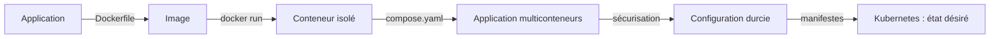

# Conteneurisation et orchestration

Cours du module A2627_0187 (Ynov, Mastère 2 Expert Cloud, Sécurité & Infrastructure), réécrit pour être lu seul, page par page.

On part d'une question simple (pourquoi isoler une application ?) pour arriver à Kubernetes, en passant par les images, Docker Compose et la sécurité. Chaque page peut se lire indépendamment, mais l'ordre du plan construit les notions les unes sur les autres.

## Comment lire une page

Toutes les pages suivent le même format :

| Section | Ce qu'on y trouve |
|---|---|
| **Synthèse** | l'essentiel en tableaux et listes courtes, et les pièges à retenir |
| **Cas d'usage** | des situations concrètes, avec les commandes et ce qu'on observe |
| **Schémas** | des idées de visuels, avec le code Mermaid quand c'est possible |
| **Motion design** | un découpage séquence par séquence pour animer le concept, quand il s'y prête |
| **Vérifier soi-même** | un mini-lab de quelques commandes |

## Plan du cours

### Partie 1 · Comprendre les conteneurs
1. [Du monolithe aux microservices](docs/Du-monolithe-aux-microservices.md)
2. [Machine virtuelle ou conteneur](docs/Machine-virtuelle-ou-conteneur.md)
3. [Isolation d'un conteneur : namespaces, cgroups et protections](docs/Isolation-des-conteneurs.md)
4. [Image et cycle de vie du conteneur](docs/Image-et-cycle-de-vie.md)

### Partie 2 · Construire des images
5. [Les couches d'une image](docs/Couches-d-une-image.md)
6. [Écrire un Dockerfile](docs/Ecrire-un-Dockerfile.md)
7. [Contexte de build, cache et .dockerignore](docs/Contexte-de-build-et-cache.md)
8. [Versionner et publier une image](docs/Versionner-et-publier-une-image.md)

### Partie 3 · Faire tourner une application complète
9. [Réseaux Docker et publication de ports](docs/Reseaux-et-ports.md)
10. [Stockage : couche du conteneur, volumes, bind mounts](docs/Stockage-et-volumes.md)
11. [Docker Compose](docs/Docker-Compose.md)
12. [Démarré n'est pas disponible : healthchecks et diagnostic](docs/Demarre-n-est-pas-disponible.md)

### Partie 4 · Sécuriser
13. [Sécurité des images](docs/Securite-des-images.md)
14. [Identités, privilèges et capabilities](docs/Identites-et-privileges.md)
15. [Secrets, fichiers, réseau et ressources](docs/Secrets-fichiers-reseau-ressources.md)

### Partie 5 · Orchestrer
16. [Pourquoi orchestrer ?](docs/Pourquoi-orchestrer.md)
17. [Kubernetes : état désiré et réconciliation](docs/Kubernetes-etat-desire.md)
18. [Pod, Deployment, ReplicaSet](docs/Pod-Deployment-ReplicaSet.md)
19. [Service et Ingress](docs/Service-et-Ingress.md)
20. [De Compose aux manifestes Kubernetes](docs/De-Compose-a-Kubernetes.md)
21. [Virtualisation et orchestration : les couches](docs/Virtualisation-et-orchestration.md)

## Le fil rouge en une image

## Environnement de référence

Les commandes du wiki sont écrites pour Docker Engine 29 avec Docker Compose v2 (`docker compose`, fichier `compose.yaml`) sur Linux, et pour Kubernetes 1.3x avec Minikube. Sous Windows, elles s'exécutent dans une distribution WSL2.
