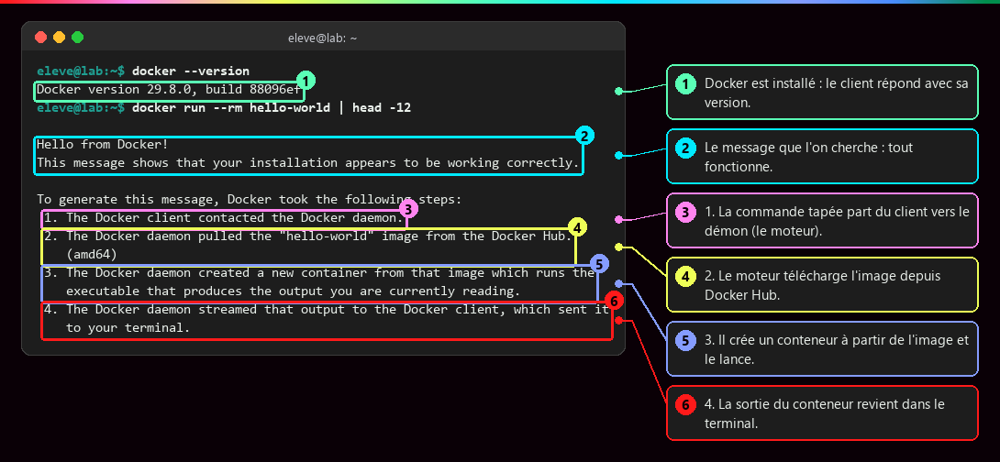

# Bien démarrer

<p class="lead">Jamais touché à Docker ? Cette page installe ce qu'il faut, explique comment lire les commandes et les captures du cours, et propose un <strong>parcours dans l'ordre</strong>. Compter 20 minutes.</p>

!!! abstract "Dans cette page"

    **Tu vas :** installer Docker, lancer ton premier conteneur, savoir lire une capture annotée et choisir par où commencer.

    **Prérequis :** aucun. **Durée :** 20 min. **Niveau :** grand débutant.

## :material-numeric-1-circle-outline: Ce qu'il te faut

Docker fonctionne sur **Linux**. Sous Windows ou macOS, il tourne dans une petite machine Linux cachée.

=== "Windows"

    1. Ouvre **PowerShell en administrateur** et installe Linux (Ubuntu) dans WSL2 :

        ```powershell
        wsl --install -d Ubuntu
        ```

    2. Redémarre, ouvre **Ubuntu** depuis le menu Démarrer, choisis un nom d'utilisateur et un mot de passe.
    3. Dans le terminal Ubuntu, suis l'onglet **Linux** ci-contre.

    !!! tip "Docker Desktop ?"

        Docker Desktop est une alternative avec une interface graphique. Ce cours utilise Docker Engine directement dans Ubuntu : c'est plus proche d'un vrai serveur.

=== "Linux"

    ```bash
    curl -fsSL https://get.docker.com -o get-docker.sh   # (1)!
    sudo sh get-docker.sh                                 # (2)!
    sudo usermod -aG docker $USER                         # (3)!
    ```

    1. Télécharge le script d'installation officiel de Docker.
    2. L'exécute en administrateur (`sudo`) : il installe le moteur, le client et Compose.
    3. T'ajoute au groupe `docker` pour ne plus taper `sudo` devant chaque commande. Ferme puis rouvre le terminal pour que ce soit pris en compte.

    !!! warning "Le groupe docker donne les pleins pouvoirs"

        Être dans le groupe `docker`, c'est pouvoir devenir root sur la machine (voir [Identités et privilèges](Identites-et-privileges.md)). C'est normal sur ton poste d'apprentissage, pas sur un serveur partagé.

=== "macOS"

    Installe **Docker Desktop** depuis le site de Docker, lance-le, puis ouvre l'application **Terminal**. Les commandes du cours fonctionnent telles quelles.

## :material-numeric-2-circle-outline: Ton premier conteneur

Une seule commande pour vérifier que tout marche :

```bash
docker run --rm hello-world   # (1)!
```

1. `docker run` : crée et lance un conteneur. `--rm` : le supprime dès qu'il a fini. `hello-world` : le nom de l'**image** à utiliser, une toute petite image de test.

???+ example "En vrai : ce que tu dois voir"

    

    Si tu vois **« Hello from Docker! »**, tout fonctionne. Le texte explique lui-même le trajet : ta commande part du **client**, le **moteur** télécharge l'image, crée le conteneur, et sa sortie revient dans ton terminal.

??? tip "Ça ne marche pas ?"

    | Message | Cause probable | Solution |
    |---|---|---|
    | `command not found: docker` | Docker n'est pas installé | reprends l'étape 1 |
    | `permission denied ... docker.sock` | tu n'es pas encore dans le groupe docker | ferme et rouvre le terminal, ou préfixe par `sudo` |
    | `Cannot connect to the Docker daemon` | le moteur n'est pas démarré | `sudo systemctl start docker` |
    | `pull access denied` ou délai dépassé | pas d'accès Internet | vérifie la connexion, le proxy |

!!! example "Pas encore installé ? Essaie dans le navigateur"

    Le **lab Premiers pas** t'ouvre une machine Docker simulée, avec un tutoriel pas à pas à côté : premier conteneur, serveur web, `docker ps`, journaux, arrêt et ménage. Dix minutes, rien à installer.

    [:material-console: Ouvrir le lab Premiers pas](labs/premiers-pas.md){ .md-button .md-button--primary target="_blank" rel="noopener" }

## :material-numeric-3-circle-outline: Lire une commande

Dans tout le cours, les commandes se lisent ainsi :

```text
eleve@lab:~$ docker run -d --name web -p 127.0.0.1:8080:80 nginx:stable
└───┬────┘   └──┬──┘ └┬┘ └──────────────┬────────────────┘ └────┬─────┘
 l'invite     outil  action      options (réglages)           l'image
 (ne pas
  la taper)
```

- **L'invite** `eleve@lab:~$` indique que le terminal attend une commande : **ne la tape pas**, tape seulement ce qui suit le `$`.
- Une option qui commence par `--` a un nom long (`--name web`), par `-` un nom court (`-d`).
- Les lignes **sans** invite sont ce que la commande **répond**.
- `# (1)` dans un bloc de code : passe la souris sur la bulle numérotée pour l'explication.

!!! tip "Trois réflexes de terminal"

    ++tab++ complète les noms. ++arrow-up++ rappelle la commande précédente. ++ctrl+c++ arrête la commande en cours.

## :material-numeric-4-circle-outline: Lire une capture annotée

Les captures du cours sont de **vraies sorties**, rejouées sur une machine de test. Les encadrés colorés pointent ce qu'il faut regarder, dans l'ordre des numéros ① ② ③ :


1. Lis la **commande** (en vert, après l'invite).
2. Repère l'**encadré numéroté** dans la sortie.
3. Lis la **bulle du même numéro** à droite : elle dit pourquoi c'est important.

Les mots soulignés en pointillés, comme PID ou namespace, ont une définition : **passe la souris dessus**. Tout est aussi dans le [Glossaire](Glossaire.md).

## :material-numeric-5-circle-outline: Par où commencer

| Étape | Pages | Tu sauras… | Durée |
|---|---|---|---|
| 1 · Comprendre | [Monolithe et microservices](Du-monolithe-aux-microservices.md), [VM ou conteneur](Machine-virtuelle-ou-conteneur.md), [Isolation](Isolation-des-conteneurs.md), [Cycle de vie](Image-et-cycle-de-vie.md) | ce qu'est vraiment un conteneur | 1 h 30 |
| 2 · Images | [Couches](Couches-d-une-image.md), [Dockerfile](Ecrire-un-Dockerfile.md), [Cache](Contexte-de-build-et-cache.md), [Publier](Versionner-et-publier-une-image.md) | construire et partager tes images | 1 h 30 |
| 3 · Application | [Réseaux](Reseaux-et-ports.md), [Stockage](Stockage-et-volumes.md), [Compose](Docker-Compose.md), [Healthchecks](Demarre-n-est-pas-disponible.md) | faire tourner un site et sa base | 2 h |
| 4 · Sécurité | [Images](Securite-des-images.md), [Privilèges](Identites-et-privileges.md), [Secrets et ressources](Secrets-fichiers-reseau-ressources.md) | durcir ce que tu as construit | 1 h 30 |
| 5 · Orchestration | [Pourquoi](Pourquoi-orchestrer.md), [État désiré](Kubernetes-etat-desire.md), [Pod et Deployment](Pod-Deployment-ReplicaSet.md), [Service](Service-et-Ingress.md), [Traduction](De-Compose-a-Kubernetes.md), [Couches](Virtualisation-et-orchestration.md) | passer de Docker à Kubernetes | 2 h 30 |

!!! success "Prêt ?"

    Commence par [Du monolithe aux microservices](Du-monolithe-aux-microservices.md). Chaque page se termine par un mini-lab à faire toi-même et trois questions pour vérifier que tu as compris.
