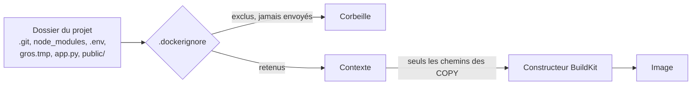
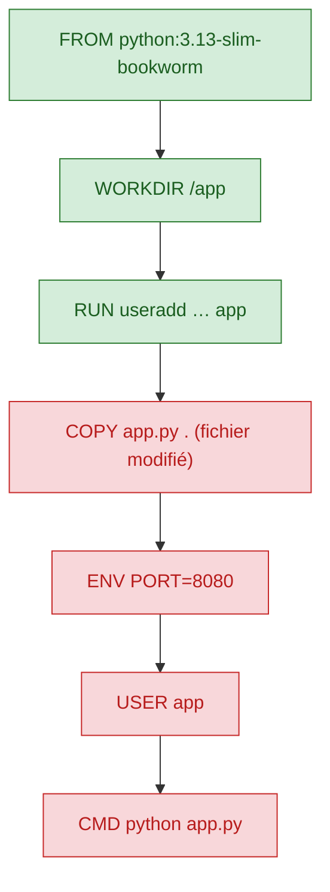
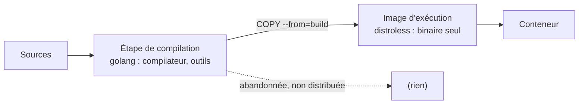

# Contexte de build, cache et .dockerignore

> **En une phrase.** Le constructeur ne voit que les fichiers du **contexte** (filtré par `.dockerignore`) et il **réutilise** le résultat d'une étape tant que ses entrées n'ont pas changé : bien filtrer le contexte et bien ordonner le Dockerfile, c'est construire vite, petit et sans fuite.

---

## 1. Synthèse

### Le modèle mental

```
  dossier du projet
        │
        ▼   .dockerignore  (filtre appliqué AVANT l'envoi)
  ┌─────────────┐
  │  CONTEXTE   │  seuls fichiers lisibles par COPY et ADD
  └─────┬───────┘
        ▼
  constructeur (BuildKit)
        │   pour chaque étape : entrées identiques ?  ── oui ──►  CACHED (résultat réutilisé)
        │                                              └─ non ──►  exécutée, et toutes les suivantes aussi
        ▼
      image
```

### Le contexte de construction

```bash
docker build -t atelier-web:1.0 .
#                               └── le contexte : ici, le répertoire courant
```

| Règle | Conséquence |
|---|---|
| Le **dernier argument** de `docker build` désigne le contexte | c'est la racine des chemins sources de `COPY` et `ADD` |
| Le constructeur ne lit que les fichiers du contexte, **après** application de `.dockerignore` | `COPY ../config.ini .` est impossible : on ne sort pas du contexte |
| `-f` permet de placer le Dockerfile ailleurs | `docker build -f docker/Dockerfile .` garde `.` comme racine du contexte |
| Le répertoire du Dockerfile et le contexte **ne sont pas synonymes** | un Dockerfile rangé dans `docker/` copie quand même depuis la racine du contexte |

### `.dockerignore` : filtrer ce qui part au constructeur

Sans filtrage, le contexte peut contenir le dépôt Git, des caches, des journaux, des fichiers temporaires ou des documents privés. Le fichier `.dockerignore`, placé **à la racine du contexte**, exclut des éléments **avant leur transfert**. Cela réduit les transferts inutiles et évite que des fichiers non souhaités soient disponibles pendant le build. Un fichier ignoré **ne peut pas** être copié par `COPY`.

Exemple pour une application Python :

```
.git
__pycache__/
*.pyc
*.log
.env
secrets/
```

| Motif | Ce qu'il exclut |
|---|---|
| `*.log` | les fichiers `.log` **à la racine du contexte seulement** |
| `**/*.log` | les fichiers `.log` à tous les niveaux |
| `secrets/` | le dossier `secrets` à la racine et son contenu |
| `!important.log` | une **exception** : réinclut ce fichier malgré une règle précédente |
| `# commentaire` | une ligne ignorée |

`.dockerignore` et `.gitignore` répondent à des usages différents : le premier filtre ce que reçoit le constructeur, le second ce que Git suit. On peut vouloir versionner un fichier sans l'envoyer au build (la documentation), ou l'inverse.

### Le cache de construction

Quand une étape et ses **entrées pertinentes** sont inchangées, le constructeur réutilise un résultat précédent (`CACHED` dans la sortie).

| Instruction | Ce qui entre dans la clé de cache |
|---|---|
| `FROM` | l'image de base désignée (son digest) |
| `RUN` | l'étape précédente et le **texte** de la commande, pas ce qu'elle télécharge |
| `COPY`, `ADD` | l'étape précédente et une **empreinte du contenu** des fichiers copiés |
| `ENV`, `USER`, `CMD`, `WORKDIR`… | l'étape précédente et la valeur écrite |

Avec le Dockerfile de l'exemple, si seul `app.py` change :

```
FROM python:…        → réutilisable si la base est inchangée
WORKDIR /app         → réutilisable
RUN useradd …        → réutilisable
COPY app.py .        → à recalculer : le contenu copié a changé
ENV / USER / CMD …   → recalculés, puisqu'ils suivent une étape recalculée
```

**Dès qu'une étape est invalidée, toutes les suivantes le sont aussi.** D'où la règle d'or : **placer les opérations stables avant les fichiers souvent modifiés.**

### Cache et fraîcheur : deux sujets différents

| Option | Effet | Ce qu'elle ne fait pas |
|---|---|---|
| (aucune) | réutilise tout ce qui peut l'être | ne vérifie ni la base dans le registre, ni les dépôts de paquets |
| `--pull` | vérifie s'il existe une version plus récente de l'image de base | ne désactive pas le reste du cache |
| `--no-cache` | rejoue toutes les étapes | ne garantit pas à lui seul des dépendances à jour, et ne retélécharge pas la base sans `--pull` |
| `--pull --no-cache` | base vérifiée et toutes les étapes rejouées | ne remplace pas une politique de mise à jour |

Le cache accélère le build ; il ne remplace pas une politique de mise à jour. Une étape `RUN apt-get …` en cache n'a pas revu le dépôt de paquets, et une image de base référencée par tag a pu être republiée.

### Construire une image plus maîtrisable

- choisir une image de base **maintenue** et adaptée au besoin ;
- limiter les fichiers et outils inutiles (contexte filtré, base minimale, `--no-cache-dir` pour `pip`) ;
- utiliser un utilisateur non-root lorsque c'est possible ;
- séparer ce qui change souvent de ce qui change rarement ;
- ne jamais intégrer de secret dans le Dockerfile, le contexte ou l'image ;
- pour une application **compilée**, utiliser un **build multi-étapes** : une étape avec les outils de compilation, une image finale qui ne reçoit que l'artefact produit (`COPY --from=…`).

> [!IMPORTANT]
> **Les pièges à retenir**
> 1. **Un motif sans `**/` ne vise que la racine du contexte.** `*.tmp` n'exclut pas `public/gros.tmp` ; il faut `**/*.tmp`.
> 2. **Supprimer un fichier dans une étape suivante ne l'efface pas de l'image.** Il reste dans la couche qui l'a ajouté, distribuée avec l'image. Un secret doit être **exclu du contexte**, pas supprimé après coup.
> 3. **`.dockerignore` n'est qu'une liste d'exclusions maintenue à la main.** Un oubli, un motif mal écrit ou un `COPY . .` suffit à embarquer un fichier sensible. Il ne protège ni `ENV`, ni `ARG`, ni l'historique.
> 4. **Le cache ne voit pas le réseau.** Il compare le texte d'un `RUN`, pas ce que la commande téléchargerait aujourd'hui.
> 5. **Instruction, étape de cache et couche sont trois choses différentes** : une étape peut être en cache sans produire de couche, et une couche ne correspond pas toujours à une ligne d'historique.

---

## 2. Cas d'usage classiques

### Cas 1 : mesurer ce qui part réellement au constructeur

**Besoin.** Vérifier qu'un fichier volumineux (une archive de 200 Mo oubliée dans le projet) ne ralentit pas le build et n'arrive pas dans l'image.

```bash
docker build --progress=plain -t demo/web-php:ctx-test ./app 2>&1 | grep -E "transferring context: [0-9]"
docker image ls demo/web-php
docker run --rm demo/web-php:ctx-test ls -lh /var/www/html/
```

Sur un poste de test, avec un Dockerfile qui ne copie que `public/` :

| Emplacement du fichier de 200 Mo | Contexte transféré | Taille de l'image | Fichier dans l'image ? |
|---|---|---|---|
| `app/gros.tmp` (hors de `public/`) | 63 B | 721 Mo | non |
| `app/public/gros.tmp` | **209,77 MB** (4,5 s) | **931 Mo** | **oui** |

**Ce qu'on observe.** BuildKit n'envoie que les chemins dont les `COPY` ont besoin : hors de `public/`, le fichier n'a même pas été transmis. Dans `public/`, il est transféré **et** il finit dans l'image, qui prend 210 Mo.
**À retenir.** Une grosse archive ralentit chaque build et gonfle l'image dès qu'un `COPY` la prend. Des fichiers temporaires dans le contexte rendent aussi les builds moins reproductibles et cassent le cache des `COPY`.

### Cas 2 : le piège du motif écrit pour la racine

Même situation, avec un `.dockerignore` qui contient `*.tmp`.

```
# .dockerignore, première version
*.tmp
```

**Ce qu'on observe.** Le fichier `public/gros.tmp` est **toujours** transféré et présent dans l'image : le motif ne vise que la racine du contexte. Avec la forme récursive, le contexte tombe à 124 B et le fichier disparaît de l'image :

```
# .dockerignore, version corrigée
*.tmp
**/*.tmp
*.log
**/*.log
.env
**/.env
.git
**/.git
```

**Un second piège, plus discret.** Lors d'un essai, la sortie annonçait seulement `transferring context: 100B`, alors que le fichier de 200 Mo était encore copié dans l'image. Le transfert du contexte est **incrémental** : BuildKit garde une copie des fichiers déjà reçus et n'envoie que les différences. Un petit chiffre ne prouve donc pas qu'un fichier est exclu. Pour vérifier sur une base propre, on peut vider ce seul cache de contextes locaux, puis regarder **le contenu de l'image** :

```bash
docker builder prune -f --filter type=source.local
docker run --rm mon-image ls -lh /chemin/copié/
```

**À retenir.** Tester un `.dockerignore`, c'est regarder ce qui est **dans l'image**, pas seulement la taille annoncée du transfert.

### Cas 3 : tenir un secret hors de l'image

**Besoin.** Le projet contient un fichier `.env` avec des mots de passe et un dossier `secrets/`.

La mauvaise idée :

```dockerfile
COPY . .
RUN rm -f .env          # trop tard : .env est déjà dans la couche du COPY
```

**Ce qu'on observe.** L'image finale ne montre plus `.env` dans son arborescence, mais la couche ajoutée par `COPY . .` le contient toujours. Quiconque récupère l'image (`docker pull`, `docker image save`) peut extraire cette couche et lire le fichier.

La bonne approche : exclure, puis transmettre le secret par un mécanisme dédié.

```
# .dockerignore
.env
.env.*
**/.env
secrets/
```

```dockerfile
# Un secret nécessaire PENDANT le build (ici un jeton de dépôt npm privé) est monté
# le temps d'une seule commande, sans jamais être écrit dans une couche.
RUN --mount=type=secret,id=npmrc,target=/root/.npmrc npm ci --omit=dev
```

```bash
docker build --secret id=npmrc,src=$HOME/.npmrc -t myapp:1.0 .
```

**À retenir.** Exclure un secret du contexte vaut mieux que le copier puis tenter de le supprimer. Les secrets nécessaires **à l'exécution** se montent au lancement du conteneur : voir [Secrets, fichiers, réseau et ressources](Secrets-fichiers-reseau-ressources.md) et [Sécurité des images](Securite-des-images.md).

### Cas 4 : voir le cache travailler

**Besoin.** Comprendre pourquoi un second build prend moins d'une seconde.

```dockerfile
FROM php:8.4-apache
RUN docker-php-ext-install pdo_mysql
WORKDIR /var/www/html
COPY public/ /var/www/html/
```

Après modification du **seul** code PHP, sur un poste de test :

```
#5 [1/4] FROM docker.io/library/php:8.4-apache@sha256:c6527b06c772…
#6 [2/4] RUN docker-php-ext-install pdo_mysql
#6 CACHED
#7 [3/4] WORKDIR /var/www/html
#7 CACHED
#8 [4/4] COPY public/ /var/www/html/
#8 DONE 0.1s
```

**Ce qu'on observe.** Build complet en **0,7 s**, contre **21,5 s** avec `--no-cache`. La clé du `RUN` (étape parente + texte de la commande) n'a pas changé ; celle du `COPY` inclut l'empreinte des fichiers copiés, qui a changé.
**À retenir.** L'extension, lente et stable, est installée **avant** la copie du code. Dans l'ordre inverse, chaque modification du code relancerait la compilation de l'extension.

### Cas 5 : copier les dépendances avant le code

**Besoin.** Une application Python avec des bibliothèques externes listées dans `requirements.txt`.

Ordre à éviter :

```dockerfile
COPY . .
RUN pip install --no-cache-dir -r requirements.txt   # rejoué à CHAQUE modification du code
```

Ordre recommandé :

```dockerfile
COPY requirements.txt .
RUN pip install --no-cache-dir -r requirements.txt   # rejoué seulement si requirements.txt change
COPY app.py .
```

**Ce qu'on observe.** Modifier `app.py` ne force pas, à lui seul, la réinstallation des dépendances si `requirements.txt` et les autres entrées pertinentes sont inchangés. `--no-cache-dir` empêche `pip` de garder son propre cache de téléchargement dans la couche, donc dans l'image.
**À retenir.** Le même schéma vaut pour Node.js (`COPY package*.json ./` puis `RUN npm ci`), Java (`pom.xml`), Go (`go.mod`, `go.sum`). Le petit service HTTP de l'exemple, sans dépendance externe, n'en a pas besoin.

### Cas 6 : récupérer des mises à jour malgré le cache

**Besoin.** Un correctif de sécurité vient d'être publié pour l'image de base et pour un paquet installé par `RUN`.

```bash
docker build --pull -t atelier-web:1.0.1 .               # base vérifiée dans le registre
docker build --pull --no-cache -t atelier-web:1.0.1 .    # base vérifiée ET toutes les étapes rejouées
```

**Quand utiliser `--no-cache`.**
- récupérer des mises à jour que la clé de cache ne voit pas (paquets téléchargés par un `RUN apt-get` ou `pip install`) ;
- produire une version finale de livraison, ou reconstruire après un correctif de sécurité ;
- diagnostiquer un build qui semble dépendre d'un état ancien mis en cache.

**À retenir.** Le cache n'est pas une politique de mise à jour. Reconstruire régulièrement, avec `--pull`, fait partie de l'entretien d'une image (voir [Sécurité des images](Securite-des-images.md)).

### Cas 7 : séparer compilation et exécution (build multi-étapes)

**Besoin.** Un service écrit en Go doit être compilé. Les outils de compilation (plusieurs centaines de Mo) n'ont rien à faire dans l'image de production.

```dockerfile
# Étape 1 : compilation
FROM golang:1.24 AS build
WORKDIR /src
COPY go.* ./
RUN go mod download
COPY . .
RUN CGO_ENABLED=0 go build -o /out/app .

# Étape 2 : exécution, sans compilateur ni shell
FROM gcr.io/distroless/static-debian12:nonroot
COPY --from=build /out/app /app
ENTRYPOINT ["/app"]
```

**Ce qu'on observe.** L'image finale ne contient que le binaire et le strict nécessaire : ni compilateur, ni sources, ni gestionnaire de paquets. La variante `nonroot` fait tourner le processus sous un utilisateur non privilégié.
**À retenir.** Le build multi-étapes réduit les composants présents dans l'image distribuée et facilite sa maintenance. Pour le serveur Python de l'exemple, qui n'a rien à compiler, il n'apporterait que peu de bénéfices.

---

## 3. Idées de schémas

### Schéma A : l'entonnoir du contexte



### Schéma B : la cascade d'invalidation



Vert : `CACHED`. Rouge : rejoué. Le rouge ne remonte jamais, il ne fait que descendre.

### Schéma C : deux ordres, deux temps de build

Deux colonnes côte à côte. À gauche, « `COPY . .` puis `pip install` » : à chaque modification de code, une longue barre rouge « installation des dépendances » réapparaît. À droite, « `COPY requirements.txt`, `pip install`, puis `COPY app.py` » : la barre d'installation reste verte, seule une fine barre rouge « copie du code » est rejouée. Sous chaque colonne, un chronomètre (par exemple 21 s contre moins d'une seconde).

### Schéma D : le build multi-étapes



---

## 4. Script de motion design : « Le cache se casse à partir d'une ligne » (environ 70 s)

Style : le Dockerfile affiché verticalement, chaque instruction dans une case ; à droite de chaque case, un témoin (vert « CACHED », rouge « rejoué ») et un chronomètre global en haut.

| Séq. | Durée | À l'écran | Animation | Texte à l'écran |
|---|---|---|---|---|
| 1 | 0-8 s | Un dossier de projet plein d'objets (`.git`, `.env`, archive de 200 Mo, `app.py`) | Un tamis `.dockerignore` passe : `.git`, `.env` et l'archive tombent à côté ; `app.py` passe | « Le constructeur ne reçoit que le contexte, filtré par .dockerignore. » |
| 2 | 8-16 s | Premier build : les 7 cases s'allument une à une | Chaque case s'exécute, témoins rouges, chronomètre à 21 s | « Premier build : toutes les étapes sont exécutées. » |
| 3 | 16-24 s | Second build sans modification | Les 7 témoins passent au vert d'un coup, chronomètre à moins d'1 s | « Rien n'a changé : tout est réutilisé. » |
| 4 | 24-36 s | On modifie `app.py` (un crayon touche le fichier) | Les cases 1 à 3 restent vertes ; la case `COPY` devient rouge, puis le rouge **coule** vers les cases du dessous | « Une entrée change : l'étape et toutes les suivantes sont rejouées. » |
| 5 | 36-48 s | Même modification, avec un Dockerfile mal ordonné (`COPY . .` avant `pip install`) | Le rouge part de haut, la longue case « installation » est rejouée, chronomètre qui s'emballe | « Mal ordonné, le moindre changement relance tout. » |
| 6 | 48-58 s | Le registre de paquets, en arrière-plan, affiche « nouvelle version » | La case `RUN apt-get` reste verte malgré tout ; un point d'exclamation apparaît | « Le cache ne voit pas le réseau : vert ne veut pas dire à jour. » |
| 7 | 58-66 s | Boutons `--pull` et `--no-cache` | `--pull` rafraîchit la case `FROM` ; `--no-cache` repeint toutes les cases en rouge | « --pull vérifie la base, --no-cache rejoue tout. » |
| 8 | 66-70 s | Synthèse | Le Dockerfile se réordonne : stable en haut, changeant en bas | « Le stable en haut, ce qui change en bas. » |

**Conseil de réalisation.** Le moment clé est la séquence 4 : le rouge doit **couler vers le bas** comme un liquide, sans jamais remonter, pour faire sentir la cascade. Garder la même modification de `app.py` en séquences 4 et 5 pour que la comparaison des chronomètres soit juste.

---

## 5. Vérifier soi-même

```bash
mkdir -p ~/demo-ctx/public && cd ~/demo-ctx
echo '<h1>ok</h1>' > public/index.html
truncate -s 200M public/gros.tmp
printf 'FROM busybox:1.37\nCOPY public/ /www/\n' > Dockerfile

echo '*.tmp' > .dockerignore
docker build --progress=plain -t demo-ctx . 2>&1 | grep "transferring context: [0-9]"
docker run --rm demo-ctx ls -lh /www                 # gros.tmp est là

echo '**/*.tmp' >> .dockerignore
docker build --progress=plain -t demo-ctx . 2>&1 | grep -E "transferring context: [0-9]|CACHED"
docker run --rm demo-ctx ls -lh /www                 # gros.tmp a disparu

echo '<h1>v2</h1>' > public/index.html
docker build --progress=plain -t demo-ctx . 2>&1 | grep -E "COPY|CACHED|DONE"   # seul le COPY est rejoué
docker image rm demo-ctx && rm -rf ~/demo-ctx
```

## Voir aussi

- [Accueil du wiki](../README.md)
- Page précédente : [Écrire un Dockerfile](Ecrire-un-Dockerfile.md)
- Page suivante : [Versionner et publier une image](Versionner-et-publier-une-image.md)
- Pour aller plus loin : [Sécurité des images](Securite-des-images.md) (secrets dans les couches, images minimales)
