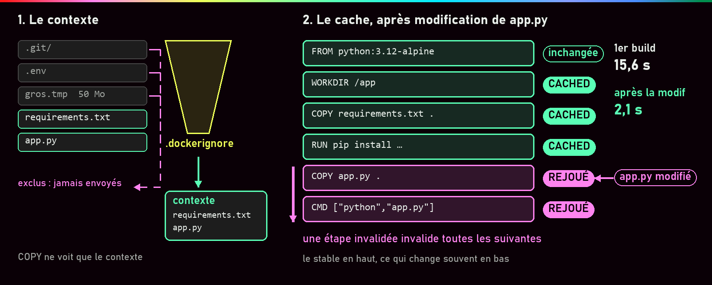
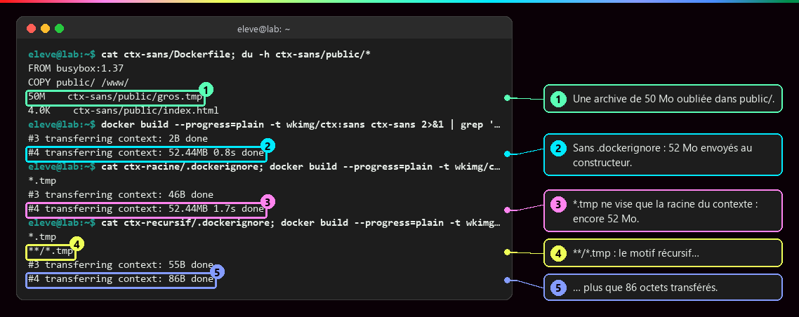
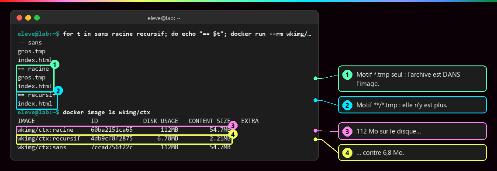
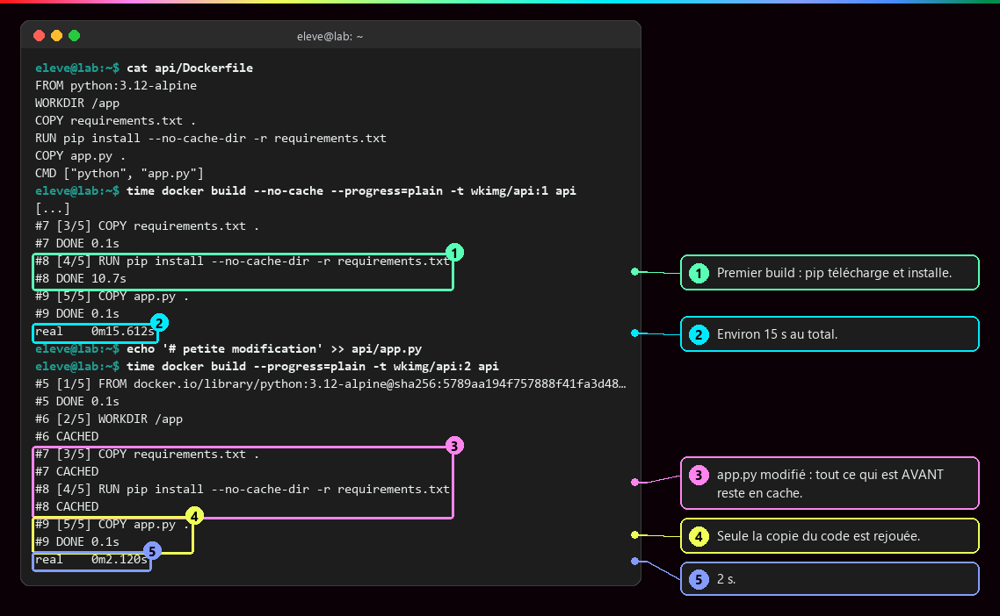
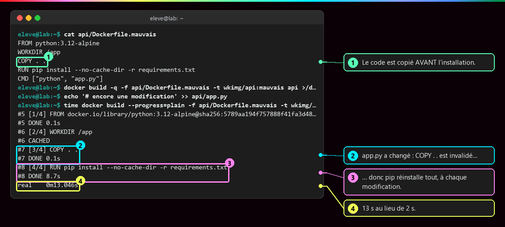
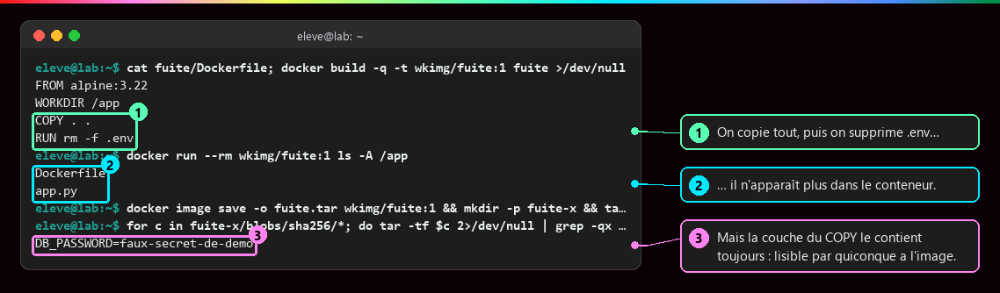
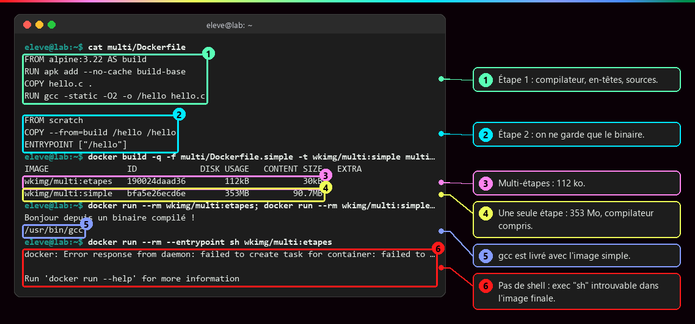

# Contexte de build, cache et .dockerignore

<p class="lead">Le constructeur ne voit que les fichiers du <strong>contexte</strong>, filtré par <code>.dockerignore</code>, et il <strong>réutilise</strong> chaque étape tant que ses entrées n'ont pas changé. Bien filtrer et bien ordonner, c'est construire vite, petit et sans fuite.</p>

{ .hero }

!!! abstract "Dans cette page"

    **Tu vas comprendre :**

    - quels fichiers Docker reçoit quand tu lances `docker build`, et comment en exclure ;
    - pourquoi une reconstruction prend parfois 2 secondes, parfois 15 ;
    - pourquoi un mot de passe copié par erreur reste dans l'image, même supprimé ensuite.

    **Prérequis :** [Écrire un Dockerfile](Ecrire-un-Dockerfile.md). **Durée :** 30 min. **Niveau :** débutant.

!!! quote "En clair"

    Construire une image, c'est comme **envoyer un colis à un cuisinier** qui suit ta recette. Il ne peut utiliser que ce qu'il y a dans le colis (le contexte) ; la liste `.dockerignore` dit ce qu'il ne faut pas y mettre. Et il garde au frigo chaque préparation déjà faite (le cache) : si rien n'a changé, il la ressort au lieu de tout refaire. Limite de l'image : dès qu'une étape change, il refait aussi **toutes les suivantes**, même si elles n'ont pas changé.

    { .anim }

## L'essentiel en 30 secondes

<div class="grid cards" markdown>

-   :material-folder-arrow-right-outline:{ .lg .middle } __Le contexte__

    ---

    Le dossier donné en dernier à `docker build`. `COPY` ne peut rien lire en dehors.

-   :material-filter-outline:{ .lg .middle } __.dockerignore__

    ---

    Exclut des fichiers **avant** l'envoi. Un fichier ignoré ne peut pas être copié.

-   :material-cached:{ .lg .middle } __Le cache__

    ---

    Entrées identiques : `CACHED`. Une étape refaite **entraîne toutes les suivantes**.

-   :material-layers-minus:{ .lg .middle } __Multi-étapes__

    ---

    On fabrique dans une étape, on ne livre que le résultat.

</div>

!!! warning "À retenir"

    **Ce qui change rarement en haut, ce qui change souvent en bas.** Et un mot de passe s'**exclut** du contexte : le supprimer dans une étape suivante ne l'efface pas de l'image.

## :material-folder-arrow-right-outline: Le contexte et son filtre

!!! quote "En clair"

    Le **contexte**, c'est le dossier que tu désignes à la fin de `docker build`. Docker l'envoie en entier à son constructeur (BuildKit) avant de lire la première ligne de la recette. Tout ce qui est dedans voyage ; rien de ce qui est dehors n'est accessible.

    { .anim }

```bash
docker build -t web:1.0 .                       # (1)!
docker build -f docker/Dockerfile -t web:1.0 .  # (2)!
```

1. Le `.` final désigne le dossier courant : c'est le contexte.
2. `-f` indique un Dockerfile rangé ailleurs ; le contexte reste le dossier courant `.`.

`COPY ../config.ini .` est donc impossible : on ne sort pas du contexte. Le fichier `.dockerignore`, placé **à la racine du contexte**, retire des fichiers avant leur envoi, une règle par ligne :

| Motif | Exclut |
|---|---|
| `*.log` | les `.log` **à la racine seulement** |
| `**/*.log` | les `.log` dans tous les sous-dossiers aussi |
| `secrets/` | le dossier `secrets` à la racine |
| `!important.log` | **réinclut** ce fichier malgré une règle précédente |

???+ example "En vrai : 50 Mo oubliés dans `public/`, trois `.dockerignore`"

    **Ce qu'on fait :** un petit site contient, dans son dossier `public/`, une archive de 50 Mo oubliée. On le construit trois fois : sans `.dockerignore`, avec le motif `*.tmp`, puis avec `**/*.tmp`. À chaque fois, on regarde combien Docker a envoyé au constructeur.

    

    **Ce qu'il faut regarder :**

    - ① : l'archive `gros.tmp` de 50 Mo, rangée dans `public/`.
    - ② : sans `.dockerignore`, 52 Mo partent vers le constructeur.
    - ③ : avec `*.tmp`, toujours 52 Mo : ce motif ne vise que la **racine** du contexte, pas `public/`.
    - ④ : le motif `**/*.tmp` cherche dans tous les dossiers…
    - ⑤ : … et il ne part plus que 86 octets.

    Dans chaque build, la première petite ligne (`2B`, `46B`, `55B`) est l'envoi du `.dockerignore` lui-même ; la seconde, celui du contexte.

???+ example "En vrai : ce qui compte, c'est ce qui est DANS l'image"

    **Ce qu'on fait :** on liste le dossier `/www` des trois images obtenues, puis on compare leurs tailles.

    

    **Ce qu'il faut regarder :**

    - ① : avec le motif `*.tmp` seul, l'archive est **dans** l'image.
    - ② : avec `**/*.tmp`, elle n'y est plus.
    - ③ : l'image qui contient l'archive pèse 112 Mo sur le disque…
    - ④ : … contre 6,8 Mo pour l'image filtrée.

`.dockerignore` et `.gitignore` n'ont pas le même rôle : l'un filtre ce que reçoit le constructeur, l'autre ce que Git suit.

## :material-cached: Le cache, étape par étape

!!! quote "En clair"

    Avant chaque étape, le constructeur se demande : « ai-je déjà fait **exactement** cette étape, sur **exactement** le même point de départ ? ». Si oui, il réutilise le résultat et affiche `CACHED`. Sinon, il la refait, et tout ce qui vient après aussi, car le point de départ des suivantes a changé.

    { .anim }

Ce que le constructeur compare pour décider (la « clé de cache ») :

| Instruction | Clé de cache |
|---|---|
| `FROM` | l'image de base désignée (son digest) |
| `RUN` | l'étape précédente + le **texte** de la commande (pas ce qu'elle télécharge) |
| `COPY`, `ADD` | l'étape précédente + l'**empreinte du contenu** des fichiers copiés |
| `ENV`, `USER`, `CMD`… | l'étape précédente + la valeur écrite |

???+ example "En vrai : les dépendances avant le code"

    **Ce qu'on fait :** une petite application Python dépend de la bibliothèque `requests`. Son Dockerfile copie d'abord la liste des dépendances (`requirements.txt`), les installe, puis copie le code. On construit une première fois, on modifie `app.py`, et on reconstruit en chronométrant (`time`).

    

    **Ce qu'il faut regarder :**

    - ① : au premier build, `pip` télécharge et installe les dépendances : c'est l'étape longue.
    - ② : environ 15 secondes au total.
    - ③ : après la modification de `app.py`, tout ce qui vient **avant** sa copie est `CACHED`, installation comprise, car `requirements.txt` n'a pas changé.
    - ④ : seule la copie du code est refaite.
    - ⑤ : 2 secondes.

    L'option `--no-cache-dir` empêche `pip` de laisser son propre cache de téléchargement dans la couche.

???+ danger "En vrai : le même projet, mal ordonné"

    **Ce qu'on fait :** même projet, mais le Dockerfile copie tout le dossier (`COPY . .`) **avant** d'installer les dépendances. On modifie encore `app.py` et on reconstruit.

    

    **Ce qu'il faut regarder :**

    - ① : le code est copié **avant** l'installation.
    - ② : `app.py` a changé, donc l'étape `COPY . .` est refaite…
    - ③ : … et l'installation qui la suit aussi, à chaque modification, même d'une virgule.
    - ④ : 13 secondes au lieu de 2.

    Même schéma pour Node.js (`COPY package*.json ./` puis `npm ci`), Java (`pom.xml`) ou Go (`go.mod`, `go.sum`) : la liste des dépendances d'abord, le code ensuite.

!!! tip "Cache et fraîcheur sont deux sujets"

    Le cache **ne regarde pas Internet** : un `RUN apk add` ou `pip install` en cache n'a pas revérifié les nouvelles versions, et l'image de base a pu être republiée sous le même tag.

    | Option de `docker build` | Effet |
    |---|---|
    | `--pull` | vérifie si la base a une version plus récente ; garde le reste du cache |
    | `--no-cache` | refait toutes les étapes, sans revérifier la base |
    | `--pull --no-cache` | les deux : pour une livraison ou après un correctif de sécurité |

## :material-shield-alert-outline: Ce qui part dans l'image

???+ danger "En vrai : supprimer après coup ne suffit pas"

    **Ce qu'on fait :** un Dockerfile copie tout le projet, y compris un fichier `.env` qui contient un mot de passe (factice), puis le supprime avec `RUN rm`. On regarde le conteneur, puis on ouvre l'image elle-même.

    

    **Ce qu'il faut regarder :**

    - ① : on copie tout, puis on supprime `.env`…
    - ② : … et il n'apparaît plus dans le conteneur.
    - ③ : mais en ouvrant l'image, on relit le mot de passe dans la couche du `COPY`. La suppression n'a fait que le **cacher** dans une couche du dessus.

    Quiconque récupère l'image (`docker pull`, `docker image save`) peut lire cette couche. La bonne approche : **exclure** (`.env`, `**/.env`, `secrets/` dans `.dockerignore`), puis, si une étape a besoin d'un secret, le prêter le temps de cette seule commande :

    ```dockerfile
    RUN --mount=type=secret,id=npmrc,target=/root/.npmrc npm ci --omit=dev
    ```

    ```bash
    docker build --secret id=npmrc,src=$HOME/.npmrc -t app:1.0 .
    ```

    Les secrets dont le conteneur a besoin **en fonctionnement** se donnent au lancement : voir [Secrets, fichiers, réseau et ressources](Secrets-fichiers-reseau-ressources.md).

???+ example "En vrai : un build multi-étapes, de 353 Mo à 112 ko"

    **Ce qu'on fait :** un petit programme en C doit être compilé (transformé en exécutable). Une première image fait tout dans une seule étape ; une seconde compile dans une étape `build`, puis ne garde que l'exécutable dans une image vide (`scratch`).

    

    **Ce qu'il faut regarder :**

    - ① : l'étape 1, nommée `build`, contient le compilateur et les sources.
    - ② : l'étape 2 part de rien et ne récupère que l'exécutable, avec `COPY --from=build`.
    - ③ : l'image multi-étapes pèse 112 ko…
    - ④ : … contre 353 Mo pour l'image en une seule étape, compilateur compris.
    - ⑤ : le compilateur `gcc` est livré avec l'image simple, alors qu'il ne sert plus à rien.
    - ⑥ : l'image finale n'a même pas de shell (`sh`) : moins de composants, moins de failles possibles.

    Pour un serveur Python, qui n'a rien à compiler, le gain serait faible.

## :material-flask-outline: À toi de jouer

Six étapes, environ 10 minutes. Tu vas voir le filtre `.dockerignore` et le cache à l'œuvre sur un tout petit site.

**Étape 1 · Préparer un site avec un gros fichier caché**

```bash
mkdir -p demo-ctx/public && cd demo-ctx                    # (1)!
echo '<h1>ok</h1>' > public/index.html                     # (2)!
head -c 50M /dev/urandom > public/gros.tmp                 # (3)!
printf 'FROM busybox:1.37\nCOPY public/ /www/\n' > Dockerfile  # (4)!
du -h public/*                                             # (5)!
```

1. Crée le dossier `demo-ctx` et son sous-dossier `public` (`-p` crée les deux d'un coup), puis entre dans `demo-ctx`.
2. Une page web d'une ligne.
3. Un fichier de 50 Mo rempli de hasard : il joue l'archive oubliée.
4. Un Dockerfile de deux lignes : une base minuscule (`busybox`), puis la copie du dossier `public/` vers `/www/`. `\n` marque le passage à la ligne.
5. Affiche la taille de chaque fichier de `public/`.

Tu dois voir :

```text
50M	public/gros.tmp
4.0K	public/index.html
```

**Étape 2 · Un premier filtre, qui rate sa cible**

```bash
echo '*.tmp' > .dockerignore                                                        # (1)!
docker build --progress=plain -t demo-ctx . 2>&1 | grep 'transferring context: [0-9]'  # (2)!
docker run --rm demo-ctx ls /www                                                    # (3)!
```

1. Crée le `.dockerignore` avec une seule règle.
2. Construit l'image. `--progress=plain` affiche le détail en texte simple, `2>&1 | grep …` ne garde que les lignes qui disent combien a été envoyé.
3. Liste le contenu de `/www` dans l'image.

Tu dois voir deux envois (le `.dockerignore`, puis le contexte : 52 Mo), et `gros.tmp` bien présent dans l'image. Les numéros `#3`, `#4` et les durées peuvent varier :

```text
#3 transferring context: 46B done
#4 transferring context: 52.44MB 0.4s done
gros.tmp
index.html
```

**Étape 3 · Le bon motif**

```bash
echo '**/*.tmp' >> .dockerignore   # (1)!
cat .dockerignore
docker build --progress=plain -t demo-ctx . 2>&1 | grep 'transferring context: [0-9]'
docker run --rm demo-ctx ls /www
```

1. `>>` **ajoute** une ligne à la fin du fichier (un seul `>` l'aurait remplacé).

Tu dois voir les deux règles, un envoi de quelques dizaines d'octets, et une image sans `gros.tmp` :

```text
*.tmp
**/*.tmp
#3 transferring context: 55B done
#4 transferring context: 64B done
index.html
```

**Étape 4 · Reconstruire sans rien changer**

```bash
docker build --progress=plain -t demo-ctx . 2>&1 | grep -A1 '\[2/2\]'   # (1)!
```

1. `grep -A1 '\[2/2\]'` garde la ligne de l'étape 2 sur 2 (le `COPY`) et la ligne suivante (`-A1`), qui dit ce qu'il en est advenu.

Tu dois voir `CACHED` : rien n'a changé, le résultat précédent est réutilisé.

```text
#6 [2/2] COPY public/ /www/
#6 CACHED
```

**Étape 5 · Modifier un fichier et reconstruire**

```bash
echo "<h1>modifié le $(date)</h1>" > public/index.html                  # (1)!
docker build --progress=plain -t demo-ctx . 2>&1 | grep -A1 '\[2/2\]'
```

1. Réécrit la page avec la date et l'heure du moment (`$(date)`) : son contenu est forcément nouveau.

Tu dois voir `DONE` à la place de `CACHED` : le contenu copié a changé, l'étape est refaite.

```text
#6 [2/2] COPY public/ /www/
#6 DONE 0.0s
```

**Étape 6 · Faire le ménage**

```bash
docker image rm demo-ctx       # (1)!
cd .. && rm -rf demo-ctx       # (2)!
```

1. Supprime l'image. Sans tag précisé, Docker vise `latest`.
2. Remonte d'un dossier et supprime `demo-ctx` avec son fichier de 50 Mo.

Tu dois voir (ton identifiant sera différent) :

```text
Untagged: demo-ctx:latest
Deleted: sha256:6f894423ee4ab463910743ad93174191bc544895175c629499802f9a1b729031
```

??? tip "Ça ne marche pas ?"

    | Message ou symptôme | Cause | Solution |
    |---|---|---|
    | la commande `docker build … \| grep …` n'affiche rien | le build a échoué, et `grep` a masqué l'erreur | relance la même commande sans `\| grep …` pour lire le message |
    | à l'étape 2, l'envoi ne fait que quelques octets | le constructeur a gardé le contexte d'un essai précédent et n'envoie que les différences | normal ; ce qui compte est le résultat de `ls /www` |
    | à l'étape 5, encore `CACHED` | le contenu est identique à un build déjà fait : le cache se fonde sur le contenu, pas sur la date du fichier | relance l'`echo` de l'étape 5, puis le build |
    | `failed to compute cache key: … not found` | `COPY` cherche un fichier hors du contexte, ou exclu par `.dockerignore` | vérifie que tu lances `docker build` depuis `demo-ctx` et relis `.dockerignore` |
    | `head` refuse la taille `50M` (macOS) | la version macOS de `head` n'accepte pas les suffixes | `dd if=/dev/urandom of=public/gros.tmp bs=1m count=50` |

## :material-help-circle-outline: Vérifie que tu as compris

??? question "1. Un Dockerfile fait `COPY . .` puis `RUN pip install -r requirements.txt`. Pourquoi chaque petite modification du code relance-t-elle toute l'installation ?"

    Parce que `COPY . .` copie aussi le code : quand le code change, cette étape est refaite, et **toutes les suivantes** avec elle, installation comprise. Il faut copier d'abord `requirements.txt` seul, installer, puis copier le reste.

??? question "2. Un collègue ajoute `RUN rm .env` juste après `COPY . .`. Le mot de passe du `.env` est-il protégé ?"

    **Non.** Le `.env` est dans la couche du `COPY`, qui fait partie de l'image ; `RUN rm` ne fait que le cacher dans une couche du dessus. Il faut l'**exclure** avec `.dockerignore`, pour qu'il ne parte jamais au constructeur.

??? question "3. Le build affiche `CACHED` pour `RUN apk add --no-cache curl`. As-tu la dernière version de `curl` ?"

    **Pas forcément.** La clé de cache d'un `RUN` est le **texte** de la commande, pas ce qu'elle télécharge : le constructeur ne revérifie pas Internet. Pour une livraison, on reconstruit avec `--pull --no-cache`.

!!! success "Et ensuite ?"

    Tu sais choisir ce qui entre dans l'image et ordonner ta recette pour reconstruire vite. Page suivante : [Versionner et publier une image](Versionner-et-publier-une-image.md), pour nommer tes versions et les envoyer vers un registre.

## :material-server: Pour aller plus loin

??? note "Un petit transfert ne prouve rien"

    BuildKit garde une copie des contextes déjà reçus et n'envoie que les **différences** : un `transferring context: 100B` peut cacher un gros fichier déjà transmis lors d'un build précédent. On vérifie donc toujours le **contenu de l'image** (`docker run --rm image ls -lh /chemin`). Sur son propre poste, on peut repartir d'une base propre en vidant ce seul cache : `docker builder prune -f --filter type=source.local`.

??? note "Le même principe en Go, avec une base distroless"

    ```dockerfile
    FROM golang:1.24 AS build
    WORKDIR /src
    COPY go.* ./
    RUN go mod download
    COPY . .
    RUN CGO_ENABLED=0 go build -o /out/app .

    FROM gcr.io/distroless/static-debian12:nonroot
    COPY --from=build /out/app /app
    ENTRYPOINT ["/app"]
    ```

    La variante `nonroot` fait tourner le binaire sous un utilisateur non privilégié.

??? abstract "Pour les créateurs : script de motion design (70 s)"

    Le Dockerfile affiché verticalement, une case par instruction ; à droite de chaque case, un témoin (vert « CACHED », rouge « rejoué ») et un chronomètre global en haut.

    | Séq. | Durée | À l'écran | Animation | Texte à l'écran |
    |---|---|---|---|---|
    | 1 | 0-8 s | Un dossier de projet (`.git`, `.env`, archive de 50 Mo, `app.py`) | Un tamis `.dockerignore` passe : `.git`, `.env` et l'archive tombent à côté | « Le constructeur ne reçoit que le contexte, filtré par .dockerignore. » |
    | 2 | 8-16 s | Premier build : les cases s'allument une à une | Témoins rouges, chronomètre à 15 s | « Premier build : toutes les étapes sont exécutées. » |
    | 3 | 16-24 s | Second build sans modification | Tous les témoins passent au vert, chronomètre sous 2 s | « Rien n'a changé : tout est réutilisé. » |
    | 4 | 24-36 s | Un crayon touche `app.py` | Les cases du haut restent vertes ; la case `COPY app.py` rougit, puis le rouge **coule** vers le bas | « Une entrée change : l'étape et toutes les suivantes sont rejouées. » |
    | 5 | 36-48 s | Même modification, Dockerfile mal ordonné (`COPY . .` avant `pip install`) | La longue case « installation » est rejouée, chronomètre qui s'emballe | « Mal ordonné, le moindre changement relance tout. » |
    | 6 | 48-58 s | Le dépôt de paquets affiche « nouvelle version » | La case `RUN pip` reste verte ; un point d'exclamation apparaît | « Le cache ne voit pas le réseau : vert ne veut pas dire à jour. » |
    | 7 | 58-66 s | Boutons `--pull` et `--no-cache` | `--pull` rafraîchit `FROM` ; `--no-cache` repeint tout en rouge | « --pull vérifie la base, --no-cache rejoue tout. » |
    | 8 | 66-70 s | Synthèse | Le Dockerfile se réordonne : stable en haut, changeant en bas | « Le stable en haut, ce qui change en bas. » |

    Moment clé : en séquence 4, le rouge **coule vers le bas** sans jamais remonter. Garder la même modification en séquences 4 et 5 pour comparer les chronomètres (2 s contre 13 s mesurés).

??? info "Pour les créateurs : idées de schémas"

    - **Deux ordres, deux temps** : deux colonnes ; à gauche `COPY . .` puis `pip install`, une longue barre rouge « installation » réapparaît à chaque modification ; à droite, seule une fine barre « copie du code » est rejouée. Chronomètres 13 s et 2 s.
    - **Le build multi-étapes** : sources, étape de compilation (compilateur, outils), flèche `COPY --from=build` vers l'image d'exécution (binaire seul) ; l'étape de compilation part en pointillés vers « abandonnée, non distribuée ».
    - **Trois notions distinctes** : une instruction, une étape de cache, une couche. Une étape peut être en cache sans produire de couche, et une couche ne correspond pas toujours à une ligne d'historique.
