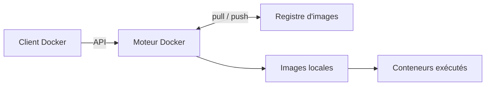
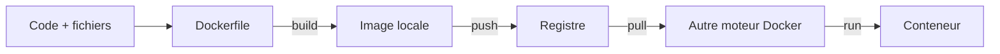
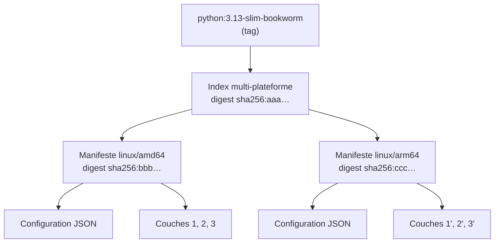

# Les couches d'une image

> **En une phrase.** Une image est le **modèle figé et distribuable** d'un conteneur : une pile de couches de fichiers en lecture seule et une fiche de configuration, désignées par un nom lisible (le **tag**) et identifiées par une empreinte (le **digest**).

---

## 1. Synthèse

### Le modèle mental

```
  registry.example.org/equipe/atelier-web:1.0      ← RÉFÉRENCE (nom lisible, modifiable)
                    │
                    ▼
  ┌──────────── INDEX (si plusieurs plateformes) ─────────────┐
  │  linux/amd64 → manifeste A    linux/arm64 → manifeste B   │
  └───────────────────────────────────────────────────────────┘
                    │                                          ← DIGEST (empreinte, fixe)
                    ▼
            MANIFESTE de l'image
            ├── CONFIGURATION (JSON) : commande, variables, utilisateur, répertoire…
            └── COUCHES DE FICHIERS (lecture seule), empilées :
                  ┌───────────────────────────────────┐
                  │ couche 3 : copie de l'application │
                  │ couche 2 : utilisateur applicatif │
                  │ couche 1 : Python + bibliothèques │  ← image de base
                  └───────────────────────────────────┘
```

Une image n'est **pas un conteneur arrêté** : c'est son **modèle de départ**. Le conteneur, lui, n'existe qu'au moment de l'exécution (voir [Image et cycle de vie du conteneur](Image-et-cycle-de-vie.md)).

**Comment les couches deviennent une arborescence.** Au démarrage d'un conteneur, le moteur superpose les couches avec un système de fichiers en union (**OverlayFS** sous Linux) : le conteneur voit une seule racine `/`, où la couche la plus haute masque les plus basses. Il ajoute au sommet une **couche inscriptible** propre à ce conteneur (copie à l'écriture : un fichier de l'image n'est recopié dans cette couche qu'au moment où on le modifie). Les couches de l'image ne sont jamais modifiées ; le devenir de la couche inscriptible est traité dans [Stockage : couche du conteneur, volumes, bind mounts](Stockage-et-volumes.md).

**Une image en dérive d'une autre.** On part d'une image existante (l'**image de base**), puis on l'enrichit :

| Étage | Exemple | Nature |
|---|---|---|
| Image de base | Python + bibliothèques système | couches héritées |
| Couche ajoutée | création d'un utilisateur applicatif | fichiers (`/etc/passwd`, répertoire personnel) |
| Couche ajoutée | copie de l'application | fichiers (`/app/app.py`) |
| Configuration | utilisateur, port, commande de démarrage | paramètres, aucune couche |

Dans ce Dockerfile, seule la première ligne produit une couche de fichiers :

```dockerfile
COPY app.py /app/app.py          # modifie le système de fichiers : nouvelle couche
ENV PORT=8080                    # valeur de configuration distribuée avec l'image
CMD ["python", "/app/app.py"]    # commande de démarrage par défaut
```

### Ce que contient une image, et ce qu'elle ne contient pas

| Contient | Ne contient pas |
|---|---|
| un **système de fichiers** : programmes, bibliothèques, ressources nécessaires à l'application, souvent sur une base Debian, Alpine ou Distroless | un **noyau Linux** propre (le noyau est celui de l'hôte) |
| une **configuration** : commande par défaut, variables d'environnement, utilisateur prévu, répertoire de travail, ports documentés, étiquettes | des **processus** en cours d'exécution |
| | des **namespaces** actifs, des limites de ressources, des ports publiés : ils sont mis en place à la création du conteneur, selon ses paramètres d'exécution |

### Trois rôles : client, moteur, registre

| Rôle | Ce qu'il fait | Exemple |
|---|---|---|
| **Client Docker** | transmet une demande au moteur, par son API | la commande `docker` (`build`, `pull`, `run`, `push`) |
| **Moteur Docker** | traite la demande, gère les objets locaux (images, conteneurs) | le démon `dockerd` |
| **Registre** | conserve des images et les distribue | Docker Hub (public), un registre privé d'entreprise |

Le registre **ne démarre jamais** de conteneur : il stocke et distribue. Construire, publier et exécuter peuvent se faire sur des machines différentes.

### Le vocabulaire d'une image distribuée

| Terme | Définition |
|---|---|
| **Couche** (layer) | une **différence** de système de fichiers (fichiers ajoutés, modifiés, supprimés), en lecture seule, identifiée par son empreinte et réutilisable par plusieurs images |
| **Configuration** | document JSON qui fixe le **lancement par défaut** (commande, variables, utilisateur…) |
| **Manifeste** | document qui liste la configuration et les couches d'une image pour **une** plateforme |
| **Index** | document qui pointe vers plusieurs manifestes, un par plateforme (`linux/amd64`, `linux/arm64`…) |
| **Digest** | empreinte cryptographique (souvent SHA-256) d'un de ces objets : `sha256:…` |
| **Registre** | serveur qui héberge les images (`docker.io`, `registry.example.org`) |
| **Dépôt** (repository) | ensemble des versions d'une même image applicative (`equipe/atelier-web`) |
| **Tag** | nom choisi pour une version ou une variante (`1.0`, `3.13-slim-bookworm`, `latest`) |

### Lire une référence

```
registry.example.org/equipe/atelier-web:1.0
└──── registre ─────┘└─── dépôt ──────┘└tag┘
```

- Sans registre explicite, Docker utilise **Docker Hub**. Sans tag, il utilise `latest`.
- Les images officielles sont rangées sous `library/` : `python:3.13-slim-bookworm` signifie `docker.io/library/python:3.13-slim-bookworm`.
- On peut viser un contenu exact par digest : `python@sha256:<empreinte>`.

### Tag et digest : deux façons de désigner une image

| | Tag | Digest |
|---|---|---|
| Forme | `python:3.13-slim-bookworm` | `python@sha256:250e16…` |
| Nature | **pointeur modifiable**, choisi par le propriétaire du dépôt | **empreinte du contenu**, calculée |
| Peut changer de cible ? | oui, à chaque republication, même si le tag ressemble à une version | non : un autre contenu donne une autre empreinte |
| Usage | lisibilité, organisation des versions | retrouver **exactement** un artefact distribué |

### Les commandes d'inventaire

| Commande | Ce qu'elle fait | Ce qu'elle ne fait pas |
|---|---|---|
| `docker pull` | récupère l'image dans le stockage local du moteur | ne crée aucun conteneur |
| `docker run` | crée et démarre une instance (télécharge l'image d'abord si elle manque) | ne modifie pas l'image |
| `docker image ls` | liste dépôt, tag, identifiant, taille | n'additionne pas des tailles réelles : les couches partagées ne sont comptées qu'une fois sur le disque |
| `docker image inspect` | décrit le modèle : architecture, configuration, couches | ne dit rien d'un conteneur en cours |
| `docker image history` | liste les étapes de construction enregistrées | ne montre pas une couche par ligne : beaucoup de lignes font 0 B |
| `docker image tag` | ajoute une **référence** vers une image existante | ne reconstruit rien, ne publie rien |
| `docker image rm` | retire une référence locale | ne libère pas forcément les données (autres tags, conteneurs) |
| `docker image prune` | supprime les images sans tag (*dangling*) ; avec `-a`, toutes celles qu'aucun conteneur n'utilise | n'efface rien dans un registre distant |

> [!IMPORTANT]
> **Les pièges à retenir**
> 1. **Une instruction de Dockerfile n'ajoute pas forcément une couche.** `COPY` et `RUN` modifient des fichiers ; `ENV`, `CMD`, `EXPOSE`, `USER` ne changent que la configuration.
> 2. **Un tag n'est pas une garantie.** `latest` ne veut dire ni « la version la plus récente » au sens métier, ni « mise à jour automatique des conteneurs ». Un tag peut être republié avec un autre contenu.
> 3. **Digest du manifeste, digest de l'index et `IMAGE ID` local sont trois valeurs différentes.** Comparer deux images n'a de sens qu'au même niveau.
> 4. **Un digest d'index ne fixe pas les fichiers d'une plateforme à l'autre** : la variante AMD64 et la variante ARM64 n'ont ni les mêmes couches ni le même digest de manifeste.
> 5. **La configuration d'image n'est pas l'isolation.** L'image propose une commande et un utilisateur ; les namespaces, les limites et les droits sont fixés à l'exécution.

---

## 2. Cas d'usage classiques

### Cas 1 : savoir d'où vient une image à partir de son nom

**Besoin.** Un fichier de déploiement contient `image: python:3.13-slim-bookworm`. D'où vient-elle exactement, et quel contenu sera tiré ?

```bash
docker pull python:3.13-slim-bookworm
docker image inspect python:3.13-slim-bookworm --format '{{.RepoTags}} {{.RepoDigests}}'
```

**Ce qu'on observe.** Le nom complet est `docker.io/library/python:3.13-slim-bookworm` : registre Docker Hub, dépôt officiel `library/python`, tag `3.13-slim-bookworm` (Python 3.13, variante allégée de Debian Bookworm). `RepoDigests` donne l'empreinte de ce qui a été tiré.
**À retenir.** Le tag dit « une famille de versions et une variante » ; seul le digest dit « ce contenu-là ». Demain, le même tag pourra désigner une image reconstruite avec des correctifs.

### Cas 2 : télécharger n'est pas exécuter

```bash
docker pull python:3.13-slim-bookworm                     # image locale, aucun conteneur
docker ps -a                                              # rien de nouveau
docker run --rm python:3.13-slim-bookworm python --version
```

**Ce qu'on observe.** `pull` remplit seulement le stockage local. `run` crée une instance, exécute `python --version` **dans le conteneur**, affiche `Python 3.13.x`, puis le conteneur s'arrête et `--rm` le supprime. Si l'image avait manqué, `run` l'aurait téléchargée d'abord, selon sa politique de récupération (`--pull missing` par défaut).
**À retenir.** La version affichée vient de l'exécution du programme dans le conteneur, pas d'une lecture de l'image.

### Cas 3 : comprendre les tailles affichées

```bash
docker image ls
docker image tag demo/web-php:1.0 demo/web-php:1.1
docker image ls demo/web-php
```

Sur un poste de test (Docker Engine 29, magasin d'images containerd) :

```
IMAGE              ID             DISK USAGE   CONTENT SIZE
demo/web-php:1.0   4fd5873fe2f1        721MB          180MB
demo/web-php:1.1   4fd5873fe2f1        721MB          180MB
demo/web-php:1.2   14bc3e8a8c5f        721MB          180MB
```

**Ce qu'on observe.** `1.0` et `1.1` ont le **même identifiant** : ce sont deux noms pour une seule image. Chaque ligne affiche 721 Mo, mais le disque ne contient pas trois fois 721 Mo : les trois images partagent toutes leurs couches de base. `CONTENT SIZE` est la taille compressée, telle qu'elle transite par le registre ; `DISK USAGE` la taille décompressée.
**À retenir.** Une image peut apparaître sous plusieurs noms sans que ses couches soient copiées. Additionner la colonne des tailles ne donne pas l'espace disque occupé. Avec le magasin d'images classique, les colonnes s'appellent `REPOSITORY`, `TAG`, `IMAGE ID`, `SIZE`, mais la logique est la même.

### Cas 4 : lire la configuration d'une image avant de l'utiliser

**Besoin.** Savoir quelle commande une image lance, sous quel utilisateur et dans quel répertoire, sans la démarrer.

```bash
docker image inspect php:8.4-apache \
  --format 'Cmd={{.Config.Cmd}} Entrypoint={{.Config.Entrypoint}} WorkingDir={{.Config.WorkingDir}} Ports={{.Config.ExposedPorts}} User="{{.Config.User}}"'
docker image inspect php:8.4-apache --format 'OS={{.Os}} ARCH={{.Architecture}} ID={{.Id}}'
```

Sur un poste de test :

```
Cmd=[apache2-foreground] Entrypoint=[docker-php-entrypoint] WorkingDir=/var/www/html Ports=map[80/tcp:map[]] User=""
```

**Ce qu'on observe.** L'image propose un point d'entrée, une commande, un répertoire et un port documenté. Le champ `User` est **vide** : le conteneur démarrera en root, sauf indication contraire au lancement.
**À retenir.** `docker image inspect` décrit le **modèle distribué**. Pour savoir si un processus tourne, avec quel utilisateur réel, c'est `docker inspect` ou `docker top` sur le **conteneur** qu'il faut lire. Les enjeux de l'utilisateur root sont détaillés dans [Identités, privilèges et capabilities](Identites-et-privileges.md).

### Cas 5 : lire l'historique et compter les couches

```bash
docker image history demo/web-php:1.0
docker image inspect --format '{{len .RootFS.Layers}} couches' php:8.4-apache
docker image inspect --format '{{len .RootFS.Layers}} couches' demo/web-php:1.0
```

Extrait réel, pour une image construite sur `php:8.4-apache` avec un `WORKDIR` et un `COPY` :

```
IMAGE          CREATED          CREATED BY                                   SIZE
bba0c7889796   9 seconds ago    COPY public/ /var/www/html/ # buildkit       20.5kB
<missing>      10 seconds ago   WORKDIR /var/www/html                        4.1kB
<missing>      4 days ago       CMD ["apache2-foreground"]                   0B
<missing>      4 days ago       EXPOSE map[80/tcp:{}]                        0B
<missing>      4 days ago       ENTRYPOINT ["docker-php-entrypoint"]         0B
<missing>      4 days ago       RUN /bin/sh -c set -eux;  apt-get update; …  366MB
<missing>      4 days ago       ENV PHP_VERSION=8.4.27                       0B
<missing>      5 days ago       # debian.sh --arch 'amd64' out/ 'trixie' …   87.7MB
```

**Ce qu'on observe.**
- En haut, les étapes ajoutées localement ; en dessous, celles de l'image de base ; tout en bas, la distribution Debian (87,7 Mo).
- Les lignes `ENV`, `EXPOSE`, `CMD`, `ENTRYPOINT` font **0 B** : elles ne touchent que la configuration.
- `<missing>` ne signale pas une erreur : ces étapes ont été construites ailleurs et leur identifiant intermédiaire n'existe pas sur ce poste.
- L'image de base compte 15 couches de fichiers, l'image dérivée 17 (`WORKDIR` + `COPY`), puis 18 après ajout d'un `RUN docker-php-ext-install pdo_mysql` (86 ko).

**À retenir.** L'historique aide à repérer une étape coûteuse (ici, l'installation de paquets à 366 Mo) ou un choix discutable. Mais une ligne n'est pas une couche : pour comprendre une image, on croise **historique, configuration et contenu**.

### Cas 6 : vérifier les plateformes disponibles

**Besoin.** Une équipe travaille sur des PC AMD64 et des Mac ARM64. L'image est-elle disponible pour les deux ?

```bash
docker buildx imagetools inspect mariadb:11.4
docker pull --platform linux/arm64 python:3.13-slim-bookworm
```

Sur un poste de test :

```
Name:      docker.io/library/mariadb:11.4
MediaType: application/vnd.oci.image.index.v1+json
Digest:    sha256:250e1609e93c0e6aecf64bfbab2d84d5e89d2481540fe77447ff6c855c3b1873
  Platform:    linux/amd64
  Platform:    linux/arm64/v8
  Platform:    linux/ppc64le
  Platform:    linux/s390x
```

**Ce qu'on observe.** La référence `mariadb:11.4` pointe vers un **index** qui couvre quatre architectures. Le manifeste AMD64 a pour digest `sha256:33a6653a…`, le manifeste ARM64 `sha256:2839e4d3…` : un même tag, un même digest d'index, mais deux contenus différents.
**À retenir.** Le moteur choisit normalement la variante qui correspond à son hôte. Forcer `--platform linux/amd64` sur un poste ARM64 sans raison oblige à émuler l'autre architecture, ce qui a un coût en performance.

### Cas 7 : nommer, retirer, nettoyer

```bash
docker image tag python:3.13-slim-bookworm atelier-python:demo
docker image ls                       # deux références, un seul identifiant
docker image rm atelier-python:demo   # « Untagged » : seule la référence disparaît
docker image prune                    # images sans tag uniquement, avec confirmation
```

**Ce qu'on observe.** `rm` sur une référence parmi d'autres affiche seulement `Untagged` : les données restent, puisque `python:3.13-slim-bookworm` les désigne encore. Les données ne sont libérées (`Deleted`) que lorsque plus aucune référence ni aucun conteneur ne les utilise.
**Le bon réflexe.** Sur une machine partagée, ne pas lancer `docker image prune -a` à la légère : il supprime toutes les images qu'aucun conteneur n'utilise, y compris celles d'autres projets. Et nettoyer le poste n'efface **jamais** un dépôt distant.

---

## 3. Idées de schémas

### Schéma A : client, moteur, registre



À souligner : le registre est à gauche de la flèche `run`, jamais à droite. Il distribue, il n'exécute pas.

### Schéma B : le parcours d'une image



Trois verbes, trois résultats : **construire** produit une image, **publier** la rend disponible, **exécuter** crée un conteneur. Chaque étape peut avoir lieu sur une machine différente (poste du développeur, serveur d'intégration, serveur de production).

### Schéma C : ce que désigne une référence



À souligner : chaque boîte a son propre digest. Le tag est la seule flèche qui peut changer de cible.

### Schéma D : des couches partagées entre images

Deux piles côte à côte, `atelier-web:1.0` et `atelier-web:1.1`. Les trois couches du bas (Debian, Python, utilisateur `app`) sont **les mêmes blocs**, dessinés une seule fois et reliés aux deux piles. Seule la couche du haut (« copie de app.py ») diffère, en deux couleurs. À côté de chaque pile, une petite fiche « configuration » (CMD, ENV, USER). Légende : « sur le disque et dans le registre, une couche commune n'est stockée et transférée qu'une fois ».

---

## 4. Script de motion design : « Une image, c'est une pile » (environ 70 s)

Style : fond clair, blocs plats empilés en perspective légère, une couleur par origine (gris pour la base, bleu pour les couches ajoutées, jaune pour la configuration).

| Séq. | Durée | À l'écran | Animation | Texte à l'écran |
|---|---|---|---|---|
| 1 | 0-6 s | Un dossier « mon application » et une boîte fermée étiquetée « image » | Le dossier glisse vers la boîte | « Avant d'exécuter un conteneur, il faut un modèle : l'image. » |
| 2 | 6-16 s | Un bloc gris « Debian » se pose, puis un bloc gris « Python + bibliothèques » au-dessus | Chute douce et léger rebond, un cadenas apparaît sur chaque bloc | « L'image de base : des couches de fichiers, en lecture seule. » |
| 3 | 16-26 s | Un bloc bleu « utilisateur app », puis un bloc bleu « app.py » | Chaque bloc ne contient que ses fichiers, en surbrillance | « Chaque couche ajoutée est une différence : seulement ce qui change. » |
| 4 | 26-36 s | Les instructions `ENV PORT=8080` et `CMD ["python", "app.py"]` arrivent vers la pile | Elles ne s'empilent pas : elles s'écrivent sur une fiche jaune accrochée à côté | « Certaines instructions n'ajoutent aucun fichier : elles remplissent la configuration. » |
| 5 | 36-46 s | Une seconde pile apparaît à droite pour la version 1.1 | Les blocs gris et le premier bloc bleu sont reliés par des traits aux deux piles ; seul le bloc « app.py » est nouveau, d'une autre teinte | « Deux images peuvent partager les mêmes couches. On ne stocke et ne transfère que la différence. » |
| 6 | 46-56 s | Une étiquette « atelier-web:1.0 » accrochée à la première pile, puis décrochée et raccrochée à la seconde | L'étiquette se déplace ; sous chaque pile, un code `sha256:…` reste fixe | « Le tag est une étiquette mobile. Le digest est l'empreinte du contenu : il ne bouge pas. » |
| 7 | 56-64 s | Au-dessus d'une pile, une « couche du conteneur » translucide apparaît au démarrage | Elle se colore, puis disparaît quand le conteneur est supprimé ; la pile en dessous reste intacte | « Au démarrage, le conteneur écrit au-dessus. L'image, elle, ne change pas. » |
| 8 | 64-70 s | Écran de synthèse : pile, fiche, étiquette, empreinte | Les quatre mots s'affichent un par un | « Couches. Configuration. Tag. Digest. » |

**Conseil de réalisation.** La séquence 4 est la plus importante pour lever une confusion fréquente : l'instruction `ENV` doit visiblement « rater » la pile et atterrir sur la fiche. Dans la séquence 6, garder le code `sha256` affiché en permanence sous chaque pile, pour que le spectateur voie que seul le tag a bougé.

---

## 5. Vérifier soi-même

```bash
docker pull python:3.13-slim-bookworm
docker image inspect python:3.13-slim-bookworm --format 'OS={{.Os}} ARCH={{.Architecture}} ID={{.Id}}'
docker image inspect python:3.13-slim-bookworm --format 'CMD={{.Config.Cmd}} ENV={{json .Config.Env}}'
docker image history python:3.13-slim-bookworm        # repérer les lignes à 0 B
docker image inspect --format '{{len .RootFS.Layers}} couches' python:3.13-slim-bookworm
docker buildx imagetools inspect python:3.13-slim-bookworm   # plateformes publiées
docker image tag python:3.13-slim-bookworm atelier-python:demo
docker image ls                                       # même ID pour les deux noms
docker image rm atelier-python:demo                   # « Untagged » seulement
```

Questions à se poser en lisant les résultats : combien de lignes d'historique pour combien de couches ? L'identifiant local est-il égal au digest affiché par `imagetools` ? Sur un moteur utilisant le magasin d'images containerd, l'ID local correspond en général au digest de l'index ; avec le magasin classique, il correspond à l'empreinte de la configuration.

## Voir aussi

- [Accueil du wiki](../README.md)
- Page précédente : [Image et cycle de vie du conteneur](Image-et-cycle-de-vie.md)
- Page suivante : [Écrire un Dockerfile](Ecrire-un-Dockerfile.md)
- Pour aller plus loin : [Versionner et publier une image](Versionner-et-publier-une-image.md) (tags, digest et registres en pratique), [Sécurité des images](Securite-des-images.md) (provenance et épinglage par digest)
