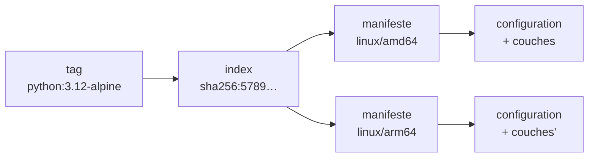

# Les couches d'une image

<p class="lead">Une image est le <strong>modèle figé et distribuable</strong> d'un conteneur : une pile de couches de fichiers en lecture seule, une fiche de configuration, un nom lisible (le <strong>tag</strong>) et une empreinte (le <strong>digest</strong>).</p>

{ .hero }

## L'essentiel en 30 secondes

<div class="grid cards" markdown>

-   :material-layers-triple-outline:{ .lg .middle } __Des couches__

    ---

    Chaque `RUN` ou `COPY` ajoute une **différence** de fichiers, en lecture seule, partageable entre images.

-   :material-file-cog-outline:{ .lg .middle } __Une configuration__

    ---

    `ENV`, `USER`, `EXPOSE`, `CMD` remplissent une fiche JSON : **0 octet** de fichiers.

-   :material-tag-outline:{ .lg .middle } __Un tag__

    ---

    Un nom lisible et **mobile** : `python:3.12-alpine` peut désigner demain un autre contenu.

-   :material-fingerprint:{ .lg .middle } __Un digest__

    ---

    L'empreinte `sha256:…` du contenu : **fixe**. Autre contenu, autre digest.

</div>

!!! warning "À retenir"

    Une image n'est **pas un conteneur arrêté** : c'est son modèle de départ. Elle ne contient ni noyau (c'est celui de l'hôte), ni processus, ni namespaces, ni limites : tout cela naît au `docker run` (voir [Image et cycle de vie du conteneur](Image-et-cycle-de-vie.md)).

## :material-layers-triple-outline: Une pile de couches

Chaque couche est une **différence** de système de fichiers (fichiers ajoutés, modifiés, supprimés). Au démarrage, le moteur les superpose avec **OverlayFS** : le conteneur voit une seule racine `/`, la couche du haut masquant celles du bas.

| Instruction | Ce qu'elle produit |
|---|---|
| `FROM` | hérite des couches **et** de la configuration de la base |
| `RUN`, `COPY`, `ADD` | une **couche** de fichiers |
| `WORKDIR` | de la configuration (et une petite couche s'il crée le dossier) |
| `ENV`, `USER`, `EXPOSE`, `CMD`, `ENTRYPOINT` | de la **configuration** seulement |

???+ example "En vrai : `docker image history` lit la pile de haut en bas"

    

    Une ligne d'historique n'est **pas** une couche : sur 19 lignes, seules 7 ajoutent des fichiers. L'historique aide surtout à repérer une étape coûteuse (ici, l'installation de Python à 44 Mo, héritée de la base).

??? note "Pourquoi certaines lignes affichent `<missing>` ?"

    Avec la colonne `IMAGE`, les étapes de la base apparaissent en `<missing>` : elles ont été construites ailleurs et leurs identifiants intermédiaires n'existent pas sur ce poste. Ce n'est pas une erreur.

???+ example "En vrai : le conteneur écrit au-dessus, l'image ne bouge pas"

    

    Le conteneur reçoit une **couche inscriptible** à lui (copie à l'écriture : un fichier de l'image n'y est recopié que s'il est modifié). Même « supprimé », `app.py` reste dans l'image. Le devenir de cette couche est traité dans [Stockage et volumes](Stockage-et-volumes.md).

## :material-tag-outline: Nommer : tag, digest, index

```
docker.io/library/python:3.12-alpine        python@sha256:5789aa19…
└registre┘└─ dépôt ──┘└─ tag ─────┘        └─ digest : ce contenu-là ─┘
```

Sans registre, Docker vise **Docker Hub** ; sans tag, il prend `latest` ; les images officielles sont rangées sous `library/`.

| | Tag | Digest |
|---|---|---|
| Nature | **pointeur modifiable**, choisi par le propriétaire | **empreinte** calculée du contenu |
| Peut changer de cible | oui, à chaque republication | non |
| Sert à | lire, organiser les versions | retrouver **exactement** un artefact |

???+ example "En vrai : un tag, un index, huit architectures"

    

    Le tag désigne un **index** ; l'index pointe vers un **manifeste par plateforme** ; chaque manifeste liste la configuration et les couches. Le moteur tire la variante de son hôte (ici `linux/amd64`).



??? note "Forcer une autre plateforme"

    `docker pull --platform linux/arm64 …` tire la variante ARM64 sur un poste AMD64. Sans raison, c'est à éviter : l'exécution passe alors par une émulation, plus lente. Les deux variantes n'ont ni les mêmes couches ni le même digest de manifeste, même sous un seul tag.

???+ danger "Trois empreintes à ne pas mélanger"

    Digest de l'**index**, digest du **manifeste** d'une plateforme et `IMAGE ID` local sont trois valeurs différentes. Avec le magasin d'images containerd, l'ID local est en général le digest de l'index ; avec le magasin classique, l'empreinte de la configuration. On ne compare que des valeurs **de même niveau**.

## :material-format-list-bulleted: Inventorier et nettoyer

| Commande | Fait | Ne fait pas |
|---|---|---|
| `docker pull` | remplit le stockage local | ne crée aucun conteneur |
| `docker image ls` | liste nom, ID, tailles | n'additionne pas : les couches partagées comptent une fois |
| `docker image inspect` | décrit le modèle (config, couches, digest) | ne dit rien d'un conteneur en cours |
| `docker image tag` | ajoute un **nom** | ne copie ni ne reconstruit rien |
| `docker image rm` | retire un nom (`Untagged`) | ne libère les données qu'au dernier nom (`Deleted`) |

???+ example "En vrai : deux noms, une seule image"

    

    `DISK USAGE` est la taille décompressée sur le disque, `CONTENT SIZE` la taille compressée qui transite par le registre. Les deux lignes ne pèsent pas deux fois 74 Mo.

??? note "Qui fait quoi : client, moteur, registre"

    | Rôle | Ce qu'il fait | Exemple |
    |---|---|---|
    | **Client** | transmet la demande au moteur, par son API | la commande `docker` |
    | **Moteur** | construit, stocke les images locales, crée les conteneurs | le démon `dockerd` |
    | **Registre** | conserve et distribue les images, **n'exécute rien** | Docker Hub, un registre privé |

    Construire, publier et exécuter peuvent donc se faire sur trois machines différentes (voir [Versionner et publier une image](Versionner-et-publier-une-image.md)).

!!! tip "Le bon réflexe"

    Sur une machine partagée, ne lancez pas `docker image prune -a` : il supprime toutes les images qu'aucun conteneur n'utilise, y compris celles des autres. Et nettoyer le poste n'efface **jamais** un registre distant.

## :material-flask-outline: À toi de jouer

```bash
docker pull python:3.12-alpine
docker image history python:3.12-alpine              # quelles lignes font 0 B ?
docker image inspect -f '{{len .RootFS.Layers}} couches' python:3.12-alpine
docker image inspect -f 'Cmd={{.Config.Cmd}} User="{{.Config.User}}"' python:3.12-alpine
docker buildx imagetools inspect python:3.12-alpine   # l'index et ses plateformes
docker image tag python:3.12-alpine demo:essai
docker image ls                                       # même ID pour les deux noms
docker image rm demo:essai                            # Untagged seulement
```

Questions : combien de lignes d'historique pour combien de couches ? L'ID local est-il égal au digest affiché par `imagetools` ?

??? abstract "Pour les créateurs : script de motion design (70 s)"

    Fond clair, blocs plats empilés en légère perspective : gris pour la base, bleu pour les couches ajoutées, jaune pour la configuration.

    | Séq. | Durée | À l'écran | Animation | Texte à l'écran |
    |---|---|---|---|---|
    | 1 | 0-6 s | Un dossier « mon application » et une boîte fermée « image » | Le dossier glisse vers la boîte | « Avant d'exécuter un conteneur, il faut un modèle : l'image. » |
    | 2 | 6-16 s | Un bloc gris « Alpine », puis « Python » | Chute douce, un cadenas apparaît sur chaque bloc | « L'image de base : des couches de fichiers, en lecture seule. » |
    | 3 | 16-26 s | Un bloc bleu « utilisateur app », puis « app.py » | Chaque bloc ne contient que ses fichiers, en surbrillance | « Chaque couche ajoutée est une différence : seulement ce qui change. » |
    | 4 | 26-36 s | `ENV PORT=8080` et `CMD [...]` arrivent vers la pile | Elles ratent la pile et s'écrivent sur une fiche jaune accrochée à côté | « Certaines instructions n'ajoutent aucun fichier : elles remplissent la configuration. » |
    | 5 | 36-46 s | Une seconde pile pour la version 1.1 | Les blocs gris sont reliés aux deux piles ; seul « app.py » est nouveau | « Deux images partagent leurs couches : on ne stocke et ne transfère que la différence. » |
    | 6 | 46-56 s | L'étiquette « web:1.0 » passe d'une pile à l'autre | Sous chaque pile, un code `sha256:…` reste fixe | « Le tag est une étiquette mobile. Le digest est l'empreinte du contenu. » |
    | 7 | 56-64 s | Une couche translucide « conteneur » se pose au sommet | Elle se colore, puis disparaît ; la pile reste intacte | « Le conteneur écrit au-dessus. L'image ne change pas. » |
    | 8 | 64-70 s | Synthèse | Les quatre mots s'affichent un par un | « Couches. Configuration. Tag. Digest. » |

    La séquence 4 lève la confusion la plus fréquente : `ENV` doit visiblement « rater » la pile. En séquence 6, garder le `sha256` affiché en permanence.

??? info "Pour les créateurs : idées de schémas"

    - **Client, moteur, registre** : le client `docker` parle au moteur `dockerd` par son API ; le moteur échange avec le registre (`pull`, `push`) et gère images et conteneurs. Le registre stocke et distribue, il ne démarre jamais de conteneur.
    - **Le parcours d'une image** : code et Dockerfile, `build`, image locale, `push`, registre, `pull`, autre moteur, `run`, conteneur. Chaque étape peut avoir lieu sur une machine différente.
    - **Couches partagées** : deux piles `web:1.0` et `web:1.1` dont les couches du bas sont **les mêmes blocs**, dessinés une seule fois et reliés aux deux piles ; seule la couche du haut diffère. Légende : « une couche commune n'est stockée et transférée qu'une fois ».
