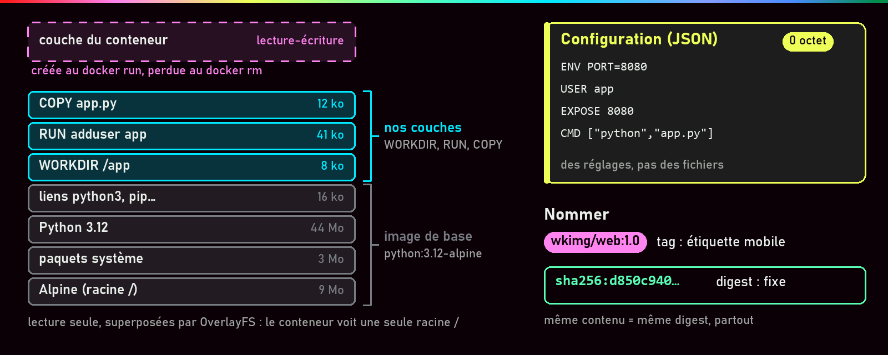
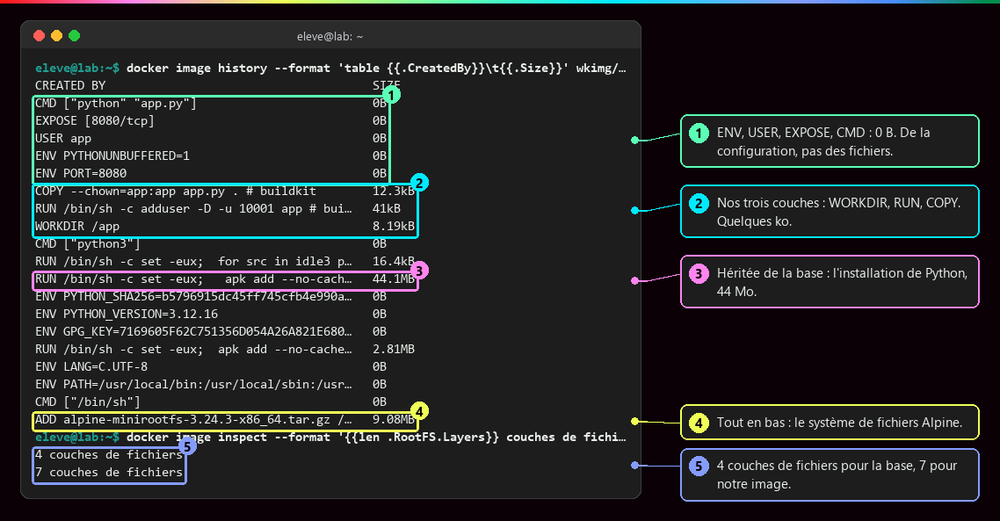
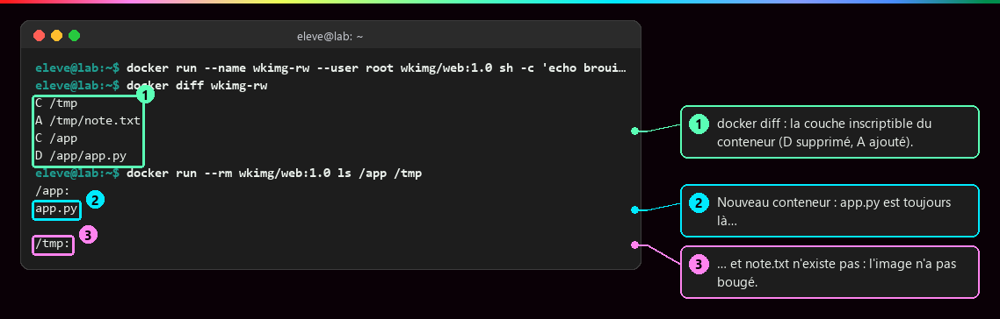
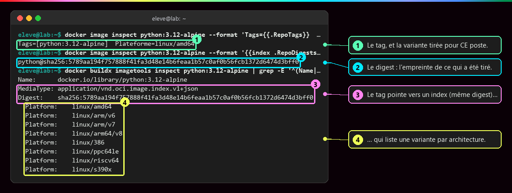
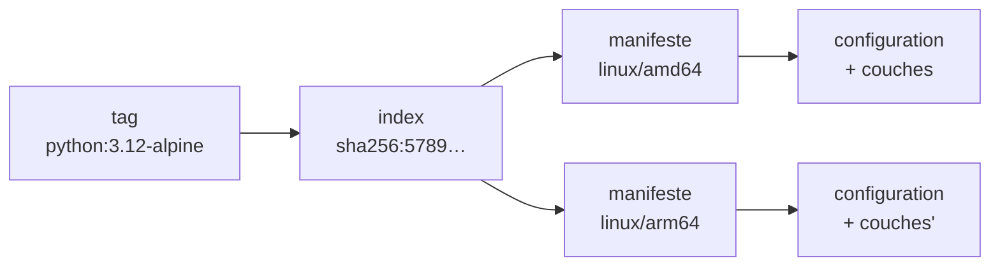
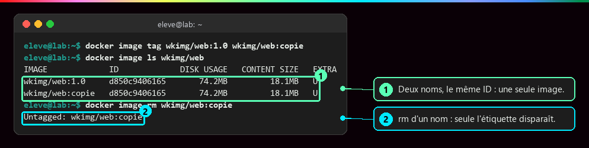

# Les couches d'une image

<p class="lead">Une image est le <strong>modèle figé et distribuable</strong> d'un conteneur : une pile de couches de fichiers en lecture seule, une fiche de configuration, un nom lisible (le <strong>tag</strong>) et une empreinte (le <strong>digest</strong>).</p>

{ .hero }

!!! abstract "Dans cette page"

    **Tu vas comprendre :**

    - de quoi est faite une image : des couches de fichiers empilées et une fiche de réglages ;
    - pourquoi un conteneur peut écrire des fichiers sans jamais abîmer son image ;
    - la différence entre le nom d'une image (le tag) et son empreinte (le digest).

    **Prérequis :** [Image et cycle de vie du conteneur](Image-et-cycle-de-vie.md). **Durée :** 25 min. **Niveau :** débutant.

!!! quote "En clair"

    Pense aux **calques transparents** d'un logiciel de dessin. Chaque calque ne contient que ce qu'il ajoute ; empilés, ils forment une seule image. Le conteneur reçoit un calque vierge posé tout en haut, et il ne dessine **que sur celui-là** : les calques du dessous restent intacts. Limite de l'image : un calque peut aussi **cacher** un fichier du dessous, mais ce fichier reste présent dans son calque d'origine.

    { .anim }

## L'essentiel en 30 secondes

<div class="grid cards" markdown>

-   :material-layers-triple-outline:{ .lg .middle } __Des couches__

    ---

    Chaque `RUN` ou `COPY` du Dockerfile ajoute une **différence** de fichiers, en lecture seule, que plusieurs images peuvent partager.

-   :material-file-cog-outline:{ .lg .middle } __Une configuration__

    ---

    `ENV`, `USER`, `EXPOSE`, `CMD` remplissent une fiche de réglages : **0 octet** de fichiers.

-   :material-tag-outline:{ .lg .middle } __Un tag__

    ---

    Un nom lisible et **mobile** : `python:3.12-alpine` peut désigner demain un autre contenu.

-   :material-fingerprint:{ .lg .middle } __Un digest__

    ---

    L'empreinte `sha256:…` du contenu : **fixe**. Autre contenu, autre digest.

</div>

!!! warning "À retenir"

    Une image n'est **pas un conteneur arrêté** : c'est son modèle de départ. Elle ne contient ni noyau (c'est celui de l'hôte), ni programme en cours, ni limites : tout cela naît au `docker run` (voir [Image et cycle de vie du conteneur](Image-et-cycle-de-vie.md)).

## :material-layers-triple-outline: Une pile de couches

!!! quote "En clair"

    Une **couche**, c'est la liste de ce qui a changé dans les fichiers à une étape de la fabrication : « ajouté ceci, modifié cela, supprimé ça ». L'image est la pile de toutes ces étapes.

    { .anim }

Au démarrage d'un conteneur, Docker superpose les couches avec **OverlayFS** (le mécanisme de Linux qui empile des dossiers). Le conteneur voit une seule racine `/` ; si un même fichier existe dans deux couches, c'est celle du haut qui gagne.

Les instructions du Dockerfile (la recette de l'image, voir [Écrire un Dockerfile](Ecrire-un-Dockerfile.md)) ne produisent pas toutes une couche :

| Instruction | Ce qu'elle produit |
|---|---|
| `FROM` | reprend les couches **et** la configuration d'une image de départ, la « base » |
| `RUN`, `COPY`, `ADD` | une **couche** de fichiers |
| `WORKDIR` | de la configuration (et une petite couche s'il crée le dossier) |
| `ENV`, `USER`, `EXPOSE`, `CMD`, `ENTRYPOINT` | de la **configuration** seulement |

???+ example "En vrai : `docker image history` lit la pile de haut en bas"

    **Ce qu'on fait :** on affiche l'historique d'une petite image construite à partir de `python:3.12-alpine`. Chaque ligne est une étape de sa fabrication, la plus récente en haut, avec le poids qu'elle a ajouté.

    

    **Ce qu'il faut regarder :**

    - ① : `ENV`, `USER`, `EXPOSE`, `CMD` pèsent 0 B. Ce sont des réglages, pas des fichiers.
    - ② : nos trois étapes à nous (`WORKDIR`, `RUN`, `COPY`) n'ajoutent que quelques ko.
    - ③ : l'étape la plus lourde, 44 Mo, est l'installation de Python. Elle vient de l'image de base, pas de nous.
    - ④ : tout en bas, le système de fichiers Alpine, le point de départ de tout.
    - ⑤ : la base a 4 couches de fichiers, notre image 7. Sur 19 lignes d'historique, seules 7 ajoutent des fichiers : **une ligne d'historique n'est pas forcément une couche**.

???+ example "En vrai : le conteneur écrit au-dessus, l'image ne bouge pas"

    **Ce qu'on fait :** un conteneur crée un fichier `note.txt` et supprime `app.py`. Puis on lance un **nouveau** conteneur à partir de la même image et on regarde ce qu'il trouve.

    

    **Ce qu'il faut regarder :**

    - ① : `docker diff` liste ce que le conteneur a changé dans **sa** couche à lui, la couche inscriptible : `A` ajouté, `D` supprimé, `C` modifié.
    - ② : le nouveau conteneur retrouve `app.py`, pourtant « supprimé » par le premier.
    - ③ : et `note.txt` n'existe pas chez lui. L'image n'a pas bougé.

    Un fichier de l'image n'est recopié dans la couche du conteneur que s'il est modifié : c'est la **copie à l'écriture**. Ce que devient cette couche à la suppression du conteneur est traité dans [Stockage et volumes](Stockage-et-volumes.md).

## :material-tag-outline: Nommer : tag, digest, index

!!! quote "En clair"

    Le **tag**, c'est l'étiquette collée sur un carton : on peut la décoller et la recoller sur un autre carton. Le **digest**, c'est l'empreinte digitale de ce qu'il y a dedans : si le contenu change d'un seul octet, l'empreinte change.

    { .anim }

Le nom complet d'une image se lit en trois morceaux :

```
docker.io/library/python:3.12-alpine        python@sha256:5789aa19…
└registre┘└─ dépôt ──┘└─ tag ─────┘        └─ digest : ce contenu-là ─┘
```

- Le **registre** est le serveur qui stocke l'image. Sans registre écrit, Docker va sur **Docker Hub**.
- Le **dépôt** est le nom de l'image. Les images officielles sont rangées sous `library/`.
- Le **tag** est la version lisible. Sans tag, Docker prend `latest`.

| | Tag | Digest |
|---|---|---|
| Nature | **pointeur modifiable**, choisi par le propriétaire | **empreinte** calculée à partir du contenu |
| Peut changer de cible | oui, à chaque republication | non |
| Sert à | lire, organiser les versions | retrouver **exactement** un contenu |

???+ example "En vrai : un tag, un index, huit architectures"

    **Ce qu'on fait :** on interroge l'image `python:3.12-alpine` : son tag, son digest, puis la liste de ce que le registre range sous ce nom.

    

    **Ce qu'il faut regarder :**

    - ① : le tag, et la variante récupérée pour **ce** poste : `linux/amd64`, un processeur Intel ou AMD 64 bits.
    - ② : le digest, l'empreinte exacte de ce qui a été téléchargé.
    - ③ : le tag ne désigne pas une image unique mais un **index**, une table des matières (même digest).
    - ④ : cet index liste une variante par type de processeur. Docker télécharge celle qui correspond à la machine.

Chaque variante est décrite par un **manifeste** : la liste de sa configuration et de ses couches.



## :material-format-list-bulleted: Inventorier et nettoyer

| Commande | Fait | Ne fait pas |
|---|---|---|
| `docker pull` | télécharge l'image dans le stockage local | ne crée aucun conteneur |
| `docker image ls` | liste nom, identifiant, tailles | n'additionne pas : les couches partagées comptent une fois |
| `docker image inspect` | décrit le modèle (configuration, couches, digest) | ne dit rien d'un conteneur en cours |
| `docker image tag` | ajoute un **nom** | ne copie ni ne reconstruit rien |
| `docker image rm` | retire un nom (`Untagged`) | ne libère la place qu'au dernier nom retiré (`Deleted`) |

???+ example "En vrai : deux noms, une seule image"

    **Ce qu'on fait :** on donne un deuxième nom (`copie`) à une image, on liste les deux, puis on retire ce deuxième nom.

    

    **Ce qu'il faut regarder :**

    - ① : deux lignes, mais le **même identifiant** (`ID`) : c'est une seule image avec deux étiquettes. Elle ne pèse pas deux fois 74 Mo.
    - ② : retirer un nom n'affiche que `Untagged`. Les fichiers restent, puisque l'autre nom les utilise encore.

    `DISK USAGE` est la place prise sur le disque, `CONTENT SIZE` la taille compressée qui voyage vers un registre.

!!! tip "Le bon réflexe"

    Sur une machine partagée, ne lance pas `docker image prune -a` : il supprime toutes les images qu'aucun conteneur n'utilise, y compris celles des autres. Supprime tes images **par leur nom**. Et nettoyer ton poste n'efface **jamais** un registre distant.

## :material-flask-outline: À toi de jouer

Six étapes, environ 10 minutes. Tu as seulement besoin de Docker et d'un terminal (voir [Bien démarrer](Bien-demarrer.md)).

**Étape 1 · Télécharger une image**

```bash
docker pull python:3.12-alpine   # (1)!
```

1. `pull` télécharge l'image depuis Docker Hub, sans rien lancer. `python` est le nom, `3.12-alpine` le tag : Python 3.12 sur une base Alpine Linux, très légère.

Tu dois voir le digest, puis le nom complet de l'image (si tu ne l'avais pas encore, des lignes `Pull complete` s'affichent avant, une par couche) :

```text
3.12-alpine: Pulling from library/python
Digest: sha256:5789aa194f757888f41fa3d48e14b6feaa1b57c0af0b56fcb1372d6474d3bff0
Status: Image is up to date for python:3.12-alpine
docker.io/library/python:3.12-alpine
```

Si l'image a été republiée depuis, ton digest sera différent : c'est justement le principe d'un tag mobile.

**Étape 2 · Lire l'historique**

```bash
docker image history --format 'table {{.CreatedBy}}\t{{.Size}}' python:3.12-alpine  # (1)!
```

1. `history` liste les étapes de fabrication. `--format` ne garde que deux colonnes : l'instruction (`CreatedBy`) et le poids ajouté (`Size`). `\t` insère une tabulation entre les deux.

Tu dois voir 11 lignes ; seules 4 ont une taille différente de `0B` :

```text
CREATED BY                                      SIZE
CMD ["python3"]                                 0B
RUN /bin/sh -c set -eux;  for src in idle3 p…   16.4kB
RUN /bin/sh -c set -eux;   apk add --no-cach…   44.1MB
ENV PYTHON_SHA256=b5796915dc45ff745cfb4e990a…   0B
ENV PYTHON_VERSION=3.12.16                      0B
ENV GPG_KEY=7169605F62C751356D054A26A821E680…   0B
RUN /bin/sh -c set -eux;  apk add --no-cache…   2.81MB
ENV LANG=C.UTF-8                                0B
ENV PATH=/usr/local/bin:/usr/local/sbin:/usr…   0B
CMD ["/bin/sh"]                                 0B
ADD alpine-minirootfs-3.24.3-x86_64.tar.gz /…   9.08MB
```

**Étape 3 · Compter les couches et lire la fiche de réglages**

```bash
docker image inspect -f '{{len .RootFS.Layers}} couches' python:3.12-alpine                  # (1)!
docker image inspect -f 'Cmd={{.Config.Cmd}} User="{{.Config.User}}"' python:3.12-alpine    # (2)!
docker image inspect -f '{{index .RepoDigests 0}}' python:3.12-alpine                        # (3)!
```

1. `inspect` affiche la description complète de l'image. `-f` en extrait un morceau : ici, le nombre de couches de fichiers.
2. Deux réglages de la fiche : la commande lancée par défaut (`Cmd`) et l'utilisateur (`User`).
3. Le premier digest connu pour cette image.

Tu dois voir 4 couches (autant que de lignes non nulles à l'étape 2), la commande `python3`, un utilisateur vide (donc root) et le digest :

```text
4 couches
Cmd=[python3] User=""
python@sha256:5789aa194f757888f41fa3d48e14b6feaa1b57c0af0b56fcb1372d6474d3bff0
```

**Étape 4 · Écrire dans un conteneur, vérifier que l'image n'a pas bougé**

```bash
docker run --name demo python:3.12-alpine sh -c 'echo bonjour > /note.txt'  # (1)!
docker diff demo                                                            # (2)!
docker run --rm python:3.12-alpine cat /note.txt                            # (3)!
```

1. Crée un conteneur `demo` qui écrit le mot « bonjour » dans un fichier `/note.txt`, puis s'arrête. `sh -c '…'` remplace la commande par défaut de l'image.
2. Liste ce que ce conteneur a changé par rapport à son image.
3. Un **nouveau** conteneur, supprimé dès la fin (`--rm`), essaie de lire le même fichier.

Tu dois voir `A /note.txt` (ajouté), puis une erreur : le nouveau conteneur ne trouve pas le fichier.

```text
A /note.txt
cat: can't open '/note.txt': No such file or directory
```

**Étape 5 · Donner un deuxième nom à l'image**

```bash
docker image tag python:3.12-alpine demo:essai                                              # (1)!
docker image ls --filter reference=python:3.12-alpine --filter reference=demo:essai         # (2)!
```

1. Ajoute l'étiquette `demo:essai` sur la même image. Rien n'est copié.
2. Liste seulement les images qui portent l'un de ces deux noms.

Tu dois voir deux lignes avec le **même** identifiant. Il commence comme le digest de l'étape 3 : avec le stockage d'images récent de Docker, l'identifiant local est le début du digest. La lettre `U` (*in use*) signale qu'un conteneur, ici `demo`, utilise l'image.

```text
IMAGE                ID             DISK USAGE   CONTENT SIZE   EXTRA
python:3.12-alpine   5789aa194f75       74.7MB         18.7MB   U
demo:essai           5789aa194f75       74.7MB         18.7MB   U
```

**Étape 6 · Faire le ménage**

```bash
docker rm demo                # (1)!
docker image rm demo:essai    # (2)!
```

1. Supprime le conteneur arrêté de l'étape 4.
2. Retire l'étiquette `demo:essai`. Garde `python:3.12-alpine` : la page suivante s'en sert.

Tu dois voir le nom du conteneur, puis seulement `Untagged` : l'image elle-même reste, sous son autre nom.

```text
demo
Untagged: demo:essai
```

??? tip "Ça ne marche pas ?"

    | Message | Cause | Solution |
    |---|---|---|
    | `Conflict. The container name "/demo" is already in use` | un conteneur `demo` existe déjà | `docker rm -f demo` puis recommence l'étape 4 |
    | `Error response from daemon: No such image: demo:essai` | l'étape 5 n'a pas été faite, ou déjà nettoyée | rien à faire, ou refais l'étape 5 |
    | `template parsing error` | une accolade ou une apostrophe manque dans `-f '…'` | recopie la commande d'un bloc, sans la retaper |
    | l'`ID` ne ressemble pas au digest | ancien stockage d'images de Docker | normal : l'identifiant est alors l'empreinte de la fiche de réglages |

## :material-help-circle-outline: Vérifie que tu as compris

??? question "1. Tu lances 10 conteneurs à partir de la même image de 74 Mo. Combien de fois ses couches sont-elles stockées sur le disque ?"

    **Une seule fois.** Les couches de l'image sont en lecture seule et partagées. Chaque conteneur n'a en plus que sa propre couche inscriptible, vide au départ, qui ne grossit que de ce qu'il écrit.

??? question "2. Ajouter `ENV PORT=8080` dans un Dockerfile rend-il l'image plus lourde ?"

    **Non.** `ENV` écrit un réglage dans la fiche de configuration, pas un fichier : sa ligne d'historique affiche `0B`. Seuls `RUN`, `COPY` et `ADD` ajoutent des fichiers.

??? question "3. Toi et un collègue tapez `docker pull python:3.12-alpine` à un mois d'écart. Avez-vous forcément la même image ? Comment le vérifier ?"

    **Pas forcément.** Le tag est une étiquette que le propriétaire peut déplacer vers une nouvelle version (correctif de sécurité, par exemple). Pour savoir si vous avez le même contenu, comparez les **digests** (`docker image inspect -f '{{index .RepoDigests 0}}'`).

!!! success "Et ensuite ?"

    Tu sais lire une image : des couches, une fiche de réglages, un tag et un digest. Page suivante : [Écrire un Dockerfile](Ecrire-un-Dockerfile.md), pour fabriquer ta propre image ligne par ligne.

## :material-server: Pour aller plus loin

??? note "Pourquoi certaines lignes affichent `<missing>` ?"

    Avec la colonne `IMAGE` de `docker image history`, les étapes de la base apparaissent en `<missing>` : elles ont été construites ailleurs, et leurs identifiants intermédiaires n'existent pas sur ce poste. Ce n'est pas une erreur.

??? note "Forcer une autre plateforme"

    `docker pull --platform linux/arm64 …` tire la variante ARM64 sur un poste AMD64. Sans raison, c'est à éviter : l'exécution passe alors par une émulation, plus lente. Les deux variantes n'ont ni les mêmes couches ni le même digest de manifeste, même sous un seul tag.

??? note "Trois empreintes à ne pas mélanger"

    Digest de l'**index**, digest du **manifeste** d'une plateforme et `IMAGE ID` local sont trois valeurs différentes. Avec le magasin d'images containerd, l'ID local est en général le digest de l'index ; avec le magasin classique, l'empreinte de la configuration. On ne compare que des valeurs **de même niveau**. `docker buildx imagetools inspect python:3.12-alpine` affiche l'index et ses plateformes.

??? note "Qui fait quoi : client, moteur, registre"

    | Rôle | Ce qu'il fait | Exemple |
    |---|---|---|
    | **Client** | transmet la demande au moteur, par son API | la commande `docker` |
    | **Moteur** | construit, stocke les images locales, crée les conteneurs | le démon `dockerd` |
    | **Registre** | conserve et distribue les images, **n'exécute rien** | Docker Hub, un registre privé |

    Construire, publier et exécuter peuvent donc se faire sur trois machines différentes (voir [Versionner et publier une image](Versionner-et-publier-une-image.md)).

??? abstract "Pour les créateurs : script de motion design (70 s)"

    Fond clair, blocs plats empilés en légère perspective : gris pour la base, bleu pour les couches ajoutées, jaune pour la configuration.

    | Séq. | Durée | À l'écran | Animation | Texte à l'écran |
    |---|---|---|---|---|
    | 1 | 0-6 s | Un dossier « mon application » et une boîte fermée « image » | Le dossier glisse vers la boîte | « Avant d'exécuter un conteneur, il faut un modèle : l'image. » |
    | 2 | 6-16 s | Un bloc gris « Alpine », puis « Python » | Chute douce, un cadenas apparaît sur chaque bloc | « L'image de base : des couches de fichiers, en lecture seule. » |
    | 3 | 16-26 s | Un bloc bleu « utilisateur app », puis « app.py » | Chaque bloc ne contient que ses fichiers, en surbrillance | « Chaque couche ajoutée est une différence : seulement ce qui change. » |
    | 4 | 26-36 s | `ENV PORT=8080` et `CMD [...]` arrivent vers la pile | Elles ratent la pile et s'écrivent sur une fiche jaune accrochée à côté | « Certaines instructions n'ajoutent aucun fichier : elles remplissent la configuration. » |
    | 5 | 36-46 s | Une seconde pile pour la version 1.1 | Les blocs gris sont reliés aux deux piles ; seul « app.py » est nouveau | « Deux images partagent leurs couches : on ne stocke et ne transfère que la différence. » |
    | 6 | 46-56 s | L'étiquette « web:1.0 » passe d'une pile à l'autre | Sous chaque pile, un code `sha256:…` reste fixe | « Le tag est une étiquette mobile. Le digest est l'empreinte du contenu. » |
    | 7 | 56-64 s | Une couche translucide « conteneur » se pose au sommet | Elle se colore, puis disparaît ; la pile reste intacte | « Le conteneur écrit au-dessus. L'image ne change pas. » |
    | 8 | 64-70 s | Synthèse | Les quatre mots s'affichent un par un | « Couches. Configuration. Tag. Digest. » |

    La séquence 4 lève la confusion la plus fréquente : `ENV` doit visiblement « rater » la pile. En séquence 6, garder le `sha256` affiché en permanence.

??? info "Pour les créateurs : idées de schémas"

    - **Client, moteur, registre** : le client `docker` parle au moteur `dockerd` par son API ; le moteur échange avec le registre (`pull`, `push`) et gère images et conteneurs. Le registre stocke et distribue, il ne démarre jamais de conteneur.
    - **Le parcours d'une image** : code et Dockerfile, `build`, image locale, `push`, registre, `pull`, autre moteur, `run`, conteneur. Chaque étape peut avoir lieu sur une machine différente.
    - **Couches partagées** : deux piles `web:1.0` et `web:1.1` dont les couches du bas sont **les mêmes blocs**, dessinés une seule fois et reliés aux deux piles ; seule la couche du haut diffère. Légende : « une couche commune n'est stockée et transférée qu'une fois ».
