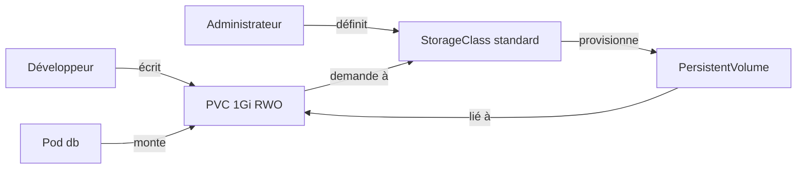

# De Compose à Kubernetes

<p class="lead">Traduire un fichier Compose n'est pas changer de syntaxe : chaque service se <strong>découpe en une famille d'objets</strong>, et Kubernetes ne fait que ce qui est déclaré, <strong>défauts compris</strong>.</p>

{ .hero }

## L'essentiel en 30 secondes

<div class="grid cards" markdown>

-   :material-puzzle-outline:{ .lg .middle } __Un service, une famille d'objets__

    ---

    Deployment, Service, ConfigMap, Secret, PersistentVolumeClaim, sondes : chaque ligne du Compose trouve son objet.

-   :material-bug-outline:{ .lg .middle } __Fidèle aux défauts__

    ---

    Un Compose qui ne marche pas donne des manifestes qui ne marchent pas. On **valide le Compose d'abord**.

-   :material-database-off-outline:{ .lg .middle } __emptyDir n'est pas un volume nommé__

    ---

    Ses données meurent avec le pod. Une base a besoin d'une **PVC**.

-   :material-lock-open-variant-outline:{ .lg .middle } __base64 n'est pas du chiffrement__

    ---

    Un Secret protège par les **droits d'accès** à l'API, pas par son encodage.

</div>

!!! warning "À retenir"

    Compose décrit des conteneurs **sur une machine** ; Kubernetes, un **état désiré pour un cluster** (voir [Kubernetes : état désiré et réconciliation](Kubernetes-etat-desire.md)). Deux choses disparaissent à la traduction : le `build` (l'image doit exister avant) et `depends_on` (remplacé par des sondes et une application qui sait réessayer).

??? note "La table de correspondance complète"

    | Concept | Docker Compose | Kubernetes | Ce qui change vraiment |
    |---|---|---|---|
    | Fichier | `compose.yaml` | **manifestes YAML** (objets séparés par `---`) | `kubectl apply -f dossier/` applique tout un dossier |
    | Projet | nom du projet (`-p`) | **Namespace** | cloisonne noms, droits et quotas |
    | Service | `services.web` | **Deployment** (ReplicaSet puis **Pods**) | maintient N réplicas, gère les mises à jour |
    | Image | `image:` ou `build:` | `image:` seulement | **pas de build** : construire, puis pousser ou charger dans le nœud |
    | Ports | `ports: "5000:5000"` | `containerPort` **+** un **Service** | accès externe par NodePort, LoadBalancer ou Ingress |
    | Découverte | nom du service | nom DNS du **Service** (CoreDNS) | voir [Service et Ingress](Service-et-Ingress.md) |
    | Réseau | `bridge` interne au projet | réseau de cluster (plugin **CNI**) | **plat** : tout pod joint tout pod, sauf **NetworkPolicy** (l'équivalent de `internal: true`) |
    | Variables | `environment:` | `env:` ou `envFrom:` | rangées dans une **ConfigMap** |
    | Fichier `.env` | `env_file:` | ConfigMap `--from-env-file` | |
    | Secrets | `secrets:` (`/run/secrets/`) | **Secret**, en variables ou en fichiers | base64, **pas chiffré** |
    | Volume nommé | `data:/var/lib/…` | **PersistentVolumeClaim** | demandé, puis fourni par une **StorageClass** |
    | Bind mount | `./conf:/etc/app:ro` | ConfigMap montée en volume (`hostPath` déconseillé) | les fichiers d'un hôte n'ont pas de sens sur plusieurs nœuds |
    | Temporaire | `tmpfs:` | `emptyDir` (`medium: Memory`) | vit et meurt **avec le pod** |
    | Ordre | `depends_on` (`service_healthy`) | **aucun équivalent** | `initContainers` et application qui réessaie |
    | Santé | `healthcheck:` | `startupProbe`, `readinessProbe`, `livenessProbe` | Kubernetes **agit** sur le résultat |
    | Redémarrage | `restart: unless-stopped` | `restartPolicy: Always` (implicite) | plus la réconciliation : un pod supprimé est recréé |
    | Réplicas | `up --scale web=2` | `replicas: 2` | |
    | Ressources | `deploy.resources.limits` | `resources.requests` et `limits` | les `requests` servent au **placement** |
    | Durcissement | `user:`, `cap_drop:`, `read_only:` | `securityContext` | mêmes notions, autre syntaxe |

## :material-check-decagram-outline: Valider le Compose, puis préparer l'image

Le point de départ : une application Flask (port 5000) et PostgreSQL. Avant de traduire, on vérifie que **le Compose fonctionne**, pour ne pas confondre un défaut d'origine avec une erreur de traduction.

```yaml
services:
  web:
    build: .
    ports: ["5000:5000"]
    environment: [DB_HOST=db, DB_USER=app, DB_PASS=example]
    depends_on: [db]
  db:
    image: postgres:15
    environment:
      POSTGRES_PASSWORD: example
    volumes: [data:/var/lib/postgresql/data]
volumes:
  data:
```

???+ danger "En vrai : le Compose d'origine ne marche pas"

    

    L'image officielle PostgreSQL ne crée l'utilisateur `app` que si `POSTGRES_USER` est fourni. Correction : une ligne, puis `docker compose down -v` pour réinitialiser la base. (L'attribut `version: "3.9"` des vieux exemples est ignoré par Compose v2 : on l'omet.)

Kubernetes ne sait pas exécuter `build: .`. On construit l'image, puis on la charge dans le nœud (ou on la pousse dans un registre).

???+ example "En vrai : l'image chargée dans le nœud"

    

    `minikube image load` importe l'image dans le **containerd du nœud**, distinct du Docker du poste. Le tag n'étant pas `latest`, la politique par défaut est `IfNotPresent` : le kubelet prend l'image locale. Réutiliser `demo-web:1.0`, déjà pris par une autre application, aurait servi l'ancienne image depuis le cache : **un tag désigne un seul contenu** (voir [Versionner et publier une image](Versionner-et-publier-une-image.md)).

## :material-key-variant: Configuration : ConfigMap et Secret

| | ConfigMap | Secret |
|---|---|---|
| Contenu | réglages non sensibles (`DB_HOST`, `DB_USER`) | mots de passe, jetons, certificats |
| Dans l'API | en clair | en **base64**, pas chiffré |
| Protection réelle | aucune nécessaire | **RBAC**, chiffrement d'etcd au repos, gestionnaire externe (Vault, KMS, External Secrets) |

???+ example "En vrai : un Secret se lit en une commande"

    

    En YAML, `stringData:` évite d'encoder soi-même ; un tel fichier ne se versionne **pas** en clair. Monter le Secret **en fichiers** plutôt qu'en variables reprend le principe de `/run/secrets/` (voir [Secrets, fichiers, réseau et ressources](Secrets-fichiers-reseau-ressources.md)) : une variable est héritée par les processus fils et finit souvent dans un journal.

???+ danger "En vrai : le même bug, traduit fidèlement"

    

    Le Secret ne contient pas `POSTGRES_USER` : la traduction reproduit le défaut à l'identique. Réponse JSON repliée à la largeur du terminal.

???+ example "En vrai : la correction, et ce qu'elle révèle"

    

    Un Secret injecté en variables n'est **pas relu** par les pods déjà lancés : il faut `rollout restart`. Les échecs du début (`Connection refused`, puis `starting up`) sont le problème « démarré n'est pas prêt » : sans `depends_on` ni sonde, rien ne retient le trafic. L'avertissement `last-applied-configuration` vient d'un `apply` sur un objet créé par `create` : sans conséquence, mais mieux vaut choisir une méthode.

??? note "Les manifestes db et web"

    ```yaml
    apiVersion: apps/v1
    kind: Deployment
    metadata: { name: db }
    spec:
      replicas: 1
      selector: { matchLabels: { app: db } }
      template:
        metadata: { labels: { app: db } }
        spec:
          containers:
            - name: postgres
              image: postgres:15
              envFrom: [{ secretRef: { name: db-secret } }]   # toutes les clés deviennent des variables
              ports: [{ containerPort: 5432 }]
              volumeMounts: [{ name: data, mountPath: /var/lib/postgresql/data }]
          volumes:
            - name: data
              emptyDir: {}                                    # traduction naïve du volume nommé
    ---
    apiVersion: apps/v1
    kind: Deployment
    metadata: { name: web }
    spec:
      replicas: 2
      selector: { matchLabels: { app: web } }
      template:
        metadata: { labels: { app: web } }
        spec:
          containers:
            - name: web
              image: demo-web:2.0
              ports: [{ containerPort: 5000 }]
              envFrom:
                - configMapRef: { name: web-config }
                - secretRef: { name: db-secret }
    ```

    Chaque Deployment est suivi de son Service : `db` en ClusterIP sur 5432, `web` en NodePort sur 5000 (voir [Service et Ingress](Service-et-Ingress.md)).

## :material-database-outline: Stockage : emptyDir ou PVC

| Objet | Qui l'écrit | Rôle |
|---|---|---|
| **PersistentVolumeClaim** | le développeur | une **demande** : « 1 Gio, lecture-écriture par un seul nœud » |
| **StorageClass** | l'administrateur | une **catégorie** de stockage et son fournisseur |
| **PersistentVolume** | créé automatiquement par la StorageClass | le volume réel, **lié** à la PVC |

???+ danger "En vrai : l'emptyDir perd tout"

    

    Le volume nommé de Compose survivait à la recréation du conteneur ; l'`emptyDir`, non. La traduction naïve **n'est pas équivalente**.

???+ example "En vrai : la PVC garde les données"

    

    Minikube a créé le PV grâce à sa StorageClass `standard`. Mais la politique est `Delete` : **supprimer la PVC supprime les données**.

??? note "Le manifeste de la PVC et les réglages qui vont avec"

    ```yaml
    apiVersion: v1
    kind: PersistentVolumeClaim
    metadata: { name: db-data }
    spec:
      accessModes: ["ReadWriteOnce"]
      resources: { requests: { storage: 1Gi } }      # pas de storageClassName : classe par défaut
    ---
    # Dans le Deployment db :
    spec:
      strategy: { type: Recreate }                   # un seul PostgreSQL à la fois sur les fichiers
      template:
        spec:
          containers:
            - name: postgres
              env: [{ name: PGDATA, value: /var/lib/postgresql/data/pgdata }]   # sous-dossier
          volumes:
            - name: data
              persistentVolumeClaim: { claimName: db-data }
    ```

    - Modes d'accès : **RWO** (un seul nœud en écriture), **RWX** (plusieurs nœuds, par exemple NFS), **ROX** (lecture seule partagée).
    - `Recreate` arrête l'ancien pod avant le nouveau : avec `RollingUpdate`, deux PostgreSQL ouvriraient brièvement les mêmes fichiers.
    - `PGDATA` dans un sous-dossier : certains volumes ne sont pas vides à leur création.
    - En production, une base se déploie plutôt avec un **StatefulSet**, qui donne à chaque réplica son identité et sa PVC.



## :material-heart-pulse: Sondes : ce qui remplace healthcheck et depends_on

| Sonde | Question | Si elle échoue | Côté Compose |
|---|---|---|---|
| `startupProbe` | a-t-elle fini de démarrer ? | les autres sondes attendent, puis redémarrage | `start_period` |
| `readinessProbe` | peut-elle recevoir du trafic **maintenant** ? | **retirée du Service**, sans redémarrage | `service_healthy`, mais en continu |
| `livenessProbe` | est-elle encore vivante ? | conteneur **redémarré** | rien : `unhealthy` ne déclenche rien |

```yaml
# Conteneur postgres
readinessProbe:
  exec: { command: ["pg_isready", "-U", "app", "-h", "127.0.0.1"] }
  initialDelaySeconds: 5
  periodSeconds: 5
livenessProbe:
  tcpSocket: { port: 5432 }                # jamais un service externe : sinon, redémarrages en boucle
  periodSeconds: 10
  failureThreshold: 6
---
# Pod web : attendre la base (rôle de depends_on, au démarrage seulement)
initContainers:
  - name: attendre-db
    image: postgres:15
    command: ["sh", "-c", "until pg_isready -h db -U app; do sleep 2; done"]
```

Tant que `pg_isready` échoue, le pod db est `0/1` et le Service `db` n'a aucun endpoint ; les pods web restent en `Init:0/1`. L'application doit quand même savoir réessayer : la base peut tomber à tout moment (voir [Démarré n'est pas disponible](Demarre-n-est-pas-disponible.md)).

!!! tip "kompose"

    `kompose convert` génère une première version des manifestes depuis un Compose. Bon point de départ, mais il produit exactement les traductions naïves de cette page (volumes sans réflexion, aucune sonde) : le résultat se relit.

## :material-flask-outline: À toi de jouer

```bash
kubectl create namespace labk8s
kubectl create secret generic s -n labk8s --from-literal=MDP=example
kubectl get secret s -n labk8s -o jsonpath='{.data.MDP}' | base64 -d; echo     # example : encodé, pas chiffré
kubectl get storageclass                                                         # standard (default) sur Minikube
cat <<'EOF' | kubectl apply -n labk8s -f -
apiVersion: v1
kind: PersistentVolumeClaim
metadata: { name: essai }
spec:
  accessModes: ["ReadWriteOnce"]
  resources: { requests: { storage: 100Mi } }
EOF
kubectl get pvc,pv -n labk8s                                                     # Bound, PV créé automatiquement
kubectl delete namespace labk8s                                                  # supprime la PVC, donc le PV
```

??? abstract "Pour les créateurs : script de motion design (70 s)"

    Fond sombre, formes plates. Le fichier Compose est une feuille blanche ; chaque objet a sa couleur (bleu Deployment, violet Service, jaune ConfigMap, rouge Secret, vert PVC, orange sondes).

    | Séq. | Durée | À l'écran | Animation | Texte à l'écran |
    |---|---|---|---|---|
    | 1 | 0-7 s | Une feuille `compose.yaml` avec deux blocs `web` et `db` | La feuille glisse au centre, les deux blocs s'éclairent | « Un fichier, deux services, une machine. » |
    | 2 | 7-17 s | Le bloc `db` se détache de la feuille | Il se fend en cinq éclats colorés qui deviennent des cartes : Deployment, Service, Secret, PVC, sondes | « Dans Kubernetes, un service devient une famille d'objets. » |
    | 3 | 17-25 s | La carte rouge Secret, avec la valeur `ZXhhbXBsZQ==` | Un filtre « base64 -d » passe dessus : le texte devient `example` en clair | « Encodé n'est pas chiffré. » |
    | 4 | 25-34 s | La carte bleue Deployment produit un pod, la carte violette Service se branche devant | Les pods web envoient une flèche vers « db » ; la flèche rebondit avec l'étiquette « Role app does not exist » | « La traduction est fidèle, y compris au bug d'origine. » |
    | 5 | 34-42 s | Une ligne `POSTGRES_USER: app` s'ajoute dans le Secret | Le pod db se ferme et se rouvre (redémarrage), la flèche passe et devient verte | « On corrige la déclaration, Kubernetes applique. » |
    | 6 | 42-52 s | Le pod db contient un petit cylindre de données « emptyDir », compteur 2 | Le pod est balayé ; le nouveau pod arrive avec un cylindre vide, compteur 1 en rouge | « emptyDir : les données meurent avec le pod. » |
    | 7 | 52-62 s | Le cylindre vert PVC sort du pod et se pose à côté, relié par un câble | Le pod est balayé, le nouveau se branche au même cylindre, compteur 3 puis 4 en vert | « La PVC survit au pod. » |
    | 8 | 62-70 s | Les cartes orange « sondes » se posent sur les pods | Un pod qui démarre reste grisé et sans flèche, puis s'allume quand il est prêt | « depends_on disparaît : les sondes prennent le relais. » |

    Les séquences 6 et 7 doivent être **strictement symétriques** (même cadrage, même rythme) : seule la position du cylindre change, ce qui fait comprendre que tout se joue dans le fait que les données soient dans le pod ou à côté.

??? info "Pour les créateurs : idées de schémas"

    - **Deux vies de données** : deux colonnes, même scénario en trois temps (« pod db en marche, compteur à 2 », « pod supprimé », « nouveau pod »). À gauche **emptyDir** : le cylindre est **dans** le pod et disparaît avec lui, le compteur repart à 1 (rouge). À droite **PVC** : le cylindre est **à côté**, relié par un câble qui se rebranche sur le nouveau pod, le compteur passe à 3 (vert).
    - **L'application traduite dans son namespace** : poste vers Service web NodePort `5000:30198`, deux pods web, Service db ClusterIP `:5432`, pod db ; ConfigMap et Secret reliés en pointillés (`envFrom`) ; PVC `db-data` reliée au pod db et à son PersistentVolume.
