# De Compose à Kubernetes

<p class="lead">Traduire un fichier Compose n'est pas changer de syntaxe : chaque service se <strong>découpe en une famille d'objets</strong>, et Kubernetes ne fait que ce qui est déclaré, <strong>défauts compris</strong>.</p>

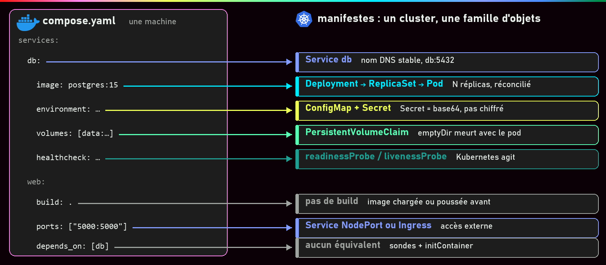{ .hero }

!!! abstract "Dans cette page"

    **Tu vas comprendre :**

    - en quoi devient chaque ligne d'un `compose.yaml` que tu sais déjà écrire ;
    - pourquoi un Secret Kubernetes n'est pas un coffre-fort ;
    - pourquoi une base de données a besoin d'une PVC, et pas d'un simple `emptyDir`.

    **Prérequis :** [Docker Compose](Docker-Compose.md), [Pod, Deployment, ReplicaSet](Pod-Deployment-ReplicaSet.md) et [Service et Ingress](Service-et-Ingress.md). **Durée :** 50 min. **Niveau :** intermédiaire.

!!! quote "En clair"

    Avec Compose, ton application vit dans une **maison** : tout est sous le même toit, avec un seul trousseau. Passer à Kubernetes, c'est emménager dans un **immeuble géré par un syndic** : le bail (le Deployment), la boîte aux lettres (le Service), le panneau d'affichage (la ConfigMap), l'enveloppe cachetée (le Secret) et la cave louée (la PVC) deviennent des choses séparées. Le syndic applique ce qui est écrit, rien de plus : si ton ancien plan avait une erreur, il la reproduit.

    { .anim }

## L'essentiel en 30 secondes

<div class="grid cards" markdown>

-   :material-puzzle-outline:{ .lg .middle } __Un service, une famille d'objets__

    ---

    Deployment, Service, ConfigMap, Secret, PersistentVolumeClaim, sondes : chaque ligne du Compose trouve son objet.

-   :material-bug-outline:{ .lg .middle } __Fidèle aux défauts__

    ---

    Un Compose qui ne marche pas donne des manifestes qui ne marchent pas. On **vérifie le Compose d'abord**.

-   :material-database-off-outline:{ .lg .middle } __emptyDir n'est pas un volume nommé__

    ---

    Ses données meurent avec le pod. Une base a besoin d'une **PVC**.

-   :material-lock-open-variant-outline:{ .lg .middle } __base64 n'est pas du chiffrement__

    ---

    Un Secret est protégé par les **droits d'accès** au cluster, pas par son encodage.

</div>

!!! warning "À retenir"

    Compose décrit des conteneurs **sur une machine** ; Kubernetes, un **état désiré pour un cluster** (voir [Kubernetes : état désiré et réconciliation](Kubernetes-etat-desire.md)). Deux choses disparaissent à la traduction : le `build` (l'image doit exister avant) et `depends_on` (remplacé par des sondes et une application qui sait réessayer).

## :material-swap-horizontal: Ton compose.yaml, ligne par ligne

Le point de départ : une application Flask (un petit site en Python, port 5000) et sa base PostgreSQL. Tu sais déjà lire ce fichier ; les bulles disent ce que devient chaque ligne.

```yaml
services:
  web:                                                       # (1)!
    build: .                                                 # (2)!
    ports: ["5000:5000"]                                     # (3)!
    environment: [DB_HOST=db, DB_USER=app, DB_PASS=example]  # (4)!
    depends_on: [db]                                         # (5)!
  db:
    image: postgres:15                                       # (6)!
    environment:
      POSTGRES_PASSWORD: example                             # (7)!
    volumes: [data:/var/lib/postgresql/data]                 # (8)!
volumes:
  data:
```

1. Un service Compose devient **deux** objets : un **Deployment**, qui maintient le bon nombre de pods identiques, et un **Service**, qui leur donne le nom stable `web`. Le projet Compose tout entier devient un **namespace** (un espace de travail du cluster).
2. Kubernetes ne construit pas d'image. On la construit avant avec `docker build`, puis on la pousse dans un registre ou on la charge dans le nœud. Le manifeste ne garde que `image:`.
3. Devient `containerPort: 5000` dans le pod, **plus** un Service de type NodePort (ou un Ingress) pour sortir du cluster.
4. Les réglages ordinaires (`DB_HOST`, `DB_USER`) partent dans une **ConfigMap**, le mot de passe dans un **Secret**. Les deux sont injectés en variables d'environnement.
5. **Aucun équivalent.** Kubernetes ne lance pas les pods dans un ordre donné : on utilise des **sondes** et une application qui sait réessayer.
6. Ne change pas : le nœud télécharge la même image.
7. Le mot de passe part dans le Secret `db-secret`. Remarque déjà qu'il **manque** `POSTGRES_USER` : c'est le défaut d'origine que l'on va retrouver plus bas.
8. Un volume nommé devient une **PersistentVolumeClaim** (PVC), une demande de stockage durable. Le traduire en `emptyDir` perd les données.

Garde cette table sous la main : elle part de ce que tu écris dans Compose.

| Dans Compose, tu écris… | Dans Kubernetes, ça devient… | Ce qui change vraiment |
|---|---|---|
| le fichier `compose.yaml` | des **manifestes YAML** (objets séparés par `---`) | `kubectl apply -f dossier/` applique tout un dossier |
| le nom de projet (`-p demo`) | un **Namespace** | cloisonne noms, droits et quotas |
| un service `services.web` | un **Deployment** (qui crée un ReplicaSet, puis des **Pods**) | maintient N copies, gère les mises à jour |
| `image:` ou `build:` | `image:` seulement | **pas de build** : construire, puis pousser ou charger dans le nœud |
| `ports: "5000:5000"` | `containerPort` **+** un **Service** | accès externe par NodePort, LoadBalancer ou Ingress |
| le nom du service (`db`) | le nom DNS du **Service** (CoreDNS) | voir [Service et Ingress](Service-et-Ingress.md) |
| le réseau `bridge` du projet | le réseau du cluster (plugin **CNI**) | **plat** : tout pod joint tout pod, sauf **NetworkPolicy** (l'équivalent de `internal: true`) |
| `environment:` | `env:` ou `envFrom:` | valeurs rangées dans une **ConfigMap** |
| `env_file:` | une ConfigMap `--from-env-file` | |
| `secrets:` (`/run/secrets/`) | un **Secret**, en variables ou en fichiers | base64, **pas chiffré** |
| un volume nommé `data:/var/lib/…` | une **PersistentVolumeClaim** | demandée, puis fournie par une **StorageClass** |
| un bind mount `./conf:/etc/app:ro` | une ConfigMap montée en volume (`hostPath` déconseillé) | les fichiers d'une machine n'ont pas de sens sur plusieurs nœuds |
| `tmpfs:` | `emptyDir` (`medium: Memory`) | vit et meurt **avec le pod** |
| `depends_on` (`service_healthy`) | **aucun équivalent** | `initContainers` et application qui réessaie |
| `healthcheck:` | `startupProbe`, `readinessProbe`, `livenessProbe` | Kubernetes **agit** sur le résultat |
| `restart: unless-stopped` | `restartPolicy: Always` (implicite) | plus la réconciliation : un pod supprimé est recréé |
| `up --scale web=2` | `replicas: 2` | |
| `deploy.resources.limits` | `resources.requests` et `limits` | les `requests` servent au **placement** |
| `user:`, `cap_drop:`, `read_only:` | `securityContext` | mêmes notions, autre syntaxe |

## :material-check-decagram-outline: Vérifier le Compose, puis préparer l'image

Avant de traduire, on vérifie que **le Compose fonctionne**. Sinon, impossible de savoir si une panne vient de la traduction ou du fichier d'origine.

???+ danger "En vrai : le Compose d'origine ne marche pas"

    **Ce qu'on fait :** on lance le Compose tel quel, on appelle l'application, puis on cherche pourquoi elle répond mal.

    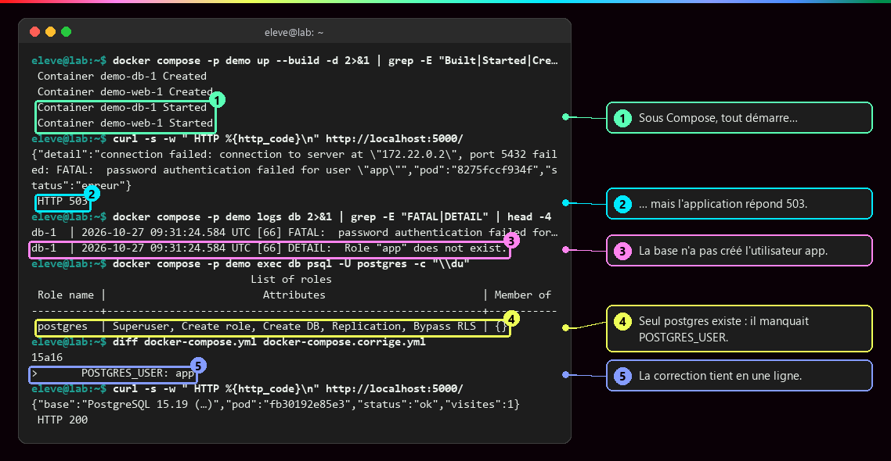

    **Ce qu'il faut regarder :**

    - ① les deux conteneurs démarrent : en apparence, tout va bien.
    - ② mais l'application répond **503** (service indisponible).
    - ③ le journal de la base explique : l'utilisateur `app` n'existe pas.
    - ④ dans PostgreSQL, seul l'utilisateur `postgres` existe. L'image officielle ne crée `app` que si `POSTGRES_USER` est fourni.
    - ⑤ la correction tient en une ligne. Ensuite, `docker compose down -v` efface la base pour qu'elle soit recréée avec ce réglage.

    L'attribut `version: "3.9"` des vieux exemples est ignoré par Compose v2 : on l'omet.

Kubernetes ne sait pas exécuter `build: .`. On construit l'image sur le poste, puis on la copie dans le nœud (ou on la pousse dans un registre) :

```bash
docker build -t demo-web:2.0 .        # (1)!
minikube image load demo-web:2.0      # (2)!
minikube image ls | grep demo-web     # (3)!
```

1. Construit l'image sur ton poste, avec un tag précis (`2.0`), jamais `latest`.
2. Copie l'image du Docker du poste vers le magasin d'images du nœud Minikube, qui est **séparé**.
3. Vérifie que le nœud la voit.

???+ example "En vrai : l'image chargée dans le nœud"

    **Ce qu'on fait :** on copie l'image `demo-web:2.0` dans le nœud, puis on liste les images `demo-web` qu'il connaît.

    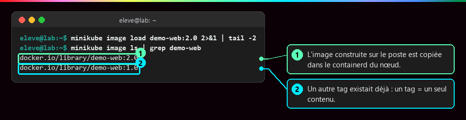

    **Ce qu'il faut regarder :**

    - ① l'image `demo-web:2.0` est maintenant dans le containerd du **nœud**, distinct du Docker du poste. Son tag n'étant pas `latest`, Kubernetes utilise la copie locale sans chercher à la télécharger (politique `IfNotPresent`).
    - ② un tag `1.0` existait déjà, utilisé par une autre application. Réutiliser `1.0` pour la nouvelle image aurait servi l'ancienne depuis le cache : **un tag désigne un seul contenu** (voir [Versionner et publier une image](Versionner-et-publier-une-image.md)).

## :material-key-variant: Configuration : ConfigMap et Secret

!!! quote "En clair"

    La **ConfigMap**, c'est le **panneau d'affichage** du hall : tout le monde peut le lire. Le **Secret**, c'est une **enveloppe cachetée** : on ne la lit pas par accident, mais quiconque a le droit de la prendre peut l'ouvrir. Ce n'est pas un coffre-fort.

    { .anim }

| | ConfigMap | Secret |
|---|---|---|
| Contenu | réglages non sensibles (`DB_HOST`, `DB_USER`) | mots de passe, jetons, certificats |
| Dans le cluster | en clair | en **base64** (un simple encodage), pas chiffré |
| Protection réelle | aucune nécessaire | droits d'accès (**RBAC**), chiffrement de la base du cluster (etcd), coffre externe (Vault, KMS, External Secrets) |

On peut les créer en une commande :

```bash
kubectl create configmap web-config -n demo --from-literal=DB_HOST=db --from-literal=DB_USER=app   # (1)!
kubectl create secret generic db-secret -n demo --from-literal=DB_PASS=example --from-literal=POSTGRES_PASSWORD=example   # (2)!
```

1. Une ConfigMap `web-config` dans le namespace `demo`. Chaque `--from-literal=CLÉ=valeur` ajoute une entrée.
2. Un Secret `db-secret`. `generic` : un Secret ordinaire, fait de paires clé-valeur. On retrouve le défaut du Compose : pas de `POSTGRES_USER`.

Ou les écrire dans un fichier, ce qui revient au même :

```yaml
apiVersion: v1
kind: ConfigMap
metadata:
  name: web-config            # (1)!
data:                         # (2)!
  DB_HOST: db
  DB_USER: app
---                           # (3)!
apiVersion: v1
kind: Secret
metadata:
  name: db-secret
type: Opaque                  # (4)!
stringData:                   # (5)!
  DB_PASS: example
  POSTGRES_PASSWORD: example
```

1. Le nom par lequel les pods feront référence à cette ConfigMap.
2. Les paires clé-valeur, en clair.
3. `---` sépare deux objets dans un même fichier YAML.
4. `Opaque` : un Secret générique, sans format imposé.
5. `stringData` permet d'écrire les valeurs en clair ; Kubernetes les encode lui-même en base64 dans le champ `data`. Un tel fichier contient des mots de passe : il ne se range **pas** tel quel dans Git.

???+ example "En vrai : un Secret se lit en une commande"

    **Ce qu'on fait :** on crée le Secret, on l'affiche avec `describe`, puis on lit directement son contenu.

    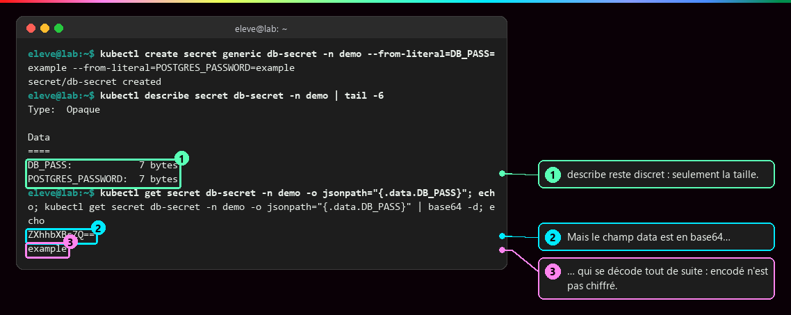

    **Ce qu'il faut regarder :**

    - ① `describe` reste discret : il n'affiche que la taille des valeurs.
    - ② mais le champ `data` contient la valeur encodée en base64…
    - ③ … qui se décode aussitôt avec `base64 -d` : `example`. Encodé n'est pas chiffré.

    Pour limiter les fuites, on monte le Secret **en fichiers** plutôt qu'en variables, sur le principe de `/run/secrets/` (voir [Secrets, fichiers, réseau et ressources](Secrets-fichiers-reseau-ressources.md)) : une variable est transmise aux programmes lancés par l'application et finit souvent dans un journal.

???+ danger "En vrai : le même bug, traduit fidèlement"

    **Ce qu'on fait :** on déploie la base et l'application sous Kubernetes, puis on appelle l'application. La réponse JSON est repliée à la largeur du terminal.

    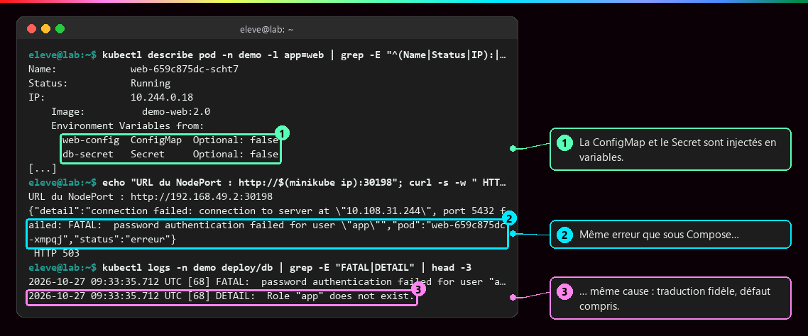

    **Ce qu'il faut regarder :**

    - ① la ConfigMap et le Secret sont bien injectés dans le pod web.
    - ② l'application échoue avec la **même** erreur que sous Compose…
    - ③ … pour la **même** cause : le Secret ne contient pas `POSTGRES_USER`. La traduction est fidèle, défaut compris.

???+ example "En vrai : la correction, et ce qu'elle révèle"

    **Ce qu'on fait :** on ajoute `POSTGRES_USER` au Secret, on relance la base, puis on appelle l'application six fois de suite.

    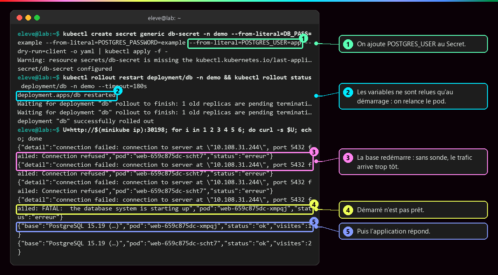

    **Ce qu'il faut regarder :**

    - ① on ajoute `POSTGRES_USER=app` au Secret. L'avertissement `last-applied-configuration` vient d'un `apply` sur un objet créé par `create` : sans conséquence, mais mieux vaut s'en tenir à une seule méthode.
    - ② un pod ne relit pas ses variables pendant qu'il tourne : il faut le **relancer** (`rollout restart`).
    - ③ pendant le redémarrage, la base refuse les connexions. Sans `depends_on` ni sonde, rien ne retient le trafic.
    - ④ la base a démarré mais n'est pas encore prête : c'est le problème « démarré n'est pas disponible ».
    - ⑤ puis l'application répond enfin, avec un compteur de visites à 1.

## :material-file-cog-outline: Le Deployment : ce que devient un service

!!! quote "En clair"

    Un service Compose, c'est « lance ce conteneur ». Un **Deployment**, c'est un **chef d'équipe** à qui l'on dit « je veux toujours deux pods comme celui-ci » : il les crée, les remplace s'ils tombent et les met à jour un par un.

    { .anim }

Voici le service `web` du Compose, traduit. Le Deployment est détaillé champ par champ dans [Pod, Deployment, ReplicaSet](Pod-Deployment-ReplicaSet.md) ; on ne regarde ici que ce qui vient du Compose.

```yaml
apiVersion: apps/v1                # (1)!
kind: Deployment
metadata:
  name: web
spec:
  replicas: 2                      # (2)!
  selector:
    matchLabels:
      app: web                     # (3)!
  template:                        # (4)!
    metadata:
      labels:
        app: web                   # (5)!
    spec:
      containers:
        - name: web
          image: demo-web:2.0      # (6)!
          ports:
            - containerPort: 5000  # (7)!
          envFrom:                 # (8)!
            - configMapRef:
                name: web-config
            - secretRef:
                name: db-secret
```

1. Les Deployments appartiennent au groupe d'API `apps`, version `v1`.
2. Deux copies du pod, maintenues en permanence. C'est l'équivalent de `docker compose up --scale web=2`, mais **réparé tout seul** si un pod disparaît.
3. Le Deployment reconnaît « ses » pods à cette étiquette.
4. Le **modèle** de pod : chaque copie est fabriquée d'après lui.
5. L'étiquette posée sur chaque pod. Elle doit être identique au sélecteur juste au-dessus, et c'est aussi elle que vise le Service `web`.
6. L'image chargée dans le nœud plus haut, avec son tag précis. Plus de `build:`.
7. Le port d'écoute de l'application. Il est surtout documentaire : il n'ouvre rien vers l'extérieur, c'est le rôle du Service.
8. L'équivalent de `environment:` : **toutes** les clés de la ConfigMap `web-config` et du Secret `db-secret` deviennent des variables d'environnement du conteneur.

??? note "Le Deployment db, traduction naïve"

    ```yaml
    apiVersion: apps/v1
    kind: Deployment
    metadata:
      name: db
    spec:
      replicas: 1
      selector:
        matchLabels:
          app: db
      template:
        metadata:
          labels:
            app: db
        spec:
          containers:
            - name: postgres
              image: postgres:15
              envFrom:
                - secretRef:
                    name: db-secret                    # (1)!
              ports:
                - containerPort: 5432
              volumeMounts:
                - name: data
                  mountPath: /var/lib/postgresql/data  # (2)!
          volumes:
            - name: data
              emptyDir: {}                             # (3)!
    ```

    1. Toutes les clés du Secret deviennent des variables : `POSTGRES_PASSWORD`, et bientôt `POSTGRES_USER`.
    2. Où le volume apparaît dans le conteneur : le dossier des données de PostgreSQL, comme dans le Compose.
    3. La traduction **naïve** du volume nommé : un dossier vide créé avec le pod… et détruit avec lui. La section suivante montre pourquoi c'est un piège.

    Chaque Deployment est suivi de son Service : `db` en ClusterIP sur 5432, `web` en NodePort sur 5000 (voir [Service et Ingress](Service-et-Ingress.md)).

## :material-database-outline: Stockage : emptyDir ou PVC

!!! quote "En clair"

    Un `emptyDir`, c'est le **tableau blanc** d'une salle de réunion : il est effacé quand on rend la salle. Une **PVC**, c'est un **casier loué** au gardien de l'immeuble : tu changes de salle, le casier reste. Attention : si tu rends la clé (tu supprimes la PVC), le gardien vide le casier.

    { .anim }

Trois objets se partagent le travail :

| Objet | Qui l'écrit | Rôle |
|---|---|---|
| **PersistentVolumeClaim** (PVC) | le développeur | une **demande** : « 1 Gio, lecture-écriture par un seul nœud » |
| **StorageClass** | l'administrateur | une **catégorie** de stockage et le programme qui le fournit |
| **PersistentVolume** (PV) | créé automatiquement par la StorageClass | le volume réel, **lié** à la PVC |

???+ danger "En vrai : l'emptyDir perd tout"

    **Ce qu'on fait :** l'application compte les visites dans la base. On note le compteur, on supprime le pod de la base, puis on rappelle l'application.

    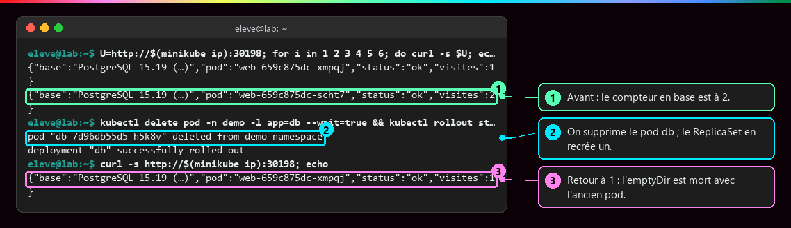

    **Ce qu'il faut regarder :**

    - ① avant : le compteur en base est à 2.
    - ② on supprime le pod `db` ; Kubernetes en recrée un aussitôt.
    - ③ retour à 1 : l'`emptyDir` est mort avec l'ancien pod, et les données avec lui. Le volume nommé de Compose, lui, survivait à la recréation du conteneur : la traduction naïve **n'est pas équivalente**.

On remplace donc l'`emptyDir` par une PVC :

```yaml
apiVersion: v1
kind: PersistentVolumeClaim          # (1)!
metadata:
  name: db-data                      # (2)!
spec:
  accessModes: ["ReadWriteOnce"]     # (3)!
  resources:
    requests:
      storage: 1Gi                   # (4)!
```

1. Une demande de stockage durable.
2. Le nom par lequel le Deployment fera référence à cette demande.
3. `ReadWriteOnce` (RWO) : lecture-écriture par **un seul** nœud à la fois. Il existe aussi RWX (plusieurs nœuds, par exemple sur NFS) et ROX (lecture seule partagée).
4. La taille demandée : 1 Gio. Aucune `storageClassName` n'est indiquée : c'est la classe **par défaut** du cluster qui fournira le volume (`standard` sur Minikube).

Et dans le Deployment `db`, trois changements :

```yaml
spec:
  strategy:
    type: Recreate                                  # (1)!
  template:
    spec:
      containers:
        - name: postgres
          env:
            - name: PGDATA
              value: /var/lib/postgresql/data/pgdata  # (2)!
      volumes:
        - name: data
          persistentVolumeClaim:
            claimName: db-data                      # (3)!
```

1. `Recreate` arrête l'ancien pod **avant** de lancer le nouveau. Avec la stratégie par défaut (`RollingUpdate`), deux PostgreSQL ouvriraient un instant les mêmes fichiers.
2. Les données dans un **sous-dossier** : certains volumes ne sont pas tout à fait vides à leur création, et PostgreSQL refuse de démarrer dans un dossier non vide.
3. Le volume ne vient plus d'un `emptyDir` mais de la PVC `db-data`.

???+ example "En vrai : la PVC garde les données"

    **Ce qu'on fait :** même scénario qu'avec l'`emptyDir`, mais la base est maintenant sur une PVC.

    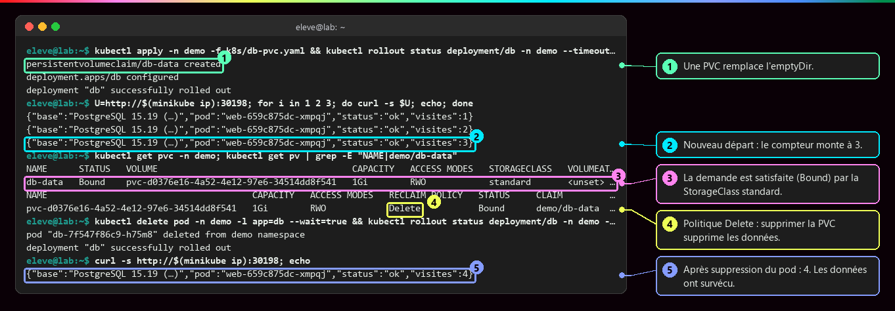

    **Ce qu'il faut regarder :**

    - ① la PVC `db-data` est créée et remplace l'`emptyDir`.
    - ② nouveau départ : le compteur monte jusqu'à 3.
    - ③ la demande est satisfaite (`Bound`, liée) par la StorageClass `standard` de Minikube, qui a créé le volume réel.
    - ④ la politique est `Delete` : **supprimer la PVC supprime les données**.
    - ⑤ après suppression du pod, le compteur passe à 4 : les données ont survécu.

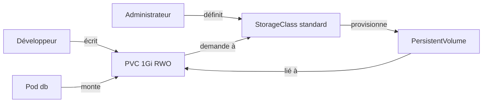

En production, une base se déploie plutôt avec un **StatefulSet**, qui donne à chaque copie son identité et sa propre PVC.

## :material-heart-pulse: Sondes : ce qui remplace healthcheck et depends_on

!!! quote "En clair"

    Trois questions posées régulièrement au conteneur. « As-tu fini de t'installer ? » (démarrage). « Peux-tu recevoir des clients **maintenant** ? » (disponibilité). « Es-tu encore en vie ? » (vivacité). Selon la réponse, Kubernetes attend, retire le pod du trafic ou le redémarre.

    { .anim }

| Sonde | Question | Si elle échoue | Côté Compose |
|---|---|---|---|
| `startupProbe` | a-t-elle fini de démarrer ? | les autres sondes attendent, puis redémarrage | `start_period` |
| `readinessProbe` | peut-elle recevoir du trafic **maintenant** ? | **retirée du Service**, sans redémarrage | `service_healthy`, mais en continu |
| `livenessProbe` | est-elle encore vivante ? | conteneur **redémarré** | rien : `unhealthy` ne déclenche rien |

```yaml
# Dans le conteneur postgres
readinessProbe:                                                # (1)!
  exec:
    command: ["pg_isready", "-U", "app", "-h", "127.0.0.1"]   # (2)!
  initialDelaySeconds: 5                                       # (3)!
  periodSeconds: 5
livenessProbe:                                                 # (4)!
  tcpSocket:
    port: 5432
  periodSeconds: 10
  failureThreshold: 6                                          # (5)!
---
# Dans le pod web : attendre la base (rôle de depends_on, au démarrage seulement)
initContainers:                                                # (6)!
  - name: attendre-db
    image: postgres:15
    command: ["sh", "-c", "until pg_isready -h db -U app; do sleep 2; done"]
```

1. Tant que cette sonde échoue, le pod n'est pas inscrit derrière le Service `db` : il ne reçoit aucune connexion.
2. La commande lancée dans le conteneur : `pg_isready` répond « oui » quand PostgreSQL accepte les connexions.
3. On attend 5 secondes avant le premier essai, puis on teste toutes les 5 secondes.
4. Ici, on vérifie seulement que le port 5432 répond. Une sonde de vivacité ne doit **jamais** dépendre d'un autre service : s'il tombe, Kubernetes redémarrerait ce pod en boucle pour rien.
5. Six échecs d'affilée (une minute) avant de redémarrer : on laisse le temps à un ralentissement passager.
6. Un **conteneur d'initialisation** tourne jusqu'au bout **avant** les conteneurs normaux du pod. Celui-ci boucle tant que la base ne répond pas.

Tant que `pg_isready` échoue, le pod db est `0/1` et le Service `db` n'a aucune adresse dans sa liste ; les pods web restent en `Init:0/1`. L'application doit quand même savoir réessayer : la base peut tomber à tout moment (voir [Démarré n'est pas disponible](Demarre-n-est-pas-disponible.md)).

!!! tip "kompose"

    `kompose convert` génère une première version des manifestes depuis un Compose. Bon point de départ, mais il produit exactement les traductions naïves de cette page (volumes sans réflexion, aucune sonde) : le résultat se relit.

## :material-flask-outline: À toi de jouer

!!! tip "Pratique sans rien installer : le lab interactif"

    Une **machine simulée avec Minikube et kubectl** à gauche, le **tutoriel pas à pas** à droite, et Conti, le robot du lab, pour te dire quoi observer avant chaque commande. Chaque option est expliquée, tu vois ce que tu dois obtenir, et chaque étape se valide toute seule. Tu ne peux rien casser.

    [:material-console: Ouvrir le lab interactif](labs/compose-vers-k8s.md){ .md-button .md-button--primary target="_blank" rel="noopener" }

**Sur ton poste**, le même lab pas à pas :

Six étapes, environ 15 minutes. Tu vas rejouer la traduction de la base : configuration, Secret, Deployment, correction, puis passage sur une PVC. Il te faut un cluster qui tourne (`minikube start --driver=docker`, puis `kubectl get nodes` doit afficher `Ready`) et un accès Internet pour que le nœud télécharge `postgres:15`.

**Étape 1 · Créer l'espace de travail et ranger la configuration**

```bash
kubectl create namespace demo                                                                     # (1)!
kubectl create configmap web-config -n demo --from-literal=DB_HOST=db --from-literal=DB_USER=app
kubectl create secret generic db-secret -n demo --from-literal=DB_PASS=example --from-literal=POSTGRES_PASSWORD=example   # (2)!
kubectl get configmaps,secrets -n demo                                                            # (3)!
```

1. Le namespace `demo` joue le rôle du nom de projet Compose.
2. Le Secret tel que traduit depuis le Compose, **avec** son défaut : pas de `POSTGRES_USER`. On le corrigera à l'étape 4.
3. Liste les ConfigMaps et les Secrets du namespace.

Tu dois voir (sortie réelle) :

```text
namespace/demo created
configmap/web-config created
secret/db-secret created
NAME                         DATA   AGE
configmap/kube-root-ca.crt   1      2s
configmap/web-config         2      1s

NAME               TYPE     DATA   AGE
secret/db-secret   Opaque   2      1s
```

`kube-root-ca.crt` est créée d'office dans chaque namespace : c'est le certificat du cluster. La colonne `DATA` compte les clés : 2 dans chaque objet.

**Étape 2 · Constater qu'un Secret n'est pas chiffré**

```bash
kubectl describe secret db-secret -n demo | tail -6                              # (1)!
kubectl get secret db-secret -n demo -o jsonpath="{.data.DB_PASS}"; echo         # (2)!
kubectl get secret db-secret -n demo -o jsonpath="{.data.DB_PASS}" | base64 -d; echo   # (3)!
```

1. La vue « polie » : seulement les tailles. `tail -6` garde les six dernières lignes.
2. Le champ brut, tel qu'il est stocké. `echo` ajoute juste un retour à la ligne.
3. Le même champ, décodé.

Tu dois voir (sortie réelle) :

```text
Type:  Opaque

Data
====
DB_PASS:            7 bytes
POSTGRES_PASSWORD:  7 bytes
ZXhhbXBsZQ==
example
```

**Étape 3 · Lancer la base (traduction naïve)**

Crée le fichier du Deployment `db` en copiant-collant ce bloc en entier dans ton terminal :

??? example "Créer `k8s/db-deploy.yaml`"

    ```bash
    mkdir -p k8s
    cat > k8s/db-deploy.yaml <<'EOF'
    apiVersion: apps/v1
    kind: Deployment
    metadata:
      name: db
    spec:
      replicas: 1
      selector:
        matchLabels:
          app: db
      template:
        metadata:
          labels:
            app: db
        spec:
          containers:
          - name: postgres
            image: postgres:15
            envFrom:
            - secretRef:
                name: db-secret
            ports:
            - containerPort: 5432
            volumeMounts:
            - name: data
              mountPath: /var/lib/postgresql/data
          volumes:
          - name: data
            emptyDir: {}
    EOF
    ```

Puis :

```bash
kubectl apply -n demo -f k8s/db-deploy.yaml                      # (1)!
kubectl rollout status deployment/db -n demo --timeout=180s      # (2)!
kubectl get pods -n demo                                         # (3)!
```

1. Envoie le manifeste au cluster, dans le namespace `demo`.
2. Attend que le déploiement soit terminé (trois minutes au plus, le temps de télécharger l'image).
3. Liste les pods.

Tu dois voir (sortie réelle ; le nom du pod et l'âge seront différents chez toi) :

```text
deployment.apps/db created
Waiting for deployment "db" rollout to finish: 0 of 1 updated replicas are available...
deployment "db" successfully rolled out
NAME                 READY   STATUS    RESTARTS   AGE
db-c96cf66dc-5x6c7   1/1     Running   0          1s
```

La base tourne, mais sans l'utilisateur `app` : exactement le défaut du Compose.

**Étape 4 · Corriger le Secret et relancer la base**

```bash
kubectl create secret generic db-secret -n demo --from-literal=DB_PASS=example --from-literal=POSTGRES_PASSWORD=example --from-literal=POSTGRES_USER=app --dry-run=client -o yaml | kubectl apply -f -   # (1)!
kubectl rollout restart deployment/db -n demo && kubectl rollout status deployment/db -n demo --timeout=180s   # (2)!
```

1. Astuce pour modifier un Secret existant : `--dry-run=client -o yaml` **fabrique** le Secret complet (avec `POSTGRES_USER`) sans rien envoyer, et `kubectl apply -f -` l'applique par-dessus l'ancien.
2. Relance le pod pour qu'il lise ses nouvelles variables, puis attend la fin.

Tu dois voir (sortie réelle) :

```text
Warning: resource secrets/db-secret is missing the kubectl.kubernetes.io/last-applied-configuration annotation which is required by kubectl apply. kubectl apply should only be used on resources created declaratively by either kubectl create --save-config or kubectl apply. The missing annotation will be patched automatically.
secret/db-secret configured
deployment.apps/db restarted
Waiting for deployment "db" rollout to finish: 1 old replicas are pending termination...
Waiting for deployment "db" rollout to finish: 1 old replicas are pending termination...
deployment "db" successfully rolled out
```

L'avertissement est sans conséquence : le Secret a été créé par `create` et modifié par `apply`. Le nouveau pod démarre avec un `emptyDir` neuf, donc PostgreSQL crée cette fois l'utilisateur `app`.

**Étape 5 · Passer la base sur une PVC**

??? example "Créer `k8s/db-pvc.yaml` (la PVC et le Deployment modifié)"

    ```bash
    cat > k8s/db-pvc.yaml <<'EOF'
    apiVersion: v1
    kind: PersistentVolumeClaim
    metadata:
      name: db-data
    spec:
      accessModes: ["ReadWriteOnce"]
      resources:
        requests:
          storage: 1Gi
    ---
    apiVersion: apps/v1
    kind: Deployment
    metadata:
      name: db
    spec:
      replicas: 1
      strategy:
        type: Recreate
      selector:
        matchLabels:
          app: db
      template:
        metadata:
          labels:
            app: db
        spec:
          containers:
          - name: postgres
            image: postgres:15
            envFrom:
            - secretRef:
                name: db-secret
            env:
            - name: PGDATA
              value: /var/lib/postgresql/data/pgdata
            ports:
            - containerPort: 5432
            volumeMounts:
            - name: data
              mountPath: /var/lib/postgresql/data
          volumes:
          - name: data
            persistentVolumeClaim:
              claimName: db-data
    EOF
    ```

```bash
kubectl apply -n demo -f k8s/db-pvc.yaml && kubectl rollout status deployment/db -n demo --timeout=180s   # (1)!
kubectl get pvc -n demo; kubectl get pv | grep -E "NAME|demo/db-data"                                     # (2)!
```

1. Crée la PVC et met à jour le Deployment `db` existant (`configured`), puis attend la fin.
2. La demande (PVC), puis le volume réel (PV) qui lui a été attribué. Les PV n'appartiennent à aucun namespace : `grep` ne garde que l'en-tête et celui de `demo/db-data`.

Tu dois voir (sortie réelle ; le nom du volume `pvc-…` sera différent chez toi) :

```text
persistentvolumeclaim/db-data created
deployment.apps/db configured
Waiting for deployment "db" rollout to finish: 0 out of 1 new replicas have been updated...
Waiting for deployment "db" rollout to finish: 0 out of 1 new replicas have been updated...
Waiting for deployment "db" rollout to finish: 0 out of 1 new replicas have been updated...
Waiting for deployment "db" rollout to finish: 0 of 1 updated replicas are available...
deployment "db" successfully rolled out
NAME      STATUS   VOLUME                                     CAPACITY   ACCESS MODES   STORAGECLASS   VOLUMEATTRIBUTESCLASS   AGE
db-data   Bound    pvc-d0376e16-4a52-4e12-97e6-34514dd8f541   1Gi        RWO            standard       <unset>                 11s
NAME                                       CAPACITY   ACCESS MODES   RECLAIM POLICY   STATUS     CLAIM                                      STORAGECLASS   VOLUMEATTRIBUTESCLASS   REASON   AGE
pvc-d0376e16-4a52-4e12-97e6-34514dd8f541   1Gi        RWO            Delete           Bound      demo/db-data                                standard       <unset>                          12s
```

Repère `Bound` (la demande est satisfaite), `standard` (la StorageClass qui a fourni le volume) et `Delete` (supprimer la PVC supprimera les données).

**Étape 6 · Faire le ménage**

```bash
kubectl delete namespace demo                     # (1)!
kubectl get pv | grep demo/db-data                # (2)!
rm -r k8s                                         # (3)!
```

1. Supprime le namespace et tout ce qu'il contient : Deployment, pod, ConfigMap, Secret, PVC. Compte quelques secondes.
2. Vérifie que le volume réel a suivi (politique `Delete`).
3. Supprime les deux fichiers créés sur ton poste.

Tu dois voir une confirmation de suppression du namespace, puis **aucune ligne** pour la commande `grep` (relance-la si le volume met quelques secondes à disparaître).

??? tip "Ça ne marche pas ?"

    | Message | Cause | Solution |
    |---|---|---|
    | `namespaces "demo" already exists` | un essai précédent n'a pas été nettoyé | `kubectl delete namespace demo` puis recommence |
    | `the path "k8s/db-deploy.yaml" does not exist` | le fichier n'a pas été créé, ou tu n'es pas dans le bon dossier | `ls k8s` ; recrée le fichier depuis le bloc dépliable |
    | `error: timed out waiting for the condition` au `rollout status` | l'image `postgres:15` se télécharge encore, ou le pod ne démarre pas | `kubectl get pods -n demo` puis `kubectl describe pod -n demo -l app=db` (lire les `Events` en bas) |
    | PVC en `Pending` | aucune StorageClass par défaut | `kubectl get storageclass` doit montrer `standard (default)` ; sinon `minikube addons enable default-storageclass` et `minikube addons enable storage-provisioner` |
    | `error converting YAML to JSON` | l'indentation du fichier a été abîmée au copier-coller | recrée le fichier en copiant le bloc **entier**, de `cat` jusqu'à `EOF` |

## :material-help-circle-outline: Vérifie que tu as compris

??? question "1. Sous Kubernetes, ta base refuse l'utilisateur `app`. Est-ce forcément une erreur de traduction ?"

    **Non.** Kubernetes applique exactement ce qui est déclaré, défauts compris. Ici, le Compose d'origine avait déjà le problème (pas de `POSTGRES_USER`). C'est pour cela qu'on vérifie le Compose **avant** de traduire : sinon, on cherche l'erreur au mauvais endroit.

??? question "2. Un collègue dit : « Mes mots de passe sont dans un Secret, donc ils sont chiffrés. » Qu'en penses-tu ?"

    C'est faux. Un Secret est seulement **encodé** en base64 : `base64 -d` le relit en une seconde. Sa protection vient des **droits d'accès** au cluster (qui a le droit de lire les Secrets), du chiffrement de la base du cluster au repos, ou d'un coffre externe. Et un fichier YAML de Secret ne se range pas en clair dans Git.

??? question "3. Pourquoi remplacer l'`emptyDir` de la base par une PVC, et que se passe-t-il si tu supprimes la PVC ?"

    L'`emptyDir` naît et meurt **avec le pod** : à chaque remplacement, la base repart de zéro. La PVC existe **à côté** du pod : le nouveau pod se rebranche dessus et retrouve les données. Mais avec la politique `Delete`, supprimer la PVC supprime aussi le volume réel, donc les données.

!!! success "Et ensuite ?"

    Tu sais traduire une application Compose en objets Kubernetes et repérer les pièges de la traduction naïve. Page suivante : [Virtualisation et orchestration](Virtualisation-et-orchestration.md), pour voir sur quoi tout cela tourne vraiment, du PC jusqu'aux pods.

## :material-server: Pour aller plus loin

??? abstract "Pour les créateurs : script de motion design (70 s)"

    Fond sombre, formes plates. Le fichier Compose est une feuille blanche ; chaque objet a sa couleur (bleu Deployment, violet Service, jaune ConfigMap, rouge Secret, vert PVC, orange sondes).

    | Séq. | Durée | À l'écran | Animation | Texte à l'écran |
    |---|---|---|---|---|
    | 1 | 0-7 s | Une feuille `compose.yaml` avec deux blocs `web` et `db` | La feuille glisse au centre, les deux blocs s'éclairent | « Un fichier, deux services, une machine. » |
    | 2 | 7-17 s | Le bloc `db` se détache de la feuille | Il se fend en cinq éclats colorés qui deviennent des cartes : Deployment, Service, Secret, PVC, sondes | « Dans Kubernetes, un service devient une famille d'objets. » |
    | 3 | 17-25 s | La carte rouge Secret, avec la valeur `ZXhhbXBsZQ==` | Un filtre « base64 -d » passe dessus : le texte devient `example` en clair | « Encodé n'est pas chiffré. » |
    | 4 | 25-34 s | La carte bleue Deployment produit un pod, la carte violette Service se branche devant | Les pods web envoient une flèche vers « db » ; la flèche rebondit avec l'étiquette « Role app does not exist » | « La traduction est fidèle, y compris au bug d'origine. » |
    | 5 | 34-42 s | Une ligne `POSTGRES_USER: app` s'ajoute dans le Secret | Le pod db se ferme et se rouvre (redémarrage), la flèche passe et devient verte | « On corrige la déclaration, Kubernetes applique. » |
    | 6 | 42-52 s | Le pod db contient un petit cylindre de données « emptyDir », compteur 2 | Le pod est balayé ; le nouveau pod arrive avec un cylindre vide, compteur 1 en rouge | « emptyDir : les données meurent avec le pod. » |
    | 7 | 52-62 s | Le cylindre vert PVC sort du pod et se pose à côté, relié par un câble | Le pod est balayé, le nouveau se branche au même cylindre, compteur 3 puis 4 en vert | « La PVC survit au pod. » |
    | 8 | 62-70 s | Les cartes orange « sondes » se posent sur les pods | Un pod qui démarre reste grisé et sans flèche, puis s'allume quand il est prêt | « depends_on disparaît : les sondes prennent le relais. » |

    Les séquences 6 et 7 doivent être **strictement symétriques** (même cadrage, même rythme) : seule la position du cylindre change, ce qui fait comprendre que tout se joue dans le fait que les données soient dans le pod ou à côté.

??? info "Pour les créateurs : idées de schémas"

    - **Deux vies de données** : deux colonnes, même scénario en trois temps (« pod db en marche, compteur à 2 », « pod supprimé », « nouveau pod »). À gauche **emptyDir** : le cylindre est **dans** le pod et disparaît avec lui, le compteur repart à 1 (rouge). À droite **PVC** : le cylindre est **à côté**, relié par un câble qui se rebranche sur le nouveau pod, le compteur passe à 3 (vert).
    - **L'application traduite dans son namespace** : poste vers Service web NodePort `5000:30198`, deux pods web, Service db ClusterIP `:5432`, pod db ; ConfigMap et Secret reliés en pointillés (`envFrom`) ; PVC `db-data` reliée au pod db et à son PersistentVolume.
