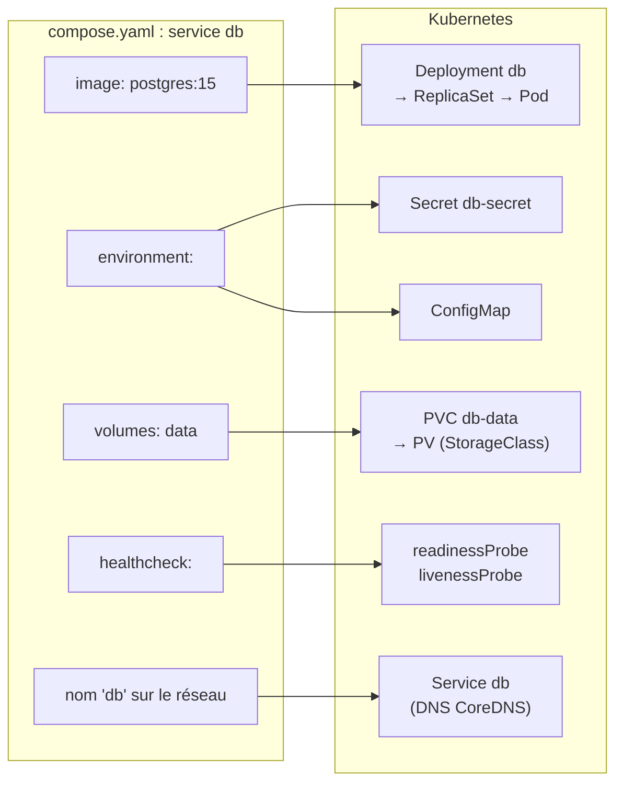
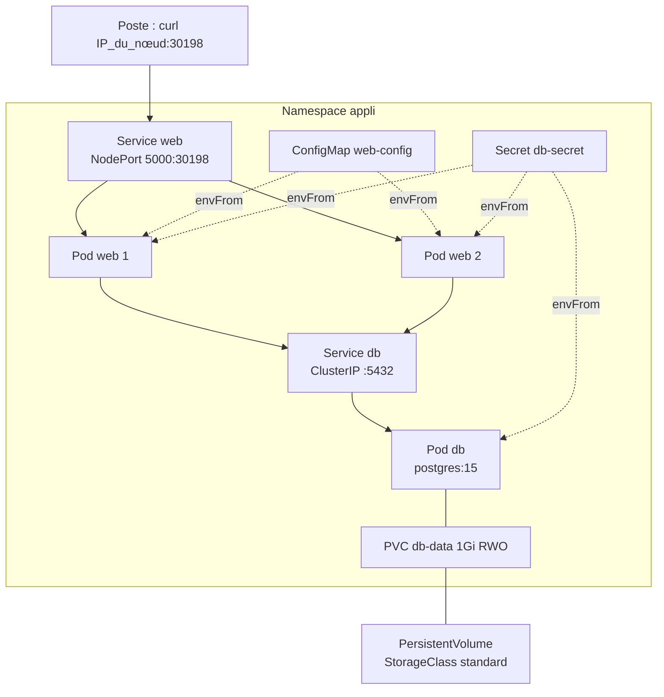
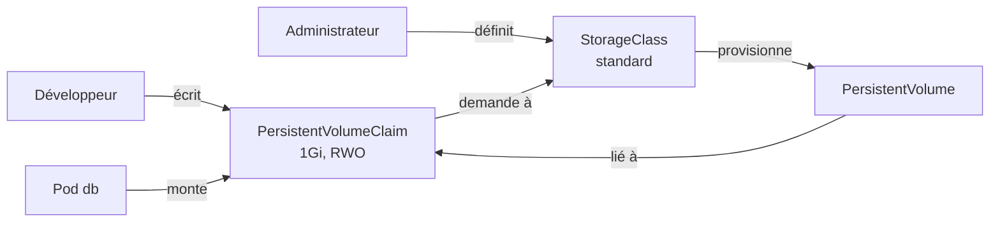

# De Compose aux manifestes Kubernetes

> **En une phrase.** Traduire un fichier Compose en Kubernetes n'est pas un simple changement de syntaxe : chaque service Compose se **découpe en plusieurs objets** (Deployment, Service, ConfigMap, Secret, PersistentVolumeClaim, sondes), et Kubernetes ne fait **que** ce qui est déclaré, défauts compris.

---

## 1. Synthèse

### Le modèle mental : un service Compose, une famille d'objets

```
  compose.yaml                         manifestes Kubernetes
  ────────────                         ─────────────────────
  services:                            Deployment db  ──► ReplicaSet ──► Pod
    db:                                Service db        (nom DNS stable)
      image: postgres:15       ═══►    Secret db-secret  (mots de passe)
      environment: …                   ConfigMap         (réglages non sensibles)
      volumes: [data:/var/…]           PersistentVolumeClaim ──► PersistentVolume
      healthcheck: …                   readinessProbe / livenessProbe
```

Compose décrit des **conteneurs sur une machine**. Kubernetes décrit un **état désiré pour un cluster** (voir [Kubernetes : état désiré et réconciliation](Kubernetes-etat-desire.md)) : il généralise et distribue les mêmes idées à grande échelle, avec plusieurs nœuds, la haute disponibilité et l'auto-guérison.

### La table de correspondance

| Concept | Docker Compose | Kubernetes | Ce qui change vraiment |
|---|---|---|---|
| Fichier | `compose.yaml` (un seul fichier) | **manifestes YAML** (un ou plusieurs fichiers, objets séparés par `---`) | `kubectl apply -f dossier/` applique tout un dossier |
| Projet | nom du projet (`-p`) | **Namespace** | cloisonne les noms, les droits et les quotas |
| Service | `services.web` : un conteneur et ses dépendances | **Deployment** (qui crée ReplicaSet et **Pods**) | le Deployment maintient N réplicas et gère les mises à jour |
| Image | `image:` ou `build:` | `image:` seulement | **pas de build** dans Kubernetes : construire avant, puis pousser dans un registre ou charger dans le nœud |
| Ports | `ports: "5000:5000"` | `containerPort` dans le pod **+** un **Service** | l'accès stable passe par un Service ; l'accès externe par NodePort, LoadBalancer ou Ingress |
| Découverte | nom du service sur le réseau du projet | nom DNS du **Service** (CoreDNS) | voir [Service et Ingress](Service-et-Ingress.md) |
| Réseau | réseau `bridge` interne au projet | réseau de cluster fourni par un plugin **CNI** | réseau **plat** : tout pod joint tout pod, sauf **NetworkPolicy** (l'équivalent de `internal: true`) |
| Variables | `environment:` | `env:` ou `envFrom:` | les valeurs sont rangées dans une **ConfigMap** |
| Fichier `.env` | `env_file:` | ConfigMap créée `--from-env-file` | |
| Secrets | `secrets:` (fichier monté dans `/run/secrets/`) | **Secret**, injecté en variables ou monté en fichiers | encodé en base64, **pas chiffré** |
| Volume nommé | `volumes: [data:/var/lib/…]` | **PersistentVolumeClaim** (PVC) | le stockage est demandé, puis fourni par une **StorageClass** |
| Bind mount | `./conf:/etc/app:ro` | ConfigMap montée en volume (ou `hostPath`, déconseillé) | les fichiers de l'hôte n'ont pas de sens dans un cluster multinœud |
| Répertoire temporaire | `tmpfs:` | volume `emptyDir` (`medium: Memory` pour la RAM) | vit et meurt **avec le pod** |
| Ordre de démarrage | `depends_on` (avec `condition: service_healthy`) | **aucun équivalent** | `initContainers` qui attendent, et une application qui sait réessayer |
| Santé | `healthcheck:` | **sondes** `startupProbe`, `readinessProbe`, `livenessProbe` | Kubernetes **agit** sur le résultat (retrait du trafic, redémarrage) |
| Redémarrage | `restart: unless-stopped` | `restartPolicy: Always` (implicite dans un Deployment) | plus la réconciliation : un pod supprimé est recréé |
| Réplicas | `docker compose up --scale web=2` | `replicas: 2` | |
| Ressources | `deploy.resources.limits` | `resources.requests` et `resources.limits` | les `requests` servent au **placement** des pods |
| Durcissement | `user:`, `cap_drop:`, `read_only:` | `securityContext` | mêmes notions, autre syntaxe |

### ConfigMap et Secret : sortir la configuration de l'image

| | ConfigMap | Secret |
|---|---|---|
| Contenu | réglages non sensibles (`DB_HOST`, `DB_USER`) | mots de passe, jetons, certificats |
| Stockage dans l'API | en clair | encodé en **base64** (ce n'est **pas** du chiffrement) |
| Injection | `env`, `envFrom`, volume | `env`, `envFrom`, volume (fichiers en mémoire, en `tmpfs`) |
| Protection réelle | aucune nécessaire | droits **RBAC** sur les Secrets du namespace, chiffrement d'etcd au repos, gestionnaire externe (Vault, KMS du cloud, External Secrets) |

Monter un Secret **en fichiers** plutôt qu'en variables reprend le principe de `/run/secrets/` de Compose (voir [Secrets, fichiers, réseau et ressources](Secrets-fichiers-reseau-ressources.md)) : une variable d'environnement est héritée par les processus fils et finit souvent dans un journal d'erreur.

### Stockage : PVC, PV et StorageClass

| Objet | Qui l'écrit | Rôle |
|---|---|---|
| **PersistentVolumeClaim** (PVC) | le développeur, avec l'application | une **demande** : « 1 Gio, en lecture-écriture par un seul nœud » |
| **StorageClass** | l'administrateur du cluster | une **catégorie** de stockage et son fournisseur (disque cloud, NFS, disque local…) |
| **PersistentVolume** (PV) | créé automatiquement par la StorageClass (provisionnement dynamique) | le volume réel, **lié** à la PVC |

Modes d'accès courants : **RWO** (`ReadWriteOnce`, un seul nœud en écriture), **RWX** (`ReadWriteMany`, plusieurs nœuds, par exemple NFS), **ROX** (lecture seule partagée). La **politique de récupération** (`reclaimPolicy`) dit ce que devient le PV quand on supprime la PVC : `Delete` (par défaut avec le provisionnement dynamique, les données disparaissent) ou `Retain`.

### Les trois sondes, traduction du `healthcheck`

| Sonde | Question | Si elle échoue | Équivalent Compose |
|---|---|---|---|
| `startupProbe` | l'application a-t-elle fini de démarrer ? | les autres sondes attendent ; au-delà du seuil, redémarrage | `start_period` |
| `readinessProbe` | peut-elle recevoir du trafic **maintenant** ? | le pod est **retiré du Service**, sans redémarrage | `condition: service_healthy`, mais en continu |
| `livenessProbe` | est-elle encore vivante ? | le conteneur est **redémarré** | aucun : un `unhealthy` Compose ne déclenche rien |

Chaque sonde peut être une requête HTTP (`httpGet`), une connexion TCP (`tcpSocket`), une commande (`exec`) ou un appel gRPC.

> [!IMPORTANT]
> **Les pièges à retenir**
> 1. **La traduction reproduit fidèlement les défauts.** Un Compose qui ne marche pas donne des manifestes qui ne marchent pas : valider le Compose d'abord.
> 2. **`depends_on` disparaît.** Rien n'ordonne le démarrage : sans `readinessProbe` sur la base et sans nouvelles tentatives dans l'application, les premières requêtes échouent.
> 3. **`emptyDir` n'est pas un volume nommé.** Ses données meurent avec le pod. Pour une base, il faut une PVC.
> 4. **base64 n'est pas du chiffrement.** Quiconque peut lire le Secret dans l'API lit le mot de passe.
> 5. **Une `livenessProbe` ne doit pas dépendre d'un service externe.** Si elle teste la base, une panne de la base fait redémarrer en boucle tous les pods web, ce qui n'arrange rien.
> 6. **Pas de build dans le cluster.** L'image doit exister dans un registre joignable ou dans le magasin d'images du nœud.

---

## 2. Cas d'usage classiques : une traduction réelle, étape par étape

Le point de départ est l'exemple de référence du cours : une application web (Flask, port 5000) et une base PostgreSQL.

```yaml
services:
  web:
    build: .
    ports:
      - "5000:5000"
    environment:
      - DB_HOST=db
      - DB_USER=app
      - DB_PASS=example
    depends_on:
      - db
  db:
    image: postgres:15
    environment:
      POSTGRES_PASSWORD: example
    volumes:
      - data:/var/lib/postgresql/data
volumes:
  data:
```

> [!NOTE]
> Beaucoup d'exemples commencent encore par `version: "3.9"`. Compose v2 l'ignore et le signale : `the attribute 'version' is obsolete, it will be ignored`. On l'omet.

### Cas 1 : valider le Compose avant de le traduire

**Besoin.** S'assurer que l'application fonctionne avec Compose, pour ne pas confondre plus tard un défaut d'origine avec une erreur de traduction.

```bash
docker compose up --build -d
curl -s -w " HTTP %{http_code}\n" http://localhost:5000/
docker compose logs db | grep -E "FATAL|DETAIL"
docker compose exec db psql -U postgres -c '\du'
```

**Ce qu'on observe** (poste de test) : l'application répond `HTTP 503` avec `password authentication failed for user "app"`, et le journal de la base précise `Role "app" does not exist.` La commande `\du` ne liste qu'un rôle : `postgres`.
**L'explication.** L'image officielle PostgreSQL ne crée l'utilisateur `app` que si `POSTGRES_USER` est fourni. Seul `POSTGRES_PASSWORD` l'est : elle crée donc l'utilisateur par défaut `postgres`.
**La correction.** Ajouter `POSTGRES_USER: app` au service `db`. Après `docker compose down -v` (pour réinitialiser la base) et un nouveau `up`, l'application répond `"status":"ok"`.

### Cas 2 : rendre l'image disponible pour le cluster

**Besoin.** Kubernetes ne sait pas exécuter `build: .`. L'image doit exister avant le déploiement.

```bash
docker build -t demo-web:2.0 .
minikube image load demo-web:2.0
minikube image ls | grep demo-web          # docker.io/library/demo-web:2.0
```

**Ce qu'on observe.** `minikube image load` ne pousse pas dans un registre : il importe l'image dans le **magasin d'images de containerd** du nœud, distinct de celui du Docker du poste. Comme le tag n'est pas `latest`, la politique de téléchargement par défaut est `IfNotPresent` : le kubelet utilise l'image locale sans chercher à la télécharger.
**Le piège réel.** Le tag `demo-web:1.0` existait déjà dans le cluster pour une autre application. Le réutiliser aurait laissé le kubelet servir l'ancienne image depuis son cache. **Un tag doit désigner un seul contenu** (voir [Versionner et publier une image](Versionner-et-publier-une-image.md)). En production, on pousse l'image dans un registre.

### Cas 3 : remplacer `environment:` par une ConfigMap et un Secret

```bash
kubectl create namespace appli
kubectl create configmap web-config -n appli \
  --from-literal=DB_HOST=db --from-literal=DB_USER=app
kubectl create secret generic db-secret -n appli \
  --from-literal=DB_PASS=example --from-literal=POSTGRES_PASSWORD=example
kubectl describe secret db-secret -n appli | tail -3
kubectl get secret db-secret -n appli -o jsonpath='{.data.DB_PASS}' | base64 -d; echo
```

**Ce qu'on observe.** `describe` reste discret (`DB_PASS: 7 bytes`), mais le champ `data` contient `ZXhhbXBsZQ==`, qui se décode immédiatement en `example`.
**À retenir.** Un Secret protège par les **droits d'accès**, pas par l'encodage. Écrit en YAML, il est plus lisible avec `stringData`, que l'API encode elle-même :

```yaml
apiVersion: v1
kind: Secret
metadata:
  name: db-secret
type: Opaque
stringData:
  DB_PASS: example
  POSTGRES_PASSWORD: example
```

Un tel fichier ne se versionne **pas** en clair dans Git.

### Cas 4 : traduire le service `db` en Deployment et Service

```yaml
apiVersion: apps/v1
kind: Deployment
metadata:
  name: db
spec:
  replicas: 1
  selector:
    matchLabels: { app: db }
  template:
    metadata:
      labels: { app: db }
    spec:
      containers:
        - name: postgres
          image: postgres:15
          envFrom:
            - secretRef: { name: db-secret }   # toutes les clés du Secret deviennent des variables
          ports:
            - containerPort: 5432
          volumeMounts:
            - name: data
              mountPath: /var/lib/postgresql/data
      volumes:
        - name: data
          emptyDir: {}                         # traduction naïve du volume nommé (voir cas 6)
---
apiVersion: v1
kind: Service
metadata:
  name: db
spec:
  selector: { app: db }
  ports:
    - port: 5432
      targetPort: 5432
```

**Ce qu'on observe.** Le Deployment crée un ReplicaSet, qui crée le pod `db-…`. Le Service `db` reçoit une ClusterIP stable et son EndpointSlice pointe sur l'IP du pod. Les pods web joindront la base par le nom `db`, exactement comme dans Compose.

### Cas 5 : le service `web`, et le bug reproduit à l'identique

```yaml
apiVersion: apps/v1
kind: Deployment
metadata:
  name: web
spec:
  replicas: 2
  selector:
    matchLabels: { app: web }
  template:
    metadata:
      labels: { app: web }
    spec:
      containers:
        - name: web
          image: demo-web:2.0
          ports:
            - containerPort: 5000
          envFrom:
            - configMapRef: { name: web-config }
            - secretRef: { name: db-secret }
```

Il est exposé par un Service `NodePort` (voir [Service et Ingress](Service-et-Ingress.md)).

**Ce qu'on observe.** Les deux pods web démarrent, mais l'application répond `HTTP 503` avec **le même message** qu'avec Compose : `password authentication failed for user "app"`. Le Secret ne contient pas `POSTGRES_USER`. La traduction est fidèle, défaut compris.
**La correction.**

```bash
kubectl create secret generic db-secret -n appli \
  --from-literal=DB_PASS=example --from-literal=POSTGRES_PASSWORD=example \
  --from-literal=POSTGRES_USER=app --dry-run=client -o yaml | kubectl apply -f -
kubectl rollout restart deployment/db -n appli
for i in 1 2 3 4 5 6; do curl -s http://$(minikube ip):30198/; echo; done
```

Les premières réponses échouent encore (`Connection refused`, puis `the database system is starting up`), puis l'application répond `"status":"ok"`, tantôt depuis un pod web, tantôt depuis l'autre.
**À retenir.**
- Un Secret modifié n'est **pas** relu par les pods déjà lancés quand il est injecté en variables : il faut les redémarrer (`rollout restart`).
- Les échecs du début sont le problème « démarré n'est pas prêt » (voir [Démarré n'est pas disponible](Demarre-n-est-pas-disponible.md)). Sans `depends_on` ni sonde, rien ne retient le trafic : il manque une `readinessProbe` (cas 7).
- `kubectl apply` sur un objet créé par `kubectl create` affiche un avertissement (`missing the kubectl.kubernetes.io/last-applied-configuration annotation`) sans conséquence ; mieux vaut choisir une méthode et s'y tenir.

### Cas 6 : `emptyDir` perd les données, la PVC les garde

**Besoin.** Vérifier que la traduction du volume `data` est équivalente.

```bash
curl -s http://$(minikube ip):30198/        # "visites": 2
kubectl delete pod -n appli -l app=db       # le ReplicaSet recrée un pod
curl -s http://$(minikube ip):30198/        # "visites": 1  : tout est perdu
```

Avec un `emptyDir`, le compteur repart à **1** : le nouveau pod a un répertoire vide. Le volume nommé de Compose, lui, survivait à la recréation du conteneur. La traduction naïve **n'est pas équivalente**. On remplace donc par une PVC :

```yaml
apiVersion: v1
kind: PersistentVolumeClaim
metadata:
  name: db-data
spec:
  accessModes: ["ReadWriteOnce"]
  resources:
    requests:
      storage: 1Gi           # pas de storageClassName : la classe par défaut est utilisée
---
# Dans le Deployment db :
spec:
  strategy:
    type: Recreate           # un seul PostgreSQL à la fois sur le répertoire de données
  template:
    spec:
      containers:
        - name: postgres
          env:
            - name: PGDATA
              value: /var/lib/postgresql/data/pgdata   # sous-dossier : certains volumes ne sont pas vides à la création
      volumes:
        - name: data
          persistentVolumeClaim:
            claimName: db-data
```

```bash
kubectl get pvc -n appli
```

```
NAME      STATUS   VOLUME                                     CAPACITY   ACCESS MODES   STORAGECLASS
db-data   Bound    pvc-d0376e16-4a52-4e12-97e6-34514dd8f541   1Gi        RWO            standard
```

**Ce qu'on observe.** Minikube a créé automatiquement le PV grâce à sa StorageClass `standard`, et la PVC est `Bound`. Le compteur est à 3 ; après une nouvelle suppression du pod db, il **continue** à 4 : les données ont survécu au remplacement du pod.
**À retenir.**
- La stratégie `Recreate` arrête l'ancien pod avant de lancer le nouveau : avec `RollingUpdate`, deux PostgreSQL ouvriraient brièvement les mêmes fichiers.
- La PV a une politique `Delete` : **supprimer la PVC supprime les données**.
- En production, une base se déploie plutôt avec un **StatefulSet**, qui donne à chaque réplica une identité et sa propre PVC.

### Cas 7 : traduire `healthcheck` et `depends_on` en sondes

**Besoin.** Ne plus envoyer de requêtes à une base qui démarre, et ne plus lancer web avant que la base soit joignable.

```yaml
# Conteneur postgres du Deployment db
readinessProbe:
  exec:
    command: ["pg_isready", "-U", "app", "-h", "127.0.0.1"]
  initialDelaySeconds: 5
  periodSeconds: 5
livenessProbe:
  tcpSocket: { port: 5432 }
  periodSeconds: 10
  failureThreshold: 6
---
# Pod du Deployment web : attendre la base avant de démarrer (rôle de depends_on)
initContainers:
  - name: attendre-db
    image: postgres:15
    command: ["sh", "-c", "until pg_isready -h db -U app; do sleep 2; done"]
```

**Ce qu'on observe.** Tant que `pg_isready` échoue, le pod db est `0/1` et le Service `db` n'a aucun endpoint : les connexions ne partent pas vers une base à moitié démarrée. Les pods web restent en `Init:0/1` tant que la base ne répond pas.
**À retenir.** Ces mécanismes ne valent qu'**au démarrage** pour l'`initContainer`, et en continu pour la `readinessProbe`. L'application doit quand même savoir réessayer : la base peut tomber à tout moment.

> [!TIP]
> L'outil `kompose convert` génère une première version des manifestes à partir d'un fichier Compose. C'est un bon point de départ, mais il produit exactement les traductions naïves de cette page (`emptyDir` ou PVC sans réflexion, aucune sonde) : le résultat se relit et se corrige.

---

## 3. Idées de schémas

### Schéma A : un service Compose éclaté en objets



### Schéma B : l'application traduite dans son namespace



### Schéma C : deux vies de données

Deux colonnes côte à côte, même scénario en trois temps : « pod db en marche, compteur à 2 », « pod supprimé », « nouveau pod ». Colonne de gauche **emptyDir** : le petit cylindre de données est dessiné **à l'intérieur** du pod et disparaît avec lui, le compteur repart à 1 (rouge). Colonne de droite **PVC** : le cylindre est dessiné **à l'extérieur** du pod, relié par un câble ; le pod disparaît, le câble se rebranche sur le nouveau pod, le compteur passe à 3 (vert).

### Schéma D : qui demande, qui fournit



---

## 4. Script de motion design : « Un fichier Compose qui se décompose » (environ 70 s)

Style : fond sombre, formes plates. Le fichier Compose est une feuille blanche ; chaque objet Kubernetes a sa couleur (bleu Deployment, violet Service, jaune ConfigMap, rouge Secret, vert PVC, orange sondes).

| Séq. | Durée | À l'écran | Animation | Texte à l'écran |
|---|---|---|---|---|
| 1 | 0-7 s | Une feuille `compose.yaml` avec deux blocs `web` et `db` | La feuille glisse au centre, les deux blocs s'éclairent | « Un fichier, deux services, une machine. » |
| 2 | 7-17 s | Le bloc `db` se détache de la feuille | Il se fend en cinq éclats colorés qui deviennent des cartes : Deployment, Service, Secret, PVC, sondes | « Dans Kubernetes, un service devient une famille d'objets. » |
| 3 | 17-25 s | La carte rouge Secret, avec la valeur `ZXhhbXBsZQ==` | Un filtre « base64 -d » passe dessus : le texte devient `example` en clair | « Encodé n'est pas chiffré. » |
| 4 | 25-34 s | La carte bleue Deployment produit un pod, la carte violette Service se branche devant | Les pods web envoient une flèche vers « db » ; la flèche rebondit avec l'étiquette « Role app does not exist » | « La traduction est fidèle, y compris au bug d'origine. » |
| 5 | 34-42 s | Une ligne `POSTGRES_USER: app` s'ajoute dans le Secret | Le pod db se ferme et se rouvre (redémarrage), la flèche passe et devient verte | « On corrige la déclaration, Kubernetes applique. » |
| 6 | 42-52 s | Le pod db contient un petit cylindre de données « emptyDir », compteur 2 | Le pod est balayé ; le nouveau pod arrive avec un cylindre vide, compteur 1 en rouge | « emptyDir : les données meurent avec le pod. » |
| 7 | 52-62 s | Le cylindre vert PVC sort du pod et se pose à côté, relié par un câble | Le pod est balayé, le nouveau se branche au même cylindre, compteur 3 puis 4 en vert | « La PVC survit au pod. » |
| 8 | 62-70 s | Les cartes orange « sondes » se posent sur les pods | Un pod qui démarre reste grisé et sans flèche, puis s'allume quand il est prêt | « depends_on disparaît : les sondes prennent le relais. » |

**Conseil de réalisation.** Les séquences 6 et 7 doivent être **strictement symétriques** (même cadrage, même rythme) : seule la position du cylindre change, ce qui fait comprendre que tout se joue dans le fait que les données soient dans le pod ou à côté.

---

## 5. Vérifier soi-même

```bash
kubectl create namespace labk8s
kubectl create secret generic s -n labk8s --from-literal=MDP=example
kubectl get secret s -n labk8s -o jsonpath='{.data.MDP}' | base64 -d; echo     # example : encodé, pas chiffré
kubectl get storageclass                                                         # standard (default) sur Minikube
cat <<'EOF' | kubectl apply -n labk8s -f -
apiVersion: v1
kind: PersistentVolumeClaim
metadata: { name: essai }
spec:
  accessModes: ["ReadWriteOnce"]
  resources: { requests: { storage: 100Mi } }
EOF
kubectl get pvc,pv -n labk8s                                                     # STATUS Bound, PV créé automatiquement
kubectl delete namespace labk8s                                                  # supprime aussi la PVC, donc le PV (Delete)
```

## Voir aussi

- [Accueil du wiki](../README.md)
- Page précédente : [Service et Ingress](Service-et-Ingress.md)
- Page suivante : [Virtualisation et orchestration : les couches](Virtualisation-et-orchestration.md)
- Côté Compose : [Docker Compose](Docker-Compose.md), [Stockage et volumes](Stockage-et-volumes.md), [Démarré n'est pas disponible](Demarre-n-est-pas-disponible.md)
