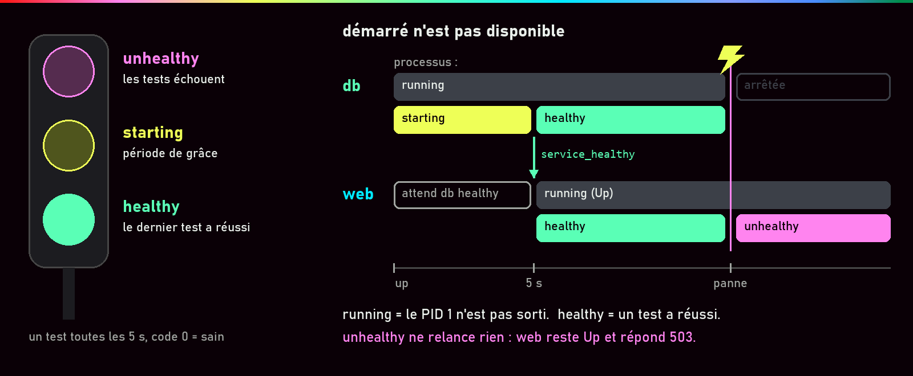
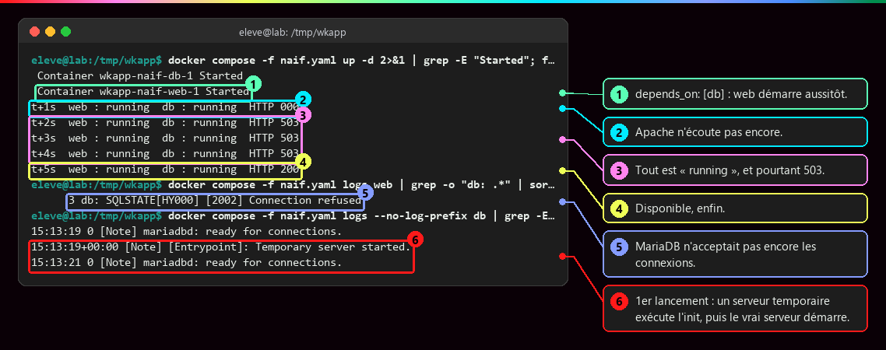
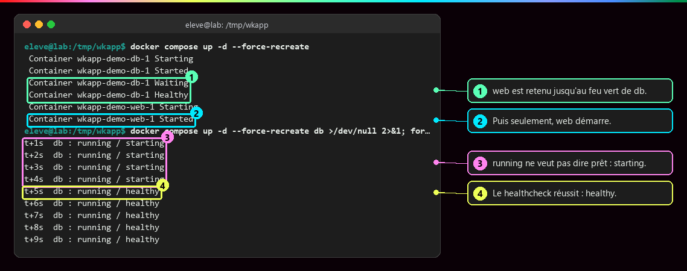
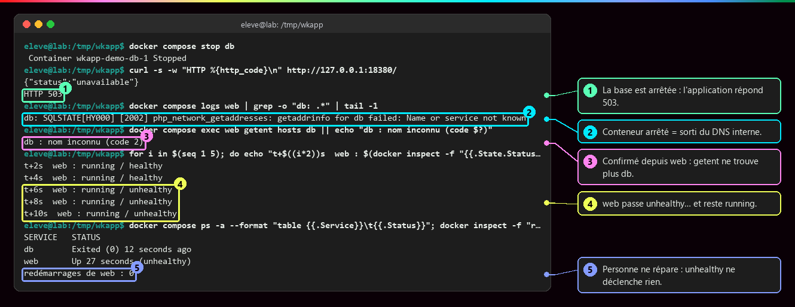
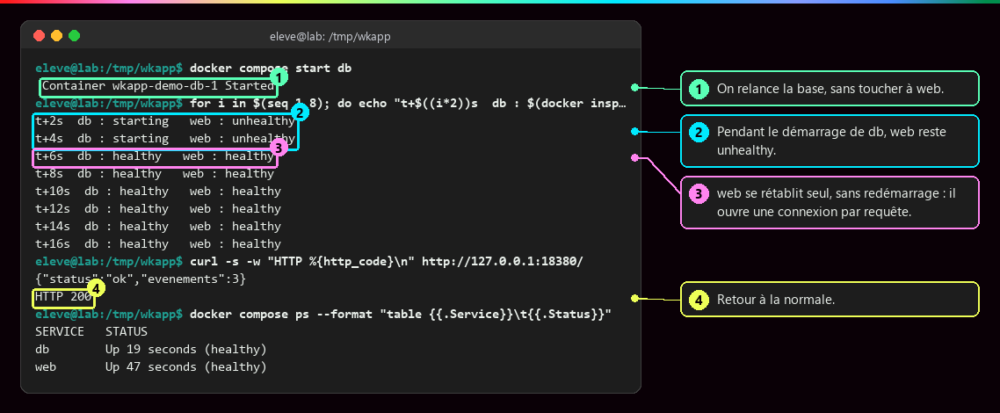
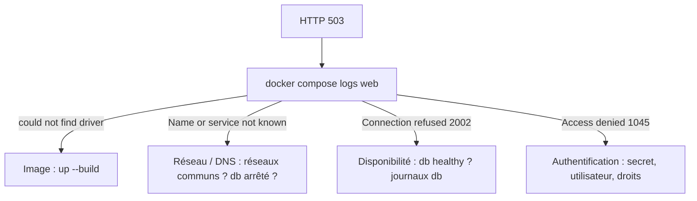

# Démarré n'est pas disponible

<p class="lead">Un conteneur <code>running</code> signifie seulement que son processus principal n'est pas sorti. Pour savoir si un service <strong>répond vraiment</strong>, il faut le <strong>mesurer</strong> (healthcheck), en tenir compte au démarrage (<code>service_healthy</code>) et, en cas de panne, remonter les couches une par une au lieu de tout supprimer.</p>

{ .hero }

!!! abstract "Dans cette page"

    **Tu vas comprendre :**

    - pourquoi un conteneur « allumé » peut quand même renvoyer des erreurs ;
    - comment faire attendre le site jusqu'à ce que sa base soit vraiment prête ;
    - comment trouver la cause d'une erreur 503 sans tout casser.

    **Prérequis :** [Docker Compose](Docker-Compose.md). **Durée :** 40 min. **Niveau :** débutant.

!!! quote "En clair"

    Un restaurant qui a **ouvert ses portes** n'est pas forcément **prêt à servir** : la cuisine chauffe encore. Le healthcheck, c'est le serveur qui passe en cuisine toutes les 5 secondes demander « on peut envoyer ? ». `service_healthy`, c'est attendre ce feu vert avant de faire entrer les clients. La limite : si la cuisine prend feu plus tard, le serveur le **constate**, mais il n'appelle personne.

## L'essentiel en 30 secondes

<div class="grid cards" markdown>

-   :material-play-outline:{ .lg .middle } __Démarré · `running`__

    ---

    Le programme principal est lancé. La base peut encore préparer ses fichiers et refuser les connexions.

-   :material-heart-pulse:{ .lg .middle } __Prêt · healthcheck__

    ---

    Une commande lancée régulièrement dans le conteneur : code 0 = sain. Elle **mesure**, elle ne répare pas.

-   :material-traffic-light-outline:{ .lg .middle } __Attendre · `service_healthy`__

    ---

    `web` ne démarre qu'une fois `db` déclaré **healthy**. La forme courte `depends_on: [db]` n'attend que le lancement.

-   :material-alert-outline:{ .lg .middle } __Le piège · `unhealthy` ne déclenche rien__

    ---

    Pas d'arrêt, pas de recréation, pas d'alerte. La garantie ne valait qu'au démarrage.

</div>

!!! warning "À retenir"

    **Allumé ne veut pas dire prêt.** `docker compose ps` peut afficher `Up` pendant que l'application renvoie des erreurs 503 (« service indisponible »). **Mesurer la santé, réparer, prévenir quelqu'un et tenir malgré une panne** sont quatre choses différentes. Et un `down -v` « pour repartir propre » efface les indices, et la base.

## :material-timer-sand: Démarré, mais pas prêt

| État | Ce qui est vrai | Comment le voir |
|---|---|---|
| **Démarré** (`running`) | le programme principal du conteneur (PID 1) est lancé | `docker compose ps` : `Up` |
| **Serveur actif** | le serveur tourne, mais n'accepte peut-être pas encore de connexions | journaux du service |
| **Prêt** | le service accepte **et traite** les requêtes | healthcheck, requête de bout en bout |

???+ example "En vrai : forme courte de `depends_on`, seconde par seconde"

    **Ce qu'on fait :** on lance le site et sa base avec la forme courte `depends_on: [db]`, puis on interroge le site toutes les secondes en notant l'état des deux conteneurs et le code HTTP reçu.

    

    **Ce qu'il faut regarder :**

    - ① `web` démarre aussitôt après `db`, sans attendre.
    - ② À la première seconde, `000` : Apache n'écoute même pas encore.
    - ③ Les deux conteneurs sont `running`, et pourtant le site répond `503`.
    - ④ Le site devient disponible après quelques secondes seulement.
    - ⑤ Le journal de `web` explique : MariaDB refusait les connexions (`Connection refused`).
    - ⑥ Le journal de `db` montre pourquoi : au premier lancement, un serveur temporaire exécute l'initialisation, puis le vrai serveur démarre.

    **L'ordre de lancement ne garantit pas la disponibilité.**

## :material-heart-pulse: Le healthcheck : une mesure

!!! quote "En clair"

    Le healthcheck est un **thermomètre** : on prend la température à intervalle régulier. Il dit « malade » ou « en forme », il ne soigne rien.

```yaml
services:
  db:
    image: mariadb:11.4
    healthcheck:
      test: ["CMD", "healthcheck.sh", "--connect", "--innodb_initialized"]   # (1)!
      interval: 5s        # (2)!
      timeout: 3s         # (3)!
      retries: 15         # (4)!
      start_period: 20s   # (5)!
  web:
    depends_on:
      db:
        condition: service_healthy   # (6)!
```

1. La commande de test, lancée **dans** le conteneur. Code de sortie 0 = sain. Ici, un outil fourni par l'image MariaDB vérifie qu'on peut se connecter et que le moteur de stockage est prêt.
2. Un test toutes les 5 secondes.
3. Un test qui dure plus de 3 secondes compte comme un échec.
4. 15 échecs **de suite** avant de déclarer le conteneur `unhealthy`.
5. Période de grâce au démarrage : pendant 20 s, les échecs ne comptent pas (un succès, lui, compte tout de suite).
6. `web` ne démarre que lorsque `db` est `healthy`. La forme courte `depends_on: [db]` équivaut à `service_started` : attendre seulement le lancement.

???+ example "En vrai : `Waiting`, puis `Healthy`, puis seulement `web`"

    **Ce qu'on fait :** on relance l'application avec `condition: service_healthy`, puis on recrée la base seule et on note son état chaque seconde.

    

    **Ce qu'il faut regarder :**

    - ① Compose retient `web` (`Waiting`) jusqu'à ce que `db` soit `Healthy`.
    - ② Alors seulement, `web` démarre.
    - ③ Pendant 4 secondes, `db` est `running` mais `starting` : lancé, pas encore prêt.
    - ④ Le healthcheck réussit : `healthy`.

    `healthcheck.sh` est fourni par les images MariaDB récentes : pour une autre image, on prend l'outil adapté (`pg_isready` pour PostgreSQL, une requête HTTP pour un serveur web). Un script d'automatisation attend la même chose avec `docker compose up -d --wait`. L'historique des derniers tests se lit avec `docker inspect -f '{{json .State.Health.Log}}' <conteneur>`.

| Forme de `depends_on` | Compose attend… | Garantie |
|---|---|---|
| `[db]` (courte) | que `db` soit **lancé** | un ordre de démarrage et d'arrêt |
| `condition: service_healthy` | que le healthcheck de `db` dise **healthy** | une dépendance prête, **au démarrage** |
| `condition: service_completed_successfully` | qu'un service ponctuel (migration, init) **se termine sans erreur** (code 0) | une tâche préalable réussie |

## :material-flash-alert-outline: Une panne après le démarrage

Ici `web` a aussi un healthcheck (`curl` sur sa propre page), qui dépend donc de la base.

???+ danger "En vrai : la base tombe, `web` reste `Up`"

    **Ce qu'on fait :** l'application tourne. On arrête la base, puis on observe le site, ses journaux et l'état de `web` pendant 10 secondes.

    

    **Ce qu'il faut regarder :**

    - ① Le site répond `503` : Apache et PHP fonctionnent, le code signale proprement que la base manque.
    - ② Le journal dit `Name or service not known` : un conteneur arrêté **sort du DNS** de Docker.
    - ③ Confirmé depuis `web` : le nom `db` est devenu inconnu.
    - ④ `web` passe `unhealthy`… et reste `running`.
    - ⑤ Zéro redémarrage : personne ne répare, personne n'est prévenu.

???+ example "En vrai : la base revient, l'application se rétablit seule"

    **Ce qu'on fait :** on relance seulement la base, et on suit l'état des deux services toutes les 2 secondes.

    

    **Ce qu'il faut regarder :**

    - ① On relance la base, sans toucher à `web`.
    - ② Tant que `db` démarre, `web` reste `unhealthy`.
    - ③ `web` redevient `healthy` tout seul, sans redémarrage : il ouvre une nouvelle connexion à chaque requête.
    - ④ Retour à la normale : `200`.

    Un client robuste prévoit des délais de connexion courts, de nouvelles tentatives espacées de plus en plus, une réponse `503` claire (éventuellement avec `Retry-After`), sans planter ni écrire de secret dans ses journaux.

| Fonction | Question | Avec Docker seul |
|---|---|---|
| **Santé** | Le service répond-il ? | le healthcheck, qui **observe** |
| **Réparation** | Qui relance ou remplace ? | `restart:`, seulement si le **programme s'arrête** |
| **Supervision** | Qui est prévenu ? | rien par défaut : il faut un outil d'alerte |
| **Haute disponibilité** | Tient-on si un conteneur ou une machine tombe ? | rien : plusieurs copies et un [orchestrateur](Pourquoi-orchestrer.md) |

## :material-magnify: Diagnostiquer un 503, couche par couche

!!! quote "En clair"

    Comme un médecin : on écoute le symptôme, on lit le dossier (les journaux), on examine organe par organe. On n'opère pas avant d'avoir trouvé.

Le même symptôme a eu trois causes différentes sur la même application : pilote PHP absent, base pas encore prête, base arrêtée. On **lit l'erreur dans son contexte** avant de corriger.

| Message dans `docker compose logs web` | Couche en cause | Correction |
|---|---|---|
| `could not find driver` | **image** | reconstruire (`up --build -d`), voir [Docker Compose](Docker-Compose.md) |
| `Name or service not known` | **réseau / DNS** : pas de réseau commun, conteneur arrêté | réseaux, nom du service |
| `Connection refused` (2002) | **disponibilité** : la base ne répond pas (encore) | santé de `db`, ses journaux |
| `Access denied` (1045) | **authentification** | identifiants, secret, droits SQL |
| HTTP `500`, `PHP Fatal error` | **code de l'application** | journal web, avec une base `healthy` |

| # | Question | Commande |
|---|---|---|
| 1 | `web` est-il `running` ? | `docker compose ps` |
| 2 | Apache/PHP répond-il ? | `curl -i http://127.0.0.1:8080/` (un 503 prouve déjà que oui) |
| 3 | `db` est-il trouvé depuis `web` ? | `docker compose exec web getent hosts db` |
| 4 | Le port SQL est-il joignable ? | `docker compose exec web bash -c 'echo > /dev/tcp/db/3306' && echo ouvert` |
| 5 | MariaDB est-il sain, la base initialisée ? | `docker compose ps`, `docker compose logs --tail=80 db` |
| 6 | Identifiants et droits valides ? | `docker compose logs --tail=80 web` (`Access denied` ?) |



## :material-flask-outline: À toi de jouer

Six étapes, environ 10 minutes. Un service `lent` qui met volontairement 10 secondes à être prêt, et un `client` qui doit l'attendre.

**Étape 1 · Écrire le fichier**

```bash
mkdir sante && cd sante   # (1)!
nano compose.yaml         # (2)!
```

1. Crée le dossier du projet et entre dedans.
2. Colle le fichier ci-dessous, puis ++ctrl+o++, ++enter++ et ++ctrl+x++.

```yaml
services:
  lent:
    image: alpine:3.22
    command: sh -c 'echo "lent lancé à $$(date +%T)"; sleep 10; touch /tmp/pret; sleep infinity'   # (1)!
    healthcheck:
      test: ["CMD-SHELL", "test -f /tmp/pret"]   # (2)!
      interval: 2s
      timeout: 1s
      retries: 3                                  # (3)!
      start_period: 15s                           # (4)!
  client:
    image: alpine:3.22
    command: sh -c 'echo "client démarré à $$(date +%T)"; sleep infinity'
    depends_on:
      lent:
        condition: service_healthy                # (5)!
```

1. Le service note l'heure, attend 10 s, crée le fichier `/tmp/pret`, puis reste allumé. `$$` : Compose remplace les `$` par des variables ; doubler le `$` le fait arriver tel quel dans le conteneur.
2. La sonde : « le fichier `/tmp/pret` existe-t-il ? ». `CMD-SHELL` lance le test dans un shell.
3. 3 échecs de suite (un test toutes les 2 s) suffisent pour passer `unhealthy`.
4. Pendant les 15 premières secondes, les échecs ne comptent pas : le temps de se préparer.
5. `client` attend que `lent` soit `healthy`.

**Étape 2 · Lancer et observer l'attente**

```bash
docker compose up -d   # (1)!
```

1. La commande ne rend la main qu'après une dizaine de secondes : Compose attend le feu vert de `lent`.

Tu dois voir, à la fin, `lent` passer de `Waiting` à `Healthy`, et alors seulement `client` démarrer (extrait) :

```text
 Container sante-lent-1 Started
 Container sante-lent-1 Waiting
 Container sante-lent-1 Healthy
 Container sante-client-1 Starting
 Container sante-client-1 Started
```

**Étape 3 · Vérifier l'ordre**

```bash
docker compose ps     # (1)!
docker compose logs   # (2)!
```

1. L'état des deux conteneurs, avec la santé de `lent` entre parenthèses.
2. Les messages des deux services, préfixés par leur nom.

Tu dois voir `lent` en `(healthy)`, puis deux heures séparées d'environ 10 secondes (les tiennes seront différentes) :

```text
NAME             IMAGE         COMMAND                   SERVICE   CREATED          STATUS                    PORTS
sante-client-1   alpine:3.22   "sh -c 'echo \"client…"   client    11 seconds ago   Up Less than a second
sante-lent-1     alpine:3.22   "sh -c 'echo \"lent l…"   lent      11 seconds ago   Up 11 seconds (healthy)
lent-1    | lent lancé à 15:44:59
client-1  | client démarré à 15:45:10
```

**Étape 4 · Provoquer une panne**

```bash
docker compose exec lent rm /tmp/pret                      # (1)!
sleep 10                                                   # (2)!
docker compose ps
docker inspect -f '{{.RestartCount}}' sante-lent-1         # (3)!
```

1. Supprime le fichier testé par la sonde : le service « tombe malade ».
2. Attend 10 secondes, le temps de 3 échecs de suite.
3. Combien de fois Docker a relancé `lent`.

Tu dois voir `lent` en `(unhealthy)` mais toujours `Up`, et aucun redémarrage :

```text
NAME             IMAGE         COMMAND                   SERVICE   CREATED          STATUS                      PORTS
sante-client-1   alpine:3.22   "sh -c 'echo \"client…"   client    23 seconds ago   Up 12 seconds
sante-lent-1     alpine:3.22   "sh -c 'echo \"lent l…"   lent      23 seconds ago   Up 23 seconds (unhealthy)
0
```

**Étape 5 · Soigner**

```bash
docker compose exec lent touch /tmp/pret                                  # (1)!
sleep 3
docker compose ps --format "table {{.Service}}\t{{.Status}}"              # (2)!
```

1. Recrée le fichier : la prochaine sonde réussira.
2. Affiche seulement le service et son état.

Tu dois voir `lent` de nouveau `(healthy)`, sans avoir été redémarré :

```text
SERVICE   STATUS
client    Up 16 seconds
lent      Up 27 seconds (healthy)
```

**Étape 6 · Faire le ménage**

```bash
docker compose down       # (1)!
cd .. && rm -r sante
```

1. Supprime les deux conteneurs et le réseau du projet.

Tu dois voir (extrait) :

```text
 Container sante-client-1 Removed
 Container sante-lent-1 Removed
 Network sante_default Removed
```

??? tip "Ça ne marche pas ?"

    | Message | Cause | Solution |
    |---|---|---|
    | `dependency failed to start: container sante-lent-1 is unhealthy` | la sonde n'a jamais réussi : fichier testé jamais créé, faute de frappe, `start_period` trop court | compare la ligne `test` et la ligne `command`, puis `docker compose down` et recommence |
    | `up -d` rend la main tout de suite et `lent` n'a pas de `(healthy)` | le bloc `healthcheck` est mal décalé ou absent | `docker compose config` pour voir ce que Compose a compris |
    | `service "lent" is not running` | le conteneur s'est arrêté | `docker compose ps -a`, `docker compose logs lent` |
    | `no configuration file provided: not found` | tu n'es pas dans le dossier `sante` | `cd sante` |
    | `Error: no such object: sante-lent-1` | le nom réel du conteneur est différent | prends le nom affiché par `docker compose ps` |

## :material-help-circle-outline: Vérifie que tu as compris

??? question "1. `docker compose ps` affiche `Up` pour la base. Le site peut-il quand même répondre 503 ?"

    **Oui.** `Up` dit seulement que le programme principal tourne. La base peut être en train de s'initialiser et refuser les connexions. Seul un healthcheck, ou une vraie requête, dit si elle est prête.

??? question "2. Ta base passe `unhealthy` en pleine nuit. Que fait Docker ?"

    **Rien.** Il note l'état, c'est tout : pas de redémarrage (on l'a vu à l'étape 4, compteur à 0), pas d'alerte. Réparer, prévenir et tenir malgré la panne demandent d'autres outils.

??? question "3. Le site renvoie 503 et le journal de `web` dit `Name or service not known`. Faut-il reconstruire l'image ?"

    **Non.** Ce message vise la couche **réseau / DNS** : le nom `db` n'est pas trouvé, parce que la base est arrêtée ou que les deux services ne partagent pas de réseau. On vérifie `docker compose ps` et les réseaux, pas le Dockerfile.

!!! success "Et ensuite ?"

    Ton application démarre dans le bon ordre et tu sais lire ses pannes. Page suivante : [Sécurité des images](Securite-des-images.md), pour durcir ce que tu as construit.

## :material-server: Pour aller plus loin

??? note "Prouver qu'un projet se relance depuis zéro"

    Une application peut ne marcher que grâce à un état caché : un fichier modifié par `exec`, un vieux volume déjà initialisé, une variable du terminal, un réseau oublié. La seule preuve est un démarrage **depuis un environnement propre**, sous un autre nom de projet.

    ```bash
    git clone <depot> /tmp/essai-propre && cd /tmp/essai-propre
    mkdir -p secrets && openssl rand -hex 18 > secrets/db_root_password \
                     && openssl rand -hex 18 > secrets/db_app_password
    docker compose -p essai-propre up --build -d --wait
    curl -s http://127.0.0.1:8080/
    docker compose -p essai-propre down -v      # ici seulement : projet jetable, volume de test
    ```

    Un projet livrable contient : `Dockerfile` et `.dockerignore` ; fichiers de l'application et scripts SQL ; `compose.yaml` ; la procédure de création des secrets ; les instructions de démarrage et de vérification ; les justifications et des preuves ciblées. **Jamais** les fichiers de secrets, les données réelles ni les sauvegardes.

??? note "Récapitulatif : faire tourner une application complète"

    | Ne pas confondre | Avec |
    |---|---|
    | Port écouté dans le conteneur | Port publié sur l'hôte ([Réseaux et ports](Reseaux-et-ports.md)) |
    | Adresse IP d'un conteneur | Nom du service ([Réseaux et ports](Reseaux-et-ports.md)) |
    | Couche inscriptible | Volume persistant ([Stockage et volumes](Stockage-et-volumes.md)) |
    | Persistance | Sauvegarde ([Stockage et volumes](Stockage-et-volumes.md)) |
    | `depends_on` | Disponibilité effective (cette page) |
    | Healthcheck | Réparation automatique, haute disponibilité (cette page) |
    | Compose | Orchestrateur multi-machines ([Docker Compose](Docker-Compose.md)) |

    Trois niveaux complémentaires : l'**image** (ce que l'application contient), le **service Compose** (comment elle s'exécute et communique), l'**exploitation** (observer, sauvegarder, diagnostiquer, restaurer). `compose.yaml` ne remplace ni une stratégie de sauvegarde, ni une supervision. Pour aller vers la sécurité : [Identités, privilèges et capabilities](Identites-et-privileges.md) ; vers l'orchestration : [Pourquoi orchestrer ?](Pourquoi-orchestrer.md).

??? abstract "Pour les créateurs : script de motion design « Le feu passe au vert » (65 s)"

    Deux cartes de conteneurs (db en vert, web en bleu) sur une ligne de départ ; un feu tricolore au-dessus de db (orange `starting`, vert `healthy`, rouge `unhealthy`). Un chronomètre en haut à droite.

    | Séq. | Durée | À l'écran | Animation | Texte à l'écran |
    |---|---|---|---|---|
    | 1 | 0-8 s | Les deux cartes démarrent **en même temps** ; `Up` s'allume sur les deux | web envoie des enveloppes qui rebondissent ; compteur : `000`, `503`, `503`, puis `200` | « Démarrés en même temps. Prêts à des moments différents. » |
    | 2 | 8-16 s | Zoom sur db : un sablier « initialisation InnoDB », un serveur temporaire sans port | Le sablier s'écoule ; `Up` reste allumé | « running veut dire : le processus est lancé. Pas : le service répond. » |
    | 3 | 16-26 s | Un feu **orange** au-dessus de db, web retenu derrière une barrière | Toutes les 5 s, une sonde descend dans db et remonte avec une croix | « Un healthcheck mesure. Pendant start_period, les échecs ne comptent pas. » |
    | 4 | 26-34 s | La sonde remonte avec une coche | Le feu passe au **vert**, la barrière se lève, web démarre | « condition: service_healthy : web attend le feu vert. » |
    | 5 | 34-40 s | Première enveloppe de web | Elle revient avec « 200 » | « Première requête : réussie. » |
    | 6 | 40-50 s | Un éclair frappe db, qui s'éteint ; son nom s'efface de l'annuaire DNS | web reste allumé, ses enveloppes reviennent avec « 503 » ; aucune main, aucune alarme | « La garantie ne valait qu'au démarrage. Personne ne répare. » |
    | 7 | 50-58 s | db redémarre : feu orange puis vert ; son nom réapparaît | Les enveloppes reviennent avec « 200 », sans que web ait redémarré | « Un client qui réessaie se rétablit tout seul. » |
    | 8 | 58-65 s | Quatre pictogrammes : stéthoscope, clé, cloche, serveurs jumeaux | Le stéthoscope s'allume, les trois autres restent gris | « Mesurer la santé n'est ni réparer, ni prévenir, ni tenir la charge. » |

    Garder le chronomètre visible : l'écart entre `Up` (quasi immédiat) et `healthy` (plusieurs secondes) doit se **lire en chiffres**. En séquence 6, l'absence de toute réaction est le message.

??? info "Pour les créateurs : idées de schémas"

    **La séquence de démarrage contrôlée.**

    ```mermaid
    sequenceDiagram
        participant C as docker compose up
        participant D as Conteneur db
        participant H as Healthcheck
        participant W as Conteneur web
        C->>D: créer et démarrer
        Note over D: running, initialisation en cours
        loop toutes les 5 s
            H->>D: healthcheck.sh --connect --innodb_initialized
            D-->>H: échec (ignoré pendant start_period)
        end
        H->>D: nouveau test
        D-->>H: succès (code 0)
        Note over D: healthy
        C->>W: démarrer web (condition service_healthy)
        W->>D: première requête SQL : OK
    ```

    **Santé, réparation, supervision, haute disponibilité.** Quatre pictogrammes alignés, chacun avec sa question : un stéthoscope (healthcheck), une clé à molette (politique `restart`), une cloche (supervision), deux serveurs jumeaux (plusieurs instances et orchestrateur). Sous Docker seul, seuls les deux premiers sont colorés, et la clé n'agit que si le processus s'arrête.
