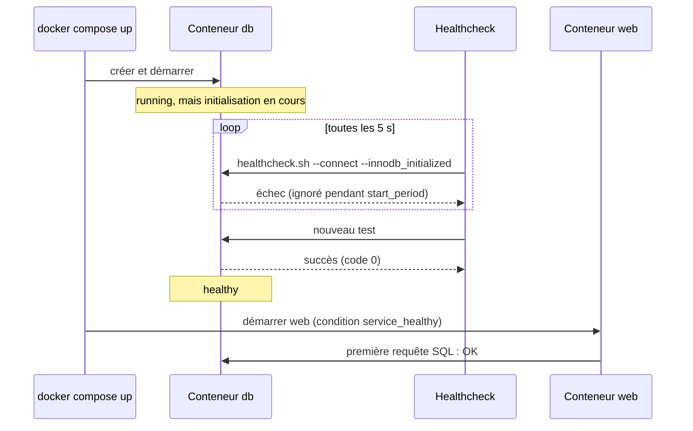
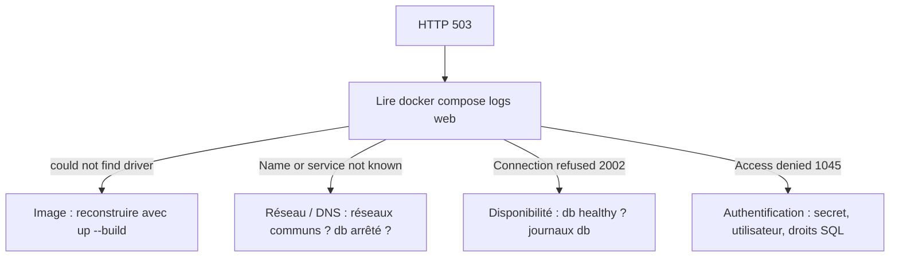

# Démarré n'est pas disponible : healthchecks et diagnostic

> **En une phrase.** Un conteneur `running` signifie seulement que son processus principal n'est pas sorti : pour savoir si un service **répond vraiment**, il faut le **mesurer** (healthcheck), en tenir compte au démarrage (`depends_on` avec `condition: service_healthy`), et, en cas de panne, remonter les couches une par une au lieu de tout supprimer.

---

## 1. Synthèse

### Le modèle mental : trois états à ne pas confondre

| État | Ce qui est vrai | Comment le voir |
|---|---|---|
| **Démarré** (`running`) | le processus principal (PID 1) du conteneur est lancé | `docker compose ps` : `Up` |
| **Processus serveur actif** | le serveur tourne, mais n'accepte peut-être pas encore de connexions (initialisation, récupération de fichiers) | journaux du service |
| **Prêt** (disponible) | le service accepte **et traite** réellement les requêtes | un test applicatif : healthcheck, requête de bout en bout |

Un conteneur MariaDB peut être `running` alors qu'il initialise son répertoire de données, vérifie ou récupère ses fichiers, ou refuse encore les connexions. Si PHP démarre aussitôt, ses premières requêtes échouent. **L'ordre de création ne garantit pas la disponibilité effective.**

### `depends_on` : deux formes, deux garanties

| Forme | Écriture | Compose attend… | Garantie |
|---|---|---|---|
| Courte | `depends_on: [db]` | que `db` soit **lancé** (`condition: service_started`) | un **ordre** de démarrage et d'arrêt |
| Longue | `depends_on: { db: { condition: service_healthy } }` | que le healthcheck de `db` soit **healthy** | une dépendance **prête**, au moment du démarrage |
| Longue | `condition: service_completed_successfully` | qu'un service ponctuel (migration, init) se **termine avec le code 0** | une tâche préalable réussie |

La différence compte au premier lancement, après un incident et lors de certaines reconfigurations.

### Le healthcheck : une mesure, pas une réparation

Un **healthcheck** est une commande que le moteur exécute **périodiquement** dans le conteneur pour évaluer sa santé déclarée.

| Paramètre | Rôle | Valeur de l'exemple MariaDB |
|---|---|---|
| `test` | la commande ; code de sortie 0 = sain | `healthcheck.sh --connect --innodb_initialized` |
| `interval` | délai entre deux tests | `5s` |
| `timeout` | durée maximale d'un test | `3s` |
| `retries` | échecs consécutifs avant `unhealthy` | `15` |
| `start_period` | période de grâce au démarrage : les échecs n'y comptent pas | `20s` |

| Statut | Signification |
|---|---|
| `starting` | période de démarrage, vérifications initiales |
| `healthy` | le dernier contrôle a réussi |
| `unhealthy` | les contrôles ont échoué selon la politique configurée |

Un healthcheck pertinent teste **ce que l'on veut réellement garantir**. Celui de MariaDB vérifie le serveur SQL et l'initialisation d'InnoDB, pas le bon fonctionnement de l'application PHP.

### Quatre fonctions distinctes

| Fonction | Question | Qui la remplit (Docker seul) |
|---|---|---|
| **Supervision** | Qui est prévenu d'une panne ? | rien par défaut : il faut un outil d'alerte |
| **Santé** | Le service répond-il ? | le healthcheck, qui **observe** |
| **Réparation** | Qui relance ou remplace ? | une politique `restart:`, seulement si le **processus s'arrête** |
| **Haute disponibilité** | Le service survit-il à la perte d'une instance ou d'un hôte ? | rien : il faut plusieurs instances et un orchestrateur |

Docker Engine n'assimile pas `unhealthy` à l'arrêt du processus principal : un conteneur `unhealthy` n'est **ni arrêté, ni recréé**. Une politique de redémarrage ne résout pas non plus une panne applicative ou une incohérence de données.

### Méthode de diagnostic : du symptôme à la couche

| Observation | Hypothèse à examiner |
|---|---|
| Pas de réponse sur `localhost:8080` | publication, serveur web, processus |
| PHP répond `503` | dépendance SQL ou code applicatif |
| `db` introuvable depuis `web` | réseaux, nom de service, DNS |
| Base vide après recréation | volume réellement utilisé, initialisation |
| `db` en `unhealthy` | santé réelle et journaux MariaDB |

| Message d'erreur | Couche en cause | Correction |
|---|---|---|
| `could not find driver` (pilote PHP absent) | **image** | reconstruire l'image (`up --build -d`) |
| `Name or service not known` | **réseau / DNS** : pas de réseau commun, nom absent, conteneur arrêté | réseaux, nom du service |
| `Connection refused` (code 2002) | **écoute / disponibilité** : la base ne répond pas (encore) | santé de `db`, journaux, healthcheck |
| `Access denied` (code 1045) | **authentification / privilèges SQL** | identifiants, secret, droits SQL |
| HTTP `500`, `PHP Fatal error` | **code applicatif** | journal web, avec une base `healthy` |

Un diagnostic robuste repose sur **plusieurs preuves concordantes**.

### Récapitulatif : faire tourner une application complète

**Les distinctions essentielles.**

| Ne pas confondre | Avec |
|---|---|
| Port écouté dans le conteneur | Port publié sur l'hôte ([Réseaux et ports](Reseaux-et-ports.md)) |
| Adresse IP d'une instance | Nom logique du service ([Réseaux et ports](Reseaux-et-ports.md)) |
| Couche inscriptible | Volume persistant ([Stockage et volumes](Stockage-et-volumes.md)) |
| Persistance | Sauvegarde ([Stockage et volumes](Stockage-et-volumes.md)) |
| `depends_on` | Disponibilité effective (cette page) |
| Healthcheck | Auto-réparation, haute disponibilité (cette page) |
| Compose | Orchestrateur multi-hôtes ([Docker Compose](Docker-Compose.md), [Pourquoi orchestrer ?](Pourquoi-orchestrer.md)) |

**Trois niveaux de description, complémentaires.**

1. **L'image Docker** : ce que l'application contient et lance par défaut.
2. **Le service Compose** : comment une instance doit s'exécuter, communiquer et accéder à ses ressources.
3. **L'exploitation** : comment observer, sauvegarder, diagnostiquer et restaurer le service.

Un même fichier ne règle pas tout : `compose.yaml` ne remplace ni une stratégie de sauvegarde, ni une supervision.

**La suite : sécuriser.**

On sait maintenant construire des services, les faire communiquer et conserver leurs données. Reste à traiter systématiquement les identités et permissions des processus, les capabilities et privilèges, les secrets, les images et la surface d'attaque, les politiques de durcissement, puis les limites de Compose face aux exigences d'orchestration : à partir de [Sécurité des images](Securite-des-images.md).

> [!IMPORTANT]
> **Les pièges à retenir**
> 1. **`running` ≠ prêt.** `docker compose ps` peut afficher `Up` pendant que l'application renvoie des erreurs.
> 2. **La forme courte de `depends_on` n'attend pas que la base réponde.** Elle règle l'ordre, pas la disponibilité.
> 3. **`service_healthy` ne vaut qu'au démarrage.** Si la base tombe ensuite, rien ne prévient ni n'arrête `web` : le code applicatif doit gérer les coupures.
> 4. **`unhealthy` ne déclenche rien.** Healthcheck, redémarrage, supervision et haute disponibilité sont quatre fonctions différentes.
> 5. **Ne pas commencer par tout supprimer.** Un `down -v` « pour repartir propre » efface les preuves, et la base.
> 6. **Une application qui marche « chez moi » peut dépendre d'un état caché** (fichier modifié dans un conteneur, vieux volume, variable hors du projet, réseau oublié). La seule preuve est un démarrage depuis un environnement propre.

---

## 2. Cas d'usage classiques

### Cas 1 : mesurer l'écart entre « démarré » et « prêt »

**Besoin.** Voir ce qui se passe, seconde par seconde, sans healthcheck (forme courte de `depends_on`).

```bash
docker compose stop
docker compose up -d
for i in $(seq 1 8); do
  printf "t+%ss %s\n" $i "$(curl -s -o /dev/null -w %{http_code} http://127.0.0.1:8080/)"
  sleep 1
done
```

**Ce qu'on observe sur un poste de test.**

```
t+1s 000     ← Apache n'écoute pas encore
t+2s 503     ← PHP répond, MariaDB n'accepte pas encore les connexions
t+3s 503
t+4s 200     ← service réellement disponible
```

Pendant tout ce temps, `docker compose ps` affiche `Up` pour les deux services. Au tout premier lancement, c'est plus long encore : le point d'entrée de MariaDB initialise les fichiers, démarre un **serveur temporaire** sans port réseau pour exécuter les scripts d'initialisation, puis redémarre le vrai serveur (le journal affiche `Temporary server started`, puis plus tard `ready for connections`). Sur un poste de test, des requêtes envoyées juste après un tel démarrage ont reçu `SQLSTATE[HY000] [2002] Connection refused` : MariaDB n'avait pas encore ouvert son port.
**À retenir.** Le statut `running` dit seulement que le PID 1 n'est pas sorti.

### Cas 2 : faire attendre le service web avec un healthcheck

**Besoin.** Que `web` ne démarre qu'une fois la base réellement prête.

```yaml
services:
  db:
    image: mariadb:11.4
    healthcheck:
      test: ["CMD", "healthcheck.sh", "--connect", "--innodb_initialized"]
      interval: 5s
      timeout: 3s
      retries: 15
      start_period: 20s
  web:
    depends_on:
      db:
        condition: service_healthy
```

```bash
docker compose up -d --force-recreate
```

```
 Container webapp-db-1   Started
 Container webapp-db-1   Waiting
 Container webapp-db-1   Healthy
 Container webapp-web-1  Started
```

**Ce qu'on observe.** Compose **attend** (`Waiting`) que `db` soit `Healthy` avant de lancer `web`. Les quatre premières requêtes reçoivent toutes `200`. `docker compose config` montre la forme normalisée : `condition: service_healthy`, `required: true`.
**À retenir.** `healthcheck.sh` est un script fourni par les images officielles MariaDB récentes : on ne l'invente pas pour une autre image, on utilise l'outil de contrôle adapté (`pg_isready` pour PostgreSQL, une requête HTTP pour un serveur web, etc.). Pour qu'un script d'automatisation attende lui aussi la santé des services, `docker compose up -d --wait` rend la main seulement quand ils sont prêts.

### Cas 3 : lire l'état de santé d'un conteneur

```bash
docker compose ps --format "{{.Service}} {{.Status}}"      # db Up 7 seconds (healthy)
docker inspect -f '{{.State.Health.Status}}' webapp-db-1          # healthy
docker inspect -f '{{json .State.Health.Log}}' webapp-db-1        # derniers tests : début, fin, code, sortie
```

**Ce qu'on observe.** Le moteur conserve l'historique des derniers tests, avec leur code de sortie et leur sortie texte : c'est la première chose à lire quand un service passe `unhealthy`.

### Cas 4 : une panne **après** le démarrage

**Besoin.** Comprendre ce que garantit (et ne garantit pas) `service_healthy` quand la base tombe en cours de route.

```bash
docker compose stop db
docker compose ps --format "{{.Service}} {{.Status}}"   # web Up 11 seconds   (db n'apparaît plus)
curl -i http://127.0.0.1:8080/                          # HTTP/1.1 503 Service Unavailable, en 1,18 s
docker compose logs --tail=2 web
```

```
[php:notice] ... SQLSTATE[HY000] [2002] php_network_getaddresses: getaddrinfo for db failed: Name or service not known
"GET / HTTP/1.1" 503
```

```bash
docker compose start db
docker compose ps --format "{{.Service}} {{.Status}}"   # db Up 1 second (health: starting)
# ... environ 7 s plus tard : db Up 7 seconds (healthy)
curl -s -o /dev/null -w "%{http_code}\n" http://127.0.0.1:8080/   # 200, sans redémarrer web
```

**Ce qu'on observe sur un poste de test.** `web` reste `Up` : il n'est ni arrêté ni prévenu. Un conteneur arrêté **disparaît du DNS** de Docker, d'où `Name or service not known`. Apache et PHP fonctionnent toujours : seul leur service dépendant manque, et le code renvoie proprement `503`. Au redémarrage de `db`, l'application se rétablit seule, parce qu'elle ouvre une nouvelle connexion à chaque requête.
**À retenir.** Le contrôle initial ne garantit pas le maintien de la disponibilité. Une panne ultérieure exige du **diagnostic**, une **politique de reprise** adaptée et des **clients capables de gérer les échecs transitoires** : délais de connexion courts, nouvelles tentatives avec attente progressive, réponse `503` explicite (éventuellement avec `Retry-After`), sans planter ni journaliser de secret.

### Cas 5 : diagnostiquer un 503 méthodiquement

**Besoin.** L'application répond `503`. Avant de toucher à quoi que ce soit, poser les questions **dans l'ordre des couches** :

| # | Question | Commande |
|---|---|---|
| 1 | Le conteneur `web` est-il `running` ? | `docker compose ps` |
| 2 | Apache/PHP accepte-t-il des requêtes ? | `curl -i http://127.0.0.1:8080/` (un 503 prouve déjà que oui) |
| 3 | Le nom `db` est-il résolu depuis `web` ? | `docker compose exec web getent hosts db` |
| 4 | Le port SQL est-il accessible ? | `docker compose exec web bash -c 'echo > /dev/tcp/db/3306' && echo ouvert` |
| 5 | MariaDB est-il sain, la base initialisée ? | `docker compose ps`, `docker compose logs --tail=80 db` |
| 6 | Les identifiants et les droits SQL sont-ils valides ? | `docker compose logs --tail=80 web` (`Access denied` ?) |

**Ce qu'on observe.** Le même symptôme (`503`) a eu, sur un poste de test, trois causes différentes à des moments différents : pilote PHP absent (`could not find driver`, l'image était à reconstruire), base pas encore prête (`Connection refused`, juste après le démarrage), base arrêtée (`Name or service not known`).
**À retenir.** Un symptôme HTTP peut venir de plusieurs couches : on **lit l'erreur dans son contexte** avant de choisir la correction. Pilote absent → image ; connexion refusée → réseau, écoute ou disponibilité ; accès refusé → authentification ou privilèges SQL.

### Cas 6 : prouver la reproductibilité depuis un environnement propre

**Besoin.** S'assurer que l'application ne marche pas seulement « grâce à » un état local oublié.

Une application fonctionne parfois uniquement grâce à :
- un fichier modifié à la main dans un conteneur (`exec`) ;
- un volume local ancien, déjà initialisé ;
- une variable définie dans le shell, hors du projet ;
- un réseau préexistant oublié.

```bash
git clone <depot> /tmp/essai-propre && cd /tmp/essai-propre
mkdir -p secrets && openssl rand -hex 18 > secrets/db_root_password \
                 && openssl rand -hex 18 > secrets/db_app_password
docker compose -p essai-propre up --build -d --wait
curl -s http://127.0.0.1:8080/
docker compose -p essai-propre down -v      # ici seulement : projet jetable, volume de test
```

**Ce qu'on observe.** Le nom de projet distinct (`-p essai-propre`) crée des réseaux et un volume **neufs**, sans toucher au projet existant (le port 8080 doit toutefois être libre). Sur un poste de test, après le passage du réseau par défaut à `frontend`/`backend`, l'ancien réseau `webapp_default` était resté présent : exactement le genre de reliquat qui fausse un essai.
**À retenir.** La reproductibilité exige que toutes les ressources nécessaires soient **décrites** (fichiers du projet), **fournies**, ou **explicitement documentées** (procédure de création des secrets).

> [!TIP]
> **Ce que contient un projet livrable.** `Dockerfile` et `.dockerignore` ; fichiers applicatifs et scripts SQL fournis ; `compose.yaml` ; la procédure de création locale des secrets ; les instructions de démarrage et de vérification ; les justifications techniques et des preuves ciblées. **Jamais** les fichiers de secrets, ni les données réelles, ni les sauvegardes.

---

## 3. Idées de schémas

### Schéma A : la séquence de démarrage contrôlée



### Schéma B : la garantie ne vaut qu'au démarrage


### Schéma C : l'arbre de diagnostic d'un 503



### Schéma D : santé, réparation, supervision, haute disponibilité

Quatre pictogrammes alignés, chacun avec sa question : un stéthoscope (« le service répond-il ? » : healthcheck), une clé à molette (« qui relance ? » : politique `restart`), une cloche (« qui est prévenu ? » : supervision), deux serveurs jumeaux (« survit-on à une perte ? » : plusieurs instances et orchestrateur). Sous Docker seul, seuls les deux premiers sont colorés, et la clé à molette n'agit que si le processus s'arrête.

---

## 4. Script de motion design : « Le feu passe au vert » (environ 65 s)

Style : deux cartes de conteneurs (db en vert, web en bleu) sur une ligne de départ ; un feu tricolore au-dessus de db représente son statut de santé (orange `starting`, vert `healthy`, rouge `unhealthy`). Un chronomètre en haut à droite.

| Séq. | Durée | À l'écran | Animation | Texte à l'écran |
|---|---|---|---|---|
| 1 | 0-8 s | Les deux cartes démarrent **en même temps** (forme courte de `depends_on`) ; l'étiquette `Up` s'allume sur les deux | web envoie aussitôt des enveloppes vers db, qui rebondissent ; compteur de réponses : `000`, `503`, `503`, puis `200` | « Démarrés en même temps. Prêts à des moments différents. » |
| 2 | 8-16 s | Zoom sur db : à l'intérieur, un sablier « initialisation InnoDB », un serveur temporaire sans port | Le sablier s'écoule ; l'étiquette `Up` reste allumée tout le temps | « running veut dire : le processus est lancé. Pas : le service répond. » |
| 3 | 16-26 s | Retour au départ ; un feu **orange** apparaît au-dessus de db, web est retenu derrière une barrière | Toutes les 5 s, une petite sonde descend du feu dans db et remonte avec une croix | « Un healthcheck mesure. Pendant start_period, les échecs ne comptent pas. » |
| 4 | 26-34 s | La sonde remonte avec une coche | Le feu passe au **vert** (`healthy`), la barrière se lève, web démarre | « condition: service_healthy : web attend le feu vert. » |
| 5 | 34-40 s | web envoie sa première enveloppe | Elle arrive, revient avec « 200 » | « Première requête : réussie. » |
| 6 | 40-50 s | Un éclair frappe db, qui s'éteint ; son nom s'efface de l'annuaire DNS | web reste allumé, ses enveloppes reviennent avec « 503 » ; aucune main, aucune alarme n'apparaît | « La garantie ne valait qu'au démarrage. Personne ne répare. » |
| 7 | 50-58 s | db redémarre : feu orange puis vert ; son nom réapparaît dans l'annuaire | Les enveloppes de web reviennent de nouveau avec « 200 », sans que web ait redémarré | « Un client qui réessaie se rétablit tout seul. » |
| 8 | 58-65 s | Quatre pictogrammes : stéthoscope, clé, cloche, serveurs jumeaux | Le stéthoscope s'allume, les trois autres restent gris | « Mesurer la santé n'est ni réparer, ni prévenir, ni tenir la charge. » |

**Conseil de réalisation.** Garder le chronomètre visible : l'écart entre `Up` (séquence 1, quasi immédiat) et `healthy` (séquence 4, plusieurs secondes) doit se **lire en chiffres**. En séquence 6, l'absence de toute réaction est le message : ne rien animer d'autre que les 503.

---

## 5. Vérifier soi-même

Un service qui met volontairement 10 s à être prêt, et un client qui l'attend :

```yaml
services:
  lent:
    image: alpine:3.22
    command: sh -c 'sleep 10; touch /tmp/pret; sleep infinity'
    healthcheck:
      test: ["CMD-SHELL", "test -f /tmp/pret"]
      interval: 2s
      timeout: 1s
      retries: 10
  client:
    image: alpine:3.22
    command: sh -c 'echo "démarré à $$(date +%T)"; sleep infinity'   # $$ : un $ littéral pour Compose
    depends_on:
      lent:
        condition: service_healthy
```

```bash
docker compose up -d                                 # observer "Waiting" puis "Healthy"
docker compose ps                                    # lent ... (healthy)
docker compose logs client                           # démarré environ 10 s après lent
docker inspect -f '{{json .State.Health}}' $(docker compose ps -q lent)
docker compose exec lent rm /tmp/pret                # au bout de 10 échecs : (unhealthy)
docker compose ps                                    # lent (unhealthy) : toujours Up, rien n'est relancé
docker compose down
```

## Voir aussi

- [Accueil du wiki](../README.md)
- Page précédente : [Docker Compose](Docker-Compose.md)
- Page suivante : [Sécurité des images](Securite-des-images.md)
- Pour aller plus loin : [Identités, privilèges et capabilities](Identites-et-privileges.md), [Pourquoi orchestrer ?](Pourquoi-orchestrer.md)
