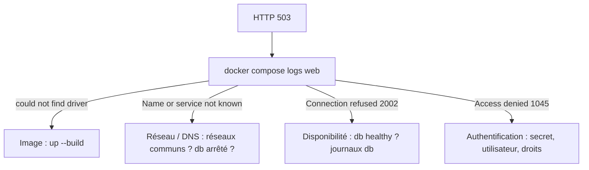

# Démarré n'est pas disponible

<p class="lead">Un conteneur <code>running</code> signifie seulement que son processus principal n'est pas sorti. Pour savoir si un service <strong>répond vraiment</strong>, il faut le <strong>mesurer</strong> (healthcheck), en tenir compte au démarrage (<code>service_healthy</code>) et, en cas de panne, remonter les couches une par une au lieu de tout supprimer.</p>

{ .hero }

## L'essentiel en 30 secondes

<div class="grid cards" markdown>

-   :material-play-outline:{ .lg .middle } __Démarré · `running`__

    ---

    Le PID 1 est lancé. La base peut encore initialiser ses fichiers et refuser les connexions.

-   :material-heart-pulse:{ .lg .middle } __Prêt · healthcheck__

    ---

    Une commande exécutée périodiquement dans le conteneur : code 0 = sain. Elle **mesure**, elle ne répare pas.

-   :material-traffic-light-outline:{ .lg .middle } __Attendre · `service_healthy`__

    ---

    `web` ne démarre qu'une fois `db` **healthy**. La forme courte `depends_on: [db]` n'attend que le lancement.

-   :material-alert-outline:{ .lg .middle } __Le piège · `unhealthy` ne déclenche rien__

    ---

    Pas d'arrêt, pas de recréation, pas d'alerte. La garantie ne valait qu'au démarrage.

</div>

!!! warning "À retenir"

    **`running` ≠ prêt.** `docker compose ps` peut afficher `Up` pendant que l'application renvoie des 503. **Santé, réparation, supervision et haute disponibilité** sont quatre fonctions différentes. Et un `down -v` « pour repartir propre » efface les preuves, et la base.

## :material-timer-sand: Démarré, mais pas prêt

| État | Ce qui est vrai | Comment le voir |
|---|---|---|
| **Démarré** (`running`) | le PID 1 du conteneur est lancé | `docker compose ps` : `Up` |
| **Serveur actif** | le serveur tourne, mais n'accepte peut-être pas encore de connexions | journaux du service |
| **Prêt** | le service accepte **et traite** les requêtes | healthcheck, requête de bout en bout |

???+ example "En vrai : forme courte de `depends_on`, seconde par seconde"

    

    Au premier lancement, le point d'entrée de MariaDB initialise les fichiers, démarre un **serveur temporaire sans port réseau** pour exécuter les scripts d'init, puis redémarre le vrai serveur. Pendant ce temps, PHP reçoit `Connection refused`. **L'ordre de création ne garantit pas la disponibilité.**

## :material-heart-pulse: Le healthcheck : une mesure

| Paramètre | Rôle | MariaDB |
|---|---|---|
| `test` | la commande ; code 0 = sain | `healthcheck.sh --connect --innodb_initialized` |
| `interval` / `timeout` | délai entre deux tests / durée maximale d'un test | `5s` / `3s` |
| `retries` | échecs consécutifs avant `unhealthy` | `15` |
| `start_period` | période de grâce : les échecs n'y comptent pas | `20s` |

```yaml
services:
  db:
    image: mariadb:11.4
    healthcheck:
      test: ["CMD", "healthcheck.sh", "--connect", "--innodb_initialized"]
      interval: 5s
      timeout: 3s
      retries: 15
      start_period: 20s
  web:
    depends_on:
      db:
        condition: service_healthy     # forme courte [db] = service_started
```

???+ example "En vrai : `Waiting`, puis `Healthy`, puis seulement `web`"

    

    `healthcheck.sh` est fourni par les images MariaDB récentes : pour une autre image, on prend l'outil adapté (`pg_isready` pour PostgreSQL, une requête HTTP pour un serveur web). Un script d'automatisation attend la même chose avec `docker compose up -d --wait`. L'historique des derniers tests (début, fin, code, sortie) se lit avec `docker inspect -f '{{json .State.Health.Log}}' <conteneur>`.

| Forme de `depends_on` | Compose attend… | Garantie |
|---|---|---|
| `[db]` (courte) | que `db` soit **lancé** | un ordre de démarrage et d'arrêt |
| `condition: service_healthy` | que le healthcheck de `db` soit **healthy** | une dépendance prête, **au démarrage** |
| `condition: service_completed_successfully` | qu'un service ponctuel (migration, init) **sorte en 0** | une tâche préalable réussie |

## :material-flash-alert-outline: Une panne après le démarrage

Ici `web` a aussi un healthcheck (`curl` sur sa propre page), qui dépend donc de la base.

???+ danger "En vrai : la base tombe, `web` reste `Up`"

    

    Un conteneur arrêté **sort du DNS** de Docker, d'où `Name or service not known`. Apache et PHP fonctionnent toujours et le code renvoie proprement `503`. Personne n'est prévenu, rien n'est relancé.

???+ example "En vrai : la base revient, l'application se rétablit seule"

    

    `web` ouvre une nouvelle connexion à chaque requête : il n'a pas besoin d'être redémarré. Un client robuste prévoit des délais de connexion courts, des nouvelles tentatives avec attente progressive, une réponse `503` explicite (éventuellement avec `Retry-After`), sans planter ni journaliser de secret.

| Fonction | Question | Avec Docker seul |
|---|---|---|
| **Santé** | Le service répond-il ? | le healthcheck, qui **observe** |
| **Réparation** | Qui relance ou remplace ? | `restart:`, seulement si le **processus s'arrête** |
| **Supervision** | Qui est prévenu ? | rien par défaut : il faut un outil d'alerte |
| **Haute disponibilité** | Survit-on à la perte d'une instance, d'un hôte ? | rien : plusieurs instances et un [orchestrateur](Pourquoi-orchestrer.md) |

## :material-magnify: Diagnostiquer un 503, couche par couche

Le même symptôme a eu trois causes différentes sur la même application : pilote PHP absent, base pas encore prête, base arrêtée. On **lit l'erreur dans son contexte** avant de corriger.

| Message dans `docker compose logs web` | Couche en cause | Correction |
|---|---|---|
| `could not find driver` | **image** | reconstruire (`up --build -d`), voir [Docker Compose](Docker-Compose.md) |
| `Name or service not known` | **réseau / DNS** : pas de réseau commun, conteneur arrêté | réseaux, nom du service |
| `Connection refused` (2002) | **disponibilité** : la base ne répond pas (encore) | santé de `db`, ses journaux |
| `Access denied` (1045) | **authentification** | identifiants, secret, droits SQL |
| HTTP `500`, `PHP Fatal error` | **code applicatif** | journal web, avec une base `healthy` |

| # | Question | Commande |
|---|---|---|
| 1 | `web` est-il `running` ? | `docker compose ps` |
| 2 | Apache/PHP répond-il ? | `curl -i http://127.0.0.1:8080/` (un 503 prouve déjà que oui) |
| 3 | `db` est-il résolu depuis `web` ? | `docker compose exec web getent hosts db` |
| 4 | Le port SQL est-il accessible ? | `docker compose exec web bash -c 'echo > /dev/tcp/db/3306' && echo ouvert` |
| 5 | MariaDB est-il sain, la base initialisée ? | `docker compose ps`, `docker compose logs --tail=80 db` |
| 6 | Identifiants et droits valides ? | `docker compose logs --tail=80 web` (`Access denied` ?) |



## :material-recycle: Prouver la reproductibilité

Une application peut ne marcher que grâce à un état caché : un fichier modifié par `exec`, un vieux volume déjà initialisé, une variable du shell, un réseau oublié. La seule preuve est un démarrage **depuis un environnement propre**, sous un autre nom de projet.

```bash
git clone <depot> /tmp/essai-propre && cd /tmp/essai-propre
mkdir -p secrets && openssl rand -hex 18 > secrets/db_root_password \
                 && openssl rand -hex 18 > secrets/db_app_password
docker compose -p essai-propre up --build -d --wait
curl -s http://127.0.0.1:8080/
docker compose -p essai-propre down -v      # ici seulement : projet jetable, volume de test
```

!!! tip "Ce que contient un projet livrable"

    `Dockerfile` et `.dockerignore` ; fichiers applicatifs et scripts SQL ; `compose.yaml` ; la procédure de création des secrets ; les instructions de démarrage et de vérification ; les justifications et des preuves ciblées. **Jamais** les fichiers de secrets, les données réelles ni les sauvegardes.

??? note "Récapitulatif : faire tourner une application complète"

    | Ne pas confondre | Avec |
    |---|---|
    | Port écouté dans le conteneur | Port publié sur l'hôte ([Réseaux et ports](Reseaux-et-ports.md)) |
    | Adresse IP d'une instance | Nom logique du service ([Réseaux et ports](Reseaux-et-ports.md)) |
    | Couche inscriptible | Volume persistant ([Stockage et volumes](Stockage-et-volumes.md)) |
    | Persistance | Sauvegarde ([Stockage et volumes](Stockage-et-volumes.md)) |
    | `depends_on` | Disponibilité effective (cette page) |
    | Healthcheck | Auto-réparation, haute disponibilité (cette page) |
    | Compose | Orchestrateur multi-hôtes ([Docker Compose](Docker-Compose.md)) |

    Trois niveaux complémentaires : l'**image** (ce que l'application contient), le **service Compose** (comment elle s'exécute et communique), l'**exploitation** (observer, sauvegarder, diagnostiquer, restaurer). `compose.yaml` ne remplace ni une stratégie de sauvegarde, ni une supervision.

    La suite : identités et privilèges, capabilities, secrets, images et surface d'attaque, à partir de [Sécurité des images](Securite-des-images.md).

## :material-flask-outline: À toi de jouer

Un service qui met volontairement 10 s à être prêt, et un client qui l'attend :

```yaml
services:
  lent:
    image: alpine:3.22
    command: sh -c 'sleep 10; touch /tmp/pret; sleep infinity'
    healthcheck:
      test: ["CMD-SHELL", "test -f /tmp/pret"]
      interval: 2s
      timeout: 1s
      retries: 10
  client:
    image: alpine:3.22
    command: sh -c 'echo "démarré à $$(date +%T)"; sleep infinity'   # $$ : un $ littéral pour Compose
    depends_on:
      lent:
        condition: service_healthy
```

```bash
docker compose up -d                                 # observer "Waiting" puis "Healthy"
docker compose ps                                    # lent ... (healthy)
docker compose logs client                           # démarré environ 10 s après lent
docker compose exec lent rm /tmp/pret                # au bout de 10 échecs : (unhealthy)
docker compose ps                                    # lent (unhealthy) : toujours Up, rien n'est relancé
docker compose down
```

Pour aller plus loin : [Identités, privilèges et capabilities](Identites-et-privileges.md), [Pourquoi orchestrer ?](Pourquoi-orchestrer.md).

??? abstract "Pour les créateurs : script de motion design « Le feu passe au vert » (65 s)"

    Deux cartes de conteneurs (db en vert, web en bleu) sur une ligne de départ ; un feu tricolore au-dessus de db (orange `starting`, vert `healthy`, rouge `unhealthy`). Un chronomètre en haut à droite.

    | Séq. | Durée | À l'écran | Animation | Texte à l'écran |
    |---|---|---|---|---|
    | 1 | 0-8 s | Les deux cartes démarrent **en même temps** ; `Up` s'allume sur les deux | web envoie des enveloppes qui rebondissent ; compteur : `000`, `503`, `503`, puis `200` | « Démarrés en même temps. Prêts à des moments différents. » |
    | 2 | 8-16 s | Zoom sur db : un sablier « initialisation InnoDB », un serveur temporaire sans port | Le sablier s'écoule ; `Up` reste allumé | « running veut dire : le processus est lancé. Pas : le service répond. » |
    | 3 | 16-26 s | Un feu **orange** au-dessus de db, web retenu derrière une barrière | Toutes les 5 s, une sonde descend dans db et remonte avec une croix | « Un healthcheck mesure. Pendant start_period, les échecs ne comptent pas. » |
    | 4 | 26-34 s | La sonde remonte avec une coche | Le feu passe au **vert**, la barrière se lève, web démarre | « condition: service_healthy : web attend le feu vert. » |
    | 5 | 34-40 s | Première enveloppe de web | Elle revient avec « 200 » | « Première requête : réussie. » |
    | 6 | 40-50 s | Un éclair frappe db, qui s'éteint ; son nom s'efface de l'annuaire DNS | web reste allumé, ses enveloppes reviennent avec « 503 » ; aucune main, aucune alarme | « La garantie ne valait qu'au démarrage. Personne ne répare. » |
    | 7 | 50-58 s | db redémarre : feu orange puis vert ; son nom réapparaît | Les enveloppes reviennent avec « 200 », sans que web ait redémarré | « Un client qui réessaie se rétablit tout seul. » |
    | 8 | 58-65 s | Quatre pictogrammes : stéthoscope, clé, cloche, serveurs jumeaux | Le stéthoscope s'allume, les trois autres restent gris | « Mesurer la santé n'est ni réparer, ni prévenir, ni tenir la charge. » |

    Garder le chronomètre visible : l'écart entre `Up` (quasi immédiat) et `healthy` (plusieurs secondes) doit se **lire en chiffres**. En séquence 6, l'absence de toute réaction est le message.

??? info "Pour les créateurs : idées de schémas"

    **La séquence de démarrage contrôlée.**

    ```mermaid
    sequenceDiagram
        participant C as docker compose up
        participant D as Conteneur db
        participant H as Healthcheck
        participant W as Conteneur web
        C->>D: créer et démarrer
        Note over D: running, initialisation en cours
        loop toutes les 5 s
            H->>D: healthcheck.sh --connect --innodb_initialized
            D-->>H: échec (ignoré pendant start_period)
        end
        H->>D: nouveau test
        D-->>H: succès (code 0)
        Note over D: healthy
        C->>W: démarrer web (condition service_healthy)
        W->>D: première requête SQL : OK
    ```

    **Santé, réparation, supervision, haute disponibilité.** Quatre pictogrammes alignés, chacun avec sa question : un stéthoscope (healthcheck), une clé à molette (politique `restart`), une cloche (supervision), deux serveurs jumeaux (plusieurs instances et orchestrateur). Sous Docker seul, seuls les deux premiers sont colorés, et la clé n'agit que si le processus s'arrête.
