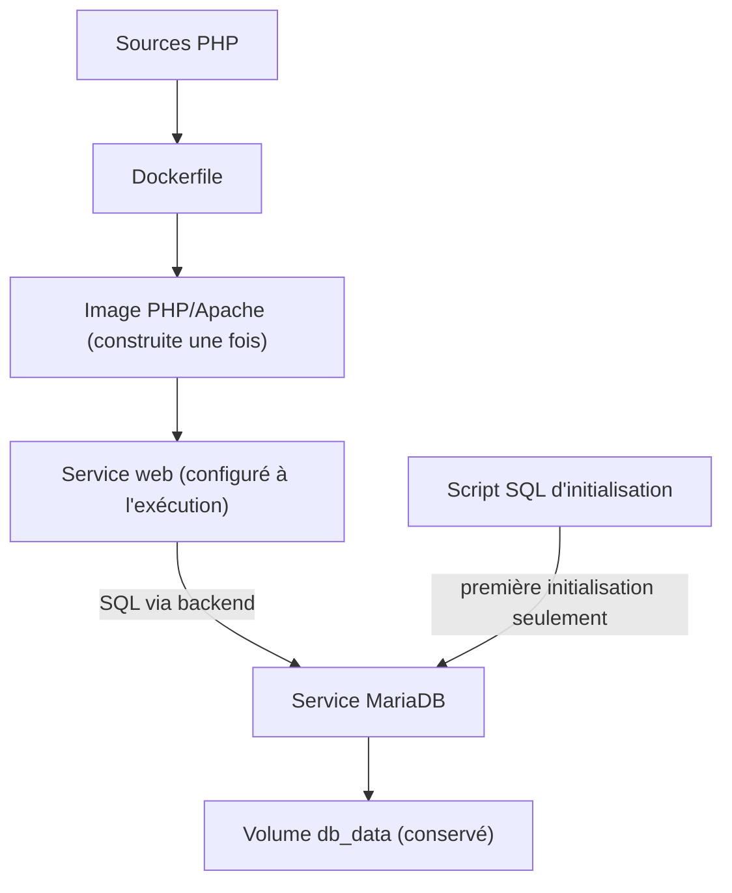
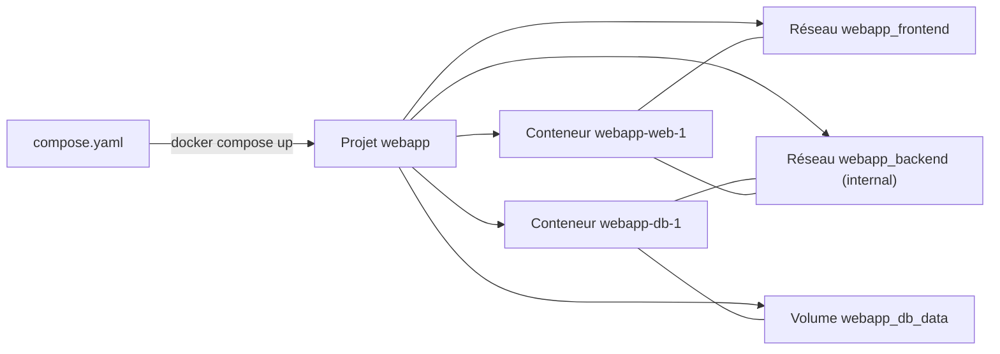

# Docker Compose

> **En une phrase.** Compose décrit une application multi-conteneurs (services, réseaux, volumes, secrets) dans un fichier `compose.yaml` versionné, puis **fait converger** l'état local du moteur Docker vers cette description, en une commande ; c'est un outil déclaratif pour **un hôte**, pas un orchestrateur de cluster.

---

## 1. Synthèse

### Le problème : une application, dix commandes

Faire tourner une application PHP + MariaDB « à la main » demande de :

1. créer les réseaux ;
2. créer ou retrouver le volume de données ;
3. lancer MariaDB avec sa configuration et ses secrets ;
4. construire puis lancer l'image PHP ;
5. relier les conteneurs entre eux, dans le bon ordre.

Des commandes `docker run` dispersées sont difficiles à relire, à partager et à reproduire : rien ne garantit qu'un collègue obtienne la même chose. Compose remplace cette suite d'**actions** par une **description** de l'état attendu.

### Le modèle : un fichier, quelques familles de ressources

| Clé de premier niveau | Décrit | Exemple |
|---|---|---|
| `services:` | les conteneurs à faire tourner : image ou construction, paramètres d'exécution | `web`, `db` |
| `networks:` | la connectivité entre services | `frontend`, `backend` |
| `volumes:` | le stockage persistant | `db_data` |
| `secrets:` / `configs:` | des données de configuration montées en fichiers | `db_app_password` |
| `name:` | le nom du projet (facultatif) | `webapp` |

- Le fichier s'appelle `compose.yaml` (les noms historiques `docker-compose.yml` sont encore lus).
- **Pas de clé `version:`** : le format actuel suit la *Compose Specification* et ignore cette clé.
- La commande est `docker compose` (plugin v2), et non plus l'ancien binaire `docker-compose`.

### Trois niveaux, trois responsabilités

| Niveau | Contient | Dans l'application fil rouge |
|---|---|---|
| **Image** (le livrable de construction) | ce que l'application contient et lance par défaut | Apache, PHP, l'extension `pdo_mysql`, les fichiers PHP |
| **Service Compose** (la configuration d'exécution) | comment une instance s'exécute, communique, accède à ses ressources | nom du service SQL, utilisateur, réseaux, port publié, secrets |
| **Volume** (l'état) | ce qui doit survivre aux instances | tables, index et journaux de MariaDB |

Cette séparation permet de reconstruire l'image sans toucher aux données, et de faire tourner la même image avec d'autres paramètres. Elle évite aussi les interventions manuelles dans les instances.

### Un projet regroupe et préfixe les objets

| Objet | Nom réel | Exemple observé |
|---|---|---|
| Projet | nom du dossier, ou `-p <nom>`, ou clé `name:` | `webapp` |
| Conteneur | `<projet>-<service>-<n>` | `webapp-db-1` |
| Réseau | `<projet>_<réseau>` ; sans section `networks:`, un réseau `<projet>_default` | `webapp_backend` |
| Volume | `<projet>_<volume>` | `webapp_db_data` |

Conséquence : deux projets qui déclarent chacun un volume `db_data` **ne partagent pas** le même volume physique.

### Les commandes du cycle de vie

| Commande | Effet |
|---|---|
| `docker compose config` | assemble et valide le modèle (fichiers + variables) ; **ne lance rien** |
| `docker compose build` | construit les images des services qui ont une clé `build:` |
| `docker compose up -d` | crée ou réutilise les objets et démarre les services, en arrière-plan |
| `docker compose up --build -d` | construit d'abord, puis converge (recrée les services modifiés) |
| `docker compose up -d --force-recreate` | recrée les conteneurs même sans changement détecté |
| `docker compose ps` · `logs` · `images` · `ls` | état des services, journaux, images utilisées, projets existants |
| `docker compose exec <svc> <cmd>` | lance un processus **dans l'instance existante** |
| `docker compose run --rm <svc> <cmd>` | crée une **nouvelle instance ponctuelle** du service |
| `docker compose restart <svc>` | arrête puis redémarre **la même instance**, sur la même image |
| `docker compose stop` / `start` | arrête / redémarre les instances du projet |
| `docker compose down` | supprime conteneurs et réseaux du projet (**garde les volumes**) |
| `docker compose down -v` | supprime **aussi** les volumes déclarés (pas les volumes externes) |

### Compose n'est pas Kubernetes

Compose pilote des services sur **le moteur Docker ciblé**, généralement un seul hôte. Il ne fournit pas nativement de planificateur de cluster, ni de remplacement sur un autre nœud après la perte d'un hôte, ni la boucle complète de contrôle de l'état désiré de Kubernetes. Le mot « orchestration » n'a pas partout la même portée : voir [Pourquoi orchestrer ?](Pourquoi-orchestrer.md) et [De Compose aux manifestes Kubernetes](De-Compose-a-Kubernetes.md).

### L'application fil rouge

| Élément | Choix |
|---|---|
| Services | `web` (image construite localement depuis `php:8.4-apache`) et `db` (`mariadb:11.4`) |
| Réseaux | `frontend` et `backend` (`internal: true`) ; `db` **uniquement** sur `backend` |
| Volume | `db_data`, monté sur `/var/lib/mysql` |
| Point d'entrée | `127.0.0.1:8080` vers Apache (port 80 de `web`) ; aucun port publié pour `db` |
| Dépendance | `web` ne démarre que lorsque `db` est **healthy** |
| Secrets | deux fichiers : mot de passe administrateur et mot de passe applicatif |

> [!IMPORTANT]
> **Les pièges à retenir**
> 1. **`config` valide la configuration, pas l'application.** Un fichier valide peut produire des services qui ne démarrent pas ou ne fonctionnent pas.
> 2. **Construire une image ne met pas à jour le conteneur.** `restart` relance la même instance sur l'ancienne image ; il faut `up --build -d` pour recréer le service.
> 3. **`exec` n'est pas une correction.** Ce qui est modifié à la main dans une instance disparaît à la prochaine recréation.
> 4. **`.env` n'est pas un coffre-fort**, et il sert à interpréter le YAML, pas (directement) à configurer le processus.
> 5. **Un secret Compose local est un fichier de l'hôte, en clair**, monté dans le conteneur : il évite l'image et les variables d'environnement, il ne chiffre rien.
> 6. **`down -v` supprime la base.** `down` seul la conserve.
> 7. **Compose = un hôte.** Pas de reprise sur un autre nœud, pas de répartition de charge entre machines.

---

## 2. Cas d'usage classiques

### Cas 1 : lire le `compose.yaml` d'une application complète

**Besoin.** Comprendre, clé par clé, la description de l'application fil rouge. (Les clés de durcissement `cap_drop`, `cap_add` et `security_opt` sont traitées dans [Identités, privilèges et capabilities](Identites-et-privileges.md).)

```yaml
services:
  db:
    image: mariadb:11.4                     # image officielle, utilisée telle quelle
    environment:                            # configuration de PREMIÈRE mise en service
      MARIADB_DATABASE: app
      MARIADB_USER: appuser
      MARIADB_PASSWORD_FILE: /run/secrets/db_app_password       # convention *_FILE de l'image
      MARIADB_ROOT_PASSWORD_FILE: /run/secrets/db_root_password
    secrets: [db_app_password, db_root_password]   # db reçoit les deux secrets
    volumes:
      - db_data:/var/lib/mysql                     # volume nommé : l'état
      - ./db/init:/docker-entrypoint-initdb.d:ro   # bind mount : scripts de 1re initialisation
    networks: [backend]                            # db n'est QUE sur backend, sans "ports:"
    healthcheck:
      test: ["CMD", "healthcheck.sh", "--connect", "--innodb_initialized"]
      interval: 5s
      timeout: 3s
      retries: 15
      start_period: 20s

  web:
    build:
      context: ./app                        # répertoire de construction (contient le Dockerfile)
    image: demo/web-php:1.0                 # nom donné à l'image construite
    ports:
      - "127.0.0.1:8080:80"                 # seule publication, sur la boucle locale
    environment:                            # configuration lue par PHP à l'exécution
      DB_HOST: db                           # nom de service, résolu par le DNS interne
      DB_NAME: app
      DB_USER: appuser
    secrets: [db_app_password]              # web ne reçoit QUE le secret applicatif
    networks: [frontend, backend]           # web fait le pont entre les deux réseaux
    depends_on:
      db:
        condition: service_healthy          # attendre que db soit sain

networks:
  frontend:
  backend:
    internal: true                          # pas de sortie vers l'extérieur

volumes:
  db_data:                                  # créé si absent, réutilisé ensuite

secrets:
  db_root_password:
    file: ./secrets/db_root_password        # fichiers locaux, hors de l'image et du dépôt
  db_app_password:
    file: ./secrets/db_app_password
```

**Ce qu'il faut retenir, bloc par bloc.**
- **`image` et `build`** : `build.context` dit **d'où** construire, `image` donne la **référence** de l'image produite. L'image est le livrable ; le service dit comment l'exécuter. Voir [Écrire un Dockerfile](Ecrire-un-Dockerfile.md).
- **`environment`** : des variables injectées dans le processus à l'exécution. Les valeurs non sensibles peuvent y figurer ; les mots de passe, non.
- **`secrets`** : déclarés **deux fois**, au niveau supérieur (d'où vient le fichier) et dans chaque service (qui y a droit). Le fichier apparaît dans le conteneur sous `/run/secrets/<nom>`, en lecture seule.
- **`*_FILE`** : `MARIADB_PASSWORD_FILE` est une **convention du point d'entrée de l'image MariaDB**, qui lit le mot de passe dans ce fichier. Ce n'est pas une fonction générale de Docker : une variable quelconque suffixée par `_FILE` ne fait rien toute seule. Ici, le code PHP lit lui-même `/run/secrets/db_app_password`.
- **`networks` et `ports`** : les services d'un même réseau se joignent directement ; `ports:` ne sert qu'à publier un accès **depuis l'extérieur** du réseau. Voir [Réseaux et ports](Reseaux-et-ports.md).
- **`volumes`** : Compose crée `db_data` s'il n'existe pas et le **réutilise** aux exécutions suivantes du même projet. Voir [Stockage et volumes](Stockage-et-volumes.md).
- **`healthcheck` et `depends_on`** : voir [Démarré n'est pas disponible](Demarre-n-est-pas-disponible.md).

> [!WARNING]
> **Limites des secrets Compose locaux.** Un secret défini avec `file:` est un **bind mount d'un fichier en clair de l'hôte**. Sur un poste de test, il est lisible (droits 644) par tous les processus du conteneur. Il faut donc maîtriser les droits du fichier sur l'hôte (dossier `secrets/` en 700, hors du dépôt Git), les accès dans le conteneur, la distribution et la rotation. L'analyse complète : [Secrets, fichiers, réseau et ressources](Secrets-fichiers-reseau-ressources.md).

### Cas 2 : moderniser un ancien `docker-compose.yml`

**Besoin.** On hérite d'un fichier à l'ancienne, du type :

```yaml
version: "3.9"
services:
  web:
    build: .
    ports:
      - "5000:5000"
    depends_on:
      - db
    environment:
      DATABASE_URL: postgres://app:example@db:5432/appdb
  db:
    image: postgres:15
    environment:
      POSTGRES_DB: appdb
      POSTGRES_USER: app
      POSTGRES_PASSWORD: example
    volumes:
      - db_data:/var/lib/postgresql/data
volumes:
  db_data:
```

**Ce qu'on observe.** Il fonctionne toujours, mais Compose v2 affiche un avertissement :

```
level=warning msg=".../docker-compose.yml: the attribute `version` is obsolete, it will be ignored, please remove it to avoid potential confusion"
```

**Ce qu'il faut corriger, et pourquoi.**

| Ligne d'origine | Problème | Correction |
|---|---|---|
| `version: "3.9"` | obsolète, ignorée | la supprimer ; renommer le fichier en `compose.yaml` |
| `"5000:5000"` | publié sur **toutes** les interfaces | `"127.0.0.1:5000:5000"` si l'accès est local |
| `POSTGRES_PASSWORD: example`, mot de passe dans `DATABASE_URL` | secret en clair dans le fichier versionné et dans `docker inspect` | secret monté + `POSTGRES_PASSWORD_FILE` (l'image officielle PostgreSQL suit la même convention) |
| `depends_on: [db]` | n'attend que le **lancement** de `db` | `healthcheck` sur `db` + `condition: service_healthy` |

**À retenir.** Ce fichier illustre déjà l'idée centrale de Compose : **déclarer un état attendu** et les **dépendances** entre services, plutôt qu'enchaîner des commandes.

### Cas 3 : valider le modèle avant de lancer quoi que ce soit

```bash
docker compose config --quiet && echo "configuration valide"
docker compose config --services       # db, web
docker compose config --images         # mariadb:11.4, demo/web-php:1.0
docker compose config                  # le modèle complet, normalisé
```

**Ce qu'on observe.** `config` affiche le fichier **tel que Compose l'a compris** : chemins relatifs rendus absolus (`context: /home/.../app`), ports détaillés (`host_ip: 127.0.0.1`, `target: 80`, `published: "8080"`), noms réels des objets (`name: webapp_db_data`). Sur un poste de test, il révèle aussi qu'une forme courte `depends_on: [db]` est traduite en `condition: service_started`, c'est-à-dire « attendre le lancement », pas « attendre que la base réponde ».
**À retenir.** C'est une vérification de configuration, pas un test métier : elle ne garantit ni le démarrage ni le bon fonctionnement.

### Cas 4 : le pilote PDO manquant, ou pourquoi `restart` ne répare rien

**Besoin.** Au premier `up`, l'application répond `HTTP 503 {"status":"unavailable"}`.

```bash
docker compose logs --tail=20 web        # [php:notice] ... could not find driver
docker compose exec web php -m | grep -i pdo
#   PDO
#   pdo_sqlite                            ← pas de pdo_mysql
```

**Diagnostic.** Le pilote MariaDB/MySQL de PHP manque **dans l'image**. On ajoute `RUN docker-php-ext-install pdo_mysql` au Dockerfile, puis :

```bash
docker compose restart web               # même conteneur, même image : pdo_mysql toujours absent, 503
docker compose up --build -d             # construit, détecte le changement : "web-1 Recreate", puis "Started"
docker compose exec web php -m | grep -c pdo_mysql   # 1
curl -s -o /dev/null -w "%{http_code}\n" http://127.0.0.1:8080/   # 200
```

**Ce qu'on observe sur un poste de test.** Après `restart`, l'extension est toujours absente : l'instance tourne encore sur l'ancienne image. Seul `up --build -d` recrée le conteneur `web` sur la nouvelle image (le service `db`, inchangé, reste `Running`).
**À retenir.**
- `restart` = arrêt et démarrage de **l'instance existante** ; `up --build -d` = construction puis **convergence** vers le modèle.
- `exec` lance un processus supplémentaire **dans le conteneur en marche** (ici `php -m`) : c'est un outil de diagnostic, pas une modification durable. Les images minimales ne contiennent pas toujours les outils voulus (`ps`, `ss`, `curl`).
- `docker compose run --rm web php -v` ferait autre chose : il crée une **nouvelle instance** ponctuelle du service, qui **ne publie pas** ses ports (sauf `--service-ports`) et démarre aussi les services dont elle dépend (sauf `--no-deps`).

### Cas 5 : paramétrer le fichier sans le modifier (interpolation et `.env`)

**Besoin.** Changer le port publié d'un poste à l'autre.

```yaml
services:
  web:
    ports:
      - "127.0.0.1:${WEB_PORT:-8080}:80"     # 8080 si WEB_PORT n'est pas défini
```

```bash
echo "WEB_PORT=8090" > .env
docker compose config | grep published      # published: "8090"
```

**Ce qu'il faut distinguer.**

| Mécanisme | Lu par | Sert à |
|---|---|---|
| Fichier `.env` du projet, variables du shell | **Compose** | **interpréter le YAML** (`${WEB_PORT}`) |
| Clé `environment:` | le **processus** du conteneur | configurer l'application à l'exécution |
| Clé `env_file:` | le **processus** du conteneur | même chose, depuis un fichier |
| Clé `secrets:` | le processus, via `/run/secrets/` | transmettre une valeur sensible en fichier |

**À retenir.** `.env` est un fichier en clair, facile à committer par erreur : ce n'est pas un coffre-fort de secrets.

### Cas 6 : arrêter, recréer, nettoyer sans perdre la base

```bash
docker compose stop && docker compose start      # mêmes instances, rien n'est recréé
docker compose up -d --force-recreate            # nouvelles instances, volume db_data remonté
docker compose down                              # conteneurs + réseaux supprimés, volume gardé
docker volume ls --filter name=app               # webapp_db_data toujours là
```

**Ce qu'on observe sur un poste de test.** Après `down` puis `up -d`, la sortie montre `Network ... Created`, `Container webapp-db-1 Created`, `Healthy`, puis `web-1 Started` : tout est recréé **sauf** le volume, et les données ajoutées auparavant sont toujours servies.
**À retenir.** Recréer un conteneur remplace son instance et sa couche inscriptible, mais ne supprime pas ses volumes nommés. `down -v` supprime aussi les volumes déclarés : **jamais sur une base à conserver**. Les volumes déclarés `external: true` ne sont jamais supprimés par Compose.

### Cas 7 : justifier une architecture, pas seulement constater qu'elle marche

**Besoin.** Expliquer **pourquoi** l'application fonctionne, au niveau attendu d'un ingénieur. « La page s'affiche » est une **observation**, pas une explication.

**La chaîne à justifier.**

```
Navigateur → 127.0.0.1:8080
        ↓ publication Docker (seul port ouvert sur l'hôte)
Conteneur web → Apache → PHP
        ↓ résolution DNS « db » sur le réseau backend
Conteneur db → MariaDB → /var/lib/mysql (volume db_data)
        ↓
Résultat SQL → PHP → réponse HTTP
```

Chaque flèche est un **chemin vérifiable**, et un service peut fonctionner localement tout en échouant à travers l'une de ces dépendances.

| Ce qu'il faut démontrer | Mécanisme | Preuve observable |
|---|---|---|
| Le réseau permet l'échange | `web` et `db` partagent `backend` ; DNS interne | `docker compose exec web getent hosts db` |
| Le port n'est pas exposé inutilement | `db` sans `ports:`, `web` publié sur `127.0.0.1` | `ss -lnt` sur l'hôte : seul `127.0.0.1:8080` |
| Les données survivent à une recréation | volume nommé `db_data` | `down` puis `up` : les données sont toujours là |
| Le healthcheck limite une classe d'échecs | `condition: service_healthy` | `Waiting` puis `Healthy` avant `web Started` |
| Le projet peut être reconstruit | Dockerfile, `compose.yaml`, procédure des secrets | `up --build -d` depuis un dossier propre |

---

## 3. Idées de schémas

### Schéma A : ce qui est construit et ce qui est conservé



Message : l'application est **construite une fois**, puis **configurée à l'exécution** ; le conteneur de base peut être remplacé tout en réutilisant son volume.

### Schéma B : d'un fichier à des objets Docker



### Schéma C : ce que chaque commande touche

| | Image | Conteneur | Réseaux | Volume |
|---|---|---|---|---|
| `restart` | · | même instance | · | · |
| `up --build -d` | reconstruite | recréé si modifié | créés si absents | réutilisé |
| `up -d --force-recreate` | · | recréé | réutilisés | réutilisé |
| `stop` / `start` | · | arrêté / relancé | · | · |
| `down` | · | supprimé | supprimés | **conservé** |
| `down -v` | · | supprimé | supprimés | **supprimé** |

Version graphique : quatre colonnes d'icônes (image, conteneur, réseau, cylindre volume) et une ligne par commande ; une icône barrée en rouge pour « supprimé », une flèche circulaire pour « recréé ».

---

## 4. Script de motion design : « De la description à l'application » (environ 65 s)

Style : à gauche, le fichier `compose.yaml` affiché comme une page de code ; à droite, un plateau « moteur Docker » vide. Chaque bloc du fichier s'allume au moment où l'objet correspondant apparaît sur le plateau.

| Séq. | Durée | À l'écran | Animation | Texte à l'écran |
|---|---|---|---|---|
| 1 | 0-8 s | Une pile de dix commandes `docker run`, `docker network create`… qui se désordonnent | Les lignes glissent, se mélangent, l'une tombe | « Dix commandes à retaper, dans le bon ordre. » |
| 2 | 8-15 s | Les commandes se compactent en une seule page `compose.yaml` | Morphing de la pile vers la page | « Compose les remplace par une description. » |
| 3 | 15-24 s | Prompt : `docker compose up --build -d` | Le bloc `build:` s'allume ; une image « demo/web-php:1.0 » se forme couche par couche sur le plateau | « 1. Construire l'image. » |
| 4 | 24-32 s | Les blocs `networks:` et `volumes:` s'allument | Deux zones colorées (frontend, backend) se dessinent ; un cylindre `db_data` apparaît | « 2. Créer réseaux et volume, préfixés par le projet. » |
| 5 | 32-44 s | Le bloc `db:` s'allume, puis `web:` | La carte db se pose dans backend, se branche au cylindre ; un témoin passe de jaune à vert (« healthy ») ; alors seulement, la carte web se pose à cheval sur les deux zones | « 3. Démarrer les services, dans l'ordre des dépendances. » |
| 6 | 44-52 s | Une ligne du fichier change (`RUN docker-php-ext-install pdo_mysql`) ; nouveau `up --build -d` | Seule la carte web est remplacée (« Recreate ») ; db et le cylindre ne bougent pas | « Compose ne recrée que ce qui a changé. » |
| 7 | 52-60 s | `docker compose down` | Les cartes et les zones réseau s'effacent ; le cylindre reste seul sur le plateau | « down : tout part, sauf les données. » |
| 8 | 60-65 s | Recul : le plateau est posé sur **une seule** machine | Une étiquette « un hôte » apparaît sous le plateau | « Un fichier, un hôte. Pour plusieurs machines, il faut un orchestrateur. » |

**Conseil de réalisation.** Synchroniser strictement l'allumage du bloc YAML et l'apparition de l'objet : c'est ce lien visuel qui fait comprendre que le fichier **est** l'état attendu. En séquence 6, figer volontairement db et le volume pendant que web est remplacé.

---

## 5. Vérifier soi-même

Dans un dossier vide, avec ce `compose.yaml` minimal :

```yaml
services:
  web:
    image: nginx:stable
    ports:
      - "127.0.0.1:${WEB_PORT:-8080}:80"
  outil:
    image: alpine:3.22
    command: sleep infinity
```

```bash
docker compose config --services                          # outil, web
docker compose up -d
docker compose ps                                         # noms <dossier>-web-1, <dossier>-outil-1
docker compose exec outil wget -qO- http://web | head -4  # le réseau par défaut résout "web"
docker network ls --filter name=$(basename "$PWD")        # <dossier>_default
docker compose run --rm outil hostname                    # une AUTRE instance, détruite aussitôt
docker compose down                                       # conteneurs et réseau supprimés
```

## Voir aussi

- [Accueil du wiki](../README.md)
- Page précédente : [Stockage : couche du conteneur, volumes, bind mounts](Stockage-et-volumes.md)
- Page suivante : [Démarré n'est pas disponible : healthchecks et diagnostic](Demarre-n-est-pas-disponible.md)
- Pour aller plus loin : [De Compose aux manifestes Kubernetes](De-Compose-a-Kubernetes.md)
