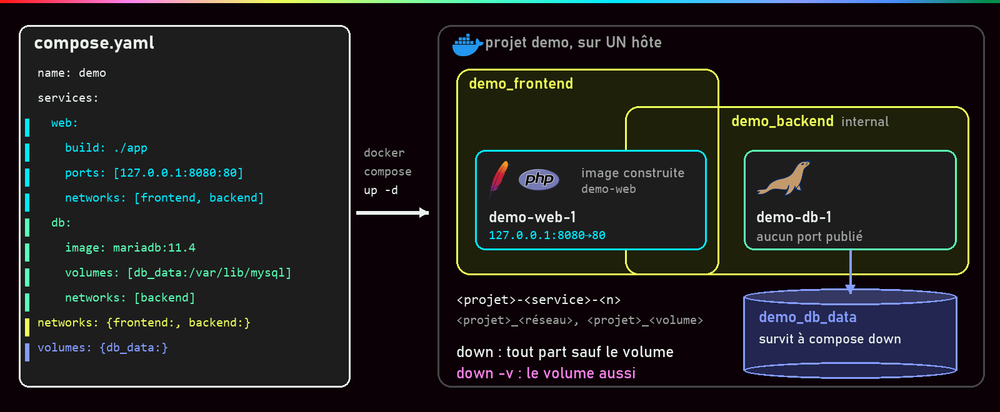
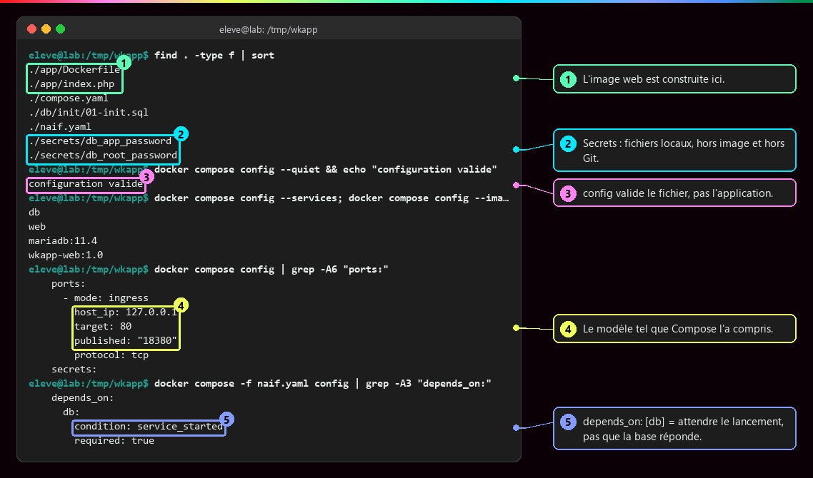
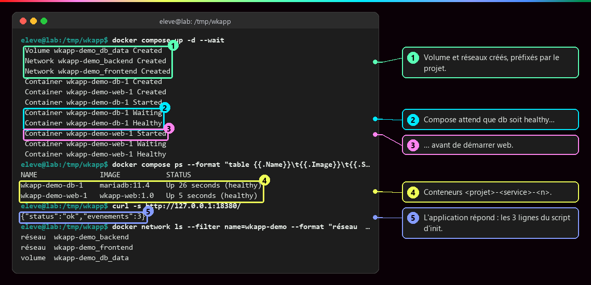
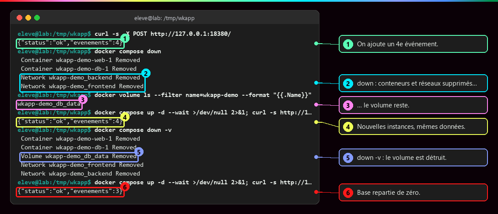

# Docker Compose

<p class="lead">Compose décrit une application multi-conteneurs (services, réseaux, volumes, secrets) dans un fichier <code>compose.yaml</code> versionné, puis <strong>fait converger</strong> le moteur Docker vers cette description, en une commande. C'est un outil déclaratif pour <strong>un hôte</strong>, pas un orchestrateur de cluster.</p>

{ .hero }

!!! abstract "Dans cette page"

    **Tu vas comprendre :**

    - comment un seul fichier remplace une dizaine de commandes `docker run` ;
    - ce que veut dire chaque ligne du `compose.yaml` d'une vraie application (un site et sa base) ;
    - quelle commande garde tes données et laquelle les efface.

    **Prérequis :** [Réseaux et ports](Reseaux-et-ports.md), [Stockage et volumes](Stockage-et-volumes.md), et [Écrire un Dockerfile](Ecrire-un-Dockerfile.md) pour la partie construction. **Durée :** 45 min. **Niveau :** débutant.

!!! quote "En clair"

    Compose, c'est le **plan de salle** remis au traiteur avant une réception : tables, chaises, buffet, décor. Le traiteur arrive, compare le plan avec la salle, installe ce qui manque, refait ce qui a changé et ne touche pas au reste. Tu ne donnes plus dix ordres à la suite : tu tiens le plan à jour. Limite de l'image : le traiteur ne s'occupe que d'**une seule salle**. Pour répartir la fête sur plusieurs bâtiments, il faut un orchestrateur.

## L'essentiel en 30 secondes

<div class="grid cards" markdown>

-   :material-file-code-outline:{ .lg .middle } __Décrire__

    ---

    Un fichier remplace dix `docker run` dispersés : l'état attendu, relisible, partageable, reproductible.

-   :material-sync:{ .lg .middle } __Converger__

    ---

    `up -d` crée ce qui manque, recrée ce qui a changé, garde le reste (dont le volume).

-   :material-tag-outline:{ .lg .middle } __Préfixer__

    ---

    Un projet regroupe ses objets sous son nom : `demo-db-1`, `demo_backend`, `demo_db_data`.

-   :material-server-off:{ .lg .middle } __Le piège · un seul hôte__

    ---

    Pas de répartition sur plusieurs machines, pas de reprise ailleurs en cas de panne. Pour cela : [un orchestrateur](Pourquoi-orchestrer.md).

</div>

!!! warning "À retenir"

    **`config` vérifie le fichier, pas l'application.** **`restart` ne met pas à jour l'image** : il faut `up --build -d`. **`exec` n'est pas une correction** : ce qui est changé à la main disparaît quand le conteneur est recréé. **`down` garde la base, `down -v` la supprime.**

## :material-file-code-outline: Le fichier : une application décrite

!!! quote "En clair : lire du YAML"

    Le fichier est écrit en YAML. Trois règles suffisent : `clé: valeur` ; le **décalage** (deux espaces, jamais de tabulation) range une clé *à l'intérieur* de la précédente ; un tiret `- ` ou des crochets `[a, b]` font une liste.

| Clé de premier niveau | Décrit | Exemple |
|---|---|---|
| `services:` | les conteneurs : image ou construction, réglages d'exécution | `web`, `db` |
| `networks:` | les réseaux entre services | `frontend`, `backend` |
| `volumes:` | le stockage qui dure | `db_data` |
| `secrets:` / `configs:` | des données fournies en fichiers | `db_app_password` |
| `name:` | le nom du projet (sinon : le nom du dossier, ou `-p`) | `wkapp-demo` |

Le fichier s'appelle `compose.yaml`, **sans clé `version:`** (elle est ignorée aujourd'hui), et la commande est `docker compose` (avec un espace), et non plus l'ancien programme `docker-compose`.

### Le compose.yaml de la démonstration, clé par clé

C'est le fichier de l'application des captures : un site PHP (`web`) et sa base MariaDB (`db`). On le lit en trois morceaux, qui se suivent dans **un seul** fichier. Passe la souris sur les bulles numérotées (ou clique dessus) pour lire l'explication de chaque ligne.

**1. Le projet et le service `db`**

```yaml
name: wkapp-demo                                   # (1)!
services:                                          # (2)!
  db:                                              # (3)!
    image: mariadb:11.4                            # (4)!
    environment:                                   # (5)!
      MARIADB_DATABASE: app
      MARIADB_USER: appuser
      MARIADB_PASSWORD_FILE: /run/secrets/db_app_password       # (6)!
      MARIADB_ROOT_PASSWORD_FILE: /run/secrets/db_root_password
    secrets: [db_app_password, db_root_password]   # (7)!
    volumes:
      - db_data:/var/lib/mysql                     # (8)!
      - ./db/init:/docker-entrypoint-initdb.d:ro   # (9)!
    networks: [backend]                            # (10)!
    healthcheck:                                   # (11)!
      test: ["CMD", "healthcheck.sh", "--connect", "--innodb_initialized"]
      interval: 5s
      timeout: 3s
      retries: 15
      start_period: 20s
```

1. Le nom du projet. Il préfixe tout ce que Compose crée : conteneurs `wkapp-demo-db-1`, réseaux `wkapp-demo_backend`, volume `wkapp-demo_db_data`.
2. La liste des services. Un service = un rôle dans l'application ; Compose en tire un ou plusieurs conteneurs.
3. Le nom du service. C'est aussi le **nom réseau** : les autres services joignent la base à l'adresse `db`.
4. L'image officielle de MariaDB, utilisée telle quelle, avec une version figée.
5. Des variables d'environnement lues par l'image au **tout premier** démarrage : nom de la base et de l'utilisateur à créer.
6. Les mots de passe ne sont pas écrits ici : `_FILE` dit à l'image d'aller les lire dans un fichier. C'est une convention **de l'image MariaDB**, pas de Docker.
7. Les secrets que ce service a le droit de lire. Ils apparaissent comme fichiers dans `/run/secrets/`. Voir [Secrets, fichiers, réseau et ressources](Secrets-fichiers-reseau-ressources.md).
8. Le volume nommé `db_data`, branché là où MariaDB range ses tables : les données survivent au conteneur ([Stockage et volumes](Stockage-et-volumes.md)).
9. Un dossier du projet (bind mount), en lecture seule : les scripts SQL exécutés une seule fois, sur une base vide.
10. `db` n'est que sur le réseau `backend`, et n'a **pas** de clé `ports:` : aucune porte sur l'hôte ([Réseaux et ports](Reseaux-et-ports.md)).
11. La sonde de santé : une commande lancée toutes les 5 s pour savoir si la base accepte vraiment les connexions ([Démarré n'est pas disponible](Demarre-n-est-pas-disponible.md)).

**2. Le service `web`**

```yaml
  web:
    build: ./app                              # (1)!
    image: wkapp-web:1.0                      # (2)!
    ports:
      - "127.0.0.1:18380:80"                  # (3)!
    environment:
      DB_HOST: db                             # (4)!
      DB_NAME: app
      DB_USER: appuser
    secrets: [db_app_password]                # (5)!
    networks: [frontend, backend]             # (6)!
    depends_on:
      db:
        condition: service_healthy            # (7)!
    healthcheck:
      test: ["CMD", "curl", "-fsS", "-o", "/dev/null", "http://localhost/"]   # (8)!
      interval: 3s
      timeout: 2s
      retries: 2
      start_period: 5s
```

1. Construire l'image à partir du dossier `./app`, qui contient le `Dockerfile` ([Écrire un Dockerfile](Ecrire-un-Dockerfile.md)).
2. Le nom donné à l'image construite. `build` dit **d'où** construire, `image` dit **comment l'appeler**.
3. La seule porte publiée de l'application : le port 18380 de l'hôte, sur `127.0.0.1` uniquement, mène au port 80 d'Apache.
4. Le code PHP lit cette variable pour savoir où est la base. On donne le **nom du service**, jamais une adresse IP.
5. `web` ne reçoit **que** le mot de passe de l'application, pas celui de l'administrateur de la base.
6. `web` est sur les deux réseaux : il reçoit les visiteurs côté `frontend` et parle à la base côté `backend`.
7. Ne démarrer `web` qu'une fois `db` déclaré **sain** par sa sonde. La forme courte `depends_on: [db]` n'attendrait que son lancement.
8. La sonde de `web` : `curl` demande la page d'accueil ; un code d'erreur HTTP rend la sonde négative.

**3. Les déclarations communes**

```yaml
networks:
  frontend:                                   # (1)!
  backend:
    internal: true                            # (2)!
volumes:
  db_data:                                    # (3)!
secrets:
  db_root_password:
    file: ./secrets/db_root_password          # (4)!
  db_app_password:
    file: ./secrets/db_app_password
```

1. Déclarer un réseau suffit : Compose le crée avec les réglages par défaut, DNS interne compris.
2. `internal: true` : pas de route vers l'extérieur. La base ne peut ni être jointe depuis l'hôte, ni sortir sur Internet.
3. Le volume est créé s'il n'existe pas, puis **réutilisé** à chaque `up`.
4. D'où vient chaque secret : un fichier local, hors de l'image et hors du dépôt Git. Les secrets sont donc déclarés deux fois : ici (d'où ils viennent) et dans chaque service (qui y a droit).

???+ example "En vrai : vérifier le fichier avant de lancer"

    **Ce qu'on fait :** on liste les fichiers du projet, puis on demande à Compose de lire le `compose.yaml` et de nous dire ce qu'il en a compris, sans rien lancer.

    

    **Ce qu'il faut regarder :**

    - ① Le dossier `app/` contient le `Dockerfile` et le code : c'est là que l'image `web` est construite.
    - ② Les mots de passe sont des fichiers locaux, à part.
    - ③ `configuration valide` : le fichier est bien écrit. Ça ne dit **rien** sur le bon fonctionnement de l'application.
    - ④ Compose a détaillé la ligne `ports` : adresse, port du conteneur, port publié.
    - ⑤ Dans un autre fichier, la forme courte `depends_on: [db]` est traduite en `service_started` : attendre le lancement, pas que la base réponde.

Trois niveaux, trois responsabilités : l'**image** (ce que l'application contient : Apache, PHP, le pilote MySQL), le **service** (comment un conteneur s'exécute : réseaux, port, secrets), le **volume** (ce qui survit : les tables). On reconstruit l'image sans toucher aux données.

## :material-play-circle-outline: Le cycle de vie : up, ps, logs, down

!!! quote "En clair"

    `up` : « mets la salle conforme au plan ». `down` : « range tout ». Entre les deux, `ps` et `logs` servent à regarder, sans rien changer.

| Commande | Effet |
|---|---|
| `up -d` · `up --build -d` · `up -d --wait` | crée ce qui manque et démarre, en arrière-plan ; construit d'abord les images ; rend la main seulement quand tout est sain |
| `up -d --force-recreate` | recrée les conteneurs même sans changement |
| `ps` · `logs` · `images` · `ls` | état, journaux, images, projets existants |
| `exec <svc> <cmd>` | lance une commande de plus **dans le conteneur existant** |
| `run --rm <svc> <cmd>` | crée un **nouveau conteneur ponctuel** (sans ports publiés, sauf `--service-ports`) |
| `restart` · `stop` / `start` | les **mêmes** conteneurs, sur la même image |
| `down` / `down -v` | supprime conteneurs et réseaux ; **et** les volumes déclarés avec `-v` |

???+ example "En vrai : `up -d --wait` sur un dossier propre"

    **Ce qu'on fait :** on lance l'application pour la première fois, on regarde l'état des conteneurs, puis on interroge le site.

    

    **Ce qu'il faut regarder :**

    - ① Compose crée d'abord le volume et les réseaux, tous préfixés par le nom du projet.
    - ② Il attend que `db` soit **sain** (`Waiting`, puis `Healthy`)…
    - ③ … avant de démarrer `web`. C'est l'effet de `condition: service_healthy`.
    - ④ Les conteneurs s'appellent `<projet>-<service>-<numéro>`.
    - ⑤ Le site répond et compte les 3 lignes créées par le script d'initialisation.

    Le nom du projet préfixe tout : deux projets qui déclarent chacun `db_data` **ne partagent pas** le même volume.

???+ danger "En vrai : `down` contre `down -v`"

    **Ce qu'on fait :** on ajoute une ligne dans la base, on supprime le projet avec `down`, on le relance. Puis on recommence avec `down -v`.

    

    **Ce qu'il faut regarder :**

    - ① On ajoute un 4e événement dans la base.
    - ② `down` supprime les conteneurs et les réseaux…
    - ③ … mais le volume est toujours là.
    - ④ Après un nouveau `up`, de nouveaux conteneurs retrouvent les 4 événements.
    - ⑤ `down -v` supprime aussi le volume.
    - ⑥ La base repart de zéro : les 3 lignes du script d'init, le 4e événement est perdu.

    `down -v` est réservé aux projets jetables. Les volumes déclarés `external: true` ne sont jamais supprimés par Compose.

## :material-hammer-wrench: Construire n'est pas recréer

Scénario typique : l'application répond `503`, le journal de `web` dit `could not find driver`. Le pilote `pdo_mysql` (ce qui permet à PHP de parler à MariaDB) manque **dans l'image** ; on ajoute `RUN docker-php-ext-install pdo_mysql` au Dockerfile.

```bash
docker compose restart web                            # (1)!
docker compose up --build -d                          # (2)!
docker compose exec web php -m | grep -c pdo_mysql    # (3)!
```

1. Redémarre le **même** conteneur, sur la **même** image : toujours 503.
2. `--build` reconstruit l'image, Compose voit qu'elle a changé et recrée `web` (`web-1 Recreate`). `db` reste `Running`, intact.
3. Vérifie dans le nouveau conteneur que le module PHP est là : la commande affiche `1`.

`exec` sert au **diagnostic** (ici `php -m`), pas à corriger : ce qu'on installe à la main disparaît à la prochaine recréation. Les images minimales n'ont d'ailleurs pas toujours `ps`, `ss` ou `curl`.

## :material-variable: Paramétrer sans modifier le fichier

```yaml
    ports:
      - "127.0.0.1:${WEB_PORT:-8080}:80"     # (1)!
```

1. `${WEB_PORT:-8080}` : Compose remplace ce morceau par la valeur de la variable `WEB_PORT`, ou par `8080` si elle n'est pas définie.

| Mécanisme | Lu par | Sert à |
|---|---|---|
| fichier `.env` du projet, variables du terminal | **Compose** | **remplir le YAML** (`${WEB_PORT}`) |
| `environment:` / `env_file:` | le **programme** dans le conteneur | configurer l'application |
| `secrets:` | le programme, via `/run/secrets/` | transmettre une valeur sensible en fichier |

!!! danger "Ni `.env` ni un secret Compose local ne sont des coffres-forts"

    `.env` est un fichier en clair, facile à envoyer sur Git par erreur. Un secret défini avec `file:` est un **fichier en clair de l'hôte, monté dans le conteneur** : il évite l'image et les variables d'environnement, il ne chiffre rien. Dossier `secrets/` réservé à son propriétaire (droits 700), hors du dépôt Git.

## :material-server-off: Ce que Compose ne fait pas

Compose pilote **le moteur Docker visé**, en général une seule machine : il ne répartit pas les conteneurs sur plusieurs machines, ne les relance pas ailleurs si la machine tombe, et ne surveille pas en permanence que la réalité correspond au fichier. Voir [Pourquoi orchestrer ?](Pourquoi-orchestrer.md) et [De Compose aux manifestes Kubernetes](De-Compose-a-Kubernetes.md).

## :material-flask-outline: À toi de jouer

Cinq étapes, environ 10 minutes. Un mini-projet de deux services : un site nginx et un conteneur « outil » qui sert à tester le réseau.

**Étape 1 · Écrire le fichier et le vérifier**

```bash
mkdir atelier && cd atelier   # (1)!
nano compose.yaml             # (2)!
```

1. Crée un dossier `atelier` et entre dedans. Son nom deviendra le nom du projet.
2. Ouvre un éditeur de texte dans le terminal. Colle le fichier ci-dessous, puis ++ctrl+o++, ++enter++ pour enregistrer et ++ctrl+x++ pour quitter.

```yaml
services:
  web:                                     # (1)!
    image: nginx:stable
    ports:
      - "127.0.0.1:${WEB_PORT:-8080}:80"   # (2)!
  outil:                                   # (3)!
    image: alpine:3.22
    command: sleep infinity                # (4)!
```

1. Premier service : un serveur web nginx.
2. Publié sur le port 8080 de ton poste, ou sur celui que donne la variable `WEB_PORT`.
3. Second service : une petite image Alpine, pour tester depuis l'intérieur du réseau.
4. Remplace la commande par défaut de l'image : « dormir pour toujours », pour que le conteneur reste allumé.

Puis vérifie :

```bash
docker compose config --services            # (1)!
docker compose config | grep -A5 "ports:"   # (2)!
```

1. Liste les services que Compose a trouvés dans le fichier.
2. Affiche la partie `ports` telle que Compose l'a comprise.

Tu dois voir les deux services, puis la publication détaillée :

```text
outil
web
    ports:
      - mode: ingress
        host_ip: 127.0.0.1
        target: 80
        published: "8080"
        protocol: tcp
```

**Étape 2 · Lancer le projet**

```bash
docker compose up -d   # (1)!
docker compose ps      # (2)!
```

1. Crée le réseau et les conteneurs, et les démarre en arrière-plan (`-d`).
2. Affiche les conteneurs du projet.

Tu dois voir le réseau et les deux conteneurs créés (extrait : la dernière ligne de chaque objet ; dans un terminal, ces lignes se mettent à jour sur place), puis leur état :

```text
 Network atelier_default Created
 Container atelier-web-1 Started
 Container atelier-outil-1 Started

NAME              IMAGE          COMMAND                  SERVICE   CREATED        STATUS                  PORTS
atelier-outil-1   alpine:3.22    "sleep infinity"         outil     1 second ago   Up Less than a second
atelier-web-1     nginx:stable   "/docker-entrypoint.…"   web       1 second ago   Up 1 second             127.0.0.1:8080->80/tcp
```

Compose a construit les noms tout seul : `<dossier>-<service>-1` pour les conteneurs, `<dossier>_default` pour le réseau.

**Étape 3 · Les services se trouvent par leur nom**

```bash
docker compose exec outil wget -qO- http://web | grep '<title>'   # (1)!
curl -s http://127.0.0.1:8080/ | grep '<title>'                   # (2)!
docker network ls --filter name=atelier --format "{{.Name}}"      # (3)!
```

1. Depuis le conteneur `outil`, demande la page de `web`, **par son nom de service**. Tu n'as déclaré aucun réseau : Compose en a créé un pour le projet.
2. Depuis ton poste, par le port publié.
3. Affiche le réseau créé par Compose.

Tu dois voir deux fois le titre de la page, puis le réseau du projet :

```text
<title>Welcome to nginx!</title>
<title>Welcome to nginx!</title>
atelier_default
```

**Étape 4 · Changer un réglage : Compose ne refait que le nécessaire**

```bash
WEB_PORT=8081 docker compose up -d                                          # (1)!
docker compose ps --format "table {{.Service}}\t{{.Status}}\t{{.Ports}}"    # (2)!
```

1. Relance `up` avec `WEB_PORT=8081` : le fichier n'a pas changé, mais le résultat attendu, si.
2. Affiche seulement le service, l'état et les ports.

Tu dois voir `outil` laissé tel quel (`Running`), `web` recréé, et la nouvelle porte :

```text
 Container atelier-outil-1 Running
 Container atelier-web-1 Recreate
 Container atelier-web-1 Recreated
 Container atelier-web-1 Starting
 Container atelier-web-1 Started
SERVICE   STATUS                  PORTS
outil     Up 3 seconds
web       Up Less than a second   127.0.0.1:8081->80/tcp
```

C'est la **convergence** : Compose compare le fichier à ce qui tourne et ne touche qu'à ce qui diffère.

**Étape 5 · Faire le ménage**

```bash
docker compose down        # (1)!
docker compose ps -a       # (2)!
cd .. && rm -r atelier
```

1. Arrête et supprime les conteneurs, puis le réseau du projet.
2. Liste tous les conteneurs du projet, même arrêtés : il n'y en a plus.

Tu dois voir (extrait) les suppressions, puis un tableau vide :

```text
 Container atelier-web-1 Removed
 Container atelier-outil-1 Removed
 Network atelier_default Removed
NAME      IMAGE     COMMAND   SERVICE   CREATED   STATUS    PORTS
```

??? tip "Ça ne marche pas ?"

    | Message | Cause | Solution |
    |---|---|---|
    | `no configuration file provided: not found` | tu n'es pas dans le dossier qui contient `compose.yaml` | `cd atelier`, puis `ls` pour vérifier |
    | `services.image must be a mapping` | décalage incorrect : `image:` est au même niveau que `web:` | décale `image:` de deux espaces de plus que `web:` |
    | `found character that cannot start any token` | une **tabulation** dans le fichier | remplace-la par des espaces : YAML les refuse |
    | `port is already allocated` | le port 8080 est déjà pris sur ton poste | `WEB_PORT=8082 docker compose up -d` |
    | `service "outil" is not running` | le conteneur `outil` s'est arrêté (ligne `command` oubliée ?) | vérifie `command: sleep infinity`, puis `docker compose up -d` |

## :material-help-circle-outline: Vérifie que tu as compris

??? question "1. `docker compose config` affiche « configuration valide ». Ton application fonctionne-t-elle ?"

    **On ne sait pas encore.** `config` vérifie seulement que le fichier est bien écrit et le montre tel que Compose l'a compris. La base peut refuser les connexions, l'image peut manquer d'un pilote : seul un vrai test (une requête au site) le dit.

??? question "2. Tu as modifié le Dockerfile de `web`. Pourquoi `docker compose restart web` ne suffit-il pas ?"

    Parce que `restart` relance le **même** conteneur, issu de l'**ancienne** image. Il faut `docker compose up --build -d` : reconstruire l'image, puis recréer le conteneur à partir d'elle.

??? question "3. Ton collègue veut « repartir propre » et tape `docker compose down -v`. Que perd-il ?"

    Les **données** : `-v` supprime les volumes déclarés, donc la base. `docker compose down` seul aurait supprimé conteneurs et réseaux en gardant le volume.

!!! success "Et ensuite ?"

    Tu sais décrire, lancer, faire évoluer et ranger une application complète. Page suivante : [Démarré n'est pas disponible](Demarre-n-est-pas-disponible.md), pour savoir si elle **répond** vraiment.

## :material-server: Pour aller plus loin

??? note "De la source à la donnée : qui fait quoi"

    ```mermaid
    flowchart LR
        S["Sources PHP"] --> F["Dockerfile"] --> I["Image (construite une fois)"]
        I --> W["Service web (configuré à l'exécution)"]
        W -->|"SQL via backend"| B["Service MariaDB"]
        B --> V["Volume db_data (conservé)"]
        Q["Script SQL d'init"] -->|"1re initialisation seulement"| B
    ```

??? note "Moderniser un ancien docker-compose.yml"

    Un fichier à l'ancienne fonctionne encore, avec l'avertissement `the attribute 'version' is obsolete, it will be ignored`.

    | Ligne d'origine | Problème | Correction |
    |---|---|---|
    | `version: "3.9"` | obsolète, ignorée | la supprimer ; renommer en `compose.yaml` |
    | `"5000:5000"` | publié sur **toutes** les cartes réseau | `"127.0.0.1:5000:5000"` si l'accès est local |
    | `POSTGRES_PASSWORD: example`, mot de passe dans `DATABASE_URL` | secret en clair, visible dans `docker inspect` | secret monté + `POSTGRES_PASSWORD_FILE` |
    | `depends_on: [db]` | n'attend que le **lancement** | `healthcheck` + `condition: service_healthy` |

??? note "Justifier une architecture, pas seulement constater qu'elle marche"

    « La page s'affiche » est une observation, pas une explication. Chaque flèche de la chaîne navigateur → publication → web → DNS → db → volume est un chemin vérifiable.

    | À démontrer | Mécanisme | Preuve observable |
    |---|---|---|
    | Le réseau permet l'échange | `web` et `db` partagent `backend` ; DNS interne | `docker compose exec web getent hosts db` |
    | Le port n'est pas exposé inutilement | `db` sans `ports:`, `web` sur `127.0.0.1` | `ss -lnt` : une seule porte |
    | Les données survivent à une recréation | volume nommé | `down` puis `up` : données présentes |
    | Le healthcheck limite une classe d'échecs | `condition: service_healthy` | `Waiting` puis `Healthy` avant `web Started` |
    | Le projet se reconstruit | Dockerfile, `compose.yaml`, procédure des secrets | `up --build -d` depuis un dossier propre |

??? abstract "Pour les créateurs : script de motion design « De la description à l'application » (65 s)"

    À gauche, `compose.yaml` en page de code ; à droite, un plateau « moteur Docker » vide. Chaque bloc du fichier s'allume quand l'objet correspondant apparaît.

    | Séq. | Durée | À l'écran | Animation | Texte à l'écran |
    |---|---|---|---|---|
    | 1 | 0-8 s | Une pile de dix commandes `docker run`, `docker network create`… | Les lignes glissent, se mélangent, l'une tombe | « Dix commandes à retaper, dans le bon ordre. » |
    | 2 | 8-15 s | Les commandes se compactent en une page `compose.yaml` | Morphing de la pile vers la page | « Compose les remplace par une description. » |
    | 3 | 15-24 s | `docker compose up --build -d` | Le bloc `build:` s'allume ; une image se forme couche par couche | « 1. Construire l'image. » |
    | 4 | 24-32 s | Les blocs `networks:` et `volumes:` s'allument | Deux zones (frontend, backend) se dessinent ; un cylindre `db_data` apparaît | « 2. Créer réseaux et volume, préfixés par le projet. » |
    | 5 | 32-44 s | Le bloc `db:` puis `web:` | db se pose dans backend, se branche au cylindre ; un témoin passe de jaune à vert ; alors seulement, web se pose à cheval sur les deux zones | « 3. Démarrer les services, dans l'ordre des dépendances. » |
    | 6 | 44-52 s | Une ligne change (`RUN docker-php-ext-install pdo_mysql`) ; nouveau `up --build -d` | Seule la carte web est remplacée ; db et le cylindre ne bougent pas | « Compose ne recrée que ce qui a changé. » |
    | 7 | 52-60 s | `docker compose down` | Cartes et zones s'effacent ; le cylindre reste seul | « down : tout part, sauf les données. » |
    | 8 | 60-65 s | Recul : le plateau est posé sur **une seule** machine | Une étiquette « un hôte » apparaît | « Un fichier, un hôte. Pour plusieurs machines, il faut un orchestrateur. » |

    Synchroniser strictement l'allumage du bloc YAML et l'apparition de l'objet : c'est ce lien qui fait comprendre que le fichier **est** l'état attendu.

??? info "Pour les créateurs : ce que chaque commande touche"

    | | Image | Conteneur | Réseaux | Volume |
    |---|---|---|---|---|
    | `restart` | · | même instance | · | · |
    | `up --build -d` | reconstruite | recréé si modifié | créés si absents | réutilisé |
    | `up -d --force-recreate` | · | recréé | réutilisés | réutilisé |
    | `stop` / `start` | · | arrêté / relancé | · | · |
    | `down` | · | supprimé | supprimés | **conservé** |
    | `down -v` | · | supprimé | supprimés | **supprimé** |

    Version graphique : quatre colonnes d'icônes (image, conteneur, réseau, cylindre) et une ligne par commande ; icône barrée en rouge pour « supprimé », flèche circulaire pour « recréé ».
