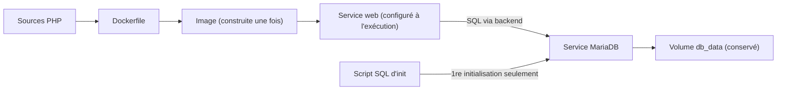

# Docker Compose

<p class="lead">Compose décrit une application multi-conteneurs (services, réseaux, volumes, secrets) dans un fichier <code>compose.yaml</code> versionné, puis <strong>fait converger</strong> le moteur Docker vers cette description, en une commande. C'est un outil déclaratif pour <strong>un hôte</strong>, pas un orchestrateur de cluster.</p>

{ .hero }

## L'essentiel en 30 secondes

<div class="grid cards" markdown>

-   :material-file-code-outline:{ .lg .middle } __Décrire__

    ---

    Un fichier remplace dix `docker run` dispersés : l'état attendu, relisible, partageable, reproductible.

-   :material-sync:{ .lg .middle } __Converger__

    ---

    `up -d` crée ce qui manque, recrée ce qui a changé, réutilise le reste (dont le volume).

-   :material-tag-outline:{ .lg .middle } __Préfixer__

    ---

    Un projet regroupe ses objets : `demo-db-1`, `demo_backend`, `demo_db_data`.

-   :material-server-off:{ .lg .middle } __Le piège · un seul hôte__

    ---

    Pas de planificateur, pas de reprise sur un autre nœud. Pour cela : [un orchestrateur](Pourquoi-orchestrer.md).

</div>

!!! warning "À retenir"

    **`config` valide le fichier, pas l'application.** **`restart` ne met pas à jour l'image** : il faut `up --build -d`. **`exec` n'est pas une correction** : ce qui est changé à la main disparaît à la recréation. **`down` garde la base, `down -v` la supprime.**

## :material-file-code-outline: Le fichier : une application décrite

| Clé de premier niveau | Décrit | Exemple |
|---|---|---|
| `services:` | les conteneurs : image ou construction, paramètres d'exécution | `web`, `db` |
| `networks:` | la connectivité entre services | `frontend`, `backend` |
| `volumes:` | le stockage persistant | `db_data` |
| `secrets:` / `configs:` | des données montées en fichiers | `db_app_password` |
| `name:` | le nom du projet (sinon : le nom du dossier, ou `-p`) | `wkapp-demo` |

Le fichier s'appelle `compose.yaml`, **sans clé `version:`** (ignorée par la *Compose Specification*), et la commande est `docker compose` (plugin v2), et non plus l'ancien binaire `docker-compose`.

??? note "Le compose.yaml de la démonstration, commenté (celui des captures)"

    ```yaml
    name: wkapp-demo
    services:
      db:
        image: mariadb:11.4                       # image officielle, utilisée telle quelle
        environment:                              # configuration de PREMIÈRE mise en service
          MARIADB_DATABASE: app
          MARIADB_USER: appuser
          MARIADB_PASSWORD_FILE: /run/secrets/db_app_password      # convention *_FILE de l'image
          MARIADB_ROOT_PASSWORD_FILE: /run/secrets/db_root_password
        secrets: [db_app_password, db_root_password]   # db reçoit les deux secrets
        volumes:
          - db_data:/var/lib/mysql                     # volume nommé : l'état
          - ./db/init:/docker-entrypoint-initdb.d:ro   # bind mount : scripts de 1re initialisation
        networks: [backend]                            # db n'est QUE sur backend, sans "ports:"
        healthcheck:
          test: ["CMD", "healthcheck.sh", "--connect", "--innodb_initialized"]
          interval: 5s
          timeout: 3s
          retries: 15
          start_period: 20s
      web:
        build: ./app                              # d'où construire (contient le Dockerfile)
        image: wkapp-web:1.0                      # nom donné à l'image construite
        ports:
          - "127.0.0.1:18380:80"                  # seule publication, sur la boucle locale
        environment:                              # lu par PHP à l'exécution
          DB_HOST: db                             # nom de service, résolu par le DNS interne
          DB_NAME: app
          DB_USER: appuser
        secrets: [db_app_password]                # web ne reçoit QUE le secret applicatif
        networks: [frontend, backend]             # web fait le pont entre les deux réseaux
        depends_on:
          db:
            condition: service_healthy            # attendre que db soit sain
        healthcheck:
          test: ["CMD", "curl", "-fsS", "-o", "/dev/null", "http://localhost/"]
          interval: 3s
          timeout: 2s
          retries: 2
          start_period: 5s
    networks:
      frontend:
      backend:
        internal: true                            # pas de sortie vers l'extérieur
    volumes:
      db_data:                                    # créé si absent, réutilisé ensuite
    secrets:
      db_root_password:
        file: ./secrets/db_root_password          # fichiers locaux, hors de l'image et du dépôt
      db_app_password:
        file: ./secrets/db_app_password
    ```

| Bloc | Ce qu'il faut comprendre | Détails |
|---|---|---|
| `build` + `image` | `build` dit **d'où** construire, `image` donne la **référence** produite | [Écrire un Dockerfile](Ecrire-un-Dockerfile.md) |
| `environment` | variables du processus ; les valeurs non sensibles, jamais les mots de passe | |
| `secrets` | déclarés **deux fois** : d'où vient le fichier, et qui y a droit ; vus en `/run/secrets/<nom>` | [Secrets](Secrets-fichiers-reseau-ressources.md) |
| `*_FILE` | convention **du point d'entrée de l'image MariaDB**, pas une fonction de Docker | |
| `networks` + `ports` | même réseau = joignable ; `ports:` ne sert qu'à l'accès **depuis l'extérieur** | [Réseaux et ports](Reseaux-et-ports.md) |
| `volumes` | créé s'il n'existe pas, **réutilisé** ensuite | [Stockage et volumes](Stockage-et-volumes.md) |
| `healthcheck` + `depends_on` | attendre une base **prête**, pas seulement lancée | [Démarré n'est pas disponible](Demarre-n-est-pas-disponible.md) |

???+ example "En vrai : valider le modèle avant de lancer"

    

    `config` affiche le fichier **tel que Compose l'a compris** : chemins absolus, ports détaillés, noms réels. Il révèle que la forme courte `depends_on: [db]` devient `condition: service_started`. Aucune garantie de démarrage ni de bon fonctionnement.

Trois niveaux, trois responsabilités : l'**image** (ce que l'application contient : Apache, PHP, `pdo_mysql`), le **service** (comment une instance s'exécute : réseaux, port, secrets), le **volume** (ce qui survit : les tables). On reconstruit l'image sans toucher aux données.

## :material-play-circle-outline: Le cycle de vie : up, ps, logs, down

| Commande | Effet |
|---|---|
| `up -d` · `up --build -d` · `up -d --wait` | crée ou réutilise et démarre ; construit d'abord ; rend la main quand tout est sain |
| `up -d --force-recreate` | recrée les conteneurs même sans changement |
| `ps` · `logs` · `images` · `ls` | état, journaux, images, projets existants |
| `exec <svc> <cmd>` | un processus de plus **dans l'instance existante** |
| `run --rm <svc> <cmd>` | une **nouvelle instance ponctuelle** (sans ports publiés, sauf `--service-ports`) |
| `restart` · `stop` / `start` | les **mêmes** instances, sur la même image |
| `down` / `down -v` | supprime conteneurs et réseaux ; **et** les volumes déclarés avec `-v` |

???+ example "En vrai : `up -d --wait` sur un dossier propre"

    

    Le nom du projet préfixe tout : deux projets qui déclarent chacun `db_data` **ne partagent pas** le même volume.

???+ danger "En vrai : `down` contre `down -v`"

    

    `down -v` est réservé aux projets jetables. Les volumes déclarés `external: true` ne sont jamais supprimés par Compose.

## :material-hammer-wrench: Construire n'est pas recréer

Scénario typique : l'application répond `503`, le journal de `web` dit `could not find driver`. Le pilote `pdo_mysql` manque **dans l'image** ; on ajoute `RUN docker-php-ext-install pdo_mysql` au Dockerfile.

```bash
docker compose restart web          # même conteneur, même image : toujours 503
docker compose up --build -d        # construit, détecte le changement : "web-1 Recreate", db reste "Running"
docker compose exec web php -m | grep -c pdo_mysql   # 1
```

`exec` sert au **diagnostic** (ici `php -m`), pas à corriger : les images minimales n'ont d'ailleurs pas toujours `ps`, `ss` ou `curl`.

## :material-variable: Paramétrer sans modifier le fichier

```yaml
    ports:
      - "127.0.0.1:${WEB_PORT:-8080}:80"     # 8080 si WEB_PORT n'est pas défini
```

| Mécanisme | Lu par | Sert à |
|---|---|---|
| `.env` du projet, variables du shell | **Compose** | **interpréter le YAML** (`${WEB_PORT}`) |
| `environment:` / `env_file:` | le **processus** du conteneur | configurer l'application |
| `secrets:` | le processus, via `/run/secrets/` | transmettre une valeur sensible en fichier |

!!! danger "Ni `.env` ni un secret Compose local ne sont des coffres-forts"

    `.env` est un fichier en clair, facile à committer par erreur. Un secret défini avec `file:` est un **bind mount d'un fichier en clair de l'hôte** : il évite l'image et les variables d'environnement, il ne chiffre rien. Dossier `secrets/` en 700, hors du dépôt Git.

??? note "Moderniser un ancien docker-compose.yml"

    Un fichier à l'ancienne fonctionne encore, avec l'avertissement `the attribute 'version' is obsolete, it will be ignored`.

    | Ligne d'origine | Problème | Correction |
    |---|---|---|
    | `version: "3.9"` | obsolète, ignorée | la supprimer ; renommer en `compose.yaml` |
    | `"5000:5000"` | publié sur **toutes** les interfaces | `"127.0.0.1:5000:5000"` si l'accès est local |
    | `POSTGRES_PASSWORD: example`, mot de passe dans `DATABASE_URL` | secret en clair, visible dans `docker inspect` | secret monté + `POSTGRES_PASSWORD_FILE` |
    | `depends_on: [db]` | n'attend que le **lancement** | `healthcheck` + `condition: service_healthy` |

??? note "Justifier une architecture, pas seulement constater qu'elle marche"

    « La page s'affiche » est une observation, pas une explication. Chaque flèche de la chaîne navigateur → publication → web → DNS → db → volume est un chemin vérifiable.

    | À démontrer | Mécanisme | Preuve observable |
    |---|---|---|
    | Le réseau permet l'échange | `web` et `db` partagent `backend` ; DNS interne | `docker compose exec web getent hosts db` |
    | Le port n'est pas exposé inutilement | `db` sans `ports:`, `web` sur `127.0.0.1` | `ss -lnt` : une seule socket |
    | Les données survivent à une recréation | volume nommé | `down` puis `up` : données présentes |
    | Le healthcheck limite une classe d'échecs | `condition: service_healthy` | `Waiting` puis `Healthy` avant `web Started` |
    | Le projet se reconstruit | Dockerfile, `compose.yaml`, procédure des secrets | `up --build -d` depuis un dossier propre |



Compose pilote **le moteur Docker ciblé**, généralement un hôte : pas de planificateur de cluster, pas de remplacement sur un autre nœud, pas de boucle de contrôle de l'état désiré. Voir [Pourquoi orchestrer ?](Pourquoi-orchestrer.md) et [De Compose aux manifestes Kubernetes](De-Compose-a-Kubernetes.md).

## :material-flask-outline: À toi de jouer

Dans un dossier vide, ce `compose.yaml` :

```yaml
services:
  web:
    image: nginx:stable
    ports:
      - "127.0.0.1:${WEB_PORT:-8080}:80"
  outil:
    image: alpine:3.22
    command: sleep infinity
```

```bash
docker compose config --services                          # outil, web
docker compose up -d
docker compose ps                                         # <dossier>-web-1, <dossier>-outil-1
docker compose exec outil wget -qO- http://web | head -4  # le réseau par défaut résout "web"
docker network ls --filter name=$(basename "$PWD")        # <dossier>_default
docker compose run --rm outil hostname                    # une AUTRE instance, détruite aussitôt
docker compose down                                       # conteneurs et réseau supprimés
```

??? abstract "Pour les créateurs : script de motion design « De la description à l'application » (65 s)"

    À gauche, `compose.yaml` en page de code ; à droite, un plateau « moteur Docker » vide. Chaque bloc du fichier s'allume quand l'objet correspondant apparaît.

    | Séq. | Durée | À l'écran | Animation | Texte à l'écran |
    |---|---|---|---|---|
    | 1 | 0-8 s | Une pile de dix commandes `docker run`, `docker network create`… | Les lignes glissent, se mélangent, l'une tombe | « Dix commandes à retaper, dans le bon ordre. » |
    | 2 | 8-15 s | Les commandes se compactent en une page `compose.yaml` | Morphing de la pile vers la page | « Compose les remplace par une description. » |
    | 3 | 15-24 s | `docker compose up --build -d` | Le bloc `build:` s'allume ; une image se forme couche par couche | « 1. Construire l'image. » |
    | 4 | 24-32 s | Les blocs `networks:` et `volumes:` s'allument | Deux zones (frontend, backend) se dessinent ; un cylindre `db_data` apparaît | « 2. Créer réseaux et volume, préfixés par le projet. » |
    | 5 | 32-44 s | Le bloc `db:` puis `web:` | db se pose dans backend, se branche au cylindre ; un témoin passe de jaune à vert ; alors seulement, web se pose à cheval sur les deux zones | « 3. Démarrer les services, dans l'ordre des dépendances. » |
    | 6 | 44-52 s | Une ligne change (`RUN docker-php-ext-install pdo_mysql`) ; nouveau `up --build -d` | Seule la carte web est remplacée ; db et le cylindre ne bougent pas | « Compose ne recrée que ce qui a changé. » |
    | 7 | 52-60 s | `docker compose down` | Cartes et zones s'effacent ; le cylindre reste seul | « down : tout part, sauf les données. » |
    | 8 | 60-65 s | Recul : le plateau est posé sur **une seule** machine | Une étiquette « un hôte » apparaît | « Un fichier, un hôte. Pour plusieurs machines, il faut un orchestrateur. » |

    Synchroniser strictement l'allumage du bloc YAML et l'apparition de l'objet : c'est ce lien qui fait comprendre que le fichier **est** l'état attendu.

??? info "Pour les créateurs : ce que chaque commande touche"

    | | Image | Conteneur | Réseaux | Volume |
    |---|---|---|---|---|
    | `restart` | · | même instance | · | · |
    | `up --build -d` | reconstruite | recréé si modifié | créés si absents | réutilisé |
    | `up -d --force-recreate` | · | recréé | réutilisés | réutilisé |
    | `stop` / `start` | · | arrêté / relancé | · | · |
    | `down` | · | supprimé | supprimés | **conservé** |
    | `down -v` | · | supprimé | supprimés | **supprimé** |

    Version graphique : quatre colonnes d'icônes (image, conteneur, réseau, cylindre) et une ligne par commande ; icône barrée en rouge pour « supprimé », flèche circulaire pour « recréé ».
