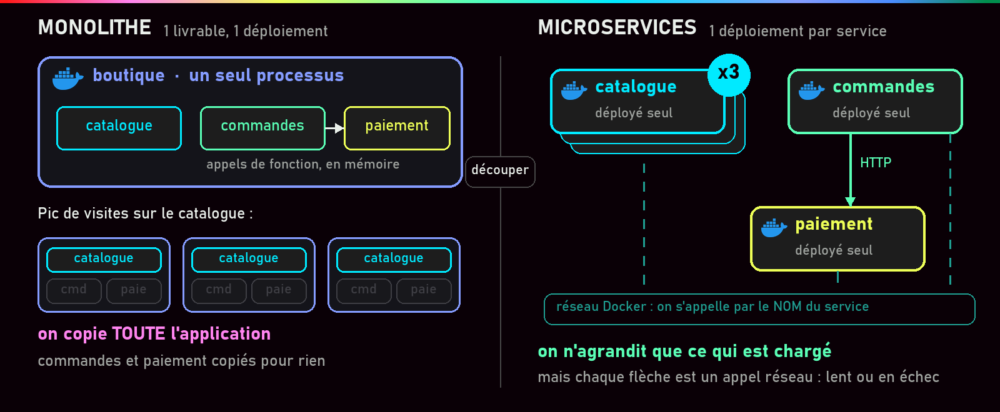
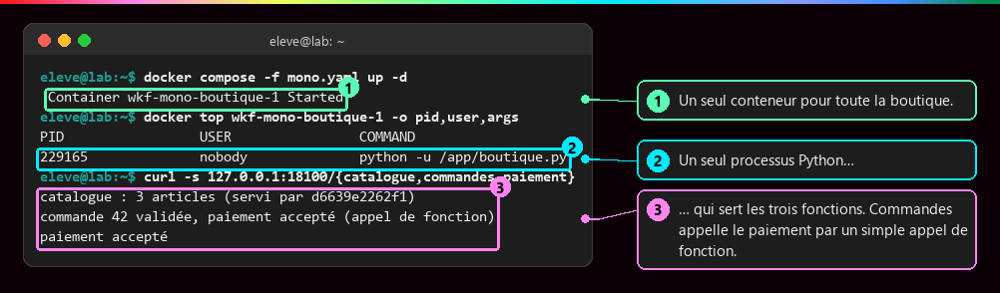
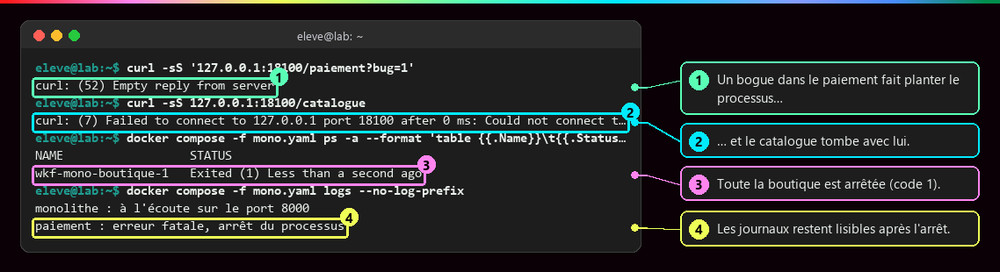
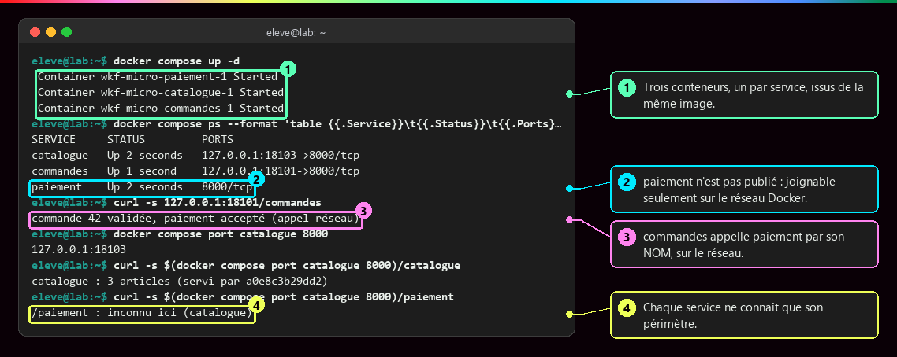
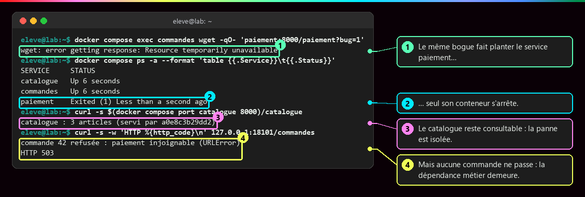
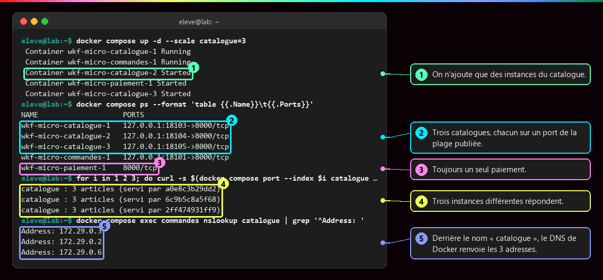
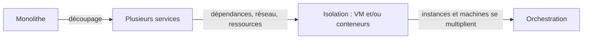

# Du monolithe aux microservices

<p class="lead">Monolithe et microservices sont deux façons d'<strong>organiser et de livrer</strong> une application. Découper en petits services donne de l'autonomie à chaque partie, mais chaque échange passe alors par le réseau, et l'exploitation devient plus exigeante.</p>

{ .hero }

!!! abstract "Dans cette page"

    **Tu vas comprendre :**

    - ce qu'on appelle un « monolithe » et un « microservice », sur l'exemple d'une petite boutique en ligne ;
    - ce qu'on gagne à découper une application, et ce que ça coûte ;
    - pourquoi « conteneur » et « microservice » ne veulent pas dire la même chose.

    **Prérequis :** [Bien démarrer](Bien-demarrer.md) (Docker installé). **Durée :** 25 min. **Niveau :** débutant.

!!! quote "En clair"

    Imagine une **petite boutique tenue par une seule personne** : elle conseille, encaisse et gère la réserve. C'est simple et rien ne se perd entre collègues, mais si elle tombe malade, la boutique ferme : c'est le **monolithe**. Un **grand magasin** a une équipe par rayon, une pour les caisses, une pour la réserve, qui se parlent au talkie-walkie : une caisse en panne n'empêche pas de flâner dans les rayons, mais personne ne peut payer. Ce sont les **microservices**. Limite de l'image : un monolithe peut être très bien rangé à l'intérieur, ce n'est pas forcément du désordre.

    { .anim }

## L'essentiel en 30 secondes

<div class="grid cards" markdown>

-   :material-cube-outline:{ .lg .middle } __Monolithe__

    ---

    Toute l'application est livrée **d'un seul bloc**. Corriger le paiement, c'est réinstaller toute l'application. À l'intérieur, le code peut être très bien découpé en modules.

-   :material-puzzle-outline:{ .lg .middle } __Microservice__

    ---

    Une seule fonction de l'application (catalogue, paiement…), livrée **à part**, qui parle aux autres selon des règles fixées d'avance : un **contrat**.

-   :material-scale-balance:{ .lg .middle } __Le prix à payer__

    ---

    Chaque échange passe par le **réseau** : il peut être lent ou échouer, les données sont éparpillées, il faut surveiller chaque service.

-   :material-docker:{ .lg .middle } __Pas un synonyme de conteneur__

    ---

    Microservice = une façon d'**organiser** l'application. Conteneur = une façon de l'**exécuter**. Les deux se combinent librement.

</div>

!!! warning "À retenir"

    Découper permet d'**isoler une panne** et d'**agrandir une seule partie**. Mais les parties restent dépendantes les unes des autres : sans paiement, pas de commande. Ce n'est pas une étape obligatoire : la taille de l'application, l'organisation des équipes et les besoins de montée en charge décident.

Pour les démonstrations ci-dessous, une petite boutique (catalogue, commandes, paiement) a été écrite **une seule fois** en Python, puis lancée de deux façons : en un seul programme, puis en trois services. Les captures sont des rendus de sorties réellement exécutées ; les noms commencent par `wkf-`, le nom du projet de démonstration. La commande `curl`, utilisée partout, est un petit navigateur web en ligne de commande : elle affiche la réponse d'une adresse.

## :material-cube-outline: Le monolithe : tout d'un seul tenant

Toutes les fonctions sont livrées et mises à jour **ensemble**. Elles s'appellent entre elles comme on appelle une fonction dans un programme, en mémoire, sans réseau. Pour absorber plus de visiteurs, on copie l'application entière. Ce qu'une panne emporte **dépend de la façon dont le code est écrit**.

???+ example "En vrai : la boutique en un seul programme"

    **Ce qu'on fait :** on lance la boutique en un seul conteneur, on regarde ce qui tourne dedans, puis on interroge ses trois fonctions.

    

    **Ce qu'il faut regarder :** ① un seul conteneur pour toute la boutique ; ② dedans, un seul programme Python ; ③ ce programme répond pour les trois fonctions, et les commandes appellent le paiement **en mémoire** (« appel de fonction ») : c'est rapide, et rien ne peut se perdre en route.

???+ danger "En vrai : un bogue du paiement emporte le catalogue"

    **Ce qu'on fait :** on déclenche une erreur grave dans la partie paiement, puis on essaie de consulter le catalogue.

    

    **Ce qu'il faut regarder :** ① le serveur raccroche sans répondre : le programme vient de planter ; ② le catalogue ne répond plus non plus ; ③ le conteneur est arrêté (`Exited (1)`), donc **toute** la boutique ; ④ les journaux (`logs`) restent lisibles après l'arrêt et expliquent pourquoi. Un monolithe mieux écrit pourrait contenir l'erreur, mais tout reste dans le même programme.

## :material-puzzle-outline: Les microservices : un service par fonction

!!! quote "En clair"

    Chaque rayon du grand magasin a son équipe et son **guichet**. Les autres rayons ne passent jamais par l'arrière-boutique : ils s'adressent au guichet, selon des règles connues de tous. Ce guichet, c'est l'API du service ; ces règles, son contrat.

    { .anim }

Un microservice est conçu pour **tourner et se mettre à jour seul**, **exposer une interface claire** (son API) et **évoluer ou grandir sans toucher aux autres**. Cette autonomie ne vient pas du seul fait de lancer plusieurs programmes : il faut aussi maîtriser qui dépend de qui, et qui possède quelles données.

| Aspect | Monolithe | Microservices |
|---|---|---|
| Mise à jour | l'application entière | service par service |
| Dépendances entre parties | selon l'organisation du code | on les veut faibles, rien ne le **garantit** |
| Montée en charge | on copie l'application entière | on copie seulement les services chargés |
| Pannes | peuvent affecter l'ensemble | isolables, mais elles peuvent se propager |
| Exploitation | peu d'échanges réseau internes | réseau, données et diagnostic éparpillés |

???+ example "En vrai : la même boutique en trois services"

    **Ce qu'on fait :** on relance le même code, mais cette fois en trois conteneurs, un par fonction, puis on passe une commande.

    

    **Ce qu'il faut regarder :** ① trois conteneurs, un par service, tous issus de la même image ; ② le paiement n'a **aucun port publié** (aucune porte ouverte vers l'extérieur) : seuls les autres conteneurs du projet peuvent le joindre ; ③ le service commandes appelle le paiement **par son nom**, cette fois par le réseau (« appel réseau ») ; ④ chaque service ne répond que pour sa propre fonction.

???+ danger "En vrai : la panne est isolée, la dépendance demeure"

    **Ce qu'on fait :** on déclenche le même bogue dans le service paiement, puis on teste le catalogue et les commandes.

    

    **Ce qu'il faut regarder :** ① le même bogue fait planter le paiement… ② mais seul son conteneur s'arrête ; ③ le catalogue reste consultable : la panne est **isolée** ; ④ en revanche aucune commande ne passe (`HTTP 503` : service indisponible), parce qu'une commande a besoin du paiement.

    Il faut donc des **délais d'expiration** (ici, les commandes abandonnent au bout de 2 s), des nouvelles tentatives limitées et une surveillance de chaque service. Sinon, la lenteur d'un service se propage à tous ceux qui l'attendent.

??? question "Les quatre confusions à éviter"

    1. **Monolithe ne veut pas dire code mal rangé.** Un monolithe découpé en modules est souvent le meilleur choix pour une petite équipe.
    2. **Plusieurs programmes ne font pas des microservices.** Sans contrats stables ni données séparées, on obtient un « monolithe distribué » : les inconvénients du réseau sans les avantages.
    3. **Découper ne supprime pas les dépendances métier.** Sans paiement, pas de commande, quelle que soit l'organisation.
    4. **Conteneur et microservice ne sont pas synonymes.** L'un est une façon d'exécuter, l'autre une façon d'organiser.

## :material-arrow-expand-horizontal: Agrandir seulement ce qui est chargé

!!! quote "En clair"

    Le samedi des soldes, le magasin ouvre **plus de caisses**, pas plus de réserves. En microservices, c'est pareil : on ajoute des copies du seul service débordé.

    { .anim }

Pendant les soldes, le catalogue reçoit cent fois plus de visites que le paiement. En monolithe, on copie **toute** l'application ; en microservices, on n'augmente **que** le catalogue. Ici, les trois services sont décrits dans un fichier Compose, un fichier qui liste les conteneurs à lancer ensemble (voir [Docker Compose](Docker-Compose.md)) :

```yaml title="compose.yaml (extrait)"
services:
  catalogue:
    image: wkf-boutique:1.0
    ports:
      - "127.0.0.1:18102-18109:8000"   # (1)!
  paiement:
    image: wkf-boutique:1.0            # (2)!
```

1. Une **plage** de ports de l'ordinateur (18102 à 18109) : chaque copie du catalogue en prend un libre. `127.0.0.1` : joignable depuis ce poste seulement.
2. Même image que le catalogue, mais pas de ligne `ports:` : le paiement n'est joignable que par les autres services du projet.

```bash
docker compose up -d --scale catalogue=3   # (1)!
```

1. `docker compose up -d` : lance (ou met à jour) tous les services du fichier, en arrière-plan. `--scale catalogue=3` : demande **trois** copies du catalogue.

???+ example "En vrai : `docker compose up -d --scale catalogue=3`"

    **Ce qu'on fait :** on demande trois catalogues, puis on interroge chacun et on demande au réseau Docker qui se cache derrière le nom « catalogue ».

    

    **Ce qu'il faut regarder :** ① on n'ajoute que des copies du catalogue (le paiement, arrêté par la panne précédente, est simplement relancé) ; ② trois catalogues, chacun sur un port de la plage ; ③ toujours un seul paiement ; ④ trois copies différentes répondent (`servi par` donne l'identifiant du conteneur) ; ⑤ pour les autres services, le nom `catalogue` désigne maintenant **trois** adresses.

!!! tip "Deux conditions"

    Le service doit être **sans état local** : il ne garde rien d'important dans son propre conteneur, sinon chaque copie aurait des données différentes. Et un mécanisme doit **répartir les visiteurs** entre les copies. Avec un port fixe (`"8080:80"`), `--scale` échoue : trois copies ne peuvent pas réserver le même port de l'ordinateur (voir [Réseaux Docker et publication de ports](Reseaux-et-ports.md), et [Service et Ingress](Service-et-Ingress.md) pour Kubernetes).

## :material-file-document-edit-outline: Le contrat : évoluer sans casser les autres

Un service ne peut évoluer seul **que si son contrat reste compatible**. Ajouter une information à sa réponse ne gêne personne ; en renommer une casse tous les services qui la lisent. Exemple : deux versions de la même demande « donne-moi la commande 42 », et leur réponse au format JSON.

```text
GET /api/v1/commandes/42 -> { "id": 42, "total": 59.90, "statut": "payée" }
GET /api/v2/commandes/42 -> { "id": 42, "montant": 59.90, "statut": "payée", "devise": "EUR" }
```

En v2, `total` est devenu `montant` : un service qui lit `total` serait cassé. On publie donc une `v2` **et on garde la `v1`** le temps que les autres services s'adaptent.

## :material-docker: Organiser et exécuter : deux décisions distinctes

| | **Sans conteneur** | **Avec conteneurs** |
|---|---|---|
| **Monolithe** | `java -jar boutique.jar` sur un serveur | un conteneur `boutique/monolithe` |
| **Microservices** | un service par machine virtuelle | un conteneur par service |

Les quatre cases existent en entreprise. Mettre une application en conteneur ne la découpe pas : le conteneur livre le code avec tout ce dont il a besoin, mais n'impose pas les microservices et **ne rend pas à lui seul l'application résistante aux pannes**.

??? example "Mettre un monolithe en conteneur (sans le découper)"

    ```dockerfile
    FROM eclipse-temurin:21-jre
    WORKDIR /app
    COPY boutique.jar app.jar
    CMD ["java", "-jar", "app.jar"]
    ```

    Un conteneur, un monolithe : l'organisation n'a pas changé, seule la façon de l'**exécuter et de la distribuer** a changé. Ce fichier, un Dockerfile, est expliqué dans [Écrire un Dockerfile](Ecrire-un-Dockerfile.md). À l'inverse, trois services Java, Python et Go dans trois machines virtuelles, chacun avec sa fonction et son contrat, sont bien des microservices, sans aucun conteneur.



Chaque service doit avoir ce dont il a besoin, parler aux autres et partager la machine sans gêner ses voisins : c'est le rôle de l'isolation ([Machine virtuelle ou conteneur](Machine-virtuelle-ou-conteneur.md), [Isolation d'un conteneur](Isolation-des-conteneurs.md)). Quand les copies et les machines se multiplient, il faut décider où les placer, comment les mettre à jour et les remplacer : c'est l'**orchestration** ([Pourquoi orchestrer ?](Pourquoi-orchestrer.md)).

??? tip "Décider de ne pas découper"

    Trois personnes, une application de gestion interne, peu d'utilisateurs : un **monolithe modulaire** (code séparé en modules, une seule base de données). Découper ajouterait du réseau, plusieurs bases à garder cohérentes, plusieurs chaînes de livraison et une surveillance éparpillée, sans besoin de montée en charge ciblée pour le justifier.

## :material-flask-outline: À toi de jouer

!!! tip "Pratique sans rien installer : le lab interactif"

    Une **machine Docker simulée** à gauche, le **tutoriel pas à pas** à droite, et Conti, le robot du lab, pour te dire quoi observer avant chaque commande. Chaque option est expliquée, tu vois ce que tu dois obtenir, et chaque étape se valide toute seule. Tu ne peux rien casser.

    [:material-console: Ouvrir le lab interactif](labs/microservices.md){ .md-button .md-button--primary target="_blank" rel="noopener" }

**Sur ton poste**, le même lab pas à pas :

Cinq étapes, environ 5 minutes. Tu vas jouer la boutique avec deux « services » : un serveur web Apache dans le rôle du paiement, un serveur nginx dans le rôle du catalogue. Puis tu provoques une panne. Tape les commandes une par une et compare avec ce que tu dois voir.

**Étape 1 · Créer un réseau pour la boutique**

```bash
docker network create boutique   # (1)!
```

1. Crée un réseau privé nommé `boutique`. Les conteneurs branchés dessus peuvent se joindre **par leur nom**.

Tu dois voir l'identifiant du réseau, une longue suite de chiffres et de lettres (le tien sera différent) :

```text
f66d64380e91ec9d426591bc744f94ceb5e611f7999c398d361aed704499808d
```

**Étape 2 · Lancer les deux services**

```bash
docker run -d --name paiement --network boutique httpd:2.4       # (1)!
docker run -d --name catalogue --network boutique nginx:stable   # (2)!
docker ps --filter network=boutique --format 'table {{.Names}}\t{{.Image}}\t{{.Status}}'   # (3)!
```

1. `-d` : en arrière-plan. `--name paiement` : le nom du conteneur, qui sert aussi de nom sur le réseau. `--network boutique` : le brancher sur le réseau de l'étape 1. `httpd:2.4` : l'image du serveur web Apache.
2. Même chose pour le catalogue, avec l'image du serveur web nginx.
3. `docker ps` liste les conteneurs en marche. `--filter network=boutique` : seulement ceux de notre réseau. `--format` : n'affiche que trois colonnes, le nom, l'image et l'état.

Chaque `docker run -d` affiche d'abord un long identifiant. Puis tu dois voir tes deux services à l'état `Up` (en marche), depuis une durée qui variera chez toi :

```text
NAMES       IMAGE          STATUS
catalogue   nginx:stable   Up Less than a second
paiement    httpd:2.4      Up Less than a second
```

**Étape 3 · Appeler le paiement par son nom**

```bash
docker run --rm --network boutique alpine:3.22 wget -qO- http://paiement/   # (1)!
```

1. On lance un petit conteneur Alpine jetable (`--rm` : supprimé dès qu'il a fini), sur le même réseau, qui joue le client. `wget -qO-` télécharge une page et l'affiche à l'écran. `http://paiement/` : on vise le service **par son nom**, sans connaître son adresse.

Tu dois voir la page d'accueil d'Apache :

```text
<!DOCTYPE HTML PUBLIC "-//W3C//DTD HTML 4.01//EN" "http://www.w3.org/TR/html4/strict.dtd">
<html>
<head>
<title>It works! Apache httpd</title>
</head>
<body>
<p>It works!</p>
</body>
</html>
```

**Étape 4 · Provoquer une panne**

```bash
docker stop paiement   # (1)!
docker run --rm --network boutique alpine:3.22 wget -qO- http://catalogue/ | grep title   # (2)!
docker run --rm --network boutique alpine:3.22 wget -T 2 -qO- http://paiement/          # (3)!
```

1. Arrête le conteneur du paiement : c'est notre panne.
2. Le catalogue répond-il encore ? `| grep title` ne garde que la ligne du titre de la page.
3. Et le paiement ? `-T 2` : abandonner au bout de 2 secondes.

Tu dois voir le nom du conteneur arrêté, puis le titre de la page de nginx, puis une erreur :

```text
paiement
<title>Welcome to nginx!</title>
wget: bad address 'paiement'
```

Le catalogue répond toujours : la panne est isolée. Le nom `paiement` n'existe plus sur le réseau, car un conteneur arrêté en disparaît. Dans une vraie boutique, toute commande échouerait.

**Étape 5 · Faire le ménage**

```bash
docker rm -f paiement catalogue   # (1)!
docker network rm boutique        # (2)!
```

1. `rm` supprime les conteneurs, `-f` arrête d'abord ceux qui tournent encore.
2. Supprime le réseau. Il faut le faire **après** les conteneurs : on ne retire pas un réseau encore utilisé.

Tu dois voir les noms de ce qui a été supprimé :

```text
paiement
catalogue
boutique
```

??? tip "Ça ne marche pas ?"

    | Message | Cause | Solution |
    |---|---|---|
    | `network with name boutique already exists` | le réseau existe déjà, d'un essai précédent | passe à l'étape 2, ou fais le ménage (étape 5) et recommence |
    | `Conflict. The container name "/paiement" is already in use` | un ancien conteneur porte déjà ce nom | `docker rm -f paiement` puis relance la commande |
    | `wget: bad address 'paiement'` dès l'étape 3 | le client n'est pas sur le réseau `boutique` (option `--network` oubliée), ou le paiement n'a pas démarré | vérifie l'option, puis `docker ps -a` |
    | `network boutique has active endpoints` | des conteneurs sont encore branchés sur le réseau | supprime d'abord les conteneurs, puis le réseau |

## :material-help-circle-outline: Vérifie que tu as compris

??? question "1. Dans la boutique en microservices, le paiement tombe en panne. Qu'est-ce qui marche encore, et qu'est-ce qui ne marche plus ?"

    Le **catalogue** marche encore : il tourne dans son propre conteneur, la panne ne l'atteint pas. Les **commandes** ne passent plus : elles ont besoin du paiement. Découper isole la panne, mais ne supprime pas la dépendance. Dans le monolithe, au contraire, tout s'arrêtait.

??? question "2. Pendant les soldes, seul le catalogue est débordé. Que fait-on avec un monolithe, et avec des microservices ?"

    Avec un monolithe, on copie **toute** l'application, y compris le paiement qui n'en a pas besoin. Avec des microservices, on ajoute des copies du **seul** catalogue (`--scale catalogue=3`). À deux conditions : le catalogue ne garde rien d'important dans son conteneur, et quelque chose répartit les visiteurs entre les copies.

??? question "3. Une application est livrée dans un conteneur Docker. Est-ce forcément une application en microservices ?"

    **Non.** Le conteneur est une façon d'exécuter, pas une façon d'organiser. Pour savoir, pose-toi ces questions : combien de morceaux sont livrés séparément ? Si on corrige une fonction, que faut-il réinstaller ? Peut-on agrandir seule la fonction la plus chargée ? Si une fonction tombe, lesquelles restent utilisables ? Chaque fonction a-t-elle ses propres données ? Si la réponse est toujours « l'application entière », c'est un monolithe, en conteneur ou non.

!!! success "Et ensuite ?"

    Tu sais maintenant pourquoi on découpe (ou pas) une application. Reste à savoir comment faire tourner chaque morceau à l'abri des autres. Page suivante : [Machine virtuelle ou conteneur](Machine-virtuelle-ou-conteneur.md).

## :material-server: Pour aller plus loin

??? note "Pourquoi l'architecture a évolué"

    - **Le contexte** : applications plus complexes, essor du web, besoin de **livrer souvent**. On a cherché plus d'autonomie entre les parties d'une application.
    - **Les moyens de communication** : API HTTP, SOAP ou gRPC, ou échanges de messages (files, bus). Ces techniques **ne sont pas réservées aux microservices**.
    - Pour aller plus loin : la bande dessinée [Kubernetes par Google Cloud](https://cloud.google.com/kubernetes-engine/kubernetes-comic/).

??? abstract "Pour les créateurs : script de motion design (70 s)"

    Style : formes plates, une couleur par fonction (bleu catalogue, vert commandes, jaune paiement), fond sombre. Les textes à l'écran suffisent.

    | Séq. | Durée | À l'écran | Animation | Texte à l'écran |
    |---|---|---|---|---|
    | 1 | 0-8 s | Un grand bloc gris « Boutique » contenant trois tuiles colorées : catalogue, commandes, paiement | Le bloc se pose sur un serveur ; un tampon « déployé » s'imprime sur l'ensemble | « Un monolithe : tout est livré et déployé d'un seul tenant. » |
    | 2 | 8-16 s | La tuile « paiement » reçoit une petite clé à molette (correctif) | Tout le bloc s'éteint, puis se rallume en entier | « Corriger une partie, c'est redéployer le tout. » |
    | 3 | 16-26 s | Une foule d'icônes « visiteurs » se dirige vers la tuile bleue | Le bloc entier est dupliqué trois fois ; les tuiles verte et jaune des copies restent grisées, inutilisées | « Plus de visites sur le catalogue ? On copie toute l'application. » |
    | 4 | 26-36 s | Le bloc gris se fissure le long des tuiles | Les trois tuiles se séparent et deviennent trois boîtes autonomes, reliées par des câbles fins étiquetés « API » | « Découper : chaque fonction devient un service, avec un contrat. » |
    | 5 | 36-44 s | La foule revient vers « catalogue » | Seule la boîte bleue se multiplie (x3) ; les autres ne bougent pas | « Mise à l'échelle ciblée : on n'agrandit que ce qui est chargé. » |
    | 6 | 44-54 s | La boîte « paiement » devient rouge et s'éteint | Le catalogue continue de pulser ; une commande (petit chariot) avance vers paiement et reste bloquée devant | « Une panne peut être isolée, mais les dépendances métier demeurent. » |
    | 7 | 54-62 s | Les câbles « API » s'allongent et ondulent ; de petites horloges apparaissent dessus | Un paquet ralentit sur un câble, un autre se perd | « Le réseau a un prix : latence, pannes partielles, données à garder cohérentes. » |
    | 8 | 62-70 s | Recul : des dizaines de boîtes sur plusieurs serveurs, en désordre | Un point d'interrogation, puis trois mots apparaissent : « isoler », « placer », « remplacer » | « Nouvelle question : comment exécuter tous ces services ? » |

    La séquence 3 doit rendre visible le **gaspillage** (les tuiles grisées dans les copies), sinon la séquence 5 perd son effet. La séquence 6 est la plus importante : ne pas montrer les microservices comme une solution magique, laisser le chariot bloqué quelques secondes.

??? info "Pour les créateurs : idées de schémas"

    **La boutique, deux organisations.** À gauche, les flèches sont des appels de fonction ; à droite, des **appels réseau**, qui peuvent être lents ou échouer.

    ```mermaid
    flowchart LR
        subgraph Mono["Monolithe : un seul déploiement"]
            direction TB
            UI1["Interface"] --> CAT1["Module catalogue"]
            UI1 --> CMD1["Module commandes"]
            CMD1 --> PAY1["Module paiement"]
        end
        Mono --> DB1[("Base de données")]
        subgraph Micro["Microservices : un déploiement par service"]
            direction TB
            UI2["Interface"] -- "HTTP" --> CAT2["Service catalogue"]
            UI2 -- "HTTP" --> CMD2["Service commandes"]
            CMD2 -- "API / messages" --> PAY2["Service paiement"]
        end
        CAT2 --> DBc[("Données catalogue")]
        CMD2 --> DBo[("Données commandes")]
    ```

    **Deux axes indépendants.** Le tableau « organiser et exécuter » se dessine comme une grille 2 x 2 : les lignes (organisation) et les colonnes (exécution) sont deux décisions distinctes.

    **Vocabulaire à afficher.** Module : partie du code d'une même application (paquetage, bibliothèque interne). Contrat : ce qu'un service promet aux autres (routes, format des messages, codes d'erreur). Couplage : fort si changer l'une des parties oblige à changer l'autre. Mise à l'échelle (*scaling*) : ajouter des instances pour absorber la charge.

    **Code de la démonstration.** `wiki_sources/scripts/fondements_boutique/` : `boutique.py` (le rôle est choisi par la variable `ROLE`), `Dockerfile`, `mono.yaml` et `compose.yaml`. Mini-lab : `wiki_sources/scripts/lab_fondements.sh`.
