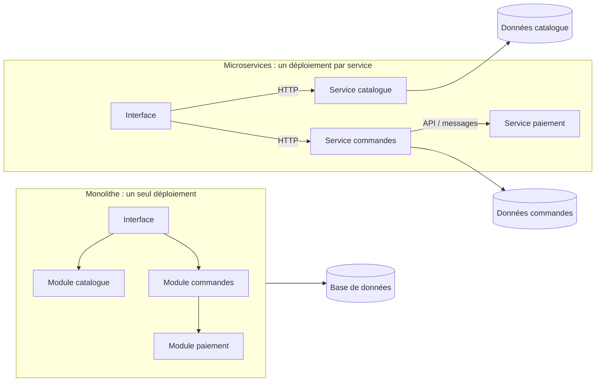
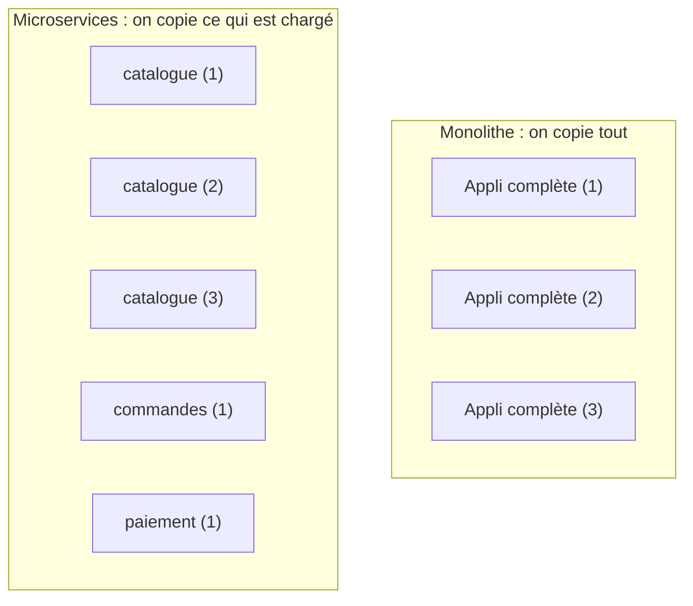
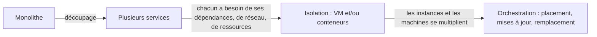

# Du monolithe aux microservices

> **En une phrase.** Monolithe et microservices sont deux façons d'**organiser et de déployer** une application : découper en services achète de l'autonomie au prix d'une exploitation plus exigeante, et fait apparaître un problème nouveau, celui d'exécuter proprement tous ces services.

---

## 1. Synthèse

### Le modèle mental

```
        MONOLITHE                                    MICROSERVICES

 ┌───────────────────────────────┐        ┌───────────┐   API    ┌───────────┐
 │   application-complete.jar    │        │ catalogue │◄────────►│ commandes │
 │  ┌───────────┐ ┌───────────┐  │        └───────────┘          └─────┬─────┘
 │  │ catalogue │ │ commandes │  │                                     │ API
 │  └───────────┘ └───────────┘  │                               ┌─────▼─────┐
 │  ┌───────────┐ ┌───────────┐  │                               │ paiement  │
 │  │ paiement  │ │ interface │  │                               └───────────┘
 │  └───────────┘ └───────────┘  │
 └───────────────────────────────┘
   1 livrable · 1 déploiement            1 livrable et 1 déploiement par service,
   appels internes (en mémoire)          reliés par des contrats sur le réseau
```

### Le vocabulaire

| Terme | Définition |
|---|---|
| **Monolithe** | Application qui regroupe ses principales fonctionnalités dans **un ensemble déployé comme une unité**. |
| **Microservice** | Service qui prend en charge **un périmètre fonctionnel cohérent** (le catalogue, les commandes…), exécuté et déployé indépendamment. |
| **Module** | Partie du code d'une même application, organisée à part (paquetage, bibliothèque interne). Un monolithe peut être très modulaire. |
| **Contrat** (interface) | Ce qu'un service promet aux autres : routes d'API, format des messages, codes d'erreur. Tant qu'il reste compatible, chaque côté peut évoluer seul. |
| **Couplage** | Degré de dépendance entre deux parties : fort si changer l'une oblige à changer l'autre. |
| **Mise à l'échelle** (*scaling*) | Ajouter des instances d'un programme pour absorber plus de charge. |

### Les caractéristiques du monolithe

- Les fonctionnalités partagent **un cycle de déploiement commun** : corriger le paiement, c'est redéployer toute l'application.
- Le code peut être organisé en modules : un monolithe **n'est pas nécessairement fortement couplé**.
- La mise à l'échelle porte généralement sur **l'application entière**.
- Une défaillance peut affecter plusieurs fonctionnalités ; **son impact dépend de la conception**.

Exemple typique : `java -jar application-complete.jar` lance un seul programme qui contient l'API, l'interface utilisateur et la logique métier. Les données, elles, peuvent être stockées dans une base externe.

### Pourquoi l'architecture a évolué

- **Le contexte** : applications plus complexes, essor du web, besoin de **déployer souvent**. On a cherché plus d'autonomie entre les parties d'une application.
- **Les moyens de communication** : API HTTP, SOAP ou gRPC, ou échanges de messages (files, bus). Ces techniques **ne sont pas réservées aux microservices**.
- **Le choix** dépend de la taille de l'application, de l'organisation des équipes et des besoins de mise à l'échelle. Les microservices **ne sont pas une étape obligatoire**.

### Ce qu'est un microservice

Un microservice est conçu pour :
1. **s'exécuter et être déployé indépendamment** des autres services ;
2. **exposer une interface de communication définie** ;
3. permettre **une évolution et une mise à l'échelle ciblées**.

Cette autonomie suppose de **maîtriser les dépendances entre services et l'accès aux données**. Elle ne résulte pas du seul découpage en plusieurs processus. Et la distribution ajoute ses propres contraintes : **latence réseau**, **indisponibilité des dépendances**, **cohérence des données**, **supervision**.

### La vue architecturale

| Aspect | Monolithe | Microservices |
|---|---|---|
| Organisation | Modules réunis dans une application | Services aux responsabilités délimitées |
| Couplage | Dépend de l'organisation interne du code | Faible couplage recherché, mais **non garanti** |
| Déploiement | Application déployée comme un ensemble | Déploiement indépendant recherché par service |
| Mise à l'échelle | Généralement l'application entière | Possibilité de cibler certains services |
| Pannes | Une défaillance peut affecter l'ensemble | Isolement possible, mais propagation entre services à maîtriser |
| Exploitation | Moins d'échanges réseau internes à gérer | Communications, données et diagnostic distribués plus complexes |

Le choix porte sur **des compromis** : les microservices peuvent faciliter l'autonomie des équipes et des déploiements, au prix d'une exploitation plus exigeante.

### Microservice ou conteneur : deux notions différentes

| Notion | Ce que c'est | Niveau |
|---|---|---|
| **Microservice** | Un choix d'**organisation fonctionnelle et de déploiement** du logiciel | Architecture |
| **Conteneur** | Un **environnement d'exécution isolé** pour des processus applicatifs | Exécution |

- Un **monolithe peut être conteneurisé**.
- Des **microservices peuvent tourner dans des machines virtuelles**, sans aucun conteneur.
- La conteneurisation facilite la distribution du code et de ses dépendances dans un environnement reproductible, **sur des hôtes compatibles**. Elle n'impose pas les microservices et **ne garantit pas à elle seule la résilience** (capacité à continuer de servir malgré des pannes).

### Le problème nouveau : exécuter tous ces services

Chaque service doit **disposer de ses dépendances**, **communiquer avec les autres** et **partager les ressources de la machine sans perturber ses voisins**. Deux mécanismes d'isolation, combinables, y répondent :

| Mécanisme | Principe | Page |
|---|---|---|
| **Virtualisation** | Fournir des machines virtuelles, chacune avec son propre système d'exploitation | [Machine virtuelle ou conteneur](Machine-virtuelle-ou-conteneur.md) |
| **Conteneurisation** | Isoler des processus et leur environnement en **partageant un noyau** | [Isolation d'un conteneur](Isolation-des-conteneurs.md) |

Quand les instances et les machines se multiplient, il faut aussi organiser **leur placement, leurs mises à jour et leur remplacement** : c'est le besoin d'**orchestration** (voir [Pourquoi orchestrer ?](Pourquoi-orchestrer.md)).

> [!IMPORTANT]
> **Les quatre confusions à éviter**
> 1. **Monolithe ne veut pas dire code spaghetti.** Un monolithe modulaire, bien conçu, est souvent le meilleur choix pour une petite équipe.
> 2. **Plusieurs processus ne font pas des microservices.** Sans contrats stables ni données séparées, on obtient un « monolithe distribué » : tous les inconvénients du réseau, aucun des avantages.
> 3. **Découper ne supprime pas les dépendances métier.** Si le paiement tombe, on ne finalise plus de commande, quelle que soit l'architecture.
> 4. **Conteneur et microservice ne sont pas synonymes.** L'un est une technique d'exécution, l'autre un choix d'architecture.

---

## 2. Cas d'usage classiques

Les cas suivants utilisent une boutique en ligne fictive, avec trois fonctions : **catalogue**, **commandes**, **paiement**.

### Cas 1 : la boutique en monolithe

**Besoin.** Une petite équipe lance la boutique. Le catalogue, les commandes et le paiement sont trois modules d'une même application, déployés ensemble.

```bash
java -jar application-complete.jar      # un seul processus : API + interface + logique métier
```

**Ce qu'on observe.** Un seul livrable à construire, tester et superviser. Les modules s'appellent par de simples appels de fonction, sans réseau. En revanche, corriger une ligne du module paiement oblige à **redéployer toute l'application**, catalogue compris.
**À retenir.** C'est un choix raisonnable tant que l'équipe et la charge restent modestes.

### Cas 2 : un pic de charge sur le catalogue seulement

**Besoin.** Pendant les soldes, le catalogue reçoit cent fois plus de visites que le paiement.

- **En monolithe** : on lance plusieurs copies de **toute** l'application. Chaque copie embarque aussi le paiement et les commandes, qui n'en avaient pas besoin.
- **En microservices** : on augmente seulement le catalogue. Avec Docker Compose, par exemple (images fictives) :

```yaml
# compose.yaml
services:
  catalogue:
    image: boutique/catalogue:1.4
  commandes:
    image: boutique/commandes:2.0
  paiement:
    image: boutique/paiement:1.1
```

```bash
docker compose up -d --scale catalogue=3     # 3 instances du catalogue, 1 seule du paiement
docker compose ps
```

**À retenir.** La mise à l'échelle **ciblée** est l'un des vrais gains. Elle suppose que le service soit sans état local et qu'un mécanisme répartisse les requêtes entre ses instances (voir [Service et Ingress](Service-et-Ingress.md) pour Kubernetes).

> [!NOTE]
> `--scale` échoue si le service publie un port fixe de l'hôte (`ports: ["8080:80"]`) : trois instances ne peuvent pas toutes réserver le port 8080 de l'hôte. Voir [Réseaux Docker et publication de ports](Reseaux-et-ports.md).

### Cas 3 : le paiement tombe en panne

**Besoin.** Comprendre ce que l'architecture change, et ne change pas, face à une panne.

| Situation | Monolithe | Microservices |
|---|---|---|
| Bogue qui fait planter le module paiement | Peut faire tomber **tout** le processus, catalogue compris (selon la conception) | Le service paiement tombe ; le catalogue **reste consultable** |
| Un client veut finaliser sa commande | Impossible | **Impossible aussi** : commandes dépend de paiement |
| Le paiement répond lentement (5 s au lieu de 50 ms) | Lenteur interne | Les appels de commandes s'accumulent ; sans délai d'expiration, la lenteur **se propage** |

**À retenir.** Le découpage peut **isoler** une panne, il ne supprime pas les dépendances métier. Il faut prévoir des délais d'expiration, des réessais limités et une supervision de chaque service.

### Cas 4 : faire évoluer un service sans casser les autres (le contrat)

**Besoin.** L'équipe commandes veut ajouter un champ à sa réponse et renommer un autre.

```
GET /api/v1/commandes/42   -> { "id": 42, "total": 59.90, "statut": "payée" }
GET /api/v2/commandes/42   -> { "id": 42, "montant": 59.90, "statut": "payée", "devise": "EUR" }
```

**Ce qu'on observe.** Ajouter `devise` est compatible : les anciens clients l'ignorent. Renommer `total` en `montant` casse tous les clients qui lisent `total`. On publie donc une `v2` et on garde la `v1` le temps que les autres services migrent.
**À retenir.** Chaque service ne peut évoluer et être déployé indépendamment **que si les contrats entre services restent compatibles**.

### Cas 5 : conteneuriser un monolithe

**Besoin.** Garder l'application d'un seul tenant, mais la livrer avec son environnement Java pour qu'elle tourne partout pareil.

```dockerfile
FROM eclipse-temurin:21-jre
WORKDIR /app
COPY application-complete.jar app.jar
CMD ["java", "-jar", "app.jar"]
```

```bash
docker build -t boutique/monolithe:1.0 .
docker run -d -p 8080:8080 boutique/monolithe:1.0
```

**Ce qu'on observe.** Un conteneur, un monolithe : l'architecture n'a pas changé, seule la façon de l'**exécuter et de la distribuer** a changé.
**À retenir.** Conteneuriser n'est pas découper. Le Dockerfile est détaillé dans [Écrire un Dockerfile](Ecrire-un-Dockerfile.md).

### Cas 6 : des microservices sans conteneur

**Besoin.** Une entreprise exploite déjà un parc de machines virtuelles.

```
VM 1 : catalogue  (service systemd, Java)
VM 2 : commandes  (service systemd, Python)
VM 3 : paiement   (service systemd, Go)
```

**Ce qu'on observe.** Chaque service a son périmètre, son contrat et son déploiement propres : ce sont bien des microservices. Le coût est plus élevé (un système d'exploitation complet par service), mais l'architecture est la même.
**À retenir.** Le microservice est une **décision d'architecture**, pas une technologie.

### Cas 7 : décider de ne pas découper

**Besoin.** Une équipe de trois personnes, une application de gestion interne, peu d'utilisateurs.

**La bonne réponse.** Un monolithe modulaire (code bien séparé en modules, une seule base). Découper ajouterait du réseau, plusieurs bases à garder cohérentes, plusieurs pipelines de déploiement et une supervision distribuée, sans besoin de mise à l'échelle ciblée pour le justifier.
**À retenir.** Les critères de choix : **taille de l'application, organisation des équipes, besoins de mise à l'échelle**.

---

## 3. Idées de schémas

### Schéma A : la boutique, deux organisations



Message du schéma : à gauche, les flèches sont des appels de fonction ; à droite, ce sont des **appels réseau**, qui peuvent être lents ou échouer.

### Schéma B : la mise à l'échelle ciblée



### Schéma C : deux axes indépendants

Un tableau à deux entrées, à dessiner comme une grille 2 x 2 :

| | **Sans conteneur** | **Avec conteneurs** |
|---|---|---|
| **Monolithe** | `java -jar` sur un serveur | un conteneur `boutique/monolithe` (cas 5) |
| **Microservices** | un service par VM (cas 6) | un conteneur par service (cas 2) |

Les quatre cases existent en entreprise. Le schéma montre que **l'architecture (lignes) et l'exécution (colonnes) sont deux décisions distinctes**.

### Schéma D : du découpage à l'orchestration



---

## 4. Script de motion design : « Du monolithe aux microservices » (environ 70 s)

Style : formes plates, une couleur par fonction (bleu catalogue, vert commandes, orange paiement), fond clair. Les textes à l'écran suffisent.

| Séq. | Durée | À l'écran | Animation | Texte à l'écran |
|---|---|---|---|---|
| 1 | 0-8 s | Un grand bloc gris « Boutique » contenant trois tuiles colorées : catalogue, commandes, paiement | Le bloc se pose sur un serveur ; un tampon « déployé » s'imprime sur l'ensemble | « Un monolithe : tout est livré et déployé d'un seul tenant. » |
| 2 | 8-16 s | La tuile orange « paiement » reçoit une petite clé à molette (correctif) | Tout le bloc s'éteint, puis se rallume en entier | « Corriger une partie, c'est redéployer le tout. » |
| 3 | 16-26 s | Une foule d'icônes « visiteurs » se dirige vers la tuile bleue | Le bloc entier est dupliqué trois fois ; les tuiles verte et orange des copies restent grisées, inutilisées | « Plus de visites sur le catalogue ? On copie toute l'application. » |
| 4 | 26-36 s | Le bloc gris se fissure le long des tuiles | Les trois tuiles se séparent et deviennent trois boîtes autonomes, reliées par des câbles fins étiquetés « API » | « Découper : chaque fonction devient un service, avec un contrat. » |
| 5 | 36-44 s | La foule revient vers « catalogue » | Seule la boîte bleue se multiplie (x3) ; les autres ne bougent pas | « Mise à l'échelle ciblée : on n'agrandit que ce qui est chargé. » |
| 6 | 44-54 s | La boîte orange « paiement » devient rouge et s'éteint | Le catalogue continue de pulser ; une commande (petit chariot) avance vers paiement et reste bloquée devant | « Une panne peut être isolée, mais les dépendances métier demeurent. » |
| 7 | 54-62 s | Les câbles « API » s'allongent et ondulent ; de petites horloges apparaissent dessus | Un paquet ralentit sur un câble, un autre se perd | « Le réseau a un prix : latence, pannes partielles, données à garder cohérentes. » |
| 8 | 62-70 s | Recul : des dizaines de boîtes sur plusieurs serveurs, en désordre | Un point d'interrogation, puis trois mots apparaissent : « isoler », « placer », « remplacer » | « Nouvelle question : comment exécuter tous ces services ? » |

**Conseil de réalisation.** La séquence 3 doit rendre visible le **gaspillage** (les tuiles grisées dans les copies), sinon la séquence 5 perd son effet. La séquence 6 est la plus importante pédagogiquement : ne pas montrer les microservices comme une solution magique, laisser le chariot bloqué quelques secondes.

---

## 5. Vérifier soi-même

Ce sujet est avant tout un sujet d'architecture : il n'y a pas de commande qui « prouve » qu'une application est en microservices. Un exercice utile consiste à prendre une application connue et à remplir ce tableau :

| Question | Réponse pour l'application étudiée |
|---|---|
| Combien de livrables sont déployés séparément ? | |
| Si on corrige une fonction, que faut-il redéployer ? | |
| Quelle fonction reçoit le plus de charge ? Peut-on l'agrandir seule ? | |
| Si une fonction tombe, lesquelles restent utilisables ? | |
| Chaque fonction a-t-elle ses propres données, ou une base commune ? | |

Si toutes les réponses désignent « l'application entière », c'est un monolithe, conteneurisé ou non.

## Voir aussi

- [Accueil du wiki](../README.md)
- Page suivante : [Machine virtuelle ou conteneur](Machine-virtuelle-ou-conteneur.md)
- Pour aller plus loin : la bande dessinée [Kubernetes par Google Cloud](https://cloud.google.com/kubernetes-engine/kubernetes-comic/)
