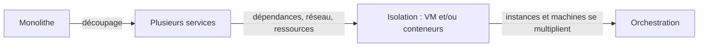

# Du monolithe aux microservices

<p class="lead">Monolithe et microservices sont deux façons d'<strong>organiser et de déployer</strong> une application. Découper en services achète de l'autonomie, au prix d'appels réseau et d'une exploitation plus exigeante.</p>

{ .hero }

## L'essentiel en 30 secondes

<div class="grid cards" markdown>

-   :material-cube-outline:{ .lg .middle } __Monolithe__

    ---

    Un livrable, **un déploiement**. Corriger le paiement, c'est redéployer toute l'application. Il peut être très bien découpé en modules.

-   :material-puzzle-outline:{ .lg .middle } __Microservice__

    ---

    Un **périmètre fonctionnel** (catalogue, paiement…), déployé seul, derrière un **contrat** : API, messages.

-   :material-scale-balance:{ .lg .middle } __Le prix à payer__

    ---

    Chaque appel passe par le **réseau** : latence, pannes partielles, données à garder cohérentes, supervision distribuée.

-   :material-docker:{ .lg .middle } __Pas un synonyme de conteneur__

    ---

    Microservice = choix d'**architecture**. Conteneur = technique d'**exécution**. Les deux se combinent librement.

</div>

!!! warning "À retenir"

    Découper peut **isoler une panne** et **agrandir une seule partie**, mais ne supprime pas les dépendances métier. Ce n'est pas une étape obligatoire : la taille de l'application, l'organisation des équipes et les besoins de mise à l'échelle décident.

Pour les démonstrations ci-dessous, une petite boutique (catalogue, commandes, paiement) a été écrite **une seule fois** en Python, puis lancée de deux façons : en un seul processus, puis en trois services. Les captures sont des rendus de sorties réellement exécutées.

## :material-cube-outline: Le monolithe : tout d'un seul tenant

Les fonctionnalités partagent **un cycle de déploiement commun** et s'appellent par de simples appels de fonction, sans réseau. La mise à l'échelle porte sur l'application entière ; l'impact d'une panne **dépend de la conception**.

???+ example "En vrai : la boutique en un seul processus"

    

    Un seul livrable à construire, tester et superviser. Commandes appelle paiement en mémoire : rapide, et rien ne peut se perdre en route.

???+ danger "En vrai : un bogue du paiement emporte le catalogue"

    

    Ici, une erreur fatale dans le module paiement arrête le processus : **toute** la boutique tombe. Un monolithe mieux conçu peut contenir l'erreur, mais tout reste dans le même processus.

## :material-puzzle-outline: Les microservices : un service par périmètre

Un microservice est conçu pour **s'exécuter et se déployer seul**, **exposer une interface définie** et permettre **une évolution et une mise à l'échelle ciblées**. Cette autonomie suppose de maîtriser les dépendances et l'accès aux données : elle ne vient pas du seul découpage en processus.

| Aspect | Monolithe | Microservices |
|---|---|---|
| Déploiement | l'application comme un ensemble | indépendant, service par service |
| Couplage | dépend de l'organisation du code | faible couplage recherché, **non garanti** |
| Mise à l'échelle | l'application entière | ciblée sur certains services |
| Pannes | peuvent affecter l'ensemble | isolables, mais la propagation est à maîtriser |
| Exploitation | peu d'échanges réseau internes | réseau, données et diagnostic distribués |

???+ example "En vrai : la même boutique en trois services"

    

    Même image, trois conteneurs, trois rôles. Le paiement n'est même pas publié sur l'hôte : seul le service commandes l'appelle, **par son nom**, sur le réseau Docker du projet.

???+ danger "En vrai : la panne est isolée, la dépendance demeure"

    

    Le même bogue n'arrête que le conteneur paiement : le catalogue reste consultable. Mais aucune commande ne passe. Il faut donc des **délais d'expiration** (ici 2 s), des réessais limités et une supervision de chaque service, sinon la lenteur d'un service se propage aux autres.

??? question "Les quatre confusions à éviter"

    1. **Monolithe ne veut pas dire code spaghetti.** Un monolithe modulaire est souvent le meilleur choix pour une petite équipe.
    2. **Plusieurs processus ne font pas des microservices.** Sans contrats stables ni données séparées, on obtient un « monolithe distribué » : les inconvénients du réseau sans les avantages.
    3. **Découper ne supprime pas les dépendances métier.** Sans paiement, pas de commande, quelle que soit l'architecture.
    4. **Conteneur et microservice ne sont pas synonymes.** L'un est une technique d'exécution, l'autre un choix d'architecture.

## :material-arrow-expand-horizontal: Agrandir seulement ce qui est chargé

Pendant les soldes, le catalogue reçoit cent fois plus de visites que le paiement. En monolithe, on copie **toute** l'application ; en microservices, on n'augmente **que** le catalogue.

```yaml title="compose.yaml (extrait)"
services:
  catalogue:
    image: wkf-boutique:1.0
    ports:
      - "127.0.0.1:18102-18109:8000"   # une PLAGE : chaque instance prend un port libre
  paiement:
    image: wkf-boutique:1.0            # pas de port publié : interne au projet
```

???+ example "En vrai : `docker compose up -d --scale catalogue=3`"

    

    Seul le catalogue est multiplié (le paiement, arrêté par la panne précédente, est simplement relancé). Pour les autres services, le nom `catalogue` désigne désormais **trois** adresses.

!!! tip "Deux conditions"

    Le service doit être **sans état local** (rien d'important stocké dans le conteneur), et un mécanisme doit **répartir les requêtes** entre les instances. Avec un port fixe (`"8080:80"`), `--scale` échoue : trois instances ne peuvent pas réserver le même port de l'hôte (voir [Réseaux Docker et publication de ports](Reseaux-et-ports.md), et [Service et Ingress](Service-et-Ingress.md) pour Kubernetes).

## :material-file-document-edit-outline: Le contrat : évoluer sans casser les autres

Chaque service ne peut évoluer seul **que si son contrat reste compatible**. Ajouter un champ ne gêne personne ; en renommer un casse tous les clients qui le lisent.

```text
GET /api/v1/commandes/42 -> { "id": 42, "total": 59.90, "statut": "payée" }
GET /api/v2/commandes/42 -> { "id": 42, "montant": 59.90, "statut": "payée", "devise": "EUR" }
```

On publie donc une `v2` **et on garde la `v1`** le temps que les autres services migrent.

## :material-docker: Architecture et exécution : deux décisions distinctes

| | **Sans conteneur** | **Avec conteneurs** |
|---|---|---|
| **Monolithe** | `java -jar boutique.jar` sur un serveur | un conteneur `boutique/monolithe` |
| **Microservices** | un service par VM (systemd) | un conteneur par service |

Les quatre cases existent en entreprise. Conteneuriser n'est pas découper : la conteneurisation livre le code avec ses dépendances, sur des hôtes compatibles, mais n'impose pas les microservices et **ne garantit pas à elle seule la résilience**.

??? example "Conteneuriser un monolithe (sans le découper)"

    ```dockerfile
    FROM eclipse-temurin:21-jre
    WORKDIR /app
    COPY boutique.jar app.jar
    CMD ["java", "-jar", "app.jar"]
    ```

    Un conteneur, un monolithe : l'architecture n'a pas changé, seule la façon de l'**exécuter et de la distribuer** a changé. Le Dockerfile est détaillé dans [Écrire un Dockerfile](Ecrire-un-Dockerfile.md). À l'inverse, trois services Java, Python et Go dans trois VM, chacun avec son périmètre et son contrat, sont bien des microservices, sans aucun conteneur.



Chaque service doit avoir ses dépendances, parler aux autres et partager la machine sans gêner ses voisins : c'est le rôle de l'isolation ([Machine virtuelle ou conteneur](Machine-virtuelle-ou-conteneur.md), [Isolation d'un conteneur](Isolation-des-conteneurs.md)). Quand instances et machines se multiplient, il faut organiser leur placement, leurs mises à jour et leur remplacement : c'est l'**orchestration** ([Pourquoi orchestrer ?](Pourquoi-orchestrer.md)).

??? tip "Décider de ne pas découper"

    Trois personnes, une application de gestion interne, peu d'utilisateurs : un **monolithe modulaire** (code séparé en modules, une seule base). Découper ajouterait du réseau, plusieurs bases à garder cohérentes, plusieurs pipelines et une supervision distribuée, sans besoin de mise à l'échelle ciblée pour le justifier.

## :material-flask-outline: À toi de jouer

Deux « services » sur un réseau Docker, puis une panne :

```bash
docker network create demo
docker run -d --name paiement  --network demo httpd:2.4
docker run -d --name catalogue --network demo nginx:stable
docker run --rm --network demo alpine:3.22 wget -qO- http://paiement/              # It works!
docker stop paiement                                                             # panne du paiement
docker run --rm --network demo alpine:3.22 wget -qO- http://catalogue/ | grep title  # le catalogue répond
docker run --rm --network demo alpine:3.22 wget -T 2 -qO- http://paiement/        # bad address 'paiement'
docker rm -f paiement catalogue && docker network rm demo
```

Puis prends une application que tu connais et réponds : combien de livrables sont déployés séparément ? Si on corrige une fonction, que faut-il redéployer ? Peut-on agrandir seule la fonction la plus chargée ? Si une fonction tombe, lesquelles restent utilisables ? Chaque fonction a-t-elle ses propres données ? Si toutes les réponses désignent « l'application entière », c'est un monolithe, conteneurisé ou non.

??? abstract "Pour les créateurs : script de motion design (70 s)"

    Style : formes plates, une couleur par fonction (bleu catalogue, vert commandes, jaune paiement), fond sombre. Les textes à l'écran suffisent.

    | Séq. | Durée | À l'écran | Animation | Texte à l'écran |
    |---|---|---|---|---|
    | 1 | 0-8 s | Un grand bloc gris « Boutique » contenant trois tuiles colorées : catalogue, commandes, paiement | Le bloc se pose sur un serveur ; un tampon « déployé » s'imprime sur l'ensemble | « Un monolithe : tout est livré et déployé d'un seul tenant. » |
    | 2 | 8-16 s | La tuile « paiement » reçoit une petite clé à molette (correctif) | Tout le bloc s'éteint, puis se rallume en entier | « Corriger une partie, c'est redéployer le tout. » |
    | 3 | 16-26 s | Une foule d'icônes « visiteurs » se dirige vers la tuile bleue | Le bloc entier est dupliqué trois fois ; les tuiles verte et jaune des copies restent grisées, inutilisées | « Plus de visites sur le catalogue ? On copie toute l'application. » |
    | 4 | 26-36 s | Le bloc gris se fissure le long des tuiles | Les trois tuiles se séparent et deviennent trois boîtes autonomes, reliées par des câbles fins étiquetés « API » | « Découper : chaque fonction devient un service, avec un contrat. » |
    | 5 | 36-44 s | La foule revient vers « catalogue » | Seule la boîte bleue se multiplie (x3) ; les autres ne bougent pas | « Mise à l'échelle ciblée : on n'agrandit que ce qui est chargé. » |
    | 6 | 44-54 s | La boîte « paiement » devient rouge et s'éteint | Le catalogue continue de pulser ; une commande (petit chariot) avance vers paiement et reste bloquée devant | « Une panne peut être isolée, mais les dépendances métier demeurent. » |
    | 7 | 54-62 s | Les câbles « API » s'allongent et ondulent ; de petites horloges apparaissent dessus | Un paquet ralentit sur un câble, un autre se perd | « Le réseau a un prix : latence, pannes partielles, données à garder cohérentes. » |
    | 8 | 62-70 s | Recul : des dizaines de boîtes sur plusieurs serveurs, en désordre | Un point d'interrogation, puis trois mots apparaissent : « isoler », « placer », « remplacer » | « Nouvelle question : comment exécuter tous ces services ? » |

    La séquence 3 doit rendre visible le **gaspillage** (les tuiles grisées dans les copies), sinon la séquence 5 perd son effet. La séquence 6 est la plus importante : ne pas montrer les microservices comme une solution magique, laisser le chariot bloqué quelques secondes.

??? info "Pour les créateurs : idées de schémas"

    **La boutique, deux organisations.** À gauche, les flèches sont des appels de fonction ; à droite, des **appels réseau**, qui peuvent être lents ou échouer.

    ```mermaid
    flowchart LR
        subgraph Mono["Monolithe : un seul déploiement"]
            direction TB
            UI1["Interface"] --> CAT1["Module catalogue"]
            UI1 --> CMD1["Module commandes"]
            CMD1 --> PAY1["Module paiement"]
        end
        Mono --> DB1[("Base de données")]
        subgraph Micro["Microservices : un déploiement par service"]
            direction TB
            UI2["Interface"] -- "HTTP" --> CAT2["Service catalogue"]
            UI2 -- "HTTP" --> CMD2["Service commandes"]
            CMD2 -- "API / messages" --> PAY2["Service paiement"]
        end
        CAT2 --> DBc[("Données catalogue")]
        CMD2 --> DBo[("Données commandes")]
    ```

    **Deux axes indépendants.** Le tableau « architecture et exécution » se dessine comme une grille 2 x 2 : les lignes (architecture) et les colonnes (exécution) sont deux décisions distinctes.

    **Vocabulaire à afficher.** Module : partie du code d'une même application (paquetage, bibliothèque interne). Contrat : ce qu'un service promet aux autres (routes, format des messages, codes d'erreur). Couplage : fort si changer l'une des parties oblige à changer l'autre. Mise à l'échelle (*scaling*) : ajouter des instances pour absorber la charge.

    **Code de la démonstration.** `wiki_sources/scripts/fondements_boutique/` : `boutique.py` (le rôle est choisi par la variable `ROLE`), `Dockerfile`, `mono.yaml` et `compose.yaml`.

??? note "Pourquoi l'architecture a évolué"

    - **Le contexte** : applications plus complexes, essor du web, besoin de **déployer souvent**. On a cherché plus d'autonomie entre les parties d'une application.
    - **Les moyens de communication** : API HTTP, SOAP ou gRPC, ou échanges de messages (files, bus). Ces techniques **ne sont pas réservées aux microservices**.
    - Pour aller plus loin : la bande dessinée [Kubernetes par Google Cloud](https://cloud.google.com/kubernetes-engine/kubernetes-comic/).
