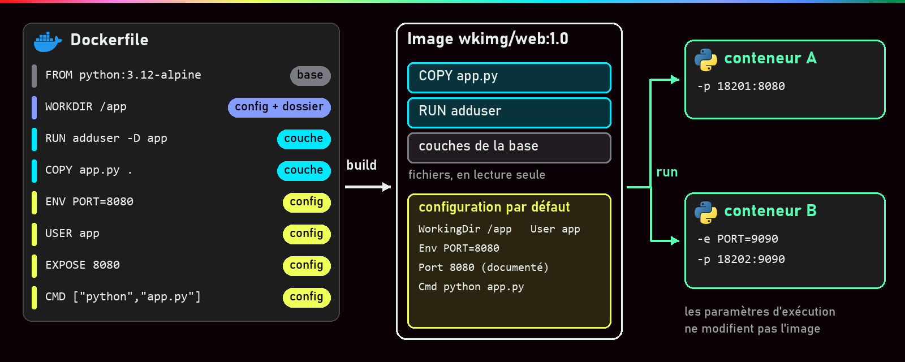
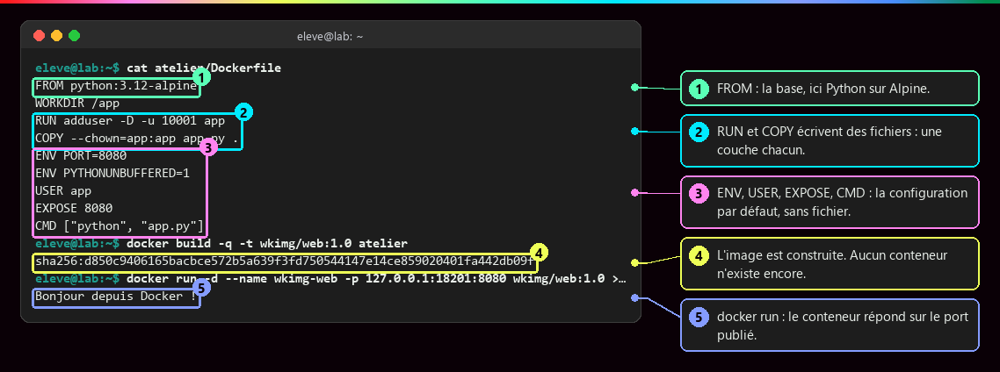
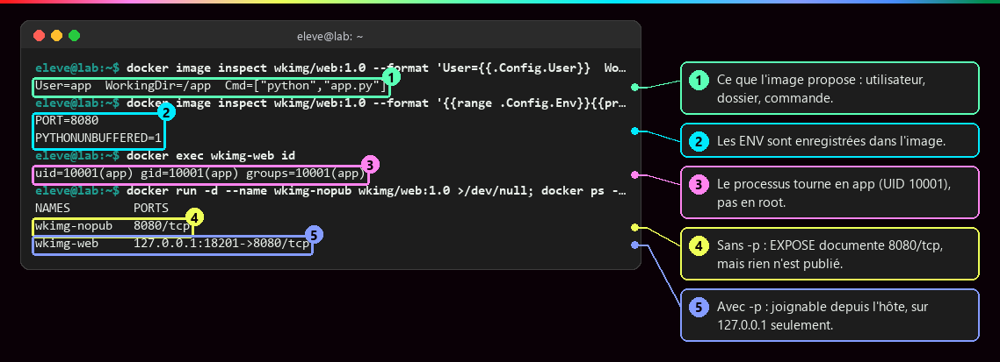
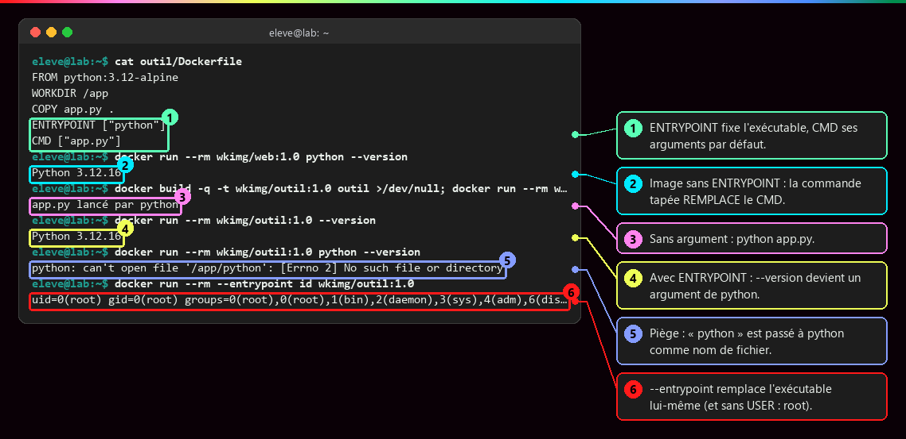
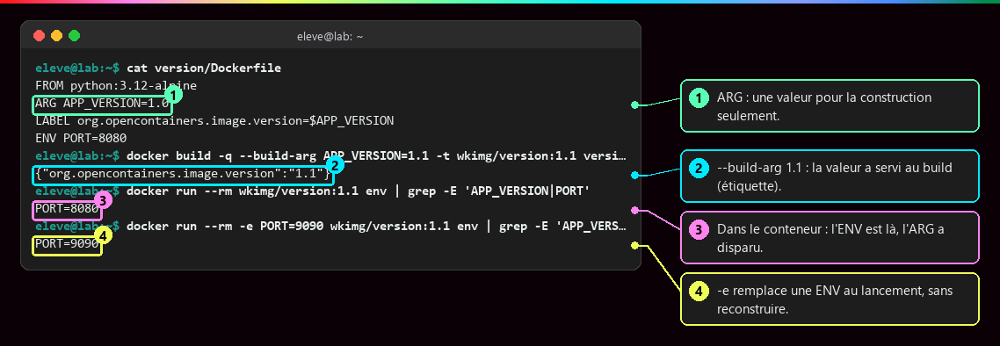

# Écrire un Dockerfile

<p class="lead">Un Dockerfile est une <strong>recette</strong> : chaque ligne ajoute des fichiers ou fixe un réglage par défaut. <code>docker build</code> en tire une image ; le conteneur n'existe qu'au <code>docker run</code>.</p>

{ .hero }

!!! abstract "Dans cette page"

    **Tu vas comprendre :**

    - ce que fait chaque ligne d'un Dockerfile, et lesquelles ajoutent des fichiers ;
    - ce qui est décidé une fois pour toutes à la construction, et ce qu'on choisit à chaque lancement ;
    - comment faire tourner ton application sans les droits d'administrateur.

    **Prérequis :** [Les couches d'une image](Couches-d-une-image.md). **Durée :** 35 min. **Niveau :** débutant.

!!! quote "En clair"

    Le Dockerfile est une **recette de cuisine**. `docker build` la suit et produit un **bocal scellé** : l'image, qu'on peut ranger et transporter. `docker run` **sert une assiette** à partir du bocal : c'est le conteneur. Limite de l'image : contrairement à un vrai bocal, on peut servir autant d'assiettes qu'on veut sans jamais le vider.

    { .anim }

## L'essentiel en 30 secondes

<div class="grid cards" markdown>

-   :material-hammer-wrench:{ .lg .middle } __build : la recette__

    ---

    Base, fichiers, commandes de préparation, réglages **par défaut**. Le résultat se publie sans avoir jamais tourné.

-   :material-play-circle-outline:{ .lg .middle } __run : l'exécution__

    ---

    Ports publiés, variables, limites : décidés **au lancement**, sans reconstruire.

-   :material-layers-plus:{ .lg .middle } __Couche ou réglage__

    ---

    `RUN` et `COPY` écrivent des fichiers ; `ENV`, `USER`, `EXPOSE`, `CMD` remplissent la fiche de configuration.

-   :material-account-lock-outline:{ .lg .middle } __Pas d'administrateur__

    ---

    Un utilisateur créé dans l'image, puis `USER` : le programme ne tourne plus en root.

</div>

!!! warning "À retenir"

    **`COPY` copie, il ne fait pas de lien** : modifier le code ne change pas une image déjà construite. **`EXPOSE` documente, il n'ouvre rien** : on publie un port avec `-p` au lancement. **`RUN` agit une seule fois, au build**, jamais à chaque `docker run`.

## :material-file-document-edit-outline: Une première image, ligne par ligne

Le service : un petit serveur web écrit en Python, qui répond « Bonjour depuis Docker ! ». Pas besoin de lire le Python : retiens seulement qu'il écoute sur le port donné par la variable `PORT` (8080 par défaut) et sur `0.0.0.0`, c'est-à-dire **toutes** les adresses du conteneur. Sur `127.0.0.1`, il ne serait joignable que depuis l'intérieur du conteneur.

??? note "Le programme `app.py`"

    ```python
    from http.server import BaseHTTPRequestHandler, HTTPServer
    from os import getenv


    class App(BaseHTTPRequestHandler):
        def do_GET(self):
            body = b"Bonjour depuis Docker !\n"
            self.send_response(200)
            self.send_header("Content-Type", "text/plain; charset=utf-8")
            self.send_header("Content-Length", str(len(body)))
            self.end_headers()
            self.wfile.write(body)


    HTTPServer(("0.0.0.0", int(getenv("PORT", "8080"))), App).serve_forever()
    ```

Voici la recette complète. Clique sur chaque bulle numérotée pour l'explication de la ligne :

```bash title="Dockerfile"
FROM python:3.12-alpine          # (1)!
WORKDIR /app                     # (2)!
RUN adduser -D -u 10001 app      # (3)!
COPY --chown=app:app app.py .    # (4)!
ENV PORT=8080                    # (5)!
ENV PYTHONUNBUFFERED=1           # (6)!
USER app                         # (7)!
EXPOSE 8080                      # (8)!
CMD ["python", "app.py"]         # (9)!
```

1. **La base.** On part d'une image existante qui contient déjà Alpine Linux et Python 3.12. On hérite de ses couches et de ses réglages. On choisit une version précise (`3.12-alpine`), jamais `latest`.
2. **Le dossier de travail.** Crée `/app` s'il n'existe pas et s'y place : les lignes suivantes, et le programme au démarrage, travailleront dans ce dossier.
3. **Une commande lancée pendant la construction.** Ici, crée un compte `app` sans mot de passe (`-D`), avec un numéro d'utilisateur (UID) fixe et élevé, 10001. Produit une couche. Sur une base Debian, on écrirait `useradd --uid 10001 --create-home app`.
4. **Copier un fichier.** Prend `app.py` dans le dossier passé à `docker build` (le « contexte ») et le dépose dans le dossier de travail (`.` = `/app`). `--chown=app:app` le donne directement à l'utilisateur `app`. Cette ligne doit venir **après** la création du compte : sinon, avec le moteur testé (Docker 29), le build ne signale rien et le fichier reste à root (on le voit avec `ls -ln`).
5. **Une variable d'environnement.** `PORT=8080` sera visible par le programme dans chaque conteneur. C'est une valeur par défaut, remplaçable au lancement avec `-e`.
6. Demande à Python d'écrire ses messages tout de suite, sans les garder en mémoire : ils apparaissent immédiatement dans `docker logs`.
7. **Changer d'utilisateur.** À partir d'ici, et surtout au démarrage du conteneur, le programme tourne en `app` et non plus en root.
8. **Documenter un port.** Indique que le service écoute sur 8080. N'ouvre **rien** : c'est `-p` au lancement qui rend le port joignable.
9. **La commande de démarrage.** Ce que lance le conteneur s'il n'en reçoit pas d'autre. Écrite entre crochets (forme « exec »), elle lance `python` directement, sans passer par un shell.

Les lignes 1 à 4 produisent des fichiers (des couches) ; les lignes 5 à 9 ne remplissent que la fiche de réglages (voir [Les couches d'une image](Couches-d-une-image.md)).

Pour fabriquer l'image puis lancer un conteneur :

```bash
docker build -t atelier:1.0 .                                  # (1)!
docker run -d --name web -p 127.0.0.1:8080:8080 atelier:1.0    # (2)!
```

1. `build` suit la recette. `-t atelier:1.0` donne le nom `atelier` et le tag `1.0`. Le `.` final est le **contexte** : le dossier courant, où Docker cherche le `Dockerfile` et `app.py`.
2. `-d` : en arrière-plan. `--name web` : un nom facile à retenir. `-p 127.0.0.1:8080:8080` : le port 8080 de ta machine, seulement en local, mène au port 8080 du conteneur.

???+ example "En vrai : le Dockerfile complet, construit puis lancé"

    **Ce qu'on fait :** on affiche le Dockerfile, on construit l'image, puis on lance un conteneur et on l'interroge.

    

    **Ce qu'il faut regarder :**

    - ① : `FROM`, la base de départ.
    - ② : `RUN` et `COPY` écrivent des fichiers, une couche chacun.
    - ③ : `ENV`, `USER`, `EXPOSE`, `CMD` ne remplissent que la configuration.
    - ④ : le build se termine par l'identifiant de l'image. À ce stade, **aucun conteneur** n'existe.
    - ⑤ : après `docker run`, le conteneur répond sur le port publié.

???+ example "En vrai : ce que l'image enregistre, ce que le lancement décide"

    **Ce qu'on fait :** on lit la fiche de réglages de l'image, on demande au conteneur sous quel utilisateur il tourne, puis on compare un conteneur lancé sans `-p` à un conteneur lancé avec.

    

    **Ce qu'il faut regarder :**

    - ① : ce que l'image propose par défaut : l'utilisateur `app`, le dossier `/app`, la commande `python app.py`.
    - ② : les deux `ENV` sont enregistrées dans l'image.
    - ③ : le programme tourne bien en `app` (UID 10001), pas en root. `docker image inspect` lit le **modèle** ; `docker exec … id` interroge le **programme** en cours.
    - ④ : sans `-p`, le port est seulement documenté (`8080/tcp`) : rien n'est joignable depuis l'hôte.
    - ⑤ : avec `-p`, il est joignable, et sur `127.0.0.1` seulement : il n'est pas ouvert au réseau.

## :material-console-line: Qui lance quoi : `CMD` et `ENTRYPOINT`

!!! quote "En clair"

    `CMD` est une **suggestion** : si tu tapes une autre commande après le nom de l'image, elle la remplace. `ENTRYPOINT` est le **programme fixe** : ce que tu tapes après le nom de l'image devient ses arguments.

    { .anim }

| Dockerfile | `docker run img` | `docker run img python --version` |
|---|---|---|
| `CMD ["python", "app.py"]` | `python app.py` | `python --version` : la commande **remplace** `CMD` |
| `ENTRYPOINT ["python"]` + `CMD ["app.py"]` | `python app.py` | `python python --version` : les mots deviennent des **arguments** |

???+ example "En vrai : remplacer, compléter, forcer"

    **Ce qu'on fait :** on lance une image sans `ENTRYPOINT`, puis une image avec `ENTRYPOINT ["python"]`, en ajoutant différents mots après le nom de l'image.

    

    **Ce qu'il faut regarder :**

    - ① : `ENTRYPOINT` fixe le programme (`python`), `CMD` ses arguments par défaut (`app.py`).
    - ② : sur l'image **sans** `ENTRYPOINT`, `python --version` remplace complètement le `CMD`.
    - ③ : sans rien ajouter, l'image avec `ENTRYPOINT` lance `python app.py`.
    - ④ : avec `ENTRYPOINT`, on tape seulement `--version` : il devient l'argument de `python`.
    - ⑤ : le piège : taper `python --version` fait chercher à Python un fichier nommé `python`.
    - ⑥ : pour changer le programme lui-même, il faut `--entrypoint`. Ici `id` montre root, car cette image n'a pas de `USER`.

    Beaucoup d'images officielles combinent un script de préparation en `ENTRYPOINT` et le serveur en `CMD` (`php:8.4-apache` : `docker-php-entrypoint` puis `apache2-foreground`).

!!! tip "Forme exec ou forme shell"

    `CMD ["python", "app.py"]` (forme exec, entre crochets) lance le programme **directement** : il reçoit le signal d'arrêt (`SIGTERM`) envoyé par `docker stop`, mais `$PORT` n'y est pas remplacé par sa valeur. `CMD python app.py` (forme shell) passe par `/bin/sh -c` : les variables sont remplacées, mais c'est le shell qui reçoit le signal, pas ton programme. Préfère la forme exec.

## :material-variable: `ENV` ou `ARG` ?

!!! quote "En clair"

    `ARG` est une **note sur le brouillon** de la recette : elle sert pendant la fabrication, puis disparaît. `ENV` est une **mention imprimée sur l'étiquette** : chaque conteneur la retrouve.

    { .anim }

| | `ENV` | `ARG` |
|---|---|---|
| Disponible pendant le build | oui | oui |
| Présente dans le conteneur | **oui** | non |
| Remplacée par | `docker run -e PORT=9090` | `docker build --build-arg APP_VERSION=1.1` |
| Pour un mot de passe ? | **non** : visible dans `docker image inspect` | **non** : visible dans l'historique |

???+ example "En vrai : l'ARG sert au build, l'ENV reste dans le conteneur"

    **Ce qu'on fait :** une image reçoit un numéro de version par `--build-arg`, qu'elle recopie dans une étiquette (`LABEL`). Puis on regarde les variables présentes dans un conteneur.

    

    **Ce qu'il faut regarder :**

    - ① : `ARG APP_VERSION=1.0` déclare une valeur pour la construction seulement.
    - ② : `--build-arg APP_VERSION=1.1` l'a remplacée, et elle a servi pendant le build : elle se retrouve dans l'étiquette.
    - ③ : dans le conteneur, `PORT` est là mais `APP_VERSION` a disparu.
    - ④ : `-e PORT=9090` remplace une `ENV` au lancement, sans reconstruire.

    Un `ARG` déclaré **avant** `FROM` ne sert qu'à paramétrer le `FROM` lui-même.

## :material-check-decagram-outline: Les bonnes pratiques

```dockerfile
FROM <base précise et maintenue>       # 1. 3.12-alpine, pas latest ; slim, alpine ou distroless si ça suffit
# 2. ce qui change rarement : paquets système, utilisateur
# 3. la liste des dépendances, puis leur installation
# 4. le code, qui change souvent
# 5. la configuration : ENV, USER, EXPOSE, HEALTHCHECK, CMD
```

Cet ordre accélère les reconstructions grâce au **cache** (voir [Contexte de build et cache](Contexte-de-build-et-cache.md)). Ajoute à cela :

- `COPY` plutôt que `ADD`, qui sait aussi télécharger ou extraire une archive, souvent sans qu'on s'en rende compte ;
- la forme exec pour `CMD` ;
- un utilisateur qui n'est pas root ;
- la configuration fournie au lancement (`-e`), pour utiliser **la même image** en test et en production ;
- les données dans des **volumes** (voir [Stockage et volumes](Stockage-et-volumes.md)) ;
- **aucun mot de passe** dans `ENV`, `ARG`, `COPY` ou le texte du Dockerfile (voir [Sécurité des images](Securite-des-images.md)).

???+ danger "Un composant manque : on corrige la recette, pas le conteneur"

    L'image `php:8.4-apache` n'a pas le pilote MariaDB : l'appli répond 503 (`could not find driver`). On ajoute `RUN docker-php-ext-install pdo_mysql` **avant** le `COPY` du code. Mais `docker compose restart web` ne change rien : il relance **le même conteneur sur la même image**. Il faut reconstruire **et** recréer : `docker compose up --build -d` (voir [Docker Compose](Docker-Compose.md)).

## :material-flask-outline: À toi de jouer

Six étapes, environ 15 minutes. Tu vas fabriquer l'image `atelier:1.0` : **garde-la** à la fin, la page [Versionner et publier une image](Versionner-et-publier-une-image.md) s'en resservira.

**Étape 1 · Créer le dossier et les deux fichiers**

```bash
mkdir atelier && cd atelier   # (1)!
```

1. `mkdir` crée le dossier `atelier`, `cd` entre dedans. Tout le reste de l'atelier se passe dans ce dossier.

Copie ensuite ces deux blocs en entier, l'un après l'autre. Chacun crée un fichier avec le texte compris entre la première ligne et `EOF` :

```bash
cat > app.py <<'EOF'
from http.server import BaseHTTPRequestHandler, HTTPServer
from os import getenv


class App(BaseHTTPRequestHandler):
    def do_GET(self):
        body = b"Bonjour depuis Docker !\n"
        self.send_response(200)
        self.send_header("Content-Type", "text/plain; charset=utf-8")
        self.send_header("Content-Length", str(len(body)))
        self.end_headers()
        self.wfile.write(body)


HTTPServer(("0.0.0.0", int(getenv("PORT", "8080"))), App).serve_forever()
EOF
```

```bash
cat > Dockerfile <<'EOF'
FROM python:3.12-alpine
WORKDIR /app
RUN adduser -D -u 10001 app
COPY --chown=app:app app.py .
ENV PORT=8080
ENV PYTHONUNBUFFERED=1
USER app
EXPOSE 8080
CMD ["python", "app.py"]
EOF
ls
```

Tu dois voir les deux fichiers :

```text
Dockerfile  app.py
```

**Étape 2 · Construire l'image**

```bash
docker build -t atelier:1.0 .   # (1)!
docker image ls atelier         # (2)!
```

1. Suit la recette du `Dockerfile` du dossier courant (`.`) et nomme le résultat `atelier:1.0`.
2. Liste les images qui s'appellent `atelier`.

`docker build` affiche ses étapes `[1/4]` à `[4/4]` (`FROM`, `WORKDIR`, `RUN`, `COPY` : seules ces lignes produisent des fichiers), puis termine par `naming to docker.io/library/atelier:1.0`. Tu dois ensuite voir ton image (ton identifiant sera différent) :

```text
IMAGE         ID             DISK USAGE   CONTENT SIZE   EXTRA
atelier:1.0   547a15591fd6       74.2MB         18.1MB
```

**Étape 3 · Lancer un conteneur et lui parler**

```bash
docker run -d --name web -p 127.0.0.1:8080:8080 atelier:1.0   # (1)!
curl http://127.0.0.1:8080                                    # (2)!
docker logs web                                               # (3)!
```

1. Crée et démarre le conteneur `web`, en arrière-plan, joignable sur le port 8080 de ta machine.
2. `curl` envoie une requête web, comme un navigateur, et affiche la réponse. Tu peux aussi ouvrir `http://127.0.0.1:8080` dans ton navigateur.
3. Affiche ce que le programme a écrit depuis son démarrage.

Tu dois voir l'identifiant complet du conteneur (le tien sera différent), la réponse du serveur, puis la trace de ta requête avec sa date et le code `200` (OK) :

```text
740e3ab0b37079f264510c0e7be7e7c79d82770e3f5a23133edc93326dca61e4
Bonjour depuis Docker !
172.17.0.1 - - [27/Oct/2026 15:46:37] "GET / HTTP/1.1" 200 -
```

`172.17.0.1` est l'adresse par laquelle ta machine joint le conteneur. Cette ligne s'affiche tout de suite grâce à `ENV PYTHONUNBUFFERED=1`.

**Étape 4 · Vérifier ce que l'image a fixé**

```bash
docker exec web id                                          # (1)!
docker run --rm -e PORT=9090 atelier:1.0 env | grep PORT    # (2)!
```

1. Lance la commande `id` **dans** le conteneur `web` : sous quel utilisateur tourne-t-il ?
2. Un conteneur jetable (`--rm`) où l'on remplace `PORT` par 9090. La commande `env` (qui liste les variables) remplace le `CMD`, et `grep PORT` ne garde que la ligne utile.

Tu dois voir l'utilisateur `app`, puis la nouvelle valeur, obtenue sans reconstruire l'image :

```text
uid=10001(app) gid=10001(app) groups=10001(app)
PORT=9090
```

**Étape 5 · Et sans la ligne `USER` ?**

```bash
sed '/^USER/d' Dockerfile > Dockerfile.root              # (1)!
docker build -q -f Dockerfile.root -t atelier:root .     # (2)!
docker run --rm atelier:root id                          # (3)!
```

1. Écrit une copie du Dockerfile sans la ligne qui commence par `USER`.
2. `-f` choisit ce Dockerfile-là au lieu de `Dockerfile` ; `-q` (silencieux) n'affiche que l'identifiant final.
3. Sous quel utilisateur tourne cette variante ?

Tu dois voir l'identifiant de la nouvelle image, puis **root** (UID 0), avec tous ses groupes :

```text
sha256:ab87260e5391d353bf6f2b1e07f2a15c28ebc9969e34bdea9361398a24717784
uid=0(root) gid=0(root) groups=0(root),0(root),1(bin),2(daemon),3(sys),4(adm),6(disk),10(wheel),11(floppy),20(dialout),26(tape),27(video)
```

Sans `USER`, le programme hérite de l'utilisateur de la base : l'administrateur.

**Étape 6 · Faire le ménage**

```bash
docker rm -f web              # (1)!
docker image rm atelier:root  # (2)!
rm Dockerfile.root            # (3)!
```

1. Arrête et supprime le conteneur `web`.
2. Supprime la variante sans `USER`.
3. Supprime sa recette. Garde le dossier `atelier` et l'image `atelier:1.0` pour la suite du parcours.

Tu dois voir :

```text
web
Untagged: atelier:root
Deleted: sha256:ab87260e5391d353bf6f2b1e07f2a15c28ebc9969e34bdea9361398a24717784
```

??? tip "Ça ne marche pas ?"

    | Message | Cause | Solution |
    |---|---|---|
    | `mkdir: cannot create directory 'atelier': File exists` | le dossier existe déjà | `cd atelier` et continue, ou choisis un autre nom |
    | `failed to read dockerfile: open Dockerfile: no such file or directory` | tu n'es pas dans le dossier `atelier`, ou le fichier est mal nommé | `cd atelier`, puis `ls` : il faut exactement `Dockerfile`, avec un D majuscule |
    | `Bind for 127.0.0.1:8080 failed: port is already allocated` | un autre programme utilise déjà le port 8080 | `docker rm -f web`, ou publie un autre port : `-p 127.0.0.1:8081:8080` puis `curl http://127.0.0.1:8081` |
    | `curl: (7) Failed to connect to 127.0.0.1 port 8080` | le conteneur n'est pas démarré, ou pas encore prêt | attends une seconde ; regarde `docker ps -a` et `docker logs web` |
    | `Conflict. The container name "/web" is already in use` | un conteneur `web` existe déjà | `docker rm -f web` puis recommence l'étape 3 |

## :material-help-circle-outline: Vérifie que tu as compris

??? question "1. Le conteneur `web` tourne. Tu modifies le texte dans `app.py`. Que répond le conteneur ?"

    **Toujours l'ancien texte.** `COPY` a recopié `app.py` dans l'image au moment du build ; le conteneur ne voit pas ton dossier. Il faut reconstruire l'image, puis **recréer** le conteneur à partir de la nouvelle image. C'est le sujet de [Versionner et publier une image](Versionner-et-publier-une-image.md).

??? question "2. L'image contient `EXPOSE 8080`. Tu la lances sans `-p`. Peux-tu l'ouvrir dans ton navigateur ?"

    **Non.** `EXPOSE` est une simple indication dans la fiche de l'image. Seul `-p` au lancement relie un port de ta machine au port du conteneur.

??? question "3. Tu veux la même application en test sur le port 9090 et en production sur le port 8080. Faut-il deux images ?"

    **Non.** Le port vient de la variable `PORT`, une valeur par défaut que `-e PORT=9090` remplace au lancement. Une seule image, testée une fois, sert partout : c'est tout l'intérêt de séparer la recette (build) des réglages de lancement (run).

!!! success "Et ensuite ?"

    Tu sais écrire une recette, construire une image et la lancer sous un utilisateur ordinaire. Page suivante : [Contexte de build et cache](Contexte-de-build-et-cache.md), pour choisir ce qui entre dans l'image et reconstruire en quelques secondes.

## :material-server: Pour aller plus loin

??? note "Les autres instructions"

    | Instruction | Rôle |
    |---|---|
    | `LABEL clé=valeur` | métadonnées (version, source, auteur) |
    | `VOLUME /data` | déclare un point de montage ; ne stocke **aucune** donnée dans l'image |
    | `HEALTHCHECK CMD …` | contrôle d'état périodique ; l'outil doit **exister dans l'image** (une image slim n'a pas forcément `curl`, mais Python peut faire la requête). Voir [Démarré n'est pas disponible](Demarre-n-est-pas-disponible.md). |

??? note "La même logique en Node.js"

    ```dockerfile
    FROM node:24-slim
    WORKDIR /app
    COPY package*.json ./
    RUN npm ci --omit=dev        # versions exactes du lock, sans dépendances de dev
    COPY . .
    EXPOSE 5000
    CMD ["npm", "start"]
    ```

    Dépendances d'abord, code ensuite. `COPY . .` copie **tout** le contexte : sans `.dockerignore`, un `node_modules` local, un `.git` ou un `.env` partent dans l'image.

??? note "Vérifier à qui appartiennent les fichiers"

    `docker run --rm atelier:1.0 ls -ln /app` affiche les propriétaires en numéros : `10001 10001` pour `app.py` dans l'image correcte. Avec `COPY --chown=app:app` placé **avant** `RUN adduser`, le build réussit pourtant, mais la même commande affiche `0 0` : le fichier appartient à root. Ici, le serveur fonctionne quand même, car il ne fait que lire `app.py` ; une application qui doit écrire dans son dossier, elle, échouerait.

??? abstract "Pour les créateurs : script de motion design (60 s)"

    Le Dockerfile en fiche de recette à gauche, l'image en bocal scellé au centre, les conteneurs en assiettes à droite.

    | Séq. | Durée | À l'écran | Animation | Texte à l'écran |
    |---|---|---|---|---|
    | 1 | 0-6 s | Une fiche « Dockerfile » vide | Les lignes s'écrivent une à une | « Un Dockerfile est une recette : une suite d'instructions. » |
    | 2 | 6-16 s | La ligne `FROM` s'allume ; un bocal se remplit d'un fond gris « Python » | Le fond se dépose | « FROM : on part d'une base existante. » |
    | 3 | 16-28 s | Les lignes `RUN` et `COPY` s'allument | Chacune ajoute une strate colorée dans le bocal | « RUN et COPY ajoutent des fichiers : une couche chacun. » |
    | 4 | 28-38 s | `ENV`, `USER`, `EXPOSE`, `CMD` s'allument | Elles s'inscrivent sur l'étiquette, pas dedans ; le bocal se scelle | « Les autres écrivent l'étiquette : la configuration par défaut. » |
    | 5 | 38-50 s | Deux assiettes servies depuis le bocal | L'une reçoit « -p 8080:8080 », l'autre « -e PORT=9090 -p 8090:9090 » | « docker run : une image, plusieurs conteneurs, chacun ses paramètres. » |
    | 6 | 50-60 s | On modifie `app.py` sur la fiche | Les assiettes ne changent pas ; un nouveau bocal apparaît | « Changer la recette ne change pas le bocal : on reconstruit, puis on remplace. » |

    La séquence 4 doit nettement trancher avec les séquences 2 et 3 : rien ne tombe dans le bocal.

??? info "Pour les créateurs : idées de schémas"

    - **Qui remplace quoi** : une boîte `CMD` que la commande tapée **pousse** hors de l'image ; une boîte `ENTRYPOINT` vissée, à laquelle la commande tapée vient **se coller** comme argument ; un tournevis `--entrypoint` seul capable de la dévisser.
    - **L'identité au fil du Dockerfile** : frise `FROM` (root), `RUN adduser` (root crée `app`), `COPY --chown` (fichier à `app`), `USER app` (bascule), `CMD` (processus en UID 10001). Une couronne au-dessus des étapes en root, un badge simple ensuite.
