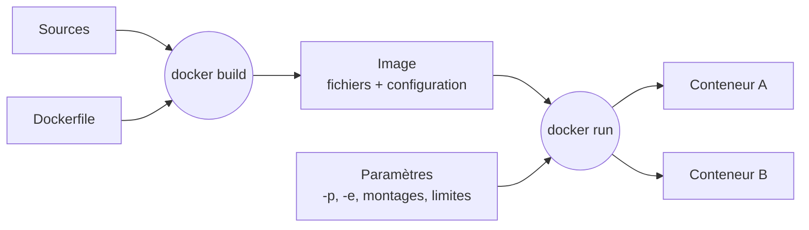
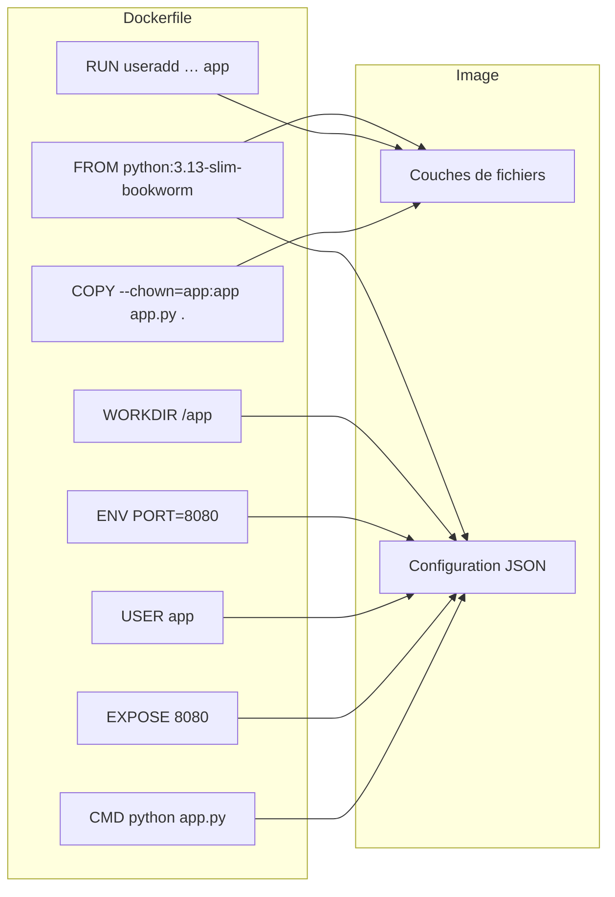

# Écrire un Dockerfile

> **En une phrase.** Un Dockerfile est une **recette** en texte : chaque instruction prépare des fichiers ou fixe un paramètre par défaut ; `docker build` en tire une image, et le conteneur n'apparaît qu'au `docker run`.

---

## 1. Synthèse

### Le modèle mental

```
  Sources + Dockerfile ──── docker build ────►  IMAGE         (fichiers + configuration par défaut)
  IMAGE + paramètres   ──── docker run   ────►  CONTENEUR     (processus isolé, ports, montages…)
```

| | Construction : `docker build` | Exécution : `docker run` |
|---|---|---|
| Qui agit | un **constructeur** (BuildKit) lit le Dockerfile et les fichiers du contexte | le **moteur** crée un conteneur à partir de l'image |
| Ce qui est décidé | le système de fichiers, la commande, les variables, l'utilisateur **par défaut** | les ports publiés, les montages, les limites, les valeurs qui remplacent les défauts |
| Résultat | une image, qu'on peut publier **sans jamais l'avoir démarrée** | une instance en cours d'exécution |

Un Dockerfile définit quatre choses : l'**image de base**, les **opérations** à réaliser pendant la construction, les **fichiers** à intégrer, la **configuration et le lancement par défaut**.

### Les instructions et leur effet

| Instruction | Rôle | Effet sur l'image |
|---|---|---|
| `FROM python:3.13-slim-bookworm` | choisit l'image de base et ouvre une étape de construction | hérite de ses couches et de sa configuration |
| `WORKDIR /app` | fixe le répertoire courant des instructions suivantes **et** du processus au démarrage ; le crée s'il manque | configuration (et répertoire créé) |
| `COPY app.py .` | copie des fichiers **du contexte** vers l'image (`.` = le `WORKDIR`) | nouvelle couche de fichiers |
| `ADD` | comme `COPY`, avec en plus l'extraction automatique d'une archive tar locale et la récupération de sources distantes | nouvelle couche de fichiers |
| `RUN useradd …` | exécute une commande **pendant le build**, dans l'environnement de construction | couche de fichiers si la commande modifie des fichiers |
| `USER app` | fixe l'utilisateur des instructions suivantes et du processus de démarrage | configuration |
| `ENV PORT=8080` | définit une variable persistante, présente aussi dans le conteneur | configuration |
| `ARG APP_VERSION=1.0` | définit une valeur utilisable **pendant le build** seulement | aucune (peut laisser une trace dans les métadonnées) |
| `EXPOSE 8080` | **documente** le port d'écoute prévu | configuration ; n'ouvre rien |
| `CMD ["python", "app.py"]` | commande par défaut, remplaçable au lancement | configuration |
| `ENTRYPOINT ["python"]` | exécutable principal ; `CMD` lui fournit alors des arguments par défaut | configuration |
| `LABEL clé=valeur` | ajoute des métadonnées descriptives (version, source, auteur) | configuration |
| `VOLUME /data` | déclare un point de montage destiné aux données | configuration ; ne met aucune donnée persistante dans l'image |
| `HEALTHCHECK CMD …` | définit un contrôle d'état exécuté régulièrement dans le conteneur | configuration |

> [!TIP]
> Un contrôle d'état doit utiliser un outil **présent dans l'image**. L'image `python:3.13-slim-bookworm` ne contient pas `curl`, mais elle contient Python :
> ```dockerfile
> HEALTHCHECK --interval=10s --timeout=3s \
>   CMD ["python", "-c", "import urllib.request; urllib.request.urlopen('http://127.0.0.1:8080')"]
> ```
> Le sens de « sain » et son usage par Compose sont traités dans [Démarré n'est pas disponible](Demarre-n-est-pas-disponible.md).

### Quelles instructions créent une couche de fichiers ?

| Effet dominant | Instructions |
|---|---|
| Préparer ou modifier des fichiers | `RUN`, `COPY`, `ADD` |
| Définir la configuration de l'image | `ENV`, `USER`, `CMD`, `ENTRYPOINT`, `EXPOSE`, `LABEL` |
| Paramétrer le build | `ARG` |
| Fixer le répertoire courant | `WORKDIR` (qui peut aussi créer le répertoire) |

Un `RUN` peut ne laisser aucun changement durable ; un `WORKDIR` peut créer un dossier. **Instruction, étape de cache et couche de fichiers sont trois notions distinctes** (voir [Les couches d'une image](Couches-d-une-image.md)).

### `ENV` ou `ARG` ?

| | `ENV` | `ARG` |
|---|---|---|
| Disponible pendant le build | oui | oui |
| Présente dans le conteneur | **oui** | non |
| Remplacée par | `docker run -e PORT=9090` | `docker build --build-arg APP_VERSION=1.1` |
| Visible dans | la configuration de l'image (`docker image inspect`) | l'historique et les métadonnées de construction |
| Pour un secret ? | **non** | **non** |

### `CMD` et `ENTRYPOINT` : qui est remplacé ?

| Dockerfile | `docker run img` | `docker run img python --version` |
|---|---|---|
| `CMD ["python", "app.py"]` | `python app.py` | `python --version` : la commande **remplace** `CMD` |
| `ENTRYPOINT ["python"]` + `CMD ["app.py"]` | `python app.py` | `python python --version` : les mots deviennent des **arguments** de l'exécutable |

Avec un `ENTRYPOINT`, on écrit plutôt `docker run img --version`. Pour remplacer l'exécutable lui-même : `docker run --entrypoint sh img`.

**Forme exec ou forme shell.**
- `CMD ["python", "app.py"]` (forme **exec**, en JSON) lance directement le programme, qui devient le processus principal et reçoit les signaux d'arrêt. Elle **n'interprète pas** les variables comme `$PORT`.
- `CMD python app.py` (forme **shell**) lance `/bin/sh -c "python app.py"` : les variables sont interprétées, mais c'est le shell qui est le processus principal, et il peut ne pas transmettre `SIGTERM` à l'application.

### L'ordre recommandé

```dockerfile
FROM <base précise et maintenue>       # 1. la base
# 2. ce qui change rarement : paquets système, utilisateur
# 3. la liste des dépendances, puis leur installation
# 4. le code, qui change souvent
# 5. la configuration : ENV, USER, EXPOSE, HEALTHCHECK, CMD
```

Cet ordre sert le **cache** : modifier le code ne doit pas rejouer l'installation des dépendances. Le mécanisme est détaillé dans [Contexte de build, cache et .dockerignore](Contexte-de-build-et-cache.md).

### Les bonnes pratiques

| Pratique | Pourquoi |
|---|---|
| Partir d'une base **maintenue**, avec un tag précis (`3.13-slim-bookworm`, pas `latest`) | la base influe sur la taille, la compatibilité, les mises à jour et les composants disponibles |
| Préférer une base **minimale** (`slim`, `alpine`, `distroless`) quand elle suffit | moins de fichiers, moins d'outils inutiles, moins de vulnérabilités à suivre |
| Préférer `COPY` à `ADD` | `COPY` fait une seule chose, explicite ; `ADD` seulement si l'on a besoin d'extraire une archive |
| Utiliser la forme exec pour `CMD` et `ENTRYPOINT` | le programme reçoit les signaux d'arrêt |
| Créer un **utilisateur non-root** et l'utiliser avec `USER` | limite les dégâts en cas de compromission (voir [Identités, privilèges et capabilities](Identites-et-privileges.md)) |
| Attribuer les fichiers avec `COPY --chown=app:app` | évite un `RUN chown` supplémentaire, donc une couche de plus |
| Placer ce qui est stable **avant** ce qui change souvent | le cache reste valide plus longtemps |
| **Externaliser la configuration** (variables d'environnement, fichiers montés) | une même image sert en test et en production |
| Écrire les données dans des **volumes**, pas dans l'image | l'image reste un modèle ; les données survivent au conteneur |
| **Aucun secret** dans `ENV`, `ARG`, `COPY` ou le texte du Dockerfile | tout ce qui entre dans l'image est distribué avec elle (voir [Sécurité des images](Securite-des-images.md)) |
| **Versionner** l'image et la pousser dans un registre | voir [Versionner et publier une image](Versionner-et-publier-une-image.md) |

> [!IMPORTANT]
> **Les pièges à retenir**
> 1. **`COPY` copie, il ne monte pas.** Modifier `app.py` sur le poste ne change pas une image déjà construite : il faut reconstruire.
> 2. **`EXPOSE` n'ouvre aucun port.** L'accès depuis l'hôte se demande au lancement : `docker run -p 8080:8080` (hôte à gauche, conteneur à droite).
> 3. **`RUN` agit une seule fois, au build.** Il n'est pas rejoué à chaque `docker run`, et il agit dans l'environnement de construction, pas sur le poste.
> 4. **`USER` exige des droits cohérents.** L'utilisateur doit pouvoir lire et écrire ce dont il a besoin ; avec `COPY --chown=app:app`, le nom `app` doit déjà exister dans l'image à ce moment-là.
> 5. **Une configuration d'image n'est pas une isolation.** `USER` limite les privilèges, mais ne remplace pas les protections appliquées à l'exécution.
> 6. **`VOLUME` ne stocke rien dans l'image, et un `HEALTHCHECK` doit utiliser un outil présent dans l'image** (une image `slim` ne contient pas forcément `curl`).

---

## 2. Cas d'usage classiques

### Cas 1 : une première image en quatre lignes

**Besoin.** Empaqueter un petit service HTTP Python qui répond sur le port 8080, sans dépendance externe (bibliothèque standard seulement).

```
atelier-web/
├── app.py
├── Dockerfile
└── .dockerignore
```

`app.py` :

```python
from http.server import BaseHTTPRequestHandler, HTTPServer
from os import getenv

class App(BaseHTTPRequestHandler):
    def do_GET(self):
        body = b"Bonjour depuis Docker !\n"
        self.send_response(200)
        self.send_header("Content-Type", "text/plain; charset=utf-8")
        self.send_header("Content-Length", str(len(body)))
        self.end_headers()
        self.wfile.write(body)

HTTPServer(("0.0.0.0", int(getenv("PORT", "8080"))), App).serve_forever()
```

Le service écoute sur **toutes les interfaces du conteneur** (`0.0.0.0`) ; la variable `PORT` choisit le port d'écoute. Écouter sur `127.0.0.1` le rendrait injoignable depuis l'extérieur du conteneur.

`Dockerfile`, première version :

```dockerfile
FROM python:3.13-slim-bookworm
WORKDIR /app
COPY app.py .
CMD ["python", "app.py"]
```

Quatre décisions : partir d'un environnement qui contient Python, travailler dans `/app`, y copier le programme, le lancer par défaut.

```bash
docker build -t atelier-web:0.1 .
docker run --rm -p 8080:8080 atelier-web:0.1
```

**À retenir.** Ce Dockerfile suffit à produire une image exécutable. Le point de `COPY app.py .` désigne `/app` (le `WORKDIR`) ; la source `app.py` est cherchée dans le **contexte de construction**, le dossier passé en dernier argument de `docker build`.

### Cas 2 : le Dockerfile complet, ligne à ligne

```dockerfile
FROM python:3.13-slim-bookworm
WORKDIR /app
RUN useradd --uid 10001 --create-home app
COPY --chown=app:app app.py .
ENV PORT=8080
ENV PYTHONUNBUFFERED=1
USER app
EXPOSE 8080
CMD ["python", "app.py"]
```

| Ligne | Ce qu'elle apporte |
|---|---|
| `RUN useradd --uid 10001 --create-home app` | un compte applicatif dans l'image (pas sur le poste), avec un UID fixe et élevé |
| `COPY --chown=app:app app.py .` | le programme, directement possédé par `app` ; placé **après** `useradd`, qui doit exister avant |
| `ENV PYTHONUNBUFFERED=1` | Python n'utilise pas de tampon pour ses sorties : les journaux apparaissent immédiatement dans `docker logs` |
| `USER app` | le processus de démarrage ne tourne plus en root |
| `EXPOSE 8080` | documentation du port d'écoute |

```bash
docker build -t atelier-web:1.0 .
docker run -d --rm --name atelier-web -p 8080:8080 atelier-web:1.0
curl http://localhost:8080              # Bonjour depuis Docker !
docker image inspect atelier-web:1.0 --format 'USER={{.Config.User}} WORKDIR={{.Config.WorkingDir}}'
docker image inspect atelier-web:1.0 --format 'ENV={{json .Config.Env}}'
docker stop atelier-web                 # --rm supprime aussi l'instance
```

**Ce qu'on observe.** `USER=app WORKDIR=/app`, et `PORT=8080` et `PYTHONUNBUFFERED=1` dans la liste des variables. Ces champs décrivent la configuration **enregistrée dans l'image** ; ils ne disent pas si un processus tourne, ce qui relève de l'inspection du conteneur.
**À retenir.** L'image distribue le programme, Python et les paramètres de démarrage par défaut. L'isolation et la publication du port sont configurées par le moteur, à l'exécution.

### Cas 3 : une image, plusieurs paramètres d'exécution

```bash
docker run -d --rm --name atelier-autre -e PORT=9090 -p 8090:9090 atelier-web:1.0
curl http://localhost:8090
docker stop atelier-autre

docker run --rm atelier-web:1.0 python --version    # remplace CMD
```

**Ce qu'on observe.** Le programme écoute sur 9090 dans le conteneur ; le poste y accède par le port 8090. Aucune reconstruction n'a été nécessaire : ce sont des **paramètres d'exécution**, pas des fichiers d'image. La seconde commande remplace `CMD` et affiche la version de Python.
**Le piège.** Changer `PORT` sans adapter `-p` : le port publié doit viser le port **réellement** utilisé par l'application, pas celui de `EXPOSE`.

### Cas 4 : paramétrer la construction avec `ARG`

```dockerfile
FROM python:3.13-slim-bookworm
ARG APP_VERSION=1.0
LABEL org.opencontainers.image.version=$APP_VERSION
# … suite inchangée
```

```bash
docker build --build-arg APP_VERSION=1.1 -t atelier-web:1.1 .
docker image inspect atelier-web:1.1 --format '{{json .Config.Labels}}'   # "org.opencontainers.image.version":"1.1"
docker run --rm atelier-web:1.1 env | grep APP_VERSION                    # aucune ligne
```

**Ce qu'on observe.** La valeur a servi pendant le build (elle est dans l'étiquette), mais elle n'est **pas** une variable du conteneur final, contrairement à `ENV`.
**À retenir.** Une valeur d'`ARG` peut apparaître dans l'historique ou les métadonnées de construction : ne jamais l'utiliser pour transmettre un mot de passe. Un `ARG` déclaré avant `FROM` ne sert qu'à paramétrer le `FROM` lui-même.

### Cas 5 : un exécutable principal avec `ENTRYPOINT`

```dockerfile
ENTRYPOINT ["python"]
CMD ["app.py"]
```

```bash
docker run --rm atelier-entry               # python app.py
docker run --rm atelier-entry --version     # python --version
docker run --rm --entrypoint sh atelier-entry -c 'id'   # remplace l'exécutable
```

**À retenir.** `ENTRYPOINT` convient aux images qui sont un outil (« l'image est la commande ») ou qui doivent toujours passer par un script de démarrage. Beaucoup d'images officielles combinent un script en `ENTRYPOINT` et le serveur en `CMD` : `php:8.4-apache` déclare `ENTRYPOINT ["docker-php-entrypoint"]` et `CMD ["apache2-foreground"]`.

### Cas 6 : ajouter ce qui manque à une image de base

**Besoin.** Une application PHP doit se connecter à MariaDB. L'image `php:8.4-apache` ne contient pas le pilote.

Sur un poste de test, le premier lancement répond `HTTP 503`, et le journal du conteneur indique `could not find driver` ; `php -m` ne liste que `PDO` et `pdo_sqlite`. Le correctif se fait dans la recette :

```dockerfile
FROM php:8.4-apache
# Pilote MariaDB/MySQL pour PDO, absent de l'image de base.
# Placé avant le code pour profiter du cache.
RUN docker-php-ext-install pdo_mysql
WORKDIR /var/www/html
COPY public/ /var/www/html/
```

**Ce qu'on observe.** Après modification du Dockerfile, `docker compose restart web` laisse le pilote absent : redémarrer relance **le même conteneur sur la même image**. Il faut reconstruire **et** recréer : `docker compose up --build -d` exécute le `RUN` (15,8 s), puis recrée le conteneur, et l'application répond 200.
**À retenir.** Un composant manquant dans l'image ne se corrige pas dans le conteneur. On corrige la recette, on reconstruit, on remplace l'instance (voir [Docker Compose](Docker-Compose.md)).

### Cas 7 : la même logique pour une application Node.js

```dockerfile
FROM node:24-slim
WORKDIR /app
COPY package*.json ./
RUN npm ci --omit=dev
COPY . .
EXPOSE 5000
CMD ["npm", "start"]
```

```bash
docker build -t myapp:1.0 .
docker run -d -p 5000:5000 myapp:1.0
```

**Ce qu'on observe.** Le schéma est identique : base, répertoire, **fichiers de dépendances d'abord**, installation, puis le reste du code, et la commande par défaut. `npm ci` installe exactement les versions du `package-lock.json` ; `--omit=dev` écarte les dépendances de développement (l'ancienne option `--only=production` est dépréciée).
**À retenir.** `COPY . .` copie **tout** le contexte : sans `.dockerignore`, un `node_modules` local, un `.git` ou un `.env` partent dans l'image. Choisir une version de Node encore maintenue (LTS). L'image obtenue devient un artefact versionné, partageable sur un registre (Docker Hub, GitLab Registry, GitHub Container Registry…).

---

## 3. Idées de schémas

### Schéma A : deux opérations, deux résultats



À souligner : la même image donne deux conteneurs différents, parce que les paramètres d'exécution diffèrent.

### Schéma B : chaque ligne va soit dans les couches, soit dans la fiche



### Schéma C : qui remplace quoi au lancement

Un tableau illustré à deux lignes. Ligne 1 : une boîte `CMD` dans l'image, et une commande tapée au `docker run` qui **pousse** la boîte hors de l'image. Ligne 2 : une boîte `ENTRYPOINT` fixe, vissée, et la commande tapée qui vient **se coller à sa droite** comme argument. Un petit tournevis `--entrypoint` sur le côté : seul outil pour dévisser l'`ENTRYPOINT`.

### Schéma D : l'identité au fil du Dockerfile

Une frise verticale : `FROM` (root) → `RUN useradd` (root crée `app`) → `COPY --chown=app:app` (fichier possédé par `app`) → `USER app` (bascule) → `CMD` (le processus démarre en `app`, UID 10001). Une couronne au-dessus des étapes en root, un badge simple ensuite.

---

## 4. Script de motion design : « Recette, image, conteneur » (environ 60 s)

Style : fond clair, le Dockerfile affiché comme une fiche de recette à gauche, l'image comme un bocal scellé au centre, les conteneurs comme des assiettes à droite.

| Séq. | Durée | À l'écran | Animation | Texte à l'écran |
|---|---|---|---|---|
| 1 | 0-6 s | Une fiche de recette « Dockerfile », vide | Les lignes s'écrivent une à une | « Un Dockerfile est une recette : une suite d'instructions. » |
| 2 | 6-16 s | La ligne `FROM` s'allume ; un bocal se remplit d'un fond gris « Python » | Le fond se dépose | « FROM : on part d'une base existante. » |
| 3 | 16-28 s | Les lignes `RUN` et `COPY` s'allument tour à tour | Chacune ajoute une strate colorée dans le bocal | « RUN et COPY ajoutent des fichiers : une couche chacun. » |
| 4 | 28-38 s | Les lignes `ENV`, `USER`, `EXPOSE`, `CMD` s'allument | Elles s'inscrivent sur l'étiquette du bocal, pas dedans ; le bocal se scelle | « Les autres écrivent l'étiquette : la configuration par défaut. » |
| 5 | 38-50 s | Le bocal scellé, puis deux assiettes servies à partir de lui | La première reçoit « -p 8080:8080 », la seconde « -e PORT=9090 -p 8090:9090 » ; l'étiquette du bocal ne change pas | « docker run : une image, plusieurs conteneurs, chacun avec ses paramètres. » |
| 6 | 50-60 s | On modifie une ligne de la fiche (`app.py`) | Les assiettes ne changent pas ; un nouveau bocal apparaît à côté | « Changer la recette ne change pas le bocal : on reconstruit, puis on remplace. » |

**Conseil de réalisation.** La séquence 4 doit être nettement différente des séquences 2 et 3 (rien ne tombe dans le bocal), c'est elle qui fait comprendre qu'une instruction n'est pas une couche. La séquence 6 prépare la page sur le versionnement.

---

## 5. Vérifier soi-même

```bash
mkdir -p ~/atelier-web && cd ~/atelier-web
# créer app.py (cas 1) puis le Dockerfile complet (cas 2)
docker build -t atelier-web:1.0 .
docker image history atelier-web:1.0 | head -10        # quelles lignes font 0 B ?
docker run -d --rm --name w1 -p 8080:8080 atelier-web:1.0
curl http://localhost:8080
docker exec w1 id                                       # uid=10001(app)
docker run --rm -e PORT=9090 atelier-web:1.0 python -c 'import os; print(os.environ["PORT"])'   # 9090
docker stop w1
```

Expérience complémentaire : retirer la ligne `USER app`, reconstruire, et comparer `docker exec … id`. Puis déplacer la ligne `RUN useradd` après `COPY --chown=app:app` et constater que le build échoue, parce que l'utilisateur n'existe pas encore.

## Voir aussi

- [Accueil du wiki](../README.md)
- Page précédente : [Les couches d'une image](Couches-d-une-image.md)
- Page suivante : [Contexte de build, cache et .dockerignore](Contexte-de-build-et-cache.md)
- Pour aller plus loin : [Réseaux Docker et publication de ports](Reseaux-et-ports.md) (`EXPOSE` et `-p`), [Stockage : couche du conteneur, volumes, bind mounts](Stockage-et-volumes.md) (`VOLUME`), [Démarré n'est pas disponible : healthchecks et diagnostic](Demarre-n-est-pas-disponible.md) (`HEALTHCHECK`)
