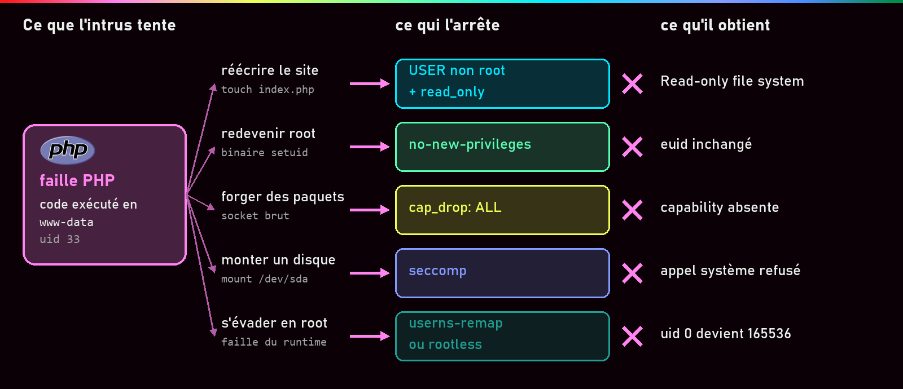
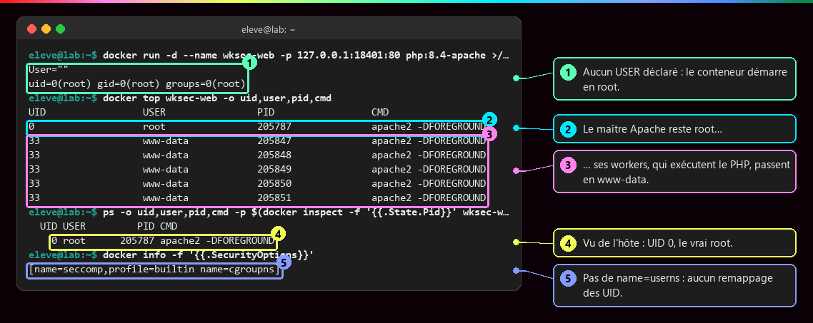
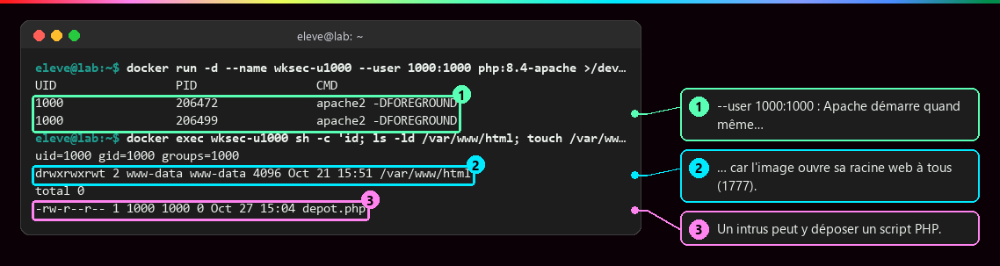
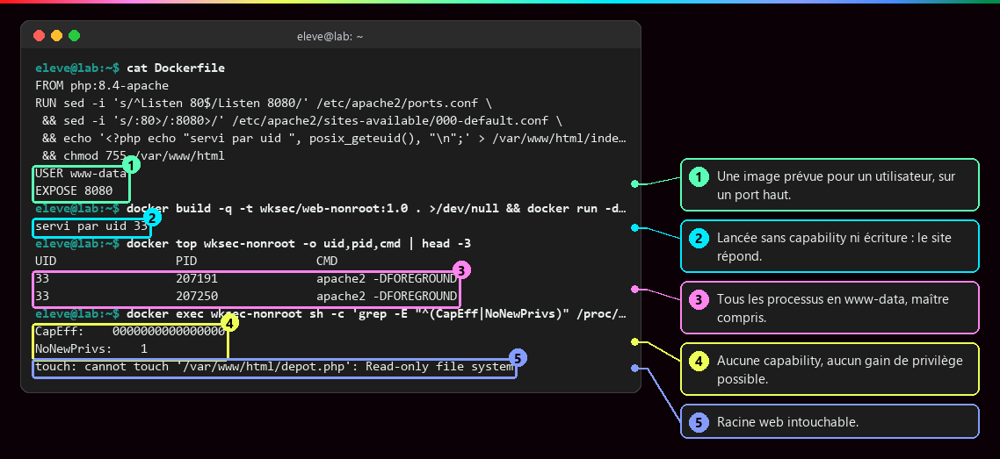
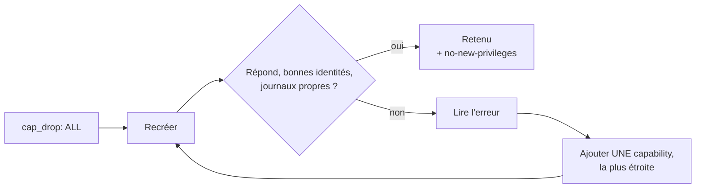
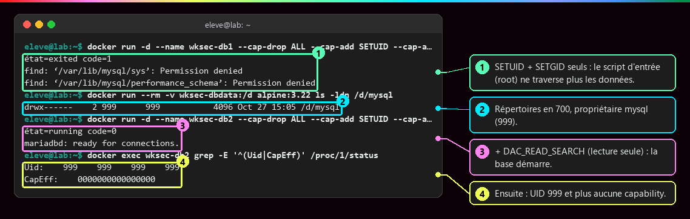
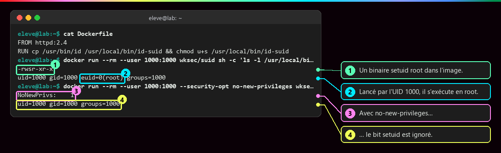
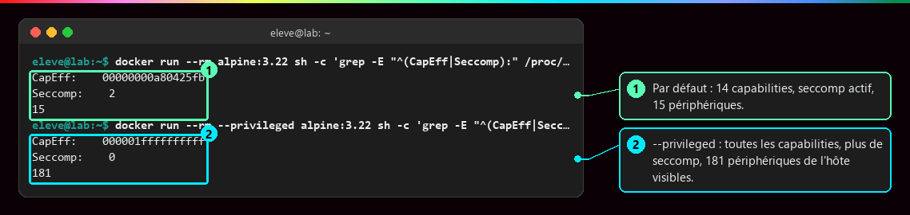
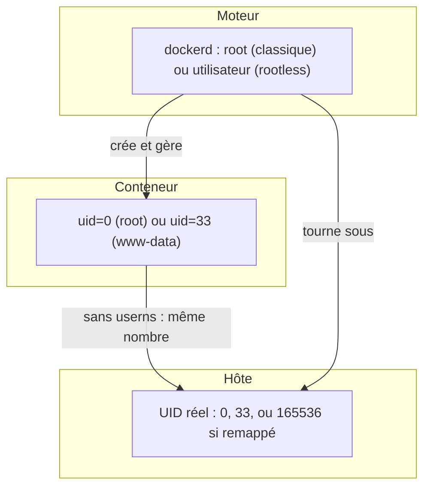

# Identités, privilèges et capabilities

<p class="lead">« root » n'est pas un oui ou un non. Ce qu'un processus conteneurisé peut faire dépend de son UID, de la traduction de cet UID sur l'hôte, des capabilities qu'il garde, des filtres du noyau et de ce qu'on lui monte : on raisonne en <strong>droits effectifs</strong>, et on prouve que le service tourne avec le minimum.</p>

{ .hero }

## L'essentiel en 30 secondes

<div class="grid cards" markdown>

-   :material-account-question-outline:{ .lg .middle } __Qui ?__

    ---

    Sans `USER`, le conteneur démarre en root. `docker top` montre **tous** les processus, pas seulement le premier.

-   :material-key-chain-variant:{ .lg .middle } __Quels pouvoirs ?__

    ---

    Root est découpé en **capabilities**. Docker en garde 14 : on retire tout, on remet le strict nécessaire.

-   :material-arrow-up-bold-circle-outline:{ .lg .middle } __Gagner des droits ?__

    ---

    `no-new-privileges` rend les binaires setuid **inoffensifs**. Il ne retire rien de ce qu'on a déjà.

-   :material-home-alert-outline:{ .lg .middle } __Root de l'hôte ?__

    ---

    Sans namespace User, **UID 0 dans le conteneur = UID 0 sur l'hôte**, limité seulement par les autres couches.

</div>

!!! warning "À retenir"

    **Un code HTTP 200 ne prouve rien.** Après chaque restriction, on vérifie les identités (`docker top`), les journaux et `/proc/1/status`. Et désactiver une protection pour « faire démarrer » (`privileged`, `seccomp=unconfined`) est une piste de diagnostic, jamais une correction.

## :material-account-search-outline: Qui exécute vraiment quoi

Trois identités à ne pas mélanger : l'**utilisateur de l'application** (`docker top`), celui du **démon Docker** (`ps -C dockerd`, généralement root) et l'**UID réel vu par le noyau de l'hôte**. Un `USER app` dans le Dockerfile ne rend pas le démon non privilégié.

???+ example "En vrai : Apache/PHP sans USER déclaré"

    

    Une faille PHP exécutée dans un worker obtient `www-data` ; une faille dans le maître ou un script d'entrée obtiendrait **root, avec les 14 capabilities** (dont `NET_RAW`, `CHOWN`, `DAC_OVERRIDE`). Même schéma pour MariaDB : `gosu` relance `mariadbd` sous l'UID 999 après un démarrage en root.

???+ danger "En vrai : imposer un UID révèle une image trop ouverte"

    

    L'image met `/var/www/html` en `1777` pour accepter n'importe quel UID : un intrus pourrait y déposer un script exécuté par PHP. Imposer un UID peut aussi casser l'image (fichiers inaccessibles, utilisateur absent de `/etc/passwd`, initialisation impossible).

???+ example "En vrai : une image prévue pour ne pas être root"

    

    `USER www-data`, `Listen 8080`, racine web à root et en `755`, un `tmpfs` pour le PID et les verrous : le service tourne avec `--cap-drop ALL`, `no-new-privileges` et `--read-only`, sans aucune exception.

??? note "Faire que root du conteneur ne soit plus root de l'hôte : userns-remap, rootless, Podman"

    | Configuration | Démon | UID des conteneurs sur l'hôte | Contreparties |
    |---|---|---|---|
    | **Docker classique** | root | identiques (UID 0 = root de l'hôte) | aucune, c'est le défaut |
    | **`userns-remap`** | root | **remappés** : 0 → 165536, 33 → 165569, 999 → 166535 | bind mounts à revoir, stockage séparé, réglage global |
    | **Rootless** | **non root** | dans l'espace d'un utilisateur ordinaire | ports < 1024, réseau en espace utilisateur, cgroups délégués |

    `{ "userns-remap": "default" }` dans `/etc/docker/daemon.json` crée l'utilisateur `dockremap` et sa plage (`/etc/subuid`) ; `docker info` affiche alors `name=userns`. **Piège réel sur un moteur partagé** : le stockage change d'emplacement, images et volumes existants deviennent invisibles, et un conteneur privilégié comme Minikube cesse de fonctionner (il faudrait `--userns=host`). Le réglage a donc été documenté sans être appliqué. Rootless s'installe par utilisateur (`dockerd-rootless-setuptool.sh install`, puis `docker context use rootless`) : même une compromission du démon ne donne que les droits d'un utilisateur ordinaire. Ce sont des **choix d'architecture du moteur**, à faire dès l'installation sur un hôte dédié.

    **Podman** n'a pas de démon central permanent et l'exécution rootless y est le mode courant. Mais les conteneurs reposent sur les **mêmes primitives du noyau** : images, privilèges, volumes et réseau restent à contrôler.

## :material-key-chain-variant: Les capabilities : fractionner root

| Capability | Ce qu'elle permet | Par défaut ? |
|---|---|---|
| `SETUID`, `SETGID` | changer d'utilisateur (Apache vers `www-data`, `gosu` vers `mysql`) | oui |
| `CHOWN`, `DAC_OVERRIDE` | changer un propriétaire ; ignorer **toutes** les permissions de fichiers | oui |
| `NET_BIND_SERVICE` | écouter sous le port 1024 | oui |
| `DAC_READ_SEARCH` | ignorer les permissions de **lecture et traversée** seulement | non |
| `NET_ADMIN`, `SYS_ADMIN` | administrer le réseau ; montages, namespaces… « le nouveau root » | non |



Le piège côté Apache est montré dans [Isolation d'un conteneur](Isolation-des-conteneurs.md) : avec `cap_drop: ALL`, il répond 200 mais **ses workers restent root**. Avec `SETUID` et `SETGID`, ils passent en `www-data` (PID 1 à `CapEff 00000000000000c0`, workers à `CapEff 0`).

???+ example "En vrai : MariaDB et la capability la plus étroite"

    

    Sans `DAC_*`, même root ne traverse plus les répertoires `700` de `mysql`. `DAC_OVERRIDE` marcherait aussi, mais autorise l'**écriture** partout : on garde `DAC_READ_SEARCH`, et on teste chaque démarrage (volume existant **et** volume vide).

??? note "Pourquoi `NET_BIND_SERVICE` n'a pas été nécessaire pour le port 80"

    Docker fixe `net.ipv4.ip_unprivileged_port_start=0` dans le namespace réseau du conteneur. Avec `sysctls: {net.ipv4.ip_unprivileged_port_start: 1024}`, Apache échoue (`could not bind to address 0.0.0.0:80`) et la capability redevient indispensable.

## :material-shield-lock-outline: no-new-privileges et les filtres du noyau

| Mesure | Ce qu'elle fait | Ce qu'elle ne fait pas |
|---|---|---|
| **UID non root** | le processus n'est plus root | n'empêche pas d'exécuter un binaire setuid |
| **`cap_drop`** | retire des pouvoirs précis à root | root reste propriétaire des fichiers de root |
| **`no-new-privileges`** | aucun `execve` ne peut **ajouter** de droits | ne retire **aucun** droit déjà possédé ; descendre en `www-data` reste permis |

???+ example "En vrai : un binaire setuid neutralisé"

    

    Le drapeau noyau `NoNewPrivs`, hérité par tous les enfants, fait ignorer le bit setuid et les capabilities de fichier : `su`, `passwd` ou `mount` ne rendent plus root.

| Filtre | Ce qu'il filtre | Par défaut | Vérifier |
|---|---|---|---|
| **seccomp** | les **appels système** (une quarantaine bloqués : `reboot`, `kexec_load`, `mount`…) | profil intégré | `grep Seccomp /proc/1/status` → `2` |
| **AppArmor** | fichiers et opérations, par profil | `docker-default` si l'hôte l'active (Debian, Ubuntu) | `docker inspect -f '{{.AppArmorProfile}}'` |
| **SELinux** | accès selon des étiquettes | si l'hôte et le démon l'activent (Fedora, RHEL) | `ps -Z`, volumes `:z` / `:Z` |

AppArmor et SELinux sont des contrôles d'accès obligatoires (**MAC**) : la politique s'impose même à root. Capabilities, seccomp et MAC sont **complémentaires, pas interchangeables**.

!!! tip "Un « Operation not permitted » ?"

    `--security-opt seccomp=unconfined` **une fois**, pour confirmer que seccomp est en cause ; puis identifier l'appel bloqué (`strace` en test) et fournir un profil qui n'ajoute que lui : `--security-opt seccomp=./profil-app.json`. Le refus peut aussi venir d'une capability, d'AppArmor ou d'une permission de fichier.

## :material-alert-octagon-outline: Les options qui ouvrent tout

???+ danger "En vrai : ce que lève `--privileged`"

    

    Toutes les capabilities, plus de seccomp, les périphériques de l'hôte : un conteneur privilégié peut monter le disque de l'hôte et le modifier. Un nœud Minikube tourne ainsi **par conception** (il fait lui-même tourner des conteneurs) : c'est un choix documenté, pas un oubli.

| Option Compose | `docker run` | Risque principal |
|---|---|---|
| `privileged: true` | `--privileged` | capabilities, périphériques, ni seccomp ni AppArmor |
| `pid: host` | `--pid=host` | partage l'espace des processus de l'hôte |
| `network_mode: host` | `--network=host` | partage la pile réseau de l'hôte |
| `volumes: ["/:/host"]` | `-v /:/host` | écrit dans les fichiers de l'hôte |
| socket Docker monté | `-v /var/run/docker.sock:…` | équivalent root sur l'hôte, **même en `:ro`** (voir [Secrets, fichiers, réseau et ressources](Secrets-fichiers-reseau-ressources.md)) |

## :material-flask-outline: À toi de jouer

```bash
docker run -d --name durci --cap-drop ALL --cap-add SETUID --cap-add SETGID \
  --security-opt no-new-privileges php:8.4-apache
docker top durci -o uid,pid,cmd                                       # 0 pour le maître, 33 pour les workers
docker exec durci grep -E 'CapEff|NoNewPrivs|Seccomp:' /proc/1/status # c0, 1, 2
docker run -d --name piege --cap-drop ALL php:8.4-apache
docker logs piege 2>&1 | grep -i setgid                               # unable to set group id
docker top piege -o uid,pid,cmd                                       # tout en 0
capsh --decode=00000000a80425fb                                       # paquet libcap2-bin sur l'hôte
docker rm -f durci piege
```

## :material-layers-outline: Trois identités, trois étages



??? abstract "Pour les créateurs : script de motion design « L'escalade bloquée, couche après couche » (85 s)"

    Style : fond sombre ; l'attaquant est un curseur rouge ; chaque protection est une paroi translucide d'une couleur propre, qui s'illumine quand elle bloque. Bruitages discrets de « verrou ».

    | Séq. | Durée | À l'écran | Animation | Texte à l'écran |
    |---|---|---|---|---|
    | 1 | 0-8 s | Un conteneur web, une requête HTTP malveillante arrive | Le curseur rouge entre par la requête et prend la forme d'un processus `www-data` | « Une faille PHP : l'attaquant exécute du code. Il est www-data. » |
    | 2 | 8-18 s | Le curseur se dirige vers les fichiers du site | Une paroi bleue « utilisateur non root + racine web en lecture seule » s'allume ; le curseur rebondit | « Il veut réécrire le site. Pas les droits. » |
    | 3 | 18-29 s | Le curseur trouve un binaire `su` marqué « setuid » et l'exécute | Une paroi verte « no-new-privileges » se ferme ; le bit setuid s'éteint | « Il tente de redevenir root. L'exécution n'ajoute plus aucun droit. » |
    | 4 | 29-40 s | Le curseur tente de forger des paquets réseau | Une paroi orange « cap_drop » : un trousseau de 14 clés se vide, il ne reste que SETUID et SETGID, rangées dans le maître Apache | « Pas de NET_RAW. Les capabilities inutiles ont été retirées. » |
    | 5 | 40-50 s | Le curseur appelle `mount` pour atteindre un disque | Une paroi violette « seccomp » filtre une file d'appels système : la plupart passent, `mount` est rejeté | « L'appel système est refusé avant même d'être traité. » |
    | 6 | 50-60 s | Le curseur vise `/proc/sys` et des fichiers de l'hôte | Une paroi jaune « AppArmor / SELinux » s'allume sur les chemins interdits | « La politique d'accès s'impose même à root. » |
    | 7 | 60-72 s | Scénario extrême : le curseur, root dans le conteneur, s'évade par une faille du moteur d'exécution | Le badge « 0 » traverse la frontière du conteneur et se transforme en « 165536 » côté hôte | « Avec le remappage, ce root n'est qu'un utilisateur ordinaire de l'hôte. » |
    | 8 | 72-85 s | Recul : les six parois empilées autour du conteneur ; une ligne rappelle la dalle « noyau partagé » | Les parois s'allument l'une après l'autre ; la dalle reste visible dessous | « Aucune couche n'est parfaite. Ensemble, elles limitent l'impact. » |

    Garder le même curseur rouge d'un bout à l'autre et faire **rétrécir** son halo à chaque paroi. En séquence 4, montrer brièvement l'erreur inverse (toutes les clés retirées, les workers deviennent rouges car ils restent root) avant de remettre les deux clés nécessaires. L'illustration d'en-tête reprend les séquences 2 à 7 en une seule image.

??? info "Pour les créateurs : schémas"

    **Le remappage des UID**

    ```
       Conteneur              userns-remap                Hôte
       UID 0     (root)    ──►  165536 + 0    ──►   UID 165536  (aucun droit)
       UID 33    (www-data)──►  165536 + 33   ──►   UID 165569
       UID 999   (mysql)   ──►  165536 + 999  ──►   UID 166535
       Sans remappage :  UID 0 ──► UID 0 (root de l'hôte)
    ```

    **Le curseur de privilège** : une règle graduée du plus sûr au plus dangereux : rootless · userns-remap · non-root + cap_drop ALL + no-new-privileges · root avec les 14 capabilities · `cap_add: SYS_ADMIN` · `--privileged` · socket Docker monté. Sous chaque graduation, ce que l'attaquant obtient (un utilisateur, un conteneur, l'hôte).
