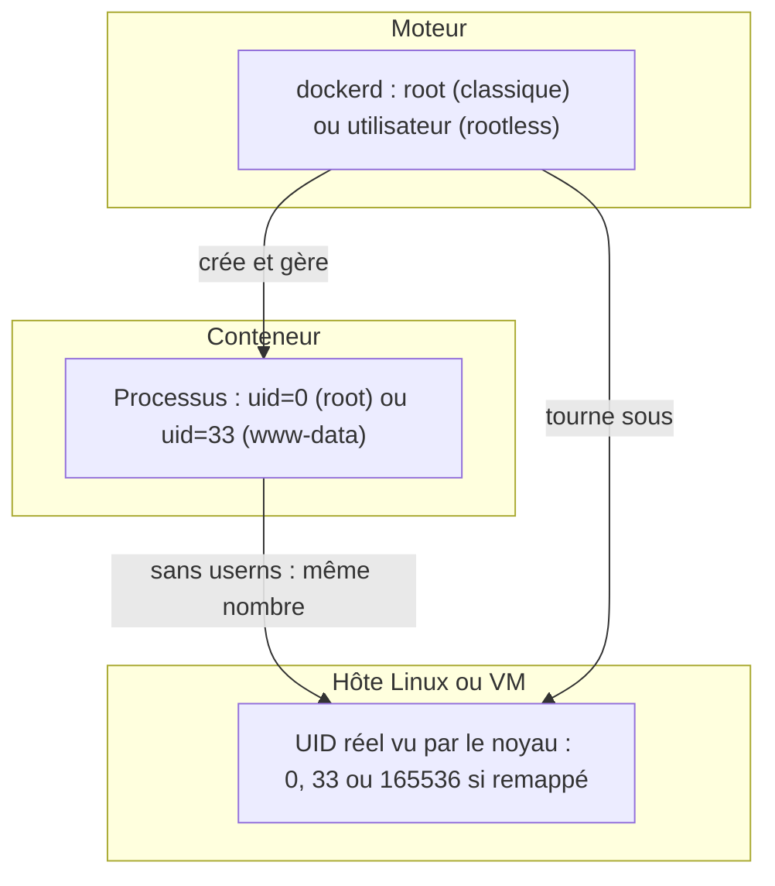
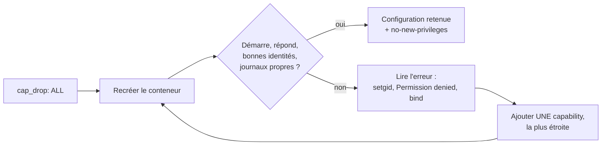

# Identités, privilèges et capabilities

> **En une phrase.** « root » n'est pas un oui ou un non : ce qu'un processus conteneurisé peut réellement faire dépend de son UID, de la traduction éventuelle de cet UID sur l'hôte, des capabilities qu'il garde, des filtres du noyau et de ce qu'on lui a monté ; on raisonne donc en **droits effectifs**, et on prouve qu'un service fonctionne avec le minimum.

Les bases (UID par défaut, les 14 capabilities de Docker, le principe de seccomp) sont posées dans [Isolation d'un conteneur](Isolation-des-conteneurs.md). Cette page va plus loin : comment les combiner, les vérifier, et ce que chaque mesure ne fait pas.

---

## 1. Synthèse

### Trois identités à ne pas mélanger

| Identité | Ce que c'est | Où la lire |
|---|---|---|
| **Utilisateur de l'application** | UID/GID du processus exécuté dans le conteneur | `docker exec c id`, `docker top c` |
| **Utilisateur du démon Docker** | identité sous laquelle le moteur gère les ressources de l'hôte | `ps -o user= -C dockerd` sur l'hôte, `docker info` |
| **Utilisateur de l'hôte** | identité visible sur le système Linux réel, ou dans la VM qui héberge le moteur | `ps` sur l'hôte, `/etc/passwd` de l'hôte |

Modifier l'une ne modifie **pas** automatiquement les deux autres. Un `USER app` dans le Dockerfile ne rend pas le démon non privilégié.

### Les droits effectifs : quatre facteurs

Un processus peut afficher `uid=0` et être plus ou moins dangereux selon :

| Facteur | Question | Mécanisme |
|---|---|---|
| **Mapping des identités** | l'UID 0 du conteneur est-il l'UID 0 de l'hôte ? | namespace User, `userns-remap`, rootless |
| **Capabilities conservées** | quels morceaux du pouvoir de root lui reste-t-il ? | `cap_drop`, `cap_add` |
| **Restrictions du noyau et du moteur** | quels appels système et quels accès sont filtrés ? | `no-new-privileges`, seccomp, AppArmor, SELinux |
| **Montages et périphériques** | qu'y a-t-il d'atteignable dans son système de fichiers ? | volumes, bind mounts, socket, `/dev` |

### L'utilisateur du processus

```dockerfile
RUN addgroup --system app \
 && adduser --system --ingroup app app
USER app
```

L'application tourne alors sous l'identité `app`, **si l'image et ses permissions le permettent**. Conséquences à vérifier :

- **port d'écoute** : un port inférieur à 1024 demande normalement un privilège (Docker l'autorise par défaut dans le conteneur, voir le cas 3) ;
- **répertoires inscriptibles** : journaux, PID, cache, fichiers temporaires ;
- **accès aux volumes** : propriétaire et droits des données montées ;
- **fichiers de configuration** : lisibles par `app`, mais idéalement pas modifiables par lui.

### Remapper les identités : userns-remap et rootless

| Configuration | Démon | Identités des conteneurs sur l'hôte | Contreparties |
|---|---|---|---|
| **Docker classique** | généralement **root** | identiques à celles du conteneur (UID 0 = root de l'hôte) | aucune, c'est le défaut |
| **`userns-remap`** | **root** | **remappées** : UID 0 du conteneur → UID subordonné non privilégié de l'hôte, UID 1 → UID suivant, etc. | permissions des bind mounts à revoir ; stockage séparé ; réglage global du démon |
| **Docker rootless** | **non root** | dans un espace utilisateurs de l'utilisateur qui lance le démon | contraintes selon le noyau, le réseau, les ports bas et le stockage |

`userns-remap` atténue certaines escalades, mais **le démon reste root**. Le mode rootless déplace la frontière : même une compromission du démon ne donne que les droits d'un utilisateur ordinaire.

### Les capabilities : fractionner le pouvoir de root

Sous Linux, le pouvoir de root est découpé en une quarantaine de **capabilities**. Docker en accorde un **ensemble limité** par défaut (14), pas toutes celles du noyau.

| Capability | Ce qu'elle permet | Dans le jeu par défaut ? |
|---|---|---|
| `CAP_NET_BIND_SERVICE` | écouter sur un port privilégié (< 1024) | oui |
| `CAP_CHOWN` | changer le propriétaire d'un fichier | oui |
| `CAP_SETUID`, `CAP_SETGID` | changer d'utilisateur ou de groupe (ce que fait Apache pour passer en `www-data`) | oui |
| `CAP_DAC_OVERRIDE` | ignorer les permissions de lecture, écriture et exécution des fichiers | oui |
| `CAP_DAC_READ_SEARCH` | ignorer les permissions **de lecture et de traversée** seulement | non |
| `CAP_NET_ADMIN` | administrer le réseau (interfaces, routes, pare-feu) | non |
| `CAP_SYS_ADMIN` | ensemble très large de pouvoirs sensibles (montages, namespaces…) : « le nouveau root » | non |

**Méthode** : tout retirer (`cap_drop: [ALL]`), puis réintroduire **uniquement** ce qui est démontré nécessaire, une capability à la fois. La preuve attendue est le **fonctionnement sous privilèges minimaux**, vérifié dans les identités et les journaux, pas seulement par un code HTTP 200.

### Trois mesures, trois effets distincts

| Mesure | Ce qu'elle fait | Ce qu'elle ne fait pas |
|---|---|---|
| **UID non privilégié** (`USER`, `user:`) | le processus n'est plus root du tout | n'empêche pas d'exécuter un binaire setuid présent dans l'image |
| **`cap_drop`** | retire des pouvoirs précis à root | root reste propriétaire de tous les fichiers de root |
| **`no-new-privileges`** | interdit d'obtenir **plus** de droits via `execve` (binaire setuid comme `su`, capabilities de fichier) | ne retire **aucun** droit déjà possédé |

Elles se combinent ; aucune ne remplace les autres, ni les permissions de fichiers.

### Les filtres du noyau

| Mécanisme | Ce qu'il filtre | Par défaut avec Docker | Vérifier |
|---|---|---|---|
| **seccomp** | les **appels système** autorisés | profil intégré qui bloque une quarantaine d'appels sensibles parmi plus de 300 (par exemple `reboot`, `kexec_load`, `mount` sans privilège) | `grep Seccomp /proc/1/status` → `2` |
| **AppArmor** | les **fichiers** et certaines **opérations** accessibles, par profil attaché au programme | profil `docker-default` si AppArmor est actif sur l'hôte (Debian, Ubuntu) | `docker inspect -f '{{.AppArmorProfile}}' c` |
| **SELinux** | accès selon des **étiquettes** posées sur processus et fichiers | actif si l'hôte et le démon l'activent (Fedora, RHEL) | `ps -Z`, options `:z` / `:Z` des volumes |

AppArmor et SELinux sont des contrôles d'accès obligatoires (**MAC**, *Mandatory Access Control*) : la politique s'impose même à root. Leur disponibilité dépend de l'hôte. **Capabilities, seccomp et MAC sont complémentaires, pas interchangeables.**

### Les options qui élargissent fortement la frontière

| Option (Compose) | Équivalent `docker run` | Risque principal |
|---|---|---|
| `privileged: true` | `--privileged` | restrictions majeures levées : toutes les capabilities, tous les périphériques, ni seccomp ni AppArmor |
| `pid: host` | `--pid=host` | partage de l'espace des processus de l'hôte |
| `network_mode: host` | `--network=host` | partage de la pile réseau de l'hôte |
| `volumes: ["/:/host"]` | `-v /:/host` | accès en écriture aux fichiers de l'hôte |
| `volumes: ["/var/run/docker.sock:/var/run/docker.sock"]` | idem | commandes privilégiées via l'API du démon : équivalent root sur l'hôte (détaillé dans [Secrets, fichiers, réseau et ressources](Secrets-fichiers-reseau-ressources.md)) |

Ces options ont des cas d'usage légitimes (un nœud Minikube tourne en conteneur privilégié, un agent de supervision lit le réseau de l'hôte), mais chacune doit être **justifiée et contrôlée**.

### Docker et Podman

- **Docker Engine** s'appuie sur un **démon** qui administre les conteneurs ; il propose aussi un mode rootless.
- **Podman** n'a pas de démon central permanent pour la gestion habituelle : chaque commande lance directement ses conteneurs, et l'exécution rootless est le mode courant pour un utilisateur ordinaire.
- Dans les deux cas, les conteneurs reposent sur les **mêmes primitives du noyau**. L'absence de démon ne dispense pas de contrôler images, privilèges, volumes et accès réseau.

> [!IMPORTANT]
> **Les pièges à retenir**
> 1. **Le champ `User` ne décrit que le processus de départ.** Un programme peut ensuite changer d'identité lui-même : on vérifie tous les processus avec `docker top`.
> 2. **Sans namespace User, root dans le conteneur est root sur l'hôte**, limité seulement par les capabilities, seccomp, MAC et les namespaces.
> 3. **`cap_drop: ALL` peut rendre un service moins sûr** tout en le laissant répondre : une image qui démarre en root et ne peut plus changer d'utilisateur garde ses workers en root.
> 4. **Désactiver une protection pour « faire démarrer »** (`seccomp=unconfined`, `privileged`) retire une couche entière. C'est une piste de diagnostic, jamais une correction.
> 5. **Un `:ro` sur le socket Docker ne protège rien** : l'API reste complète.

---

## 2. Cas d'usage classiques

### Cas 1 : savoir qui exécute vraiment quoi

**Besoin.** Une application Apache/PHP et une base MariaDB tournent ; l'image ne déclare aucun utilisateur.

```bash
docker inspect -f 'User="{{.Config.User}}"' web db     # vide : root par défaut
docker compose exec web id                              # uid=0(root)
docker top web -eo user,pid,args                        # maître Apache en root, workers en www-data
docker top db -eo user,pid,args
docker info -f '{{.SecurityOptions}}'                   # pas de "name=userns" : pas de remappage
ps -o user,uid,pid,args -p "$(docker inspect -f '{{.State.Pid}}' web)"   # vu de l'hôte : UID 0
```

**Ce qu'on observe, sur un poste de test.** Apache garde son processus maître en root (il ouvre le port et lit sa configuration) puis lance 5 workers en `www-data` (UID 33) qui exécutent le PHP. MariaDB démarre en root dans son script d'entrée, puis `gosu` relance `mariadbd` sous l'UID 999. Vu de l'hôte, le maître Apache est **UID 0** : root du conteneur = root de l'hôte.
**À retenir.** Une faille PHP exécutée dans un worker obtient `www-data` ; une faille dans le maître ou un script d'entrée obtiendrait root avec les 14 capabilities par défaut (dont `NET_RAW` pour forger des paquets, `CHOWN` et `DAC_OVERRIDE` pour modifier n'importe quel fichier du conteneur).

### Cas 2 : imposer un UID non privilégié, et ce que cela révèle

**Besoin.** Tester si une image peut tourner sans root.

```bash
docker run -d --name t33 --user 33:33 php:8.4-apache
docker run -d --name t1000 --user 1000:1000 php:8.4-apache
docker exec t1000 sh -c 'id; touch /var/www/html/depot.php && ls -l /var/www/html/'
docker rm -f t33 t1000
```

**Ce qu'on observe.** Dans les deux cas Apache démarre. Mais l'UID 1000, qui n'existe même pas dans l'image, a pu **créer un fichier dans `/var/www/html`** : l'image met ce répertoire en `1777` pour accepter n'importe quel UID. Un attaquant pourrait y déposer un script exécuté par PHP.
**Ce qu'un UID imposé peut casser.** Fichiers de l'image ou du volume non accessibles, utilisateur absent de `/etc/passwd`, opérations de démarrage impossibles (changement de propriétaire, initialisation).
**La solution propre.** Reconstruire une image prévue pour cela : `USER www-data`, `Listen 8080` (et le port publié en conséquence), racine web appartenant à root et lisible seulement par `www-data`, seuls `/var/run/apache2` et `/tmp` inscriptibles, journaux sur la sortie standard. Une telle image permet ensuite `cap_drop: ALL` sans exception, voire `read_only: true`.

### Cas 3 : trouver les capabilities strictement nécessaires (Apache)

**Besoin.** Appliquer le moindre privilège au service web sans le casser. Méthode : retirer tout, observer, réintroduire une capability, observer à nouveau.

```yaml
services:
  web:
    image: exemple/web-php:1.0   # image applicative basée sur php:8.4-apache
    cap_drop: [ALL]
    cap_add: [SETUID, SETGID]
    security_opt: ["no-new-privileges:true"]
```

**Ce qu'on observe, essai par essai, sur un poste de test.**

| Configuration | Résultat HTTP | Identité des workers | Verdict |
|---|---|---|---|
| `cap_drop: ALL` | 200 | **UID 0** (`setgid: unable to set group id to Group 33`) | **pire qu'avant** : le PHP tourne en root |
| `ALL` + `NET_BIND_SERVICE` | 200 | UID 0 | même problème |
| `ALL` + `SETUID`, `SETGID` | 200 | `www-data` | correct |
| idem + `no-new-privileges` | 200 | `www-data` | **retenu** |
| idem, avec ports bas interdits dans le conteneur (`sysctls: {net.ipv4.ip_unprivileged_port_start: 1024}`) | échec : `could not bind to address 0.0.0.0:80` | | |
| idem + `NET_BIND_SERVICE` | 200 | `www-data` | nécessaire seulement dans ce cas |

**Pourquoi `NET_BIND_SERVICE` n'est pas nécessaire ici.** Docker fixe `net.ipv4.ip_unprivileged_port_start=0` dans le namespace réseau du conteneur : tout processus peut y écouter sur le port 80. Sur un moteur qui ne le ferait pas, la capability redeviendrait indispensable.
**Résultat vérifié.** Le PID 1 garde `CapEff 00000000000000c0` (setgid et setuid seulement) et `NoNewPrivs: 1` ; les workers ont `Uid 33` et `CapEff 0`. L'application lit (200) et écrit (201).
**À retenir.** Le code HTTP ne suffit pas comme preuve. On contrôle **les identités** (`docker top`), **les journaux** et **`/proc/1/status`** après chaque restriction.

### Cas 4 : choisir la capability la plus étroite (MariaDB)

**Besoin.** Même démarche pour la base de données.

```yaml
services:
  db:
    image: mariadb:11.4
    cap_drop: [ALL]
    cap_add: [SETUID, SETGID, DAC_READ_SEARCH]
    security_opt: ["no-new-privileges:true"]
```

**Ce qu'on observe.** Avec `SETUID` et `SETGID` seuls, le script d'entrée (en root) parcourt `/var/lib/mysql` avant de passer en `mysql`, et échoue : `find: '/var/lib/mysql/<base>': Permission denied`, puis arrêt du conteneur. Les répertoires de données sont en `700` et appartiennent à `mysql` : sans `DAC_*`, même root ne peut plus les traverser.
**Le choix.** `DAC_OVERRIDE` fonctionne aussi, mais autorise l'**écriture** partout. `DAC_READ_SEARCH` ne donne que la lecture et la traversée : c'est la plus étroite. Elle a été testée sur le volume existant **et** sur un volume vide (première initialisation), sur une copie des données : `healthy` dans les deux cas. MariaDB tourne ensuite en `Uid 999` avec `CapEff 0`.
**À retenir.** Entre deux capabilities qui « marchent », on garde la plus étroite, et on teste chaque cas de démarrage (initialisation et redémarrage).

### Cas 5 : lire les filtres actifs (no-new-privileges, seccomp) sans les démonter

**Premier filtre : no-new-privileges.**

**Besoin.** Empêcher un processus non root de redevenir root par un programme setuid (`su`, `passwd`, `sudo`, `mount`).

```bash
docker run --rm alpine grep NoNewPrivs /proc/self/status                                         # 0
docker run --rm --security-opt no-new-privileges alpine grep NoNewPrivs /proc/self/status        # 1
```

**Ce qu'on observe.** L'option pose le drapeau noyau `no_new_privs` sur le processus, hérité par tous ses enfants. Dès lors, aucun `execve` ne peut **ajouter** de droits : le bit setuid d'un binaire et les capabilities de fichier sont ignorés.
**Ce qu'elle ne fait pas.** Un processus déjà root le reste, avec toutes ses capabilities. Elle complète donc un utilisateur non privilégié et un `cap_drop`, sans les remplacer. Elle n'empêche pas non plus Apache ou `gosu` de **descendre** en `www-data` ou `mysql` : perdre des droits reste permis.

**Second filtre : seccomp.** Une application échoue avec `Operation not permitted` ; la tentation est de tout désactiver.

```bash
docker run --rm alpine grep Seccomp /proc/self/status                                     # Seccomp: 2 (filtre actif)
docker run --rm --security-opt seccomp=unconfined alpine grep Seccomp /proc/self/status   # Seccomp: 0 (aucun filtre)
docker info -f '{{.SecurityOptions}}'                                                     # name=seccomp,profile=builtin
```

**La bonne démarche.** Utiliser `unconfined` **une fois, pour confirmer** que seccomp est en cause, puis identifier l'appel bloqué (par exemple avec `strace` dans un environnement de test) et fournir un profil personnalisé qui n'ajoute que lui :

```bash
docker run --security-opt seccomp=./profil-app.json mon-image
```

**À retenir.** Le refus peut aussi venir d'une capability manquante, d'AppArmor ou d'une permission de fichier. On cherche la couche responsable avant d'en retirer une.

### Cas 6 : mesurer ce que lève le mode privilégié

**Besoin.** Comprendre pourquoi un audit signale un conteneur `--privileged`.

```bash
docker run --rm alpine sh -c 'grep -E "CapEff|Seccomp" /proc/1/status; ls /dev | wc -l'
docker run --rm --privileged alpine sh -c 'grep -E "CapEff|Seccomp" /proc/1/status; ls /dev | wc -l'
```

**Ce qu'on observe.** Sans l'option : `CapEff 00000000a80425fb` (les 14 par défaut), `Seccomp: 2`, une quinzaine d'entrées dans `/dev`. Avec : **toutes** les capabilities du noyau (par exemple `000001ffffffffff`), `Seccomp: 0`, et des dizaines de périphériques de l'hôte, dont ses disques.
**À retenir.** Un conteneur privilégié peut monter le disque de l'hôte et le modifier : l'isolation se résume aux namespaces. Sur un poste de test, le nœud Minikube tournait ainsi par conception (il fait lui-même tourner des conteneurs) ; c'est un choix documenté, pas un oubli.

### Cas 7 : décider entre userns-remap et rootless

**Besoin.** Faire en sorte que root du conteneur ne soit plus root de l'hôte.

```json
{ "userns-remap": "default" }
```

Ce contenu de `/etc/docker/daemon.json` crée l'utilisateur `dockremap` et lui attribue une plage d'UID subordonnés (`/etc/subuid`). Après redémarrage du démon, `docker info` affiche `name=userns` et, vu de l'hôte, le root d'un conteneur apparaît sous un UID de cette plage (par exemple 165536).

**Le piège réel, relevé sur un moteur partagé.** Activer `userns-remap` change l'emplacement de stockage : les images et volumes existants deviennent **invisibles**, et un conteneur privilégié comme Minikube ne fonctionne plus (il faudrait `--userns=host` pour lui). Sur un moteur qui héberge d'autres projets, le réglage a été **documenté sans être appliqué**.
**Rootless.** Il s'installe par utilisateur (`dockerd-rootless-setuptool.sh install`, puis `docker context use rootless`) et `docker info` affiche `name=rootless`. Contraintes : ports inférieurs à 1024 non autorisés par défaut, réseau passé par un intermédiaire en espace utilisateur, limites de ressources dépendant de la délégation des cgroups.
**À retenir.** Ce sont des choix d'**architecture du moteur**, à faire sur un hôte dédié et dès l'installation, pas des options qu'on bascule sur un serveur en production.

---

## 3. Idées de schémas

### Schéma A : trois identités, trois étages



### Schéma B : la méthode du moindre privilège



### Schéma C : le remappage des UID

```
   Conteneur              userns-remap                Hôte
   ─────────              ────────────                ────
   UID 0     (root)   ──►  165536 + 0    ──►   UID 165536  (aucun droit)
   UID 33    (www-data)──► 165536 + 33   ──►   UID 165569
   UID 999   (mysql)  ──►  165536 + 999  ──►   UID 166535

   Sans remappage :  UID 0 ──► UID 0 (root de l'hôte)
```

### Schéma D : le curseur de privilège

Une règle horizontale graduée, du plus sûr au plus dangereux : **rootless** · **userns-remap** · **non-root + cap_drop ALL + no-new-privileges** · **root avec les 14 capabilities par défaut** · **`cap_add: SYS_ADMIN`** · **`--privileged`** · **socket Docker monté**. Sous chaque graduation, un pictogramme de ce que l'attaquant obtient (un utilisateur, un conteneur, l'hôte).

---

## 4. Script de motion design : « L'escalade bloquée, couche après couche » (environ 85 s)

Style : fond sombre ; l'attaquant est un curseur rouge ; chaque protection est une paroi translucide d'une couleur propre, qui s'illumine quand elle bloque. Bruitages discrets de « verrou ».

| Séq. | Durée | À l'écran | Animation | Texte à l'écran |
|---|---|---|---|---|
| 1 | 0-8 s | Un conteneur web, une requête HTTP malveillante arrive | Le curseur rouge entre par la requête et prend la forme d'un processus `www-data` | « Une faille PHP : l'attaquant exécute du code. Il est www-data. » |
| 2 | 8-18 s | Le curseur se dirige vers les fichiers du site | Une paroi bleue « utilisateur non root + racine web en lecture seule » s'allume ; le curseur rebondit | « Il veut réécrire le site. Pas les droits. » |
| 3 | 18-29 s | Le curseur trouve un binaire `su` marqué « setuid » et l'exécute | Une paroi verte « no-new-privileges » se ferme ; le bit setuid s'éteint | « Il tente de redevenir root. L'exécution n'ajoute plus aucun droit. » |
| 4 | 29-40 s | Le curseur tente de forger des paquets réseau | Une paroi orange « cap_drop » : un trousseau de 14 clés se vide, il ne reste que SETUID et SETGID, rangées dans le maître Apache | « Pas de NET_RAW. Les capabilities inutiles ont été retirées. » |
| 5 | 40-50 s | Le curseur appelle `mount` pour atteindre un disque | Une paroi violette « seccomp » filtre une file d'appels système : la plupart passent, `mount` est rejeté | « L'appel système est refusé avant même d'être traité. » |
| 6 | 50-60 s | Le curseur vise `/proc/sys` et des fichiers de l'hôte | Une paroi jaune « AppArmor / SELinux » s'allume sur les chemins interdits | « La politique d'accès s'impose même à root. » |
| 7 | 60-72 s | Scénario extrême : le curseur, root dans le conteneur, s'évade par une faille du moteur d'exécution | Le badge « 0 » traverse la frontière du conteneur et se transforme en « 165536 » côté hôte | « Avec le remappage, ce root n'est qu'un utilisateur ordinaire de l'hôte. » |
| 8 | 72-85 s | Recul : les six parois empilées autour du conteneur ; une ligne rappelle la dalle « noyau partagé » | Les parois s'allument l'une après l'autre ; la dalle reste visible dessous | « Aucune couche n'est parfaite. Ensemble, elles limitent l'impact. » |

**Conseil de réalisation.** Garder le même curseur rouge d'un bout à l'autre et faire **rétrécir** son halo à chaque paroi franchie ou non : le spectateur voit l'impact potentiel diminuer. En séquence 4, montrer brièvement l'erreur inverse (toutes les clés retirées, le maître Apache ne peut plus descendre en `www-data` et les workers deviennent rouges) avant de remettre les deux clés nécessaires.

---

## 5. Vérifier soi-même

```bash
# Un conteneur durci, puis la lecture de ses droits effectifs
docker run -d --name durci --cap-drop ALL --cap-add SETUID --cap-add SETGID \
  --security-opt no-new-privileges php:8.4-apache
docker top durci -eo user,pid,args                                    # maître root, workers www-data
docker exec durci grep -E 'CapEff|NoNewPrivs|Seccomp' /proc/1/status  # c0, 1, 2
docker inspect -f '{{.HostConfig.CapDrop}} {{.HostConfig.CapAdd}} {{.HostConfig.SecurityOpt}}' durci

# Le même sans SETUID/SETGID : le piège
docker run -d --name piege --cap-drop ALL php:8.4-apache
docker logs piege 2>&1 | grep -i setgid                               # unable to set group id
docker top piege -eo user,pid,args                                    # tout en root

# Décoder un masque de capabilities (paquet libcap2-bin sur l'hôte)
capsh --decode=00000000a80425fb

docker rm -f durci piege
```

## Voir aussi

- [Accueil du wiki](../README.md)
- Page précédente : [Sécurité des images](Securite-des-images.md)
- Page suivante : [Secrets, fichiers, réseau et ressources](Secrets-fichiers-reseau-ressources.md)
- Bases : [Isolation d'un conteneur : namespaces, cgroups et protections](Isolation-des-conteneurs.md)
