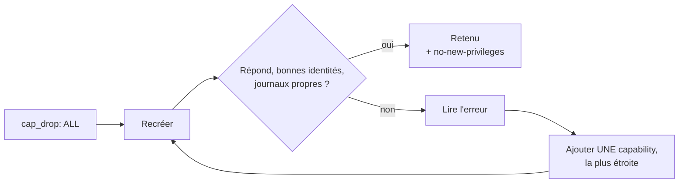

# Identités, privilèges et capabilities

<p class="lead">« root » n'est pas un oui ou un non. Ce qu'un programme conteneurisé peut faire dépend de son UID, de la traduction de cet UID sur l'hôte, des capabilities qu'il garde, des filtres du noyau et de ce qu'on lui monte : on raisonne en <strong>droits effectifs</strong>, et on prouve que le service tourne avec le minimum.</p>

{ .hero }

!!! abstract "Dans cette page"

    **Tu vas comprendre :**

    - sous quel utilisateur tournent **vraiment** les programmes de ton conteneur, et pourquoi c'est la première question à se poser ;
    - comment retirer à root les pouvoirs dont il n'a pas besoin, sans casser le service ;
    - pourquoi quelques options (`--privileged`, le socket Docker) reviennent à donner la machine entière.

    **Prérequis :** [Isolation d'un conteneur](Isolation-des-conteneurs.md), [Sécurité des images](Securite-des-images.md). **Durée :** 40 min. **Niveau :** intermédiaire.

!!! quote "En clair"

    Dans un immeuble de bureaux, le **directeur** a un passe-partout qui ouvre toutes les portes : c'est root. Plutôt que de prêter ce passe-partout à chaque employé, on le **découpe en clés séparées** (salle serveur, caisse, archives) et on ne donne à chacun que celles de son travail : ce sont les capabilities. Et on interdit de se faire **promouvoir en cours de journée** : c'est `no-new-privileges`. Limite de l'image : même sans clés, root reste propriétaire des fichiers de root ; ce n'est pas un employé ordinaire.

    { .anim }

## L'essentiel en 30 secondes

<div class="grid cards" markdown>

-   :material-account-question-outline:{ .lg .middle } __Qui ?__

    ---

    Sans ligne `USER` dans le Dockerfile, le conteneur démarre en root. `docker top` montre **tous** ses programmes, pas seulement le premier.

-   :material-key-chain-variant:{ .lg .middle } __Quels pouvoirs ?__

    ---

    Les pouvoirs de root sont découpés en **capabilities**. Docker en garde 14 : on retire tout, puis on remet le strict nécessaire.

-   :material-arrow-up-bold-circle-outline:{ .lg .middle } __Gagner des droits ?__

    ---

    `no-new-privileges` empêche un programme de **gagner** des droits en route. Il ne retire rien de ce qu'il a déjà.

-   :material-home-alert-outline:{ .lg .middle } __Root de l'hôte ?__

    ---

    Par défaut, **root dans le conteneur = root sur l'hôte**. Seules les autres protections le retiennent.

</div>

!!! warning "À retenir"

    **Un site qui répond (code HTTP 200) ne prouve pas qu'il est sûr.** Après chaque restriction, on vérifie qui tourne (`docker top`), les journaux et `/proc/1/status`. Et désactiver une protection pour « faire démarrer » (`--privileged`, `seccomp=unconfined`) sert à chercher la cause, jamais à corriger.

## :material-account-search-outline: Qui exécute vraiment quoi

!!! quote "En clair"

    Dans un hôtel, il y a le **client** d'une chambre (le programme du conteneur), le **gérant** qui attribue les chambres (le démon Docker) et le **registre officiel** de l'accueil (l'identité que voit le noyau de l'hôte). Par défaut, il n'y a pas de traduction : le client n° 0 de la chambre est inscrit au registre comme le n° 0 de l'hôtel, le propriétaire.

    { .anim }

Trois identités à ne pas mélanger :

- l'**utilisateur de l'application**, qu'on lit avec `docker top` ;
- celui du **démon Docker** (le moteur qui crée les conteneurs), généralement root, visible avec `ps -C dockerd` ;
- l'**UID réel vu par le noyau** de l'hôte, le numéro qui décide vraiment des droits.

Un `USER app` dans le Dockerfile change la première, pas les deux autres.

???+ example "En vrai : Apache/PHP sans USER déclaré"

    **Ce qu'on fait :** on lance l'image officielle `php:8.4-apache` sans aucun réglage, puis on regarde qui tourne, de l'intérieur et depuis l'hôte.

    

    **Ce qu'il faut regarder :**

    - ① : aucun `USER` n'est déclaré dans l'image : le conteneur démarre en root (`uid=0`).
    - ② : le programme principal d'Apache, le « maître », reste root…
    - ③ : … mais ses « workers », les programmes qui exécutent le PHP, passent en `www-data` (UID 33).
    - ④ : vu de l'hôte, le maître est l'UID 0 : le **vrai** root de la machine.
    - ⑤ : pas de `name=userns` dans les options de sécurité : aucune traduction des UID.

    **Le scénario :** un attaquant trouve une faille dans ton code PHP et y fait exécuter ses commandes. Il obtient `www-data`, un utilisateur sans droits particuliers. Mais une faille dans le maître ou dans le script de démarrage lui donnerait **root, avec les 14 capabilities**. Même schéma pour MariaDB : elle démarre en root puis se relance sous l'UID 999 grâce à l'outil `gosu`.

???+ danger "En vrai : imposer un UID révèle une image trop ouverte"

    **Ce qu'on fait :** on force l'utilisateur 1000 avec `--user 1000:1000`, puis on essaie d'écrire dans le dossier du site.

    

    **Ce qu'il faut regarder :**

    - ① : Apache démarre quand même sous l'UID 1000…
    - ② : … parce que l'image ouvre son dossier web à tout le monde (droits `1777`, le `t` final).
    - ③ : on a pu y déposer un fichier `depot.php`.

    **Le scénario :** un attaquant qui a pris la main sur ce programme dépose un script PHP dans le dossier du site, et ce script sera exécuté à chaque visite. Imposer un UID peut aussi **casser** une image : fichiers inaccessibles, utilisateur absent de `/etc/passwd`, initialisation impossible.

???+ example "En vrai : une image prévue pour ne pas être root"

    **Ce qu'on fait :** on construit une image qui déclare `USER www-data` et écoute sur le port 8080 (au-dessus de 1024, donc sans droit spécial), puis on la lance avec presque toutes les protections : aucune capability (`--cap-drop ALL`), `no-new-privileges`, et racine en lecture seule (`--read-only`, avec un tmpfs pour les petits fichiers de travail d'Apache).

    

    **Ce qu'il faut regarder :**

    - ① : l'image est prévue pour un utilisateur ordinaire, sur un port haut.
    - ② : malgré toutes les restrictions, le site répond, servi par l'UID 33.
    - ③ : **tous** les programmes sont en `www-data`, maître compris.
    - ④ : aucune capability (`CapEff` à zéro) et aucun gain de droits possible (`NoNewPrivs: 1`).
    - ⑤ : impossible d'écrire dans le dossier du site.

    C'est la cible : un service conçu dès l'image pour tourner sans root, sans aucune exception à justifier.

## :material-key-chain-variant: Les capabilities : découper root

!!! quote "En clair"

    Root, c'est un trousseau d'une quarantaine de clés. Docker en retire déjà une partie et en laisse 14. Ton travail : retirer **toutes** les clés, regarder quelle porte ne s'ouvre plus, et rendre **seulement** la clé de cette porte.

    { .anim }

| Capability | Ce qu'elle permet | Par défaut ? |
|---|---|---|
| `SETUID`, `SETGID` | changer d'utilisateur (Apache vers `www-data`, `gosu` vers `mysql`) | oui |
| `CHOWN`, `DAC_OVERRIDE` | changer un propriétaire ; ignorer **toutes** les permissions de fichiers | oui |
| `NET_BIND_SERVICE` | écouter sous le port 1024 | oui |
| `DAC_READ_SEARCH` | ignorer les permissions de **lecture et traversée** seulement | non |
| `NET_ADMIN`, `SYS_ADMIN` | administrer le réseau ; monter des disques, créer des namespaces… « le nouveau root » | non |

La méthode, en boucle :



Le piège côté Apache est montré dans [Isolation d'un conteneur](Isolation-des-conteneurs.md) et dans le mini-lab plus bas : sans aucune capability, il répond 200 mais **ses workers restent root**. Avec `SETUID` et `SETGID`, ils passent en `www-data`.

???+ example "En vrai : MariaDB et la capability la plus étroite"

    **Ce qu'on fait :** on lance MariaDB sur un volume déjà rempli, d'abord avec seulement `SETUID` et `SETGID`, puis en ajoutant `DAC_READ_SEARCH`.

    

    **Ce qu'il faut regarder :**

    - ① : avec deux capabilities seulement, la base s'arrête (`exited code=1`) : son script de démarrage, en root, ne peut plus entrer dans les dossiers de données.
    - ② : ces dossiers sont en `700` (seul leur propriétaire y entre) et appartiennent à `mysql` (UID 999).
    - ③ : avec `DAC_READ_SEARCH` en plus, qui permet seulement de **lire et traverser**, la base démarre.
    - ④ : une fois lancée, elle tourne en UID 999 sans plus aucune capability.

    `DAC_OVERRIDE` aurait marché aussi, mais elle autorise l'**écriture** partout : on garde la plus étroite. Et on teste les deux démarrages possibles : volume déjà rempli **et** volume vide.

## :material-shield-lock-outline: no-new-privileges et les filtres du noyau

!!! quote "En clair"

    Certains programmes Linux portent un tampon spécial, le bit **setuid** : quiconque les lance les exécute avec les droits de leur propriétaire, souvent root. C'est ainsi que `passwd` peut modifier le fichier des mots de passe. `no-new-privileges` dit au noyau : « dans ce conteneur, ignore ce tampon ».

    { .anim }

| Mesure | Ce qu'elle fait | Ce qu'elle ne fait pas |
|---|---|---|
| **UID non root** | le programme n'est plus root | n'empêche pas de lancer un programme setuid |
| **`cap_drop`** | retire des pouvoirs précis à root | root reste propriétaire des fichiers de root |
| **`no-new-privileges`** | aucun programme lancé ne peut **ajouter** de droits | ne retire **aucun** droit déjà possédé ; descendre en `www-data` reste permis |

???+ example "En vrai : un binaire setuid neutralisé"

    **Ce qu'on fait :** on copie la commande `id` dans l'image avec le bit setuid, puis on la lance en UID 1000, sans puis avec `no-new-privileges`.

    

    **Ce qu'il faut regarder :**

    - ① : le `s` dans `-rwsr-xr-x` : le programme porte le bit setuid et appartient à root.
    - ② : lancé par l'UID 1000, il s'exécute en root (`euid=0`, l'identité effective).
    - ③ : avec `no-new-privileges`, le noyau affiche `NoNewPrivs: 1`…
    - ④ : … et le bit setuid est ignoré : on reste l'UID 1000.

    **Le scénario :** un attaquant entré en `www-data` cherche un programme setuid oublié dans l'image (`su`, `passwd`, `mount`) pour redevenir root. Avec `no-new-privileges`, ce chemin est fermé pour tout le conteneur.

D'autres filtres du noyau travaillent en plus, sans que tu aies rien à faire :

| Filtre | Ce qu'il filtre | Par défaut | Vérifier |
|---|---|---|---|
| **seccomp** | les **appels système**, c'est-à-dire les demandes faites au noyau (une quarantaine bloquées : `reboot`, `kexec_load`, `mount`…) | profil intégré | `grep Seccomp /proc/1/status` → `2` |
| **AppArmor** | fichiers et opérations, selon un profil | `docker-default` si l'hôte l'active (Debian, Ubuntu) | `docker inspect -f '{{.AppArmorProfile}}'` |
| **SELinux** | accès selon des étiquettes | si l'hôte et le démon l'activent (Fedora, RHEL) | `ps -Z`, volumes `:z` / `:Z` |

AppArmor et SELinux sont des contrôles d'accès **obligatoires** (MAC) : la règle s'impose même à root. Capabilities, seccomp et MAC se **complètent**, ils ne se remplacent pas.

!!! tip "Un « Operation not permitted » ?"

    Lance **une fois** avec `--security-opt seccomp=unconfined`, juste pour savoir si seccomp est en cause. Si oui, identifie l'appel bloqué (avec `strace`, en test) et fournis un profil qui n'autorise que lui : `--security-opt seccomp=./profil-app.json`. Le refus peut aussi venir d'une capability, d'AppArmor ou d'une simple permission de fichier.

## :material-alert-octagon-outline: Les options qui ouvrent tout

!!! quote "En clair"

    Certaines options ne retirent pas une clé : elles **ouvrent les murs**. Le conteneur n'est plus un appartement, c'est une pièce de plus dans la maison de l'hôte.

    { .anim }

???+ danger "En vrai : ce que lève `--privileged`"

    **Ce qu'on fait :** on lit les capabilities, l'état de seccomp et le nombre de périphériques visibles, dans un conteneur normal puis dans un conteneur `--privileged`.

    

    **Ce qu'il faut regarder :**

    - ① : par défaut, 14 capabilities, seccomp actif (`2`), 15 périphériques.
    - ② : avec `--privileged`, **toutes** les capabilities, plus de seccomp (`0`), et 181 périphériques de l'hôte visibles, disques compris.

    **Le scénario :** un attaquant qui prend la main sur un conteneur privilégié monte le disque de l'hôte et modifie ce qu'il veut : mots de passe, tâches planifiées, autres conteneurs. Un nœud Minikube tourne ainsi **par conception** (il fait lui-même tourner des conteneurs) : c'est un choix documenté, pas un oubli.

| Option Compose | `docker run` | Risque principal |
|---|---|---|
| `privileged: true` | `--privileged` | toutes les capabilities, les périphériques, ni seccomp ni AppArmor |
| `pid: host` | `--pid=host` | voit et peut viser les programmes de l'hôte |
| `network_mode: host` | `--network=host` | partage le réseau de l'hôte |
| `volumes: ["/:/host"]` | `-v /:/host` | écrit dans les fichiers de l'hôte |
| socket Docker monté | `-v /var/run/docker.sock:…` | équivaut à root sur l'hôte, **même en `:ro`** (voir [Secrets, fichiers, réseau et ressources](Secrets-fichiers-reseau-ressources.md)) |

## :material-flask-outline: À toi de jouer

!!! tip "Pratique sans rien installer : le lab interactif"

    Une **machine Docker simulée** à gauche, le **tutoriel pas à pas** à droite, et Conti, le robot du lab, pour te dire quoi observer avant chaque commande. Chaque option est expliquée, tu vois ce que tu dois obtenir, et chaque étape se valide toute seule. Tu ne peux rien casser.

    [:material-console: Ouvrir le lab interactif](labs/identites.md){ .md-button .md-button--primary target="_blank" rel="noopener" }

**Sur ton poste**, le même lab pas à pas :

Cinq étapes, environ 8 minutes. Tu vas regarder qui tourne dans Apache, tomber dans le piège du « tout retirer », puis trouver le bon réglage.

**Étape 1 · Lancer Apache tel quel et regarder qui tourne**

```bash
docker run -d --name web php:8.4-apache   # (1)!
docker top web -o uid,user,pid,cmd        # (2)!
```

1. Lance l'image officielle PHP + Apache en arrière-plan (`-d`), sans aucun réglage de sécurité.
2. Liste **tous** les programmes du conteneur. `-o` choisit les colonnes : numéro d'utilisateur, nom, numéro de programme, commande. Attends 2 ou 3 secondes après l'étape précédente.

Tu dois voir un maître en root (0) et cinq workers en `www-data` (33). Les PID seront différents chez toi :

```text
UID                 USER                PID                 CMD
0                   root                271059              apache2 -DFOREGROUND
33                  www-data            271086              apache2 -DFOREGROUND
33                  www-data            271087              apache2 -DFOREGROUND
33                  www-data            271088              apache2 -DFOREGROUND
33                  www-data            271089              apache2 -DFOREGROUND
33                  www-data            271090              apache2 -DFOREGROUND
```

**Étape 2 · Lire les pouvoirs du maître**

```bash
docker exec web grep -E 'CapEff|NoNewPrivs|Seccomp:' /proc/1/status   # (1)!
capsh --decode=00000000a80425fb                                      # (2)!
```

1. Dans le conteneur, lit la fiche du programme n° 1 et garde trois lignes : ses capabilities effectives (`CapEff`), le drapeau `no-new-privileges`, l'état de seccomp.
2. Sur ta machine (pas dans le conteneur), traduit ce code en noms de capabilities.

Tu dois voir le code des 14 capabilities par défaut, `NoNewPrivs` à 0 (désactivé), seccomp actif, puis leur liste :

```text
CapEff:	00000000a80425fb
NoNewPrivs:	0
Seccomp:	2
0x00000000a80425fb=cap_chown,cap_dac_override,cap_fowner,cap_fsetid,cap_kill,cap_setgid,cap_setuid,cap_setpcap,cap_net_bind_service,cap_net_raw,cap_sys_chroot,cap_mknod,cap_audit_write,cap_setfcap
```

**Étape 3 · Le piège : tout retirer**

```bash
docker run -d --name piege --cap-drop ALL php:8.4-apache   # (1)!
docker logs piege 2>&1 | grep -i setgid                    # (2)!
docker top piege -o uid,user,pid,cmd
```

1. `--cap-drop ALL` : retire les 14 capabilities.
2. Lit les journaux d'Apache (`2>&1` y inclut les messages d'erreur) et garde ceux qui parlent de `setgid`.

Tu dois voir Apache se plaindre de ne pas pouvoir changer de groupe, puis **tous** ses programmes en root :

```text
[Tue Oct 27 15:45:17.649427 2026] [unixd:alert] [pid 17:tid 17] (1)Operation not permitted: AH02156: setgid: unable to set group id to Group 33
[Tue Oct 27 15:45:17.650707 2026] [unixd:alert] [pid 18:tid 18] (1)Operation not permitted: AH02156: setgid: unable to set group id to Group 33
[Tue Oct 27 15:45:17.652889 2026] [unixd:alert] [pid 19:tid 19] (1)Operation not permitted: AH02156: setgid: unable to set group id to Group 33
[Tue Oct 27 15:45:17.654726 2026] [unixd:alert] [pid 20:tid 20] (1)Operation not permitted: AH02156: setgid: unable to set group id to Group 33
[Tue Oct 27 15:45:17.655709 2026] [unixd:alert] [pid 21:tid 21] (1)Operation not permitted: AH02156: setgid: unable to set group id to Group 33
UID                 USER                PID                 CMD
0                   root                271241              apache2 -DFOREGROUND
0                   root                271292              apache2 -DFOREGROUND
0                   root                271293              apache2 -DFOREGROUND
0                   root                271294              apache2 -DFOREGROUND
0                   root                271295              apache2 -DFOREGROUND
0                   root                271296              apache2 -DFOREGROUND
```

Pour abandonner ses droits, Apache a besoin… d'un droit. Sans lui, ses workers restent root : la « mesure de sécurité » a aggravé la situation.

**Étape 4 · Rendre seulement les deux clés utiles**

```bash
docker run -d --name durci --cap-drop ALL --cap-add SETUID --cap-add SETGID \
  --security-opt no-new-privileges php:8.4-apache     # (1)!
docker top durci -o uid,user,pid,cmd
docker exec durci grep -E 'CapEff|NoNewPrivs|Seccomp:' /proc/1/status
capsh --decode=00000000000000c0
```

1. On retire tout (`--cap-drop ALL`), on rend `SETUID` et `SETGID` (`--cap-add`), et on interdit tout gain de droits (`no-new-privileges`). Le `\` en fin de ligne continue la commande sur la ligne suivante.

Tu dois voir les workers revenus en `www-data`, un maître qui ne garde que deux capabilities, et `NoNewPrivs` à 1 :

```text
UID                 USER                PID                 CMD
0                   root                271552              apache2 -DFOREGROUND
33                  www-data            271604              apache2 -DFOREGROUND
33                  www-data            271605              apache2 -DFOREGROUND
33                  www-data            271606              apache2 -DFOREGROUND
33                  www-data            271607              apache2 -DFOREGROUND
33                  www-data            271608              apache2 -DFOREGROUND
CapEff:	00000000000000c0
NoNewPrivs:	1
Seccomp:	2
0x00000000000000c0=cap_setgid,cap_setuid
```

**Étape 5 · Faire le ménage**

```bash
docker rm -f web piege durci   # (1)!
```

1. Arrête et supprime les trois conteneurs du lab.

Tu dois voir leurs trois noms :

```text
web
piege
durci
```

??? tip "Ça ne marche pas ?"

    | Message | Cause | Solution |
    |---|---|---|
    | `Couldn't find PID field in ps output` | la liste de colonnes après `-o` ne contient pas `pid` | garde `-o uid,user,pid,cmd` |
    | une seule ligne dans `docker top` | Apache n'a pas fini de démarrer | attends 2 ou 3 secondes et relance |
    | `capsh: command not found` | l'outil n'est pas installé sur ta machine | `sudo apt install libcap2-bin` (Ubuntu, Debian) |
    | `Conflict. The container name "/web" is already in use` | un conteneur du même nom existe déjà | `docker rm -f web` puis recommence |

## :material-help-circle-outline: Vérifie que tu as compris

??? question "1. `docker top` montre 0 pour le maître Apache et 33 pour les workers. Un attaquant exploite une faille dans ton code PHP : qu'obtient-il ?"

    Les droits de `www-data` (UID 33), car c'est un worker qui exécute le PHP. C'est limité, mais pas nul : il lit ce que `www-data` peut lire, et écrit là où le dossier web le permet. Une faille dans le **maître** ou le script de démarrage, elle, donnerait root : d'où l'intérêt de retirer les capabilities inutiles même au maître.

??? question "2. Pourquoi rendre `SETUID` et `SETGID`, alors que ce sont des pouvoirs de root ?"

    Parce que changer d'utilisateur **est** un pouvoir. Sans eux, Apache ne peut pas descendre en `www-data` et tous ses programmes restent root (étape 3). Avec eux, seul le maître garde ces deux capabilities ; les workers, qui traitent les requêtes, n'en ont plus aucune.

??? question "3. Après `--security-opt no-new-privileges`, le maître Apache a-t-il perdu ses capabilities ?"

    **Non.** Il garde `CapEff 00000000000000c0` (SETUID, SETGID). `no-new-privileges` ne retire rien : il empêche seulement d'en **gagner** de nouveaux, par exemple via un programme setuid. Pour retirer, c'est `--cap-drop`.

!!! success "Et ensuite ?"

    Tu sais vérifier qui tourne dans un conteneur et lui retirer les pouvoirs inutiles. Page suivante : [Secrets, fichiers, réseau et ressources](Secrets-fichiers-reseau-ressources.md), ce qu'on lui donne à lire, à joindre et à consommer.

## :material-server: Pour aller plus loin

??? note "Trois identités, trois étages"

    ```mermaid
    flowchart TB
        subgraph C["Conteneur"]
            P1["uid=0 (root) ou uid=33 (www-data)"]
        end
        subgraph M["Moteur"]
            D["dockerd : root (classique) ou utilisateur (rootless)"]
        end
        subgraph H["Hôte"]
            U["UID réel : 0, 33, ou 165536 si remappé"]
        end
        P1 -- "sans userns : même nombre" --> U
        D -- "crée et gère" --> P1
        D -- "tourne sous" --> U
    ```

??? note "Faire que root du conteneur ne soit plus root de l'hôte : userns-remap, rootless, Podman"

    | Configuration | Démon | UID des conteneurs sur l'hôte | Contreparties |
    |---|---|---|---|
    | **Docker classique** | root | identiques (UID 0 = root de l'hôte) | aucune, c'est le défaut |
    | **`userns-remap`** | root | **remappés** : 0 → 165536, 33 → 165569, 999 → 166535 | bind mounts à revoir, stockage séparé, réglage global |
    | **Rootless** | **non root** | dans l'espace d'un utilisateur ordinaire | ports < 1024, réseau en espace utilisateur, cgroups délégués |

    `{ "userns-remap": "default" }` dans `/etc/docker/daemon.json` crée l'utilisateur `dockremap` et sa plage (`/etc/subuid`) ; `docker info` affiche alors `name=userns`. **Piège réel sur un moteur partagé** : le stockage change d'emplacement, images et volumes existants deviennent invisibles, et un conteneur privilégié comme Minikube cesse de fonctionner (il faudrait `--userns=host`). Le réglage a donc été documenté sans être appliqué. Rootless s'installe par utilisateur (`dockerd-rootless-setuptool.sh install`, puis `docker context use rootless`) : même une compromission du démon ne donne que les droits d'un utilisateur ordinaire. Ce sont des **choix d'architecture du moteur**, à faire dès l'installation sur un hôte dédié.

    **Podman** n'a pas de démon central permanent et l'exécution rootless y est le mode courant. Mais les conteneurs reposent sur les **mêmes mécanismes du noyau** : images, privilèges, volumes et réseau restent à contrôler.

??? note "Pourquoi `NET_BIND_SERVICE` n'a pas été nécessaire pour le port 80"

    Docker fixe `net.ipv4.ip_unprivileged_port_start=0` dans le namespace réseau du conteneur. Avec `sysctls: {net.ipv4.ip_unprivileged_port_start: 1024}`, Apache échoue (`could not bind to address 0.0.0.0:80`) et la capability redevient indispensable.

??? abstract "Pour les créateurs : script de motion design « L'escalade bloquée, couche après couche » (85 s)"

    Style : fond sombre ; l'attaquant est un curseur rouge ; chaque protection est une paroi translucide d'une couleur propre, qui s'illumine quand elle bloque. Bruitages discrets de « verrou ».

    | Séq. | Durée | À l'écran | Animation | Texte à l'écran |
    |---|---|---|---|---|
    | 1 | 0-8 s | Un conteneur web, une requête HTTP malveillante arrive | Le curseur rouge entre par la requête et prend la forme d'un processus `www-data` | « Une faille PHP : l'attaquant exécute du code. Il est www-data. » |
    | 2 | 8-18 s | Le curseur se dirige vers les fichiers du site | Une paroi bleue « utilisateur non root + racine web en lecture seule » s'allume ; le curseur rebondit | « Il veut réécrire le site. Pas les droits. » |
    | 3 | 18-29 s | Le curseur trouve un binaire `su` marqué « setuid » et l'exécute | Une paroi verte « no-new-privileges » se ferme ; le bit setuid s'éteint | « Il tente de redevenir root. L'exécution n'ajoute plus aucun droit. » |
    | 4 | 29-40 s | Le curseur tente de forger des paquets réseau | Une paroi orange « cap_drop » : un trousseau de 14 clés se vide, il ne reste que SETUID et SETGID, rangées dans le maître Apache | « Pas de NET_RAW. Les capabilities inutiles ont été retirées. » |
    | 5 | 40-50 s | Le curseur appelle `mount` pour atteindre un disque | Une paroi violette « seccomp » filtre une file d'appels système : la plupart passent, `mount` est rejeté | « L'appel système est refusé avant même d'être traité. » |
    | 6 | 50-60 s | Le curseur vise `/proc/sys` et des fichiers de l'hôte | Une paroi jaune « AppArmor / SELinux » s'allume sur les chemins interdits | « La politique d'accès s'impose même à root. » |
    | 7 | 60-72 s | Scénario extrême : le curseur, root dans le conteneur, s'évade par une faille du moteur d'exécution | Le badge « 0 » traverse la frontière du conteneur et se transforme en « 165536 » côté hôte | « Avec le remappage, ce root n'est qu'un utilisateur ordinaire de l'hôte. » |
    | 8 | 72-85 s | Recul : les six parois empilées autour du conteneur ; une ligne rappelle la dalle « noyau partagé » | Les parois s'allument l'une après l'autre ; la dalle reste visible dessous | « Aucune couche n'est parfaite. Ensemble, elles limitent l'impact. » |

    Garder le même curseur rouge d'un bout à l'autre et faire **rétrécir** son halo à chaque paroi. En séquence 4, montrer brièvement l'erreur inverse (toutes les clés retirées, les workers deviennent rouges car ils restent root) avant de remettre les deux clés nécessaires. L'illustration d'en-tête reprend les séquences 2 à 7 en une seule image.

??? info "Pour les créateurs : schémas"

    **Le remappage des UID**

    ```
       Conteneur              userns-remap                Hôte
       UID 0     (root)    ──►  165536 + 0    ──►   UID 165536  (aucun droit)
       UID 33    (www-data)──►  165536 + 33   ──►   UID 165569
       UID 999   (mysql)   ──►  165536 + 999  ──►   UID 166535
       Sans remappage :  UID 0 ──► UID 0 (root de l'hôte)
    ```

    **Le curseur de privilège** : une règle graduée du plus sûr au plus dangereux : rootless · userns-remap · non-root + cap_drop ALL + no-new-privileges · root avec les 14 capabilities · `cap_add: SYS_ADMIN` · `--privileged` · socket Docker monté. Sous chaque graduation, ce que l'attaquant obtient (un utilisateur, un conteneur, l'hôte).
