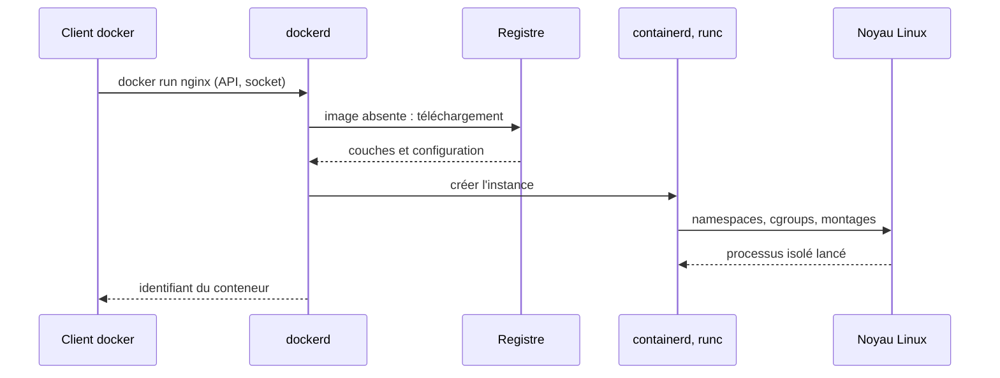
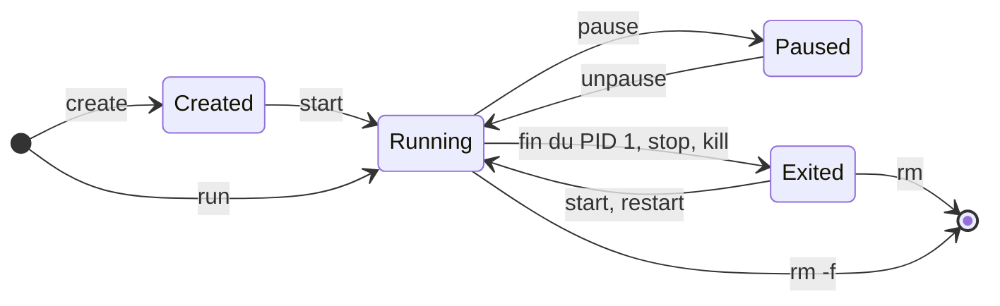

# Image et cycle de vie du conteneur

<p class="lead">Une <strong>image</strong> est un modèle figé : des fichiers et des réglages de départ. Un <strong>conteneur</strong> est un exemplaire fabriqué à partir de ce modèle, avec ses propres réglages, sa <strong>couche inscriptible</strong> (là où il écrit ses fichiers) et un état qui suit la vie de son <strong>programme principal</strong>.</p>

{ .hero }

!!! abstract "Dans cette page"

    **Tu vas comprendre :**

    - la différence entre une image (le modèle) et un conteneur (un exemplaire) ;
    - les étapes de la vie d'un conteneur, de sa création à sa suppression, et ce que veut dire `Exited (137)` ;
    - ce que deviennent tes fichiers quand tu arrêtes ou supprimes un conteneur, et où ranger ce qui doit durer.

    **Prérequis :** [Isolation d'un conteneur](Isolation-des-conteneurs.md). **Durée :** 30 min. **Niveau :** débutant.

!!! quote "En clair"

    L'image est un **moule à gâteau**. On ne mange jamais le moule : on s'en sert pour faire autant de gâteaux qu'on veut. Chaque gâteau (un conteneur) peut être décoré à sa façon sans toucher au moule ni aux autres gâteaux : ce qu'on fait à un gâteau ne change jamais le moule. Limite de l'image : un conteneur a en plus une **vie**, il démarre, s'arrête et redémarre, ce qu'un gâteau ne fait pas.

    { .anim }

## L'essentiel en 30 secondes

<div class="grid cards" markdown>

-   :material-layers-outline:{ .lg .middle } __Image__

    ---

    Des fichiers et des réglages de départ, en **lecture seule**. Elle sert à créer **autant** de conteneurs qu'on veut.

-   :material-docker:{ .lg .middle } __Conteneur__

    ---

    Un **exemplaire** de l'image : un nom, des ports, des réglages, une **couche inscriptible** à lui, un état.

-   :material-heart-pulse:{ .lg .middle } __Cycle de vie__

    ---

    Il vit **aussi longtemps que son programme principal** (le PID 1). `Exited` n'est pas forcément un échec : il faut lire le **code de sortie**.

-   :material-database-outline:{ .lg .middle } __Persistance__

    ---

    `docker rm` efface la couche inscriptible. Ce qui doit durer va dans un **volume**.

</div>

!!! warning "À retenir"

    **Arrêter n'efface rien ; supprimer efface tout ce qui n'est pas rangé dans un volume.** Recréer un conteneur avec le même nom ne fait pas revenir l'ancien. Pour mettre à jour, on ne bricole pas le conteneur : on fabrique une **nouvelle image**, avec un nouveau numéro de version, et on **remplace** le conteneur.

## :material-cog-outline: Qui fait quoi quand on tape `docker run`

!!! quote "En clair"

    La commande `docker` que tu tapes n'est qu'une **télécommande**. Le vrai travail est fait par le **moteur**, qui tourne en permanence en arrière-plan. Il va chercher les images dans un **registre**, un entrepôt en ligne, puis confie la fabrication du conteneur à deux ouvriers spécialisés, containerd et runc.

    { .anim }

| Composant | Rôle |
|---|---|
| **Client** (`docker`) | envoie tes demandes au moteur |
| **Docker Engine** (`dockerd`) | le moteur : il gère images, conteneurs, réseaux et volumes ; le client le joint par une prise locale, `unix:///var/run/docker.sock` |
| **Runtime** (`containerd`, `runc`) | crée et fait tourner les programmes isolés |
| **Registre** (Docker Hub, `docker.io`) | stocke et distribue les images : **il n'exécute rien** |

L'image contient le **code**, ce dont il a besoin pour tourner (ses **dépendances**), un **système minimal** (Debian, Alpine, ou Distroless : sans shell ni gestionnaire de paquets) et un **point d'entrée** : le programme à lancer au démarrage (`ENTRYPOINT`, complété par `CMD`). Docker organise le tout ; c'est **le noyau Linux qui fournit l'isolation**.

???+ example "En vrai : les composants et le point d'entrée"

    **Ce qu'on fait :** on affiche les versions de chaque composant, puis le programme de départ de l'image nginx, puis la liste des programmes d'un conteneur Alpine.

    

    **Ce qu'il faut regarder :**

    - ① le client, la commande `docker` ; ② le moteur `dockerd` ; ③ containerd, qui appelle runc pour créer le programme isolé.
    - ④ le point d'entrée de nginx. `daemon off;` n'est pas un détail : nginx reste au premier plan, son programme principal ne se termine pas, donc le conteneur reste en marche.
    - ⑤ dans un conteneur Alpine, le programme n° 1 est **celui qu'on a demandé** (ici `ps`), pas `systemd`, le programme qui démarre tous les services d'un Linux complet.



## :material-content-copy: Une image, plusieurs conteneurs

| Notion | Définition |
|---|---|
| **Couche inscriptible** | propre à chaque conteneur, posée sur les fichiers de l'image ; y écrire **ne modifie ni l'image ni les autres conteneurs** |
| **rootfs** | l'ensemble des fichiers que le conteneur voit, à partir de sa racine `/` |
| **Montage** | un stockage extérieur branché à un endroit précis de ces fichiers |

Un chemin comme `/var/www/html` appartient à la vue du conteneur : il **ne désigne pas** le dossier du même nom sur l'hôte ou dans un autre conteneur. L'image elle-même est faite de couches en lecture seule ([Les couches d'une image](Couches-d-une-image.md)) et se fabrique avec un Dockerfile, une recette ([Écrire un Dockerfile](Ecrire-un-Dockerfile.md)).

???+ example "En vrai : même image, vies indépendantes"

    **Ce qu'on fait :** on crée deux conteneurs A et B depuis la même image Alpine, on écrit un fichier dans A seulement, puis on essaie de recréer un conteneur avec le nom de A. Les noms commencent par `wkf-`, le préfixe des démonstrations.

    

    **Ce qu'il faut regarder :** ① même image, deux conteneurs, chacun son nom de machine ; ② le fichier existe dans A… ③ mais pas dans B : chacun a sa propre couche ; ④ le nom est déjà pris, Docker refuse (`Conflict`). Un nom désigne **un** conteneur : `docker start` reprend celui qui existe, `docker run` en crée toujours un nouveau, et après un `docker rm` rien ne relie le nouveau à l'ancien.

## :material-state-machine: Le cycle de vie

!!! quote "En clair"

    Un conteneur, c'est une **salle de concert réservée pour un artiste**. Tant que l'artiste joue (le programme principal), la salle est ouverte. Quand il a fini, elle ferme, mais le décor reste en place jusqu'à ce qu'on démonte tout.

    { .anim }

**Règle centrale : le conteneur s'arrête quand son programme principal se termine.** Un serveur web tourne sans fin, donc son conteneur reste en marche ; une tâche d'export s'arrête dès que son travail est fini.

| État (`docker ps -a`) | Ce que ça veut dire | Comment y arriver |
|---|---|---|
| `Created` | le conteneur existe, son programme n'est pas lancé | `docker create` |
| `Up` | le programme principal tourne | `docker start`, ou `docker run` (= create + start) |
| `Up (Paused)` | programmes gelés, mémoire conservée | `docker pause` (`unpause` pour reprendre) |
| `Exited (code)` | programme terminé ; le conteneur et ses fichiers sont toujours là | fin du programme, `docker stop`, `docker kill` |
| *(absent)* | conteneur et fichiers supprimés | `docker rm` (`rm -f` s'il tourne) |

`docker exec` lance une commande de plus dans un conteneur **en marche** ; `docker logs` affiche ce que le programme a écrit, **même après son arrêt** ; `docker ps` seul n'affiche que les conteneurs en marche, `docker ps -a` les affiche tous.

???+ example "En vrai : create, start, stop, start, rm"

    **Ce qu'on fait :** on fait passer un conteneur Apache (`httpd`) par toutes les étapes, en regardant son état avec `docker ps -a` après chacune.

    

    **Ce qu'il faut regarder :** ① après `create`, le conteneur existe mais rien ne tourne ; ② après `start`, le programme principal tourne ; ③ après `stop`, il s'est arrêté (`Exited (0)`), mais le conteneur est toujours là ; ④ un nouveau `start` relance **le même** conteneur ; ⑤ après `rm`, il a disparu de la liste.

???+ example "En vrai : 0, 3 et 137, trois façons de s'arrêter"

    **Ce qu'on fait :** trois conteneurs s'arrêtent de trois façons : le premier finit son travail normalement, le second signale une erreur, le troisième est arrêté de force par `docker stop`.

    

    **Ce qu'il faut regarder :**

    - ① `docker stop` a mis plus de 10 secondes. Il envoie d'abord le signal `SIGTERM` (« arrête-toi proprement »), attend 10 s, puis envoie `SIGKILL` (arrêt forcé, immédiat). Ici `sleep`, programme n° 1 du conteneur, ignore `SIGTERM`.
    - ② `137` : tué par `SIGKILL` (après le délai de `docker stop`, ou par manque de mémoire).
    - ③ `3` : une erreur, avec un code choisi par le programme.
    - ④ `0` : fin normale. `Exited` n'est donc pas forcément un échec.
    - ⑤ `docker logs` affiche toujours le message d'erreur après l'arrêt.

    Avant de conclure à une panne, lis le code **et** `docker logs`.



## :material-file-outline: Le devenir des fichiers

!!! quote "En clair"

    La couche inscriptible est un **calque transparent** posé sur l'image : le conteneur écrit sur le calque, jamais sur l'image. Arrêter le conteneur laisse le calque en place ; le supprimer jette le calque. Un **volume**, c'est un classeur rangé à part, qu'on peut rebrancher sur le conteneur suivant.

    { .anim }

Pour un conteneur lancé sans `--rm` : les fichiers de la couche inscriptible sont **conservés** quand on l'arrête et le redémarre, **supprimés** avec le conteneur, et **absents** d'un nouveau conteneur créé avec la même image. La **mémoire** du programme, elle, n'est jamais conservée : au redémarrage, le programme repart de zéro, avec ses fichiers.

???+ example "En vrai : un fichier qui survit au stop, pas au rm"

    **Ce qu'on fait :** on écrit un fichier `trace.txt` dans un serveur web Apache, puis on le demande au serveur après un arrêt et redémarrage, puis après suppression et recréation du conteneur.

    

    **Ce qu'il faut regarder :** ① `docker diff` liste ce qui a changé par rapport à l'image (`A` ajouté, `C` modifié, `D` supprimé), c'est-à-dire le contenu de la couche inscriptible : notre fichier y est ; ② après un arrêt et un redémarrage, il est toujours là ; ③ on supprime le conteneur et on en crée un nouveau, du même nom… ④ et le serveur répond `404 Not Found` (page introuvable) : le fichier est parti avec l'ancienne couche. Le nouveau conteneur repart d'une couche vide, posée sur une image qui n'a jamais contenu `trace.txt`.

| Montage | Principe | Durée de vie |
|---|---|---|
| **Volume Docker** | un espace de stockage géré par Docker | peut survivre à la suppression du conteneur |
| **Bind mount** | un dossier **de l'hôte** rendu visible dans le conteneur | celle du dossier de l'hôte |
| **tmpfs** | un dossier en mémoire vive | perdu à l'arrêt du conteneur |

???+ example "En vrai : le volume garde, la couche oublie"

    **Ce qu'on fait :** un conteneur jetable écrit deux fichiers, l'un dans un volume, l'autre dans sa propre couche. Puis un deuxième conteneur, branché sur le même volume, cherche les deux.

    

    **Ce qu'il faut regarder :** ① le premier conteneur (`--rm`, supprimé dès qu'il a fini) écrit `/v/garde` dans le volume et `/perdu` dans sa couche ; ② dans le nouveau conteneur, `/perdu` a disparu avec l'ancienne couche… ③ mais `/v/garde`, rangé dans le volume, est toujours là ; ④ le volume existe toujours, indépendamment des conteneurs.

    Retiens la séparation entre **ce qui se remplace** (le conteneur, l'image) et **ce qui doit durer** (les données). Pour une base de données : `-v donnees-db:/var/lib/mysql`, et après un `docker rm -f db` suivi d'un nouveau `docker run` avec le même volume, on retrouve toutes les tables. Détails dans [Stockage : couche du conteneur, volumes, bind mounts](Stockage-et-volumes.md).

## :material-flask-outline: À toi de jouer

!!! tip "Pratique sans rien installer : le lab interactif"

    Une **machine Docker simulée** à gauche, le **tutoriel pas à pas** à droite, et Conti, le robot du lab, pour te dire quoi observer avant chaque commande. Chaque option est expliquée, tu vois ce que tu dois obtenir, et chaque étape se valide toute seule. Tu ne peux rien casser.

    [:material-console: Ouvrir le lab interactif](labs/cycle-de-vie.md){ .md-button .md-button--primary target="_blank" rel="noopener" }

**Sur ton poste**, le même lab pas à pas :

Six étapes, environ 8 minutes. Tu vas faire vivre un conteneur nommé `cycle` : le créer, écrire un fichier dedans, l'arrêter, le supprimer, et voir à chaque fois ce que devient ton fichier. Tape les commandes une par une.

**Étape 1 · Créer le conteneur sans le démarrer**

```bash
docker create --name cycle alpine:3.22 sleep 300                     # (1)!
docker ps -a --filter name=cycle --format '{{.Names}}  {{.Status}}'   # (2)!
```

1. `docker create` prépare le conteneur sans lancer son programme. Son programme principal sera `sleep 300` : attendre 300 secondes, puis s'arrêter.
2. `docker ps -a` liste **tous** les conteneurs, même arrêtés. `--filter name=cycle` : seulement le nôtre. `--format` : afficher son nom et son état.

Tu dois voir un long identifiant (le tien sera différent), puis l'état `Created` :

```text
776f00d92e6f0997067099f5c2e0f17893263355aa63fd5ec8318ecf46711537
cycle  Created
```

**Étape 2 · Le démarrer et y écrire un fichier**

```bash
docker start cycle                                    # (1)!
docker exec cycle sh -c 'echo bonjour > /note.txt'    # (2)!
docker diff cycle                                     # (3)!
```

1. Lance le programme principal du conteneur.
2. `docker exec` exécute une commande **dans** le conteneur en marche : ici, écrire « bonjour » dans le fichier `/note.txt`.
3. Liste ce qui a changé par rapport à l'image, c'est-à-dire le contenu de la couche inscriptible.

Tu dois voir le nom du conteneur, puis `A /note.txt` (`A` pour ajouté) :

```text
cycle
A /note.txt
```

**Étape 3 · L'arrêter puis le redémarrer**

```bash
docker stop cycle                                                     # (1)!
docker ps -a --filter name=cycle --format '{{.Names}}  {{.Status}}'
docker start cycle
docker exec cycle cat /note.txt                                       # (2)!
```

1. Demande l'arrêt. **Patiente une dizaine de secondes** : `sleep`, programme n° 1 du conteneur, ignore la demande polie (`SIGTERM`), donc Docker attend 10 s avant de le forcer (`SIGKILL`).
2. `cat` affiche le contenu du fichier.

Tu dois voir l'état `Exited (137)` (arrêté de force ; la durée affichée variera), puis ton fichier, intact après le redémarrage :

```text
cycle
cycle  Exited (137) Less than a second ago
cycle
bonjour
```

**Étape 4 · Le supprimer, puis en recréer un du même nom**

```bash
docker rm -f cycle                                 # (1)!
docker run -d --name cycle alpine:3.22 sleep 300   # (2)!
docker exec cycle cat /note.txt
```

1. Supprime le conteneur, et avec lui sa couche inscriptible. `-f` : l'arrêter d'abord s'il tourne.
2. `docker run` crée **et** démarre un nouveau conteneur, `-d` en arrière-plan. Même image, même nom, mais c'est un tout nouveau conteneur.

Tu dois voir le nom supprimé, l'identifiant du nouveau conteneur (le tien sera différent), puis une erreur : le fichier n'existe plus.

```text
cycle
a3f31f68eb20d9502b73ca25b31d5062b057ac7eb0eecfd2164378bd8cb94d5b
cat: can't open '/note.txt': No such file or directory
```

**Étape 5 · Ranger le fichier dans un volume**

```bash
docker volume create notes                                                          # (1)!
docker run --rm -v notes:/donnees alpine:3.22 sh -c 'echo garde > /donnees/note.txt'   # (2)!
docker run --rm -v notes:/donnees alpine:3.22 cat /donnees/note.txt                    # (3)!
```

1. Crée un volume nommé `notes`.
2. Un conteneur jetable (`--rm`) branche le volume sur son dossier `/donnees` (`-v notes:/donnees`) et y écrit un fichier. Puis il est supprimé.
3. Un **autre** conteneur jetable, branché sur le même volume, relit le fichier.

Tu dois voir le nom du volume, puis le contenu du fichier, qui a survécu à la suppression du premier conteneur :

```text
notes
garde
```

**Étape 6 · Faire le ménage**

```bash
docker rm -f cycle        # (1)!
docker volume rm notes    # (2)!
```

1. Supprime le conteneur de l'étape 4.
2. Supprime le volume. Attention : c'est **définitif**, les données qu'il contient sont perdues.

Tu dois voir :

```text
cycle
notes
```

??? tip "Ça ne marche pas ?"

    | Message ou symptôme | Cause | Solution |
    |---|---|---|
    | `Conflict. The container name "/cycle" is already in use` | un conteneur `cycle` existe déjà, d'un essai précédent | `docker rm -f cycle` puis recommence l'étape |
    | `container … is not running` | le conteneur est arrêté : `docker exec` ne marche que sur un conteneur en marche (ou les 300 s de `sleep` sont écoulées) | `docker start cycle` puis relance la commande |
    | `docker stop` semble bloqué | c'est normal : il attend 10 s avant de forcer l'arrêt | patiente ; `docker stop -t 2 cycle` raccourcit l'attente à 2 s |
    | `volume is in use` | un conteneur utilise encore le volume | supprime d'abord ce conteneur |
    | `permission denied ... docker.sock` | tu n'es pas dans le groupe `docker` | voir [Bien démarrer](Bien-demarrer.md) ; `sudo` marche aussi, mais revient à agir en administrateur (voir [Identités, privilèges et capabilities](Identites-et-privileges.md)) |

## :material-help-circle-outline: Vérifie que tu as compris

??? question "1. J'ai fait `docker stop` sur mon conteneur. Mes fichiers sont-ils perdus ? Et après `docker rm` ?"

    Après `docker stop`, **rien n'est perdu** : le conteneur et sa couche inscriptible restent, `docker start` les retrouve (étape 3). Après `docker rm`, la couche est **effacée** avec le conteneur. Seul ce qui est rangé dans un volume survit (étape 5).

??? question "2. Mon conteneur affiche `Exited (0)` juste après son lancement. Est-ce une panne ?"

    **Pas forcément.** Le code `0` veut dire que le programme principal a fini normalement, et le conteneur s'arrête avec lui. C'est le comportement attendu pour une tâche courte. Pour un serveur, cela veut dire que le programme ne reste pas au premier plan (d'où le `daemon off;` de nginx). Dans tous les cas : lis le code, puis `docker logs`.

??? question "3. Pour mettre à jour nginx, je lance une mise à jour avec `docker exec` dans le conteneur. Bonne idée ?"

    **Non.** La mise à jour n'irait que dans la couche inscriptible de ce conteneur : elle disparaîtrait au premier `docker rm`, et personne ne pourrait la reproduire sur une autre machine. On fabrique une **nouvelle image** avec un nouveau numéro de version, puis on **remplace** le conteneur. Les données, elles, restent dans un volume.

!!! success "Et ensuite ?"

    Tu sais d'où vient un conteneur et ce qu'il devient tout au long de sa vie. Page suivante : [Les couches d'une image](Couches-d-une-image.md), pour regarder de quoi est faite une image.

## :material-server: Pour aller plus loin

??? note "Conteneur système ou conteneur applicatif"

    | | **Conteneur système** (LXC/LXD) | **Conteneur applicatif** (Docker) |
    |---|---|---|
    | Contenu | un environnement proche d'un système complet | un service ou une tâche |
    | Processus | plusieurs services, souvent `systemd` en PID 1 | un processus principal et ses enfants |
    | Gestion | administré comme une petite machine (paquets, SSH, instantanés) | distribué en **image**, remplacé plutôt que modifié |
    | Noyau | partagé avec l'hôte | partagé avec l'hôte |

    `lxc exec ct-test -- ps -p 1 -o comm=` répond `systemd` ; `docker run --rm alpine:3.22 ps` montre `ps` en PID 1 (capture des composants, plus haut). LXD rend en plus ses conteneurs **non privilégiés par défaut** (root du conteneur = UID 1000000 sur l'hôte), alors que Docker garde root = UID 0 sans configuration particulière.

    Repères : **systemd** gère le démarrage et les services ; **systemd-nspawn** lance un environnement isolé depuis une arborescence ; **LXC** fournit les outils des conteneurs système ; **LXD** les gère (images, réseau, stockage) ainsi que des **machines virtuelles** ; **Docker** construit, distribue et exécute des conteneurs applicatifs. Tous reposent sur un noyau partagé.

    **Un service ne signifie pas un seul processus** : Apache ou nginx lancent plusieurs processus de traitement sous leur processus principal.

??? note "Documentation officielle"

    [Exécution des conteneurs (Docker)](https://docs.docker.com/engine/containers/run/), [Stockage Docker](https://docs.docker.com/engine/storage/), [Bind mounts](https://docs.docker.com/engine/storage/bind-mounts/), [Conteneurs système avec LXD](https://canonical.com/lxd/docs/latest/). Pour les mots de passe et la configuration d'une base en production : [Secrets, fichiers, réseau et ressources](Secrets-fichiers-reseau-ressources.md).

??? abstract "Pour les créateurs : script de motion design « La vie d'un conteneur » (75 s)"

    Style : fond sombre, l'image représentée comme un moule doré, les conteneurs comme des boîtes transparentes, la couche inscriptible comme une feuille bleue posée sur le dessus. Textes à l'écran seulement.

    | Séq. | Durée | À l'écran | Animation | Texte à l'écran |
    |---|---|---|---|---|
    | 1 | 0-8 s | Un moule doré « nginx:1.25 » arrive d'un nuage « registre » | Le moule descend du nuage et se pose sur la machine ; le nuage reste vide de toute activité | « L'image : un modèle figé. Le registre la distribue, il n'exécute rien. » |
    | 2 | 8-16 s | Une boîte transparente sort du moule, une feuille bleue vierge se pose dessus | La boîte prend l'étiquette « Created » ; rien ne bouge à l'intérieur | « docker create : une instance existe, aucun processus ne tourne. » |
    | 3 | 16-26 s | Un petit moteur « PID 1 » s'allume dans la boîte | Le moteur tourne, une étiquette « Up » remplace « Created » ; des requêtes arrivent par un port | « docker start : le processus principal démarre. Le conteneur vit avec lui. » |
    | 4 | 26-34 s | Un fichier vert apparaît sur la feuille bleue | Le moule doré, en arrière-plan, reste intact (petit reflet) | « Les écritures vont dans la couche de l'instance, jamais dans l'image. » |
    | 5 | 34-44 s | Le moteur ralentit et s'arrête | L'étiquette devient « Exited (0) » ; le fichier vert est toujours sur la feuille ; un rouleau « logs » reste lisible | « Arrêté n'est pas effacé : fichiers et journaux sont conservés. » |
    | 6 | 44-52 s | Le moteur redémarre | Le fichier vert est là ; une bulle « mémoire » repart vide | « Redémarrer : mêmes fichiers, mais un processus qui repart de zéro. » |
    | 7 | 52-62 s | Une main « docker rm » saisit la boîte | La boîte et sa feuille bleue se dissolvent ; une nouvelle boîte sort du moule avec une feuille vierge et le même nom | « Supprimer efface la couche. Même nom, nouvelle instance : le fichier a disparu. » |
    | 8 | 62-75 s | Même scène rejouée avec un tiroir « volume » branché sur le côté de la boîte | Le fichier est rangé dans le tiroir ; la boîte disparaît, une nouvelle se branche sur le même tiroir et retrouve le fichier | « Ce qui doit durer va dans un volume. Le conteneur, lui, se remplace. » |

    Garder la feuille bleue (couche inscriptible) **solidaire de la boîte** dans toutes les séquences : c'est en la voyant disparaître avec la boîte en séquence 7 que le spectateur comprend la règle. La séquence 8 reprend exactement le cadrage de la 7 pour que la différence (le tiroir) saute aux yeux.

??? info "Pour les créateurs : idées de schémas"

    **Les états d'un conteneur** : c'est l'illustration d'en-tête. Sous chaque état, ce qui existe encore (processus, couche inscriptible, journaux) ; seul le passage à « supprimé » efface la couche.

    **Une image, plusieurs instances** : une image `nginx:1.25` (couches en lecture seule) et deux flèches vers les conteneurs A (port 8081, couche A) et B (port 8082, couche B), un volume branché en pointillés sur B. Message : la flèche de l'image vers les conteneurs ne s'inverse jamais, rien de ce qu'écrit un conteneur ne remonte dans l'image.

    **La vie d'un fichier** : une frise en quatre étapes avec une icône de fichier : « écrit » (fichier vert dans la couche A), « stop/start » (le fichier reste, le processus clignote), « rm » (la couche et le fichier tombent à la corbeille), « run » (nouvelle couche vide, réponse 404). En contrepoint, sous la frise, un fichier rangé dans un volume qui traverse les quatre étapes intact.
