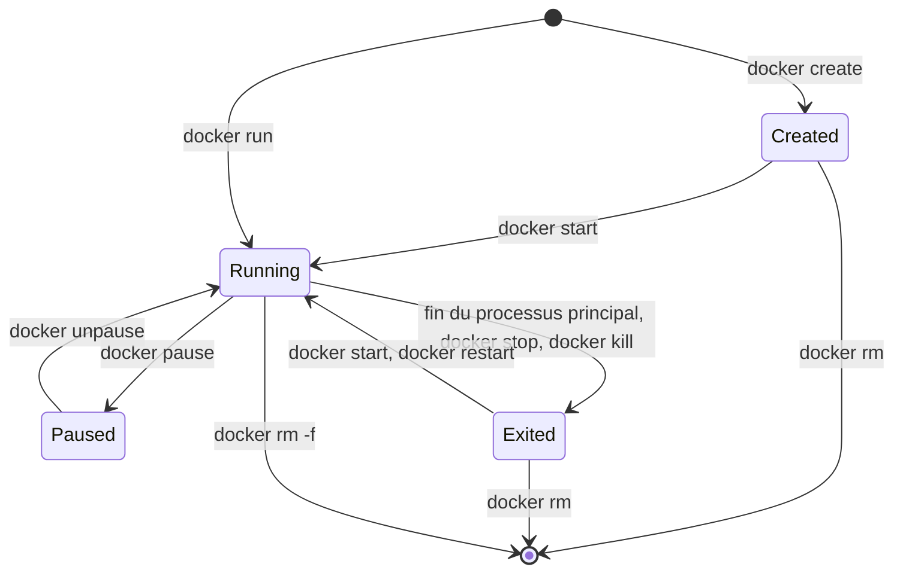
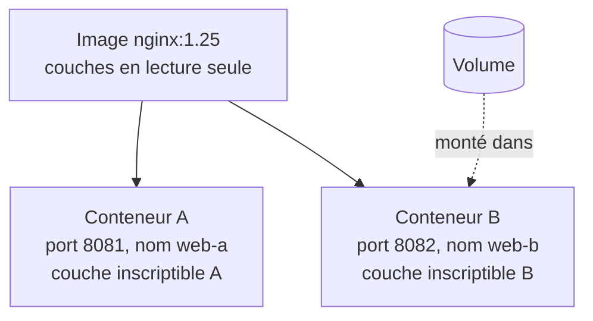
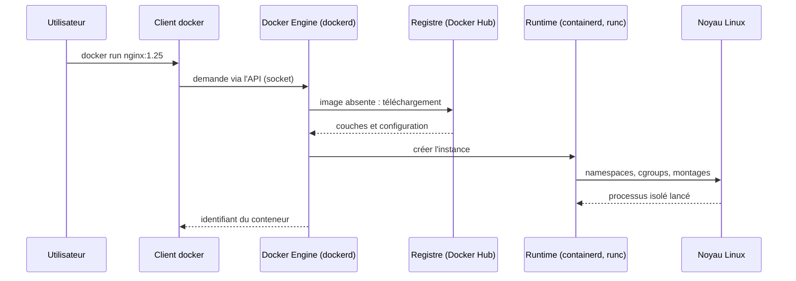

# Image et cycle de vie du conteneur

> **En une phrase.** Une **image** est un modèle figé (des fichiers et une configuration de départ) ; un **conteneur** est une instance créée à partir d'elle, avec ses propres paramètres, sa **couche inscriptible** et un état qui suit la vie de son **processus principal**.

---

## 1. Synthèse

### Le modèle mental

```
                    IMAGE  nginx:1.25   (lecture seule, partagée)
                 ┌────────────────────────────────────┐
                 │ fichiers + configuration de départ │
                 └───────┬──────────────────┬─────────┘
                         │                  │
          ┌──────────────▼───┐      ┌───────▼──────────┐
          │ couche inscrip. A│      │ couche inscrip. B│   ◄── modifications propres
          │ paramètres A     │      │ paramètres B     │       à chaque instance
          │ processus PID 1  │      │ processus PID 1  │
          └──────────────────┘      └──────────────────┘
              CONTENEUR A               CONTENEUR B
```

### Deux usages de la conteneurisation

| | **Conteneur système** (exemple : LXC/LXD) | **Conteneur applicatif** (usage courant de Docker) |
|---|---|---|
| Contenu | un environnement proche d'un système complet | un service ou une tâche |
| Processus | plusieurs services, souvent `systemd` en PID 1 | un processus principal et ses éventuels enfants |
| Distribution | administré comme une petite machine (paquets, SSH, instantanés) | distribué sous forme d'**image**, remplacé plutôt que modifié |
| Noyau | partagé avec l'hôte | partagé avec l'hôte |

> [!NOTE]
> **Un service ne signifie pas un seul processus.** Un serveur web comme Apache ou nginx lance plusieurs processus de traitement sous son processus principal.

### Repères dans l'écosystème Linux

| Outil | Rôle |
|---|---|
| **systemd** | gère le démarrage et les services sur de nombreuses distributions |
| **systemd-nspawn** | lance un environnement isolé à partir d'une arborescence de fichiers |
| **LXC** | fournit des outils pour les conteneurs système |
| **LXD** | ajoute leur gestion (images, réseau, stockage, ressources) ; gère aussi des **machines virtuelles** |
| **Docker** | construit, distribue et exécute des conteneurs applicatifs |

Ces outils n'ont pas le même rôle, mais tous les conteneurs Linux reposent sur **un noyau partagé** et sur les mécanismes décrits dans [Isolation d'un conteneur](Isolation-des-conteneurs.md).

### Les composants de Docker

| Composant | Rôle | Sur un poste de test |
|---|---|---|
| **Client Docker** | envoyer des demandes au moteur (la commande `docker`) | `docker` 29.8 |
| **Docker Engine** | gérer images, conteneurs, réseaux et volumes (le démon `dockerd`) | `dockerd` 29.8, joint par `unix:///var/run/docker.sock` |
| **Runtime** | créer et exécuter les processus isolés | `containerd` 2.3, qui appelle `runc` 1.5 |
| **Registre** | stocker et distribuer des images | Docker Hub (`docker.io`) |

Le client envoie une demande ; le moteur organise l'exécution en s'appuyant sur le runtime et le noyau. **Docker Hub distribue les images, il n'exécute aucun conteneur.** En résumé : Docker organise l'exécution, **Linux fournit les mécanismes d'isolation**.

### Ce que contient une image

- le **code** de l'application ;
- ses **dépendances** (bibliothèques, interpréteur) ;
- un **système minimal**, souvent basé sur Debian, Alpine ou Distroless (image réduite au strict nécessaire, sans shell ni gestionnaire de paquets) ;
- une **configuration de départ**, dont le **point d'entrée** (`ENTRYPOINT`, complété par `CMD`) : le programme lancé au démarrage du conteneur.

L'image est faite de **couches** en lecture seule empilées : voir [Les couches d'une image](Couches-d-une-image.md). On la construit avec un Dockerfile : voir [Écrire un Dockerfile](Ecrire-un-Dockerfile.md).

### Image et instance

| Notion | Définition |
|---|---|
| **Image** | Modèle contenant les fichiers et la configuration de départ. Elle peut servir à créer **plusieurs** instances. |
| **Conteneur** | **Instance** créée depuis une image, avec ses paramètres (nom, ports, variables, montages) et son état. |
| **Couche inscriptible** | Couche propre à chaque conteneur, posée au-dessus des fichiers de l'image, qui reçoit ses modifications. Écrire dedans **ne modifie ni l'image ni les autres instances**. |
| **rootfs** | L'arborescence visible depuis la racine `/` du conteneur : fichiers, bibliothèques et outils de son environnement. |
| **Montage** | Rendre un stockage extérieur accessible à un endroit précis du rootfs. |

Un chemin comme `/var/www/html` appartient à la vue du conteneur. Il **ne désigne pas automatiquement** le dossier du même nom sur l'hôte ou dans un autre conteneur.

### Le cycle de vie

**Règle centrale : le conteneur s'arrête quand son processus principal se termine.** Un serveur web reste actif pour recevoir des requêtes ; une tâche d'export s'arrête dès son travail accompli. Un état `Exited` peut donc indiquer **une fin normale**.

| État (`docker ps -a`) | Signification | Y entrer |
|---|---|---|
| `Created` | instance créée, processus pas encore lancé | `docker create` |
| `Up` (running) | processus principal en cours | `docker start`, ou `docker run` (= create + start) |
| `Up (Paused)` | processus gelés, mémoire conservée | `docker pause` (`unpause` pour reprendre) |
| `Exited (code)` | processus principal terminé ; l'instance et sa couche existent toujours | fin du programme, `docker stop`, `docker kill` |
| *(absent)* | instance et couche inscriptible supprimées | `docker rm` (`rm -f` si elle tourne encore) |

| Commande | Effet |
|---|---|
| `docker run` | **créer et démarrer** une nouvelle instance |
| `docker start` | démarrer une instance **existante** |
| `docker exec` | exécuter une commande supplémentaire dans une instance **active** |
| `docker stop` | envoyer `SIGTERM` au processus principal, puis `SIGKILL` après 10 s |
| `docker logs` | lire la sortie du processus, même après son arrêt |
| `docker rm` | supprimer l'instance et sa couche inscriptible |

Le **code de sortie** et les **journaux** renseignent sur les conditions de terminaison : `0` fin normale, autre valeur erreur du programme, `137` processus tué par `SIGKILL` (par exemple par manque de mémoire ou après le délai de `docker stop`).

### Le devenir des fichiers de la couche inscriptible

Pour un conteneur lancé sans suppression automatique (sans `--rm`) :

| Action | Fichiers ajoutés dans la couche inscriptible |
|---|---|
| Arrêt | **conservés** |
| Redémarrage du même conteneur | **conservés** |
| Suppression du conteneur | **supprimés** avec sa couche |
| Nouvelle instance de la même image | **absents** : les anciennes modifications n'y sont pas |

La **mémoire du processus**, elle, n'est pas restaurée par un redémarrage : le programme repart de zéro, avec ses fichiers.

### Les données qui doivent survivre

Les fichiers d'une base de données doivent rester disponibles quand son conteneur est remplacé. Trois types de montage existent (détails dans [Stockage : couche du conteneur, volumes, bind mounts](Stockage-et-volumes.md)) :

| Montage | Principe | Durée de vie |
|---|---|---|
| **Volume Docker** | stockage géré par Docker, monté dans le conteneur | peut être conservé après la suppression du conteneur |
| **Bind mount** | fichier ou dossier **de l'hôte** rendu accessible dans le conteneur | celle du dossier de l'hôte : les modifications portent sur ce même stockage |
| **tmpfs** | montage en mémoire | perdu à l'arrêt du conteneur |

### Les distinctions essentielles

| Notion | À retenir |
|---|---|
| **VM** | système invité avec son noyau |
| **Conteneur Linux** | processus isolés, noyau partagé |
| **Image** | point de départ de l'instance |
| **Namespace** | vue d'une ressource |
| **Cgroup** | contrôle de consommation |
| **Volume** | stockage indépendant de l'instance |

L'isolation et la persistance **ne sont pas automatiques** : elles dépendent de choix explicites de configuration.

> [!IMPORTANT]
> **Les pièges à retenir**
> 1. **`Exited` n'est pas synonyme d'échec.** Il faut lire le code de sortie et `docker logs` avant de conclure.
> 2. **Arrêter n'efface rien, supprimer efface tout ce qui n'est pas monté.** Une base sans volume perd ses données au premier `docker rm`.
> 3. **Réutiliser le même nom ne restaure pas l'ancienne instance.** Un nouveau `docker run --name web` repart de l'image, couche inscriptible vide.
> 4. **On ne modifie pas un conteneur pour le mettre à jour.** On construit une nouvelle image versionnée et on remplace l'instance.
> 5. **Le registre ne lance rien.** Il stocke et distribue ; c'est le moteur de la machine qui exécute.

---

## 2. Cas d'usage classiques

### Cas 1 : lancer un service depuis une image

**Besoin.** Démarrer un serveur web sans rien installer sur l'hôte.

```bash
docker run -d --name web -p 8080:80 nginx:1.25
curl -I http://localhost:8080                      # HTTP/1.1 200 OK
docker image inspect -f '{{.Config.Entrypoint}} {{.Config.Cmd}}' nginx:1.25
# [/docker-entrypoint.sh] [nginx -g daemon off;]
```

**Ce qu'on observe.** Le moteur télécharge l'image si elle est absente, crée l'instance, lance le point d'entrée prévu par l'image et publie le port 80 du conteneur sur le port 8080 de l'hôte. Le service HTTP est isolé et n'affecte pas l'hôte.
**À retenir.** `daemon off;` n'est pas un détail : nginx reste au premier plan, donc le processus principal ne se termine pas, donc le conteneur reste `Up`.

> [!NOTE]
> `sudo` n'est nécessaire que si l'utilisateur n'appartient pas au groupe `docker`. Appartenir à ce groupe revient à avoir des droits root sur l'hôte : voir [Identités, privilèges et capabilities](Identites-et-privileges.md).

### Cas 2 : un conteneur qui s'arrête aussitôt n'a pas forcément échoué

**Besoin.** Interpréter un conteneur qui n'apparaît pas dans `docker ps`.

```bash
docker run --name bonjour hello-world
docker ps                                           # bonjour absent
docker ps -a                                        # bonjour   Exited (0) ...
docker inspect -f '{{.State.Status}} {{.State.ExitCode}}' bonjour     # exited 0
docker logs bonjour                                 # « Hello from Docker! » et la suite
docker run --name erreur alpine sh -c 'echo "échec"; exit 3'
docker ps -a --filter name=erreur                   # Exited (3)
```

**Ce qu'on observe.** `docker ps` n'affiche que les conteneurs actifs ; `docker ps -a` montre aussi les arrêtés. Le programme de `hello-world` affiche son message puis se termine : le conteneur passe en `Exited (0)`, ce qui est **une fin normale**. Le second se termine avec le code 3 choisi par le programme.
**À retenir.** Un conteneur vit aussi longtemps que son processus principal. Il existe encore, avec ses journaux, tant qu'on ne l'a pas supprimé.

```bash
docker rm bonjour erreur
```

### Cas 3 : le devenir d'un fichier

**Besoin.** Vérifier ce que deviennent les fichiers écrits dans un conteneur.

```bash
docker run -d --name site -p 9091:80 httpd:2.4
docker exec site sh -c 'echo "trace" > /usr/local/apache2/htdocs/trace.txt'
docker diff site                      # parmi les lignes : A /usr/local/apache2/htdocs/trace.txt
curl http://localhost:9091/trace.txt  # trace

docker stop site && docker start site
curl http://localhost:9091/trace.txt  # trace

docker rm -f site
docker run -d --name site -p 9091:80 httpd:2.4
curl -I http://localhost:9091/trace.txt
```

**Ce qu'on observe.** Sur un poste de test :

| Moment | Résultat |
|---|---|
| Juste après la création du fichier | `trace` |
| Après `stop` puis `start` du même conteneur | `trace` (et après `docker stop`, l'état était `Exited (0)`) |
| Après `rm -f` puis nouveau `run` depuis la même image | `HTTP/1.1 404 Not Found` |

`docker diff` liste les écarts entre le conteneur et son image (`A` ajouté, `C` modifié, `D` supprimé) : c'est le contenu de la couche inscriptible.
**À retenir.** Arrêter ne touche qu'au processus. `docker rm` supprime l'instance **et** sa couche. La nouvelle instance repart d'une couche vide, au-dessus d'une image qui n'a jamais contenu `trace.txt`.

```bash
docker rm -f site
```

### Cas 4 : deux instances de la même image

**Besoin.** Montrer que deux conteneurs issus de la même image ont des états indépendants.

```bash
docker run -d --name a --hostname atelier-a alpine sleep 600
docker run -d --name b --hostname atelier-b alpine sleep 600
docker exec a hostname ; docker exec b hostname      # atelier-a, atelier-b
docker exec a ps ; docker exec b ps                  # dans chacun, sleep est le PID 1
docker exec a touch /seulement-dans-a
docker exec a ls /seulement-dans-a                   # présent
docker exec b ls /seulement-dans-a                   # No such file or directory
```

| Propriété | Conteneur A | Conteneur B |
|---|---|---|
| Image | identique | identique |
| Nom d'hôte | `atelier-a` | `atelier-b` |
| Processus principal | PID 1 dans A | PID 1 dans B |
| Fichier créé uniquement dans A | présent | absent |

**À retenir.** **Même image, états indépendants** (ici avec deux espaces PID distincts et aucun montage de données partagé).

```bash
docker rm -f a b
```

### Cas 5 : réutiliser un nom ne restaure rien

**Besoin.** Comprendre pourquoi « relancer le conteneur web » peut faire perdre des modifications.

```bash
docker run -d --name web nginx:1.25
docker run -d --name web nginx:1.25
# docker: Error response from daemon: Conflict. The container name "/web" is already in use by container "...".
docker start web          # bonne commande pour relancer l'instance existante (si elle est arrêtée)
docker rm -f web
docker run -d --name web nginx:1.25    # nouvelle instance : même nom, couche inscriptible neuve
```

**À retenir.** Un nom désigne **une** instance. `docker start` reprend l'instance existante ; `docker run` en crée toujours une nouvelle. Le refus de doublon protège contre les confusions, mais après un `rm`, rien ne relie la nouvelle instance à l'ancienne.

### Cas 6 : garder les données d'une base en remplaçant son conteneur

**Besoin.** Mettre à jour le conteneur d'une base de données sans perdre son contenu.

```bash
docker volume create donnees-db
docker run -d --name db -e MARIADB_ROOT_PASSWORD=exemple \
  -v donnees-db:/var/lib/mysql mariadb:11.4
docker rm -f db                                       # l'instance disparaît
docker run -d --name db -e MARIADB_ROOT_PASSWORD=exemple \
  -v donnees-db:/var/lib/mysql mariadb:11.4           # nouvelle instance, mêmes données
docker volume ls                                      # donnees-db existe toujours
```

**Ce qu'on observe.** Les bases et tables créées avant le `rm` sont toujours là : elles ne vivaient pas dans la couche inscriptible, mais dans le volume.
**À retenir.** Séparer **ce qui se remplace** (le conteneur, l'image) de **ce qui doit durer** (les données). Le mot de passe en clair dans la commande est acceptable pour un essai, pas en production : voir [Secrets, fichiers, réseau et ressources](Secrets-fichiers-reseau-ressources.md).

```bash
docker rm -f db && docker volume rm donnees-db
```

### Cas 7 : conteneur système contre conteneur applicatif

**Besoin.** Voir concrètement la différence entre un conteneur LXD et un conteneur Docker.

```bash
lxc launch ubuntu:24.04 ct-test </dev/null
lxc exec ct-test -- ps -p 1 -o comm=          # systemd : un système complet a démarré
lxc exec ct-test -- systemctl list-units --type=service --state=running | head
docker run --rm alpine ps                     # PID 1 = ps : un seul programme
```

**Ce qu'on observe.** Le conteneur LXD démarre `systemd` et plusieurs services ; on l'administre comme une petite machine. Le conteneur Docker ne lance que le programme demandé et s'arrête avec lui. Sur un poste de test, LXD rend en plus ses conteneurs **non privilégiés par défaut** (root du conteneur = UID 1000000 sur l'hôte), alors que Docker, sans configuration particulière, garde root = UID 0 de l'hôte.
**À retenir.** Même noyau partagé, mêmes mécanismes ; deux usages : **administrer un système** ou **livrer une application**.

```bash
lxc delete --force ct-test </dev/null
```

---

## 3. Idées de schémas

### Schéma A : les états d'un conteneur



À faire figurer sous chaque état : ce qui existe encore (processus, mémoire, couche inscriptible, journaux). Seul le passage à `[*]` efface la couche.

### Schéma B : une image, plusieurs instances



Message : la flèche de l'image vers les conteneurs ne s'inverse jamais. Rien de ce qu'écrit un conteneur ne remonte dans l'image.

### Schéma C : qui fait quoi quand on tape `docker run`



### Schéma D : la vie d'un fichier

Une frise horizontale avec quatre étapes et une icône de fichier : « écrit » (fichier vert dans la couche A), « stop/start » (le fichier reste, le processus clignote), « rm » (la couche A et le fichier tombent à la corbeille), « run » (nouvelle couche vide, point d'interrogation, réponse 404). En contrepoint, sous la frise, un fichier rangé dans un volume qui traverse les quatre étapes intact.

---

## 4. Script de motion design : « La vie d'un conteneur » (environ 75 s)

Style : fond sombre, l'image représentée comme un moule doré, les conteneurs comme des boîtes transparentes, la couche inscriptible comme une feuille bleue posée sur le dessus. Textes à l'écran seulement.

| Séq. | Durée | À l'écran | Animation | Texte à l'écran |
|---|---|---|---|---|
| 1 | 0-8 s | Un moule doré « nginx:1.25 » arrive d'un nuage « registre » | Le moule descend du nuage et se pose sur la machine ; le nuage reste vide de toute activité | « L'image : un modèle figé. Le registre la distribue, il n'exécute rien. » |
| 2 | 8-16 s | Une boîte transparente sort du moule, une feuille bleue vierge se pose dessus | La boîte prend l'étiquette « Created » ; rien ne bouge à l'intérieur | « docker create : une instance existe, aucun processus ne tourne. » |
| 3 | 16-26 s | Un petit moteur « PID 1 » s'allume dans la boîte | Le moteur tourne, une étiquette « Up » remplace « Created » ; des requêtes arrivent par un port | « docker start : le processus principal démarre. Le conteneur vit avec lui. » |
| 4 | 26-34 s | Un fichier vert apparaît sur la feuille bleue | Le moule doré, en arrière-plan, reste intact (petit reflet) | « Les écritures vont dans la couche de l'instance, jamais dans l'image. » |
| 5 | 34-44 s | Le moteur ralentit et s'arrête | L'étiquette devient « Exited (0) » ; le fichier vert est toujours sur la feuille ; un rouleau « logs » reste lisible | « Arrêté n'est pas effacé : fichiers et journaux sont conservés. » |
| 6 | 44-52 s | Le moteur redémarre | Le fichier vert est là ; une bulle « mémoire » repart vide | « Redémarrer : mêmes fichiers, mais un processus qui repart de zéro. » |
| 7 | 52-62 s | Une main « docker rm » saisit la boîte | La boîte et sa feuille bleue se dissolvent ; une nouvelle boîte sort du moule avec une feuille vierge et le même nom | « Supprimer efface la couche. Même nom, nouvelle instance : le fichier a disparu. » |
| 8 | 62-75 s | Même scène rejouée avec un tiroir « volume » branché sur le côté de la boîte | Le fichier est rangé dans le tiroir ; la boîte disparaît, une nouvelle se branche sur le même tiroir et retrouve le fichier | « Ce qui doit durer va dans un volume. Le conteneur, lui, se remplace. » |

**Conseil de réalisation.** Garder la feuille bleue (couche inscriptible) **solidaire de la boîte** dans toutes les séquences : c'est en la voyant disparaître avec la boîte en séquence 7 que le spectateur comprend la règle. La séquence 8 doit reprendre exactement le même cadrage que la 7 pour que la différence (le tiroir) saute aux yeux.

---

## 5. Vérifier soi-même

```bash
docker create --name cycle alpine sh -c 'date > /trace; sleep 30'
docker ps -a --filter name=cycle --format '{{.Names}} {{.Status}}'     # Created
docker start cycle
docker ps -a --filter name=cycle --format '{{.Names}} {{.Status}}'     # Up ...
docker exec cycle cat /trace                                            # la date
docker stop cycle                                                       # environ 10 s : sh ignore SIGTERM
docker ps -a --filter name=cycle --format '{{.Names}} {{.Status}}'     # Exited (137)
docker start cycle && sleep 1 && docker exec cycle cat /trace                 # une nouvelle date : la commande a été relancée
docker rm -f cycle
```

Le code `137` illustre le cas d'un processus qui ne gère pas `SIGTERM` : `docker stop` attend 10 s puis le tue avec `SIGKILL`.

## Voir aussi

- [Accueil du wiki](../README.md)
- Page précédente : [Isolation d'un conteneur : namespaces, cgroups et protections](Isolation-des-conteneurs.md)
- Page suivante : [Les couches d'une image](Couches-d-une-image.md)
- Pour aller plus loin : [Exécution des conteneurs (Docker)](https://docs.docker.com/engine/containers/run/), [Stockage Docker](https://docs.docker.com/engine/storage/), [Bind mounts](https://docs.docker.com/engine/storage/bind-mounts/), [Conteneurs système avec LXD](https://canonical.com/lxd/docs/latest/)
