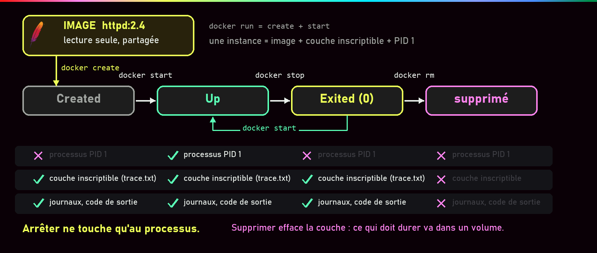
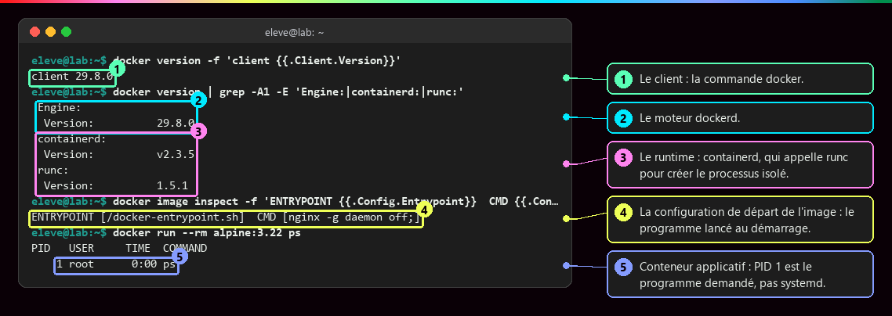
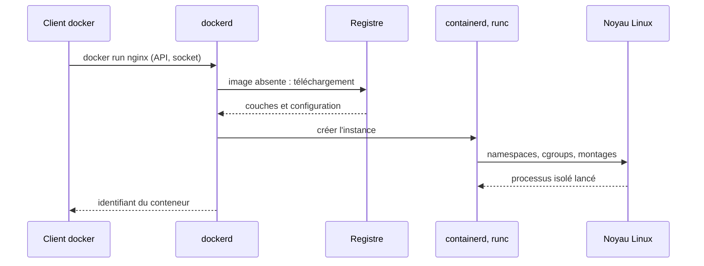
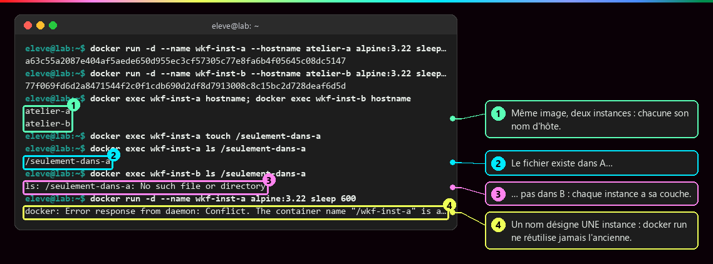
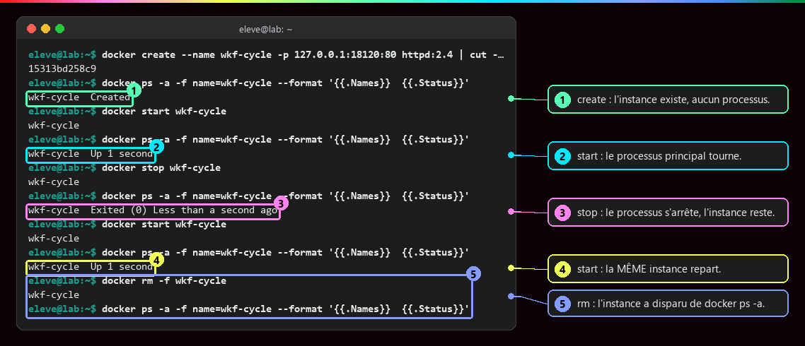
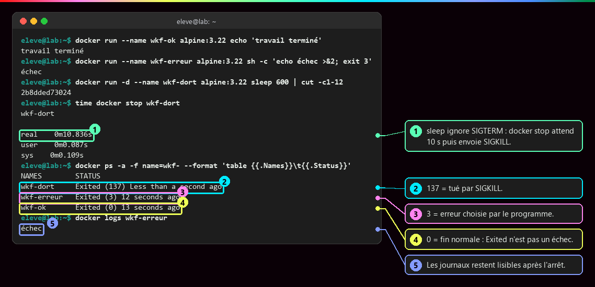
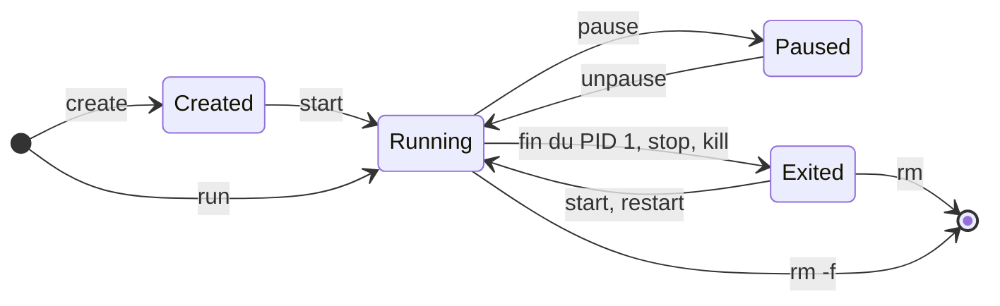
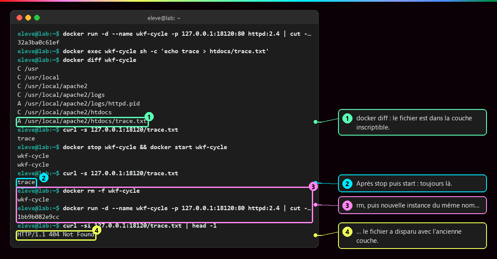
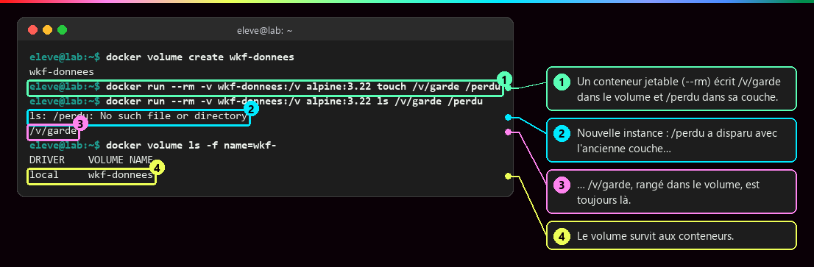

# Image et cycle de vie du conteneur

<p class="lead">Une <strong>image</strong> est un modèle figé : des fichiers et une configuration de départ. Un <strong>conteneur</strong> en est une instance, avec ses paramètres, sa <strong>couche inscriptible</strong> et un état qui suit la vie de son <strong>processus principal</strong>.</p>

{ .hero }

## L'essentiel en 30 secondes

<div class="grid cards" markdown>

-   :material-layers-outline:{ .lg .middle } __Image__

    ---

    Fichiers + configuration de départ, en **lecture seule**. Elle sert à créer **plusieurs** instances.

-   :material-docker:{ .lg .middle } __Conteneur__

    ---

    Une **instance** : nom, ports, variables, montages, une **couche inscriptible** à elle, un état.

-   :material-heart-pulse:{ .lg .middle } __Cycle de vie__

    ---

    Il vit **aussi longtemps que son PID 1**. `Exited` n'est pas un échec : lire le **code de sortie**.

-   :material-database-outline:{ .lg .middle } __Persistance__

    ---

    `docker rm` efface la couche. Ce qui doit durer va dans un **volume**.

</div>

!!! warning "À retenir"

    **Arrêter n'efface rien, supprimer efface tout ce qui n'est pas monté.** Réutiliser le même nom ne restaure pas l'ancienne instance. On ne modifie pas un conteneur pour le mettre à jour : on construit une **nouvelle image versionnée** et on **remplace** l'instance.

## :material-cog-outline: Qui fait quoi quand on tape `docker run`

| Composant | Rôle |
|---|---|
| **Client** (`docker`) | envoie les demandes au moteur |
| **Docker Engine** (`dockerd`) | gère images, conteneurs, réseaux, volumes ; joint par `unix:///var/run/docker.sock` |
| **Runtime** (`containerd`, `runc`) | crée et exécute les processus isolés |
| **Registre** (Docker Hub, `docker.io`) | stocke et distribue les images : **il n'exécute rien** |

L'image contient le **code**, ses **dépendances**, un **système minimal** (Debian, Alpine ou Distroless, sans shell ni gestionnaire de paquets) et un **point d'entrée** (`ENTRYPOINT`, complété par `CMD`). Docker organise l'exécution ; **Linux fournit les mécanismes d'isolation**.

???+ example "En vrai : les composants et le point d'entrée"

    

    `daemon off;` n'est pas un détail : nginx reste au premier plan, son processus principal ne se termine pas, donc le conteneur reste `Up`. Dans un conteneur applicatif, PID 1 est **le programme demandé**, pas `systemd`.



??? note "Conteneur système ou conteneur applicatif"

    | | **Conteneur système** (LXC/LXD) | **Conteneur applicatif** (Docker) |
    |---|---|---|
    | Contenu | un environnement proche d'un système complet | un service ou une tâche |
    | Processus | plusieurs services, souvent `systemd` en PID 1 | un processus principal et ses enfants |
    | Gestion | administré comme une petite machine (paquets, SSH, instantanés) | distribué en **image**, remplacé plutôt que modifié |
    | Noyau | partagé avec l'hôte | partagé avec l'hôte |

    `lxc exec ct-test -- ps -p 1 -o comm=` répond `systemd` ; `docker run --rm alpine:3.22 ps` montre `ps` en PID 1 (capture ci-dessus). LXD rend en plus ses conteneurs **non privilégiés par défaut** (root du conteneur = UID 1000000 sur l'hôte), alors que Docker garde root = UID 0 sans configuration particulière.

    Repères : **systemd** gère le démarrage et les services ; **systemd-nspawn** lance un environnement isolé depuis une arborescence ; **LXC** fournit les outils des conteneurs système ; **LXD** les gère (images, réseau, stockage) ainsi que des **machines virtuelles** ; **Docker** construit, distribue et exécute des conteneurs applicatifs. Tous reposent sur un noyau partagé.

    **Un service ne signifie pas un seul processus** : Apache ou nginx lancent plusieurs processus de traitement sous leur processus principal.

## :material-content-copy: Une image, plusieurs instances

| Notion | Définition |
|---|---|
| **Couche inscriptible** | propre à chaque conteneur, au-dessus des fichiers de l'image ; y écrire **ne modifie ni l'image ni les autres instances** |
| **rootfs** | l'arborescence vue depuis la racine `/` du conteneur |
| **Montage** | un stockage extérieur rendu accessible à un endroit précis du rootfs |

Un chemin comme `/var/www/html` appartient à la vue du conteneur : il **ne désigne pas** le dossier du même nom sur l'hôte ou dans un autre conteneur. L'image elle-même est faite de couches en lecture seule ([Les couches d'une image](Couches-d-une-image.md)) et se construit avec un Dockerfile ([Écrire un Dockerfile](Ecrire-un-Dockerfile.md)).

???+ example "En vrai : même image, états indépendants"

    

    Chaque instance a son nom d'hôte, son PID 1 et sa couche. Un nom désigne **une** instance : `docker start` reprend l'existante, `docker run` en crée toujours une nouvelle, et après un `rm` rien ne relie la nouvelle à l'ancienne.

## :material-state-machine: Le cycle de vie

**Règle centrale : le conteneur s'arrête quand son processus principal se termine.** Un serveur web reste actif ; une tâche d'export s'arrête dès son travail fini.

| État (`docker ps -a`) | Signification | Y entrer |
|---|---|---|
| `Created` | instance créée, processus pas encore lancé | `docker create` |
| `Up` | processus principal en cours | `docker start`, ou `docker run` (= create + start) |
| `Up (Paused)` | processus gelés, mémoire conservée | `docker pause` (`unpause` pour reprendre) |
| `Exited (code)` | processus terminé ; instance et couche toujours là | fin du programme, `docker stop`, `docker kill` |
| *(absent)* | instance et couche supprimées | `docker rm` (`rm -f` si elle tourne) |

`docker exec` lance une commande de plus dans une instance **active** ; `docker logs` lit la sortie du processus, **même après son arrêt** ; `docker ps` seul n'affiche que les conteneurs actifs.

???+ example "En vrai : create, start, stop, start, rm"

    

???+ example "En vrai : 0, 3 et 137, trois façons de s'arrêter"

    

    `docker stop` envoie `SIGTERM`, puis `SIGKILL` après 10 s. `0` : fin normale ; autre valeur : erreur du programme ; `137` : tué par `SIGKILL` (après le délai de `docker stop`, ou par manque de mémoire). Avant de conclure, lire le code **et** `docker logs`.



## :material-file-outline: Le devenir des fichiers

Pour un conteneur lancé sans `--rm` : les fichiers de la couche inscriptible sont **conservés** à l'arrêt et au redémarrage, **supprimés** avec le conteneur, et **absents** d'une nouvelle instance de la même image. La **mémoire** du processus, elle, n'est jamais restaurée : au redémarrage, le programme repart de zéro, avec ses fichiers.

???+ example "En vrai : un fichier qui survit au stop, pas au rm"

    

    `docker diff` liste les écarts avec l'image (`A` ajouté, `C` modifié, `D` supprimé) : c'est le contenu de la couche inscriptible. La nouvelle instance repart d'une couche vide, au-dessus d'une image qui n'a jamais contenu `trace.txt`.

| Montage | Principe | Durée de vie |
|---|---|---|
| **Volume Docker** | stockage géré par Docker | peut survivre à la suppression du conteneur |
| **Bind mount** | un dossier **de l'hôte** rendu visible dans le conteneur | celle du dossier de l'hôte |
| **tmpfs** | montage en mémoire | perdu à l'arrêt du conteneur |

???+ example "En vrai : le volume garde, la couche oublie"

    

    Séparer **ce qui se remplace** (le conteneur, l'image) de **ce qui doit durer** (les données). Pour une base de données : `-v donnees-db:/var/lib/mysql`, et un `docker rm -f db` suivi d'un nouveau `docker run` avec le même volume retrouve toutes les tables. Détails dans [Stockage : couche du conteneur, volumes, bind mounts](Stockage-et-volumes.md).

## :material-flask-outline: À toi de jouer

```bash
docker create --name cycle alpine:3.22 sh -c 'date > /trace; sleep 30'
docker ps -a --filter name=cycle --format '{{.Names}} {{.Status}}'     # Created
docker start cycle
docker exec cycle cat /trace                                            # la date
docker stop cycle                                                       # environ 10 s : sh ignore SIGTERM
docker ps -a --filter name=cycle --format '{{.Names}} {{.Status}}'     # Exited (137)
docker start cycle && sleep 1 && docker exec cycle cat /trace           # une nouvelle date : la commande est relancée
docker rm -f cycle
```

`sudo` n'est nécessaire que si l'utilisateur n'appartient pas au groupe `docker`, ce qui revient à avoir des droits root sur l'hôte : voir [Identités, privilèges et capabilities](Identites-et-privileges.md).

??? abstract "Pour les créateurs : script de motion design « La vie d'un conteneur » (75 s)"

    Style : fond sombre, l'image représentée comme un moule doré, les conteneurs comme des boîtes transparentes, la couche inscriptible comme une feuille bleue posée sur le dessus. Textes à l'écran seulement.

    | Séq. | Durée | À l'écran | Animation | Texte à l'écran |
    |---|---|---|---|---|
    | 1 | 0-8 s | Un moule doré « nginx:1.25 » arrive d'un nuage « registre » | Le moule descend du nuage et se pose sur la machine ; le nuage reste vide de toute activité | « L'image : un modèle figé. Le registre la distribue, il n'exécute rien. » |
    | 2 | 8-16 s | Une boîte transparente sort du moule, une feuille bleue vierge se pose dessus | La boîte prend l'étiquette « Created » ; rien ne bouge à l'intérieur | « docker create : une instance existe, aucun processus ne tourne. » |
    | 3 | 16-26 s | Un petit moteur « PID 1 » s'allume dans la boîte | Le moteur tourne, une étiquette « Up » remplace « Created » ; des requêtes arrivent par un port | « docker start : le processus principal démarre. Le conteneur vit avec lui. » |
    | 4 | 26-34 s | Un fichier vert apparaît sur la feuille bleue | Le moule doré, en arrière-plan, reste intact (petit reflet) | « Les écritures vont dans la couche de l'instance, jamais dans l'image. » |
    | 5 | 34-44 s | Le moteur ralentit et s'arrête | L'étiquette devient « Exited (0) » ; le fichier vert est toujours sur la feuille ; un rouleau « logs » reste lisible | « Arrêté n'est pas effacé : fichiers et journaux sont conservés. » |
    | 6 | 44-52 s | Le moteur redémarre | Le fichier vert est là ; une bulle « mémoire » repart vide | « Redémarrer : mêmes fichiers, mais un processus qui repart de zéro. » |
    | 7 | 52-62 s | Une main « docker rm » saisit la boîte | La boîte et sa feuille bleue se dissolvent ; une nouvelle boîte sort du moule avec une feuille vierge et le même nom | « Supprimer efface la couche. Même nom, nouvelle instance : le fichier a disparu. » |
    | 8 | 62-75 s | Même scène rejouée avec un tiroir « volume » branché sur le côté de la boîte | Le fichier est rangé dans le tiroir ; la boîte disparaît, une nouvelle se branche sur le même tiroir et retrouve le fichier | « Ce qui doit durer va dans un volume. Le conteneur, lui, se remplace. » |

    Garder la feuille bleue (couche inscriptible) **solidaire de la boîte** dans toutes les séquences : c'est en la voyant disparaître avec la boîte en séquence 7 que le spectateur comprend la règle. La séquence 8 reprend exactement le cadrage de la 7 pour que la différence (le tiroir) saute aux yeux.

??? info "Pour les créateurs : idées de schémas"

    **Les états d'un conteneur** : c'est l'illustration d'en-tête. Sous chaque état, ce qui existe encore (processus, couche inscriptible, journaux) ; seul le passage à « supprimé » efface la couche.

    **Une image, plusieurs instances** : une image `nginx:1.25` (couches en lecture seule) et deux flèches vers les conteneurs A (port 8081, couche A) et B (port 8082, couche B), un volume branché en pointillés sur B. Message : la flèche de l'image vers les conteneurs ne s'inverse jamais, rien de ce qu'écrit un conteneur ne remonte dans l'image.

    **La vie d'un fichier** : une frise en quatre étapes avec une icône de fichier : « écrit » (fichier vert dans la couche A), « stop/start » (le fichier reste, le processus clignote), « rm » (la couche et le fichier tombent à la corbeille), « run » (nouvelle couche vide, réponse 404). En contrepoint, sous la frise, un fichier rangé dans un volume qui traverse les quatre étapes intact.

??? note "Pour aller plus loin"

    [Exécution des conteneurs (Docker)](https://docs.docker.com/engine/containers/run/), [Stockage Docker](https://docs.docker.com/engine/storage/), [Bind mounts](https://docs.docker.com/engine/storage/bind-mounts/), [Conteneurs système avec LXD](https://canonical.com/lxd/docs/latest/). Pour les mots de passe et la configuration d'une base en production : [Secrets, fichiers, réseau et ressources](Secrets-fichiers-reseau-ressources.md).
