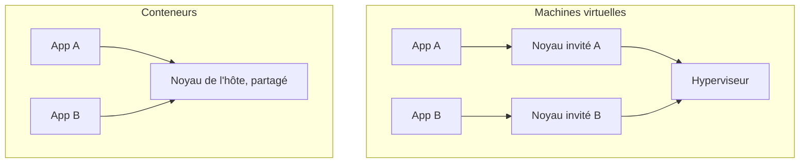

# Isolation d'un conteneur

<p class="lead">Un conteneur n'est pas une petite machine. C'est un <strong>processus ordinaire de l'hôte</strong>, à qui le noyau Linux impose trois choses : une vue restreinte du système, un budget de ressources et une liste de droits.</p>

{ .hero }

## L'essentiel en 30 secondes

<div class="grid cards" markdown>

-   :material-eye-outline:{ .lg .middle } __Voir · namespaces__

    ---

    Le processus ne voit que ses processus, son réseau, ses fichiers. Il se croit seul : il est le PID 1.

-   :material-gauge:{ .lg .middle } __Consommer · cgroups__

    ---

    Mémoire, CPU, nombre de processus : plafonnés. S'il dépasse, **lui seul** tombe.

-   :material-shield-key-outline:{ .lg .middle } __Faire · protections__

    ---

    Utilisateur, capabilities, no-new-privileges : on ne garde que les droits nécessaires.

-   :material-alert-outline:{ .lg .middle } __Le piège · noyau partagé__

    ---

    Tous les conteneurs tournent sur **le même noyau**. Une faille du noyau touche tout le monde.

</div>

!!! warning "À retenir"

    **Voir moins ≠ consommer moins ≠ pouvoir moins.** Un conteneur bien isolé peut quand même saturer la mémoire ou tourner en root. Les trois réglages sont indépendants : il faut vérifier les trois.

## :material-eye-outline: Voir : les namespaces

Un namespace donne à un groupe de processus **sa propre vue** d'une ressource du système. Docker en active six par défaut :

| Namespace | Ce qu'il isole | Ce qu'on observe |
|---|---|---|
| **PID** | la liste des processus | l'application est le PID 1 |
| **Network** | interfaces, routes, ports | deux conteneurs écoutent sur le même port 80 |
| **Mount** | les points de montage | chaque conteneur a sa propre racine `/` |
| **UTS** | le nom d'hôte | `hostname` renvoie l'ID du conteneur |
| **IPC** | mémoire partagée, files de messages | deux applis ne lisent pas leur mémoire partagée |
| **User** | les UID et GID | **désactivé par défaut** : root du conteneur = root de l'hôte |

???+ example "En vrai : deux nginx sur le même port 80"

    

    Chacun a sa propre pile réseau. Côté hôte, on les distingue par les ports publiés (8081 et 8082). Dans un conteneur, `localhost` désigne le conteneur lui-même, jamais l'hôte.

???+ example "En vrai : un seul processus, deux points de vue"

    

    Le conteneur se croit seul (PID 1), l'hôte voit tout avec les vrais PID. Et sans namespace User, l'UID 101 des workers nginx **est** l'UID 101 de l'hôte, qui appartient ici à un tout autre utilisateur.

## :material-gauge: Consommer : les cgroups

Les cgroups **comptent et plafonnent** ce qu'un groupe de processus consomme.

| Dépasser… | … c'est | Réglage |
|---|---|---|
| la mémoire | être **tué** par le noyau (code 137, `OOMKilled`) | `--memory 256m` |
| le CPU | être **ralenti** | `--cpus 0.5` |
| le nombre de processus | ne plus pouvoir en **créer** (`can't fork`) | `--pids-limit 64` |

???+ example "En vrai : une fuite mémoire contenue"

    

???+ example "En vrai : un fork bomb bloqué à 32 processus"

    

!!! tip "Le bon réflexe"

    Mesurer d'abord avec `docker stats`, puis fixer une limite **avec de la marge**. Une limite trop basse crée elle-même la panne.

## :material-shield-key-outline: Faire : les protections

| Protection | Effet | Réglage |
|---|---|---|
| Utilisateur | ne plus être root du tout | `USER` dans le Dockerfile, `--user` |
| Capabilities | retirer des pouvoirs précis à root (Docker en garde 14) | `--cap-drop ALL --cap-add …` |
| no-new-privileges | interdire de gagner des droits via `su`, `sudo`, setuid | `--security-opt no-new-privileges` |
| seccomp, AppArmor | filtrer les appels système et les accès | profil par défaut de Docker |

???+ danger "En vrai : le piège de `--cap-drop ALL`"

    

    Sans aucune capability, Apache **démarre et répond**… mais ne peut plus changer d'utilisateur : ses workers restent root. La mesure de sécurité a aggravé la situation. On réintroduit **seulement** ce qui est démontré nécessaire, et on vérifie avec `docker top`.

## :material-bug-outline: Bonus : déboguer sans toucher à l'image

On peut **rejoindre** les namespaces d'un conteneur avec une image d'outils, sans rien installer dedans :

```bash
docker run --rm -it --pid container:app --network container:app nicolaka/netshoot
```

C'est exactement le principe d'un **Pod** Kubernetes : plusieurs conteneurs qui partagent le même réseau.

## :material-flask-outline: À toi de jouer

```bash
docker run -d --name demo --memory 128m --pids-limit 32 nginx:stable
docker exec demo cat /proc/1/cmdline            # nginx est le PID 1
docker exec demo hostname                       # l'ID du conteneur
docker exec demo cat /sys/fs/cgroup/memory.max  # 134217728
docker exec demo grep CapEff /proc/1/status     # 00000000a80425fb
docker rm -f demo
```

## :material-server: VM ou conteneur : où est le noyau ?



??? abstract "Pour les créateurs : script de motion design (75 s)"

    Fond sombre, formes plates, une couleur par mécanisme (bleu namespaces, orange cgroups, rouge protections).

    | Séq. | Durée | À l'écran | Animation | Texte à l'écran |
    |---|---|---|---|---|
    | 1 | 0-6 s | Une dalle grise « noyau Linux » et six cercles « processus » | Les cercles apparaissent un par un | « Sur un serveur Linux, tout est processus. » |
    | 2 | 6-14 s | Les cercles se relient tous par des traits fins | Les traits se dessinent ; le cercle « app » clignote | « Sans isolation, chacun voit tout. » |
    | 3 | 14-26 s | Un anneau **bleu** se referme autour de « app » | Les traits vers l'extérieur se coupent ; son numéro passe de 4211 à **1** | « Namespaces : ce qu'il voit. Il se croit seul. » |
    | 4 | 26-32 s | L'anneau bleu se découpe en 6 secteurs | Chaque secteur s'allume avec son nom | « Six vues séparées. » |
    | 5 | 32-44 s | Un anneau **orange** et une jauge mémoire | La jauge touche « 256 Mio », l'app éclate seule, les autres continuent | « Cgroups : s'il dépasse, lui seul tombe. » |
    | 6 | 44-56 s | Un anneau **rouge** ; une couronne « root » au-dessus de l'app | La couronne se fragmente en clés, deux restent ; un cadenas se ferme | « Protections : on ne garde que les clés nécessaires. » |
    | 7 | 56-66 s | Trois conteneurs sur **la même** dalle | Une fissure traverse la dalle sous les trois | « Le noyau reste partagé. » |
    | 8 | 66-75 s | Les trois anneaux alignés | Les trois questions s'écrivent | « Voir. Consommer. Faire. » |

    La séquence 5 est la plus parlante : faire tomber l'application **pendant que les autres processus continuent de pulser**.

??? info "Pour les créateurs : la métaphore de l'immeuble"

    | Dans l'immeuble | Dans le conteneur |
    |---|---|
    | les fondations | le **noyau partagé** |
    | un appartement | un conteneur |
    | les murs et fenêtres opaques | les **namespaces** |
    | les compteurs avec disjoncteur | les **cgroups** |
    | le badge qui n'ouvre que certaines portes | les **protections** |
    | une maison individuelle, à côté | une VM, avec ses propres fondations |

    Limite à dire : le gardien (le noyau) a les clés de tous les appartements.
