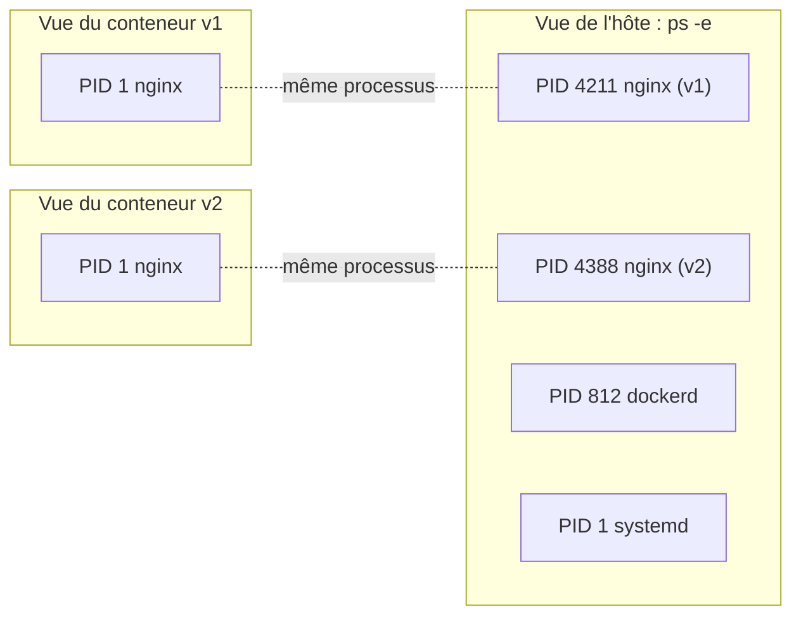
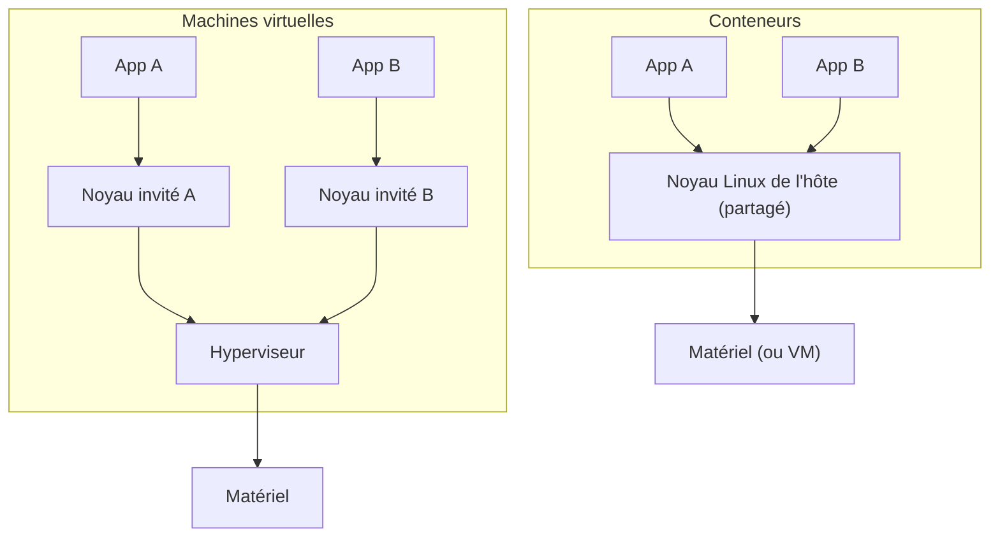

# Isolation d'un conteneur : namespaces, cgroups et protections

> **En une phrase.** Un conteneur n'est pas une petite machine : c'est un **processus ordinaire de l'hôte**, à qui le noyau Linux impose trois choses : une vue restreinte du système, un budget de ressources et une liste de droits.

---

## 1. Synthèse

### Le modèle mental

```
┌─────────────────────────────────────────────────────────────────────────────┐
│ PROTECTIONS : que peut-il FAIRE ?  (UID, capabilities, seccomp…)            │
│  ┌───────────────────────────────────────────────────────────────────────┐  │
│  │ CGROUPS : que peut-il CONSOMMER ?  (mémoire, CPU, processus)          │  │
│  │  ┌─────────────────────────────────────────────────────────────────┐  │  │
│  │  │ NAMESPACES : que peut-il VOIR ?  (processus, réseau, fichiers)  │  │  │
│  │  │                         ┌─────────────┐                         │  │  │
│  │  │                         │  processus  │                         │  │  │
│  │  │                         └─────────────┘                         │  │  │
│  │  └─────────────────────────────────────────────────────────────────┘  │  │
│  │                                                                       │  │
│  └───────────────────────────────────────────────────────────────────────┘  │
│                                                                             │
└─────────────────────────────────────────────────────────────────────────────┘
                              noyau Linux partagé
```

| Mécanisme | Question | Sans lui… | Réglage Docker typique |
|---|---|---|---|
| **Namespaces** | Que voit le processus ? | il voit tous les processus, tous les ports, tous les fichiers de l'hôte | activés par défaut ; `--pid=host`, `--network=host` les **retirent** |
| **Cgroups** | Que peut-il consommer ? | une fuite mémoire ou une boucle sature toute la machine | `--memory`, `--cpus`, `--pids-limit` |
| **Protections** | Que peut-il faire ? | root dans le conteneur fait presque tout ce que fait root sur l'hôte | `--user`, `--cap-drop`, `--security-opt no-new-privileges` |

### Les six namespaces du cours

| Namespace | Isole | Effet visible |
|---|---|---|
| **PID** | la liste des processus | l'application est le **PID 1** du conteneur |
| **Mount** | les points de montage | le conteneur a sa propre racine `/` |
| **Network** | interfaces, routes, ports | deux conteneurs peuvent écouter sur le même port 80 |
| **UTS** | le nom d'hôte | `hostname` renvoie l'ID du conteneur |
| **IPC** | mémoire partagée, files de messages | deux applis ne se lisent pas leur mémoire partagée |
| **User** | les UID et GID | root du conteneur ≠ root de l'hôte (**désactivé par défaut dans Docker**) |

### Les cgroups en 3 lignes

- Ils **comptent et plafonnent** : mémoire (`memory.max`), CPU (`cpu.max`), nombre de processus (`pids.max`), entrées-sorties disque.
- Dépasser la mémoire, c'est **être tué** (OOM killer, code de sortie 137).
- Dépasser les processus, c'est **ne plus pouvoir créer de processus** (`Cannot fork`). Dépasser le CPU, c'est **être ralenti**.

### Les protections en 4 lignes

- **Utilisateur** : par défaut, le processus tourne en root (UID 0). `USER` dans le Dockerfile ou `--user` change cela.
- **Capabilities** : le pouvoir de root découpé en une quarantaine de droits ; Docker en garde **14 par défaut**.
- **no-new-privileges** : interdit de gagner des droits en exécutant un programme setuid (`su`, `sudo`…).
- **seccomp, AppArmor, SELinux** : filtrent les appels système et les accès aux fichiers.

> [!IMPORTANT]
> **Les trois pièges à retenir**
> 1. **Voir moins ≠ consommer moins ≠ pouvoir moins.** Un conteneur bien isolé (namespaces) peut quand même saturer la mémoire (pas de cgroup) ou être root (pas de protection).
> 2. **Le noyau est partagé.** Une faille du noyau touche tous les conteneurs et l'hôte. C'est la différence fondamentale avec une VM.
> 3. **Sans namespace User, l'UID 0 du conteneur est l'UID 0 de l'hôte.** Les droits du conteneur se lisent avec les UID de l'hôte.

---

## 2. Cas d'usage classiques

### Cas 1 : faire tourner deux serveurs web sur le port 80 (namespace Network)

**Besoin.** Deux versions d'un site, chacune configurée pour écouter sur le port 80.

```bash
docker run -d --name v1 -p 8081:80 nginx
docker run -d --name v2 -p 8082:80 nginx
```

**Ce qu'on observe.** Les deux nginx écoutent sur **leur** port 80, sans conflit : chacun a sa propre pile réseau. Côté hôte, on les distingue par les ports publiés 8081 et 8082.
**À retenir.** `localhost` dans un conteneur désigne le conteneur lui-même, pas l'hôte.

### Cas 2 : comprendre « PID 1 » (namespace PID)

```bash
docker run --rm alpine ps        # vue du conteneur : ps est le PID 1
docker top v1                    # vue de l'hôte : les vrais PID de nginx
```

**Ce qu'on observe.** Le conteneur ne voit que ses processus et se croit seul. L'hôte, lui, voit tout : la visibilité est **hiérarchique**.
**Pourquoi c'est utile.** Le PID 1 reçoit les signaux d'arrêt (`docker stop` envoie `SIGTERM` au PID 1). Une application qui ne les gère pas est tuée brutalement au bout de 10 s.

### Cas 3 : empêcher une fuite mémoire de faire tomber le serveur (cgroups)

```bash
docker run -d --name app --memory 256m --cpus 0.5 --pids-limit 64 mon-image
docker stats --no-stream app                       # MEM USAGE / LIMIT : xx MiB / 256MiB
docker exec app cat /sys/fs/cgroup/memory.max      # 268435456
```

**Ce qu'on observe.** Si l'application dépasse 256 Mio, **elle seule** est tuée (`docker inspect -f '{{.State.OOMKilled}}' app` renvoie `true`). Les autres services de la machine continuent.
**Le bon réflexe.** Mesurer d'abord avec `docker stats`, puis fixer une limite avec de la marge : une limite trop basse crée elle-même la panne.

### Cas 4 : contenir un « fork bomb » (cgroup pids)

Dans un conteneur limité à 64 processus, une boucle qui en lance 80 obtient `Cannot fork` dès le 64e. Le site hébergé dans ce conteneur continue de répondre, et le reste de l'hôte n'est pas touché.

### Cas 5 : retirer des droits à root sans casser l'application (capabilities)

```yaml
services:
  web:
    image: php:8.4-apache
    security_opt: ["no-new-privileges:true"]
    cap_drop: [ALL]
    cap_add: [SETUID, SETGID]   # nécessaires pour qu'Apache passe de root à www-data
```

**Le piège réel.** Avec `cap_drop: ALL` seul, Apache **démarre et répond**, mais ses processus restent en root, parce qu'il n'a plus le droit de changer d'utilisateur (`setgid: unable to set group id`). La mesure de sécurité a aggravé la situation. **Il faut toujours vérifier** avec `docker top`.

### Cas 6 : déboguer un conteneur sans y installer d'outils (partage de namespaces)

```bash
docker run --rm -it --pid container:app --network container:app nicolaka/netshoot
```

**Ce qu'on observe.** L'outil de débogage rejoint les namespaces PID et Network de `app` : il voit ses processus et ses connexions, sans modifier son image.
**Le lien avec Kubernetes.** C'est exactement le principe d'un **Pod** : plusieurs conteneurs qui partagent le même namespace Network (même IP, même `localhost`).

### Cas 7 : lire les identités entre conteneur et hôte (namespace User absent)

Une base MariaDB tourne sous l'UID 999 dans son conteneur. Sur l'hôte, `docker top` affiche… le nom de l'utilisateur **qui possède l'UID 999 sur l'hôte** (par exemple `lxd`). Les UID ne sont pas traduits : un fichier créé par ce processus dans un volume appartient à l'UID 999 de l'hôte.

---

## 3. Idées de schémas

### Schéma A : l'immeuble (pour l'intuition)

| Élément du schéma | Correspond à |
|---|---|
| L'immeuble et ses fondations | l'hôte et son **noyau partagé** |
| Un appartement | un conteneur |
| Les murs et les fenêtres opaques | les **namespaces** : on ne voit pas chez le voisin |
| Les compteurs d'eau et d'électricité avec disjoncteur | les **cgroups** : chacun a son budget, le disjoncteur saute chez lui seulement |
| Le badge qui n'ouvre que certaines portes | les **protections** : capabilities, utilisateur |
| Une VM, à côté | une maison individuelle, avec ses propres fondations |

> Limite de la métaphore, à dire aux étudiants : dans l'immeuble, le gardien (le noyau) a les clés de tous les appartements, et une fissure dans les fondations touche tout le monde.

### Schéma B : les trois anneaux autour du processus

Le schéma ASCII de la synthèse, en version graphique : un processus au centre, trois anneaux concentriques colorés (bleu namespaces, orange cgroups, rouge protections), chaque anneau étiqueté par sa question. En dessous, une large dalle grise : « noyau Linux partagé ».

### Schéma C : deux points de vue sur la même machine



### Schéma D : VM ou conteneur, où est le noyau ?



---

## 4. Script de motion design : « Ce qu'est vraiment un conteneur » (environ 75 s)

Style : fond sombre, formes plates, une couleur par mécanisme (bleu namespaces, orange cgroups, rouge protections). Pas de voix off obligatoire : les textes à l'écran suffisent.

| Séq. | Durée | À l'écran | Animation | Texte à l'écran |
|---|---|---|---|---|
| 1 | 0-6 s | Une grande dalle grise « noyau Linux » et, posés dessus, six petits cercles blancs « processus » | Les cercles apparaissent un par un, avec un léger rebond | « Sur un serveur Linux, tout est processus. » |
| 2 | 6-14 s | Les cercles se relient tous par des traits fins (ils se voient tous) | Les traits se dessinent ; un cercle « app » clignote | « Sans isolation, chaque processus voit tous les autres, tous les ports, tous les fichiers. » |
| 3 | 14-26 s | Un anneau **bleu** se referme autour de « app » | Les traits vers l'extérieur se coupent un à un ; à l'intérieur, le numéro de l'app passe de 4211 à **1** | « Namespaces : ce que le processus voit. Ici, il se croit seul : PID 1. » |
| 4 | 26-32 s | Zoom sur l'anneau bleu, qui se découpe en 6 secteurs : PID, Mount, Network, UTS, IPC, User | Chaque secteur s'allume brièvement avec son nom | « Six vues séparées. Une seule ne suffit pas. » |
| 5 | 32-44 s | Un anneau **orange** entoure le bleu, avec une jauge mémoire à côté | La jauge monte, touche la ligne rouge « 256 Mio », le cercle « app » éclate seul ; les autres cercles hors de l'anneau ne bougent pas | « Cgroups : ce qu'il peut consommer. S'il dépasse, lui seul tombe. » |
| 6 | 44-56 s | Un anneau **rouge** entoure l'orange ; à côté, une couronne « root » au-dessus de l'app | La couronne se fragmente en petites clés (capabilities) ; la plupart s'envolent, deux restent (SETUID, SETGID) ; un cadenas « no-new-privileges » se ferme | « Protections : ce qu'il a le droit de faire. On ne garde que les clés nécessaires. » |
| 7 | 56-66 s | Recul : trois conteneurs (chacun avec ses trois anneaux) posés sur **la même** dalle grise | Une fissure traverse la dalle et remonte sous les trois conteneurs | « Mais le noyau reste partagé : une faille du noyau touche tout le monde. » |
| 8 | 66-75 s | Écran de synthèse : les trois anneaux alignés avec leur question | Les trois questions s'écrivent l'une après l'autre | « Voir. Consommer. Faire. Trois réglages différents, à vérifier tous les trois. » |

**Conseil de réalisation.** La séquence 5 est la plus parlante : faire tomber l'application **pendant que les autres processus continuent de pulser** rend évidente l'idée d'isolation des ressources. La séquence 6 doit montrer que retirer **toutes** les clés casse l'app (bref flash rouge) avant de remettre les deux nécessaires.

---

## 5. Vérifier soi-même en 5 commandes

```bash
docker run -d --name demo --memory 128m --pids-limit 32 nginx
docker exec demo ps                                   # PID 1 = nginx : namespace PID
docker exec demo hostname                             # ID du conteneur : namespace UTS
docker exec demo cat /sys/fs/cgroup/memory.max /sys/fs/cgroup/pids.max   # 134217728 et 32
docker exec demo grep CapEff /proc/1/status           # 00000000a80425fb : les 14 capabilities par défaut
docker rm -f demo
```

## Voir aussi

- [Accueil du wiki](../README.md)
- Page précédente : [Machine virtuelle ou conteneur](Machine-virtuelle-ou-conteneur.md)
- Page suivante : [Image et cycle de vie du conteneur](Image-et-cycle-de-vie.md)
- Pour aller plus loin sur les droits : [Identités, privilèges et capabilities](Identites-et-privileges.md)
