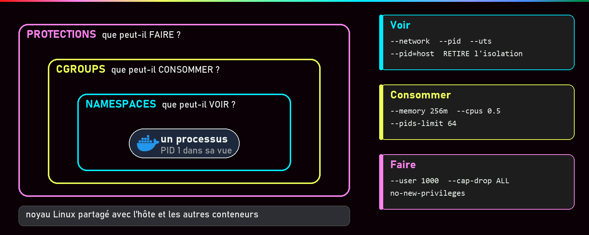
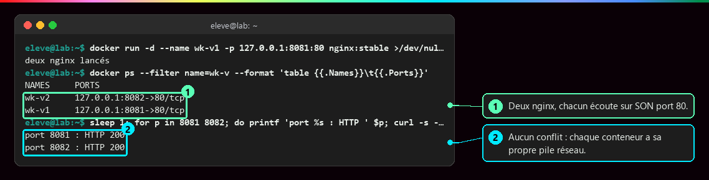
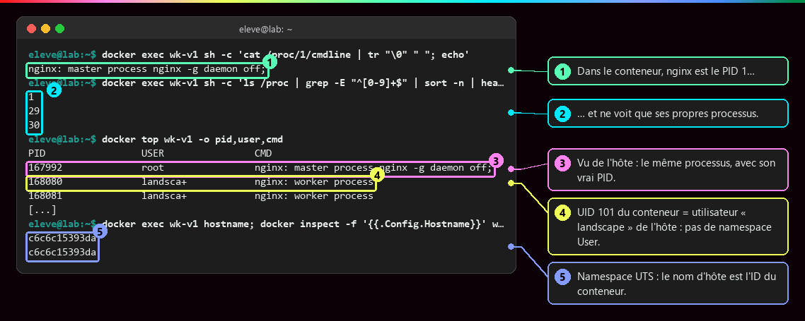
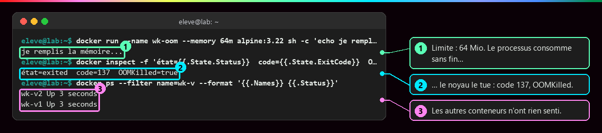
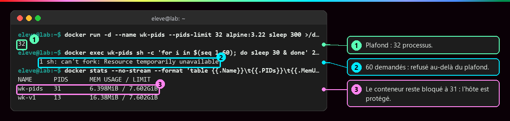
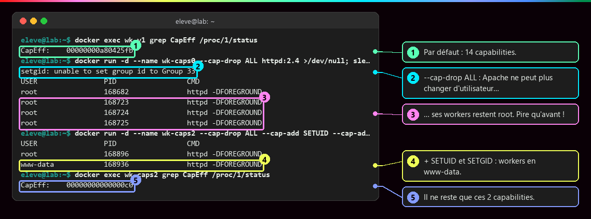

# Isolation d'un conteneur

<p class="lead">Un conteneur n'est pas une petite machine. C'est un <strong>programme ordinaire</strong> qui tourne sur l'ordinateur hôte, à qui le noyau Linux impose trois choses : une vue restreinte du système, un budget de ressources et une liste de droits.</p>

{ .hero }

!!! abstract "Dans cette page"

    **Tu vas comprendre :**

    - pourquoi un conteneur « se croit seul » sur la machine ;
    - comment on l'empêche de manger toute la mémoire ;
    - comment on limite ce qu'il a le droit de faire.

    **Prérequis :** [Machine virtuelle ou conteneur](Machine-virtuelle-ou-conteneur.md). **Durée :** 25 min. **Niveau :** débutant.

!!! quote "En clair"

    Imagine un **immeuble**. Chaque appartement (un conteneur) a ses murs et ses volets fermés : on ne voit pas chez le voisin. Chacun a son **compteur** d'eau et d'électricité avec un disjoncteur : s'il abuse, c'est chez lui que ça saute. Et chacun a un **badge** qui n'ouvre que certaines portes. Mais tout le monde partage les **mêmes fondations** : le noyau Linux.

    { .anim }

## L'essentiel en 30 secondes

<div class="grid cards" markdown>

-   :material-eye-outline:{ .lg .middle } __Voir · namespaces__

    ---

    Le conteneur ne voit que **ses** programmes, **son** réseau, **ses** fichiers. Il se croit seul : il est le PID 1.

-   :material-gauge:{ .lg .middle } __Consommer · cgroups__

    ---

    Mémoire, processeur, nombre de programmes : plafonnés. S'il dépasse, **lui seul** est arrêté.

-   :material-shield-key-outline:{ .lg .middle } __Faire · protections__

    ---

    On retire les droits d'administrateur dont il n'a pas besoin.

-   :material-alert-outline:{ .lg .middle } __Le piège · noyau partagé__

    ---

    Tous les conteneurs tournent sur **le même noyau** : une faille du noyau touche tout le monde.

</div>

!!! warning "À retenir"

    **Voir moins ≠ consommer moins ≠ pouvoir moins.** Ce sont trois réglages indépendants. Un conteneur bien caché peut quand même saturer la mémoire, ou tourner en administrateur (root). Il faut vérifier les trois.

## :material-eye-outline: Voir : les namespaces

!!! quote "En clair"

    Un namespace, ce sont des **œillères** : le noyau montre au conteneur une version filtrée du système. Les autres programmes existent toujours, il ne les voit simplement pas.

    { .anim }

Docker pose six œillères par défaut, une par type de ressource :

| Namespace | Ce qu'il cache | Ce qu'on observe |
|---|---|---|
| **PID** | les autres programmes | l'application porte le numéro 1 |
| **Network** | le réseau de l'hôte | deux conteneurs peuvent utiliser le même port 80 |
| **Mount** | les fichiers de l'hôte | chaque conteneur a sa propre racine `/` |
| **UTS** | le nom de la machine | `hostname` renvoie l'identifiant du conteneur |
| **IPC** | la mémoire partagée des autres | deux applis ne lisent pas la mémoire l'une de l'autre |
| **User** | les utilisateurs de l'hôte | **désactivé par défaut** : root dans le conteneur = root sur l'hôte |

???+ example "En vrai : deux serveurs web sur le même port 80"

    **Ce qu'on fait :** on lance deux serveurs web nginx. Chacun écoute sur le port 80 *dans son conteneur*. On les rend joignables depuis l'hôte sur deux ports différents, 8081 et 8082.

    

    **Ce qu'il faut regarder :** ① les deux conteneurs tournent en même temps ; ② les deux répondent « 200 », c'est-à-dire OK. Sur une machine classique, deux programmes ne peuvent pas écouter sur le même port. Ici, chaque conteneur a **son propre réseau**, donc aucun conflit.

???+ example "En vrai : un seul programme, deux points de vue"

    **Ce qu'on fait :** on regarde le même serveur nginx depuis l'intérieur du conteneur, puis depuis l'hôte.

    

    **Ce qu'il faut regarder :**

    - ① et ② : à l'intérieur, nginx est le programme n° 1 et ne voit que lui-même.
    - ③ : vu de l'hôte, c'est le même programme avec un tout autre numéro, 167992.
    - ④ : surprise, l'utilisateur interne du conteneur (numéro 101) porte le nom d'un **autre** utilisateur de l'hôte, parce que les numéros sont partagés. C'est l'œillère « User » qui manque.
    - ⑤ : le nom de machine est l'identifiant du conteneur.

## :material-gauge: Consommer : les cgroups

!!! quote "En clair"

    Un cgroup, c'est un **compteur avec un disjoncteur**. Le noyau compte ce que le conteneur consomme et coupe au-delà de la limite fixée.

    { .anim }

| Si le conteneur dépasse… | … il se passe | L'option à donner à `docker run` |
|---|---|---|
| la mémoire | il est **arrêté net** par le noyau (code de sortie 137) | `--memory 256m` |
| le processeur | il est **ralenti** | `--cpus 0.5` |
| le nombre de programmes | il ne peut plus en **lancer** de nouveaux | `--pids-limit 64` |

```bash
docker run -d --name app --memory 256m --cpus 0.5 --pids-limit 64 nginx:stable  # (1)!
```

1. `--memory 256m` : 256 Mo de mémoire au maximum. `--cpus 0.5` : la moitié d'un cœur de processeur. `--pids-limit 64` : 64 programmes au plus dans le conteneur.

???+ example "En vrai : une fuite de mémoire contenue"

    **Ce qu'on fait :** un conteneur limité à 64 Mo lance un programme qui remplit la mémoire sans jamais s'arrêter.

    

    **Ce qu'il faut regarder :** ② le noyau l'arrête (`OOMKilled=true`, code 137) ; ③ les deux autres conteneurs tournent toujours. Sans limite, c'est toute la machine qui aurait souffert.

???+ example "En vrai : trop de programmes d'un coup"

    **Ce qu'on fait :** dans un conteneur limité à 32 programmes, on essaie d'en lancer 60.

    

    **Ce qu'il faut regarder :** ② le système refuse (`can't fork`) ; ③ le conteneur reste bloqué juste sous le plafond. C'est exactement ce qu'on veut face à une boucle folle ou une attaque.

!!! tip "Le bon réflexe"

    Mesure d'abord avec `docker stats` ce que ton application consomme vraiment, puis fixe une limite **avec de la marge**. Une limite trop basse crée elle-même la panne.

## :material-shield-key-outline: Faire : les protections

!!! quote "En clair"

    Par défaut, le programme du conteneur tourne en **administrateur** (root). Plutôt que de lui donner le trousseau entier, on ne lui laisse que les **clés** dont il a besoin.

    { .anim }

| Protection | Ce qu'elle fait | Comment |
|---|---|---|
| Utilisateur | le programme n'est plus administrateur du tout | `USER` dans le Dockerfile, ou `--user` |
| Capabilities | on retire des pouvoirs précis à root (Docker en garde 14 sur une quarantaine) | `--cap-drop ALL --cap-add …` |
| no-new-privileges | interdit de redevenir administrateur en cours de route | `--security-opt no-new-privileges` |
| seccomp, AppArmor | filtrent les actions dangereuses demandées au noyau | actifs par défaut |

???+ danger "En vrai : le piège de « tout retirer »"

    **Ce qu'on fait :** on lance le serveur web Apache sans **aucune** capability, puis avec seulement les deux dont il a besoin pour changer d'utilisateur.

    

    **Ce qu'il faut regarder :**

    - ② et ③ : sans aucune capability, Apache démarre et répond… mais ne peut plus abandonner ses droits. Ses programmes restent **administrateurs** : la mesure de sécurité a aggravé la situation.
    - ④ et ⑤ : avec seulement `SETUID` et `SETGID`, ils passent sous l'utilisateur `www-data`, sans droits particuliers.

    **La leçon :** on retire tout, on regarde ce qui casse, et on remet **uniquement** ce qui est nécessaire. Puis on vérifie avec `docker top`.

## :material-flask-outline: À toi de jouer

!!! tip "Sans rien installer : le terminal ci-dessous"

    C'est une **machine Docker simulée**, rien que pour toi, directement dans la page. En mode **Guidé**, tu suis les étapes du lab (tape la commande ou clique sur « Insérer la commande »). En mode **Libre**, tu essaies ce que tu veux : tu ne peux rien casser. Les sorties reprennent le format du vrai Docker ; pour la vraie machine, refais le lab ci-dessous sur ton poste.

<div class="terminal-sim" data-lab="isolation"></div>

**Sur ton poste**, le même lab pas à pas :

Cinq étapes, environ 5 minutes. Tape les commandes une par une et compare avec ce que tu dois voir.

**Étape 1 · Lancer un conteneur avec des limites**

```bash
docker run -d --name demo --memory 128m --pids-limit 32 nginx:stable  # (1)!
docker ps --filter name=demo   # (2)!
```

1. `-d` : en arrière-plan. `--name demo` : on lui donne un nom facile à retenir. Les deux limites : 128 Mo de mémoire, 32 programmes.
2. Affiche les conteneurs en cours dont le nom contient « demo ».

Tu dois voir une ligne avec `demo`, `nginx:stable` et le statut `Up` :

```text
NAMES     IMAGE          STATUS
demo      nginx:stable   Up Less than a second
```

**Étape 2 · Vérifier qu'il se croit seul**

```bash
docker exec demo cat /proc/1/cmdline   # (1)!
docker exec demo hostname              # (2)!
```

1. `docker exec` lance une commande **dans** le conteneur. On lit le nom du programme n° 1.
2. Le nom de machine vu de l'intérieur.

Tu dois voir nginx en programme n° 1, puis un identifiant de 12 caractères (le tien sera différent) :

```text
nginx: master process nginx -g daemon off;
7cc3d572ed04
```

**Étape 3 · Lire les limites appliquées par le noyau**

```bash
docker exec demo cat /sys/fs/cgroup/memory.max /sys/fs/cgroup/pids.max
```

Tu dois voir 128 Mo exprimés en octets, puis 32 :

```text
134217728
32
```

**Étape 4 · Voir ses capabilities**

```bash
docker exec demo grep CapEff /proc/1/status
```

Tu dois voir le code des 14 capabilities par défaut :

```text
CapEff:	00000000a80425fb
```

**Étape 5 · Faire le ménage**

```bash
docker rm -f demo   # (1)!
```

1. `rm` supprime le conteneur, `-f` l'arrête d'abord s'il tourne encore.

??? tip "Ça ne marche pas ?"

    | Message | Cause | Solution |
    |---|---|---|
    | `Conflict. The container name "/demo" is already in use` | un conteneur `demo` existe déjà | `docker rm -f demo` puis recommence |
    | `No such container: demo` | le conteneur n'a pas démarré ou a été supprimé | relance l'étape 1, regarde `docker ps -a` |
    | `cat: can't open '/sys/fs/cgroup/memory.max'` | machine en cgroups v1 (ancien système) | le fichier s'appelle `/sys/fs/cgroup/memory/memory.limit_in_bytes` |

## :material-help-circle-outline: Vérifie que tu as compris

??? question "1. Un conteneur limité à 256 Mo dépasse sa mémoire. Que se passe-t-il pour les autres conteneurs ?"

    **Rien.** Seul le conteneur fautif est arrêté par le noyau (code 137, `OOMKilled`). C'est tout l'intérêt des cgroups.

??? question "2. Mon conteneur ne voit aucun autre programme. Est-il pour autant protégé contre l'épuisement de la mémoire ?"

    **Non.** Ne pas voir (namespaces) et ne pas consommer (cgroups) sont deux réglages différents. Sans `--memory`, il peut prendre toute la mémoire.

??? question "3. Pourquoi « retirer toutes les capabilities » peut-il rendre un service moins sûr ?"

    Parce que certains programmes, comme Apache, ont besoin de droits **pour abandonner** leurs droits : sans `SETUID` et `SETGID`, ils restent administrateurs. On vérifie toujours le résultat avec `docker top`.

!!! success "Et ensuite ?"

    Tu sais ce qu'est un conteneur vu de l'intérieur. Page suivante : [Image et cycle de vie](Image-et-cycle-de-vie.md), d'où vient un conteneur et ce qu'il devient quand on l'arrête.

## :material-server: Pour aller plus loin

??? note "Déboguer un conteneur sans rien installer dedans"

    On peut **rejoindre** les namespaces d'un conteneur avec une image d'outils :

    ```bash
    docker run --rm -it --pid container:app --network container:app nicolaka/netshoot
    ```

    C'est exactement le principe d'un **Pod** Kubernetes : plusieurs conteneurs qui partagent le même réseau.

??? note "VM ou conteneur : où est le noyau ?"

    ```mermaid
    flowchart TB
        subgraph VM["Machines virtuelles"]
            a1["App A"] --> k1["Noyau invité A"]
            a2["App B"] --> k2["Noyau invité B"]
            k1 --> hv["Hyperviseur"]
            k2 --> hv
        end
        subgraph CT["Conteneurs"]
            c1["App A"] --> kn["Noyau de l'hôte, partagé"]
            c2["App B"] --> kn
        end
    ```

??? abstract "Pour les créateurs : script de motion design (75 s)"

    Fond sombre, formes plates, une couleur par mécanisme (cyan namespaces, jaune cgroups, rose protections).

    | Séq. | Durée | À l'écran | Animation | Texte à l'écran |
    |---|---|---|---|---|
    | 1 | 0-6 s | Une dalle grise « noyau Linux » et six cercles « processus » | Les cercles apparaissent un par un | « Sur un serveur Linux, tout est processus. » |
    | 2 | 6-14 s | Les cercles se relient tous par des traits fins | Les traits se dessinent ; le cercle « app » clignote | « Sans isolation, chacun voit tout. » |
    | 3 | 14-26 s | Un anneau **cyan** se referme autour de « app » | Les traits vers l'extérieur se coupent ; son numéro passe de 4211 à **1** | « Namespaces : ce qu'il voit. Il se croit seul. » |
    | 4 | 26-32 s | L'anneau se découpe en 6 secteurs | Chaque secteur s'allume avec son nom | « Six vues séparées. » |
    | 5 | 32-44 s | Un anneau **jaune** et une jauge mémoire | La jauge touche « 256 Mio », l'app éclate seule, les autres continuent | « Cgroups : s'il dépasse, lui seul tombe. » |
    | 6 | 44-56 s | Un anneau **rose** ; une couronne « root » au-dessus de l'app | La couronne se fragmente en clés, deux restent ; un cadenas se ferme | « Protections : on ne garde que les clés nécessaires. » |
    | 7 | 56-66 s | Trois conteneurs sur **la même** dalle | Une fissure traverse la dalle sous les trois | « Le noyau reste partagé. » |
    | 8 | 66-75 s | Les trois anneaux alignés | Les trois questions s'écrivent | « Voir. Consommer. Faire. » |

    La séquence 5 est la plus parlante : faire tomber l'application **pendant que les autres processus continuent de pulser**.
