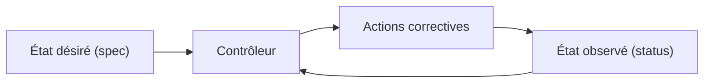
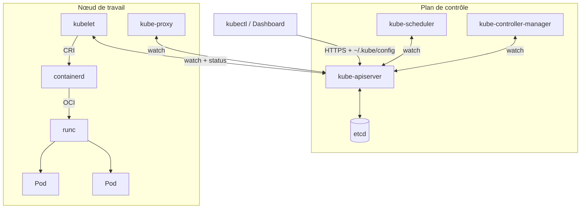
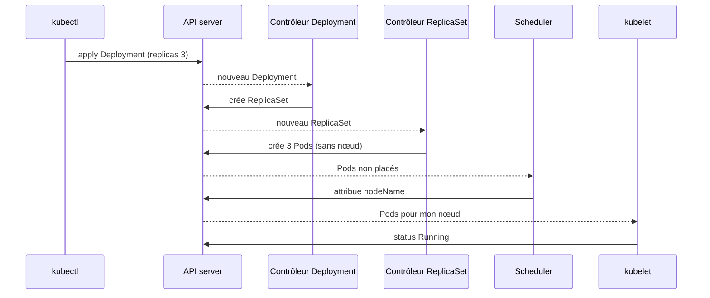

# Kubernetes : état désiré et réconciliation

> **En une phrase.** Avec Kubernetes, on ne donne pas d'ordres : on **déclare l'état voulu** dans l'API du cluster, et des **contrôleurs** comparent sans fin cet état désiré à ce qui tourne réellement, puis agissent pour réduire l'écart.

---

## 1. Synthèse

### Le modèle mental

```
   on écrit                    le cluster stocke              des contrôleurs agissent
 ┌──────────────┐  kubectl   ┌─────────────────────┐  watch   ┌────────────────────────┐
 │ web.yaml     │ ─────────► │ API server  ⇄  etcd │ ◄──────► │ « je veux 3 pods web,  │
 │ replicas: 3  │   apply    │ spec   = désiré     │          │   j'en vois 2 :        │
 └──────────────┘            │ status = observé    │          │   j'en crée 1 »        │
                             └─────────────────────┘          └────────────────────────┘
                                         ▲                               │
                                         └──── kubelet : exécute et ─────┘
                                               remonte ce qu'il observe
```

### Déclaratif ou impératif

| | Impératif | Déclaratif |
|---|---|---|
| On écrit | « exécute ces commandes dans cet ordre » | « voici l'état désiré du système » |
| On décrit | les **opérations** à effectuer | le **résultat** attendu |
| Exemple Kubernetes | `kubectl run`, `kubectl scale`, `kubectl delete` | `kubectl apply -f web.yaml` |
| Si une instance disparaît ensuite | rien ne se passe | le contrôleur la recrée |
| Source de vérité | l'historique du terminal | le fichier versionné (Git) |

On décrit **ce qu'on veut**, pas **comment le faire**. Le parallèle avec l'Infrastructure as Code est direct : Terraform ou Ansible décrivent l'infrastructure (VM, réseaux) ; Kubernetes décrit l'**état applicatif** au niveau service, ainsi que le réseau et le stockage associés.

### Spec et status : deux moitiés de chaque objet

Tout objet Kubernetes (Pod, Deployment, Service…) est un document stocké par l'API, avec deux parties :

| Partie | Écrite par | Contenu | Exemple |
|---|---|---|---|
| `spec` | l'utilisateur | l'**état désiré** | `replicas: 3`, `image: nginx:1.25` |
| `status` | les contrôleurs et le kubelet | l'**état observé** | `readyReplicas: 2`, `phase: Running` |

### La boucle de réconciliation



Un **contrôleur** est un programme qui surveille un type d'objet et tourne en boucle : **observer**, **comparer**, **agir**. Il ne cherche pas à rejouer une suite d'événements : il regarde l'écart **à l'instant présent**. C'est pour cela que l'**auto-guérison** (le remplacement automatique d'un pod disparu) n'est pas une fonction à part : c'est la conséquence normale de la boucle.

### L'architecture d'un cluster

Un **cluster** se compose d'un **plan de contrôle** (control plane), qui décide, et de **nœuds de travail** (workers), qui exécutent les pods.

| Composant | Où | Rôle | À retenir |
|---|---|---|---|
| **kube-apiserver** | plan de contrôle | porte d'entrée unique : authentifie, valide et enregistre chaque objet | **tout** passe par lui : kubectl, contrôleurs, kubelet |
| **etcd** | plan de contrôle | base clé-valeur qui contient **tout l'état** du cluster, Secrets compris | seul l'API server lui parle ; à sauvegarder et protéger |
| **kube-scheduler** | plan de contrôle | choisit un **nœud** pour chaque pod sans nœud attribué | il décide, il n'exécute rien |
| **kube-controller-manager** | plan de contrôle | fait tourner les contrôleurs : Deployment, ReplicaSet, Node, Job… | c'est lui qui réconcilie |
| **kubelet** | chaque nœud | agent qui fait tourner les pods attribués à son nœud et remonte leur état | il ne connaît que des **pods**, pas les Deployments |
| **kube-proxy** | chaque nœud | traduit les Services en règles réseau du nœud | voir [Service et Ingress](Service-et-Ingress.md) |
| **runtime de conteneurs** | chaque nœud | crée réellement les conteneurs (souvent **containerd**, qui délègue à **runc**) | le kubelet lui parle par la **CRI** |

Deux interfaces standard découplent Kubernetes de ses briques :

- **CRI** (Container Runtime Interface) : le contrat entre le kubelet et le runtime. containerd et CRI-O l'implémentent. Docker Engine n'est plus utilisé directement par le kubelet depuis Kubernetes 1.24.
- **CNI** (Container Network Interface) : le contrat avec le greffon réseau qui donne une IP à chaque pod (par exemple `kindnet` sous Minikube).

### kubectl et le fichier ~/.kube/config

**kubectl** est un simple **client de l'API** : il traduit les commandes en requêtes HTTPS vers l'API server. Pour savoir **quel** cluster joindre et **qui** il est, il lit le fichier `~/.kube/config` (ou les fichiers listés dans la variable `KUBECONFIG`).

| Section | Contenu |
|---|---|
| `clusters` | l'adresse de l'API server (`server:`) et le certificat d'autorité à vérifier |
| `users` | les identifiants : certificat client et clé, ou jeton |
| `contexts` | une association **cluster + utilisateur + namespace par défaut** |
| `current-context` | le contexte utilisé par toutes les commandes |

Un **namespace** est un cloisonnement logique à l'intérieur du cluster : il regroupe des objets et sert de périmètre aux quotas et aux droits (RBAC). Sans `-n`, kubectl travaille dans le namespace du contexte, en général `default`.

### Ce qu'il faut savoir faire

- Expliquer le principe déclaratif : décrire **ce qu'on veut**, pas **comment le faire**.
- Lire et écrire des manifestes YAML pour Pods, Deployments ([Pod, Deployment, ReplicaSet](Pod-Deployment-ReplicaSet.md)), Services et Ingress ([Service et Ingress](Service-et-Ingress.md)).
- Mettre à l'échelle et comprendre l'**auto-guérison**, c'est-à-dire le remplacement automatique des pods.

> [!IMPORTANT]
> **Les pièges à retenir**
> 1. **Supprimer un pod géré ne sert à rien** : le contrôleur le recrée. Pour arrêter une application, on modifie l'état désiré (supprimer le Deployment, ou `replicas: 0`).
> 2. **Le fichier fait foi, pas la commande.** Un `kubectl scale` ou `kubectl edit` fait à la main est écrasé au prochain `kubectl apply` du fichier. En équipe, on modifie le YAML versionné.
> 3. **`~/.kube/config` donne un accès complet au cluster.** Il se protège comme un mot de passe (droits `600`, jamais dans un dépôt Git).
> 4. **Vérifier le contexte avant d'agir.** La même commande `kubectl delete` part vers le cluster de test ou de production selon `current-context`.
> 5. **kubectl et le cluster doivent rester proches** : une version mineure d'écart au plus.

---

## 2. Cas d'usage classiques

### Cas 1 : démarrer un cluster local et reconnaître ses composants

```bash
minikube start --driver=docker
minikube status          # host, kubelet, apiserver, kubeconfig : Running / Configured
kubectl get nodes        # NAME minikube   STATUS Ready   ROLES control-plane
kubectl cluster-info     # Kubernetes control plane is running at https://127.0.0.1:32771
docker ps --filter name=minikube   # le nœud... est un conteneur Docker
```

**Ce qu'on observe.** Sur un poste de test (Minikube 1.39, Kubernetes 1.37), le nœud unique porte le rôle `control-plane` et exécute aussi les applications. Avec le driver Docker, ce nœud n'est pas une VM : c'est un conteneur `kicbase`. L'API server écoute sur le port 8443 du nœud, publié sur un port de l'hôte (ici 32771).
**À retenir.** Docker sert seulement à **héberger** le nœud. À l'intérieur, ce sont le kubelet et containerd qui exécutent les pods. Les couches sont détaillées dans [Virtualisation et orchestration](Virtualisation-et-orchestration.md).

### Cas 2 : lire ~/.kube/config et changer de contexte

```bash
kubectl config view --minify      # seulement le contexte courant (données embarquées masquées)
kubectl config get-contexts       # la liste ; une étoile marque le contexte actif
kubectl config use-context minikube
kubectl config set-context --current --namespace=demo   # namespace par défaut du contexte
```

Extrait typique généré par Minikube :

```yaml
apiVersion: v1
kind: Config
clusters:
- name: minikube
  cluster:
    server: https://127.0.0.1:32771
    certificate-authority: /home/etudiant/.minikube/ca.crt
users:
- name: minikube
  user:
    client-certificate: /home/etudiant/.minikube/profiles/minikube/client.crt
    client-key: /home/etudiant/.minikube/profiles/minikube/client.key
contexts:
- name: minikube
  context:
    cluster: minikube
    user: minikube
    namespace: default
current-context: minikube
```

**Ce qu'on observe.** Le fichier est la « carte d'accès » de kubectl : **où** (clusters), **qui** (users), **quelle combinaison** (contexts), **laquelle maintenant** (current-context). Minikube y référence des fichiers de certificat au lieu de les embarquer.
**À retenir.** `use-context` est la commande qui fait passer d'un cluster de test à un cluster de production : c'est puissant, donc dangereux.

### Cas 3 : constater que le plan de contrôle tourne lui-même en pods

```bash
kubectl get pods -n kube-system
# etcd-minikube, kube-apiserver-minikube, kube-scheduler-minikube,
# kube-controller-manager-minikube, coredns-..., kube-proxy-..., kindnet-...
minikube ssh -- ls /etc/kubernetes/manifests
# etcd.yaml  kube-apiserver.yaml  kube-controller-manager.yaml  kube-scheduler.yaml
```

**Ce qu'on observe.** Les composants du plan de contrôle sont des **pods statiques** : le kubelet les lance directement à partir des fichiers de `/etc/kubernetes/manifests`, sans passer par le scheduler. `kube-proxy` et `kindnet` sont des DaemonSets (un exemplaire par nœud).
**À retenir.** Sur un poste de test, l'inspection d'etcd montre qu'il n'accepte que des clients munis d'un certificat (`--client-cert-auth=true`) : c'est la base qui contient tout l'état du cluster, Secrets compris.

### Cas 4 : suivre la chaîne de décision d'une création

```bash
kubectl create deployment web --image=nginx:1.25 --replicas=2
kubectl get events --sort-by=.metadata.creationTimestamp
```

| Source de l'événement | Raison | Ce qui s'est passé |
|---|---|---|
| `deployment-controller` | `ScalingReplicaSet` | le Deployment demande un ReplicaSet à 2 réplicas |
| `replicaset-controller` | `SuccessfulCreate` | le ReplicaSet crée deux objets Pod (encore sans nœud) |
| `default-scheduler` | `Scheduled` | le scheduler attribue chaque pod au nœud `minikube` |
| `kubelet` | `Pulling` / `Pulled`, `Created`, `Started` | le kubelet fait télécharger l'image puis démarrer le conteneur |

**Ce qu'on observe.** Personne n'a « lancé un conteneur ». Chaque composant a réagi à un objet écrit par le précédent dans l'API. Quand l'image est déjà sur le nœud, le kubelet l'indique : `Container image "..." already present on machine`.
**À retenir.** `kubectl describe pod <nom>` affiche la même histoire, limitée à un pod : c'est le premier réflexe de diagnostic.

### Cas 5 : passer de l'impératif au déclaratif

```bash
kubectl create deployment web --image=nginx:1.25 --replicas=3 \
  --dry-run=client -o yaml > web.yaml     # génère le manifeste sans rien créer
kubectl apply -f web.yaml                 # déclare l'état désiré
sed -i 's/replicas: 3/replicas: 4/' web.yaml
kubectl diff -f web.yaml                  # montre l'écart entre le fichier et le cluster
kubectl apply -f web.yaml                 # le cluster converge vers 4
```

**Ce qu'on observe.** `kubectl diff` affiche `-  replicas: 3` / `+  replicas: 4` avant toute modification. `apply` est **idempotent** : le relancer sans changement ne fait rien.
**Le piège.** Après un `kubectl scale deployment web --replicas=10`, un nouvel `apply` du fichier ramène à 4. Le fichier versionné reste la référence.

### Cas 6 : voir la réconciliation à l'œuvre

```bash
kubectl get pods -l app=web -w &           # surveillance en continu
kubectl delete pod $(kubectl get pods -l app=web -o name | head -1)
# l'ancien pod passe Terminating, un nouveau apparaît : Pending, ContainerCreating, Running
kill %1
```

**Ce qu'on observe.** Le contrôleur de ReplicaSet voit 2 pods là où 3 sont désirés et en crée un nouveau, avec un autre nom et une autre IP. À l'inverse, un pod créé seul avec `kubectl run` n'a **aucun contrôleur** : supprimé, il n'est pas recréé (constaté sur un poste de test). Comparaison détaillée dans [Pod, Deployment, ReplicaSet](Pod-Deployment-ReplicaSet.md).
**À retenir.** L'auto-guérison n'existe que si un contrôleur porte l'état désiré.

### Cas 7 : descendre sous le kubelet, jusqu'au runtime

```bash
minikube ssh
sudo crictl ps                          # conteneurs avec nom, pod et namespace Kubernetes
sudo crictl pods                        # les pods vus par le runtime
sudo ctr namespace ls                   # k8s.io (Kubernetes) et moby (Docker interne)
sudo ctr -n k8s.io containers ls        # identifiants bruts, dont beaucoup d'images pause
exit
kubectl get pod <nom> -o jsonpath='{.status.containerStatuses[0].containerID}'   # containerd://...
```

**Ce qu'on observe.** `crictl` parle la **CRI**, comme le kubelet : il affiche les conteneurs avec le vocabulaire de Kubernetes. `ctr`, client bas niveau de containerd, voit tout mais sans contexte : sur un poste de test, il listait 79 conteneurs sans aucun nom de pod. Les namespaces de containerd n'ont rien à voir avec ceux de Kubernetes. L'identifiant `containerd://` montre qui exécute réellement le conteneur.
**À retenir.** Chaque niveau voit les mêmes conteneurs avec un vocabulaire différent : kubectl (objets), crictl (CRI), ctr (containerd), runc (processus Linux). Le magasin d'images du nœud est aussi distinct de celui de Docker sur l'hôte : d'où `minikube image load`, vu dans [Pod, Deployment, ReplicaSet](Pod-Deployment-ReplicaSet.md).

---

## 3. Idées de schémas

### Schéma A : l'architecture du cluster



Point à souligner visuellement : **toutes** les flèches convergent vers l'API server. Aucun composant ne parle directement à un autre, ni à etcd.

### Schéma B : la boucle de réconciliation, version thermostat

| Élément du schéma | Correspond à |
|---|---|
| La consigne affichée (21 °C) | l'état désiré, `spec.replicas: 3` |
| Le thermomètre | l'état observé, `status.readyReplicas` |
| Le thermostat | le contrôleur |
| La chaudière qui s'allume | l'action corrective : créer ou supprimer des pods |
| La fenêtre ouverte | une panne, un pod supprimé, un nœud perdu |

> Limite de la métaphore : un thermostat règle une valeur continue, alors qu'un contrôleur crée ou détruit des objets discrets. Et il y a **plusieurs** thermostats, un par type d'objet, qui s'enchaînent.

### Schéma C : la cascade d'une création



### Schéma D : l'anatomie de ~/.kube/config

Trois boîtes en colonne à gauche (`clusters`, `users`, `contexts`), une flèche de `current-context` qui pointe vers un contexte, et ce contexte relié par deux fils à un cluster et à un utilisateur. Un cadenas sur le fichier : « droits 600 ».

---

## 4. Script de motion design : « Le pod qui revenait toujours » (environ 75 s)

Style : fond sombre, l'API server en grand cercle central, les contrôleurs en petits robots autour, les pods en hexagones verts sur une bande « nœud » en bas.

| Séq. | Durée | À l'écran | Animation | Texte à l'écran |
|---|---|---|---|---|
| 1 | 0-8 s | Un fichier `web.yaml` avec la ligne `replicas: 3` surlignée | Le fichier glisse vers le cercle « API server » et y entre ; une petite base « etcd » s'allume à côté | « On ne lance rien : on déclare ce qu'on veut. » |
| 2 | 8-18 s | Un robot « contrôleur » regarde deux cadrans : « désiré 3 » et « observé 0 » | L'aiguille « observé » est à 0, le robot lève la main | « Un contrôleur compare l'état désiré à l'état observé. » |
| 3 | 18-28 s | Trois hexagones gris « Pod » apparaissent dans l'API, sans nœud | Un second robot « scheduler » les attrape un à un et les pose sur la bande « nœud » | « Le scheduler choisit où chaque pod va tourner. » |
| 4 | 28-36 s | La bande « nœud » avec son agent « kubelet » | Les hexagones passent du gris au vert ; le cadran « observé » monte à 3 | « Le kubelet les démarre et remonte ce qu'il voit. » |
| 5 | 36-44 s | Une main (curseur) clique sur un hexagone | L'hexagone se brise ; le cadran « observé » tombe à 2 et devient orange | « Supprimons un pod à la main. » |
| 6 | 44-56 s | Le robot contrôleur réagit immédiatement | Il lève la main ; un nouvel hexagone gris naît, est posé par le scheduler, devient vert ; nouveau nom affiché | « Écart détecté : un nouveau pod est créé. Autre nom, autre IP, même rôle. » |
| 7 | 56-66 s | Un hexagone isolé, étiqueté « kubectl run », sans robot associé | Le curseur le brise ; il ne revient pas ; un silence visuel d'une seconde | « Un pod sans contrôleur, lui, ne revient jamais. » |
| 8 | 66-75 s | Écran de synthèse : la boucle « observer → comparer → agir » en cercle | La boucle tourne en continu, de plus en plus vite | « Kubernetes ne répare pas : il réconcilie, en permanence. » |

**Conseil de réalisation.** La séquence 7 fait tout le sens : elle montre que l'auto-guérison vient du **contrôleur**, pas du pod. Garder les mêmes couleurs et formes qu'en séquence 5 pour que le contraste soit immédiat.

---

## 5. Vérifier soi-même

```bash
minikube start --driver=docker
kubectl config get-contexts                         # contexte actif : minikube
kubectl get pods -n kube-system                     # le plan de contrôle en pods
kubectl create deployment web --image=nginx:1.25 --replicas=3
kubectl get deployment web -o jsonpath='{.spec.replicas} désirés, {.status.readyReplicas} prêts{"\n"}'
kubectl delete pod $(kubectl get pods -l app=web -o name | head -1)
kubectl get pods -l app=web                          # toujours 3, dont un tout jeune
kubectl get events --sort-by=.metadata.creationTimestamp | tail -8
kubectl delete deployment web
```

## Voir aussi

- [Accueil du wiki](../README.md)
- Page précédente : [Pourquoi orchestrer ?](Pourquoi-orchestrer.md)
- Page suivante : [Pod, Deployment, ReplicaSet](Pod-Deployment-ReplicaSet.md)
