# Kubernetes : état désiré et réconciliation

<p class="lead">Avec Kubernetes, on ne donne pas d'ordres : on <strong>déclare l'état voulu</strong> dans l'API du cluster, et des <strong>contrôleurs</strong> comparent sans fin cet état désiré à ce qui tourne réellement, puis agissent pour réduire l'écart.</p>

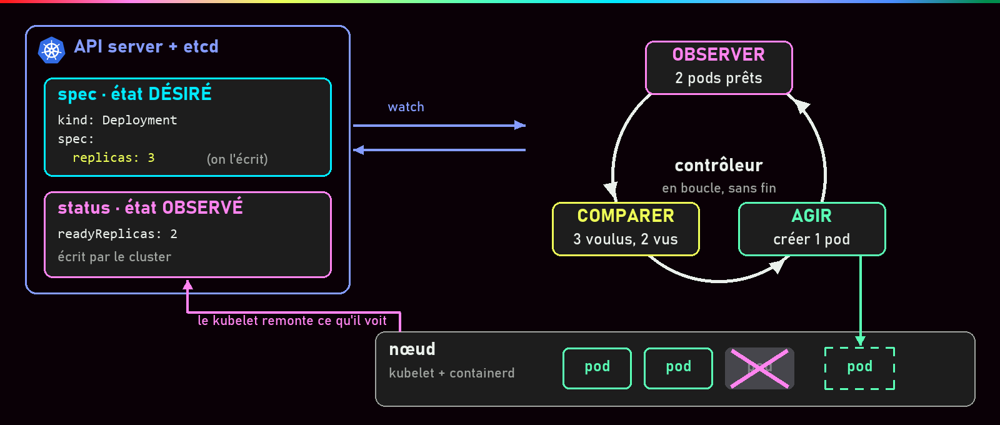{ .hero }

!!! abstract "Dans cette page"

    **Tu vas comprendre :**

    - pourquoi on écrit dans un fichier **ce qu'on veut**, et pas les commandes pour l'obtenir ;
    - comment Kubernetes recrée tout seul un conteneur qu'on a supprimé ;
    - qui fait quoi dans un cluster, et comment `kubectl` sait à quel cluster parler.

    Et tu installes ton propre cluster d'apprentissage, **Minikube**, dans le mini-lab.

    **Prérequis :** [Pourquoi orchestrer ?](Pourquoi-orchestrer.md). **Durée :** 45 min (installation comprise). **Niveau :** débutant.

!!! quote "En clair"

    Tu règles un **thermostat** sur 21 °C. Tu ne dis pas à la chaudière quand s'allumer : le thermostat mesure, compare à la consigne, et allume ou éteint. Kubernetes fait pareil avec tes applications : tu écris « je veux 3 copies », et des programmes comptent sans arrêt et corrigent. Limite de l'image : un thermostat règle une valeur continue, alors que Kubernetes crée ou supprime des objets, et il a **un « thermostat » par type d'objet**.

    { .anim }

## L'essentiel en 30 secondes

<div class="grid cards" markdown>

-   :material-file-document-edit-outline:{ .lg .middle } __Déclarer__

    ---

    On décrit le **résultat** (`replicas: 3`), pas les opérations. Le fichier, gardé dans Git, fait foi.

-   :material-sync:{ .lg .middle } __Réconcilier__

    ---

    Observer, comparer, agir, en boucle. L'**auto-guérison** n'est que la conséquence de cette boucle.

-   :material-api:{ .lg .middle } __Tout passe par l'API__

    ---

    kubectl, contrôleurs, kubelet : tous parlent à l'**API server**, jamais directement entre eux.

-   :material-key-variant:{ .lg .middle } __~/.kube/config__

    ---

    Où est le cluster, qui je suis, lequel j'utilise. Il donne un **accès complet** : à protéger comme un mot de passe.

</div>

!!! warning "À retenir"

    **Supprimer un pod géré ne sert à rien** : Kubernetes le recrée. Pour arrêter une application, on change l'état désiré (supprimer le Deployment, ou `replicas: 0`). Et **le fichier fait foi** : un changement fait à la main avec `kubectl scale` ou `kubectl edit` est écrasé au prochain `kubectl apply` du fichier.

## :material-file-compare: Déclarer plutôt qu'ordonner

!!! quote "En clair"

    Au restaurant, tu ne dis pas au cuisinier « allume le feu, prends une poêle, casse deux œufs ». Tu commandes **une omelette**. Le fichier Kubernetes, c'est ta commande : il décrit le plat, pas la recette.

    { .anim }

Dans Kubernetes, tout ce qu'on crée est un **objet** : une fiche enregistrée dans le cluster. On décrit un objet dans un **manifeste**, un fichier YAML. Chaque objet a deux moitiés :

- `spec` (pour *spécification*) : l'**état désiré**, écrit par toi. Exemple : `replicas: 3`.
- `status` : l'**état observé**, écrit par Kubernetes lui-même. Exemple : `readyReplicas: 2`.

| | Impératif | Déclaratif |
|---|---|---|
| On écrit | « exécute ces commandes dans cet ordre » | « voici l'état désiré du système » |
| Exemple | `kubectl run`, `kubectl scale`, `kubectl delete` | `kubectl apply -f web.yaml` |
| Si une instance disparaît ensuite | rien ne se passe | elle est recréée |
| Source de vérité | l'historique du terminal | le fichier, gardé dans Git |

???+ example "En vrai : on déclare, le cluster converge"

    **Ce qu'on fait :** on envoie au cluster un fichier qui dit « je veux 2 copies de l'application web », puis on suit ce qu'il fait.

    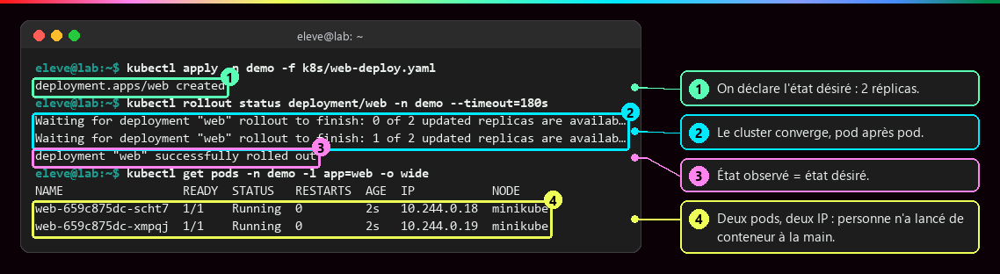

    **Ce qu'il faut regarder :** ① `apply` enregistre l'état désiré (`created`) : à ce moment, rien ne tourne encore. ② le cluster rapproche la réalité de la demande, une copie après l'autre (0 sur 2, puis 1 sur 2). ③ `successfully rolled out` : l'état observé égale l'état désiré. ④ deux pods, chacun avec sa propre adresse IP, alors que personne n'a lancé de conteneur à la main.

    `apply` est **idempotent** : le relancer sans rien changer ne fait rien. Et `kubectl diff -f web.yaml` montre l'écart avant de modifier quoi que ce soit.

???+ example "En vrai : les deux moitiés, côté Dashboard"

    **Ce qu'on fait :** dans le Dashboard (l'interface web de Kubernetes), on ouvre la fenêtre qui change le nombre de copies d'une application.

    

    **Ce qu'il faut regarder :** à gauche, **Desired replicas** (2) : le désiré, la `spec`, que tu modifies. À droite, grisé, **Actual replicas** (1) : l'actuel, le `status`, que le cluster rapporte. Attention : ce bouton est une action **impérative**, comme `kubectl scale`. Elle sera écrasée au prochain `apply` du fichier.

C'est le même esprit que l'Infrastructure as Code : Terraform ou Ansible décrivent l'infrastructure (machines virtuelles, réseaux) ; Kubernetes décrit l'**état de l'application**, avec le réseau et le stockage associés.

## :material-sync: La boucle de réconciliation

!!! quote "En clair"

    Un contrôleur, c'est un **surveillant de piscine** qui compte les nageurs toutes les minutes. Il ne se souvient pas de qui est sorti ni quand : il compte, compare au nombre attendu, et agit. C'est pour ça qu'il répare n'importe quelle panne, même imprévue.

    { .anim }

Un **contrôleur** est un programme qui surveille un type d'objet et tourne en boucle : **observer**, **comparer**, **agir**. Il ne rejoue pas une suite d'événements : il regarde l'écart **à l'instant présent**. C'est pourquoi l'auto-guérison n'est pas une fonction à part : elle sort toute seule de cette boucle.

???+ example "En vrai : un pod supprimé revient"

    **Ce qu'on fait :** on supprime à la main le pod `db` d'une application qui en demande un, puis on attend.

    

    **Ce qu'il faut regarder :** ① l'état désiré est « 1 pod db », et il tourne. ② on le supprime à la main… ③ et le déploiement est de nouveau complet aussitôt : le contrôleur a vu 0 pod là où 1 est désiré, et en a créé un nouveau, avec un autre nom et une autre IP. À l'inverse, un pod créé seul avec `kubectl run` n'a **aucun contrôleur** : supprimé, il n'est pas recréé (voir [Pod, Deployment, ReplicaSet](Pod-Deployment-ReplicaSet.md)).

???+ example "En vrai : la chaîne de décision, dans les événements"

    **Ce qu'on fait :** on demande un redémarrage propre de `db`, puis on lit le **journal des événements** du cluster (`kubectl get events`), où chaque composant note ce qu'il fait.

    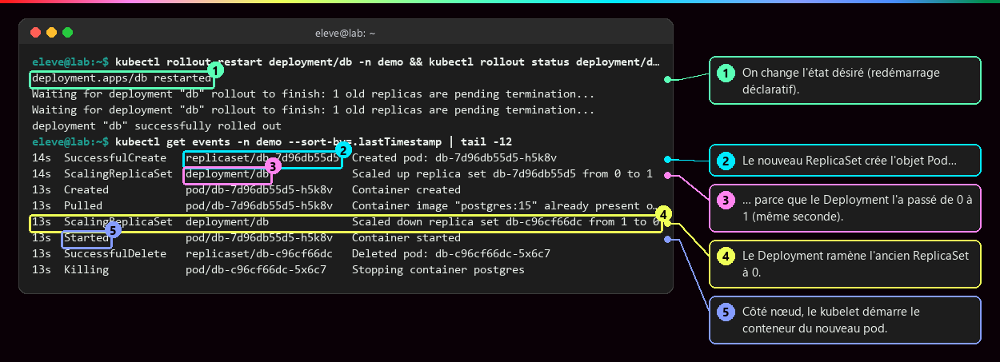

    **Ce qu'il faut regarder :**

    - ① on change l'état désiré (`restarted`).
    - ② le nouveau ReplicaSet crée l'objet Pod…
    - ③ … parce que le Deployment l'a fait passer de 0 à 1, dans la même seconde.
    - ④ le Deployment ramène l'ancien ReplicaSet à 0.
    - ⑤ sur la machine, le kubelet démarre le conteneur du nouveau pod.

    Chaque composant réagit à un objet écrit par le précédent. `kubectl describe pod <nom>` raconte la même histoire pour un seul pod, avec en plus l'événement `Scheduled` du scheduler : c'est le **premier réflexe de diagnostic**.

Le même enchaînement, dessiné (Deployment et ReplicaSet sont expliqués à la [page suivante](Pod-Deployment-ReplicaSet.md)) :

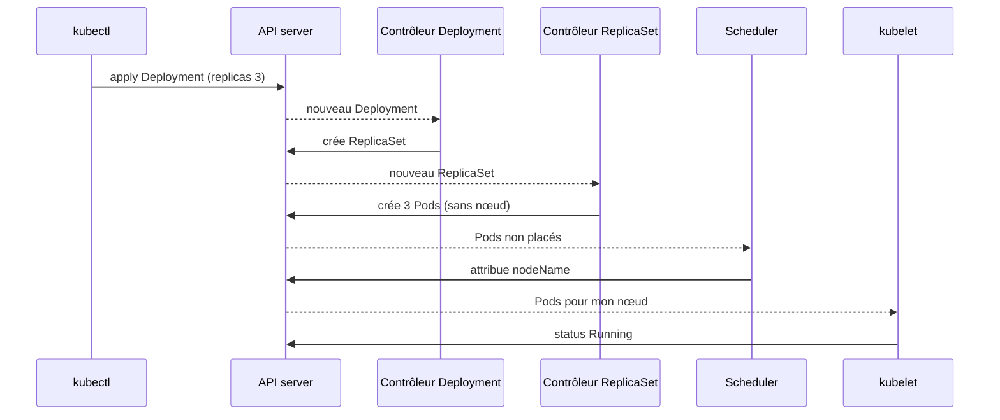

## :material-sitemap: L'architecture d'un cluster

!!! quote "En clair"

    Imagine une entreprise. La **direction** (le plan de contrôle) décide ; les **ateliers** (les nœuds) fabriquent. Personne ne se parle directement : chacun dépose et lit des fiches au **secrétariat** (l'API server), qui les range dans une **armoire** unique (etcd).

    { .anim }

Un **plan de contrôle** (control plane) décide ; des **nœuds de travail** (workers, les machines qui exécutent) font tourner les pods. **Tout** passe par l'API server : aucun composant ne parle directement à un autre, ni à etcd.

| Composant | Où | Rôle |
|---|---|---|
| **kube-apiserver** | plan de contrôle | porte d'entrée unique : vérifie qui tu es, valide et enregistre chaque objet |
| **etcd** | plan de contrôle | base de données de **tout l'état** du cluster, Secrets compris ; seul l'API server lui parle |
| **kube-scheduler** | plan de contrôle | choisit un **nœud** pour chaque pod qui n'en a pas ; il décide, il n'exécute rien |
| **kube-controller-manager** | plan de contrôle | fait tourner les contrôleurs (Deployment, ReplicaSet, Node, Job…) : c'est lui qui réconcilie |
| **kubelet** | chaque nœud | fait tourner les pods de son nœud et remonte leur état ; il ne connaît que des **pods** |
| **kube-proxy** | chaque nœud | traduit les Services en règles réseau (voir [Service et Ingress](Service-et-Ingress.md)) |
| **runtime** | chaque nœud | crée les conteneurs : souvent **containerd**, qui délègue à **runc** |

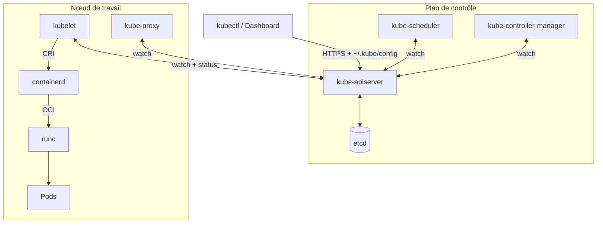

???+ example "En vrai : un cluster Minikube"

    **Ce qu'on fait :** sur un cluster Minikube (un cluster complet sur un seul poste, pour apprendre), on demande son état, la liste des nœuds, l'adresse de l'API server, puis on regarde ce que Docker voit.

    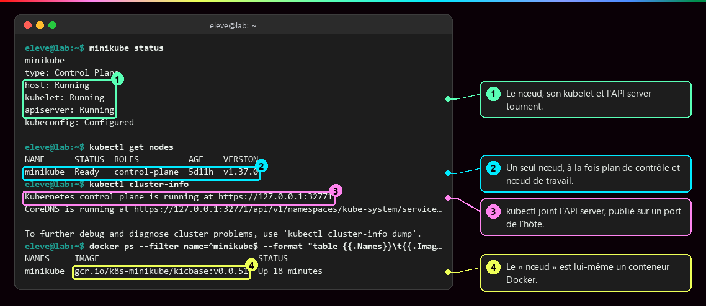

    **Ce qu'il faut regarder :** ① le nœud, son kubelet et l'API server tournent (`Running`). ② un seul nœud, `minikube`, qui est à la fois plan de contrôle et nœud de travail. ③ kubectl joint l'API server à une adresse `https://127.0.0.1:…` de ta machine. ④ surprise : le « nœud » est lui-même un **conteneur Docker** (image `kicbase`). Docker sert seulement à l'**héberger**. Les couches sont détaillées dans [Virtualisation et orchestration](Virtualisation-et-orchestration.md).

???+ example "En vrai : le plan de contrôle tourne lui-même en pods"

    **Ce qu'on fait :** on liste ce qui tourne dans `kube-system`, l'espace réservé aux composants internes du cluster.

    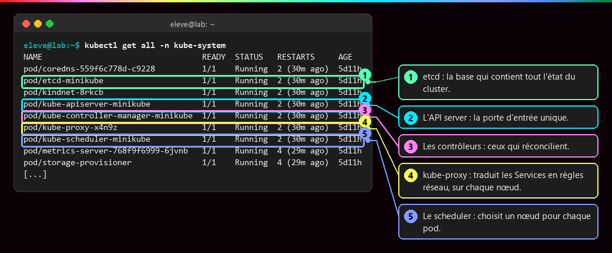

    **Ce qu'il faut regarder :** on retrouve, sous forme de pods, chaque ligne du tableau ci-dessus : ① etcd, la base qui contient tout l'état ; ② l'API server, la porte d'entrée ; ③ le controller-manager, qui réconcilie ; ④ kube-proxy, présent sur chaque nœud ; ⑤ le scheduler, qui place les pods. Kubernetes se fait tourner lui-même.

    Pour les curieux : ce sont des **pods statiques**, lancés par le kubelet directement depuis `/etc/kubernetes/manifests`, sans passer par le scheduler. `kube-proxy` et `kindnet` sont des DaemonSets (un exemplaire par nœud). etcd n'accepte que des clients munis d'un certificat (`--client-cert-auth=true`).

## :material-key-variant: kubectl et ~/.kube/config

!!! quote "En clair"

    `~/.kube/config`, c'est ton **trousseau de badges**. Chaque badge (un **contexte**) associe un bâtiment (un cluster) et ton identité (un utilisateur). `current-context`, c'est le badge que tu tiens en main : toutes tes commandes ouvrent les portes de **ce** bâtiment-là.

    { .anim }

**kubectl** est un simple **client de l'API** : il envoie des requêtes HTTPS à l'API server. Pour savoir quel cluster joindre et qui il est, il lit le fichier `~/.kube/config` (le `~` désigne ton dossier personnel).

| Section | Contenu |
|---|---|
| `clusters` | l'adresse de l'API server (`server:`) et le certificat qui prouve que c'est bien lui |
| `users` | tes identifiants : certificat et clé, ou jeton |
| `contexts` | une association **cluster + utilisateur + namespace par défaut** |
| `current-context` | le contexte utilisé par toutes les commandes |

Un **namespace Kubernetes** est un **dossier logique** dans le cluster : il range les objets d'une équipe ou d'un projet, avec ses quotas et ses droits. Il n'a rien à voir avec les namespaces Linux d'[Isolation d'un conteneur](Isolation-des-conteneurs.md), malgré le même nom.

???+ example "En vrai : le fichier généré par Minikube"

    **Ce qu'on fait :** on regarde les droits du fichier, son contenu, puis la liste des contextes.

    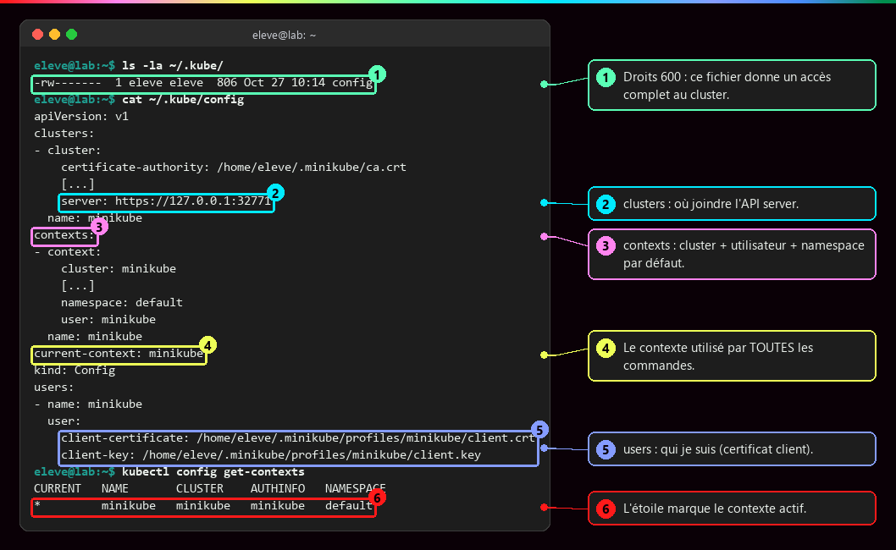

    **Ce qu'il faut regarder :**

    - ① droits `600` (`-rw-------`) : toi seul peux lire ce fichier, et c'est voulu, car il donne un accès complet au cluster.
    - ② `clusters` : où joindre l'API server.
    - ③ `contexts` : cluster + utilisateur + namespace par défaut.
    - ④ `current-context` : le contexte utilisé par **toutes** les commandes.
    - ⑤ `users` : qui tu es, prouvé par un certificat.
    - ⑥ l'étoile marque le contexte actif ; sans `-n`, kubectl travaille dans son namespace, ici `default`.

???+ danger "Vérifier le contexte avant d'agir"

    `kubectl config use-context` fait passer d'un cluster de test à un cluster de production : la même commande `kubectl delete` part vers l'un ou l'autre selon `current-context`. Le fichier se protège comme un mot de passe (droits `600`, jamais dans un dépôt Git), et kubectl doit rester proche du cluster : **une version mineure d'écart au plus** (un kubectl 1.37 pilote un cluster 1.36, 1.37 ou 1.38).

## :material-flask-outline: À toi de jouer

Six étapes, environ 20 minutes la première fois (le premier démarrage télécharge environ 1 Go). Tu vas installer un cluster sur ton poste, lui déclarer une application, la casser et la regarder se réparer.

Il te faut Docker qui fonctionne ([Bien démarrer](Bien-demarrer.md)), au moins 2 cœurs de processeur, 2 Go de mémoire libre et 20 Go de disque. Sous Windows, tape tout dans le terminal **Ubuntu** (WSL), comme pour Docker.

**Étape 1 · Installer kubectl et Minikube**

=== "Linux et WSL"

    ```bash
    curl -LO "https://dl.k8s.io/release/$(curl -L -s https://dl.k8s.io/release/stable.txt)/bin/linux/amd64/kubectl"  # (1)!
    sudo install -o root -g root -m 0755 kubectl /usr/local/bin/kubectl && rm kubectl   # (2)!
    curl -LO https://github.com/kubernetes/minikube/releases/latest/download/minikube-linux-amd64   # (3)!
    sudo install minikube-linux-amd64 /usr/local/bin/minikube && rm minikube-linux-amd64   # (4)!
    ```

    1. Télécharge la dernière version stable de **kubectl** pour Linux sur processeur x86-64 (`amd64`). Le `$(…)` intérieur va d'abord lire le numéro de cette version.
    2. `install` copie le fichier dans `/usr/local/bin`, un dossier où le terminal cherche les commandes, et le rend exécutable (`-m 0755`). `sudo` : il faut les droits d'administrateur. `rm` supprime ensuite le fichier téléchargé.
    3. Télécharge la dernière version de **Minikube**.
    4. Même chose : copie dans `/usr/local/bin` sous le nom `minikube`, puis supprime le téléchargement.

    Ce sont les commandes de la documentation officielle de [kubectl](https://kubernetes.io/docs/tasks/tools/install-kubectl-linux/) et de [Minikube](https://minikube.sigs.k8s.io/docs/start/). Sur un processeur ARM, remplace `amd64` par `arm64`.

=== "macOS"

    ```bash
    brew install kubectl minikube   # (1)!
    ```

    1. Installe les deux outils avec [Homebrew](https://brew.sh), le gestionnaire de paquets de macOS.

Vérifie ensuite que les deux outils répondent :

```bash
kubectl version --client   # (1)!
minikube version
```

1. `--client` : affiche seulement la version de kubectl lui-même, sans chercher de cluster (tu n'en as pas encore).

Tu dois voir deux numéros de version (les tiens seront sans doute plus récents) :

```text
Client Version: v1.37.1
Kustomize Version: v5.8.1
minikube version: v1.39.0
commit: 7a9f6a841470a207de8cf4bafcccee0969d8ba10
```

**Étape 2 · Démarrer le cluster et vérifier où tu es**

```bash
minikube start --driver=docker   # (1)!
minikube status                  # (2)!
kubectl get nodes                # (3)!
kubectl config get-contexts      # (4)!
```

1. Crée et démarre un cluster d'un seul nœud. `--driver=docker` : ce nœud est un conteneur Docker. N'utilise **pas** `sudo`. Compte quelques minutes la première fois.
2. Vérifie que le nœud, son kubelet et l'API server tournent.
3. Ta première vraie commande Kubernetes : la liste des nœuds du cluster.
4. Affiche tes contextes ; l'étoile marque celui que kubectl utilise.

Tu dois voir, à la fin de `minikube start` (dans ton terminal, les lignes commencent par de petites icônes) :

```text
* Done! kubectl is now configured to use "minikube" cluster and "default" namespace by default
```

puis trois `Running`, un nœud `Ready`, et le contexte `minikube` étoilé (ton `AGE` et ta `VERSION` seront différents) :

```text
minikube
type: Control Plane
host: Running
kubelet: Running
apiserver: Running
kubeconfig: Configured

NAME       STATUS   ROLES           AGE     VERSION
minikube   Ready    control-plane   5d11h   v1.37.0
CURRENT   NAME       CLUSTER    AUTHINFO   NAMESPACE
*         minikube   minikube   minikube   default
```

**Étape 3 · Déclarer l'état désiré**

D'abord un namespace `demo`, ton dossier de travail, pour tout ranger au même endroit :

```bash
kubectl create namespace demo   # (1)!
```

1. Crée le namespace `demo`. À la fin, le supprimer effacera tout ce qu'il contient.

Ensuite, crée le fichier `web.yaml` avec un éditeur de texte : tape `nano web.yaml`, colle le contenu ci-dessous, enregistre avec ++ctrl+o++ puis ++enter++, et quitte avec ++ctrl+x++. En YAML, **l'indentation compte** : deux espaces par niveau, jamais de tabulation.

```yaml
apiVersion: apps/v1        # (1)!
kind: Deployment           # (2)!
metadata:                  # (3)!
  name: web
spec:                      # (4)!
  replicas: 2              # (5)!
  selector:                # (6)!
    matchLabels:
      app: web
  template:                # (7)!
    metadata:
      labels:
        app: web           # (8)!
    spec:                  # (9)!
      containers:
        - name: web        # (10)!
          image: nginx:1.27   # (11)!
          ports:
            - containerPort: 80   # (12)!
```

1. `apiVersion` : la famille et la version de l'API qui gère ce type d'objet. Les Deployments sont dans `apps/v1`.
2. `kind` : le type d'objet. Un **Deployment** gère un groupe de pods identiques (détaillé à la [page suivante](Pod-Deployment-ReplicaSet.md)).
3. `metadata` : la carte d'identité de l'objet. Ici, son nom : `web`.
4. `spec` : **l'état désiré**, la partie que tu écris. Tu n'écris jamais `status` : c'est Kubernetes qui le remplit.
5. `replicas` : le nombre de copies voulues. C'est la consigne du thermostat.
6. `selector` : comment le Deployment **reconnaît ses pods** : tous ceux qui portent l'étiquette `app: web`.
7. `template` : le **modèle** de pod, le moule à partir duquel chaque copie est fabriquée.
8. Les étiquettes (labels) posées sur chaque pod. Elles doivent correspondre au `selector`, sinon Kubernetes refuse le fichier.
9. Le `spec` du pod : ce qu'il contient.
10. La liste des conteneurs du pod ; le tiret ouvre un élément de liste. Ici un seul, nommé `web`.
11. L'image à lancer, avec un tag précis (jamais `latest` en production).
12. Le port sur lequel le conteneur écoute. C'est une **information** : cela ne publie rien vers l'extérieur.

Puis envoie le fichier au cluster et suis le résultat :

```bash
kubectl apply -n demo -f web.yaml                 # (1)!
kubectl rollout status deployment/web -n demo     # (2)!
kubectl get pods -n demo -l app=web -o wide       # (3)!
```

1. `apply` : enregistre l'état désiré décrit dans le fichier (`-f`), dans le namespace `demo` (`-n`).
2. Attend et raconte la progression jusqu'à ce que les 2 copies soient prêtes.
3. Liste les pods qui portent l'étiquette `app=web` (`-l`), avec leur IP et leur nœud (`-o wide`).

Tu dois voir le namespace et le Deployment créés, la progression, puis deux pods `Running` (leurs noms, leur âge et leurs IP seront différents chez toi, et la ligne « 0 of 2 » peut manquer si tout va vite) :

```text
namespace/demo created
deployment.apps/web created
Waiting for deployment "web" rollout to finish: 0 of 2 updated replicas are available...
Waiting for deployment "web" rollout to finish: 1 of 2 updated replicas are available...
deployment "web" successfully rolled out
NAME                  READY   STATUS    RESTARTS   AGE   IP            NODE       NOMINATED NODE   READINESS GATES
web-659c875dc-scht7   1/1     Running   0          2s    10.244.0.18   minikube   <none>           <none>
web-659c875dc-xmpqj   1/1     Running   0          2s    10.244.0.19   minikube   <none>           <none>
```

**Étape 4 · Supprimer les pods et regarder le cluster réparer**

```bash
kubectl delete pod -n demo -l app=web --wait=true && kubectl rollout status deployment/web -n demo   # (1)!
kubectl get pods -n demo -l app=web   # (2)!
```

1. Supprime **tous** les pods étiquetés `app=web` et attend qu'ils aient disparu (`--wait=true`). `&&` : si la suppression réussit, enchaîne sur le suivi du déploiement.
2. Liste à nouveau les pods.

Tu dois voir une ligne `pod "web-…" deleted from demo namespace` **par pod supprimé**, puis `deployment "web" successfully rolled out`. Voici la sortie réelle de la même manipulation sur un Deployment `db` à un seul pod :

```text
pod "db-7d96db55d5-h5k8v" deleted from demo namespace
deployment "db" successfully rolled out
```

Ensuite, `kubectl get pods` montre de nouveau **deux** pods `Running`, avec des **noms nouveaux** et un `AGE` de quelques secondes : ce ne sont pas les anciens qui reviennent, ce sont des remplaçants.

**Étape 5 · Changer d'avis : modifier le fichier, pas le cluster**

```bash
sed -i 's/replicas: 2/replicas: 3/' web.yaml   # (1)!
kubectl diff -n demo -f web.yaml               # (2)!
kubectl apply -n demo -f web.yaml              # (3)!
kubectl get deployment web -n demo             # (4)!
```

1. `sed -i` remplace `replicas: 2` par `replicas: 3` directement dans le fichier. Tu peux aussi le faire avec `nano`.
2. `diff` montre ce qui **changerait** dans le cluster, sans rien modifier.
3. Applique la nouvelle déclaration.
4. Affiche l'état du Deployment.

Tu dois voir dans le `diff` une ligne `-  replicas: 2` (ce qui disparaît) et une ligne `+  replicas: 3` (ce qui arrive), ainsi que le champ `generation`, un compteur que Kubernetes augmente à chaque changement de la `spec`. `apply` répond ensuite `deployment.apps/web configured` (et non plus `created`). Au bout de quelques secondes, `kubectl get deployment` affiche `READY 3/3`.

**Étape 6 · Faire le ménage**

```bash
kubectl delete namespace demo   # (1)!
rm web.yaml
minikube stop                   # (2)!
```

1. Supprime le namespace `demo` et **tout** ce qu'il contient : Deployment, pods. Cela peut prendre quelques secondes.
2. Arrête le cluster sans l'effacer : tu le relanceras avec `minikube start` à la page suivante. `minikube delete` l'effacerait complètement.

Tu dois voir `namespace "demo" deleted`, puis Minikube qui annonce l'arrêt de son nœud. `kubectl get nodes` ne répond plus tant que le cluster est arrêté : c'est normal.

??? tip "Ça ne marche pas ?"

    | Message | Cause | Solution |
    |---|---|---|
    | `kubectl: command not found` | kubectl n'est pas installé, ou pas dans `/usr/local/bin` | refais l'étape 1 et vérifie avec `ls /usr/local/bin` |
    | `DRV_AS_ROOT` dans la sortie de `minikube start` | Minikube lancé avec `sudo` ou en root | relance sans `sudo`, avec ton utilisateur du groupe `docker` |
    | `PROVIDER_DOCKER_NOT_RUNNING` | Docker n'est pas démarré | `sudo systemctl start docker`, puis `minikube start` |
    | `The connection to the server localhost:8080 was refused` | kubectl ne trouve aucun cluster : Minikube arrêté ou jamais démarré | `minikube start` |
    | `version difference between client … and server … exceeds the supported minor version skew` | kubectl et le cluster ont plus d'une version d'écart | utilise `minikube kubectl -- get pods`, qui fournit un kubectl à la bonne version |
    | `namespaces "demo" already exists` | le namespace existe déjà | continue, ou `kubectl delete namespace demo` puis recommence |
    | `error converting YAML to JSON` | erreur d'indentation dans `web.yaml` (une tabulation, un espace en trop) | recopie le fichier en respectant deux espaces par niveau |
    | pods en `ErrImagePull` ou `ImagePullBackOff` | nom d'image mal écrit, ou pas d'accès Internet | vérifie la ligne `image:`, corrige, puis `kubectl apply` |
    | pods en `Pending` | le nœud manque de mémoire ou de processeur | `kubectl describe pod -n demo <nom>` et lis la partie `Events` en bas |

## :material-help-circle-outline: Vérifie que tu as compris

??? question "1. Un Deployment demande 3 copies. Tu supprimes un de ses pods à la main. Combien en vois-tu une minute plus tard, et pourquoi ?"

    **Trois.** Le contrôleur compare sans arrêt l'état désiré (3) à l'état observé (2). Il voit l'écart et crée un nouveau pod, avec un nouveau nom et une nouvelle IP. Pour vraiment réduire le nombre de pods, il faut changer la déclaration (`replicas`), pas supprimer des pods.

??? question "2. Tu tapes `kubectl scale deployment/web --replicas=5`. Le lendemain, un collègue relance `kubectl apply -f web.yaml`, qui contient `replicas: 3`. Combien de pods tournent ?"

    **Trois.** Le `scale` a changé l'état désiré directement dans le cluster, mais le fichier, lui, dit toujours 3. Au prochain `apply`, c'est le fichier qui gagne. C'est le sens de « le fichier fait foi » : un changement durable se fait **dans le fichier**, gardé dans Git.

??? question "3. Le scheduler démarre-t-il les conteneurs ?"

    **Non.** Il choisit seulement un **nœud** pour chaque pod qui n'en a pas, et l'écrit dans l'API. C'est le **kubelet** de ce nœud qui voit passer le pod, et qui demande au runtime (containerd) de créer les conteneurs. Chacun son rôle, et tous passent par l'API server.

!!! success "Et ensuite ?"

    Tu as un cluster sur ton poste, et tu as vu Kubernetes réparer tout seul ce que tu avais cassé. Page suivante : [Pod, Deployment, ReplicaSet](Pod-Deployment-ReplicaSet.md), qui ouvre la boîte : qui compte les pods, et comment on change de version sans coupure.

## :material-server: Pour aller plus loin

??? note "Sous le kubelet, le runtime : CRI, CNI, containerd"

    Deux interfaces standard découplent Kubernetes de ses briques : la **CRI** (Container Runtime Interface), entre le kubelet et le runtime (containerd, CRI-O ; Docker Engine n'est plus utilisé directement depuis Kubernetes 1.24), et la **CNI** (Container Network Interface), le greffon qui donne une IP à chaque pod (`kindnet` sous Minikube).

    **Ce qu'on fait :** on entre dans le nœud Minikube (`minikube ssh`) et on regarde les mêmes conteneurs avec deux outils : `ctr`, l'outil brut de containerd, et `crictl`, qui parle la CRI comme le kubelet.

    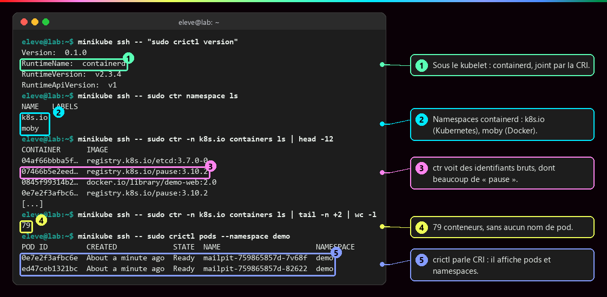

    **Ce qu'il faut regarder :**

    - ① sous le kubelet, le runtime est containerd, joint par la CRI.
    - ② containerd range ses conteneurs dans ses propres namespaces : `k8s.io` pour Kubernetes, `moby` pour Docker. Encore un troisième sens du mot « namespace » !
    - ③ `ctr` ne voit que des identifiants bruts, dont beaucoup de conteneurs `pause` (un par pod, il porte le réseau du pod).
    - ④ 79 conteneurs, sans aucun nom de pod.
    - ⑤ `crictl`, lui, parle CRI : il affiche des pods et des namespaces Kubernetes.

    Chaque niveau voit les mêmes conteneurs avec son vocabulaire : kubectl (objets), crictl (CRI, comme le kubelet), ctr (containerd brut), runc (processus Linux). Et le magasin d'images du nœud est distinct de celui de Docker sur ta machine.

??? note "Générer un manifeste au lieu de l'écrire"

    kubectl peut écrire un premier jet de manifeste à ta place, sans rien créer dans le cluster :

    ```bash
    kubectl create deployment web --image=nginx:1.27 --replicas=2 --dry-run=client -o yaml > web.yaml
    ```

    `--dry-run=client` : ne rien envoyer au cluster. `-o yaml` : afficher l'objet en YAML. Le fichier obtenu contient quelques champs vides (`creationTimestamp: null`, `resources: {}`, `status: {}`) que l'on peut retirer.

??? note "Ce qu'il faut savoir faire à la fin de la partie orchestration"

    - Expliquer le principe déclaratif : décrire **ce qu'on veut**, pas **comment le faire**.
    - Lire et écrire des manifestes YAML pour Pods, Deployments ([Pod, Deployment, ReplicaSet](Pod-Deployment-ReplicaSet.md)), Services et Ingress ([Service et Ingress](Service-et-Ingress.md)).
    - Mettre à l'échelle et comprendre l'**auto-guérison**, c'est-à-dire le remplacement automatique des pods.

??? abstract "Pour les créateurs : script de motion design « Le pod qui revenait toujours » (75 s)"

    Fond sombre, l'API server en grand cercle central, les contrôleurs en petits robots autour, les pods en hexagones verts sur une bande « nœud » en bas.

    | Séq. | Durée | À l'écran | Animation | Texte à l'écran |
    |---|---|---|---|---|
    | 1 | 0-8 s | Un fichier `web.yaml` avec la ligne `replicas: 3` surlignée | Le fichier glisse vers le cercle « API server » et y entre ; une petite base « etcd » s'allume à côté | « On ne lance rien : on déclare ce qu'on veut. » |
    | 2 | 8-18 s | Un robot « contrôleur » regarde deux cadrans : « désiré 3 » et « observé 0 » | L'aiguille « observé » est à 0, le robot lève la main | « Un contrôleur compare l'état désiré à l'état observé. » |
    | 3 | 18-28 s | Trois hexagones gris « Pod » apparaissent dans l'API, sans nœud | Un second robot « scheduler » les attrape un à un et les pose sur la bande « nœud » | « Le scheduler choisit où chaque pod va tourner. » |
    | 4 | 28-36 s | La bande « nœud » avec son agent « kubelet » | Les hexagones passent du gris au vert ; le cadran « observé » monte à 3 | « Le kubelet les démarre et remonte ce qu'il voit. » |
    | 5 | 36-44 s | Une main (curseur) clique sur un hexagone | L'hexagone se brise ; le cadran « observé » tombe à 2 et devient orange | « Supprimons un pod à la main. » |
    | 6 | 44-56 s | Le robot contrôleur réagit immédiatement | Il lève la main ; un nouvel hexagone gris naît, est posé par le scheduler, devient vert ; nouveau nom affiché | « Écart détecté : un nouveau pod est créé. Autre nom, autre IP, même rôle. » |
    | 7 | 56-66 s | Un hexagone isolé, étiqueté « kubectl run », sans robot associé | Le curseur le brise ; il ne revient pas ; un silence visuel d'une seconde | « Un pod sans contrôleur, lui, ne revient jamais. » |
    | 8 | 66-75 s | Écran de synthèse : la boucle « observer → comparer → agir » en cercle | La boucle tourne en continu, de plus en plus vite | « Kubernetes ne répare pas : il réconcilie, en permanence. » |

    La séquence 7 fait tout le sens : elle montre que l'auto-guérison vient du **contrôleur**, pas du pod. Garder les mêmes couleurs et formes qu'en séquence 5 pour que le contraste soit immédiat.

??? info "Pour les créateurs : la métaphore du thermostat et l'anatomie de ~/.kube/config"

    | Élément du schéma | Correspond à |
    |---|---|
    | La consigne affichée (21 °C) | l'état désiré, `spec.replicas: 3` |
    | Le thermomètre | l'état observé, `status.readyReplicas` |
    | Le thermostat | le contrôleur |
    | La chaudière qui s'allume | l'action corrective : créer ou supprimer des pods |
    | La fenêtre ouverte | une panne, un pod supprimé, un nœud perdu |

    Limite de la métaphore : un thermostat règle une valeur continue, alors qu'un contrôleur crée ou détruit des objets discrets. Et il y a **plusieurs** thermostats, un par type d'objet, qui s'enchaînent.

    Anatomie de `~/.kube/config` : trois boîtes en colonne (`clusters`, `users`, `contexts`), une flèche de `current-context` vers un contexte, ce contexte relié par deux fils à un cluster et à un utilisateur, et un cadenas « droits 600 » sur le fichier.
