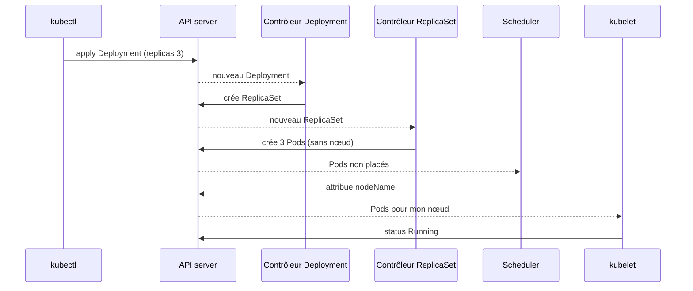
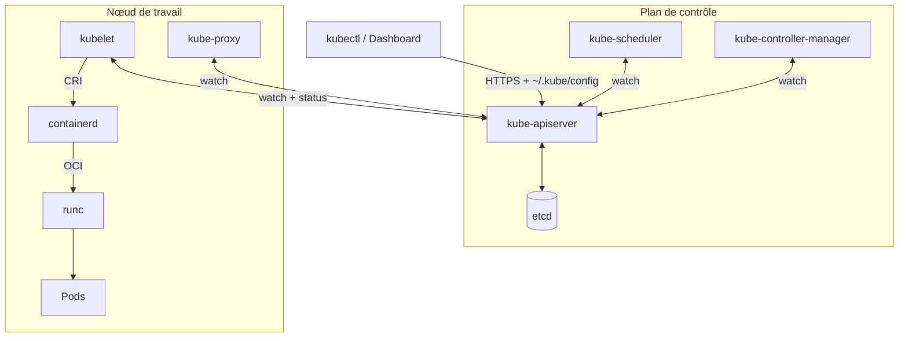

# Kubernetes : état désiré et réconciliation

<p class="lead">Avec Kubernetes, on ne donne pas d'ordres : on <strong>déclare l'état voulu</strong> dans l'API du cluster, et des <strong>contrôleurs</strong> comparent sans fin cet état désiré à ce qui tourne réellement, puis agissent pour réduire l'écart.</p>

{ .hero }

## L'essentiel en 30 secondes

<div class="grid cards" markdown>

-   :material-file-document-edit-outline:{ .lg .middle } __Déclarer__

    ---

    On décrit le **résultat** (`replicas: 3`), pas les opérations. Le fichier versionné fait foi.

-   :material-sync:{ .lg .middle } __Réconcilier__

    ---

    Observer, comparer, agir, en boucle. L'**auto-guérison** n'est que la conséquence de cette boucle.

-   :material-api:{ .lg .middle } __Tout passe par l'API__

    ---

    kubectl, contrôleurs, kubelet : tous parlent à l'**API server**, jamais directement entre eux ni à etcd.

-   :material-key-variant:{ .lg .middle } __~/.kube/config__

    ---

    Où est le cluster, qui je suis, quel contexte. Il donne un **accès complet** : à protéger comme un mot de passe.

</div>

!!! warning "À retenir"

    **Supprimer un pod géré ne sert à rien** : le contrôleur le recrée. Pour arrêter une application, on change l'état désiré (supprimer le Deployment, ou `replicas: 0`). Et **le fichier fait foi** : un `kubectl scale` ou `kubectl edit` fait à la main est écrasé au prochain `kubectl apply`.

## :material-file-compare: Déclarer plutôt qu'ordonner

Tout objet Kubernetes est un document stocké par l'API, en deux moitiés : `spec`, l'**état désiré**, écrit par l'utilisateur (`replicas: 3`), et `status`, l'**état observé**, écrit par les contrôleurs et le kubelet (`readyReplicas: 2`).

| | Impératif | Déclaratif |
|---|---|---|
| On écrit | « exécute ces commandes dans cet ordre » | « voici l'état désiré du système » |
| Exemple | `kubectl run`, `kubectl scale`, `kubectl delete` | `kubectl apply -f web.yaml` |
| Si une instance disparaît ensuite | rien ne se passe | le contrôleur la recrée |
| Source de vérité | l'historique du terminal | le fichier versionné (Git) |

???+ example "En vrai : on déclare, le cluster converge"

    

    Personne n'a lancé de conteneur : `apply` a écrit un objet dans l'API, et le cluster a convergé vers lui. `apply` est **idempotent** : le relancer sans changement ne fait rien, et `kubectl diff -f web.yaml` montre l'écart avant toute modification.

???+ example "En vrai : les deux moitiés, côté Dashboard"

    

    Le Dashboard affiche côte à côte le **désiré** (que l'on modifie) et l'**actuel** (que le cluster rapporte). Cette action équivaut à un `kubectl scale` : impérative, elle sera écrasée au prochain `apply` du fichier.

C'est le même esprit que l'Infrastructure as Code : Terraform ou Ansible décrivent l'infrastructure (VM, réseaux) ; Kubernetes décrit l'**état applicatif**, au niveau du service, avec le réseau et le stockage associés.

## :material-sync: La boucle de réconciliation

Un **contrôleur** surveille un type d'objet et tourne en boucle : **observer**, **comparer**, **agir**. Il ne rejoue pas une suite d'événements, il regarde l'écart **à l'instant présent** ; c'est pourquoi l'auto-guérison n'est pas une fonction à part.

???+ example "En vrai : un pod supprimé revient"

    

    Le contrôleur de ReplicaSet voit 0 pod là où 1 est désiré et en crée un nouveau, avec un autre nom et une autre IP. À l'inverse, un pod créé seul avec `kubectl run` n'a **aucun contrôleur** : supprimé, il n'est pas recréé (voir [Pod, Deployment, ReplicaSet](Pod-Deployment-ReplicaSet.md)).

???+ example "En vrai : la chaîne de décision, dans les événements"

    

    Chaque composant réagit à un objet écrit par le précédent dans l'API. `kubectl describe pod <nom>` raconte la même histoire limitée à un pod, avec en plus l'événement `Scheduled` du scheduler : c'est le premier réflexe de diagnostic.



## :material-sitemap: L'architecture d'un cluster

Un **plan de contrôle** (control plane) décide ; des **nœuds de travail** (workers) exécutent les pods. **Tout** passe par l'API server : aucun composant ne parle directement à un autre, ni à etcd.

| Composant | Où | Rôle |
|---|---|---|
| **kube-apiserver** | plan de contrôle | porte d'entrée unique : authentifie, valide et enregistre chaque objet |
| **etcd** | plan de contrôle | base clé-valeur de **tout l'état** du cluster, Secrets compris ; seul l'API server lui parle |
| **kube-scheduler** | plan de contrôle | choisit un **nœud** pour chaque pod sans nœud ; il décide, il n'exécute rien |
| **kube-controller-manager** | plan de contrôle | fait tourner les contrôleurs (Deployment, ReplicaSet, Node, Job…) : c'est lui qui réconcilie |
| **kubelet** | chaque nœud | fait tourner les pods de son nœud et remonte leur état ; il ne connaît que des **pods** |
| **kube-proxy** | chaque nœud | traduit les Services en règles réseau (voir [Service et Ingress](Service-et-Ingress.md)) |
| **runtime** | chaque nœud | crée les conteneurs : souvent **containerd**, qui délègue à **runc** |

Deux interfaces découplent Kubernetes de ses briques : la **CRI** (Container Runtime Interface), entre le kubelet et le runtime (containerd, CRI-O ; Docker Engine n'est plus utilisé directement depuis Kubernetes 1.24), et la **CNI** (Container Network Interface), le greffon qui donne une IP à chaque pod (`kindnet` sous Minikube).



???+ example "En vrai : un cluster Minikube"

    

    Le nœud unique porte le rôle `control-plane` et exécute aussi les applications. Avec le driver Docker, ce nœud n'est pas une VM mais un conteneur `kicbase` : Docker sert seulement à l'**héberger**. Les couches sont détaillées dans [Virtualisation et orchestration](Virtualisation-et-orchestration.md).

???+ example "En vrai : le plan de contrôle tourne lui-même en pods"

    

    Ce sont des **pods statiques** : le kubelet les lance directement depuis `/etc/kubernetes/manifests`, sans passer par le scheduler. `kube-proxy` et `kindnet` sont des DaemonSets (un exemplaire par nœud). etcd n'accepte que des clients munis d'un certificat (`--client-cert-auth=true`).

???+ example "En vrai : sous le kubelet, le runtime"

    

    Chaque niveau voit les mêmes conteneurs avec son vocabulaire : kubectl (objets), crictl (CRI, comme le kubelet), ctr (containerd brut, d'où les nombreux conteneurs `pause`), runc (processus Linux). Les namespaces de containerd n'ont rien à voir avec ceux de Kubernetes, et le magasin d'images du nœud est distinct de celui de Docker sur l'hôte.

## :material-key-variant: kubectl et ~/.kube/config

**kubectl** est un simple **client de l'API** : il envoie des requêtes HTTPS à l'API server. Pour savoir quel cluster joindre et qui il est, il lit `~/.kube/config` (ou les fichiers listés dans `KUBECONFIG`).

| Section | Contenu |
|---|---|
| `clusters` | l'adresse de l'API server (`server:`) et le certificat d'autorité à vérifier |
| `users` | les identifiants : certificat client et clé, ou jeton |
| `contexts` | une association **cluster + utilisateur + namespace par défaut** |
| `current-context` | le contexte utilisé par toutes les commandes |

???+ example "En vrai : le fichier généré par Minikube"

    

    Minikube y **référence** des fichiers de certificat au lieu de les embarquer. Un **namespace** est un cloisonnement logique (quotas, droits RBAC) : sans `-n`, kubectl travaille dans celui du contexte, ici `default`.

???+ danger "Vérifier le contexte avant d'agir"

    `kubectl config use-context` fait passer d'un cluster de test à un cluster de production : la même commande `kubectl delete` part vers l'un ou l'autre selon `current-context`. Le fichier se protège comme un mot de passe (droits `600`, jamais dans un dépôt Git), et kubectl doit rester proche du cluster : **une version mineure d'écart au plus**.

## :material-flask-outline: À toi de jouer

```bash
minikube start --driver=docker
kubectl config get-contexts                         # contexte actif : minikube
kubectl get pods -n kube-system                     # le plan de contrôle en pods
kubectl create deployment web --image=nginx:1.25 --replicas=3 --dry-run=client -o yaml > web.yaml
kubectl apply -f web.yaml                           # déclarer l'état désiré
kubectl get deployment web -o jsonpath='{.spec.replicas} désirés, {.status.readyReplicas} prêts{"\n"}'
kubectl delete pod $(kubectl get pods -l app=web -o name | head -1)
kubectl get pods -l app=web                         # toujours 3, dont un tout jeune
sed -i 's/replicas: 3/replicas: 4/' web.yaml && kubectl diff -f web.yaml   # l'écart avant d'agir
kubectl get events --sort-by=.metadata.creationTimestamp | tail -8
kubectl delete -f web.yaml
```

??? note "Ce qu'il faut savoir faire"

    - Expliquer le principe déclaratif : décrire **ce qu'on veut**, pas **comment le faire**.
    - Lire et écrire des manifestes YAML pour Pods, Deployments ([Pod, Deployment, ReplicaSet](Pod-Deployment-ReplicaSet.md)), Services et Ingress ([Service et Ingress](Service-et-Ingress.md)).
    - Mettre à l'échelle et comprendre l'**auto-guérison**, c'est-à-dire le remplacement automatique des pods.

??? abstract "Pour les créateurs : script de motion design « Le pod qui revenait toujours » (75 s)"

    Fond sombre, l'API server en grand cercle central, les contrôleurs en petits robots autour, les pods en hexagones verts sur une bande « nœud » en bas.

    | Séq. | Durée | À l'écran | Animation | Texte à l'écran |
    |---|---|---|---|---|
    | 1 | 0-8 s | Un fichier `web.yaml` avec la ligne `replicas: 3` surlignée | Le fichier glisse vers le cercle « API server » et y entre ; une petite base « etcd » s'allume à côté | « On ne lance rien : on déclare ce qu'on veut. » |
    | 2 | 8-18 s | Un robot « contrôleur » regarde deux cadrans : « désiré 3 » et « observé 0 » | L'aiguille « observé » est à 0, le robot lève la main | « Un contrôleur compare l'état désiré à l'état observé. » |
    | 3 | 18-28 s | Trois hexagones gris « Pod » apparaissent dans l'API, sans nœud | Un second robot « scheduler » les attrape un à un et les pose sur la bande « nœud » | « Le scheduler choisit où chaque pod va tourner. » |
    | 4 | 28-36 s | La bande « nœud » avec son agent « kubelet » | Les hexagones passent du gris au vert ; le cadran « observé » monte à 3 | « Le kubelet les démarre et remonte ce qu'il voit. » |
    | 5 | 36-44 s | Une main (curseur) clique sur un hexagone | L'hexagone se brise ; le cadran « observé » tombe à 2 et devient orange | « Supprimons un pod à la main. » |
    | 6 | 44-56 s | Le robot contrôleur réagit immédiatement | Il lève la main ; un nouvel hexagone gris naît, est posé par le scheduler, devient vert ; nouveau nom affiché | « Écart détecté : un nouveau pod est créé. Autre nom, autre IP, même rôle. » |
    | 7 | 56-66 s | Un hexagone isolé, étiqueté « kubectl run », sans robot associé | Le curseur le brise ; il ne revient pas ; un silence visuel d'une seconde | « Un pod sans contrôleur, lui, ne revient jamais. » |
    | 8 | 66-75 s | Écran de synthèse : la boucle « observer → comparer → agir » en cercle | La boucle tourne en continu, de plus en plus vite | « Kubernetes ne répare pas : il réconcilie, en permanence. » |

    La séquence 7 fait tout le sens : elle montre que l'auto-guérison vient du **contrôleur**, pas du pod. Garder les mêmes couleurs et formes qu'en séquence 5 pour que le contraste soit immédiat.

??? info "Pour les créateurs : la métaphore du thermostat et l'anatomie de ~/.kube/config"

    | Élément du schéma | Correspond à |
    |---|---|
    | La consigne affichée (21 °C) | l'état désiré, `spec.replicas: 3` |
    | Le thermomètre | l'état observé, `status.readyReplicas` |
    | Le thermostat | le contrôleur |
    | La chaudière qui s'allume | l'action corrective : créer ou supprimer des pods |
    | La fenêtre ouverte | une panne, un pod supprimé, un nœud perdu |

    Limite de la métaphore : un thermostat règle une valeur continue, alors qu'un contrôleur crée ou détruit des objets discrets. Et il y a **plusieurs** thermostats, un par type d'objet, qui s'enchaînent.

    Anatomie de `~/.kube/config` : trois boîtes en colonne (`clusters`, `users`, `contexts`), une flèche de `current-context` vers un contexte, ce contexte relié par deux fils à un cluster et à un utilisateur, et un cadenas « droits 600 » sur le fichier.
