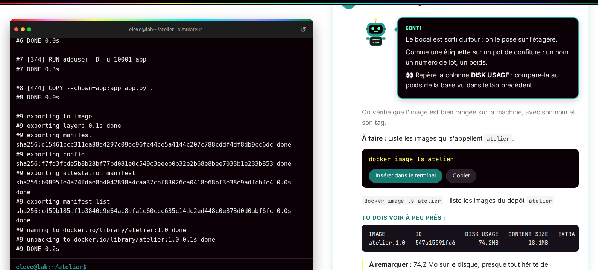

# Labs interactifs

{ .hero }

**22 labs, 334 étapes, rien à installer.** Chaque lab ouvre une machine simulée dans ton navigateur : un vrai terminal à gauche (Docker, Compose, Minikube et kubectl), le tutoriel pas à pas à droite. Avant chaque commande, **Conti**, le robot du lab, t'explique en deux phrases ce qu'on va faire et ce qu'il faut regarder ; chaque option est détaillée, tu vois la sortie que tu dois obtenir, et l'étape se valide toute seule quand ta commande est la bonne.

!!! tip "Comment ça marche"

    - Clique sur **Insérer dans le terminal**, puis appuie sur **Entrée**. Tu peux aussi taper toi-même, ou essayer autre chose : tape `help` pour la liste de ce qui est simulé.
    - Les sorties attendues viennent de **vraies exécutions** enregistrées ; le simulateur reproduit leur format, avec des identifiants et des durées qui changent à chaque fois, comme en vrai.
    - Le temps s'écoule comme sur une vraie machine : `sleep 25`, l'arrêt d'un conteneur ou l'attente d'un healthcheck prennent du temps (un peu raccourci à l'écran).
    - Tu gagnes des points d'XP à chaque étape (bonus sans indice) et un badge à la fin. Le bouton ↺ remet la machine à zéro.

## Premiers pas

-   :material-rocket-launch-outline:{ .lg .middle } __Premiers pas avec Docker__

    ---

    Ton tout premier contact avec Docker, sans rien installer.

    :material-timer-outline: 10 min · 7 étapes · :material-medal-outline: Premier capitaine Docker

    [:material-console: Ouvrir le lab](labs/premiers-pas.md){ target="_blank" rel="noopener" }

## Comprendre les conteneurs

-   :material-cube-outline:{ .lg .middle } __La boutique en services__

    ---

    Tu vas monter une mini-boutique à deux services : un serveur Apache dans le rôle du **paiement**, un serveur nginx dans le rôle du **catalogue**, sur un réseau commun où ils se trouvent par leur nom.

    :material-timer-outline: 10 min · 10 étapes · :material-medal-outline: Architecte de la boutique

    [:material-console: Ouvrir le lab](labs/microservices.md){ target="_blank" rel="noopener" }

-   :material-cube-outline:{ .lg .middle } __Un noyau pour tous__

    ---

    Tu vas vérifier par toi-même qu'un conteneur ne démarre aucun noyau : il emprunte celui de ton ordinateur.

    :material-timer-outline: 10 min · 10 étapes · :material-medal-outline: Chasseur de noyau

    [:material-console: Ouvrir le lab](labs/vm-conteneur.md){ target="_blank" rel="noopener" }

-   :material-cube-outline:{ .lg .middle } __Isolation d'un conteneur__

    ---

    Tu vas lancer un serveur web dans un conteneur, puis vérifier par toi-même les trois protections du cours : ce qu'il **voit** (namespaces), ce qu'il peut **consommer** (cgroups) et ce qu'il a le **droit de faire** (capabilities).

    :material-timer-outline: 15 min · 10 étapes · :material-medal-outline: Gardien de l'isolation

    [:material-console: Ouvrir le lab](labs/isolation.md){ target="_blank" rel="noopener" }

-   :material-cube-outline:{ .lg .middle } __La vie d'un conteneur__

    ---

    Tu vas faire vivre un conteneur nommé `cycle` de sa naissance à sa disparition : le créer, le démarrer, y écrire un fichier, l'arrêter, le supprimer, et regarder à chaque fois ce que devient ce fichier.

    :material-timer-outline: 10 min · 17 étapes · :material-medal-outline: Biographe des conteneurs

    [:material-console: Ouvrir le lab](labs/cycle-de-vie.md){ target="_blank" rel="noopener" }

## Construire des images

-   :material-layers-outline:{ .lg .middle } __Les couches d'une image__

    ---

    Tu vas ouvrir une vraie image, `python:3.12-alpine`, pour voir de quoi elle est faite : ses **couches**, sa **fiche de réglages**, son **tag** et son **digest**.

    :material-timer-outline: 10 min · 12 étapes · :material-medal-outline: Archéologue des couches

    [:material-console: Ouvrir le lab](labs/couches.md){ target="_blank" rel="noopener" }

-   :material-layers-outline:{ .lg .middle } __Écrire un Dockerfile__

    ---

    Tu vas écrire ta première recette d'image : un petit serveur web Python, construit sous le nom `atelier:1.0`, lancé, interrogé, puis comparé à une variante sans ligne `USER`.

    :material-timer-outline: 15 min · 17 étapes · :material-medal-outline: Chef de la recette Docker

    [:material-console: Ouvrir le lab](labs/dockerfile.md){ target="_blank" rel="noopener" }

-   :material-layers-outline:{ .lg .middle } __Contexte de build et cache__

    ---

    Tu vas préparer un tout petit site avec un fichier de 50 Mo caché dans `public/`, le filtrer avec `.dockerignore`, puis regarder le cache du constructeur réutiliser ou refaire une étape.

    :material-timer-outline: 10 min · 17 étapes · :material-medal-outline: Maître du cache

    [:material-console: Ouvrir le lab](labs/contexte-build.md){ target="_blank" rel="noopener" }

-   :material-layers-outline:{ .lg .middle } __Versionner et publier une image__

    ---

    Tu repars de l'image `atelier:1.0` (déjà prête dans ce terminal, avec son dossier `atelier`), tu modifies le code, tu construis une version `1.1`, puis tu la publies dans un registre lancé sur ta machine et tu vérifies ce qu'il contient.

    :material-timer-outline: 15 min · 17 étapes · :material-medal-outline: Éditeur d'images

    [:material-console: Ouvrir le lab](labs/publier.md){ target="_blank" rel="noopener" }

## Faire tourner une application

-   :material-lan:{ .lg .middle } __Réseaux et ports__

    ---

    Tu vas créer un réseau, y lancer un site web et lui ouvrir une porte sur ton poste.

    :material-timer-outline: 15 min · 15 étapes · :material-medal-outline: Standardiste en chef

    [:material-console: Ouvrir le lab](labs/reseaux.md){ target="_blank" rel="noopener" }

-   :material-lan:{ .lg .middle } __Stockage et volumes__

    ---

    Tu vas comparer trois façons de stocker des fichiers pour un conteneur : sa propre couche (qui disparaît avec lui), un **volume** géré par Docker (qui survit), un **bind mount** (un dossier de ton poste vu dans le conteneur), et enfin un **tmpfs** en mémoire.

    :material-timer-outline: 15 min · 18 étapes · :material-medal-outline: Concierge des données

    [:material-console: Ouvrir le lab](labs/stockage.md){ target="_blank" rel="noopener" }

-   :material-lan:{ .lg .middle } __Docker Compose__

    ---

    Tu vas décrire un mini-projet de deux services dans un seul fichier `compose.yaml`, le lancer, vérifier que les services se trouvent par leur nom, changer un réglage pour voir Compose ne refaire que le nécessaire, puis tout ranger.

    :material-timer-outline: 10 min · 14 étapes · :material-medal-outline: Maître du plan de salle

    [:material-console: Ouvrir le lab](labs/compose.md){ target="_blank" rel="noopener" }

-   :material-lan:{ .lg .middle } __Démarré n'est pas disponible__

    ---

    Tu vas faire attendre un service `client` jusqu'à ce qu'un service `lent` soit vraiment prêt, puis rendre `lent` malade pour constater que Docker se contente de le signaler.

    :material-timer-outline: 10 min · 14 étapes · :material-medal-outline: Docteur du feu vert

    [:material-console: Ouvrir le lab](labs/sante.md){ target="_blank" rel="noopener" }

## Sécuriser

-   :material-shield-lock-outline:{ .lg .middle } __Sécurité des images__

    ---

    Tu vas cacher un faux secret dans une image, croire qu'il a disparu, puis le retrouver en fouillant ses couches.

    :material-timer-outline: 10 min · 19 étapes · :material-medal-outline: Chasseur de secrets cachés

    [:material-console: Ouvrir le lab](labs/securite-images.md){ target="_blank" rel="noopener" }

-   :material-shield-lock-outline:{ .lg .middle } __Identités et capabilities__

    ---

    Tu vas regarder sous quel utilisateur tournent vraiment les programmes d'Apache, lire les pouvoirs (capabilities) que Docker laisse à root, tomber dans le piège du « tout retirer », puis trouver le réglage juste : seulement les deux clés utiles, et aucun gain de droits possible.

    :material-timer-outline: 10 min · 12 étapes · :material-medal-outline: Serrurier des privilèges

    [:material-console: Ouvrir le lab](labs/identites.md){ target="_blank" rel="noopener" }

-   :material-shield-lock-outline:{ .lg .middle } __Secrets, fichiers, réseau et ressources__

    ---

    Tu vas voir un mot de passe fuir par une variable d'environnement, le ranger dans un secret Compose remis à un seul service, puis lancer un nginx en lecture seule et limité, et contrôler ce qui a vraiment été créé.

    :material-timer-outline: 10 min · 22 étapes · :material-medal-outline: Sentinelle des accès

    [:material-console: Ouvrir le lab](labs/secrets.md){ target="_blank" rel="noopener" }

## Orchestrer avec Kubernetes

-   :material-ship-wheel:{ .lg .middle } __Pourquoi orchestrer ?__

    ---

    Avec Docker seulement, tu vas constater trois limites : un moteur qui relance un conteneur sur place puis abandonne, un conteneur malade qui continue de servir, et deux copies qui se disputent le même port.

    :material-timer-outline: 10 min · 17 étapes · :material-medal-outline: Détective des limites

    [:material-console: Ouvrir le lab](labs/orchestrer.md){ target="_blank" rel="noopener" }

-   :material-ship-wheel:{ .lg .middle } __Kubernetes : état désiré et réconciliation__

    ---

    Tu vas installer kubectl et Minikube, démarrer ton propre cluster, lui **déclarer** une application, puis la casser et le regarder la **réparer** tout seul.

    :material-timer-outline: 20 min · 24 étapes · :material-medal-outline: Maître du thermostat

    [:material-console: Ouvrir le lab](labs/k8s-etat-desire.md){ target="_blank" rel="noopener" }

-   :material-ship-wheel:{ .lg .middle } __Pod, Deployment, ReplicaSet__

    ---

    Tu vas faire vivre le Deployment `web-deploy` : le créer, remonter la chaîne Deployment, ReplicaSet, Pod, casser un pod, le multiplier, changer sa version puis **revenir en arrière**.

    :material-timer-outline: 15 min · 21 étapes · :material-medal-outline: Chef de rayon des pods

    [:material-console: Ouvrir le lab](labs/k8s-deployment.md){ target="_blank" rel="noopener" }

-   :material-ship-wheel:{ .lg .middle } __Service et Ingress__

    ---

    Tu vas lancer trois pods nginx, les mettre derrière un **Service**, l'appeler par son nom depuis un pod, puis regarder sa liste de pods suivre tes changements et le tester depuis ton poste à travers un tunnel.

    :material-timer-outline: 10 min · 12 étapes · :material-medal-outline: Standardiste du cluster

    [:material-console: Ouvrir le lab](labs/k8s-service.md){ target="_blank" rel="noopener" }

-   :material-ship-wheel:{ .lg .middle } __De Compose à Kubernetes__

    ---

    Tu vas rejouer la traduction de la base de données d'une application Compose : ranger la configuration dans une **ConfigMap** et un **Secret**, lancer la base, corriger le défaut hérité du Compose, puis passer ses données sur une **PVC**.

    :material-timer-outline: 15 min · 20 étapes · :material-medal-outline: Traducteur de manifestes

    [:material-console: Ouvrir le lab](labs/compose-vers-k8s.md){ target="_blank" rel="noopener" }

-   :material-ship-wheel:{ .lg .middle } __Virtualisation et orchestration__

    ---

    Tu vas descendre les couches de ton propre cluster Minikube, du poste jusqu'aux pods : la VM, le nœud qui est un conteneur, son noyau, son containerd, puis sa capacité.

    :material-timer-outline: 10 min · 9 étapes · :material-medal-outline: Spéléologue des couches

    [:material-console: Ouvrir le lab](labs/k8s-virtualisation.md){ target="_blank" rel="noopener" }

