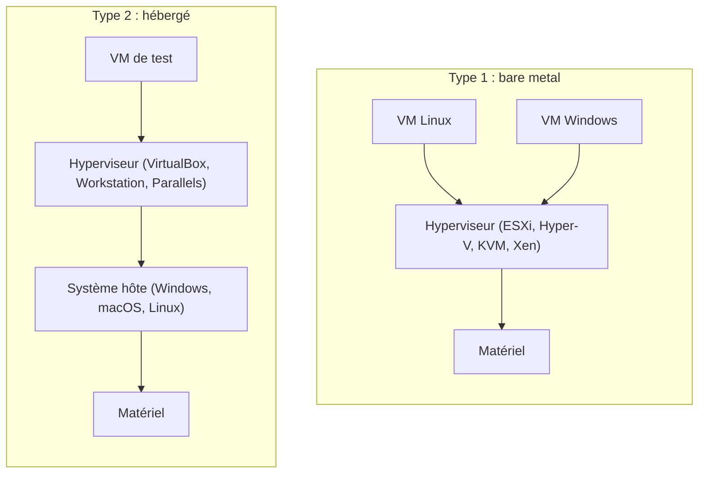
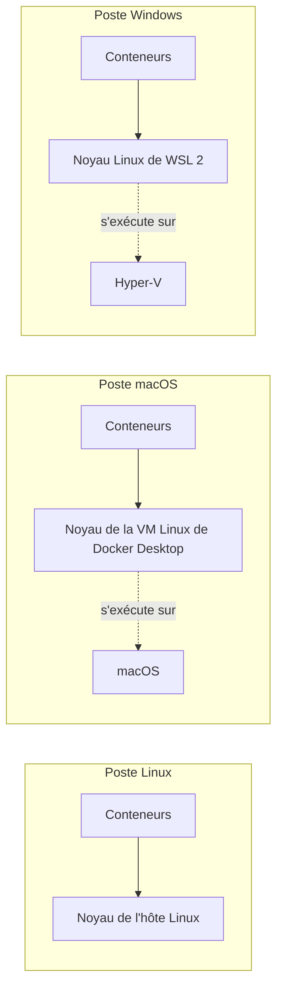
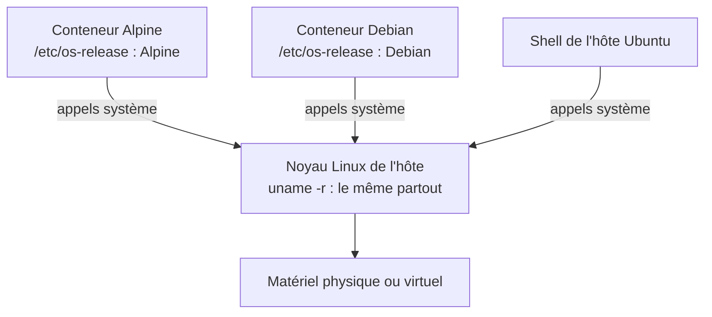

# Machine virtuelle ou conteneur

> **En une phrase.** Une machine virtuelle simule **une machine entière**, avec son propre système et son propre noyau ; un conteneur est **un processus de l'hôte**, isolé, qui **partage le noyau** : ce ne sont pas deux tailles d'un même objet, mais deux niveaux d'isolation qui se combinent.

---

## 1. Synthèse

### Pourquoi isoler une application

Deux applications installées directement sur un même serveur partagent son environnement. Leurs besoins peuvent entrer en conflit :

| Conflit | Exemple |
|---|---|
| Versions de bibliothèques | l'appli A exige Python 3.9, l'appli B Python 3.13 |
| Chemins de fichiers identiques | les deux attendent leur configuration dans `/etc/app.conf` |
| Ports réseau | les deux veulent écouter sur le port 80 |
| Ressources sans limite | une fuite mémoire de A ralentit B |

Une modification de l'environnement commun (une mise à jour, un fichier modifié) **peut casser plusieurs applications à la fois**. Un conteneur rassemble les processus d'une application et les fichiers nécessaires à son exécution, dans un environnement dont les accès sont contrôlés. Il permet de :
- **regrouper** l'application et ses dépendances ;
- lui fournir **une vue distincte** du système ;
- **définir** ses accès et ses ressources.

Conséquence : **même chemin ne signifie pas même fichier**. `/etc/app.conf` peut désigner un fichier différent dans chaque conteneur.

> [!NOTE]
> Conteneurs et microservices sont deux sujets distincts : un monolithe peut être conteneurisé, et les données, les accès et les ressources restent à organiser dans tous les cas. Voir [Du monolithe aux microservices](Du-monolithe-aux-microservices.md).

### Trois notions de base : processus, noyau, espace utilisateur

| Notion | Définition |
|---|---|
| **Programme** | Des instructions stockées dans des fichiers (par exemple `/usr/sbin/nginx`). |
| **Processus** | Une **instance d'un programme en cours d'exécution**. Il possède un identifiant (le **PID**), un espace mémoire et des **descripteurs** (références aux fichiers et connexions réseau ouverts). Lancer deux fois le même programme crée deux processus. |
| **Noyau** (*kernel*) | Le cœur du système : il fait le lien entre les programmes et le matériel, répartit le temps CPU, gère la mémoire et les périphériques. |
| **Appel système** | La demande qu'un processus adresse au noyau : ouvrir un fichier, créer un processus, communiquer sur le réseau, demander de la mémoire. Les bibliothèques (la libc, par exemple) fournissent une interface vers ces appels. |
| **Espace utilisateur** | Tout ce qui s'exécute **hors du noyau** : applications, commandes, bibliothèques. |
| **Distribution** | Un espace utilisateur (Debian, Alpine, Ubuntu…) associé à un noyau Linux. |

```
   Application ──► appels système ──► Noyau Linux ──► Matériel
   (espace utilisateur)                (espace noyau)
```

Une **image de conteneur** reprend les fichiers utiles d'un espace utilisateur, **sans démarrer tout le système** et **sans noyau**. Des outils Debian ou Alpine peuvent donc s'exécuter sur le même noyau Linux de l'hôte.

| Commande | Information affichée |
|---|---|
| `cat /etc/os-release` | la **distribution de l'espace utilisateur** (un simple fichier fourni par l'image) |
| `uname -r` | la **version du noyau réellement utilisé** |

### La virtualisation : l'isolation matérielle

La **virtualisation** exécute plusieurs environnements sur une même machine physique en créant des **machines virtuelles** (VM). Chaque VM possède son propre système d'exploitation, sa mémoire, son stockage et son réseau. Un **hyperviseur** répartit les ressources physiques entre elles et présente à chaque système invité un **matériel virtuel**.

| | **Type 1 : bare metal** | **Type 2 : hébergé** |
|---|---|---|
| Où il s'exécute | directement sur le matériel | au-dessus d'un système hôte (Windows, macOS, Linux) |
| Points forts | haute performance, fiabilité | simplicité d'installation |
| Usage | centres de données | tests, postes de travail |
| Exemples | VMware ESXi, Hyper-V, KVM, Xen | VirtualBox, VMware Workstation, Parallels |

Le **rôle de l'hyperviseur** : allouer dynamiquement les ressources, isoler les environnements, agréger ou fractionner le matériel selon les besoins.

```
            Matériel physique (CPU, RAM, disque)
                          │
                     Hyperviseur
              ┌───────────┼───────────┐
        VM1 (Linux)  VM2 (Windows)  VM3 (Ubuntu)
```

| Avantages | Limites |
|---|---|
| **Isolation complète** : chaque VM a son noyau | **Surcharge mémoire** : chaque VM porte un système complet |
| **Mutualisation** du matériel : un serveur héberge les VM base de données, web, stockage | **Démarrage lent** : il faut amorcer un système, puis ses services |
| **Portabilité** : une VM se déplace d'un hôte à l'autre | **Gestion complexe** : des dizaines de systèmes à installer, configurer, mettre à jour |
| **Flexibilité** et **abstraction matérielle** | |

C'est cette gestion complexe qui a fait naître l'**Infrastructure as Code**.

### L'Infrastructure as Code (IaC)

L'**IaC** décrit l'infrastructure comme du **code déclaratif** : on écrit **l'état attendu** (VM, réseaux, services), et l'outil se charge de l'atteindre.

- **Décrire** l'état attendu plutôt que la suite de clics ou de commandes.
- **Automatiser** la création et la configuration.
- **Versionner** (Git), **reproduire** à l'identique, intégrer à la **CI/CD** (chaîne d'intégration et de déploiement continus).

Outils : **Terraform**, **OpenTofu**, **Ansible**, **Puppet**, **Chef**, **CloudFormation**, **Pulumi**. Cette idée d'état désiré reviendra avec Compose puis Kubernetes (voir [Kubernetes : état désiré et réconciliation](Kubernetes-etat-desire.md)).

### Machine virtuelle et conteneur, côte à côte

| Critère | Machine virtuelle | Conteneur Linux |
|---|---|---|
| Ce qui est isolé | une machine et son système invité | des processus et leur environnement |
| Noyau | **propre à chaque VM** | **partagé** avec l'hôte d'exécution |
| Ce qui démarre | un système, puis ses services | le **processus principal** |
| Où sont les dépendances | dans le système invité | dans l'image, généralement |
| Mécanisme | matériel virtualisé par l'hyperviseur | mécanismes du noyau (voir [Isolation d'un conteneur](Isolation-des-conteneurs.md)) |

- Le partage du noyau évite de démarrer un système invité par conteneur : le coût d'exécution baisse, mais **l'application garde ses besoins en CPU et en mémoire**.
- **Aucune des deux solutions ne garantit une sécurité absolue.**
- **Une VM peut héberger plusieurs conteneurs** : c'est même le cas le plus courant dans le cloud.

### Où se trouve le noyau Linux ?

Les conteneurs Linux ont toujours besoin d'**un noyau Linux**. Selon l'environnement, ce n'est pas celui qu'on croit :

| Environnement | Noyau utilisé par les conteneurs Linux |
|---|---|
| Docker Engine sur Linux | le noyau de l'**hôte Linux** |
| Docker Desktop sur macOS | le noyau d'une **VM Linux** gérée par Docker Desktop (pas celui de macOS) |
| Docker Desktop sous Windows | le noyau du **backend Linux**, par exemple WSL 2 |

- **Hôte d'exécution ≠ poste de l'utilisateur.** Le client `docker` peut piloter un moteur distant (contexte Docker, variable `DOCKER_HOST`).
- Les **conteneurs Windows** (qui partagent un noyau Windows) constituent un cas distinct, non traité ici.

### Les conditions de portabilité

Une image évite de réinstaller les dépendances à la main sur chaque machine. Elle **ne contient pas** pour autant tout ce dont le service a besoin. L'exécution dépend aussi :
- d'un **noyau compatible** ;
- de l'**architecture processeur** (AMD64, ARM64…) : une image peut proposer **plusieurs variantes d'architecture** sous le même nom, et l'émulation éventuelle d'une autre architecture ajoute ses propres contraintes (lenteur, incompatibilités) ;
- du **réseau** et des **services externes** (base de données, API) ;
- des **données** et des **secrets** nécessaires.

### De la virtualisation à la conteneurisation

Les deux techniques **se combinent** : les VM assurent l'**isolation matérielle**, les conteneurs l'**isolation logicielle** (aussi appelée logique). Kubernetes peut exécuter des conteneurs sur des machines physiques ou virtuelles (voir [Virtualisation et orchestration : les couches](Virtualisation-et-orchestration.md)).

Un conteneur, c'est **un processus isolé + son environnement d'exécution minimal** (bibliothèques, configuration, dépendances). Parce qu'il partage le noyau, il est léger et rapide. Ses quatre objectifs :

| Objectif | Sens |
|---|---|
| **Portabilité** | la même image fonctionne sur tout hôte **compatible** |
| **Immutabilité** | on **remplace** le conteneur à partir d'une image versionnée, on ne le modifie pas |
| **Rapidité** | démarrage en quelques secondes, souvent moins |
| **Densité** | de nombreux conteneurs cohabitent sur la même machine |

Les mécanismes du noyau utilisés (namespaces, cgroups, capabilities, seccomp, AppArmor) sont décrits dans [Isolation d'un conteneur](Isolation-des-conteneurs.md), et le système de fichiers en couches (OverlayFS) dans [Les couches d'une image](Couches-d-une-image.md). Docker, Podman ou containerd les utilisent sous le capot, de façon transparente.

> [!IMPORTANT]
> **Les pièges à retenir**
> 1. **Voir « Alpine » ne veut pas dire qu'un noyau Alpine a démarré.** `/etc/os-release` décrit l'espace utilisateur ; seul `uname -r` dit quel noyau tourne.
> 2. **Le noyau partagé est la différence fondamentale.** Un conteneur Linux ne peut pas faire tourner un autre noyau, ni un autre système (Windows, BSD) : il faut une VM.
> 3. **Sur Mac et Windows, il y a toujours une VM Linux cachée.** Les conteneurs partagent son noyau, pas celui du poste.
> 4. **Une image n'est pas autosuffisante.** Architecture, noyau, réseau, données et secrets conditionnent son exécution.
> 5. **VM ou conteneur n'est pas un choix exclusif.** En production, les conteneurs tournent très souvent dans des VM.

---

## 2. Cas d'usage classiques

### Cas 1 : distinguer la distribution du noyau

**Besoin.** Savoir ce qui tourne vraiment quand on lance une image « Debian » ou « Alpine ».

```bash
docker run --rm debian:trixie cat /etc/os-release | head -1    # PRETTY_NAME="Debian GNU/Linux 13 (trixie)"
docker run --rm alpine cat /etc/os-release | head -1           # NAME="Alpine Linux"
docker run --rm debian:trixie uname -r
docker run --rm alpine uname -r
uname -r                                                        # sur l'hôte
```

**Ce qu'on observe.** Les deux images annoncent deux distributions différentes, mais les trois `uname -r` affichent **la même version**. Sur un poste de test sous WSL 2, les trois renvoient `6.18.33.2-microsoft-standard-WSL2`.
**À retenir.** L'image apporte les binaires et les bibliothèques de Debian ou d'Alpine ; leurs appels système sont traités par le noyau de l'hôte d'exécution.

### Cas 2 : faire cohabiter deux versions incompatibles

**Besoin.** Deux applications exigent deux versions de Python qui ne peuvent pas être installées comme version par défaut du même serveur.

```bash
docker run --rm python:3.9-slim  python --version     # Python 3.9.x
docker run --rm python:3.13-slim python --version     # Python 3.13.x
docker run --rm python:3.9-slim  ls -l /usr/local/bin/python3
docker run --rm python:3.13-slim ls -l /usr/local/bin/python3
```

**Ce qu'on observe.** Le **même chemin** `/usr/local/bin/python3` désigne deux programmes différents : chaque conteneur a sa propre arborescence de fichiers. Rien n'est installé sur l'hôte.
**À retenir.** C'est le premier service rendu par les conteneurs : isoler les dépendances sans dédier une machine (physique ou virtuelle) à chaque application.

### Cas 3 : un programme, deux processus

**Besoin.** Comprendre la différence entre programme et processus.

```bash
docker run -d --name a nginx:1.25
docker run -d --name b nginx:1.25
docker top a            # PID vus depuis l'hôte, par exemple 4211, 4260...
docker top b            # d'autres PID
```

**Ce qu'on observe.** Le même programme (`nginx`, issu de la même image) donne des processus distincts, avec des PID et des états propres. Côté hôte, ce sont des processus ordinaires, visibles avec `ps`.
**À retenir.** Un conteneur n'est pas une machine : **ce sont des processus de l'hôte**. Ce qui les isole est expliqué dans [Isolation d'un conteneur](Isolation-des-conteneurs.md).

```bash
docker rm -f a b
```

### Cas 4 : savoir sur quel noyau tournent ses conteneurs

**Besoin.** Le développeur travaille sous Windows ou macOS : où s'exécutent réellement les conteneurs ?

```bash
docker version                                   # deux blocs : Client et Server (le moteur)
docker info --format '{{.OperatingSystem}} | {{.KernelVersion}} | {{.Architecture}}'
docker context ls                                # quel moteur le client pilote-t-il ?
```

**Ce qu'on observe.** Sur un poste de test où Docker Engine est installé dans Ubuntu sous WSL 2 : `Ubuntu 26.04 | 6.18.33.2-microsoft-standard-WSL2 | x86_64`, contexte `default` sur `unix:///var/run/docker.sock`. Le noyau est celui de la **VM légère de WSL 2**, pas celui de Windows. Avec Docker Desktop, le système affiché serait celui de sa VM interne.

Le client peut aussi piloter un moteur sur une autre machine :

```bash
docker context create distant --docker "host=ssh://admin@serveur.exemple"
docker --context distant info --format '{{.KernelVersion}}'    # noyau du serveur distant
```

**À retenir.** Le poste où l'on tape `docker` n'est pas forcément l'hôte d'exécution.

> [!NOTE]
> Sous Windows, Hyper-V est un hyperviseur de **type 1** : une fois activé, Windows lui-même tourne au-dessus de lui, à côté de la VM de WSL 2. La frontière entre « type 1 » et « type 2 » est parfois moins nette qu'il n'y paraît.

### Cas 5 : vérifier qu'une image convient à la machine

**Besoin.** Une image fonctionne sur le PC d'un collègue (AMD64), un autre utilise un Mac à puce ARM.

```bash
docker image inspect --format '{{.Os}}/{{.Architecture}}' httpd:2.4      # linux/amd64
docker buildx imagetools inspect httpd:2.4                                # toutes les variantes publiées
```

**Ce qu'on observe.** Sur un poste de test, `httpd:2.4` est publiée pour `linux/amd64`, `arm/v5`, `arm/v7`, `arm64/v8`, `386`, `ppc64le`, `riscv64` et `s390x`. Le moteur télécharge automatiquement la variante de sa machine : le Mac obtient `arm64/v8` **avec le même nom**. Une image construite pour une seule architecture ne démarre pas ailleurs sans émulation (erreur typique : `exec format error`).
**À retenir.** « Ça marche sur ma machine » suppose aussi la même architecture. Le reste de la portabilité (base de données joignable, secrets fournis, données présentes) ne se trouve pas dans l'image.

### Cas 6 : choisir entre VM, conteneur ou les deux

**Besoin.** Décider de l'isolation adaptée à chaque situation.

| Situation | Choix | Raison |
|---|---|---|
| Faire tourner un serveur Windows sur un hôte Linux | **VM** | un conteneur Linux ne peut pas changer de noyau |
| Tester un module noyau ou une version précise du noyau | **VM** | le noyau d'un conteneur est celui de l'hôte |
| Héberger des clients qui ne se font pas confiance | **VM** (éventuellement avec des conteneurs dedans) | une faille du noyau partagé toucherait tout le monde |
| Déployer vingt services d'une même application | **Conteneurs** | densité, démarrage rapide, images versionnées |
| Fournir le même environnement de développement à toute une équipe | **Conteneurs** | une image remplace une procédure d'installation |
| Cluster Kubernetes dans le cloud | **Les deux** | les nœuds sont des VM, les applications des conteneurs |

### Cas 7 : décrire l'infrastructure plutôt que la construire à la main (IaC)

**Besoin.** Recréer le même environnement à l'identique, autant de fois que nécessaire. Exemple minimal avec Terraform et son fournisseur Docker (le principe est le même pour des VM, avec le fournisseur d'un cloud ou d'un hyperviseur).

```hcl
# main.tf
terraform {
  required_providers {
    docker = {
      source = "kreuzwerker/docker"
    }
  }
}

resource "docker_image" "nginx" {
  name = "nginx:1.25"
}

resource "docker_container" "web" {
  name  = "web"
  image = docker_image.nginx.image_id
  ports {
    internal = 80
    external = 8080
  }
}
```

```bash
terraform init
terraform plan      # Plan: 2 to add, 0 to change, 0 to destroy.
terraform apply     # crée l'image et le conteneur
terraform apply     # No changes. Your infrastructure matches the configuration.
```

**Ce qu'on observe.** On n'écrit pas « télécharge, puis crée, puis lance » : on décrit **ce qui doit exister**. Relancer `apply` ne refait rien, puisque l'état réel correspond déjà à l'état décrit.
**À retenir.** C'est l'approche **déclarative**. Le fichier se versionne dans Git et se relit en revue de code, ce qui est impossible avec une suite de clics.

---

## 3. Idées de schémas

### Schéma A : deux piles côte à côte

```
      MACHINES VIRTUELLES                      CONTENEURS
 ┌──────────┐ ┌──────────┐            ┌──────────┐ ┌──────────┐
 │  App A   │ │  App B   │            │  App A   │ │  App B   │
 │ bibliot. │ │ bibliot. │            │ bibliot. │ │ bibliot. │
 │ OS invité│ │ OS invité│            └────┬─────┘ └────┬─────┘
 │ noyau A  │ │ noyau B  │                 │            │
 └────┬─────┘ └────┬─────┘            ┌────▼────────────▼─────┐
 ┌────▼────────────▼─────┐            │  noyau Linux partagé  │
 │      Hyperviseur      │            │ (hôte ou VM Linux)    │
 └───────────┬───────────┘            └───────────┬───────────┘
 ┌───────────▼───────────┐            ┌───────────▼───────────┐
 │       Matériel        │            │  Matériel (ou VM)     │
 └───────────────────────┘            └───────────────────────┘
```

À mettre en valeur : la ligne « OS invité + noyau » **répétée** à gauche, **absente** à droite. C'est elle qui coûte de la mémoire et du temps de démarrage.

### Schéma B : les deux types d'hyperviseurs



### Schéma C : où est le noyau selon le poste



### Schéma D : un noyau, plusieurs espaces utilisateur



---

## 4. Script de motion design : « Où est le noyau ? » (environ 65 s)

Style : formes plates, le noyau toujours représenté par une même dalle violette, les systèmes invités en gris. Textes à l'écran seulement.

| Séq. | Durée | À l'écran | Animation | Texte à l'écran |
|---|---|---|---|---|
| 1 | 0-7 s | Un serveur, deux applications A et B posées dessus, une seule étagère « bibliothèques » | Les deux applications tirent sur la même étagère ; une bibliothèque change de couleur et B se met à clignoter en rouge | « Sur un serveur partagé, une mise à jour pour A peut casser B. » |
| 2 | 7-17 s | Une couche « Hyperviseur » se glisse sous les applications | Chaque application s'entoure d'une boîte complète : système invité gris + dalle violette « noyau » | « Machine virtuelle : chaque application reçoit une machine entière, avec son noyau. » |
| 3 | 17-25 s | Un compteur « mémoire » et un chronomètre à côté de chaque VM | Le chronomètre tourne longtemps (amorçage du système, puis des services) ; la jauge mémoire grimpe avant même que l'application démarre | « Isolation forte, mais un système complet à démarrer et à maintenir par VM. » |
| 4 | 25-37 s | Retour au serveur ; une seule grande dalle violette « noyau partagé » | Les systèmes invités gris s'évaporent ; il reste A et B, chacun dans une bulle fine | « Conteneur : on garde le noyau de l'hôte, on n'isole que les processus. » |
| 5 | 37-45 s | Dans chaque bulle, une étiquette « Alpine » ou « Debian » ; sous la dalle, « uname -r » | Les étiquettes changent ; la valeur sous la dalle reste identique | « L'image apporte l'espace utilisateur. Le noyau, lui, ne change pas. » |
| 6 | 45-55 s | Trois postes : Linux, Mac, Windows | Sur Mac et Windows, une petite VM Linux surgit derrière les conteneurs et la dalle violette se loge dedans | « Sur Mac et Windows, une VM Linux fournit le noyau. » |
| 7 | 55-65 s | Recul : une salle de serveurs ; dans chaque serveur, des VM ; dans chaque VM, des bulles de conteneurs | Les trois niveaux s'allument l'un après l'autre | « VM et conteneurs ne s'opposent pas : ils s'empilent. » |

**Conseil de réalisation.** Garder **exactement la même dalle violette** pour le noyau tout au long de la vidéo : c'est en suivant cet objet que le spectateur comprend qu'il est dupliqué dans les VM et partagé par les conteneurs. En séquence 5, afficher la vraie valeur de `uname -r` du poste de tournage renforce la démonstration.

---

## 5. Vérifier soi-même

```bash
uname -r                                                # noyau vu depuis l'hôte
docker run --rm alpine sh -c 'grep PRETTY /etc/os-release; uname -r'    # Alpine, même noyau
docker info --format '{{.OperatingSystem}} / {{.KernelVersion}}'        # où tourne le moteur
docker image inspect --format '{{.Os}}/{{.Architecture}}' alpine        # architecture de l'image locale
time docker run --rm alpine true                        # temps de création, démarrage et arrêt d'un conteneur
```

La dernière commande donne un ordre de grandeur à comparer avec le démarrage d'une VM (plusieurs dizaines de secondes pour amorcer un système complet).

## Voir aussi

- [Accueil du wiki](../README.md)
- Page précédente : [Du monolithe aux microservices](Du-monolithe-aux-microservices.md)
- Page suivante : [Isolation d'un conteneur : namespaces, cgroups et protections](Isolation-des-conteneurs.md)
- Pour aller plus loin : [Conteneurs et machines virtuelles (Docker)](https://docs.docker.com/get-started/docker-concepts/the-basics/what-is-a-container/), [Virtualisation dans Docker Desktop](https://docs.docker.com/desktop/features/vmm/), [Docker Desktop et WSL 2](https://docs.docker.com/desktop/features/wsl/), [Images multiplateformes](https://docs.docker.com/build/building/multi-platform/)
