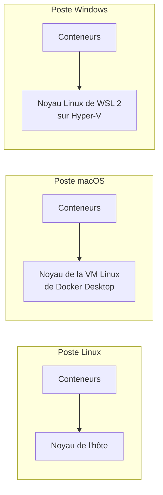

# Machine virtuelle ou conteneur

<p class="lead">Une machine virtuelle simule <strong>une machine entière</strong>, avec son propre système et son propre noyau. Un conteneur est <strong>un processus de l'hôte</strong>, isolé, qui partage le noyau. Ce ne sont pas deux tailles d'un même objet, mais deux niveaux d'isolation qui s'empilent.</p>

{ .hero }

## L'essentiel en 30 secondes

<div class="grid cards" markdown>

-   :material-server:{ .lg .middle } __Machine virtuelle__

    ---

    Un **hyperviseur** fournit du matériel virtuel ; chaque VM démarre son OS invité **et son noyau**.

-   :material-docker:{ .lg .middle } __Conteneur__

    ---

    Des **processus de l'hôte**, isolés, avec les fichiers de leur image. Ni OS invité, ni noyau.

-   :material-linux:{ .lg .middle } __Où est le noyau ?__

    ---

    Toujours un noyau **Linux**. Sur Mac et Windows, il vit dans une **VM Linux** cachée.

-   :material-layers-triple-outline:{ .lg .middle } __Les deux ensemble__

    ---

    En production, les conteneurs tournent très souvent **dans des VM**.

</div>

!!! warning "À retenir"

    **Voir « Alpine » ne veut pas dire qu'un noyau Alpine a démarré.** `/etc/os-release` décrit l'espace utilisateur fourni par l'image ; seul `uname -r` dit quel noyau tourne. Un conteneur Linux ne peut donc ni changer de noyau, ni faire tourner Windows ou BSD : il faut une VM.

## :material-package-variant-closed: Pourquoi isoler une application

Deux applications installées sur le même serveur partagent son environnement : une mise à jour pour l'une **peut casser l'autre**.

| Conflit | Exemple |
|---|---|
| Versions de bibliothèques | l'appli A exige Python 3.12, l'appli B Python 3.13 |
| Chemins identiques | les deux attendent leur configuration dans `/etc/app.conf` |
| Ports réseau | les deux veulent écouter sur le port 80 |
| Ressources sans limite | une fuite mémoire de A ralentit B |

Un conteneur **regroupe** l'application et ses dépendances, lui donne **une vue distincte** du système et **définit** ses accès et ses ressources.

???+ example "En vrai : deux Python côte à côte"

    

    **Même chemin ne signifie pas même fichier** : `/usr/local/bin/python3` désigne un programme différent dans chaque conteneur, et rien n'est installé sur l'hôte.

## :material-linux: Processus, noyau, espace utilisateur

| Notion | En une ligne |
|---|---|
| **Processus** | une **instance d'un programme en cours d'exécution** : un PID, de la mémoire, des fichiers et connexions ouverts |
| **Noyau** (*kernel*) | le cœur du système : CPU, mémoire, périphériques |
| **Appel système** | la demande d'un processus au noyau : ouvrir un fichier, créer un processus, parler au réseau |
| **Espace utilisateur** | tout ce qui tourne hors du noyau : applications, commandes, bibliothèques |
| **Distribution** | un espace utilisateur (Debian, Alpine, Ubuntu…) associé à un noyau Linux |

Une **image** reprend les fichiers d'un espace utilisateur, **sans noyau** et sans démarrer tout le système : les outils Debian ou Alpine s'exécutent sur le noyau de l'hôte.

???+ example "En vrai : trois distributions, un seul noyau"

    

    L'image apporte les binaires et les bibliothèques de Debian ou d'Alpine ; leurs appels système sont traités par **le noyau de l'hôte d'exécution**, ici celui de WSL 2.

???+ example "En vrai : un programme, deux processus de l'hôte"

    

    Même programme, même image, deux processus avec chacun son PID. Un conteneur n'est pas une machine : ce qui les isole est expliqué dans [Isolation d'un conteneur](Isolation-des-conteneurs.md).

## :material-server: La virtualisation : l'isolation matérielle

Un **hyperviseur** répartit le matériel entre des **machines virtuelles** et présente à chacune un matériel virtuel ; chaque VM a son système, sa mémoire, son stockage, son réseau.

| | **Type 1 : bare metal** | **Type 2 : hébergé** |
|---|---|---|
| S'exécute | directement sur le matériel | au-dessus d'un système hôte |
| Pour | centres de données : performance, fiabilité | tests, postes de travail : simplicité |
| Exemples | VMware ESXi, Hyper-V, KVM, Xen | VirtualBox, VMware Workstation, Parallels |

| Avantages | Limites |
|---|---|
| **isolation complète** : un noyau par VM | **surcharge mémoire** : un système complet par VM |
| **mutualisation** et **abstraction** du matériel | **démarrage lent** : amorcer un système, puis ses services |
| **portabilité** : une VM change d'hôte | **gestion complexe** : des dizaines de systèmes à maintenir |

??? note "Sous Windows, Hyper-V brouille la frontière"

    Hyper-V est un hyperviseur de **type 1** : une fois activé, Windows lui-même tourne au-dessus de lui, à côté de la VM de WSL 2. La distinction type 1 / type 2 est parfois moins nette qu'il n'y paraît.

??? note "L'Infrastructure as Code : décrire plutôt que cliquer"

    Gérer des dizaines de VM à la main a fait naître l'**IaC** : on écrit **l'état attendu** dans du code déclaratif, l'outil l'atteint. On **automatise**, on **versionne** (Git), on **reproduit** à l'identique, on intègre à la CI/CD. Outils : Terraform, OpenTofu, Ansible, Puppet, Chef, CloudFormation, Pulumi.

    ```hcl
    # main.tf : le principe est le même pour des VM, avec le fournisseur d'un cloud ou d'un hyperviseur
    terraform {
      required_providers {
        docker = { source = "kreuzwerker/docker" }
      }
    }
    resource "docker_image" "nginx" { name = "nginx:1.25" }
    resource "docker_container" "web" {
      name  = "web"
      image = docker_image.nginx.image_id
      ports {
        internal = 80
        external = 8080
      }
    }
    ```

    `terraform plan` annonce `Plan: 2 to add` ; un premier `apply` crée l'image et le conteneur ; un second répond `No changes`, puisque l'état réel correspond déjà à l'état décrit. Cette idée d'**état désiré** revient avec Compose puis Kubernetes ([Kubernetes : état désiré et réconciliation](Kubernetes-etat-desire.md)).

## :material-scale-balance: VM et conteneur, côte à côte

| Critère | Machine virtuelle | Conteneur Linux |
|---|---|---|
| Ce qui est isolé | une machine et son système invité | des processus et leur environnement |
| Noyau | **propre à chaque VM** | **partagé** avec l'hôte d'exécution |
| Ce qui démarre | un système, puis ses services | le **processus principal** |
| Dépendances | dans le système invité | dans l'image |
| Mécanisme | matériel virtualisé | mécanismes du noyau ([Isolation d'un conteneur](Isolation-des-conteneurs.md)) |

Le partage du noyau évite un système invité par conteneur, mais **l'application garde ses besoins en CPU et en mémoire**. Et **aucune des deux solutions ne garantit une sécurité absolue**.

| Environnement | Noyau utilisé par les conteneurs Linux |
|---|---|
| Docker Engine sur Linux | celui de l'**hôte Linux** |
| Docker Desktop sur macOS | celui d'une **VM Linux** gérée par Docker Desktop |
| Docker Desktop sous Windows | celui du **backend Linux**, par exemple WSL 2 |

???+ example "En vrai : sur quel noyau tournent mes conteneurs ?"

    

    Le noyau est celui de la **VM légère de WSL 2**, pas celui de Windows. Le poste où l'on tape `docker` n'est pas forcément l'hôte d'exécution : `docker context create distant --docker "host=ssh://admin@serveur.exemple"` fait piloter un moteur distant (ou la variable `DOCKER_HOST`).



Les **conteneurs Windows**, qui partagent un noyau Windows, sont un cas à part, non traité ici.

## :material-earth: Portable… sous conditions

Un conteneur, c'est un processus isolé et son environnement minimal. Ses quatre promesses : **portabilité** (sur tout hôte *compatible*), **immutabilité** (on remplace, on ne modifie pas), **rapidité** (quelques secondes, souvent moins) et **densité** (beaucoup de conteneurs par machine).

Mais une image ne contient pas tout. Son exécution dépend aussi d'un **noyau compatible**, de l'**architecture processeur** (AMD64, ARM64…), du **réseau** et des **services externes**, des **données** et des **secrets**.

???+ example "En vrai : un nom, huit architectures, moins d'une seconde"

    

    Le moteur télécharge la variante de sa machine : un Mac à puce ARM obtient `arm64/v8` **sous le même nom**. Une image construite pour une seule architecture échoue ailleurs sans émulation (`exec format error`). Comparer le temps mesuré aux dizaines de secondes d'amorçage d'une VM.

| Situation | Choix | Raison |
|---|---|---|
| Serveur Windows sur un hôte Linux | **VM** | un conteneur Linux ne change pas de noyau |
| Tester un module ou une version du noyau | **VM** | le noyau d'un conteneur est celui de l'hôte |
| Clients qui ne se font pas confiance | **VM** (avec des conteneurs dedans) | une faille du noyau partagé toucherait tout le monde |
| Vingt services d'une même application | **Conteneurs** | densité, démarrage rapide, images versionnées |
| Même environnement de dev pour toute l'équipe | **Conteneurs** | une image remplace une procédure d'installation |
| Cluster Kubernetes dans le cloud | **Les deux** | nœuds en VM, applications en conteneurs ([les couches](Virtualisation-et-orchestration.md)) |

## :material-flask-outline: À toi de jouer

```bash
uname -r                                                              # noyau vu depuis l'hôte
docker run --rm alpine:3.22 sh -c 'grep PRETTY /etc/os-release; uname -r'    # Alpine, même noyau
docker info --format '{{.OperatingSystem}} / {{.KernelVersion}}'        # où tourne le moteur
docker image inspect --format '{{.Os}}/{{.Architecture}}' alpine:3.22   # architecture de l'image locale
time docker run --rm alpine:3.22 true                                   # créer, démarrer, arrêter, supprimer
```

La dernière commande donne un ordre de grandeur à comparer avec le démarrage d'une VM. Les mécanismes du noyau utilisés (namespaces, cgroups, capabilities, seccomp, AppArmor) sont dans [Isolation d'un conteneur](Isolation-des-conteneurs.md), le système de fichiers en couches dans [Les couches d'une image](Couches-d-une-image.md).

??? abstract "Pour les créateurs : script de motion design « Où est le noyau ? » (65 s)"

    Style : formes plates, le noyau toujours représenté par une même dalle rose, les systèmes invités en gris. Textes à l'écran seulement.

    | Séq. | Durée | À l'écran | Animation | Texte à l'écran |
    |---|---|---|---|---|
    | 1 | 0-7 s | Un serveur, deux applications A et B posées dessus, une seule étagère « bibliothèques » | Les deux applications tirent sur la même étagère ; une bibliothèque change de couleur et B se met à clignoter en rouge | « Sur un serveur partagé, une mise à jour pour A peut casser B. » |
    | 2 | 7-17 s | Une couche « Hyperviseur » se glisse sous les applications | Chaque application s'entoure d'une boîte complète : système invité gris + dalle rose « noyau » | « Machine virtuelle : chaque application reçoit une machine entière, avec son noyau. » |
    | 3 | 17-25 s | Un compteur « mémoire » et un chronomètre à côté de chaque VM | Le chronomètre tourne longtemps (amorçage du système, puis des services) ; la jauge mémoire grimpe avant même que l'application démarre | « Isolation forte, mais un système complet à démarrer et à maintenir par VM. » |
    | 4 | 25-37 s | Retour au serveur ; une seule grande dalle rose « noyau partagé » | Les systèmes invités gris s'évaporent ; il reste A et B, chacun dans une bulle fine | « Conteneur : on garde le noyau de l'hôte, on n'isole que les processus. » |
    | 5 | 37-45 s | Dans chaque bulle, une étiquette « Alpine » ou « Debian » ; sous la dalle, « uname -r » | Les étiquettes changent ; la valeur sous la dalle reste identique | « L'image apporte l'espace utilisateur. Le noyau, lui, ne change pas. » |
    | 6 | 45-55 s | Trois postes : Linux, Mac, Windows | Sur Mac et Windows, une petite VM Linux surgit derrière les conteneurs et la dalle rose se loge dedans | « Sur Mac et Windows, une VM Linux fournit le noyau. » |
    | 7 | 55-65 s | Recul : une salle de serveurs ; dans chaque serveur, des VM ; dans chaque VM, des bulles de conteneurs | Les trois niveaux s'allument l'un après l'autre | « VM et conteneurs ne s'opposent pas : ils s'empilent. » |

    Garder **exactement la même dalle** pour le noyau tout au long de la vidéo : c'est en suivant cet objet que le spectateur comprend qu'il est dupliqué dans les VM et partagé par les conteneurs. En séquence 5, afficher la vraie valeur de `uname -r` (`6.18.33.2-microsoft-standard-WSL2` sur le poste des captures).

??? info "Pour les créateurs : idées de schémas"

    **Deux piles côte à côte** : c'est l'illustration d'en-tête. À mettre en valeur : la ligne « OS invité + noyau » **répétée** à gauche, **absente** à droite ; c'est elle qui coûte de la mémoire et du temps de démarrage.

    **Les deux types d'hyperviseurs** : à gauche, VM Linux et VM Windows sur l'hyperviseur, directement sur le matériel ; à droite, une VM de test sur VirtualBox, au-dessus du système hôte, au-dessus du matériel.

    **Un noyau, plusieurs espaces utilisateur** :

    ```mermaid
    flowchart TB
        A["Conteneur Alpine<br/>/etc/os-release : Alpine"] -- "appels système" --> K["Noyau Linux de l'hôte<br/>uname -r : le même partout"]
        D["Conteneur Debian<br/>/etc/os-release : Debian"] -- "appels système" --> K
        U["Shell de l'hôte Ubuntu"] -- "appels système" --> K
        K --> HW["Matériel physique ou virtuel"]
    ```

??? note "Pour aller plus loin"

    [Conteneurs et machines virtuelles (Docker)](https://docs.docker.com/get-started/docker-concepts/the-basics/what-is-a-container/), [Virtualisation dans Docker Desktop](https://docs.docker.com/desktop/features/vmm/), [Docker Desktop et WSL 2](https://docs.docker.com/desktop/features/wsl/), [Images multiplateformes](https://docs.docker.com/build/building/multi-platform/). Microservices et conteneurs sont deux sujets distincts : voir [Du monolithe aux microservices](Du-monolithe-aux-microservices.md).
