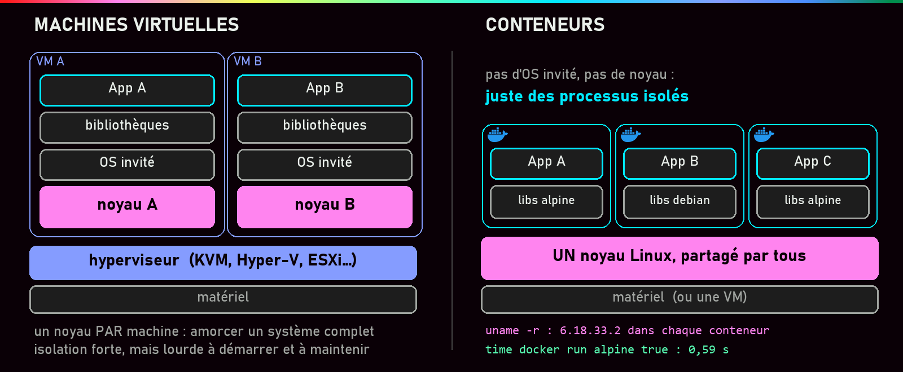
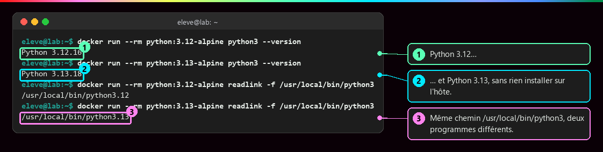
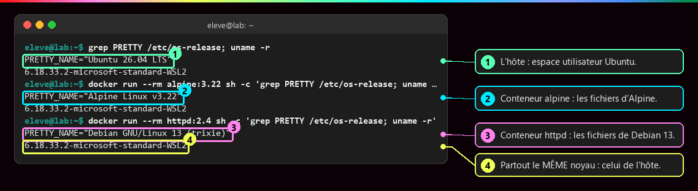
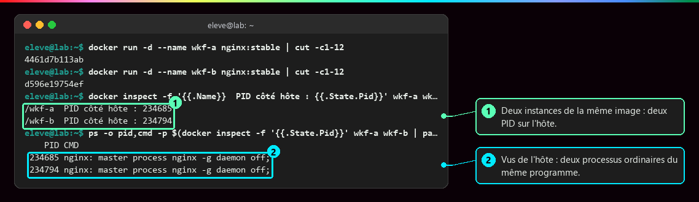
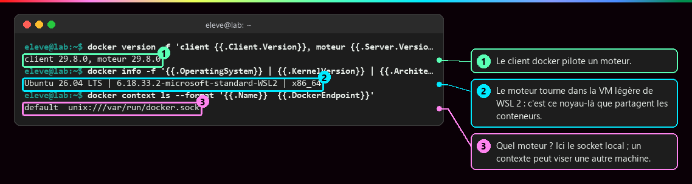
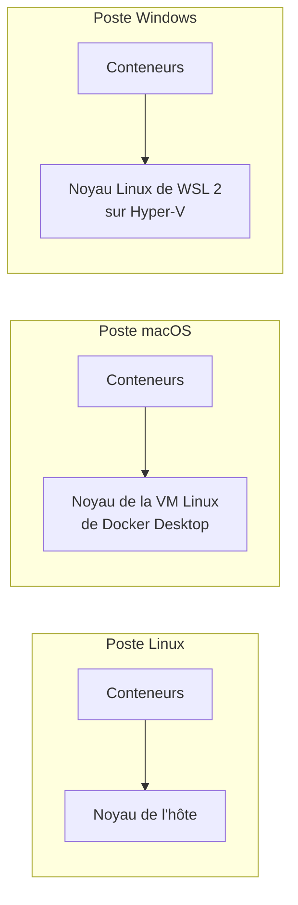
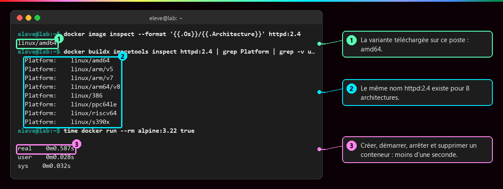

# Machine virtuelle ou conteneur

<p class="lead">Une machine virtuelle simule <strong>un ordinateur entier</strong>, avec son propre système et son propre noyau. Un conteneur est <strong>un programme de l'ordinateur hôte</strong>, isolé, qui partage le noyau de cet hôte. Ce ne sont pas deux tailles d'un même objet, mais deux niveaux d'isolation, qu'on peut d'ailleurs empiler.</p>

{ .hero }

!!! abstract "Dans cette page"

    **Tu vas comprendre :**

    - pourquoi on isole les applications les unes des autres ;
    - pourquoi un conteneur « Alpine » ou « Debian » tourne en réalité sur le noyau de ton ordinateur ;
    - quand choisir une machine virtuelle, un conteneur, ou les deux.

    **Prérequis :** [Du monolithe aux microservices](Du-monolithe-aux-microservices.md), Docker installé ([Bien démarrer](Bien-demarrer.md)). **Durée :** 30 min. **Niveau :** débutant.

!!! quote "En clair"

    Une **machine virtuelle**, c'est une **maison individuelle** : ses murs, sa chaudière, ses compteurs. Très indépendante, mais longue à construire et chère à chauffer. Un **conteneur**, c'est un **appartement** dans un immeuble : chacun chez soi, mais la chaudière commune (le **noyau**) est partagée, et on emménage en quelques secondes. Limite de l'image : si la chaudière commune tombe en panne, tout l'immeuble a froid. C'est le prix du partage.

    { .anim }

## L'essentiel en 30 secondes

<div class="grid cards" markdown>

-   :material-server:{ .lg .middle } __Machine virtuelle__

    ---

    Un **hyperviseur** (le logiciel qui découpe un ordinateur en machines virtuelles) fournit du matériel simulé ; chaque VM démarre son propre système **et son noyau**.

-   :material-docker:{ .lg .middle } __Conteneur__

    ---

    Des **programmes de l'hôte**, isolés, avec les fichiers de leur image. Ni système complet à démarrer, ni noyau à lui.

-   :material-linux:{ .lg .middle } __Où est le noyau ?__

    ---

    C'est toujours un noyau **Linux**. Sur Mac et Windows, il vit dans une **VM Linux** cachée.

-   :material-layers-triple-outline:{ .lg .middle } __Les deux ensemble__

    ---

    En production, les conteneurs tournent très souvent **à l'intérieur de VM**.

</div>

!!! warning "À retenir"

    **Voir « Alpine » ne veut pas dire qu'un noyau Alpine a démarré.** Le fichier `/etc/os-release` dit seulement de quelle distribution viennent les fichiers de l'image ; seule la commande `uname -r` dit quel noyau tourne vraiment. Un conteneur Linux ne peut donc ni changer de noyau, ni faire tourner Windows : pour ça, il faut une VM.

## :material-package-variant-closed: Pourquoi isoler une application

Deux applications installées sur le même serveur partagent tout : une mise à jour pour l'une **peut casser l'autre**.

| Conflit | Exemple |
|---|---|
| Versions de bibliothèques (du code partagé dont l'appli a besoin) | l'appli A exige Python 3.12, l'appli B Python 3.13 |
| Mêmes emplacements de fichiers | les deux attendent leur réglage dans `/etc/app.conf` |
| Ports réseau | les deux veulent écouter sur le port 80 |
| Ressources sans limite | une fuite de mémoire de A ralentit B |

Un conteneur **emballe** l'application avec tout ce dont elle a besoin, lui donne **sa propre vue** du système et **fixe** ce qu'elle peut utiliser.

???+ example "En vrai : deux Python côte à côte"

    **Ce qu'on fait :** on demande la version de Python dans deux conteneurs, l'un fait avec l'image Python 3.12, l'autre avec Python 3.13, puis on regarde vers quoi pointe le même chemin dans chacun.

    

    **Ce qu'il faut regarder :** ① Python 3.12 dans le premier conteneur ; ② Python 3.13 dans le second, et rien n'a été installé sur l'ordinateur ; ③ le même chemin `/usr/local/bin/python3` mène à deux programmes différents. **Même chemin ne veut pas dire même fichier** : chaque conteneur a ses propres fichiers.

## :material-linux: Programme, noyau, espace utilisateur

!!! quote "En clair"

    Le **noyau** est le chef d'atelier : les programmes ne touchent jamais eux-mêmes aux machines (processeur, mémoire, disque), ils lui **demandent**. Ces demandes s'appellent des appels système. Les programmes et leurs outils forment l'**espace utilisateur**. Une image apporte les ouvriers et leurs outils (ceux de Debian, d'Alpine…), jamais le chef d'atelier : c'est toujours celui de l'hôte.

    { .anim }

| Notion | En une ligne |
|---|---|
| **Processus** | un programme en cours d'exécution, avec son numéro (PID), sa mémoire, ses fichiers et connexions ouverts |
| **Noyau** (*kernel*) | le cœur du système : il gère le processeur, la mémoire et les périphériques |
| **Appel système** | la demande d'un programme au noyau : ouvrir un fichier, lancer un programme, parler au réseau |
| **Espace utilisateur** | tout ce qui tourne en dehors du noyau : applications, commandes, bibliothèques |
| **Distribution** | un espace utilisateur (Debian, Alpine, Ubuntu…) livré avec un noyau Linux |

Une **image** contient les fichiers d'un espace utilisateur, **sans noyau**, et on ne démarre pas tout un système : les outils de Debian ou d'Alpine s'exécutent directement sur le noyau de l'hôte.

???+ example "En vrai : trois distributions, un seul noyau"

    **Ce qu'on fait :** on affiche le nom de la distribution et la version du noyau, sur l'ordinateur hôte, puis dans un conteneur Alpine, puis dans un conteneur basé sur Debian (l'image `httpd`).

    

    **Ce qu'il faut regarder :** ① l'hôte est un Ubuntu ; ② le conteneur `alpine` a les fichiers d'Alpine ; ③ le conteneur `httpd` a ceux de Debian 13 ; ④ mais la version du noyau est **la même trois fois** : c'est celle de l'hôte, ici le noyau de WSL 2 (le Linux intégré à Windows).

???+ example "En vrai : un programme, deux processus de l'hôte"

    **Ce qu'on fait :** on lance deux conteneurs nginx, on demande à Docker leur numéro de programme sur l'hôte (`docker inspect` lit la fiche d'un conteneur), puis on les cherche avec `ps`, la commande qui liste les programmes de l'ordinateur.

    

    **Ce qu'il faut regarder :** ① deux conteneurs de la même image, deux numéros (PID) sur l'hôte ; ② vus depuis l'hôte, ce sont deux programmes ordinaires, le même nginx lancé deux fois. Un conteneur n'est pas une machine : ce qui l'isole est expliqué dans [Isolation d'un conteneur](Isolation-des-conteneurs.md).

## :material-server: La virtualisation : l'isolation matérielle

!!! quote "En clair"

    Un hyperviseur fait croire à chaque VM qu'elle a **son propre ordinateur** : processeur, mémoire, disque, carte réseau. Ce matériel est simulé et, en coulisses, partagé entre toutes les VM.

    { .anim }

Un **hyperviseur** répartit le matériel entre des **machines virtuelles** ; chaque VM a son système, sa mémoire, son stockage, son réseau.

| | **Type 1 : bare metal** | **Type 2 : hébergé** |
|---|---|---|
| S'exécute | directement sur le matériel, sans système dessous | au-dessus d'un système hôte (Windows, macOS…) |
| Pour | centres de données : performance, fiabilité | tests, postes de travail : simplicité |
| Exemples | VMware ESXi, Hyper-V, KVM, Xen | VirtualBox, VMware Workstation, Parallels |

| Avantages | Limites |
|---|---|
| **isolation complète** : un noyau par VM | **mémoire consommée** : un système complet par VM |
| **partage** d'un même serveur entre beaucoup de VM | **démarrage lent** : il faut démarrer un système, puis ses services |
| **portabilité** : une VM peut changer de serveur | **gestion lourde** : des dizaines de systèmes à mettre à jour |

??? note "Sous Windows, Hyper-V brouille la frontière"

    Hyper-V est un hyperviseur de **type 1** : une fois activé, Windows lui-même tourne au-dessus de lui, à côté de la VM de WSL 2. La distinction type 1 / type 2 est parfois moins nette qu'il n'y paraît.

## :material-scale-balance: VM et conteneur, côte à côte

| Critère | Machine virtuelle | Conteneur Linux |
|---|---|---|
| Ce qui est isolé | une machine entière et son système | des programmes et leur environnement |
| Noyau | **un par VM** | **partagé** avec l'hôte |
| Ce qui démarre | un système complet, puis ses services | **le programme principal**, c'est tout |
| Ce dont l'appli a besoin | installé dans le système de la VM | rangé dans l'image |
| Mécanisme | matériel simulé | protections du noyau ([Isolation d'un conteneur](Isolation-des-conteneurs.md)) |

Partager le noyau évite de faire tourner un système complet par conteneur, mais **l'application consomme toujours autant de processeur et de mémoire**. Et **aucune des deux solutions n'est une sécurité absolue**.

| Ton poste | Noyau utilisé par les conteneurs Linux |
|---|---|
| Docker Engine sur Linux | celui de l'**ordinateur Linux** lui-même |
| Docker Desktop sur macOS | celui d'une **VM Linux** gérée par Docker Desktop |
| Docker Desktop sous Windows | celui d'une **VM Linux**, par exemple WSL 2 |

???+ example "En vrai : sur quel noyau tournent mes conteneurs ?"

    **Ce qu'on fait :** on demande à Docker la version du client et du moteur, puis où tourne le moteur, puis par quel chemin le client lui parle.

    

    **Ce qu'il faut regarder :** ① la commande `docker` (le client) pilote un moteur, ici tous deux en version 29.8 ; ② le moteur tourne dans la VM légère de WSL 2 : c'est **ce noyau-là** que partagent les conteneurs, pas celui de Windows ; ③ le client parle au moteur par le socket local, `docker.sock`, une prise de communication sur la même machine.

    L'ordinateur où l'on tape `docker` n'est donc pas forcément celui qui exécute les conteneurs : un « contexte » peut viser un moteur sur un autre serveur (`docker context create distant --docker "host=ssh://admin@serveur.exemple"`, ou la variable `DOCKER_HOST`).



Les **conteneurs Windows**, qui partagent un noyau Windows, sont un cas à part, non traité ici.

## :material-earth: Portable… sous conditions

Un conteneur, c'est un programme isolé avec le minimum de fichiers dont il a besoin. Ses quatre promesses : **portabilité** (il tourne sur tout hôte *compatible*), **immuabilité** (on le remplace au lieu de le modifier), **rapidité** (quelques secondes pour démarrer, souvent moins) et **densité** (beaucoup de conteneurs sur une même machine).

Mais une image ne contient pas tout. Pour tourner, elle dépend aussi d'un **noyau compatible**, de l'**architecture du processeur** (le type de puce : AMD64 pour la plupart des PC, ARM64 pour les Mac récents ou un Raspberry Pi), du **réseau** et des **services extérieurs**, des **données** et des **secrets** (mots de passe, clés).

???+ example "En vrai : un nom, huit architectures, moins d'une seconde"

    **Ce qu'on fait :** on regarde pour quelle architecture est faite l'image `httpd:2.4` téléchargée, puis pour lesquelles elle existe sur Docker Hub, et enfin on chronomètre un conteneur complet.

    

    **Ce qu'il faut regarder :** ① la version téléchargée sur ce poste est faite pour `amd64` ; ② le même nom `httpd:2.4` existe en **8** versions, une par architecture : un Mac à puce ARM obtient automatiquement `arm64/v8` ; ③ créer, démarrer, arrêter et supprimer un conteneur prend **moins d'une seconde**. Compare aux dizaines de secondes qu'il faut pour démarrer une VM.

    Une image construite pour une seule architecture échoue ailleurs (`exec format error`), sauf à simuler l'autre processeur.

| Situation | Choix | Raison |
|---|---|---|
| Serveur Windows sur un hôte Linux | **VM** | un conteneur Linux ne change pas de noyau |
| Tester une version du noyau | **VM** | le noyau d'un conteneur est celui de l'hôte |
| Clients qui ne se font pas confiance | **VM** (avec des conteneurs dedans) | une faille du noyau partagé toucherait tout le monde |
| Vingt services d'une même application | **Conteneurs** | densité, démarrage rapide, images versionnées |
| Même environnement de développement pour toute l'équipe | **Conteneurs** | une image remplace une longue procédure d'installation |
| Cluster Kubernetes dans le cloud | **Les deux** | machines en VM, applications en conteneurs ([les couches](Virtualisation-et-orchestration.md)) |

## :material-flask-outline: À toi de jouer

Cinq étapes, environ 5 minutes. Tu vas vérifier par toi-même que tes conteneurs utilisent le noyau de ton ordinateur, et qu'un conteneur n'est qu'un programme de plus. Tape les commandes dans le terminal où tu utilises `docker` (Ubuntu sous Windows).

**Étape 1 · Regarder ton ordinateur**

```bash
grep PRETTY /etc/os-release   # (1)!
uname -r                      # (2)!
```

1. `grep PRETTY` cherche la ligne qui contient « PRETTY » dans le fichier `/etc/os-release` : le nom lisible de la distribution.
2. Affiche la version du noyau en marche (`-r` pour *release*).

Tu dois voir ta distribution, puis ton noyau (les tiens peuvent être différents) :

```text
PRETTY_NAME="Ubuntu 26.04 LTS"
6.18.33.2-microsoft-standard-WSL2
```

**Étape 2 · Même question dans un conteneur Alpine**

```bash
docker run --rm alpine:3.22 sh -c 'grep PRETTY /etc/os-release; uname -r'   # (1)!
```

1. `--rm` : le conteneur est supprimé dès qu'il a fini. `alpine:3.22` : une image Linux très légère. `sh -c '…'` : fait exécuter les deux commandes de l'étape 1, l'une après l'autre, **dans** le conteneur.

Tu dois voir **Alpine** à la place de ta distribution, mais **exactement le même noyau** qu'à l'étape 1 :

```text
PRETTY_NAME="Alpine Linux v3.22"
6.18.33.2-microsoft-standard-WSL2
```

**Étape 3 · Où tourne le moteur, et à quelle vitesse**

```bash
docker info --format '{{.OperatingSystem}} / {{.KernelVersion}}'        # (1)!
docker image inspect --format '{{.Os}}/{{.Architecture}}' alpine:3.22   # (2)!
time docker run --rm alpine:3.22 true                                   # (3)!
```

1. `docker info` décrit le moteur ; `--format` ne garde que son système et son noyau.
2. Pour quel système et quel processeur est faite l'image téléchargée.
3. `time` chronomètre la commande qui suit. `true` est un programme qui ne fait rien et s'arrête aussitôt : on mesure donc le temps de créer, démarrer, arrêter et supprimer un conteneur.

Tu dois voir le système du moteur, l'architecture de l'image, puis un temps sous la seconde (le tien sera différent) :

```text
Ubuntu 26.04 LTS / 6.18.33.2-microsoft-standard-WSL2
linux/amd64

real	0m0.669s
user	0m0.036s
sys	0m0.023s
```

Regarde la ligne `real` : c'est le temps réel écoulé.

**Étape 4 · Un conteneur, vu comme un simple programme**

```bash
docker run -d --name temoin nginx:stable                               # (1)!
docker inspect --format '{{.State.Pid}}' temoin                        # (2)!
ps -o pid,cmd -p $(docker inspect --format '{{.State.Pid}}' temoin)    # (3)!
```

1. Lance un serveur web nginx en arrière-plan (`-d`), nommé `temoin`.
2. Demande à Docker le numéro (PID) de son programme principal, **vu depuis l'hôte**.
3. `ps` liste des programmes de l'ordinateur : ici, seulement celui dont le numéro est donné par la commande entre `$( )`. `-o pid,cmd` : afficher le numéro et la ligne de commande.

Tu dois voir un numéro (le tien sera différent), puis nginx parmi les programmes ordinaires de ton ordinateur :

```text
258268
    PID CMD
 258268 nginx: master process nginx -g daemon off;
```

**Étape 5 · Faire le ménage**

```bash
docker rm -f temoin   # (1)!
```

1. `rm` supprime le conteneur, `-f` l'arrête d'abord. Ceux des étapes 2 et 3 sont déjà partis tout seuls grâce à `--rm`.

Tu dois voir :

```text
temoin
```

??? tip "Ça ne marche pas ?"

    | Message ou symptôme | Cause | Solution |
    |---|---|---|
    | `grep: /etc/os-release: No such file or directory` | tu es sur macOS, qui n'a pas ce fichier | sur Mac, `sw_vers` donne la version du système ; l'étape 2 marche normalement |
    | `uname -r` donne un autre noyau qu'à l'étape 2 | tu es sur macOS ou sur Windows avec Docker Desktop : les conteneurs tournent dans une VM Linux | c'est normal : le noyau du conteneur est celui de cette VM (`docker info` à l'étape 3 le confirme) |
    | `time` ou `grep` : commande inconnue | tu es dans PowerShell ou l'invite de commandes Windows | ouvre le terminal **Ubuntu** |
    | `ps` n'affiche que l'en-tête `PID CMD`, ou une erreur | sur Docker Desktop (Mac ou Windows), le programme tourne dans la VM cachée, pas sur ton ordinateur | c'est normal ; avec Docker Engine sur Linux ou dans Ubuntu sous WSL, il apparaît |
    | `Conflict. The container name "/temoin" is already in use` | un essai précédent n'a pas été nettoyé | `docker rm -f temoin` puis recommence l'étape 4 |

## :material-help-circle-outline: Vérifie que tu as compris

??? question "1. Je lance un conteneur `debian` sur un ordinateur Ubuntu. Quel noyau tourne dans le conteneur ?"

    **Celui de l'ordinateur Ubuntu.** Dans le conteneur, `/etc/os-release` affichera Debian, parce que les fichiers viennent de l'image Debian. Mais `uname -r` affichera la même valeur que sur l'hôte : une image n'apporte jamais de noyau.

??? question "2. Un client veut faire tourner un serveur Windows sur ton serveur Linux. Conteneur ou machine virtuelle ?"

    **Machine virtuelle.** Un conteneur Linux utilise le noyau Linux de l'hôte et ne peut pas en changer. Windows a besoin de son propre noyau : seule une VM, avec son système complet, peut le fournir.

??? question "3. Pourquoi un conteneur démarre-t-il en moins d'une seconde, alors qu'une VM met des dizaines de secondes ?"

    Parce qu'il n'y a **aucun système à démarrer** : le noyau de l'hôte tourne déjà. Docker prépare les fichiers et l'isolation, puis lance un seul programme. Une VM, elle, doit démarrer tout un système avant même de lancer l'application. Attention : une fois lancée, l'application consomme autant de mémoire et de processeur dans les deux cas.

!!! success "Et ensuite ?"

    Tu sais qu'un conteneur est un programme de l'hôte qui partage son noyau. Mais alors, comment est-il isolé des autres ? Page suivante : [Isolation d'un conteneur](Isolation-des-conteneurs.md).

## :material-server: Pour aller plus loin

??? note "L'Infrastructure as Code : décrire plutôt que cliquer"

    Gérer des dizaines de VM à la main a fait naître l'**IaC** : on écrit **l'état attendu** dans des fichiers, l'outil se charge de l'atteindre. On **automatise**, on **versionne** (Git), on **reproduit** à l'identique, on l'intègre à la CI/CD. Outils : Terraform, OpenTofu, Ansible, Puppet, Chef, CloudFormation, Pulumi.

    ```hcl
    # main.tf : le principe est le même pour des VM, avec le fournisseur d'un cloud ou d'un hyperviseur
    terraform {
      required_providers {
        docker = { source = "kreuzwerker/docker" }
      }
    }
    resource "docker_image" "nginx" { name = "nginx:1.25" }
    resource "docker_container" "web" {
      name  = "web"
      image = docker_image.nginx.image_id
      ports {
        internal = 80
        external = 8080
      }
    }
    ```

    `terraform plan` annonce `Plan: 2 to add` ; un premier `apply` crée l'image et le conteneur ; un second répond `No changes`, puisque l'état réel correspond déjà à l'état décrit. Cette idée d'**état désiré** revient avec Compose puis Kubernetes ([Kubernetes : état désiré et réconciliation](Kubernetes-etat-desire.md)).

??? note "Documentation officielle"

    [Conteneurs et machines virtuelles (Docker)](https://docs.docker.com/get-started/docker-concepts/the-basics/what-is-a-container/), [Virtualisation dans Docker Desktop](https://docs.docker.com/desktop/features/vmm/), [Docker Desktop et WSL 2](https://docs.docker.com/desktop/features/wsl/), [Images multiplateformes](https://docs.docker.com/build/building/multi-platform/). Microservices et conteneurs sont deux sujets distincts : voir [Du monolithe aux microservices](Du-monolithe-aux-microservices.md).

??? abstract "Pour les créateurs : script de motion design « Où est le noyau ? » (65 s)"

    Style : formes plates, le noyau toujours représenté par une même dalle rose, les systèmes invités en gris. Textes à l'écran seulement.

    | Séq. | Durée | À l'écran | Animation | Texte à l'écran |
    |---|---|---|---|---|
    | 1 | 0-7 s | Un serveur, deux applications A et B posées dessus, une seule étagère « bibliothèques » | Les deux applications tirent sur la même étagère ; une bibliothèque change de couleur et B se met à clignoter en rouge | « Sur un serveur partagé, une mise à jour pour A peut casser B. » |
    | 2 | 7-17 s | Une couche « Hyperviseur » se glisse sous les applications | Chaque application s'entoure d'une boîte complète : système invité gris + dalle rose « noyau » | « Machine virtuelle : chaque application reçoit une machine entière, avec son noyau. » |
    | 3 | 17-25 s | Un compteur « mémoire » et un chronomètre à côté de chaque VM | Le chronomètre tourne longtemps (amorçage du système, puis des services) ; la jauge mémoire grimpe avant même que l'application démarre | « Isolation forte, mais un système complet à démarrer et à maintenir par VM. » |
    | 4 | 25-37 s | Retour au serveur ; une seule grande dalle rose « noyau partagé » | Les systèmes invités gris s'évaporent ; il reste A et B, chacun dans une bulle fine | « Conteneur : on garde le noyau de l'hôte, on n'isole que les processus. » |
    | 5 | 37-45 s | Dans chaque bulle, une étiquette « Alpine » ou « Debian » ; sous la dalle, « uname -r » | Les étiquettes changent ; la valeur sous la dalle reste identique | « L'image apporte l'espace utilisateur. Le noyau, lui, ne change pas. » |
    | 6 | 45-55 s | Trois postes : Linux, Mac, Windows | Sur Mac et Windows, une petite VM Linux surgit derrière les conteneurs et la dalle rose se loge dedans | « Sur Mac et Windows, une VM Linux fournit le noyau. » |
    | 7 | 55-65 s | Recul : une salle de serveurs ; dans chaque serveur, des VM ; dans chaque VM, des bulles de conteneurs | Les trois niveaux s'allument l'un après l'autre | « VM et conteneurs ne s'opposent pas : ils s'empilent. » |

    Garder **exactement la même dalle** pour le noyau tout au long de la vidéo : c'est en suivant cet objet que le spectateur comprend qu'il est dupliqué dans les VM et partagé par les conteneurs. En séquence 5, afficher la vraie valeur de `uname -r` (`6.18.33.2-microsoft-standard-WSL2` sur le poste des captures).

??? info "Pour les créateurs : idées de schémas"

    **Deux piles côte à côte** : c'est l'illustration d'en-tête. À mettre en valeur : la ligne « OS invité + noyau » **répétée** à gauche, **absente** à droite ; c'est elle qui coûte de la mémoire et du temps de démarrage.

    **Les deux types d'hyperviseurs** : à gauche, VM Linux et VM Windows sur l'hyperviseur, directement sur le matériel ; à droite, une VM de test sur VirtualBox, au-dessus du système hôte, au-dessus du matériel.

    **Un noyau, plusieurs espaces utilisateur** :

    ```mermaid
    flowchart TB
        A["Conteneur Alpine<br/>/etc/os-release : Alpine"] -- "appels système" --> K["Noyau Linux de l'hôte<br/>uname -r : le même partout"]
        D["Conteneur Debian<br/>/etc/os-release : Debian"] -- "appels système" --> K
        U["Shell de l'hôte Ubuntu"] -- "appels système" --> K
        K --> HW["Matériel physique ou virtuel"]
    ```
