```mermaid
gantt
    dateFormat X
    axisFormat %s
    section RollingUpdate
    v1 (3 pods puis décroissant) :a1, 0, 6
    v2 (croissant jusqu'à 3)     :a2, 2, 10
    section Recreate
    v1 (3 pods)                  :b1, 0, 4
    coupure                      :crit, b2, 4, 6
    v2 (3 pods)                  :b3, 6, 10
```

# Pod, Deployment, ReplicaSet

<p class="lead">Le <strong>Pod</strong> est l'unité qu'on exécute, le <strong>ReplicaSet</strong> garantit qu'il en existe toujours <em>n</em> copies, et le <strong>Deployment</strong> pilote les ReplicaSets pour changer de version progressivement, garder l'historique et revenir en arrière.</p>

{ .hero }

## L'essentiel en 30 secondes

<div class="grid cards" markdown>

-   :material-cube-outline:{ .lg .middle } __Pod__

    ---

    Un ou plusieurs conteneurs qui partagent IP, `localhost` et volumes. Éphémère : **remplacé**, jamais réparé.

-   :material-content-copy:{ .lg .middle } __ReplicaSet__

    ---

    Compte les pods qui portent **ses labels** et en garantit *n*. Généré : on ne l'écrit pas à la main.

-   :material-rocket-launch-outline:{ .lg .middle } __Deployment__

    ---

    Ce qu'on écrit : version, nombre, stratégie. Chaque changement du **modèle de pod** crée une révision.

-   :material-undo:{ .lg .middle } __Rollback__

    ---

    L'ancien ReplicaSet est gardé à 0 pod. Revenir en arrière, c'est le **remettre à l'échelle**.

</div>

!!! warning "À retenir"

    **Un pod seul n'est pas de l'orchestration** : sans ReplicaSet, personne ne le recrée ; en pratique, on écrit des Deployments. Et **sans readinessProbe, « Running » veut dire « prêt »** : le rolling update avance dès qu'un conteneur démarre, même si l'application ne répond pas encore (voir [Démarré n'est pas disponible](Demarre-n-est-pas-disponible.md)).

## :material-cube-outline: Le Pod

Les conteneurs d'un pod partagent **la même IP**, le même `localhost`, le même nom d'hôte et les mêmes volumes : c'est le partage de namespaces vu dans [Isolation d'un conteneur](Isolation-des-conteneurs.md), porté par un petit conteneur **`pause`** créé en premier. Le cas courant est un conteneur par pod ; plusieurs se justifient s'ils sont indissociables (un « sidecar » qui relaie les journaux).

| Ce qui arrive | Qui réagit | Résultat |
|---|---|---|
| le conteneur plante | le **kubelet** (`restartPolicy: Always` par défaut) | **même** pod, conteneur relancé, `RESTARTS` augmente |
| le pod est supprimé ou son nœud est perdu | le **ReplicaSet**, s'il existe | **nouveau** pod : autre nom, autre IP (d'où le besoin d'un Service) |
| pod créé seul (`kubectl run`) et supprimé | personne | il est perdu |

???+ example "En vrai : un pod lancé seul"

    

    `containerPort` (ici `--port=80`) est **informatif** : il ne publie rien. `port-forward` ouvre un tunnel temporaire à travers l'API server, utile pour tester, pas pour exposer. Dans la liste, `demo-web` est le seul pod sans ReplicaSet : supprimé, il n'a pas été recréé.

??? note "Deux conteneurs dans un pod partagent localhost"

    ```yaml
    apiVersion: v1
    kind: Pod
    metadata:
      name: duo
    spec:
      containers:
        - name: web
          image: nginx:1.25
        - name: sonde
          image: busybox:1.36
          command: ["sh", "-c", "while true; do wget -qO- http://localhost:80 | head -n 4; sleep 10; done"]
    ```

    `kubectl get pod duo` affiche `READY 2/2` et `kubectl logs duo -c sonde` le début de la page de nginx : `sonde` joint nginx par `localhost`, grâce au namespace réseau porté par `pause`. Sur le nœud, `sudo crictl ps --pod <id>` montre deux conteneurs pour un seul pod. Un pod est une **petite machine logique** : on le réplique en entier, jamais conteneur par conteneur.

??? note "Utiliser une image construite en local (Minikube)"

    ```bash
    docker build -t demo-web:1.0 .
    minikube image load demo-web:1.0               # copie l'image dans le containerd du nœud
    minikube image ls | grep demo-web              # docker.io/library/demo-web:1.0
    kubectl run demo-web --image=demo-web:1.0 --image-pull-policy=Never --port=80
    ```

    L'image de `docker images` sur l'hôte et celle du cluster vivent dans **deux magasins différents**. `minikube image load` importe directement l'image dans containerd ; avec ce runtime, `minikube docker-env` échoue. Piège : `imagePullPolicy` vaut `Always` pour un tag `latest` ou absent, `IfNotPresent` sinon. Avec `Always`, le kubelet cherche `demo-web` sur Docker Hub et le pod reste en `ErrImagePull` puis `ImagePullBackOff`. Avec un tag précis déjà chargé, `IfNotPresent` suffit ; `Never` interdit tout téléchargement.

## :material-tag-outline: Labels, sélecteurs et chaîne de propriété

Un **label** est une étiquette clé-valeur (`app: web`) ; un **sélecteur** filtre sur ces étiquettes. Le ReplicaSet ne possède pas une liste de noms : il **compte les pods qui portent ses labels**, et le Service retrouve ses pods de la même façon.

???+ example "En vrai : Deployment, ReplicaSets et Pods"

    

    Les noms suivent la chaîne : `mailpit` crée `mailpit-<empreinte>`, qui crée `mailpit-<empreinte>-<5 caractères>`. L'empreinte est le label `pod-template-hash`, calculé à partir du modèle de pod. On écrit le Deployment ; ReplicaSets et Pods sont **générés**.

???+ example "En vrai : créer un Deployment depuis le Dashboard"

    

    Le formulaire ne crée pas « des conteneurs » : il crée un **Deployment** (« to maintain the desired number of pods ») avec un label tiré du nom, ici `k8s-app: mailpit`, qui sert aussi de sélecteur.

## :material-file-cog-outline: Le Deployment, champ par champ

Le sélecteur `selector.matchLabels` et les labels du `template` doivent correspondre, sinon l'API refuse le Deployment. Les valeurs par défaut :

| Champ | Rôle | Par défaut |
|---|---|---|
| `replicas` | nombre de pods désirés | 1 |
| `selector.matchLabels` | quels pods appartiennent au Deployment (**non modifiable** ensuite) | obligatoire |
| `template` | le **modèle de pod** ; ses labels doivent correspondre au sélecteur | obligatoire |
| `strategy.type` | `RollingUpdate` (progressif) ou `Recreate` (tout arrêter, puis tout recréer) | `RollingUpdate` |
| `rollingUpdate.maxSurge` | pods **en plus** de `replicas` pendant la mise à jour | 25 % (arrondi au-dessus) |
| `rollingUpdate.maxUnavailable` | pods **en moins** pouvant être indisponibles | 25 % (arrondi au-dessous) |
| `revisionHistoryLimit` | anciens ReplicaSets conservés pour le rollback | 10 |
| `progressDeadlineSeconds` | délai avant de signaler une mise à jour bloquée | 600 |

??? example "Le manifeste complet : web-deploy.yaml"

    ```yaml
    apiVersion: apps/v1
    kind: Deployment
    metadata:
      name: web-deploy
      labels: { app: web }
    spec:
      replicas: 3
      selector: { matchLabels: { app: web } }
      strategy:
        type: RollingUpdate
        rollingUpdate: { maxUnavailable: 1, maxSurge: 1 }
      template:
        metadata: { labels: { app: web } }
        spec:
          containers:
            - name: web
              image: nginx:1.25
              ports: [{ containerPort: 80 }]
    ```

???+ example "En vrai : mettre à l'échelle ne crée pas de révision"

    

    

    Passer de 1 à 2 réplicas ne modifie que le champ `replicas` : le second pod porte la **même empreinte**, donc le même ReplicaSet. Un `kubectl scale` est écrasé au prochain `apply` du fichier ; pour suivre la charge automatiquement, l'**HPA** (HorizontalPodAutoscaler) ajuste lui-même `replicas`.

## :material-update: Mise à jour, historique, rollback

**Seul un changement du `template`** (image, variables, ports…) crée une **révision**, donc un **nouveau ReplicaSet** ; l'ancien est ramené à 0 pod mais **conservé**. Le RollingUpdate monte l'un et descend l'autre pas à pas, sans jamais dépasser `maxSurge` ni passer sous `maxUnavailable`.

???+ example "En vrai : le remplacement pod par pod"

    

    Avec 2 réplicas, 25 % donne `maxSurge` = 1 et `maxUnavailable` = 0 : il n'y a jamais moins de 2 pods prêts. Les événements montrent l'alternance : un nouveau pod, un ancien en moins, jusqu'à ce que l'ancien ReplicaSet soit à 0. La progression attend que chaque nouveau pod soit **prêt** : c'est la readinessProbe qui donne un vrai sens à ce mot.

???+ danger "En vrai : Kubernetes compare la déclaration, pas l'image"

    

    

    Ajouter `:latest` à `axllent/mailpit` désigne **la même image**, mais le texte du modèle change : nouvelle révision, nouveau ReplicaSet, tous les pods remplacés. À l'inverse, repousser une autre image sous le **même tag** ne déclenche rien.

???+ example "En vrai : rollout restart crée aussi une révision"

    

    `rollout restart` ajoute une annotation horodatée au modèle de pod : c'est une révision comme une autre, d'où l'ancien ReplicaSet visible à 0 pod.

???+ danger "Une version cassée, puis le retour arrière"

    ```bash
    kubectl set image deployment/web-deploy web=nginx:9.99          # tag inexistant
    kubectl rollout status deployment/web-deploy --timeout=30s      # ne se termine pas
    kubectl get pods -l app=web       # 2 anciens Running, 2 nouveaux en ErrImagePull / ImagePullBackOff
    kubectl rollout history deployment/web-deploy
    kubectl rollout undo deployment/web-deploy                      # ou --to-revision=1
    ```

    Avec 3 réplicas et `maxUnavailable: 1`, un **seul** ancien pod a été supprimé : les deux autres continuent de servir. Sans action, le Deployment passe en échec (`ProgressDeadlineExceeded`) au bout de `progressDeadlineSeconds`. Le `rollout undo` remet à l'échelle l'ancien ReplicaSet, qui reçoit un **nouveau numéro** de révision. La colonne `CHANGE-CAUSE` reste vide si personne ne pose l'annotation `kubernetes.io/change-cause` (l'option `--record` est abandonnée) ; recopiée à chaque révision, elle doit être mise à jour à chaque version.

`Recreate` provoque une coupure, mais garantit que deux versions ne tournent jamais ensemble : on le choisit par exemple quand un seul pod peut monter un volume à la fois (une base de données sur un PersistentVolumeClaim).



??? note "Deux pièges de plus"

    - **`maxSurge` et `maxUnavailable` ne peuvent pas valoir 0 tous les deux** : la mise à jour ne pourrait jamais progresser.
    - **Sans `requests` ni `limits`**, un pod est en classe QoS `BestEffort` (c'est ce qu'affiche `kubectl describe pod` pour `demo-web`) : il est le premier évincé si le nœud manque de mémoire.

??? note "Les autres objets fondamentaux"

    | Objet | Rôle | Où l'approfondir |
    |---|---|---|
    | **Service** | point d'accès réseau stable vers un ensemble de Pods (ClusterIP, NodePort, LoadBalancer) | [Service et Ingress](Service-et-Ingress.md) |
    | **Ingress** | règles HTTP(S) vers des Services, appliquées par un Ingress Controller (Traefik, par exemple) | [Service et Ingress](Service-et-Ingress.md) |
    | **Namespace** | cloisonnement logique : quotas, droits (RBAC), séparation des équipes | [Kubernetes : état désiré](Kubernetes-etat-desire.md) |
    | **ConfigMap / Secret** | configuration externe et données sensibles, injectées dans les Pods | [De Compose aux manifestes Kubernetes](De-Compose-a-Kubernetes.md) |

## :material-flask-outline: À toi de jouer

```bash
kubectl apply -f web-deploy.yaml                         # le manifeste complet ci-dessus
kubectl get deploy,rs,pods -l app=web --show-labels       # pod-template-hash sur chaque pod
kubectl delete pod $(kubectl get pods -l app=web -o name | head -1) && kubectl get pods -l app=web   # toujours 3
kubectl scale deployment/web-deploy --replicas=5 && kubectl get rs -l app=web   # même ReplicaSet
kubectl set image deployment/web-deploy web=nginx:1.27
kubectl rollout status deployment/web-deploy
kubectl get rs -l app=web                                 # deux ReplicaSets : 5/5 et 0/0
kubectl rollout history deployment/web-deploy             # deux révisions
kubectl rollout undo deployment/web-deploy && kubectl rollout status deployment/web-deploy
kubectl get deployment web-deploy -o jsonpath='{.spec.template.spec.containers[0].image}{"\n"}'   # nginx:1.25
kubectl delete -f web-deploy.yaml
```

??? abstract "Pour les créateurs : script de motion design « Changer de version sans éteindre la lumière » (80 s)"

    Fond sombre, pods en hexagones (bleu = v1, violet = v2), une ampoule « service disponible » en haut à droite, deux jauges verticales « total ≤ 4 » et « disponibles ≥ 2 » sur le côté.

    | Séq. | Durée | À l'écran | Animation | Texte à l'écran |
    |---|---|---|---|---|
    | 1 | 0-8 s | Une boîte « Deployment » qui contient une boîte « ReplicaSet v1 » et trois hexagones bleus | Les hexagones pulsent doucement ; l'ampoule est allumée | « Trois pods v1 servent le trafic. » |
    | 2 | 8-16 s | Le fichier YAML ; la ligne `image: nginx:1.25` devient `nginx:1.27` | La modification s'écrit lettre par lettre ; une seconde boîte « ReplicaSet v2 » apparaît, vide | « On change le modèle de pod : une nouvelle révision naît. » |
    | 3 | 16-28 s | Les deux jauges s'affichent | Un hexagone violet apparaît en pointillé (démarrage) ; un bleu s'éteint ; la jauge « total » monte à 4, « disponibles » descend à 2 et reste au-dessus de la ligne rouge | « maxSurge : un pod de plus. maxUnavailable : un pod de moins. Jamais au-delà. » |
    | 4 | 28-38 s | Gros plan sur l'hexagone violet en pointillé | Un petit voyant « readiness » passe de l'orange au vert ; alors seulement le contour devient plein | « On attend qu'il soit prêt avant d'aller plus loin. » |
    | 5 | 38-52 s | Les échanges continuent | Un bleu s'éteint, un violet s'allume, deux fois ; l'ampoule ne clignote jamais | « Pod par pod, le service reste allumé. » |
    | 6 | 52-60 s | La boîte « ReplicaSet v1 » vide, en gris, reste à l'écran | Une étiquette « révision 1, 0 pod, conservée » s'y accroche | « L'ancienne version n'est pas détruite : elle attend. » |
    | 7 | 60-72 s | Une nouvelle mise à jour vers « v3 » : les hexagones deviennent rouges et clignotent « ErrImagePull » | La progression se fige ; deux hexagones violets restent allumés ; puis un bouton « rollout undo » est pressé, les rouges disparaissent et le ReplicaSet v2 se remplit | « Version cassée ? La progression s'arrête, et on revient en arrière en une commande. » |
    | 8 | 72-80 s | Écran de synthèse : Deployment, ReplicaSets empilés comme des pages d'un historique | Les pages se feuillettent | « Le Deployment écrit l'histoire. Les ReplicaSets en sont les pages. » |

    Les deux jauges sont l'élément pédagogique central : elles doivent rester visibles pendant toute la séquence 5, pour que l'on voie que les bornes ne sont **jamais** franchies. L'ampoule qui ne clignote pas porte le message « sans coupure » mieux qu'un texte.

??? info "Pour les créateurs : l'anatomie d'un pod et le rolling update pas à pas"

    **Anatomie d'un pod.** Un grand rectangle arrondi « Pod » avec une seule étiquette « IP 10.244.0.13 » sur son bord. À l'intérieur : un petit bloc gris « pause » en bas (il « tient » le réseau), deux blocs colorés « web » et « sonde » posés dessus, une flèche `localhost:80` entre eux, et un cylindre « volume » branché aux deux. À l'extérieur, une flèche « kubelet » qui relance un conteneur planté **dans** le rectangle, et une flèche « ReplicaSet » qui remplace **tout** le rectangle.

    **Rolling update pas à pas** (3 réplicas, maxSurge 1, maxUnavailable 1), repris dans l'illustration d'en-tête :

    | Étape | Pods v1 (nginx:1.25) | Pods v2 (nginx:1.27) | Total (≤ 4) | Disponibles (≥ 2) |
    |---|---|---|---|---|
    | 0 | ● ● ● | | 3 | 3 |
    | 1 | ● ● | ○ ○ (démarrage) | 4 | 2 |
    | 2 | ● | ● ● ○ | 4 | 3 |
    | 3 | | ● ● ● | 3 | 3 |

    ● pod prêt, ○ pod qui démarre. L'ordre exact peut varier selon le temps de démarrage des pods ; les deux bornes, elles, sont toujours respectées.
