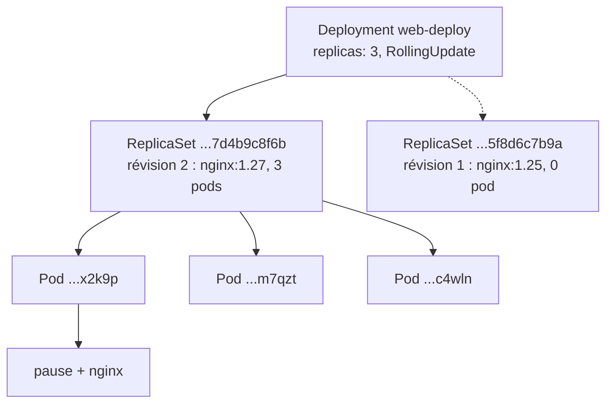

# Pod, Deployment, ReplicaSet

> **En une phrase.** Le **Pod** est l'unité qu'on exécute, le **ReplicaSet** garantit qu'il en existe toujours *n* copies, et le **Deployment** pilote les ReplicaSets pour changer de version progressivement, garder l'historique et revenir en arrière.

---

## 1. Synthèse

### Le modèle mental : trois niveaux emboîtés

```
Deployment  web-deploy                    « quelle version, combien, comment changer »
 │   stratégie RollingUpdate, historique des révisions
 │
 ├── ReplicaSet  web-deploy-7d4b9c8f6b    révision 2 (actuelle)   « garantir 3 copies »
 │     ├── Pod  web-deploy-7d4b9c8f6b-x2k9p   « une instance »
 │     ├── Pod  web-deploy-7d4b9c8f6b-m7qzt
 │     └── Pod  web-deploy-7d4b9c8f6b-c4wln
 │            └── conteneur(s) : nginx:1.27
 │
 └── ReplicaSet  web-deploy-5f8d6c7b9a    révision 1 (ancienne, 0 pod, gardée pour le rollback)
```

On écrit le **Deployment**. Le ReplicaSet et les Pods sont **générés** : on ne les crée ni ne les modifie à la main.

### Les objets fondamentaux de Kubernetes

| Objet | Rôle | Où l'approfondir |
|---|---|---|
| **Pod** | plus petite unité déployable : un ou plusieurs conteneurs qui partagent réseau et volumes | cette page |
| **ReplicaSet** | garantit *n* réplicas identiques d'un Pod ; généré par un Deployment | cette page |
| **Deployment** | stratégie de mise à jour (rolling update), historique, rollback | cette page |
| **Service** | point d'accès réseau stable vers un ensemble de Pods (ClusterIP, NodePort, LoadBalancer) | [Service et Ingress](Service-et-Ingress.md) |
| **Ingress** | règles HTTP(S) vers des Services, appliquées par un Ingress Controller (par exemple Traefik) | [Service et Ingress](Service-et-Ingress.md) |
| **Namespace** | cloisonnement logique : quotas, droits (RBAC), séparation des équipes ou des environnements | [Kubernetes : état désiré](Kubernetes-etat-desire.md) |
| **ConfigMap / Secret** | configuration externe et données sensibles, injectées dans les Pods | [De Compose aux manifestes Kubernetes](De-Compose-a-Kubernetes.md) |

### Le Pod

- Un **Pod** regroupe un ou plusieurs conteneurs qui partagent **la même IP**, le même `localhost`, le même nom d'hôte et les mêmes volumes. C'est le principe du partage de namespaces vu dans [Isolation d'un conteneur](Isolation-des-conteneurs.md).
- Ce partage est porté par un petit conteneur **`pause`**, créé en premier : il détient les namespaces réseau et IPC du pod, auxquels les conteneurs applicatifs se rattachent.
- Un pod est **éphémère** : s'il disparaît, il n'est pas « réparé », il est **remplacé** par un autre pod, avec un autre nom et une autre IP. D'où le besoin d'un Service pour le joindre.
- Le cas courant est **un conteneur par pod**. Plusieurs conteneurs se justifient s'ils sont indissociables (un « sidecar » qui relaie les journaux, par exemple).

| Ce qui arrive | Qui réagit | Résultat |
|---|---|---|
| le conteneur plante | le **kubelet** (`restartPolicy: Always` par défaut) | **même** pod, conteneur relancé, colonne `RESTARTS` qui augmente |
| le pod est supprimé ou son nœud est perdu | le **ReplicaSet**, s'il existe | **nouveau** pod, nouveau nom, nouvelle IP |
| pod créé seul (`kubectl run`) et supprimé | personne | il est perdu |

### Labels et sélecteurs : le lien entre les objets

Un **label** est une étiquette clé-valeur posée sur un objet (`app: web`). Un **sélecteur** est un filtre sur ces étiquettes. Le ReplicaSet ne « possède » pas ses pods par une liste de noms : il **compte les pods qui portent ses labels**. Le Service retrouve ses pods de la même façon.

### Le Deployment, champ par champ

| Champ | Rôle | Valeur par défaut |
|---|---|---|
| `replicas` | nombre de pods désirés | 1 |
| `selector.matchLabels` | quels pods appartiennent au Deployment (**non modifiable** après création) | obligatoire |
| `template` | le **modèle de pod** ; ses `labels` doivent correspondre au sélecteur | obligatoire |
| `strategy.type` | `RollingUpdate` (progressif) ou `Recreate` (tout arrêter, puis tout recréer) | `RollingUpdate` |
| `rollingUpdate.maxSurge` | combien de pods **en plus** de `replicas` pendant la mise à jour | 25 % (arrondi au supérieur) |
| `rollingUpdate.maxUnavailable` | combien de pods **en moins** de `replicas` peuvent être indisponibles | 25 % (arrondi à l'inférieur) |
| `revisionHistoryLimit` | nombre d'anciens ReplicaSets conservés pour le rollback | 10 |
| `progressDeadlineSeconds` | délai au-delà duquel une mise à jour bloquée est signalée en échec | 600 |

### Mise à jour, historique, rollback

- **Seul un changement du `template`** (image, variables, ports…) déclenche une nouvelle **révision**. Changer `replicas` n'en crée pas.
- Une révision = un **nouveau ReplicaSet**. Son nom porte l'empreinte du modèle de pod (`pod-template-hash`). L'ancien ReplicaSet est ramené à 0 pod mais **conservé**.
- **RollingUpdate** : le Deployment monte le nouveau ReplicaSet et descend l'ancien **pas à pas**, dans les bornes fixées par `maxSurge` et `maxUnavailable`.
- **Rollback** (`kubectl rollout undo`) : le Deployment remet à l'échelle un ancien ReplicaSet. C'est rapide, parce que rien n'est reconstruit.

> [!IMPORTANT]
> **Les pièges à retenir**
> 1. **Un pod seul n'est pas de l'orchestration.** Sans ReplicaSet, personne ne le recrée. En pratique, on écrit des Deployments.
> 2. **Sans readinessProbe, « Running » veut dire « prêt ».** Le rolling update avance alors dès qu'un conteneur démarre, même si l'application n'est pas encore capable de répondre. Voir [Démarré n'est pas disponible](Demarre-n-est-pas-disponible.md).
> 3. **Kubernetes compare la déclaration, pas l'image.** Remplacer `image: app` par `image: app:latest` crée une nouvelle révision alors que c'est la même image. À l'inverse, repousser une autre image sous le **même tag** ne déclenche rien.
> 4. **`maxSurge` et `maxUnavailable` ne peuvent pas valoir 0 tous les deux** : la mise à jour ne pourrait jamais progresser.
> 5. **Sans `requests` ni `limits`**, un pod est en classe QoS `BestEffort` : il est le premier évincé si le nœud manque de mémoire.

---

## 2. Cas d'usage classiques

### Cas 1 : un Pod minimal, et sa fragilité

```yaml
# demo-pod.yaml
apiVersion: v1
kind: Pod
metadata:
  name: demo-pod
  labels: { app: demo }
spec:
  containers:
    - name: web
      image: nginx:1.25
      ports: [{ containerPort: 80 }]
```

```bash
kubectl apply -f demo-pod.yaml
kubectl get pod demo-pod -o wide               # Running, une IP du réseau des pods (10.244.x.y)
kubectl port-forward pod/demo-pod 8080:80      # dans un autre terminal : curl http://localhost:8080
kubectl delete pod demo-pod
kubectl get pods                               # No resources found : rien ne l'a recréé
```

**Ce qu'on observe.** Le pod démarre en une ou deux secondes. `containerPort` est **informatif** : il documente le port, il ne publie rien. `port-forward` ouvre un tunnel temporaire à travers l'API server, utile pour tester mais pas pour exposer un service.
**À retenir.** Sur un poste de test, `kubectl get all` montrait la différence : le pod lancé par `kubectl run` était **seul**, sans Deployment ni ReplicaSet, et n'a pas été recréé après suppression.

### Cas 2 : utiliser une image construite en local (Minikube)

```bash
docker build -t demo-web:1.0 .
minikube image load demo-web:1.0               # copie l'image dans le containerd du nœud
minikube image ls | grep demo-web              # docker.io/library/demo-web:1.0
kubectl run demo-web --image=demo-web:1.0 --image-pull-policy=Never --port=80
```

**Ce qu'on observe.** L'image visible avec `docker images` sur l'hôte et celle que voit le cluster vivent dans **deux magasins différents**. `minikube image load` ne pousse pas vers un registre : il importe directement l'image dans containerd. Sur un poste de test dont le cluster utilisait containerd, `minikube docker-env` (qui pointe vers un démon Docker du nœud) échouait : `image load` est la méthode adaptée.
**Le piège.** `imagePullPolicy` vaut `Always` pour un tag `latest` ou absent, `IfNotPresent` sinon. Avec `Always`, le kubelet tente Docker Hub, ne trouve pas `demo-web`, et le pod reste en `ErrImagePull` puis `ImagePullBackOff`. Avec un tag précis (`1.0`) et l'image déjà chargée, `IfNotPresent` suffit ; `Never` interdit tout téléchargement.

### Cas 3 : deux conteneurs dans un pod partagent localhost

```yaml
apiVersion: v1
kind: Pod
metadata:
  name: duo
spec:
  containers:
    - name: web
      image: nginx:1.25
    - name: sonde
      image: busybox:1.36
      command: ["sh", "-c", "while true; do wget -qO- http://localhost:80 | head -n 4; sleep 10; done"]
```

```bash
kubectl apply -f duo.yaml
kubectl get pod duo                    # READY 2/2
kubectl logs duo -c sonde              # le début de la page d'accueil de nginx
```

**Ce qu'on observe.** Le conteneur `sonde` joint nginx par `localhost` : ils partagent le namespace réseau, porté par le conteneur `pause`. Sur le nœud, `sudo crictl ps --pod <id>` montre bien deux conteneurs pour un seul pod.
**À retenir.** Un pod est une **petite machine logique** : une IP, plusieurs processus. On ne réplique pas un pod conteneur par conteneur, mais en entier.

### Cas 4 : un Deployment à 3 réplicas, et l'auto-guérison

```yaml
# web-deploy.yaml
apiVersion: apps/v1
kind: Deployment
metadata:
  name: web-deploy
  labels: { app: web }
spec:
  replicas: 3
  selector: { matchLabels: { app: web } }
  strategy:
    type: RollingUpdate
    rollingUpdate: { maxUnavailable: 1, maxSurge: 1 }
  template:
    metadata: { labels: { app: web } }
    spec:
      containers:
        - name: web
          image: nginx:1.25
          ports: [{ containerPort: 80 }]
```

```bash
kubectl apply -f web-deploy.yaml
kubectl get deploy,rs,pods -l app=web
kubectl get pods -l app=web --show-labels          # chaque pod porte aussi pod-template-hash=...
kubectl delete pod $(kubectl get pods -l app=web -o name | head -1)
kubectl get pods -l app=web                        # toujours 3
```

**Ce qu'on observe.** Les noms suivent la chaîne de propriété : `web-deploy` crée `web-deploy-<empreinte>`, qui crée `web-deploy-<empreinte>-<5 caractères>`. Le pod supprimé est aussitôt remplacé. `kubectl describe pod` indique `Controlled By: ReplicaSet/web-deploy-...`.
**À retenir.** Le sélecteur `app: web` et les labels du `template` doivent correspondre, sinon l'API refuse le Deployment.

### Cas 5 : mettre à l'échelle

```bash
kubectl scale deployment/web-deploy --replicas=5    # impératif, rapide
kubectl get rs -l app=web                           # même ReplicaSet, DESIRED 5
# ou, de façon déclarative : replicas: 5 dans le fichier, puis
kubectl apply -f web-deploy.yaml
```

**Ce qu'on observe.** Le ReplicaSet reste le même : la mise à l'échelle ne crée **pas** de révision. Sur un poste de test, passer de 1 à 2 réplicas depuis le Dashboard n'a fait que modifier le champ `replicas` ; le second pod portait le même suffixe de ReplicaSet que le premier.
**Le piège.** Un `kubectl scale` est écrasé au prochain `apply` du fichier. Pour une mise à l'échelle automatique selon la charge, Kubernetes propose l'**HPA** (HorizontalPodAutoscaler), qui ajuste lui-même `replicas`.

### Cas 6 : mise à jour progressive (RollingUpdate)

```bash
kubectl scale deployment/web-deploy --replicas=3  # retour à 3 réplicas après le cas 5
kubectl set image deployment/web-deploy web=nginx:1.27
kubectl rollout status deployment/web-deploy      # attend la fin : successfully rolled out
kubectl get rs -l app=web                         # nouveau ReplicaSet 3/3, ancien 0/0
kubectl describe deployment web-deploy | tail -8  # événements ScalingReplicaSet
```

**Ce qu'on observe.** Avec `replicas: 3`, `maxSurge: 1` et `maxUnavailable: 1`, il y a au plus **4 pods** (3 + 1) et au moins **2 disponibles** (3 - 1) à tout instant. Sur un poste de test, avec 2 réplicas et les valeurs par défaut (25 %, soit `maxSurge` = 1 et `maxUnavailable` = 0 après arrondi), les événements montraient le remplacement **pod par pod** : nouveau ReplicaSet à 1, ancien à 1, nouveau à 2, ancien à 0. Le service n'est jamais descendu sous 2 pods prêts.
**À retenir.** La progression attend que chaque nouveau pod soit **prêt**. C'est la readinessProbe qui donne un vrai sens à ce mot.

### Cas 7 : historique et retour arrière après une version cassée

```bash
# Deployment à 3 réplicas, en nginx:1.27 depuis le cas 6
kubectl annotate deployment/web-deploy kubernetes.io/change-cause="passage à nginx 1.27"   # décrit la révision actuelle
kubectl set image deployment/web-deploy web=nginx:9.99          # tag inexistant
kubectl annotate deployment/web-deploy kubernetes.io/change-cause="essai nginx 9.99" --overwrite
kubectl rollout status deployment/web-deploy --timeout=30s      # ne se termine pas
kubectl get pods -l app=web       # 2 anciens Running, 2 nouveaux en ErrImagePull / ImagePullBackOff
kubectl rollout history deployment/web-deploy                   # révisions 1, 2, 3 et leur CHANGE-CAUSE
kubectl rollout undo deployment/web-deploy                      # retour à la révision précédente
kubectl rollout undo deployment/web-deploy --to-revision=1      # ou à une révision précise
```

**Ce qu'on observe.** La version cassée ne remplace pas tout : `maxUnavailable: 1` a autorisé la suppression d'**un seul** ancien pod, les deux autres continuent de servir. Le `rollout undo` remet à l'échelle l'ancien ReplicaSet, toujours présent ; il reçoit alors un **nouveau numéro** de révision. Sans action, le Deployment passe en échec (`ProgressDeadlineExceeded`) au bout de `progressDeadlineSeconds`.
**Le piège.** Sur un poste de test, `rollout history` affichait une colonne `CHANGE-CAUSE` vide : rien ne remplit l'annotation `kubernetes.io/change-cause` automatiquement (l'ancienne option `--record` est abandonnée). L'annotation est portée par le Deployment et recopiée sur chaque nouvelle révision : en équipe, on la met à jour à chaque version, sinon la révision suivante hérite d'un motif périmé. Un `kubectl rollout restart` crée lui aussi une révision : l'ancien ReplicaSet reste visible à 0 pod.

---

## 3. Idées de schémas

### Schéma A : la chaîne de propriété



Le trait pointillé vers l'ancien ReplicaSet signale qu'il est **conservé mais vide** : c'est la réserve du rollback.

### Schéma B : l'anatomie d'un pod

Un grand rectangle arrondi « Pod » avec une seule étiquette d'adresse « IP 10.244.0.13 » sur son bord. À l'intérieur : un petit bloc gris « pause » en bas (il « tient » le réseau), deux blocs colorés « web » et « sonde » posés dessus, une flèche `localhost:80` entre eux, et un cylindre « volume » branché aux deux. À l'extérieur, une flèche « kubelet » qui relance un conteneur planté **dans** le rectangle, et une flèche « ReplicaSet » qui remplace **tout** le rectangle.

### Schéma C : le rolling update pas à pas (3 réplicas, maxSurge 1, maxUnavailable 1)

| Étape | Pods v1 (nginx:1.25) | Pods v2 (nginx:1.27) | Total (≤ 4) | Disponibles (≥ 2) |
|---|---|---|---|---|
| 0 | ● ● ● | | 3 | 3 |
| 1 | ● ● | ○ ○ (démarrage) | 4 | 2 |
| 2 | ● | ● ● ○ | 4 | 3 |
| 3 | | ● ● ● | 3 | 3 |

● pod prêt, ○ pod qui démarre. L'ordre exact peut varier selon le temps de démarrage des pods ; les deux bornes, elles, sont toujours respectées.

### Schéma D : RollingUpdate ou Recreate

```mermaid
gantt
    dateFormat X
    axisFormat %s
    section RollingUpdate
    v1 (3 pods puis décroissant) :a1, 0, 6
    v2 (croissant jusqu'à 3)     :a2, 2, 10
    section Recreate
    v1 (3 pods)                  :b1, 0, 4
    coupure                      :crit, b2, 4, 6
    v2 (3 pods)                  :b3, 6, 10
```



`Recreate` provoque une coupure, mais garantit que deux versions ne tournent jamais ensemble. On le choisit par exemple quand un seul pod peut monter un volume à la fois (cas d'une base de données sur un PersistentVolumeClaim).

---

## 4. Script de motion design : « Changer de version sans éteindre la lumière » (environ 80 s)

Style : fond sombre, pods en hexagones (bleu = v1, violet = v2), une ampoule « service disponible » en haut à droite, deux jauges verticales « total ≤ 4 » et « disponibles ≥ 2 » sur le côté.

| Séq. | Durée | À l'écran | Animation | Texte à l'écran |
|---|---|---|---|---|
| 1 | 0-8 s | Une boîte « Deployment » qui contient une boîte « ReplicaSet v1 » et trois hexagones bleus | Les hexagones pulsent doucement ; l'ampoule est allumée | « Trois pods v1 servent le trafic. » |
| 2 | 8-16 s | Le fichier YAML ; la ligne `image: nginx:1.25` devient `nginx:1.27` | La modification s'écrit lettre par lettre ; une seconde boîte « ReplicaSet v2 » apparaît, vide | « On change le modèle de pod : une nouvelle révision naît. » |
| 3 | 16-28 s | Les deux jauges s'affichent | Un hexagone violet apparaît en pointillé (démarrage) ; un bleu s'éteint ; la jauge « total » monte à 4, « disponibles » descend à 2 et reste au-dessus de la ligne rouge | « maxSurge : un pod de plus. maxUnavailable : un pod de moins. Jamais au-delà. » |
| 4 | 28-38 s | Gros plan sur l'hexagone violet en pointillé | Un petit voyant « readiness » passe de l'orange au vert ; alors seulement le contour devient plein | « On attend qu'il soit prêt avant d'aller plus loin. » |
| 5 | 38-52 s | Les échanges continuent | Un bleu s'éteint, un violet s'allume, deux fois ; l'ampoule ne clignote jamais | « Pod par pod, le service reste allumé. » |
| 6 | 52-60 s | La boîte « ReplicaSet v1 » vide, en gris, reste à l'écran | Une étiquette « révision 1, 0 pod, conservée » s'y accroche | « L'ancienne version n'est pas détruite : elle attend. » |
| 7 | 60-72 s | Une nouvelle mise à jour vers « v3 » : les hexagones deviennent rouges et clignotent « ErrImagePull » | La progression se fige ; deux hexagones violets restent allumés ; puis un bouton « rollout undo » est pressé, les rouges disparaissent et le ReplicaSet v2 se remplit | « Version cassée ? La progression s'arrête, et on revient en arrière en une commande. » |
| 8 | 72-80 s | Écran de synthèse : Deployment, ReplicaSets empilés comme des pages d'un historique | Les pages se feuillettent | « Le Deployment écrit l'histoire. Les ReplicaSets en sont les pages. » |

**Conseil de réalisation.** Les deux jauges sont l'élément pédagogique central : elles doivent rester visibles du début à la fin de la séquence 5, pour que l'on voie que les bornes ne sont **jamais** franchies. L'ampoule qui ne clignote pas porte le message « sans coupure » mieux qu'un texte.

---

## 5. Vérifier soi-même

```bash
kubectl apply -f web-deploy.yaml                         # le manifeste du cas 4
kubectl get deploy,rs,pods -l app=web
kubectl scale deployment/web-deploy --replicas=5 && kubectl get rs -l app=web   # même ReplicaSet
kubectl set image deployment/web-deploy web=nginx:1.27
kubectl rollout status deployment/web-deploy
kubectl get rs -l app=web                                 # deux ReplicaSets : 5/5 et 0/0
kubectl rollout history deployment/web-deploy             # deux révisions
kubectl rollout undo deployment/web-deploy && kubectl rollout status deployment/web-deploy
kubectl get deployment web-deploy -o jsonpath='{.spec.template.spec.containers[0].image}{"\n"}'   # nginx:1.25
kubectl delete -f web-deploy.yaml
```

## Voir aussi

- [Accueil du wiki](../README.md)
- Page précédente : [Kubernetes : état désiré et réconciliation](Kubernetes-etat-desire.md)
- Page suivante : [Service et Ingress](Service-et-Ingress.md)
