# Pod, Deployment, ReplicaSet

<p class="lead">Le <strong>Pod</strong> est l'unité qu'on exécute, le <strong>ReplicaSet</strong> garantit qu'il en existe toujours <em>n</em> copies, et le <strong>Deployment</strong> pilote les ReplicaSets pour changer de version progressivement, garder l'historique et revenir en arrière.</p>

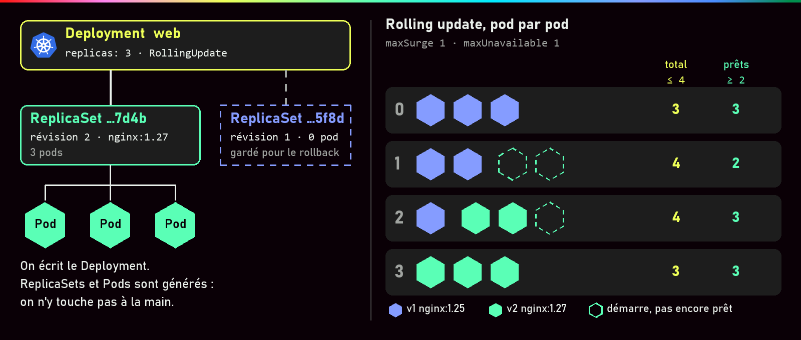{ .hero }

!!! abstract "Dans cette page"

    **Tu vas comprendre :**

    - ce qu'est un pod, et pourquoi on ne le répare jamais : on le remplace ;
    - qui compte les pods et en recrée quand il en manque ;
    - comment changer de version sans couper le service, puis revenir en arrière en une commande.

    **Prérequis :** [Kubernetes : état désiré et réconciliation](Kubernetes-etat-desire.md), avec Minikube installé. **Durée :** 45 min. **Niveau :** débutant.

!!! quote "En clair"

    Pense à un **rayon de supermarché**. Le **Pod**, c'est un produit en rayon : un ou quelques articles emballés ensemble. Le **ReplicaSet**, c'est le magasinier qui veille à ce qu'il y en ait toujours, disons, trois : un produit abîmé, il le jette et en met un neuf, il ne le répare pas. Le **Deployment**, c'est le chef de rayon : quand le modèle du produit change, il fait remplacer les anciens un par un, et garde l'ancien modèle en réserve au cas où.

    { .anim }

## L'essentiel en 30 secondes

<div class="grid cards" markdown>

-   :material-cube-outline:{ .lg .middle } __Pod__

    ---

    Un ou plusieurs conteneurs qui partagent la même IP et les mêmes fichiers. Jetable : **remplacé**, jamais réparé.

-   :material-content-copy:{ .lg .middle } __ReplicaSet__

    ---

    Compte les pods qui portent **ses étiquettes** et en garantit *n*. On ne l'écrit pas : il est fabriqué pour toi.

-   :material-rocket-launch-outline:{ .lg .middle } __Deployment__

    ---

    Ce qu'on écrit : version, nombre, manière de mettre à jour. Chaque changement du **modèle de pod** crée une révision.

-   :material-undo:{ .lg .middle } __Rollback__

    ---

    L'ancien ReplicaSet est gardé, avec 0 pod. Revenir en arrière, c'est le **remplir à nouveau**.

</div>

!!! warning "À retenir"

    **Un pod seul n'est pas de l'orchestration** : sans ReplicaSet, personne ne le recrée ; en pratique, on écrit des Deployments. Et **sans readinessProbe (une sonde « es-tu prêt ? »), « Running » veut dire « prêt »** : la mise à jour avance dès qu'un conteneur démarre, même si l'application ne répond pas encore (voir [Démarré n'est pas disponible](Demarre-n-est-pas-disponible.md)).

## :material-cube-outline: Le Pod

!!! quote "En clair"

    Un pod, c'est une **colocation** : les conteneurs qui y vivent partagent la même adresse (une seule IP), la même boîte aux lettres (`localhost`) et les mêmes placards (les volumes). Si l'immeuble s'écroule, on ne reconstruit pas l'appartement : on reloge tout le monde ailleurs, à une autre adresse.

    { .anim }

Les conteneurs d'un pod partagent **la même IP**, le même `localhost`, le même nom de machine et les mêmes volumes. C'est le partage de namespaces Linux vu dans [Isolation d'un conteneur](Isolation-des-conteneurs.md), porté par un tout petit conteneur **`pause`** créé en premier. Le cas courant est **un conteneur par pod**. Plusieurs se justifient s'ils sont indissociables, par exemple un « sidecar » (un conteneur d'appoint) qui relaie les journaux.

| Ce qui arrive | Qui réagit | Résultat |
|---|---|---|
| le conteneur plante | le **kubelet** (`restartPolicy: Always` par défaut) | **même** pod, conteneur relancé, la colonne `RESTARTS` augmente |
| le pod est supprimé ou sa machine est perdue | le **ReplicaSet**, s'il existe | **nouveau** pod : autre nom, autre IP (d'où le besoin d'un Service) |
| pod créé seul (`kubectl run`) et supprimé | personne | il est perdu |

???+ example "En vrai : un pod lancé seul"

    **Ce qu'on fait :** on lance un pod tout seul avec `kubectl run`, on le teste à travers un tunnel, puis on le compare aux autres pods du cluster.

    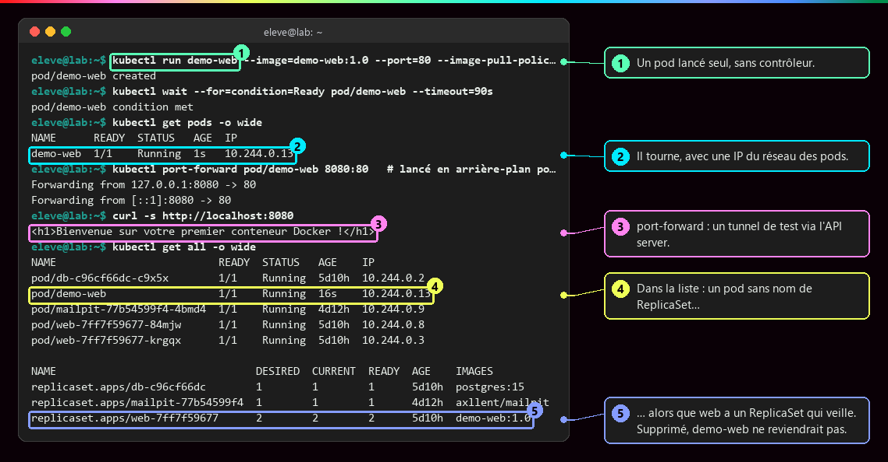

    **Ce qu'il faut regarder :**

    - ① `kubectl run` crée un pod seul, sans contrôleur. `--port=80` est **informatif** : il ne publie rien.
    - ② le pod tourne, avec une IP du réseau interne des pods.
    - ③ la page répond à travers `port-forward`, un tunnel temporaire qui passe par l'API server : pratique pour tester, pas pour ouvrir un service au public.
    - ④ dans la liste, `demo-web` est le seul pod dont le nom ne contient pas de nom de ReplicaSet…
    - ⑤ … alors que les pods `web` ont un ReplicaSet qui veille sur eux. Supprimé, `demo-web` ne reviendrait pas.

??? note "Deux conteneurs dans un pod partagent localhost"

    ```yaml
    apiVersion: v1
    kind: Pod                  # (1)!
    metadata:
      name: duo
    spec:
      containers:              # (2)!
        - name: web
          image: nginx:1.25
        - name: sonde
          image: busybox:1.36
          command: ["sh", "-c", "while true; do wget -qO- http://localhost:80 | head -n 4; sleep 10; done"]   # (3)!
    ```

    1. Un objet `Pod` écrit à la main, sans Deployment : pour l'expérience seulement.
    2. Deux éléments dans la liste `containers` : deux conteneurs dans le même pod.
    3. Toutes les 10 secondes, `sonde` lit la page de nginx à l'adresse `localhost` : il la trouve parce qu'ils partagent le même réseau.

    `kubectl get pod duo` affiche `READY 2/2` et `kubectl logs duo -c sonde` le début de la page de nginx : `sonde` joint nginx par `localhost`, grâce au namespace réseau porté par `pause`. Sur le nœud, `sudo crictl ps --pod <id>` montre deux conteneurs pour un seul pod. Un pod est une **petite machine logique** : on le réplique en entier, jamais conteneur par conteneur.

## :material-tag-outline: Labels, sélecteurs et chaîne de propriété

!!! quote "En clair"

    Un **label**, c'est une **étiquette autocollante** posée sur un objet (`app: web`). Un **sélecteur**, c'est la consigne « prends tous ceux qui portent cette étiquette ». Le ReplicaSet ne tient pas une liste de noms : il **compte les étiquettes**.

    { .anim }

Un **label** est une étiquette clé-valeur (`app: web`) ; un **sélecteur** filtre sur ces étiquettes. Le ReplicaSet **compte les pods qui portent ses labels**, et le Service retrouve ses pods de la même façon. Chaque objet sait aussi qui l'a créé : c'est la **chaîne de propriété** Deployment, puis ReplicaSet, puis Pod.

???+ example "En vrai : Deployment, ReplicaSets et Pods"

    **Ce qu'on fait :** on liste ensemble le Deployment `mailpit` (un petit serveur de courriel de test), ses ReplicaSets et ses pods, puis on demande à un pod qui est son propriétaire.

    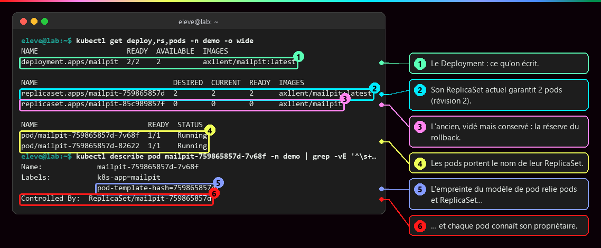

    **Ce qu'il faut regarder :**

    - ① le Deployment : c'est le seul objet qu'on a écrit.
    - ② son ReplicaSet actuel garantit 2 pods (révision 2).
    - ③ l'ancien ReplicaSet, vidé mais conservé : c'est la réserve pour revenir en arrière.
    - ④ les pods portent le nom de leur ReplicaSet, suivi de 5 caractères.
    - ⑤ l'empreinte `pod-template-hash`, calculée à partir du modèle de pod, relie pods et ReplicaSet…
    - ⑥ … et chaque pod connaît son propriétaire (`Controlled By`).

    Les noms suivent la chaîne : `mailpit` crée `mailpit-<empreinte>`, qui crée `mailpit-<empreinte>-<5 caractères>`. On écrit le Deployment ; ReplicaSets et Pods sont **générés**.

???+ example "En vrai : créer un Deployment depuis le Dashboard"

    **Ce qu'on fait :** dans le Dashboard, on remplit le formulaire « Create from form » : un nom, une image, un nombre de pods.

    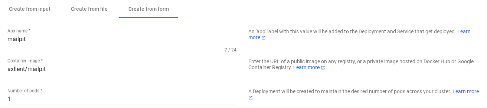

    **Ce qu'il faut regarder :** les trois champs (`App name`, `Container image`, `Number of pods`) et le texte à droite du dernier : « A Deployment will be created to maintain the desired number of pods ». Le formulaire ne crée pas « des conteneurs » : il crée un **Deployment**, avec un label tiré du nom, ici `k8s-app: mailpit`, qui sert aussi de sélecteur.

## :material-file-cog-outline: Le Deployment, champ par champ

Voici le manifeste complet utilisé dans le mini-lab de cette page. Les lignes `apiVersion`, `kind`, `metadata` et `spec` sont expliquées dans la [page précédente](Kubernetes-etat-desire.md) ; les annotations portent sur ce qui est nouveau.

```yaml title="web-deploy.yaml"
apiVersion: apps/v1
kind: Deployment
metadata:
  name: web-deploy           # (1)!
  labels:
    app: web                 # (2)!
spec:
  replicas: 3                # (3)!
  selector:
    matchLabels:
      app: web               # (4)!
  strategy:
    type: RollingUpdate      # (5)!
    rollingUpdate:
      maxUnavailable: 1      # (6)!
      maxSurge: 1            # (7)!
  template:                  # (8)!
    metadata:
      labels:
        app: web             # (9)!
    spec:
      containers:
        - name: web          # (10)!
          image: nginx:1.25  # (11)!
          ports:
            - containerPort: 80   # (12)!
```

1. Le nom du Deployment. Ses ReplicaSets s'appelleront `web-deploy-<empreinte>`, et ses pods `web-deploy-<empreinte>-<5 caractères>`.
2. Une étiquette sur le Deployment lui-même, pour le retrouver avec `-l app=web`. Elle ne sert pas à choisir les pods.
3. Trois copies voulues. Changer ce nombre ne crée **pas** de nouvelle version.
4. Le sélecteur : le Deployment considère comme siens tous les pods étiquetés `app: web`. Ce champ **ne peut plus être modifié** après la création.
5. La manière de changer de version : `RollingUpdate`, petit à petit (par défaut), ou `Recreate`, tout arrêter puis tout recréer.
6. Au plus **1 pod en moins** que `replicas` pendant la mise à jour : il reste toujours au moins 2 pods prêts.
7. Au plus **1 pod en plus** que `replicas` : jamais plus de 4 pods en même temps.
8. Le modèle de pod. **Toute** modification ici (image, variable, port…) crée une nouvelle révision, donc un nouveau ReplicaSet.
9. Les étiquettes de chaque pod. Elles doivent correspondre au sélecteur (4), sinon Kubernetes refuse le fichier.
10. Le nom du conteneur dans le pod. C'est ce nom qu'on cite dans `kubectl set image … web=…`.
11. L'image, avec un tag précis. Le mini-lab la passera à `nginx:1.27`.
12. Le port d'écoute du conteneur, à titre d'information.

Les autres réglages et leurs valeurs par défaut :

| Champ | Rôle | Par défaut |
|---|---|---|
| `replicas` | nombre de pods désirés | 1 |
| `selector.matchLabels` | quels pods appartiennent au Deployment (**non modifiable** ensuite) | obligatoire |
| `template` | le **modèle de pod** ; ses labels doivent correspondre au sélecteur | obligatoire |
| `strategy.type` | `RollingUpdate` (progressif) ou `Recreate` (tout arrêter, puis tout recréer) | `RollingUpdate` |
| `rollingUpdate.maxSurge` | pods **en plus** de `replicas` pendant la mise à jour | 25 % (arrondi au-dessus) |
| `rollingUpdate.maxUnavailable` | pods **en moins** pouvant être indisponibles | 25 % (arrondi au-dessous) |
| `revisionHistoryLimit` | anciens ReplicaSets conservés pour le retour arrière | 10 |
| `progressDeadlineSeconds` | délai avant de signaler une mise à jour bloquée | 600 |

???+ example "En vrai : mettre à l'échelle ne crée pas de révision"

    **Ce qu'on fait :** dans le Dashboard, on passe le Deployment `mailpit` de 1 à 2 copies, puis on regarde ses pods.

    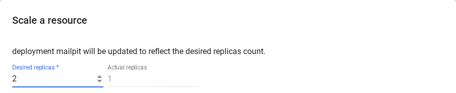

    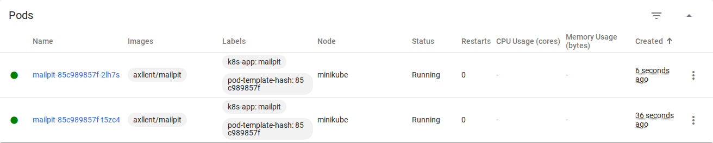

    **Ce qu'il faut regarder :** dans la fenêtre, 2 copies désirées pour 1 actuelle. Puis, dans la liste, la colonne `Labels` : les deux pods portent la **même empreinte** `pod-template-hash: 85c989857f`, donc ils appartiennent au même ReplicaSet. Seul le champ `replicas` a changé : pas de nouvelle version. Un `kubectl scale` est écrasé au prochain `apply` du fichier ; pour suivre la charge automatiquement, l'**HPA** (HorizontalPodAutoscaler) ajuste lui-même `replicas`.

## :material-update: Mise à jour, historique, rollback

!!! quote "En clair"

    Changer les ampoules d'un long couloir **une par une** : à chaque instant, il reste assez de lumière pour passer. C'est le **rolling update**. L'autre méthode, `Recreate`, éteint tout le couloir, change toutes les ampoules, puis rallume.

    { .anim }

**Seul un changement du `template`** (image, variables, ports…) crée une **révision**, donc un **nouveau ReplicaSet**. L'ancien est ramené à 0 pod mais **conservé**. Le RollingUpdate remplit le nouveau et vide l'ancien pas à pas, sans jamais dépasser `maxSurge` ni passer sous `maxUnavailable`.

???+ example "En vrai : le remplacement pod par pod"

    **Ce qu'on fait :** après un changement d'image du Deployment `mailpit` (2 copies), on lit son historique, sa stratégie, puis les événements de la mise à jour.

    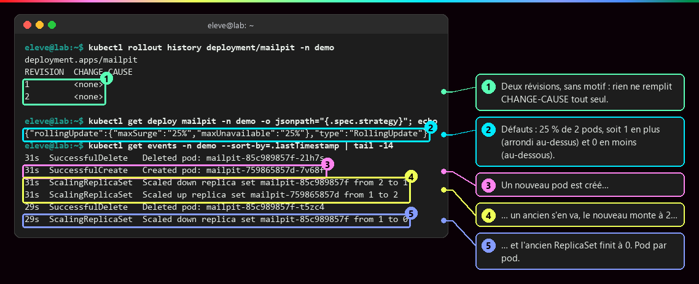

    **Ce qu'il faut regarder :**

    - ① deux révisions, sans motif : rien ne remplit la colonne `CHANGE-CAUSE` tout seul.
    - ② la stratégie par défaut : 25 % de 2 pods donne 1 pod en plus (arrondi au-dessus) et 0 en moins (arrondi au-dessous). Il n'y a donc jamais moins de 2 pods prêts.
    - ③ un nouveau pod est créé…
    - ④ … un ancien s'en va, et le nouveau ReplicaSet monte à 2…
    - ⑤ … puis l'ancien ReplicaSet finit à 0. Pod par pod.

    La progression attend que chaque nouveau pod soit **prêt** : c'est la readinessProbe qui donne un vrai sens à ce mot.

???+ danger "En vrai : Kubernetes compare la déclaration, pas l'image"

    **Ce qu'on fait :** dans le Dashboard, on modifie le Deployment `mailpit` en ajoutant seulement `:latest` à son image, puis on regarde ses ReplicaSets.

    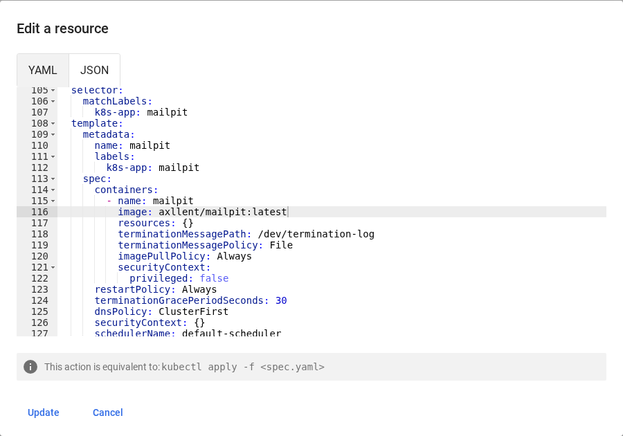

    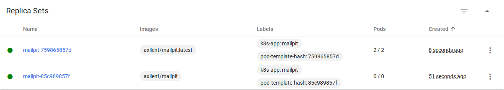

    **Ce qu'il faut regarder :** ligne 116, `image: axllent/mailpit:latest` ; en bas, le Dashboard précise que c'est l'équivalent d'un `kubectl apply`. Dans la liste, deux ReplicaSets : le nouveau (`:latest`) à `2 / 2`, l'ancien à `0 / 0`. Or `axllent/mailpit` et `axllent/mailpit:latest` désignent **la même image** ! Mais le texte du modèle a changé : nouvelle révision, tous les pods remplacés. À l'inverse, publier une autre image sous le **même tag** ne déclenche rien.

???+ example "En vrai : rollout restart crée aussi une révision"

    **Ce qu'on fait :** on demande un redémarrage propre du Deployment `db` avec `kubectl rollout restart`, puis on liste les ReplicaSets.

    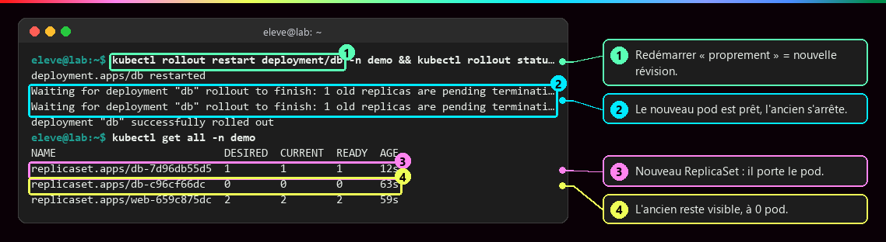

    **Ce qu'il faut regarder :** ① « redémarrer » proprement, c'est créer une nouvelle révision. ② le nouveau pod est prêt, l'ancien s'arrête. ③ le nouveau ReplicaSet porte le pod. ④ l'ancien reste visible, à 0 pod. Explication : `rollout restart` ajoute au modèle de pod une annotation contenant l'heure, et toute modification du modèle est une révision.

???+ danger "Scénario : une version cassée, puis le retour arrière"

    On demande une image qui n'existe pas, et on observe ce que Kubernetes protège :

    ```bash
    kubectl set image deployment/web-deploy web=nginx:9.99          # (1)!
    kubectl rollout status deployment/web-deploy --timeout=30s      # (2)!
    kubectl get pods -l app=web
    kubectl rollout history deployment/web-deploy
    kubectl rollout undo deployment/web-deploy                      # (3)!
    ```

    1. Change l'image du conteneur `web` pour un tag qui n'existe pas.
    2. Suit la mise à jour, 30 secondes au plus : elle ne se termine pas.
    3. Revient à la révision précédente. On peut viser une révision précise avec `--to-revision=1`.

    `kubectl get pods` montre 2 anciens pods `Running` et 2 nouveaux en `ErrImagePull` puis `ImagePullBackOff` (l'image est introuvable). Avec 3 réplicas et `maxUnavailable: 1`, un **seul** ancien pod a été supprimé : les deux autres continuent de servir. Sans action, le Deployment passe en échec (`ProgressDeadlineExceeded`) au bout de `progressDeadlineSeconds`. Le `rollout undo` remplit à nouveau l'ancien ReplicaSet, qui reçoit un **nouveau numéro** de révision. La colonne `CHANGE-CAUSE` reste vide si personne ne pose l'annotation `kubernetes.io/change-cause` (l'option `--record` est abandonnée) ; recopiée à chaque révision, elle doit être mise à jour à chaque version.

`Recreate` provoque une coupure, mais garantit que deux versions ne tournent jamais ensemble : on le choisit par exemple quand un seul pod peut utiliser un volume à la fois (une base de données sur un PersistentVolumeClaim, un espace disque réservé).

```mermaid
gantt
    dateFormat X
    axisFormat %s
    section RollingUpdate
    v1 (3 pods puis décroissant) :a1, 0, 6
    v2 (croissant jusqu'à 3)     :a2, 2, 10
    section Recreate
    v1 (3 pods)                  :b1, 0, 4
    coupure                      :crit, b2, 4, 6
    v2 (3 pods)                  :b3, 6, 10
```

## :material-flask-outline: À toi de jouer

Six étapes, environ 15 minutes. Tu vas faire vivre le Deployment `web-deploy` : le créer, casser un pod, le multiplier, changer sa version puis revenir en arrière. Il te faut le cluster Minikube installé à la [page précédente](Kubernetes-etat-desire.md).

**Étape 1 · Créer le Deployment**

Crée d'abord le fichier `web-deploy.yaml` avec `nano web-deploy.yaml` et colle le manifeste de la section [Le Deployment, champ par champ](#le-deployment-champ-par-champ) (enregistre avec ++ctrl+o++, ++enter++, quitte avec ++ctrl+x++). Puis :

```bash
minikube start                                          # (1)!
kubectl create namespace demo                           # (2)!
kubectl apply -n demo -f web-deploy.yaml                # (3)!
kubectl rollout status deployment/web-deploy -n demo    # (4)!
```

1. Redémarre le cluster s'il était arrêté. Sans danger s'il tourne déjà.
2. Recrée ton dossier de travail `demo`.
3. Déclare l'état désiré : 3 copies de nginx 1.25.
4. Suit la progression jusqu'à ce que les 3 copies soient prêtes.

Tu dois voir `namespace/demo created`, puis `deployment.apps/web-deploy created`, puis quelques lignes `Waiting for deployment "web-deploy" rollout to finish: … of 3 updated replicas are available...`, et enfin `deployment "web-deploy" successfully rolled out`.

**Étape 2 · Remonter la chaîne de propriété**

```bash
kubectl get deploy,rs,pods -n demo -l app=web --show-labels       # (1)!
kubectl describe pods -n demo -l app=web | grep "Controlled By"   # (2)!
```

1. Liste d'un coup le Deployment, ses ReplicaSets (`rs`) et ses pods, avec toutes leurs étiquettes (`--show-labels`).
2. `describe` donne la fiche détaillée de chaque pod ; `grep` n'en garde que la ligne qui nomme le propriétaire.

Tu dois voir la même structure que dans la capture [Deployment, ReplicaSets et Pods](#labels-selecteurs-et-chaine-de-propriete), avec `web-deploy` à la place de `mailpit` :

- un Deployment `web-deploy` à `3/3` ;
- un seul ReplicaSet `web-deploy-<empreinte>`, avec `3` dans les colonnes `DESIRED`, `CURRENT` et `READY` ;
- trois pods `web-deploy-<empreinte>-<5 caractères>`, chacun avec l'étiquette `pod-template-hash=<empreinte>` ;
- trois lignes `Controlled By:  ReplicaSet/web-deploy-<empreinte>`.

L'empreinte est la même partout : c'est elle qui relie le ReplicaSet à ses pods.

**Étape 3 · Supprimer un pod, puis passer à 5 copies**

```bash
kubectl delete -n demo $(kubectl get pods -n demo -l app=web -o name | head -1)   # (1)!
kubectl get pods -n demo -l app=web                       # (2)!
kubectl scale deployment/web-deploy -n demo --replicas=5  # (3)!
kubectl get rs -n demo -l app=web                         # (4)!
```

1. La commande entre `$( )` s'exécute d'abord : elle liste les pods sous la forme `pod/<nom>` et `head -1` garde le premier. `kubectl delete` supprime ensuite ce pod-là.
2. Liste les pods restants.
3. Demande 5 copies, directement au cluster (action impérative).
4. Liste les ReplicaSets.

Tu dois voir `pod "web-deploy-…" deleted from demo namespace`, puis **toujours 3 pods**, dont un avec un `AGE` de quelques secondes : le remplaçant. Après le `scale` (`deployment.apps/web-deploy scaled`), il y a **toujours un seul ReplicaSet**, qui passe à `5` : changer le nombre de copies ne crée pas de révision.

**Étape 4 · Changer de version**

```bash
kubectl set image deployment/web-deploy -n demo web=nginx:1.27   # (1)!
kubectl rollout status deployment/web-deploy -n demo             # (2)!
kubectl get rs -n demo -l app=web                                # (3)!
kubectl rollout history deployment/web-deploy -n demo            # (4)!
```

1. Remplace l'image du conteneur nommé `web` par `nginx:1.27`. Cela modifie le **modèle de pod** : nouvelle révision.
2. Suit le remplacement, pod par pod.
3. Liste les ReplicaSets : il y en a maintenant deux.
4. Affiche l'historique des révisions.

Tu dois voir `deployment.apps/web-deploy image updated`, puis plusieurs lignes `Waiting for deployment "web-deploy" rollout to finish…` jusqu'à `successfully rolled out`. Ensuite, **deux ReplicaSets** : le nouveau à `5`, l'ancien à `0`, conservé. L'historique ressemble à cette sortie réelle, enregistrée sur le Deployment `mailpit` (chez toi, la première ligne dira `deployment.apps/web-deploy`) :

```text
deployment.apps/mailpit 
REVISION  CHANGE-CAUSE
1         <none>
2         <none>
```

**Étape 5 · Revenir en arrière**

```bash
kubectl rollout undo deployment/web-deploy -n demo && kubectl rollout status deployment/web-deploy -n demo   # (1)!
kubectl get deployment web-deploy -n demo -o jsonpath='{.spec.template.spec.containers[0].image}{"\n"}'     # (2)!
kubectl rollout history deployment/web-deploy -n demo                                                     # (3)!
```

1. Revient à la révision précédente, puis suit le remplacement.
2. `-o jsonpath=…` extrait un seul champ de l'objet : l'image du premier conteneur du modèle de pod.
3. Relit l'historique.

Tu dois voir `deployment.apps/web-deploy rolled back`, puis `successfully rolled out`, puis l'image revenue à **`nginx:1.25`**. Dans l'historique, la révision `1` a disparu au profit d'une révision `3` : revenir en arrière crée un **nouveau numéro**, avec l'ancien modèle.

**Étape 6 · Faire le ménage**

```bash
kubectl delete namespace demo   # (1)!
rm web-deploy.yaml
minikube stop                   # (2)!
```

1. Supprime le namespace `demo` et tout ce qu'il contient : Deployment, ReplicaSets, pods.
2. Arrête le cluster sans l'effacer, pour la page suivante.

Tu dois voir `namespace "demo" deleted`, puis Minikube qui annonce l'arrêt de son nœud.

??? tip "Ça ne marche pas ?"

    | Message | Cause | Solution |
    |---|---|---|
    | `The connection to the server localhost:8080 was refused` | le cluster est arrêté | `minikube start` |
    | `namespaces "demo" already exists` | le namespace de la page précédente existe encore | continue : la suite fonctionne quand même |
    | `the path "web-deploy.yaml" does not exist` | le fichier n'est pas dans le dossier courant | `ls` pour vérifier, ou crée-le avec `nano web-deploy.yaml` |
    | `` `selector` does not match template `labels` `` | les étiquettes du sélecteur et du modèle diffèrent | les deux doivent dire `app: web` |
    | `there is no need to specify a resource type as a separate argument` | tu as écrit `kubectl delete pod pod/…` | écris `kubectl delete pod/…` (ou `kubectl delete -n demo $(…)` comme dans l'étape 3) |
    | `unable to find container named "web"` | le nom avant le `=` de `set image` n'est pas celui du conteneur | c'est le `name:` sous `containers:`, ici `web` |
    | la mise à jour ne finit pas, pods en `ImagePullBackOff` | tag d'image mal écrit | `kubectl rollout undo deployment/web-deploy -n demo` |

## :material-help-circle-outline: Vérifie que tu as compris

??? question "1. Le conteneur d'un pod plante et redémarre. Le pod change-t-il de nom ? Et si on supprime le pod ?"

    **Conteneur planté : non.** C'est le kubelet qui relance le conteneur **dans le même pod** : même nom, même IP, seule la colonne `RESTARTS` augmente. **Pod supprimé : oui.** Le ReplicaSet crée un **nouveau** pod, avec un autre nom et une autre IP. C'est pour ça qu'on ne joint jamais un pod par son IP, mais par un Service.

??? question "2. Tu passes `replicas` de 3 à 5. Est-ce une nouvelle révision ? Et si tu changes l'image ?"

    **Changer `replicas` : non.** Le modèle de pod n'a pas changé, le même ReplicaSet ajoute simplement 2 pods. **Changer l'image : oui.** Le modèle change, donc un nouveau ReplicaSet est créé, et l'ancien est gardé à 0 pour un retour arrière.

??? question "3. Avec `replicas: 3`, `maxSurge: 1` et `maxUnavailable: 1`, combien de pods au plus, et combien de pods prêts au moins, pendant une mise à jour ?"

    **Au plus 4** pods (3 + 1 en plus), et **au moins 2** pods prêts (3 - 1 en moins). Les deux bornes sont respectées à chaque instant : c'est ce qui permet de changer de version sans couper le service.

!!! success "Et ensuite ?"

    Tu sais faire tourner, multiplier et mettre à jour une application, et revenir en arrière. Mais chaque pod remplacé change d'IP : comment le joindre ? Page suivante : [Service et Ingress](Service-et-Ingress.md).

## :material-server: Pour aller plus loin

??? note "Utiliser une image construite en local (Minikube)"

    ```bash
    docker build -t demo-web:1.0 .
    minikube image load demo-web:1.0               # (1)!
    minikube image ls | grep demo-web              # (2)!
    kubectl run demo-web --image=demo-web:1.0 --image-pull-policy=Never --port=80   # (3)!
    ```

    1. Copie l'image dans le containerd du nœud.
    2. Vérifie qu'elle y est : `docker.io/library/demo-web:1.0`.
    3. `--image-pull-policy=Never` : interdit au kubelet de chercher l'image sur Internet.

    L'image de `docker images` sur ta machine et celle du cluster vivent dans **deux magasins différents**. `minikube image load` importe directement l'image dans containerd ; avec ce runtime, `minikube docker-env` échoue. Piège : `imagePullPolicy` vaut `Always` pour un tag `latest` ou absent, `IfNotPresent` sinon. Avec `Always`, le kubelet cherche `demo-web` sur Docker Hub et le pod reste en `ErrImagePull` puis `ImagePullBackOff`. Avec un tag précis déjà chargé, `IfNotPresent` suffit ; `Never` interdit tout téléchargement.

??? note "Deux pièges de plus"

    - **`maxSurge` et `maxUnavailable` ne peuvent pas valoir 0 tous les deux** : la mise à jour ne pourrait jamais progresser.
    - **Sans `requests` ni `limits`** (les réservations et plafonds de ressources), un pod est en classe QoS `BestEffort` (c'est ce qu'affiche `kubectl describe pod` pour `demo-web`) : il est le premier évincé si le nœud manque de mémoire.

??? note "Les autres objets fondamentaux"

    | Objet | Rôle | Où l'approfondir |
    |---|---|---|
    | **Service** | point d'accès réseau stable vers un ensemble de Pods (ClusterIP, NodePort, LoadBalancer) | [Service et Ingress](Service-et-Ingress.md) |
    | **Ingress** | règles HTTP(S) vers des Services, appliquées par un Ingress Controller (Traefik, par exemple) | [Service et Ingress](Service-et-Ingress.md) |
    | **Namespace** | cloisonnement logique : quotas, droits (RBAC), séparation des équipes | [Kubernetes : état désiré](Kubernetes-etat-desire.md) |
    | **ConfigMap / Secret** | configuration externe et données sensibles, injectées dans les Pods | [De Compose aux manifestes Kubernetes](De-Compose-a-Kubernetes.md) |

??? abstract "Pour les créateurs : script de motion design « Changer de version sans éteindre la lumière » (80 s)"

    Fond sombre, pods en hexagones (bleu = v1, violet = v2), une ampoule « service disponible » en haut à droite, deux jauges verticales « total ≤ 4 » et « disponibles ≥ 2 » sur le côté.

    | Séq. | Durée | À l'écran | Animation | Texte à l'écran |
    |---|---|---|---|---|
    | 1 | 0-8 s | Une boîte « Deployment » qui contient une boîte « ReplicaSet v1 » et trois hexagones bleus | Les hexagones pulsent doucement ; l'ampoule est allumée | « Trois pods v1 servent le trafic. » |
    | 2 | 8-16 s | Le fichier YAML ; la ligne `image: nginx:1.25` devient `nginx:1.27` | La modification s'écrit lettre par lettre ; une seconde boîte « ReplicaSet v2 » apparaît, vide | « On change le modèle de pod : une nouvelle révision naît. » |
    | 3 | 16-28 s | Les deux jauges s'affichent | Un hexagone violet apparaît en pointillé (démarrage) ; un bleu s'éteint ; la jauge « total » monte à 4, « disponibles » descend à 2 et reste au-dessus de la ligne rouge | « maxSurge : un pod de plus. maxUnavailable : un pod de moins. Jamais au-delà. » |
    | 4 | 28-38 s | Gros plan sur l'hexagone violet en pointillé | Un petit voyant « readiness » passe de l'orange au vert ; alors seulement le contour devient plein | « On attend qu'il soit prêt avant d'aller plus loin. » |
    | 5 | 38-52 s | Les échanges continuent | Un bleu s'éteint, un violet s'allume, deux fois ; l'ampoule ne clignote jamais | « Pod par pod, le service reste allumé. » |
    | 6 | 52-60 s | La boîte « ReplicaSet v1 » vide, en gris, reste à l'écran | Une étiquette « révision 1, 0 pod, conservée » s'y accroche | « L'ancienne version n'est pas détruite : elle attend. » |
    | 7 | 60-72 s | Une nouvelle mise à jour vers « v3 » : les hexagones deviennent rouges et clignotent « ErrImagePull » | La progression se fige ; deux hexagones violets restent allumés ; puis un bouton « rollout undo » est pressé, les rouges disparaissent et le ReplicaSet v2 se remplit | « Version cassée ? La progression s'arrête, et on revient en arrière en une commande. » |
    | 8 | 72-80 s | Écran de synthèse : Deployment, ReplicaSets empilés comme des pages d'un historique | Les pages se feuillettent | « Le Deployment écrit l'histoire. Les ReplicaSets en sont les pages. » |

    Les deux jauges sont l'élément pédagogique central : elles doivent rester visibles pendant toute la séquence 5, pour que l'on voie que les bornes ne sont **jamais** franchies. L'ampoule qui ne clignote pas porte le message « sans coupure » mieux qu'un texte.

??? info "Pour les créateurs : l'anatomie d'un pod et le rolling update pas à pas"

    **Anatomie d'un pod.** Un grand rectangle arrondi « Pod » avec une seule étiquette « IP 10.244.0.13 » sur son bord. À l'intérieur : un petit bloc gris « pause » en bas (il « tient » le réseau), deux blocs colorés « web » et « sonde » posés dessus, une flèche `localhost:80` entre eux, et un cylindre « volume » branché aux deux. À l'extérieur, une flèche « kubelet » qui relance un conteneur planté **dans** le rectangle, et une flèche « ReplicaSet » qui remplace **tout** le rectangle.

    **Rolling update pas à pas** (3 réplicas, maxSurge 1, maxUnavailable 1), repris dans l'illustration d'en-tête :

    | Étape | Pods v1 (nginx:1.25) | Pods v2 (nginx:1.27) | Total (≤ 4) | Disponibles (≥ 2) |
    |---|---|---|---|---|
    | 0 | ● ● ● | | 3 | 3 |
    | 1 | ● ● | ○ ○ (démarrage) | 4 | 2 |
    | 2 | ● | ● ● ○ | 4 | 3 |
    | 3 | | ● ● ● | 3 | 3 |

    ● pod prêt, ○ pod qui démarre. L'ordre exact peut varier selon le temps de démarrage des pods ; les deux bornes, elles, sont toujours respectées.
