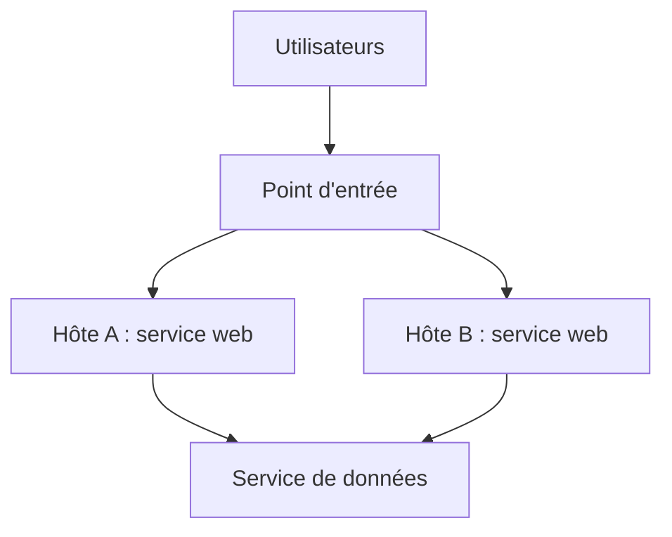
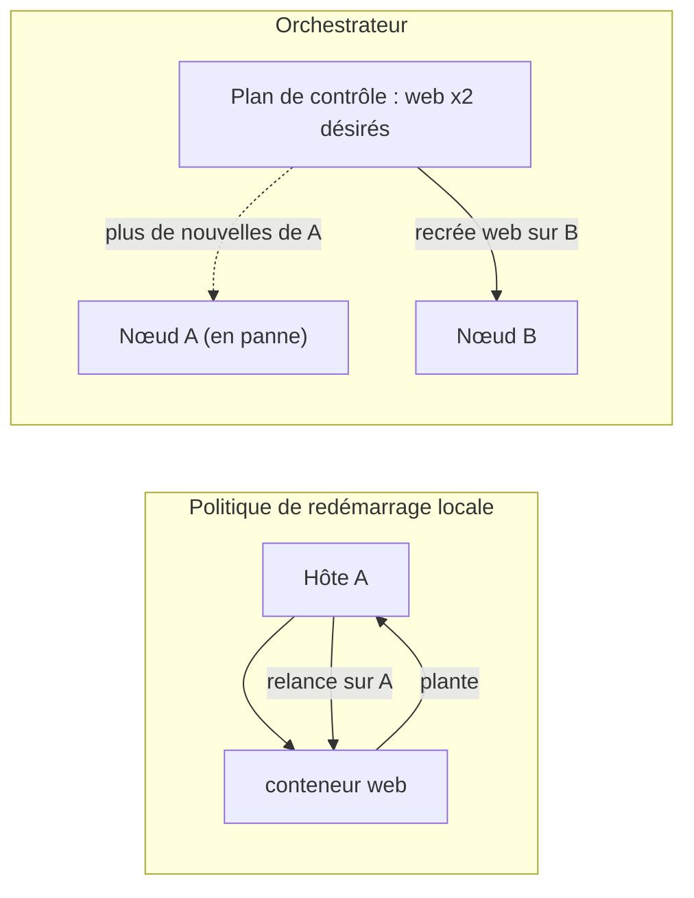
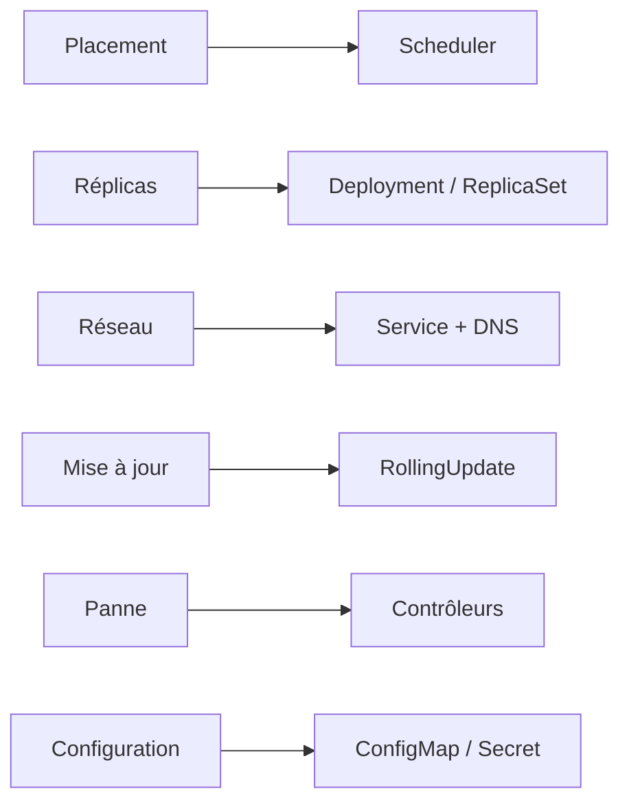

# Pourquoi orchestrer ?

> **En une phrase.** Docker et Compose savent **lancer** des conteneurs sur **une** machine ; dès qu'il faut répartir un service sur plusieurs machines, survivre à la perte de l'une d'elles et changer de version sans coupure, il faut un **orchestrateur** qui maintient en permanence un état désiré.

---

## 1. Synthèse

### Le modèle mental

```
   MOTEUR LOCAL (Docker, Compose)              ORCHESTRATEUR (Kubernetes)
   « exécute ce que je te dis, ici »           « garantis ce que je veux, quelque part »

   ┌──────────── hôte A ────────────┐          ┌──── plan de contrôle ────┐
   │ web  web  db                   │          │ état désiré : web x3     │
   │ restart: relance ICI, si l'hôte│          │ état observé : web x2    │
   │ et le moteur sont vivants      │          │ => recréer 1 web sur B   │
   └────────────────────────────────┘          └──────┬─────────┬─────────┘
   hôte A tombe : tout s'arrête.                  hôte A      hôte B
                                                (en panne)  web web web
```

### Ce que Compose résout déjà

| Compose décrit | Exemple de clé dans `compose.yaml` |
|---|---|
| les images, commandes et paramètres | `image:`, `build:`, `command:`, `environment:` |
| les réseaux, volumes et secrets | `networks:`, `volumes:`, `secrets:` |
| les dépendances et contrôles de santé | `depends_on:`, `healthcheck:` |
| le démarrage et l'arrêt d'un projet | `docker compose up -d`, `docker compose down` |

Compose simplifie le déploiement sur **un moteur Docker cible**. Ce fichier est déjà une **déclaration** d'infrastructure applicative : on décrit les services voulus, pas l'ordre des `docker run`. Détails dans [Docker Compose](Docker-Compose.md).

### Ce que Compose ne fait pas

Compose n'est pas, à lui seul, un orchestrateur : il n'assure ni la **disponibilité** ni le **placement automatique** sur un parc de machines. Quand le nombre de conteneurs augmente, il faut gérer leur cycle de vie, leur réseau et leur mise à jour, et Compose atteint ses limites dès qu'il s'agit d'un **cluster multi-hôtes** (un ensemble de machines gérées comme un tout).

### Les nouvelles questions posées par plusieurs hôtes

| Question | Pourquoi « lancer plusieurs conteneurs » ne suffit pas |
|---|---|
| Où placer les instances ? | il faut connaître la place libre (CPU, mémoire) sur chaque hôte et choisir |
| Comment les identifier à travers plusieurs hôtes ? | les adresses IP changent à chaque recréation et diffèrent d'un hôte à l'autre |
| Que faire si un hôte disparaît ? | personne, sur l'hôte mort, ne peut relancer quoi que ce soit |

### Impératif ou déclaratif

| Approche | On dit… | Qui agit ensuite ? |
|---|---|---|
| **Exécution impérative** | « démarre ce conteneur » | personne : la commande est exécutée une fois |
| **Gestion déclarative** | « je veux trois instances disponibles de ce service » | un **contrôleur**, en continu |

Une **boucle de réconciliation** compare sans arrêt l'**état observé** (ce qui tourne réellement) à l'**état désiré** (ce qui est déclaré) et agit pour réduire l'écart. Le mécanisme est détaillé dans [Kubernetes : état désiré et réconciliation](Kubernetes-etat-desire.md).

### Redémarrer n'est pas replanifier

Une **politique de redémarrage** locale (`restart: unless-stopped` dans Compose, `--restart` avec `docker run`) relance un conteneur **sur le même hôte**, à condition que le moteur et l'hôte fonctionnent. Elle ne traite pas :

- une panne matérielle de l'hôte ;
- une perte durable de connectivité ;
- le choix d'un autre nœud (une machine du cluster) ;
- le rattachement correct des données sur ce nouveau nœud.

**Replanifier**, c'est recréer l'instance **ailleurs**. La tolérance aux pannes demande donc une coordination au-delà du conteneur.

### Déployer une nouvelle version sans coupure

Avec Compose, une mise à jour consiste à **recréer le conteneur** : s'il est seul à servir le trafic, le service est interrompu pendant le remplacement. Une application en production peut nécessiter :

- plusieurs **réplicas** (copies identiques d'une même instance) ;
- des vérifications de disponibilité ;
- une progression contrôlée de la mise à jour ;
- une possibilité de retour arrière ;
- un routage vers les seules instances saines.

L'orchestration formalise ces opérations de mise à jour et de remplacement **à l'échelle du service**, et non plus du conteneur.

### Ce que doit fournir un orchestrateur

| Besoin | Fonction attendue | Réponse de Kubernetes |
|---|---|---|
| Placement | choisir les hôtes disponibles | le **scheduler** |
| Réplicas | maintenir le nombre voulu | **Deployment** et **ReplicaSet** |
| Réseau | découvrir et joindre les services | **Service** et DNS interne |
| Mise à jour | remplacer progressivement les instances | stratégie **RollingUpdate** du Deployment |
| Panne | détecter l'écart et agir | les **contrôleurs** (boucle de réconciliation) |
| Configuration | distribuer paramètres et secrets | **ConfigMap** et **Secret** |

Le stockage persistant, la sécurité et la supervision restent des sujets **à concevoir** : ils ne deviennent pas automatiques avec un orchestrateur.

### Les orchestrateurs et la réponse de Kubernetes

Quand plusieurs conteneurs doivent coopérer, il faut automatiser les déploiements, gérer le réseau et les dépendances, assurer la tolérance aux pannes et monter en charge. Plusieurs orchestrateurs sont apparus pour cela : **Docker Swarm**, **Apache Mesos** et **Kubernetes**, devenu la référence.

Kubernetes introduit notamment :

- des **Pods** pour les unités d'exécution ;
- des **Deployments** pour gérer des applications répliquées ;
- des **Services** pour leur accès logique (un nom et une adresse stables) ;
- des ressources de stockage, de configuration et de contrôle d'accès.

La plateforme repose sur des **contrôleurs** qui recherchent en permanence l'état désiré. Docker et Kubernetes ne sont pas au même niveau d'abstraction : on passe de la gestion de **conteneurs** à celle de **services répartis**. Kubernetes généralise et distribue ainsi les concepts de Compose à grande échelle : cluster multi-nœuds, haute disponibilité, auto-guérison.

### De l'image au service exploité

```
Source  →  Image vérifiée  →  Exécution restreinte
                                     ↓
                             Réseaux et volumes
                                     ↓
                             Mesure et diagnostic
                                     ↓
                         Réconciliation multi-hôtes   ← l'orchestrateur
```

Le cycle de vie d'une application conteneurisée englobe la construction, la distribution, l'exécution, la sécurité et l'exploitation. L'orchestrateur prend en charge la dernière marche.

> [!IMPORTANT]
> **Les pièges à retenir**
> 1. **Compose ≠ orchestrateur multi-hôtes.** Compose pilote un seul moteur Docker. Il ne déplace rien quand cet hôte tombe.
> 2. **Healthcheck ≠ auto-réparation garantie.** Avec Docker Engine seul, un conteneur `unhealthy` est **signalé**, pas redémarré ni remplacé.
> 3. **Redémarrer ≠ replanifier.** `restart:` relance sur place ; seul un orchestrateur recrée l'instance sur un autre nœud.
> 4. **Orchestrer ne rend pas magique.** Données persistantes, sécurité et supervision se conçoivent toujours explicitement.

### À retenir

- Un conteneur isole un processus dans un **noyau Linux partagé** ([Isolation d'un conteneur](Isolation-des-conteneurs.md)).
- Docker et Podman exploitent des mécanismes du système : namespaces, cgroups, OverlayFS.
- Docker Compose introduit une **première déclaration** d'infrastructure applicative.
- La montée en complexité des environnements distribués conduit naturellement à **Kubernetes**, qui orchestre ces conteneurs à l'échelle du cluster.

---

## 2. Cas d'usage classiques

### Cas 1 : un conteneur qui plante est relancé… sur place (politique de redémarrage)

**Besoin.** Une application s'arrête en erreur de temps en temps ; on veut qu'elle reparte seule.

```bash
docker run -d --name crash --restart on-failure:3 alpine sh -c 'sleep 5; exit 1'
sleep 30
docker inspect -f '{{.RestartCount}} {{.State.Status}}' crash   # 3 exited
docker rm -f crash
```

**Ce qu'on observe.** Le moteur relance le conteneur trois fois, puis abandonne. Tout se passe **sur le même hôte**, par le même démon Docker.
**À retenir.** C'est utile, mais c'est un réflexe local. Si l'hôte s'éteint, il n'y a plus de démon pour relancer quoi que ce soit.

### Cas 2 : l'hôte disparaît (Compose ne connaît qu'un moteur)

**Besoin.** Le site tourne avec Compose sur le serveur A. Le serveur A tombe en panne.

```bash
docker context ls            # le contexte courant désigne UN moteur Docker
docker compose ps            # n'interroge que ce moteur
```

**Ce qu'on observe.** Compose envoie ses ordres au moteur du contexte courant (ou de `DOCKER_HOST`), et à lui seul. Rien ne sait qu'un serveur B a de la place : le service reste arrêté jusqu'à une intervention humaine.
**À retenir.** Il manque un composant qui **voit tout le parc**, constate l'absence des instances et les recrée ailleurs. C'est le cœur d'un orchestrateur.

### Cas 3 : un healthcheck qui échoue ne répare rien (Docker Engine seul)

```yaml
services:
  web:
    image: nginx:1.27-alpine
    healthcheck:
      test: ["CMD", "wget", "-q", "--spider", "http://localhost/n-existe-pas"]
      interval: 5s
      retries: 3
```

```bash
docker compose up -d
docker inspect -f '{{.State.Health.Status}}' $(docker compose ps -q web)   # starting, puis unhealthy
```

**Ce qu'on observe.** L'état passe à `unhealthy` et le conteneur **continue de tourner**. Docker Engine affiche le problème, Compose peut en tenir compte pour l'ordre de démarrage (`depends_on` avec `condition: service_healthy`), mais aucun des deux ne remplace l'instance malade.
**À retenir.** Détecter n'est pas agir. Un orchestrateur relie la détection à une action : retirer l'instance du routage, la redémarrer, la remplacer. Voir [Démarré n'est pas disponible](Demarre-n-est-pas-disponible.md).

### Cas 4 : mettre à jour un service unique provoque une coupure

**Besoin.** Passer de `nginx:1.25` à `nginx:1.27`.

```bash
# terminal 1 : sonde qui interroge le site toutes les 0,2 s
while true; do curl -s -o /dev/null -w '%{http_code}\n' http://localhost:8080; sleep 0.2; done
# terminal 2 : on change le tag dans compose.yaml, puis
docker compose up -d
```

**Ce qu'on observe.** Compose arrête l'ancien conteneur avant de démarrer le nouveau (les deux ne peuvent pas publier le port 8080 en même temps). Pendant ce court intervalle, la sonde affiche `000` (connexion refusée) : le site est coupé.
**À retenir.** Sans autre instance pour servir le trafic, « recréer le conteneur » signifie interruption. Un orchestrateur remplace les instances **une par une** en gardant les autres en service : voir [Pod, Deployment, ReplicaSet](Pod-Deployment-ReplicaSet.md).

### Cas 5 : multiplier les instances se heurte au port publié

```yaml
services:
  web:
    image: nginx:1.27
    ports: ["8080:80"]
```

```bash
docker compose up -d --scale web=2
# Error ... Bind for 0.0.0.0:8080 failed: port is already allocated
```

**Ce qu'on observe.** Les deux répliques veulent le même port 8080 de l'hôte : la seconde ne peut pas démarrer. Il faudrait ajouter soi-même un répartiteur de charge devant.
**À retenir.** Répliquer suppose un **point d'accès stable** qui répartit les requêtes entre instances, quel que soit leur nombre. Dans Kubernetes, c'est le rôle du **Service** : voir [Service et Ingress](Service-et-Ingress.md).

### Cas 6 : le même besoin, exprimé à un orchestrateur

```bash
kubectl create deployment web --image=nginx:1.27 --replicas=3
kubectl get pods -l app=web               # trois pods Running
kubectl delete pod -l app=web --wait=false
kubectl get pods -l app=web               # trois nouveaux pods, avec d'autres noms
```

**Ce qu'on observe.** On n'a pas demandé « lance trois conteneurs », on a déclaré « je veux trois réplicas ». Après la suppression, le cluster constate l'écart (0 observé, 3 désirés) et recrée trois pods sans intervention.
**À retenir.** C'est la boucle de réconciliation en action. Elle est expliquée dans [Kubernetes : état désiré et réconciliation](Kubernetes-etat-desire.md).

---

## 3. Idées de schémas

### Schéma A : le nouveau problème, plusieurs hôtes



À annoter avec les trois questions, chacune posée sur l'élément concerné : « où placer ? » sur les hôtes, « comment les joindre ? » sur le point d'entrée, « et si A disparaît ? » sur l'hôte A barré.

### Schéma B : redémarrer ou replanifier



### Schéma C : besoins et réponses de Kubernetes



En bas du schéma, un bandeau gris : « À concevoir soi-même : stockage persistant, sécurité, supervision ».

### Schéma D : l'échelle des niveaux d'abstraction

Trois marches d'escalier de gauche à droite : « Processus isolé » (Docker, `docker run`), « Application d'un hôte » (Compose, `compose.yaml`), « Service réparti sur un cluster » (Kubernetes, manifestes). Sous chaque marche, la question à laquelle elle répond : « comment isoler ? », « comment assembler ? », « comment garantir ? ».

---

## 4. Script de motion design : « La nuit où le serveur A est tombé » (environ 70 s)

Style : fond sombre, deux serveurs dessinés en blocs plats (A à gauche, B à droite), conteneurs en petits carrés bleus, une jauge « requêtes servies » en haut de l'écran.

| Séq. | Durée | À l'écran | Animation | Texte à l'écran |
|---|---|---|---|---|
| 1 | 0-8 s | Le serveur A avec trois carrés « web » et un « db » ; le serveur B vide | Des points (requêtes) arrivent de la gauche et entrent dans les carrés ; la jauge est verte | « Un service, un serveur, un fichier Compose. » |
| 2 | 8-16 s | Un carré « web » devient rouge et s'éteint | Une flèche circulaire part du serveur A et rallume le carré au même endroit | « Un conteneur plante : la politique de redémarrage le relance… sur place. » |
| 3 | 16-26 s | Tout le serveur A clignote puis devient gris | Les carrés s'éteignent tous ; les points de requêtes rebondissent ; la jauge tombe à zéro ; le serveur B reste vide | « Le serveur tombe. Plus de moteur, plus de relance. B a de la place, mais personne ne le sait. » |
| 4 | 26-34 s | Retour en arrière (effet de rembobinage) ; un bandeau « plan de contrôle » apparaît au-dessus des deux serveurs | Le bandeau affiche « désiré : web x3 » | « Rejouons la scène avec un orchestrateur. » |
| 5 | 34-44 s | Le serveur A tombe de nouveau | Le bandeau affiche « observé : web x0 » en rouge, à côté de « désiré : web x3 » | « L'orchestrateur compare ce qu'il voit à ce qu'on lui a demandé. » |
| 6 | 44-54 s | Trois carrés « web » apparaissent sur le serveur B | Les carrés naissent un par un ; une flèche « point d'entrée » se réoriente vers B ; la jauge remonte au vert | « Il replanifie ailleurs, et le point d'entrée suit. » |
| 7 | 54-62 s | Zoom sur le carré « db », resté gris sur A | Un point d'interrogation clignote au-dessus | « Et les données ? Elles ne se déplacent pas toutes seules : ça se conçoit. » |
| 8 | 62-70 s | Écran de synthèse : deux colonnes « Redémarrer » et « Replanifier » | Les mots « même hôte » et « autre nœud » s'inscrivent sous chaque colonne | « Compose exécute. Un orchestrateur garantit. » |

**Conseil de réalisation.** L'effet de rembobinage de la séquence 4 est la clé : montrer **deux fois la même panne** rend la différence évidente. La séquence 7 évite le contresens fréquent selon lequel l'orchestrateur « sauve tout » : garder ce moment, même court.

---

## 5. Vérifier soi-même

```bash
# 1. Redémarrage local : le moteur relance sur place, puis abandonne
docker run -d --name crash --restart on-failure:3 alpine sh -c 'sleep 5; exit 1'
sleep 30; docker inspect -f '{{.RestartCount}}' crash          # 3
docker rm -f crash

# 2. Un healthcheck en échec ne remplace pas le conteneur
docker run -d --name malade --health-cmd 'exit 1' --health-interval 5s --health-retries 2 nginx:1.27
sleep 20; docker ps --filter name=malade --format '{{.Status}}'  # Up ... (unhealthy)
docker rm -f malade

# 3. Le même besoin déclaré à Kubernetes (cluster Minikube démarré)
kubectl create deployment web --image=nginx:1.27 --replicas=3
kubectl delete pod -l app=web --wait=false && kubectl get pods -l app=web -w   # Ctrl+C après recréation
kubectl delete deployment web
```

## Voir aussi

- [Accueil du wiki](../README.md)
- Page précédente : [Secrets, fichiers, réseau et ressources](Secrets-fichiers-reseau-ressources.md)
- Page suivante : [Kubernetes : état désiré et réconciliation](Kubernetes-etat-desire.md)
