# Pourquoi orchestrer ?

<p class="lead">Docker et Compose savent <strong>lancer</strong> des conteneurs sur <strong>une</strong> machine. Dès qu'il faut répartir un service sur plusieurs machines, survivre à la perte de l'une d'elles et changer de version sans coupure, il faut un <strong>orchestrateur</strong> qui maintient en permanence un état désiré.</p>

{ .hero }

!!! abstract "Dans cette page"

    **Tu vas comprendre :**

    - pourquoi Docker relance un conteneur planté, mais seulement sur la même machine ;
    - pourquoi un conteneur « malade » continue de recevoir des visiteurs ;
    - ce qu'un orchestrateur comme Kubernetes apporte en plus.

    **Prérequis :** [Docker Compose](Docker-Compose.md) et [Démarré n'est pas disponible](Demarre-n-est-pas-disponible.md). **Durée :** 25 min. **Niveau :** débutant (tu connais Docker et Compose).

!!! quote "En clair"

    Avec Docker et Compose, tu tiens un restaurant avec **une seule cuisine**. Si un cuisinier se blesse, on le remplace sur place. Si la cuisine prend feu, plus aucun plat ne sort. Un orchestrateur, c'est le **gérant d'une chaîne** : il a plusieurs cuisines, sait combien de plats il doit servir, et envoie les commandes ailleurs quand une cuisine ferme. Limite de l'image : les provisions restées dans la cuisine brûlée (tes **données**) ne déménagent pas toutes seules.

    { .anim }

## L'essentiel en 30 secondes

<div class="grid cards" markdown>

-   :material-docker:{ .lg .middle } __Compose déclare déjà__

    ---

    Images, réseaux, volumes, dépendances : c'est une première description… pour **un seul moteur Docker**.

-   :material-restart:{ .lg .middle } __Redémarrer ≠ replanifier__

    ---

    `restart:` relance **sur place**. Seul un orchestrateur recrée le conteneur **sur une autre machine**.

-   :material-sync:{ .lg .middle } __Déclarer, puis corriger__

    ---

    On dit « je veux 3 copies ». Un programme compare sans arrêt ce qui tourne à ce qui est voulu, et corrige l'écart.

-   :material-alert-outline:{ .lg .middle } __Pas de magie__

    ---

    Données, sécurité et surveillance se **conçoivent** toujours à la main.

</div>

!!! warning "À retenir"

    **Compose ne gère qu'une machine**, **un healthcheck ne répare rien** avec Docker seul, et **redémarrer n'est pas replanifier**. Il manque un chef d'orchestre qui voit toutes les machines et agit quand la réalité s'écarte de ce qui est voulu.

## :material-server-network: Ce que Compose ne fait pas

Un fichier `compose.yaml` est déjà une **déclaration** : on décrit les services voulus, pas l'ordre des `docker run` (voir [Docker Compose](Docker-Compose.md)). Mais il pilote **un seul moteur Docker**. Un **cluster** (plusieurs machines gérées comme un tout, chacune appelée **nœud**) pose de nouvelles questions.

| Compose sait… | … mais avec plusieurs machines, il faut aussi |
|---|---|
| décrire images, réseaux, volumes, secrets (`image:`, `networks:`, `volumes:`, `secrets:`) | **placer** chaque conteneur là où il reste de la place (CPU, mémoire) |
| ordonner le démarrage (`depends_on:`, `healthcheck:`) | **joindre** des conteneurs dont l'adresse IP change à chaque recréation |
| démarrer et arrêter un projet (`up -d`, `down`) | **réagir** quand une machine disparaît : sur la machine morte, personne ne peut plus rien relancer |

???+ example "En vrai : Compose ne parle qu'à un moteur"

    **Ce qu'on fait :** on demande à Docker à quels moteurs il sait parler (`docker context ls`), puis on lance un petit projet Compose.

    

    **Ce qu'il faut regarder :** ① un seul moteur est connu, celui de la machine locale, marqué d'une étoile : c'est à lui, et à lui seul, que Compose envoie ses ordres. ② le conteneur tourne donc sur cette machine. Si une machine B a de la place libre, personne ne le sait : si la machine tombe, le service reste arrêté jusqu'à ce qu'un humain intervienne.

## :material-restart: Redémarrer n'est pas replanifier

!!! quote "En clair"

    Redémarrer, c'est **rallumer la même lampe** après une coupure. Replanifier, c'est **allumer une lampe dans une autre pièce** parce que la première pièce n'a plus de courant.

    { .anim }

Une **politique de redémarrage** (`restart: unless-stopped` dans Compose, `--restart` avec `docker run`) relance un conteneur **sur la même machine**, à condition que la machine et le moteur Docker fonctionnent encore. **Replanifier**, c'est recréer le conteneur **ailleurs**.

???+ example "En vrai : le moteur relance, puis abandonne"

    **Ce qu'on fait :** on lance un conteneur qui plante au bout de 2 secondes, avec la consigne « relance-le 3 fois au plus ».

    

    **Ce qu'il faut regarder :** ① la consigne `--restart on-failure:3`. ② après trois relances, Docker abandonne : le conteneur reste arrêté (`exited`). ③ la suite `start die` montre que c'est **le même moteur, sur la même machine**, qui relance à chaque fois. Utile, mais local : une panne de la machine, une coupure réseau durable ou le choix d'une autre machine sont hors de sa portée.

???+ danger "En vrai : un healthcheck qui échoue ne répare rien"

    **Ce qu'on fait :** on donne à un serveur web un healthcheck qui échoue toujours, et une politique de redémarrage, puis on regarde ce que fait Docker.

    

    **Ce qu'il faut regarder :** ① Docker affiche bien `(unhealthy)`… ② mais il ne relance rien : zéro redémarrage, malgré `--restart unless-stopped`. ③ Et le conteneur malade reçoit toujours les requêtes (`HTTP 200`). Docker **signale**, Compose peut s'en servir pour l'ordre de démarrage (`condition: service_healthy`), mais personne ne remplace le conteneur ni ne le retire du trafic. Détecter n'est pas agir : voir [Démarré n'est pas disponible](Demarre-n-est-pas-disponible.md).

## :material-update: Changer de version, multiplier les copies

Avec Compose, mettre à jour, c'est **recréer le conteneur** : s'il est seul à servir, le site est coupé. En production, il faut des **réplicas** (des copies identiques du même conteneur), des vérifications de disponibilité, une progression contrôlée, un retour arrière possible, et un aiguillage vers les seules copies en bonne santé.

???+ example "En vrai : une mise à jour coupe le site"

    **Ce qu'on fait :** un petit programme interroge le site toutes les 50 millisecondes pendant qu'on passe nginx de la version 1.27 à 1.28 avec `docker compose up -d`.

    

    **Ce qu'il faut regarder :** ① un seul conteneur sert le site. ② Compose **arrête l'ancien** avant de **créer le nouveau** (les deux ne peuvent pas publier le même port). ③ pendant ce temps, 14 requêtes restent sans réponse (`000`) : le site est coupé. ④ la nouvelle version est bien là, mais après une interruption. Un orchestrateur remplace les copies **une par une** : voir [Pod, Deployment, ReplicaSet](Pod-Deployment-ReplicaSet.md).

???+ example "En vrai : deux copies, un seul port"

    **Ce qu'on fait :** on demande à Compose deux copies d'un serveur web qui publie un port fixe de la machine.

    

    **Ce qu'il faut regarder :** ① le port de la machine est écrit en dur dans le fichier. ② on demande une seconde copie avec `--scale web=2`… ③ elle veut le même port : Docker refuse (`port is already allocated`). ④ elle est créée mais ne démarre jamais. Pour multiplier les copies, il faut **une adresse stable devant elles**, qui répartit les visiteurs quel que soit leur nombre. Dans Kubernetes, c'est le rôle du **Service** : voir [Service et Ingress](Service-et-Ingress.md).

## :material-kubernetes: Ce que doit fournir un orchestrateur

!!! quote "En clair"

    Avec Docker, tu donnes des **ordres** (« démarre ce conteneur »), exécutés une fois. Avec un orchestrateur, tu donnes un **objectif** (« je veux trois copies disponibles »), et il le tient jour et nuit, comme un thermostat tient une température.

    { .anim }

On passe de l'**exécution impérative** (des ordres, exécutés une fois) à la **gestion déclarative** (un objectif, tenu en continu par un **contrôleur**, un programme qui compare et corrige). La plateforme de référence, **Kubernetes**, répond besoin par besoin :

| Besoin | Ce qu'il faut | Réponse de Kubernetes |
|---|---|---|
| Placement | choisir les machines disponibles | le **scheduler** (l'aiguilleur qui choisit une machine) |
| Copies | maintenir le nombre voulu | **Deployment** et **ReplicaSet** |
| Réseau | trouver et joindre les services | **Service** et DNS interne |
| Mise à jour | remplacer les copies petit à petit | stratégie **RollingUpdate** |
| Panne | voir l'écart et agir | les **contrôleurs** (boucle de réconciliation) |
| Configuration | distribuer paramètres et secrets | **ConfigMap** et **Secret** |

Tous ces mots sont repris un par un dans les pages suivantes ; ils sont aussi dans le [Glossaire](Glossaire.md).

???+ example "En vrai : le même besoin, déclaré à Kubernetes"

    **Ce qu'on fait :** dans Kubernetes, on a déclaré « je veux un pod `db` » (un **pod** est l'enveloppe qui contient un conteneur). Puis on le supprime à la main.

    

    **Ce qu'il faut regarder :** ① l'état voulu, un pod `db`, est atteint : il tourne. ② on le supprime à la main… ③ et le cluster en recrée un aussitôt, sans que personne ne tape rien. C'est la **boucle de réconciliation**, détaillée dans [Kubernetes : état désiré et réconciliation](Kubernetes-etat-desire.md).

!!! tip "Ce qui reste à concevoir"

    Le stockage des données, la sécurité et la surveillance ne deviennent **pas** automatiques avec un orchestrateur. Exemple : si une machine tombe, ses données locales ne suivent pas toutes seules le pod recréé ailleurs.

## :material-flask-outline: À toi de jouer

!!! tip "Pratique sans rien installer : le lab interactif"

    Une **machine Docker simulée** à gauche, le **tutoriel pas à pas** à droite, et Conti, le robot du lab, pour te dire quoi observer avant chaque commande. Chaque option est expliquée, tu vois ce que tu dois obtenir, et chaque étape se valide toute seule. Tu ne peux rien casser.

    [:material-console: Ouvrir le lab interactif](labs/orchestrer.md){ .md-button .md-button--primary target="_blank" rel="noopener" }

**Sur ton poste**, le même lab pas à pas :

Quatre étapes, environ 5 minutes, avec Docker seulement. Tu vas constater toi-même les trois limites de cette page. La partie Kubernetes viendra au mini-lab de la page suivante, une fois le cluster installé.

**Étape 1 · Le moteur relance… sur place**

```bash
docker run -d --name crash --restart on-failure:3 alpine:3.22 sh -c 'echo démarrage; sleep 2; exit 1'  # (1)!
sleep 25                                                                       # (2)!
docker inspect -f '{{.RestartCount}} relances, état {{.State.Status}}' crash   # (3)!
docker logs crash                                                              # (4)!
```

1. `--restart on-failure:3` : si le programme s'arrête en erreur, Docker le relance, 3 fois au plus. `sh -c '…'` : le programme affiche « démarrage », attend 2 secondes, puis s'arrête avec un code d'erreur (`exit 1`).
2. On attend 25 secondes, le temps que Docker épuise ses relances.
3. `docker inspect -f` lit deux informations du conteneur : le nombre de relances et son état.
4. Affiche tout ce que le conteneur a écrit : une ligne par démarrage.

Tu dois voir l'identifiant du conteneur (le tien sera différent), puis trois relances et un conteneur arrêté, puis quatre démarrages (le premier et trois relances) :

```text
4db336c4f32de540bb816c48f283944a357c5e714f7f743bc6c132ea96ecaf33
3 relances, état exited
démarrage
démarrage
démarrage
démarrage
```

**Étape 2 · Un conteneur malade continue de servir**

```bash
docker run -d --name malade --health-cmd 'exit 1' --health-interval 2s --health-retries 2 -p 127.0.0.1:18510:80 nginx:stable  # (1)!
sleep 12
docker ps --filter name=malade --format '{{.Names}}  {{.Status}}'      # (2)!
docker inspect -f '{{.State.Health.Status}}, {{.RestartCount}} redémarrage' malade   # (3)!
curl -s -o /dev/null -w 'HTTP %{http_code}\n' http://127.0.0.1:18510/  # (4)!
```

1. `--health-cmd 'exit 1'` : un healthcheck qui échoue toujours. `--health-interval 2s` : il est lancé toutes les 2 secondes. `--health-retries 2` : deux échecs de suite suffisent pour déclarer le conteneur malade. `-p 127.0.0.1:18510:80` : le port 18510 de ta machine mène au port 80 du conteneur (choisis un autre port s'il est déjà pris).
2. Affiche le nom et l'état du conteneur.
3. Lit l'état de santé et le nombre de redémarrages.
4. `curl` interroge le site et n'affiche que le code de réponse HTTP (200 veut dire « OK »).

Tu dois voir un conteneur `(unhealthy)`, jamais redémarré, qui répond pourtant `200` :

```text
7d0c5ac35c460730807b50565230e7728859846facb7e1cfb11f96f9431edbe9
malade  Up 13 seconds (unhealthy)
unhealthy, 0 redémarrage
HTTP 200
```

**Étape 3 · Deux copies, un seul port**

```bash
mkdir lab-scale && cd lab-scale     # (1)!
cat > compose.yaml <<'EOF'          # (2)!
services:
  web:
    image: nginx:stable
    ports:
      - "127.0.0.1:18511:80"
EOF
docker compose up -d                # (3)!
docker compose up -d --scale web=2  # (4)!
docker compose ps -a --format 'table {{.Name}}\t{{.Status}}'   # (5)!
```

1. Crée un dossier `lab-scale` et entre dedans. Le nom du dossier devient le nom du projet Compose.
2. Écrit le fichier `compose.yaml` : tout ce qui suit, jusqu'à la ligne `EOF`, va dans le fichier. Un service `web` qui publie le port 18511 de ta machine.
3. Démarre le projet : une copie de `web`.
4. `--scale web=2` : demande deux copies du service `web`.
5. Liste tous les conteneurs du projet, même ceux qui ne tournent pas (`-a`).

Tu dois voir la seconde copie refusée, puis restée à l'état `Created` (l'identifiant entre parenthèses sera différent chez toi ; dans un vrai terminal, Compose affiche aussi des coches et une barre de progression) :

```text
 Container lab-scale-web-1 Running
 Container lab-scale-web-2 Creating
 Container lab-scale-web-2 Created
 Container lab-scale-web-2 Starting
Error response from daemon: failed to set up container networking: driver failed programming external connectivity on endpoint lab-scale-web-2 (5c3349591b3d1aff4b7ae8e50bba716d89a965944b6ca9feae027aebc21ab44b): Bind for 127.0.0.1:18511 failed: port is already allocated
NAME              STATUS
lab-scale-web-1   Up 3 seconds
lab-scale-web-2   Created
```

**Étape 4 · Faire le ménage**

```bash
docker rm -f crash malade   # (1)!
docker compose down         # (2)!
cd .. && rm -r lab-scale    # (3)!
```

1. Supprime les deux conteneurs des étapes 1 et 2 ; `-f` arrête d'abord celui qui tourne encore.
2. Arrête et supprime les conteneurs et le réseau du projet `lab-scale`.
3. Revient au dossier parent et supprime le dossier du lab.

Tu dois voir les deux noms supprimés, puis Compose qui retire ses conteneurs et son réseau :

```text
crash
malade
 Container lab-scale-web-1 Stopping
 Container lab-scale-web-2 Stopping
 Container lab-scale-web-2 Stopped
 Container lab-scale-web-2 Removing
 Container lab-scale-web-2 Removed
 Container lab-scale-web-1 Stopped
 Container lab-scale-web-1 Removing
 Container lab-scale-web-1 Removed
 Network lab-scale_default Removing
 Network lab-scale_default Removed
```

??? tip "Ça ne marche pas ?"

    | Message | Cause | Solution |
    |---|---|---|
    | `Conflict. The container name "/crash" is already in use` | un conteneur `crash` (ou `malade`) existe déjà | `docker rm -f crash malade` puis recommence |
    | moins de 3 relances, état `running` ou `restarting` | tu as lu trop tôt | attends encore quelques secondes et relance `docker inspect` |
    | `Up 5 seconds (health: starting)` | le healthcheck n'a pas encore échoué deux fois | relance `docker ps` quelques secondes plus tard |
    | `Bind for 127.0.0.1:18510 failed: port is already allocated` dès l'étape 2 | le port est déjà pris sur ta machine | choisis un autre port, par exemple `18520`, dans la commande et dans le `curl` |
    | `no configuration file provided: not found` | tu n'es pas dans le dossier `lab-scale` | `cd lab-scale` puis recommence |

## :material-help-circle-outline: Vérifie que tu as compris

??? question "1. Ton unique serveur tombe en panne la nuit. Ton service a `restart: unless-stopped`. Que se passe-t-il ?"

    **Rien, jusqu'au retour du serveur.** La politique de redémarrage est appliquée par le moteur Docker **de cette machine**. Si la machine est éteinte, plus personne ne relance quoi que ce soit. Recréer le service sur une autre machine, c'est **replanifier** : il faut un orchestrateur.

??? question "2. Le healthcheck de ton conteneur passe à `unhealthy`. Docker le remplace-t-il ? Arrête-t-il de lui envoyer des visiteurs ?"

    **Non, et non.** Docker seul se contente de **signaler** l'état. Le conteneur continue de tourner et de recevoir les requêtes, comme l'a montré le `HTTP 200` de l'étape 2. Kubernetes, lui, peut relancer le conteneur et le retirer du trafic tant qu'il n'est pas prêt.

??? question "3. Pourquoi `--scale web=2` échoue-t-il ici, et qu'est-ce qui manque pour que ça marche ?"

    Parce que chaque copie veut **le même port de la machine**, et un port ne peut appartenir qu'à un seul programme. Il manque **une adresse stable devant les copies**, qui répartit les requêtes entre elles. Dans Kubernetes, c'est le Service.

!!! success "Et ensuite ?"

    Tu as vu ce que Docker et Compose ne savent pas faire : replanifier, réparer, remplacer sans coupure. Page suivante : [Kubernetes : état désiré et réconciliation](Kubernetes-etat-desire.md), où tu installes un vrai cluster sur ton poste et le regardes se réparer tout seul.

## :material-server: Pour aller plus loin

??? note "Swarm, Mesos, Kubernetes : un changement de niveau"

    Quand plusieurs conteneurs doivent coopérer, il faut automatiser les déploiements, gérer le réseau et les dépendances, tolérer les pannes et monter en charge. Plusieurs orchestrateurs sont apparus : **Docker Swarm**, **Apache Mesos** et **Kubernetes**, devenu la référence. Kubernetes introduit des **Pods** (unités d'exécution), des **Deployments** (applications répliquées), des **Services** (un nom et une adresse stables) et des ressources de stockage, de configuration et de contrôle d'accès, le tout piloté par des **contrôleurs** qui recherchent en permanence l'état désiré.

    Docker et Kubernetes ne sont pas au même niveau d'abstraction : on passe de la gestion de **conteneurs** à celle de **services répartis**. Kubernetes généralise les concepts de Compose à l'échelle d'un cluster : plusieurs nœuds, haute disponibilité, auto-guérison.

??? note "Le chemin parcouru jusqu'ici"

    Un conteneur isole un processus dans un **noyau Linux partagé** ([Isolation d'un conteneur](Isolation-des-conteneurs.md)) grâce aux namespaces, aux cgroups et à OverlayFS. Docker Compose introduit une **première déclaration** d'infrastructure applicative. La montée en complexité des environnements distribués conduit naturellement à Kubernetes. Le cycle de vie complet :

    ```mermaid
    flowchart LR
        S["Source"] --> I["Image vérifiée"] --> E["Exécution restreinte"] --> R["Réseaux et volumes"] --> M["Mesure et diagnostic"] --> O["Réconciliation multi-hôtes"]
        style O stroke-width:3px
    ```

    L'orchestrateur prend en charge la dernière marche.

??? abstract "Pour les créateurs : script de motion design « La nuit où le serveur A est tombé » (70 s)"

    Fond sombre, deux serveurs dessinés en blocs plats (A à gauche, B à droite), conteneurs en petits carrés bleus, une jauge « requêtes servies » en haut de l'écran.

    | Séq. | Durée | À l'écran | Animation | Texte à l'écran |
    |---|---|---|---|---|
    | 1 | 0-8 s | Le serveur A avec trois carrés « web » et un « db » ; le serveur B vide | Des points (requêtes) arrivent de la gauche et entrent dans les carrés ; la jauge est verte | « Un service, un serveur, un fichier Compose. » |
    | 2 | 8-16 s | Un carré « web » devient rouge et s'éteint | Une flèche circulaire part du serveur A et rallume le carré au même endroit | « Un conteneur plante : la politique de redémarrage le relance… sur place. » |
    | 3 | 16-26 s | Tout le serveur A clignote puis devient gris | Les carrés s'éteignent tous ; les points de requêtes rebondissent ; la jauge tombe à zéro ; le serveur B reste vide | « Le serveur tombe. Plus de moteur, plus de relance. B a de la place, mais personne ne le sait. » |
    | 4 | 26-34 s | Retour en arrière (effet de rembobinage) ; un bandeau « plan de contrôle » apparaît au-dessus des deux serveurs | Le bandeau affiche « désiré : web x3 » | « Rejouons la scène avec un orchestrateur. » |
    | 5 | 34-44 s | Le serveur A tombe de nouveau | Le bandeau affiche « observé : web x0 » en rouge, à côté de « désiré : web x3 » | « L'orchestrateur compare ce qu'il voit à ce qu'on lui a demandé. » |
    | 6 | 44-54 s | Trois carrés « web » apparaissent sur le serveur B | Les carrés naissent un par un ; une flèche « point d'entrée » se réoriente vers B ; la jauge remonte au vert | « Il replanifie ailleurs, et le point d'entrée suit. » |
    | 7 | 54-62 s | Zoom sur le carré « db », resté gris sur A | Un point d'interrogation clignote au-dessus | « Et les données ? Elles ne se déplacent pas toutes seules : ça se conçoit. » |
    | 8 | 62-70 s | Écran de synthèse : deux colonnes « Redémarrer » et « Replanifier » | Les mots « même hôte » et « autre nœud » s'inscrivent sous chaque colonne | « Compose exécute. Un orchestrateur garantit. » |

    L'effet de rembobinage de la séquence 4 est la clé : montrer **deux fois la même panne** rend la différence évidente. La séquence 7 évite le contresens selon lequel l'orchestrateur « sauve tout » : garder ce moment, même court.

??? info "Pour les créateurs : idées de schémas"

    - **Le nouveau problème, plusieurs hôtes** : utilisateurs, un point d'entrée, deux hôtes « service web », un service de données. Annoter chaque élément de sa question : « où placer ? » sur les hôtes, « comment les joindre ? » sur le point d'entrée, « et si A disparaît ? » sur l'hôte A barré.
    - **Redémarrer ou replanifier** : à gauche, un hôte A dont le conteneur plante et repart sur A ; à droite, un plan de contrôle « web x2 désirés » qui n'a plus de nouvelles du nœud A et recrée web sur le nœud B.
    - **Besoins et réponses** : six flèches besoin vers composant (Placement → Scheduler, Réplicas → Deployment / ReplicaSet, Réseau → Service + DNS, Mise à jour → RollingUpdate, Panne → Contrôleurs, Configuration → ConfigMap / Secret), avec en bas un bandeau gris « À concevoir soi-même : stockage persistant, sécurité, supervision ».
    - **L'échelle des niveaux d'abstraction** : trois marches, « Processus isolé » (Docker, `docker run`, « comment isoler ? »), « Application d'un hôte » (Compose, `compose.yaml`, « comment assembler ? »), « Service réparti sur un cluster » (Kubernetes, manifestes, « comment garantir ? »).
