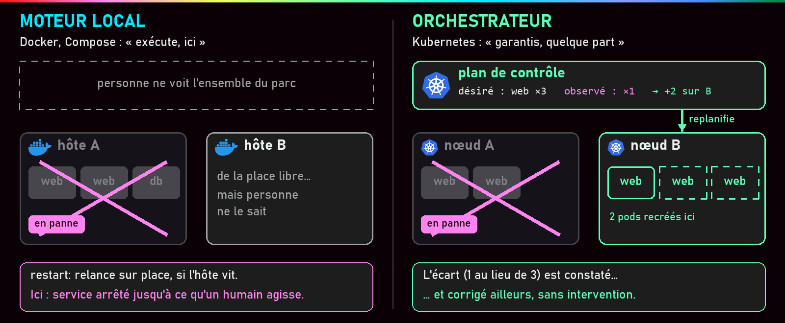
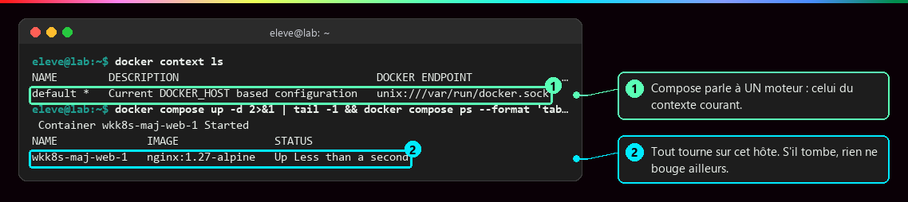
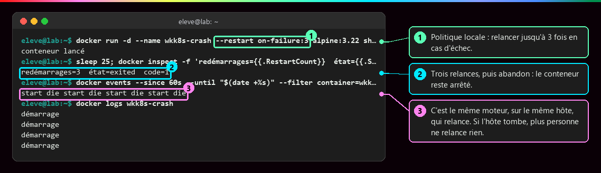
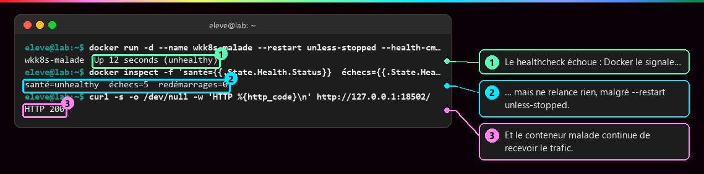
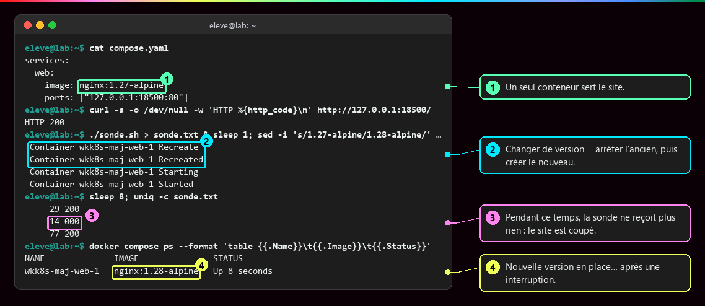
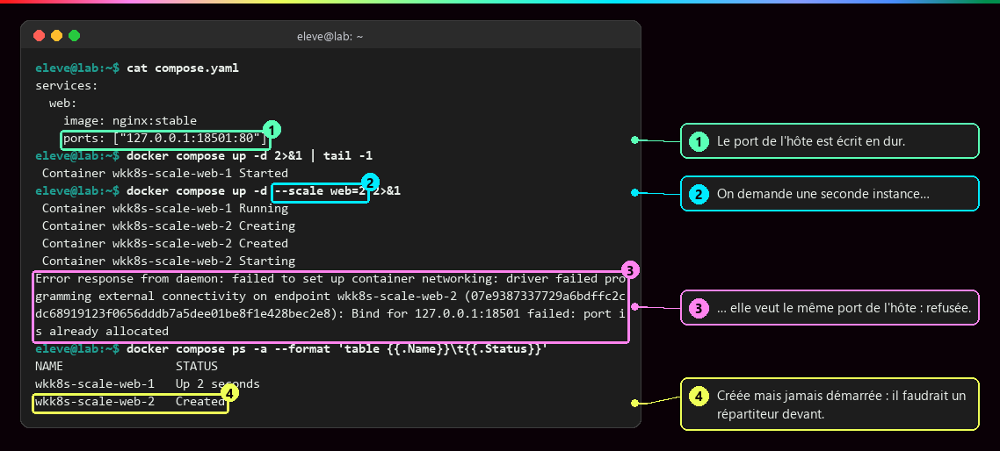
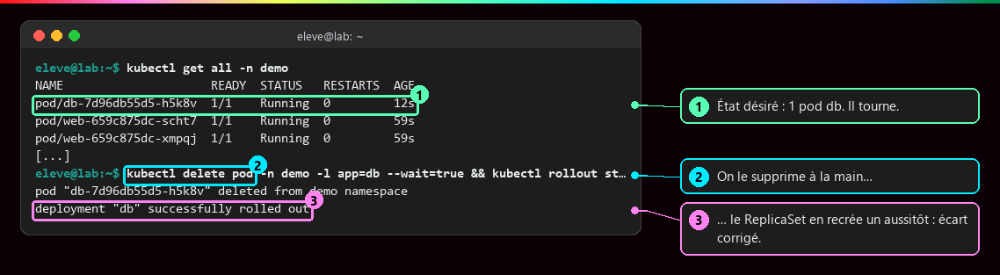

# Pourquoi orchestrer ?

<p class="lead">Docker et Compose savent <strong>lancer</strong> des conteneurs sur <strong>une</strong> machine. Dès qu'il faut répartir un service sur plusieurs machines, survivre à la perte de l'une d'elles et changer de version sans coupure, il faut un <strong>orchestrateur</strong> qui maintient en permanence un état désiré.</p>

{ .hero }

## L'essentiel en 30 secondes

<div class="grid cards" markdown>

-   :material-docker:{ .lg .middle } __Compose déclare déjà__

    ---

    Images, réseaux, volumes, dépendances : c'est une première déclaration… pour **un seul moteur Docker**.

-   :material-restart:{ .lg .middle } __Redémarrer ≠ replanifier__

    ---

    `restart:` relance **sur place**. Seul un orchestrateur recrée l'instance **sur un autre nœud**.

-   :material-sync:{ .lg .middle } __Déclarer, puis réconcilier__

    ---

    On dit « je veux 3 réplicas ». Un contrôleur compare sans arrêt ce qui tourne à ce qui est voulu, et corrige.

-   :material-alert-outline:{ .lg .middle } __Pas de magie__

    ---

    Données persistantes, sécurité et supervision se **conçoivent** toujours explicitement.

</div>

!!! warning "À retenir"

    **Compose n'est pas un orchestrateur multi-hôtes**, un **healthcheck ne répare rien** avec Docker Engine seul, et **redémarrer n'est pas replanifier**. Il manque un composant qui voit tout le parc et agit quand la réalité s'écarte de ce qui est voulu.

## :material-server-network: Ce que Compose ne fait pas

Un fichier `compose.yaml` est déjà une **déclaration** : on décrit les services voulus, pas l'ordre des `docker run` (voir [Docker Compose](Docker-Compose.md)). Mais il pilote **un seul moteur**, et un cluster multi-hôtes (des machines gérées comme un tout) pose de nouvelles questions.

| Compose sait… | … mais avec plusieurs hôtes, il faut aussi |
|---|---|
| décrire images, réseaux, volumes, secrets (`image:`, `networks:`, `volumes:`, `secrets:`) | **placer** chaque instance selon la place libre (CPU, mémoire) sur chaque hôte |
| ordonner le démarrage (`depends_on:`, `healthcheck:`) | **joindre** des instances dont l'IP change à chaque recréation et d'un hôte à l'autre |
| démarrer et arrêter un projet (`up -d`, `down`) | **réagir** quand un hôte disparaît : sur l'hôte mort, personne ne peut relancer quoi que ce soit |

???+ example "En vrai : Compose ne parle qu'à un moteur"

    

    Compose envoie ses ordres au moteur du contexte courant (ou de `DOCKER_HOST`), et à lui seul. Rien ne sait qu'un serveur B a de la place : si l'hôte tombe, le service reste arrêté jusqu'à une intervention humaine.

## :material-restart: Redémarrer n'est pas replanifier

Une **politique de redémarrage** (`restart: unless-stopped` dans Compose, `--restart` avec `docker run`) relance un conteneur **sur le même hôte**, à condition que le moteur et l'hôte fonctionnent. **Replanifier**, c'est recréer l'instance **ailleurs**.

???+ example "En vrai : le moteur relance, puis abandonne"

    

    Utile, mais local. Une politique de redémarrage ne traite ni une panne matérielle de l'hôte, ni une perte durable de connectivité, ni le choix d'un autre nœud, ni le rattachement des données sur ce nouveau nœud.

???+ danger "En vrai : un healthcheck qui échoue ne répare rien"

    

    Docker Engine **signale** `unhealthy`, Compose peut s'en servir pour l'ordre de démarrage (`depends_on` avec `condition: service_healthy`), mais aucun des deux ne remplace l'instance malade ni ne la retire du trafic. Détecter n'est pas agir : voir [Démarré n'est pas disponible](Demarre-n-est-pas-disponible.md).

## :material-update: Changer de version, multiplier les instances

Avec Compose, mettre à jour, c'est **recréer le conteneur** : s'il est seul à servir, le service est coupé. En production, il faut des **réplicas** (copies identiques), des vérifications de disponibilité, une progression contrôlée, un retour arrière et un routage vers les seules instances saines.

???+ example "En vrai : une mise à jour coupe le site"

    

    Une sonde interroge le site toutes les 50 ms pendant `docker compose up -d`. Compose arrête l'ancien conteneur **avant** de démarrer le nouveau (les deux ne peuvent pas publier le même port) : 14 requêtes restent sans réponse. Un orchestrateur remplace les instances **une par une** : voir [Pod, Deployment, ReplicaSet](Pod-Deployment-ReplicaSet.md).

???+ example "En vrai : deux répliques, un seul port"

    

    Répliquer suppose un **point d'accès stable** qui répartit les requêtes entre instances, quel que soit leur nombre. Dans Kubernetes, c'est le rôle du **Service** : voir [Service et Ingress](Service-et-Ingress.md).

## :material-kubernetes: Ce que doit fournir un orchestrateur

On passe de l'**exécution impérative** (« démarre ce conteneur », exécuté une fois) à la **gestion déclarative** (« je veux trois instances disponibles », tenu en continu par un contrôleur). La plateforme de référence, **Kubernetes**, répond besoin par besoin :

| Besoin | Fonction attendue | Réponse de Kubernetes |
|---|---|---|
| Placement | choisir les hôtes disponibles | le **scheduler** |
| Réplicas | maintenir le nombre voulu | **Deployment** et **ReplicaSet** |
| Réseau | découvrir et joindre les services | **Service** et DNS interne |
| Mise à jour | remplacer progressivement les instances | stratégie **RollingUpdate** |
| Panne | détecter l'écart et agir | les **contrôleurs** (boucle de réconciliation) |
| Configuration | distribuer paramètres et secrets | **ConfigMap** et **Secret** |

???+ example "En vrai : le même besoin, déclaré à Kubernetes"

    

    On n'a pas demandé « lance un conteneur » mais déclaré « je veux un pod db ». Après la suppression, le cluster constate l'écart et recrée le pod sans intervention : c'est la boucle de réconciliation, détaillée dans [Kubernetes : état désiré et réconciliation](Kubernetes-etat-desire.md).

!!! tip "Ce qui reste à concevoir"

    Le stockage persistant, la sécurité et la supervision ne deviennent **pas** automatiques avec un orchestrateur. Exemple : si un nœud tombe, ses données locales ne suivent pas toutes seules le pod recréé ailleurs.

??? note "Swarm, Mesos, Kubernetes : un changement de niveau"

    Quand plusieurs conteneurs doivent coopérer, il faut automatiser les déploiements, gérer le réseau et les dépendances, tolérer les pannes et monter en charge. Plusieurs orchestrateurs sont apparus : **Docker Swarm**, **Apache Mesos** et **Kubernetes**, devenu la référence. Kubernetes introduit des **Pods** (unités d'exécution), des **Deployments** (applications répliquées), des **Services** (un nom et une adresse stables) et des ressources de stockage, de configuration et de contrôle d'accès, le tout piloté par des **contrôleurs** qui recherchent en permanence l'état désiré.

    Docker et Kubernetes ne sont pas au même niveau d'abstraction : on passe de la gestion de **conteneurs** à celle de **services répartis**. Kubernetes généralise les concepts de Compose à l'échelle d'un cluster : multi-nœuds, haute disponibilité, auto-guérison.

??? note "Le chemin parcouru jusqu'ici"

    Un conteneur isole un processus dans un **noyau Linux partagé** ([Isolation d'un conteneur](Isolation-des-conteneurs.md)) grâce aux namespaces, aux cgroups et à OverlayFS. Docker Compose introduit une **première déclaration** d'infrastructure applicative. La montée en complexité des environnements distribués conduit naturellement à Kubernetes. Le cycle de vie complet :

    ```mermaid
    flowchart LR
        S["Source"] --> I["Image vérifiée"] --> E["Exécution restreinte"] --> R["Réseaux et volumes"] --> M["Mesure et diagnostic"] --> O["Réconciliation multi-hôtes"]
        style O stroke-width:3px
    ```

    L'orchestrateur prend en charge la dernière marche.

## :material-flask-outline: À toi de jouer

```bash
# 1. Redémarrage local : le moteur relance sur place, puis abandonne
docker run -d --name crash --restart on-failure:3 alpine:3.22 sh -c 'sleep 2; exit 1'
sleep 25; docker inspect -f '{{.RestartCount}} {{.State.Status}}' crash     # 3 exited
docker rm -f crash

# 2. Un healthcheck en échec ne remplace pas le conteneur
docker run -d --name malade --health-cmd 'exit 1' --health-interval 2s --health-retries 2 nginx:stable
sleep 12; docker ps --filter name=malade --format '{{.Status}}'           # Up ... (unhealthy)
docker rm -f malade

# 3. Le même besoin déclaré à Kubernetes (cluster Minikube démarré)
kubectl create deployment web --image=nginx:1.27 --replicas=3
kubectl delete pod -l app=web --wait=false && kubectl get pods -l app=web -w   # Ctrl+C après recréation
kubectl delete deployment web
```

??? abstract "Pour les créateurs : script de motion design « La nuit où le serveur A est tombé » (70 s)"

    Fond sombre, deux serveurs dessinés en blocs plats (A à gauche, B à droite), conteneurs en petits carrés bleus, une jauge « requêtes servies » en haut de l'écran.

    | Séq. | Durée | À l'écran | Animation | Texte à l'écran |
    |---|---|---|---|---|
    | 1 | 0-8 s | Le serveur A avec trois carrés « web » et un « db » ; le serveur B vide | Des points (requêtes) arrivent de la gauche et entrent dans les carrés ; la jauge est verte | « Un service, un serveur, un fichier Compose. » |
    | 2 | 8-16 s | Un carré « web » devient rouge et s'éteint | Une flèche circulaire part du serveur A et rallume le carré au même endroit | « Un conteneur plante : la politique de redémarrage le relance… sur place. » |
    | 3 | 16-26 s | Tout le serveur A clignote puis devient gris | Les carrés s'éteignent tous ; les points de requêtes rebondissent ; la jauge tombe à zéro ; le serveur B reste vide | « Le serveur tombe. Plus de moteur, plus de relance. B a de la place, mais personne ne le sait. » |
    | 4 | 26-34 s | Retour en arrière (effet de rembobinage) ; un bandeau « plan de contrôle » apparaît au-dessus des deux serveurs | Le bandeau affiche « désiré : web x3 » | « Rejouons la scène avec un orchestrateur. » |
    | 5 | 34-44 s | Le serveur A tombe de nouveau | Le bandeau affiche « observé : web x0 » en rouge, à côté de « désiré : web x3 » | « L'orchestrateur compare ce qu'il voit à ce qu'on lui a demandé. » |
    | 6 | 44-54 s | Trois carrés « web » apparaissent sur le serveur B | Les carrés naissent un par un ; une flèche « point d'entrée » se réoriente vers B ; la jauge remonte au vert | « Il replanifie ailleurs, et le point d'entrée suit. » |
    | 7 | 54-62 s | Zoom sur le carré « db », resté gris sur A | Un point d'interrogation clignote au-dessus | « Et les données ? Elles ne se déplacent pas toutes seules : ça se conçoit. » |
    | 8 | 62-70 s | Écran de synthèse : deux colonnes « Redémarrer » et « Replanifier » | Les mots « même hôte » et « autre nœud » s'inscrivent sous chaque colonne | « Compose exécute. Un orchestrateur garantit. » |

    L'effet de rembobinage de la séquence 4 est la clé : montrer **deux fois la même panne** rend la différence évidente. La séquence 7 évite le contresens selon lequel l'orchestrateur « sauve tout » : garder ce moment, même court.

??? info "Pour les créateurs : idées de schémas"

    - **Le nouveau problème, plusieurs hôtes** : utilisateurs, un point d'entrée, deux hôtes « service web », un service de données. Annoter chaque élément de sa question : « où placer ? » sur les hôtes, « comment les joindre ? » sur le point d'entrée, « et si A disparaît ? » sur l'hôte A barré.
    - **Redémarrer ou replanifier** : à gauche, un hôte A dont le conteneur plante et repart sur A ; à droite, un plan de contrôle « web x2 désirés » qui n'a plus de nouvelles du nœud A et recrée web sur le nœud B.
    - **Besoins et réponses** : six flèches besoin vers composant (Placement → Scheduler, Réplicas → Deployment / ReplicaSet, Réseau → Service + DNS, Mise à jour → RollingUpdate, Panne → Contrôleurs, Configuration → ConfigMap / Secret), avec en bas un bandeau gris « À concevoir soi-même : stockage persistant, sécurité, supervision ».
    - **L'échelle des niveaux d'abstraction** : trois marches, « Processus isolé » (Docker, `docker run`, « comment isoler ? »), « Application d'un hôte » (Compose, `compose.yaml`, « comment assembler ? »), « Service réparti sur un cluster » (Kubernetes, manifestes, « comment garantir ? »).
