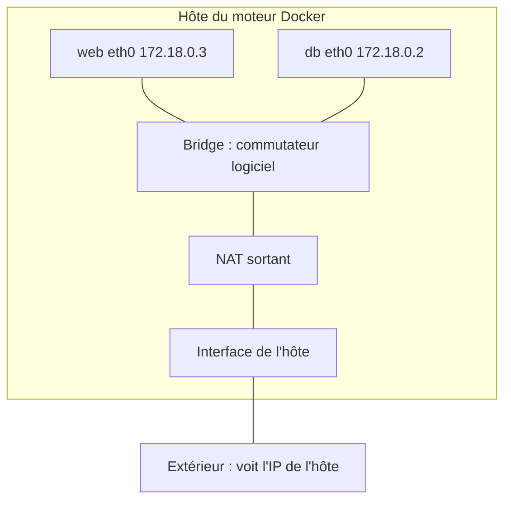

# Réseaux et ports

<p class="lead">Un conteneur a sa propre pile réseau. Pour qu'un service soit joignable, il faut un processus qui écoute, un réseau qui relie et, seulement si l'accès vient de l'extérieur, un <strong>port publié</strong>. Entre conteneurs, on se trouve <strong>par le nom du service</strong>, jamais par l'IP.</p>

{ .hero }

## L'essentiel en 30 secondes

<div class="grid cards" markdown>

-   :material-door-open:{ .lg .middle } __Publier · `-p`__

    ---

    Seule la publication ouvre une porte sur l'hôte. `127.0.0.1:8080:80` : le poste seulement.

-   :material-lan:{ .lg .middle } __Relier · un réseau__

    ---

    Deux conteneurs se parlent s'ils partagent un réseau. Compose en crée un par projet.

-   :material-dns-outline:{ .lg .middle } __Nommer · le DNS interne__

    ---

    Sur un réseau créé, `db` se résout en l'IP **actuelle** du conteneur. Le bridge par défaut ne le fait pas.

-   :material-wall:{ .lg .middle } __Cloisonner · `internal: true`__

    ---

    La base vit sur un réseau privé, sans port publié ni sortie. Ce n'est pas un pare-feu applicatif.

</div>

!!! warning "À retenir"

    **Port écouté ≠ port publié.** `EXPOSE 80` ou un serveur sur `0.0.0.0:80` dans le conteneur ne rendent rien accessible depuis l'hôte : seul `-p` (clé `ports:`) publie. Et une IP de conteneur change à chaque recréation : on configure **le nom** (`DB_HOST=db`).

Une application web et sa base produisent trois flux de nature différente : **entrant** (client → web, port publié), **privé** (web → db, réseau commun et DNS), **fichiers** (db → volume, voir [Stockage et volumes](Stockage-et-volumes.md)). Ils ne demandent ni la même configuration, ni la même protection.

## :material-dns-outline: Relier et nommer : le DNS interne

Sur un réseau **créé** (`docker network create`, ou celui de Compose), Docker fournit un résolveur `127.0.0.11` qui traduit le nom d'un conteneur, d'un alias ou d'un service en son IP actuelle. Sa portée est **le réseau** : ni l'hôte, ni le DNS de l'entreprise ne connaissent `db`.

| | Bridge par défaut (`bridge`) | Bridge créé |
|---|---|---|
| Résolution des noms | **non**, seulement les IP | **oui**, DNS interne |
| Isolation | tous les conteneurs « sans réseau précisé » ensemble | un ou plusieurs réseaux par application |
| Brancher à chaud | `docker network connect` / `disconnect` | idem |

???+ example "En vrai : le même nom, deux réseaux"

    

    La résolution par nom est une propriété **du réseau**, pas du conteneur. `docker network connect` a branché un conteneur déjà lancé sur un second réseau : il a maintenant deux interfaces.

L'IP est attribuée à la création par le gestionnaire d'adresses (IPAM) du réseau. Elle peut changer à chaque recréation, changement de réseau ou redémarrage dans un autre ordre, et parfois rester identique : on ne peut compter dessus **dans aucun sens**.

## :material-door-open: Publier un port

```
   -p 127.0.0.1:8080:80
      └─── hôte ───┘ └─ port où le service écoute DANS le conteneur
```

| Écriture | Point d'entrée sur l'hôte | Joignable depuis |
|---|---|---|
| `-p 8080:80` | toutes les interfaces (`0.0.0.0` et `[::]`) | le poste **et** potentiellement le réseau local |
| `-p 127.0.0.1:8080:80` | la boucle locale | le poste seulement |
| aucun `-p` | rien | les conteneurs du même réseau seulement |

???+ example "En vrai : la base n'a pas de porte sur l'hôte"

    

    L'image MariaDB déclare `EXPOSE 3306` : le port est **affiché**, sans flèche, donc non publié. Côté hôte, `ss -lnt` ne montre qu'une socket : `127.0.0.1:18380`. Ni le 80 d'Apache ni le 3306 de MariaDB n'existent hors des namespaces réseau des conteneurs.

!!! danger "`-p 8080:80` publie sur toutes les interfaces"

    Les règles posées par Docker passent **avant** un pare-feu comme ufw : le service peut devenir joignable depuis le réseau local. Publier sur `127.0.0.1` est une décision, pas un détail. Et publier `3306:3306` n'aide en rien le conteneur PHP (il passe par le réseau interne) : c'est un point d'accès de plus.

`docker run -P` (majuscule) publie tous les ports déclarés par `EXPOSE` sur des ports aléatoires : c'est le seul effet pratique d'`EXPOSE`, à part la documentation. À l'inverse, le NAT **sortant** permet au conteneur de joindre Internet avec l'adresse de l'hôte ; il ne publie aucun port entrant.

## :material-wall: Cloisonner : frontend et backend

Le serveur web doit être joignable par l'utilisateur ; la base, uniquement par le serveur web. `web` est sur les deux réseaux et sert de pont.

```yaml
services:
  web:
    networks: [frontend, backend]
    ports: ["127.0.0.1:8080:80"]
  db:
    networks: [backend]          # aucun "ports:"
networks:
  frontend:
  backend:
    internal: true               # pas de route vers l'extérieur
```

???+ example "En vrai : ce que voit chaque réseau"

    

    Ne pas publier de port ne rend **pas** la base inaccessible : tout conteneur branché sur `backend` l'atteint. La segmentation réduit la surface d'exposition sans rien garantir ; la vraie protection reste l'authentification de MariaDB. Syntaxe complète : [Docker Compose](Docker-Compose.md).

??? note "Les autres pilotes : host, none, overlay"

    | Pilote | Ce que reçoit le conteneur | Usage |
    |---|---|---|
    | **bridge** | une interface `eth0` reliée à un pont logiciel sur l'hôte, une IP privée | le cas central, conteneurs **d'un même hôte** |
    | **host** | **aucun** namespace réseau : celui de l'hôte | performances, outils réseau ; `-p` est ignoré (avec un avertissement) |
    | **none** | seulement `lo` | calcul, conversion, restauration hors ligne |
    | **overlay** | un réseau logique sur plusieurs hôtes | multi-hôtes, sous conditions (mode Swarm) |

    `none` ne veut pas dire « sans risque » : le conteneur garde ses fichiers, ses montages, ses privilèges. `host` retire une protection et son comportement dépend de la plateforme, en particulier sous Docker Desktop.

??? note "Sous Windows et macOS (Docker Desktop)"

    Les conteneurs Linux tournent dans une VM gérée par Docker Desktop. Le bridge existe **dans cette VM** ; la publication est relayée vers le poste. Les IP privées des conteneurs ne sont généralement pas routables depuis Windows ou macOS : on passe par le port publié sur `localhost`.

## :material-stethoscope: « Le site ne répond pas » : couche par couche

Un serveur inaccessible n'est pas forcément un conteneur arrêté. Un serveur qui écoute sur `0.0.0.0:80` **dans le conteneur** accepte les connexions sur toutes **ses** interfaces, pas sur le port 80 de l'ordinateur.

| Couche | Question | Commande |
|---|---|---|
| Processus | Le conteneur tourne-t-il ? | `docker ps`, `docker logs <c>` |
| Socket | Le serveur écoute-t-il, sur quelle adresse ? | `docker exec <c> ss -lnt` (si l'outil existe) |
| DNS | Le nom du service est-il résolu ? | `docker exec <c> getent hosts db` |
| Liaison | Les deux conteneurs partagent-ils un réseau ? | `docker network inspect <reseau>` |
| Publication | Le port est-il publié, sur quelle adresse ? | `docker port <c>`, `ss -lnt` sur l'hôte |

La méthode complète, appliquée à une erreur 503 : [Démarré n'est pas disponible](Demarre-n-est-pas-disponible.md).



Le bridge relie des interfaces **sur un même hôte** : à lui seul, ce n'est pas un réseau de cluster.

## :material-flask-outline: À toi de jouer

```bash
docker network create atelier-net
docker run -d --name site --network atelier-net -p 127.0.0.1:8080:80 nginx:stable
curl -sI http://127.0.0.1:8080/ | head -1                                   # HTTP/1.1 200 OK
docker run --rm --network atelier-net alpine:3.22 nslookup site             # réponse de 127.0.0.11
docker run --rm alpine:3.22 wget -qO- -T 3 http://site                      # bad address : bridge par défaut
docker run --rm --network none alpine:3.22 ip addr                          # seulement lo
ss -lnt | grep 8080                                                         # 127.0.0.1:8080 uniquement
docker rm -f site && docker network rm atelier-net
```

Pour aller plus loin : [Isolation d'un conteneur](Isolation-des-conteneurs.md) (le namespace Network), [Secrets, fichiers, réseau et ressources](Secrets-fichiers-reseau-ressources.md) (le réseau sous l'angle sécurité).

??? abstract "Pour les créateurs : script de motion design « Le voyage d'une requête » (70 s)"

    Vue en coupe, l'hôte en grand cadre gris, chaque conteneur en carte colorée (bleu web, vert db), la requête en petite enveloppe lumineuse qui laisse une traînée.

    | Séq. | Durée | À l'écran | Animation | Texte à l'écran |
    |---|---|---|---|---|
    | 1 | 0-7 s | Un navigateur à gauche, le cadre « Hôte » à droite avec une seule prise lumineuse `127.0.0.1:8080` sur son bord | L'enveloppe part du navigateur vers la prise | « Une requête arrive sur l'hôte. Une seule porte est ouverte. » |
    | 2 | 7-16 s | Dans le cadre, la carte « web » avec sa prise interne `:80` ; une porte « 3306 » barrée sur l'hôte | L'enveloppe passe 8080, un tunnel la conduit à `:80` ; la porte 3306 clignote puis disparaît | « La publication relie 8080 (hôte) à 80 (conteneur). La base n'a pas de porte. » |
    | 3 | 16-26 s | La carte web s'ouvre : Apache puis PHP ; une bulle « DB_HOST=db » | Une bulle « où est db ? » part vers un petit annuaire « 127.0.0.11 » | « PHP ne connaît qu'un nom : db. » |
    | 4 | 26-34 s | L'annuaire DNS interne | Il feuillette, renvoie une étiquette « 172.20.0.2 » | « Le DNS interne traduit le nom en adresse actuelle. » |
    | 5 | 34-44 s | Deux zones : « frontend » (web) et « backend » (web et db) | L'enveloppe SQL traverse backend jusqu'à db `:3306` ; une carte « intrus » dans frontend rebondit sur un mur | « db n'est que sur backend. Hors de ce réseau, son nom n'existe même pas. » |
    | 6 | 44-52 s | La carte db se retourne : MariaDB et, dessous, un cylindre « volume » | Une flèche courte, sans enveloppe, de db au volume | « La base lit ses fichiers : ce n'est plus du réseau. » |
    | 7 | 52-60 s | Le chemin inverse | L'enveloppe repart chargée : db → web → tunnel → navigateur, qui affiche « 200 » | « Chaque flèche est un chemin vérifiable. » |
    | 8 | 60-70 s | La carte db est remplacée (même nom, nouvelle IP 172.20.0.5) | L'annuaire se met à jour, la requête suivante arrive sans hésiter | « L'IP change. Le nom reste. C'est lui qu'on configure. » |

    Laisser la traînée de l'aller visible pendant le retour : l'écran final montre le chemin complet, qui sert de modèle pour le diagnostic. La séquence 5 gagne à être lente.

??? info "Pour les créateurs : idées de schémas"

    **Publication et DNS, deux mécanismes distincts.**

    ```mermaid
    flowchart LR
        U["Navigateur sur l'hôte"] -->|"127.0.0.1:8080 (port publié)"| W["web : Apache écoute :80"]
        W -->|"1. qui est db ?"| D["DNS interne 127.0.0.11"]
        D -->|"2. IP actuelle"| W
        W -->|"3. TCP :3306 (réseau privé)"| B["db : MariaDB écoute :3306"]
    ```

    **La règle `-p` en vue éclatée.** Un grand rectangle « Hôte » contient un petit rectangle « Conteneur ». Sur le bord du grand, une prise `127.0.0.1:8080` ; sur le bord du petit, une prise `:80` ; un câble « publication (-p) » les relie. À côté du conteneur, une étiquette en pointillés « EXPOSE 80 » sans câble : « documente, ne branche rien ».

    **Réseau à deux niveaux.** Le même conteneur web dessiné deux fois (une interface par réseau), relié par un pointillé « même conteneur, deux interfaces » ; db sur backend avec un trait barré vers « Internet ».
