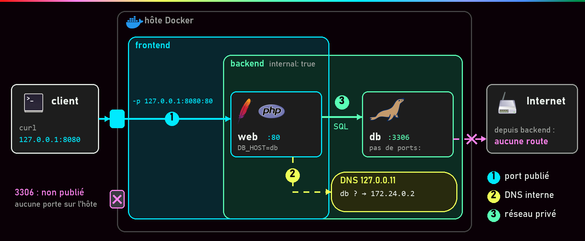
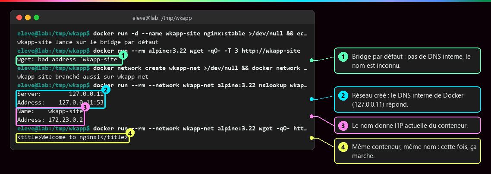
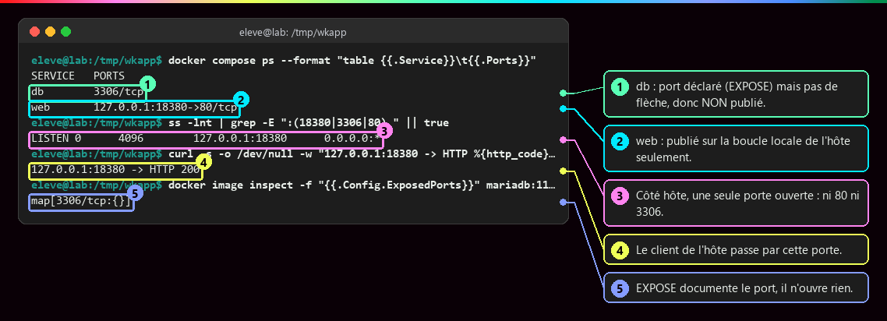
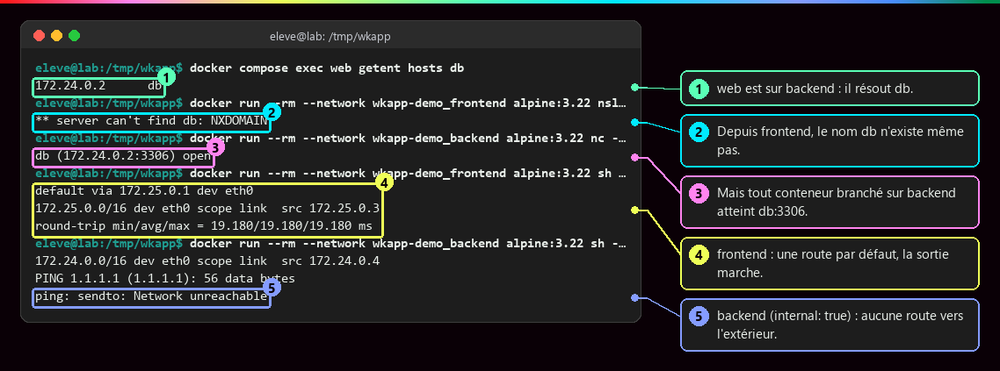

# Réseaux et ports

<p class="lead">Un conteneur a sa propre pile réseau. Pour qu'un service soit joignable, il faut un processus qui écoute, un réseau qui relie et, seulement si l'accès vient de l'extérieur, un <strong>port publié</strong>. Entre conteneurs, on se trouve <strong>par le nom du service</strong>, jamais par l'IP.</p>

{ .hero }

!!! abstract "Dans cette page"

    **Tu vas comprendre :**

    - comment ouvrir l'accès à un conteneur depuis ton poste, et seulement depuis ton poste ;
    - comment deux conteneurs se trouvent par leur nom, sans connaître leur adresse ;
    - comment cacher une base de données derrière le serveur web.

    **Prérequis :** [Isolation d'un conteneur](Isolation-des-conteneurs.md) et [Image et cycle de vie](Image-et-cycle-de-vie.md). **Durée :** 30 min. **Niveau :** débutant.

!!! quote "En clair"

    Imagine un **immeuble de bureaux**. Chaque bureau (un conteneur) a son téléphone interne. Un **standard** connaît le nom de chacun : tu demandes « Martin », il te passe le bon poste, même si Martin a changé de bureau. De l'extérieur, on ne joint que les numéros que l'accueil a **rendus publics**. La limite de l'image : ici, chaque immeuble a son propre standard ; deux conteneurs qui ne sont pas dans le même réseau ne se connaissent pas du tout.

    { .anim }

## L'essentiel en 30 secondes

<div class="grid cards" markdown>

-   :material-door-open:{ .lg .middle } __Publier · `-p`__

    ---

    Seule la publication ouvre une porte sur l'hôte. `127.0.0.1:8080:80` : ton poste seulement.

-   :material-lan:{ .lg .middle } __Relier · un réseau__

    ---

    Deux conteneurs se parlent s'ils sont branchés sur le même réseau. Compose en crée un par projet.

-   :material-dns-outline:{ .lg .middle } __Nommer · le DNS interne__

    ---

    Sur un réseau que tu as créé, le nom `db` donne l'adresse **actuelle** du conteneur. Le réseau par défaut ne le fait pas.

-   :material-wall:{ .lg .middle } __Cloisonner · `internal: true`__

    ---

    La base vit sur un réseau privé, sans port publié ni sortie vers Internet. Ce n'est pas un pare-feu complet.

</div>

!!! warning "À retenir"

    **Un port écouté n'est pas un port publié.** Un serveur qui écoute sur le port 80 *dans* le conteneur n'est pas joignable depuis ton poste : seul `-p` (la clé `ports:` dans Compose) ouvre une porte. Et l'adresse IP d'un conteneur change quand on le recrée : on configure toujours **son nom** (`DB_HOST=db`), jamais son adresse.

Une application web et sa base produisent trois flux de nature différente : **entrant** (client → web, par le port publié), **privé** (web → db, par un réseau commun et le DNS), **fichiers** (db → volume, voir [Stockage et volumes](Stockage-et-volumes.md)). Ils ne demandent ni la même configuration, ni la même protection.

## :material-dns-outline: Relier et nommer : le DNS interne

!!! quote "En clair"

    Le DNS interne, c'est le **standard** de l'immeuble : il traduit un nom (`db`) en adresse du moment (`172.18.0.2`). Il n'existe que dans les réseaux que tu crées toi-même.

    { .anim }

Sur un réseau **créé** (`docker network create`, ou celui que Compose crée pour toi), Docker fournit un résolveur, c'est-à-dire un petit service qui répond aux questions DNS, à l'adresse `127.0.0.11`. Il traduit le nom d'un conteneur, d'un alias ou d'un service en son IP actuelle. Sa portée est **le réseau** : ni ton poste, ni le DNS de l'entreprise ne connaissent `db`.

Le réseau par défaut s'appelle `bridge` (un *bridge*, ou pont, est un commutateur logiciel : une multiprise réseau à l'intérieur de l'hôte).

| | Bridge par défaut (`bridge`) | Bridge créé |
|---|---|---|
| Résolution des noms | **non**, seulement les IP | **oui**, DNS interne |
| Isolation | tous les conteneurs lancés « sans réseau précisé » ensemble | un ou plusieurs réseaux par application |
| Brancher à chaud | `docker network connect` / `disconnect` | idem |

???+ example "En vrai : le même nom, deux réseaux"

    **Ce qu'on fait :** on lance un serveur web sur le réseau par défaut et on essaie de le joindre par son nom. Puis on le branche aussi sur un réseau créé, et on recommence depuis ce réseau.

    

    **Ce qu'il faut regarder :**

    - ① Sur le réseau par défaut, `bad address` : personne ne connaît ce nom.
    - ② Sur le réseau créé, le résolveur de Docker (`127.0.0.11`) répond.
    - ③ Il donne l'adresse actuelle du conteneur.
    - ④ Même conteneur, même nom : cette fois la page arrive.

    La résolution par nom est une propriété **du réseau**, pas du conteneur. `docker network connect` a branché un conteneur déjà lancé sur un second réseau : il a maintenant deux cartes réseau.

L'IP est attribuée à la création par le gestionnaire d'adresses du réseau (l'IPAM). Elle peut changer à chaque recréation, changement de réseau ou redémarrage dans un autre ordre, et parfois rester identique : on ne peut compter dessus **dans aucun sens**.

## :material-door-open: Publier un port

!!! quote "En clair"

    Publier un port, c'est percer une **porte dans la façade** de l'hôte et la relier à la porte du conteneur. Sans cette porte, le conteneur est joignable par ses voisins de réseau, pas par toi.

    { .anim }

```bash
docker run -d --name site -p 127.0.0.1:8080:80 nginx:stable  # (1)!
```

1. `-d` : en arrière-plan. `--name site` : un nom facile à retenir. `-p 127.0.0.1:8080:80` : la porte `8080` de ton poste, ouverte seulement sur `127.0.0.1` (l'adresse qui désigne ta propre machine), mène au port `80` du conteneur, là où nginx écoute.

```
   -p 127.0.0.1:8080:80
      └─── hôte ───┘ └─ port où le service écoute DANS le conteneur
```

| Écriture | Point d'entrée sur l'hôte | Joignable depuis |
|---|---|---|
| `-p 8080:80` | toutes les cartes réseau (`0.0.0.0` et `[::]`) | ton poste **et** potentiellement le réseau local |
| `-p 127.0.0.1:8080:80` | la boucle locale | ton poste seulement |
| aucun `-p` | rien | les conteneurs du même réseau seulement |

???+ example "En vrai : la base n'a pas de porte sur l'hôte"

    **Ce qu'on fait :** dans l'application complète (un site PHP et sa base MariaDB), on liste les ports de chaque service, puis on regarde quelles portes sont réellement ouvertes sur l'hôte avec `ss -lnt` (la liste des ports en écoute).

    

    **Ce qu'il faut regarder :**

    - ① `db` affiche `3306/tcp` **sans flèche** : le port est connu, pas publié.
    - ② `web` a une flèche `127.0.0.1:18380->80` : publié, sur ton poste seulement.
    - ③ Côté hôte, une seule porte ouverte. Ni le 80 d'Apache ni le 3306 de MariaDB n'existent hors des conteneurs.
    - ④ Le client de l'hôte passe par cette porte et reçoit `200`.
    - ⑤ L'image MariaDB déclare `EXPOSE 3306` : c'est de la documentation, ça n'ouvre rien.

!!! danger "`-p 8080:80` publie sur toutes les cartes réseau"

    Les règles posées par Docker passent **avant** un pare-feu comme ufw : le service peut devenir joignable depuis le réseau local. Publier sur `127.0.0.1` est une décision, pas un détail. Et publier `3306:3306` n'aide en rien le conteneur PHP (il passe par le réseau interne) : c'est une porte de plus pour un attaquant.

`docker run -P` (majuscule) publie tous les ports déclarés par `EXPOSE` sur des ports au hasard : c'est le seul effet pratique d'`EXPOSE`, à part la documentation. À l'inverse, le NAT **sortant** permet au conteneur de joindre Internet avec l'adresse de l'hôte ; il n'ouvre aucune porte entrante.

## :material-wall: Cloisonner : frontend et backend

!!! quote "En clair"

    Deux couloirs : un couloir **public** où arrivent les visiteurs, un couloir **de service** réservé au personnel. Le serveur web a une porte sur chaque couloir ; la base n'a qu'une porte, côté service.

    { .anim }

Le serveur web doit être joignable par l'utilisateur ; la base, uniquement par le serveur web. `web` est sur les deux réseaux et sert de pont. Voici l'extrait du fichier Compose (le format est expliqué dans [Docker Compose](Docker-Compose.md)) :

```yaml
services:
  web:
    networks: [frontend, backend]   # (1)!
    ports: ["127.0.0.1:8080:80"]    # (2)!
  db:
    networks: [backend]             # (3)!
networks:
  frontend:
  backend:
    internal: true                  # (4)!
```

1. `web` est branché sur les deux réseaux : il reçoit les visiteurs d'un côté et parle à la base de l'autre.
2. La seule porte publiée de toute l'application, sur ton poste uniquement.
3. `db` n'est que sur `backend`, et n'a **aucune** clé `ports:`.
4. `internal: true` : ce réseau n'a pas de route vers l'extérieur. La base ne peut ni être jointe depuis l'hôte, ni sortir vers Internet.

???+ example "En vrai : ce que voit chaque réseau"

    **Ce qu'on fait :** on se place tour à tour dans chaque réseau avec un petit conteneur jetable, et on cherche la base, puis Internet.

    

    **Ce qu'il faut regarder :**

    - ① `web` est sur `backend` : il trouve `db`.
    - ② Depuis `frontend`, le nom `db` n'existe même pas.
    - ③ Mais **n'importe quel** conteneur branché sur `backend` atteint `db:3306`.
    - ④ `frontend` a une route par défaut (`default via`) : la sortie vers Internet marche.
    - ⑤ `backend` (`internal: true`) n'en a pas : `Network unreachable`.

    Ne pas publier de port ne rend **pas** la base inaccessible (③). La segmentation réduit la surface d'exposition sans rien garantir ; la vraie protection reste le mot de passe de MariaDB.

## :material-stethoscope: « Le site ne répond pas » : couche par couche

Un serveur inaccessible n'est pas forcément un conteneur arrêté. Un serveur qui écoute sur `0.0.0.0:80` **dans le conteneur** accepte les connexions sur toutes **ses** cartes réseau, pas sur le port 80 de ton ordinateur. On remonte donc les couches dans l'ordre :

| Couche | Question | Commande |
|---|---|---|
| Processus | Le conteneur tourne-t-il ? | `docker ps`, `docker logs <c>` |
| Écoute | Le serveur écoute-t-il, sur quelle adresse ? | `docker exec <c> ss -lnt` (si l'outil existe dans l'image) |
| DNS | Le nom du service est-il résolu ? | `docker exec <c> getent hosts db` |
| Liaison | Les deux conteneurs partagent-ils un réseau ? | `docker network inspect <reseau>` |
| Publication | Le port est-il publié, sur quelle adresse ? | `docker port <c>`, `ss -lnt` sur l'hôte |

La méthode complète, appliquée à une erreur 503 : [Démarré n'est pas disponible](Demarre-n-est-pas-disponible.md).

## :material-flask-outline: À toi de jouer

Cinq étapes, environ 10 minutes. Tape les commandes une par une et compare avec ce que tu dois voir.

**Étape 1 · Créer un réseau et y lancer un site**

```bash
docker network create atelier-net                                                  # (1)!
docker run -d --name site --network atelier-net -p 127.0.0.1:8080:80 nginx:stable  # (2)!
docker port site                                                                   # (3)!
```

1. Crée un réseau privé nommé `atelier-net`, avec son DNS interne.
2. Lance nginx sur ce réseau (`--network atelier-net`) et publie son port 80 sur le port 8080 de ton poste.
3. Affiche les ports publiés du conteneur.

Tu dois voir deux longs identifiants (les tiens seront différents), puis la publication :

```text
7b24d65d35d1d5f09827e358bb5ee82784ee09cd0a516a06205682de2b9843da
5577e58186f1a5c7f37e3f58b3cc334dbd3c15b614c85e256c833f31eac20d6b
80/tcp -> 127.0.0.1:8080
```

**Étape 2 · Passer par la porte publiée**

```bash
curl -sI http://127.0.0.1:8080/ | head -1   # (1)!
ss -lnt | grep 8080                         # (2)!
```

1. `curl` joue le rôle du navigateur. `-sI` : silencieux, en-têtes seulement. `head -1` garde la première ligne, celle du code de réponse.
2. Liste les portes ouvertes sur ton poste (`-l` en écoute, `-n` en chiffres, `-t` TCP) et garde celle du 8080.

Tu dois voir la réponse `200 OK`, puis une porte ouverte sur `127.0.0.1` seulement :

```text
HTTP/1.1 200 OK
LISTEN 0      4096        127.0.0.1:8080       0.0.0.0:*
```

**Étape 3 · Se trouver par le nom**

```bash
docker run --rm --network atelier-net alpine:3.22 nslookup site   # (1)!
docker run --rm alpine:3.22 wget -qO- -T 3 http://site            # (2)!
```

1. Un conteneur jetable (`--rm`) **sur le même réseau** demande l'adresse de `site` au DNS.
2. Le même essai, mais sans `--network` : ce conteneur atterrit sur le réseau par défaut.

Tu dois voir le résolveur `127.0.0.11` et l'adresse de `site` (la tienne peut différer), puis un échec sur le réseau par défaut :

```text
Server:		127.0.0.11
Address:	127.0.0.11:53

Non-authoritative answer:

Non-authoritative answer:
Name:	site
Address: 172.23.0.2

wget: bad address 'site'
```

**Étape 4 · L'adresse change, le nom reste**

```bash
docker inspect -f '{{range .NetworkSettings.Networks}}{{.IPAddress}}{{end}}' site   # (1)!
docker rm -f site                                                                   # (2)!
docker run -d --name voisin --network atelier-net alpine:3.22 sleep 600             # (3)!
docker run -d --name site --network atelier-net -p 127.0.0.1:8080:80 nginx:stable
docker inspect -f '{{range .NetworkSettings.Networks}}{{.IPAddress}}{{end}}' site
docker run --rm --network atelier-net alpine:3.22 wget -qO- http://site | grep '<title>'   # (4)!
```

1. Lit l'adresse IP actuelle de `site`. Le `-f '{{…}}'` choisit le champ à afficher.
2. Supprime `site` : son adresse est libérée.
3. Un autre conteneur arrive sur le réseau et prend l'adresse libre. Puis on recrée `site`.
4. On joint `site` par son nom, comme le ferait une application.

Tu dois voir deux adresses différentes, et pourtant la page arrive (les identifiants affichés entre-temps sont omis ici) :

```text
172.23.0.2
172.23.0.3
<title>Welcome to nginx!</title>
```

C'est pour cela qu'on écrit `DB_HOST=db` et jamais une adresse IP.

**Étape 5 · Faire le ménage**

```bash
docker rm -f site voisin          # (1)!
docker network rm atelier-net     # (2)!
```

1. Supprime les deux conteneurs, en les arrêtant d'abord.
2. Supprime le réseau. Il faut le faire **après** les conteneurs.

Tu dois voir les noms supprimés :

```text
site
voisin
atelier-net
```

??? tip "Ça ne marche pas ?"

    | Message | Cause | Solution |
    |---|---|---|
    | `Bind for 127.0.0.1:8080 failed: port is already allocated` | un autre programme ou conteneur utilise déjà le port 8080 | `docker rm -f site` (le conteneur a été créé malgré l'erreur), puis relance avec `-p 127.0.0.1:8081:80` et utilise 8081 dans la suite |
    | `network with name atelier-net already exists` | le réseau existe depuis un essai précédent | passe à la commande suivante, ou `docker network rm atelier-net` |
    | `wget: bad address 'site'` à l'étape 4 | tu as oublié `--network atelier-net` | ajoute l'option : le nom n'existe que sur ce réseau |
    | `network atelier-net has active endpoints` | des conteneurs sont encore branchés dessus | supprime d'abord les conteneurs (`docker rm -f site voisin`) |
    | `curl: (7) Failed to connect` | le conteneur ne tourne pas, ou pas de `-p` | `docker ps`, puis `docker port site` |

## :material-help-circle-outline: Vérifie que tu as compris

??? question "1. Ton image contient `EXPOSE 80` et tu lances `docker run -d monimage`. Peux-tu ouvrir le site dans ton navigateur ?"

    **Non.** `EXPOSE` ne fait que documenter. Sans `-p`, aucune porte n'est ouverte sur ton poste. Il faut `-p 127.0.0.1:8080:80`.

??? question "2. Pourquoi ne pas écrire l'adresse `172.18.0.2` de la base dans la configuration du site ?"

    Parce qu'elle peut changer à chaque recréation du conteneur, comme à l'étape 4. Le **nom** `db`, lui, est toujours traduit par le DNS interne en l'adresse du moment.

??? question "3. La base n'a aucun port publié. Est-elle pour autant inaccessible ?"

    **Non.** Tout conteneur branché sur le même réseau qu'elle peut la joindre. Ne rien publier réduit l'exposition ; c'est le mot de passe de la base qui protège vraiment.

!!! success "Et ensuite ?"

    Tu sais ouvrir une porte, relier des conteneurs et les trouver par leur nom. Page suivante : [Stockage et volumes](Stockage-et-volumes.md), pour garder les données quand le conteneur disparaît.

## :material-server: Pour aller plus loin

??? note "Les autres pilotes : host, none, overlay"

    | Pilote | Ce que reçoit le conteneur | Usage |
    |---|---|---|
    | **bridge** | une carte `eth0` reliée à un pont logiciel sur l'hôte, une IP privée | le cas central, conteneurs **d'un même hôte** |
    | **host** | **aucun** namespace réseau : celui de l'hôte | performances, outils réseau ; `-p` est ignoré (avec un avertissement) |
    | **none** | seulement `lo` | calcul, conversion, restauration hors ligne |
    | **overlay** | un réseau logique sur plusieurs hôtes | multi-hôtes, sous conditions (mode Swarm) |

    `none` ne veut pas dire « sans risque » : le conteneur garde ses fichiers, ses montages, ses privilèges. `host` retire une protection et son comportement dépend de la plateforme, en particulier sous Docker Desktop.

??? note "Sous Windows et macOS (Docker Desktop)"

    Les conteneurs Linux tournent dans une VM gérée par Docker Desktop. Le bridge existe **dans cette VM** ; la publication est relayée vers le poste. Les IP privées des conteneurs ne sont généralement pas joignables depuis Windows ou macOS : on passe par le port publié sur `localhost`.

??? note "Sous le capot : le bridge et le NAT sortant"

    ```mermaid
    flowchart TB
        subgraph H["Hôte du moteur Docker"]
            BR["Bridge : commutateur logiciel"]
            W["web eth0 172.18.0.3"] --- BR
            D["db eth0 172.18.0.2"] --- BR
            BR --- NAT["NAT sortant"] --- ETH["Interface de l'hôte"]
        end
        ETH --- EXT["Extérieur : voit l'IP de l'hôte"]
    ```

    Le bridge relie des cartes réseau **sur un même hôte** : à lui seul, ce n'est pas un réseau de cluster. Voir aussi [Isolation d'un conteneur](Isolation-des-conteneurs.md) (le namespace Network) et [Secrets, fichiers, réseau et ressources](Secrets-fichiers-reseau-ressources.md) (le réseau sous l'angle sécurité).

??? abstract "Pour les créateurs : script de motion design « Le voyage d'une requête » (70 s)"

    Vue en coupe, l'hôte en grand cadre gris, chaque conteneur en carte colorée (bleu web, vert db), la requête en petite enveloppe lumineuse qui laisse une traînée.

    | Séq. | Durée | À l'écran | Animation | Texte à l'écran |
    |---|---|---|---|---|
    | 1 | 0-7 s | Un navigateur à gauche, le cadre « Hôte » à droite avec une seule prise lumineuse `127.0.0.1:8080` sur son bord | L'enveloppe part du navigateur vers la prise | « Une requête arrive sur l'hôte. Une seule porte est ouverte. » |
    | 2 | 7-16 s | Dans le cadre, la carte « web » avec sa prise interne `:80` ; une porte « 3306 » barrée sur l'hôte | L'enveloppe passe 8080, un tunnel la conduit à `:80` ; la porte 3306 clignote puis disparaît | « La publication relie 8080 (hôte) à 80 (conteneur). La base n'a pas de porte. » |
    | 3 | 16-26 s | La carte web s'ouvre : Apache puis PHP ; une bulle « DB_HOST=db » | Une bulle « où est db ? » part vers un petit annuaire « 127.0.0.11 » | « PHP ne connaît qu'un nom : db. » |
    | 4 | 26-34 s | L'annuaire DNS interne | Il feuillette, renvoie une étiquette « 172.20.0.2 » | « Le DNS interne traduit le nom en adresse actuelle. » |
    | 5 | 34-44 s | Deux zones : « frontend » (web) et « backend » (web et db) | L'enveloppe SQL traverse backend jusqu'à db `:3306` ; une carte « intrus » dans frontend rebondit sur un mur | « db n'est que sur backend. Hors de ce réseau, son nom n'existe même pas. » |
    | 6 | 44-52 s | La carte db se retourne : MariaDB et, dessous, un cylindre « volume » | Une flèche courte, sans enveloppe, de db au volume | « La base lit ses fichiers : ce n'est plus du réseau. » |
    | 7 | 52-60 s | Le chemin inverse | L'enveloppe repart chargée : db → web → tunnel → navigateur, qui affiche « 200 » | « Chaque flèche est un chemin vérifiable. » |
    | 8 | 60-70 s | La carte db est remplacée (même nom, nouvelle IP 172.20.0.5) | L'annuaire se met à jour, la requête suivante arrive sans hésiter | « L'IP change. Le nom reste. C'est lui qu'on configure. » |

    Laisser la traînée de l'aller visible pendant le retour : l'écran final montre le chemin complet, qui sert de modèle pour le diagnostic. La séquence 5 gagne à être lente.

??? info "Pour les créateurs : idées de schémas"

    **Publication et DNS, deux mécanismes distincts.**

    ```mermaid
    flowchart LR
        U["Navigateur sur l'hôte"] -->|"127.0.0.1:8080 (port publié)"| W["web : Apache écoute :80"]
        W -->|"1. qui est db ?"| D["DNS interne 127.0.0.11"]
        D -->|"2. IP actuelle"| W
        W -->|"3. TCP :3306 (réseau privé)"| B["db : MariaDB écoute :3306"]
    ```

    **La règle `-p` en vue éclatée.** Un grand rectangle « Hôte » contient un petit rectangle « Conteneur ». Sur le bord du grand, une prise `127.0.0.1:8080` ; sur le bord du petit, une prise `:80` ; un câble « publication (-p) » les relie. À côté du conteneur, une étiquette en pointillés « EXPOSE 80 » sans câble : « documente, ne branche rien ».

    **Réseau à deux niveaux.** Le même conteneur web dessiné deux fois (une interface par réseau), relié par un pointillé « même conteneur, deux interfaces » ; db sur backend avec un trait barré vers « Internet ».
