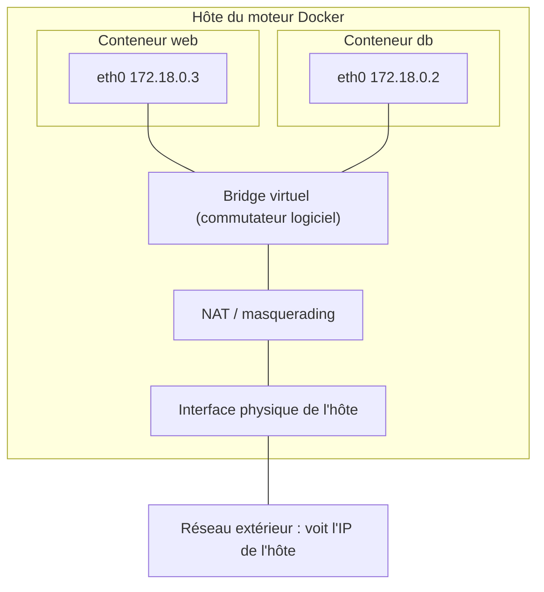
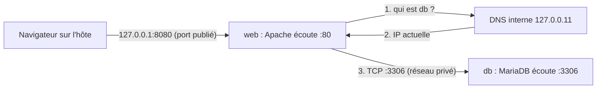
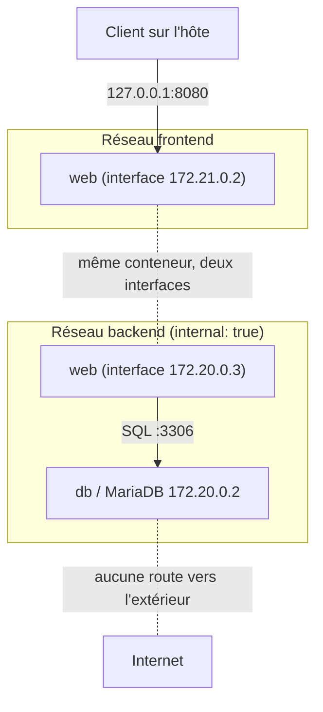

# Réseaux Docker et publication de ports

> **En une phrase.** Un conteneur a sa propre pile réseau : pour qu'un service soit joignable, il faut un processus qui écoute, un réseau qui relie, et, seulement si l'accès vient de l'extérieur, un port **publié** sur l'hôte ; entre conteneurs, on se trouve **par le nom du service**, jamais par l'adresse IP.

---

## 1. Synthèse

### Le modèle mental : trois flux, trois réglages

Une application web avec sa base de données produit trois flux de nature différente :

```
 Client (navigateur, curl)
        │  HTTP vers 127.0.0.1:8080          ① flux ENTRANT : port publié sur l'hôte
        ▼
 ┌──────────────┐
 │  web :80     │  conteneur Apache/PHP
 └──────┬───────┘
        │  SQL vers db:3306                  ② flux PRIVÉ : réseau Docker + DNS interne
        ▼
 ┌──────────────┐
 │  db :3306    │  conteneur MariaDB
 └──────┬───────┘
        │  lecture/écriture de fichiers      ③ pas de réseau : un volume (voir Stockage)
        ▼
   volume de données
```

| Flux | De → vers | Ce qu'il faut | Réglage Docker |
|---|---|---|---|
| ① Entrant | client de l'hôte → conteneur web | une **publication** de port | `-p 127.0.0.1:8080:80`, clé `ports:` |
| ② Privé | conteneur web → conteneur db | un **réseau commun** et un **nom** | `--network`, clé `networks:`, `DB_HOST=db` |
| ③ Fichiers | conteneur db → volume | un **montage** | voir [Stockage et volumes](Stockage-et-volumes.md) |

Ces flux ne demandent ni la même configuration, ni la même protection.

### Pour qu'un service réponde, il faut réunir trois conditions

1. **Un processus qui écoute** sur une adresse et un port (un port appartient toujours à une adresse et à un protocole : `0.0.0.0:80/tcp`).
2. **Une route** entre le client et ce processus (un réseau commun, une publication).
3. **Des règles qui autorisent** ce trafic (règles iptables posées par Docker, pare-feu).

> Un serveur qui écoute sur `0.0.0.0:80` **dans le conteneur** accepte les connexions IPv4 sur toutes **ses** interfaces. Cela ne veut pas dire qu'il est joignable sur le port 80 de l'ordinateur.

### Les modes réseau (pilotes)

| Pilote | Ce que reçoit le conteneur | Usage principal |
|---|---|---|
| **bridge** | une interface virtuelle `eth0` reliée à un pont logiciel sur l'hôte, une IP privée | communication entre conteneurs **d'un même hôte** (le cas central) |
| **host** | **aucun** namespace réseau propre : il utilise celui de l'hôte | performances, outils réseau ; `-p` n'a pas d'effet |
| **none** | seulement l'interface de boucle `lo` | traitement isolé qui n'a besoin d'aucun échange |
| **overlay** | un réseau logique étendu sur plusieurs hôtes | multi-hôtes, sous conditions (mode Swarm) |

```bash
docker network ls                 # bridge, host, none existent dès l'installation
docker network inspect bridge     # sous-réseau, passerelle, conteneurs connectés
```

### Bridge par défaut ou bridge personnalisé ?

| | Bridge par défaut (`bridge`) | Bridge créé (`docker network create`) |
|---|---|---|
| Résolution des noms de conteneurs | **non** (seulement les IP) | **oui**, par le DNS interne de Docker |
| Isolation entre applications | tous les conteneurs « sans réseau précisé » s'y retrouvent | chaque application a son ou ses réseaux |
| Connexion à chaud | possible | possible (`docker network connect` / `disconnect`) |

Compose crée automatiquement un bridge personnalisé par projet : c'est pour cela que les services s'y trouvent par leur nom (voir [Docker Compose](Docker-Compose.md)).

### Publier un port : lire la règle

```
   -p 127.0.0.1:8080:80
      └──── hôte ───┘└┘
                      └─ port où le service écoute DANS le conteneur
```

| Écriture | Point d'entrée sur l'hôte | Joignable depuis |
|---|---|---|
| `-p 8080:80` | toutes les interfaces de l'hôte (`0.0.0.0` et `[::]`) | le poste **et** potentiellement le réseau local |
| `-p 127.0.0.1:8080:80` | la boucle locale IPv4 | le poste seulement |
| aucun `-p` | rien | les autres conteneurs du même réseau seulement |

- **`EXPOSE 80` n'est pas `-p`** : dans un Dockerfile, `EXPOSE` **documente** le port attendu, il n'ouvre rien sur l'hôte.
- La publication **redirige** le trafic de l'hôte vers le conteneur ; elle ne change pas l'adresse d'écoute du serveur interne.
- Le NAT **sortant** (masquerading) permet au conteneur de joindre Internet avec l'adresse de l'hôte ; il ne publie **aucun** port entrant.

### Découverte par le nom

- Dans un bridge personnalisé, Docker fournit un **DNS interne** (résolveur `127.0.0.11` dans chaque conteneur) qui traduit le nom d'un conteneur, d'un alias ou d'un service Compose en son **IP actuelle**.
- L'application dépend d'une **identité de service** (`DB_HOST=db`), pas de l'IP d'une instance, qui peut changer à chaque recréation.
- Ce DNS a une **portée limitée au réseau** : le nom `db` n'existe que pour les conteneurs qui partagent un réseau avec `db`. Il n'est publié ni dans le DNS de l'entreprise, ni sur le Wi-Fi, ni sur l'hôte.

> [!IMPORTANT]
> **Les pièges à retenir**
> 1. **Port écouté ≠ port publié.** `EXPOSE 80` ou un serveur sur `0.0.0.0:80` ne rendent rien accessible depuis l'hôte. Seul `-p` (ou `ports:`) publie.
> 2. **`-p 8080:80` publie sur toutes les interfaces.** Les règles posées par Docker passent avant un pare-feu comme ufw : le service peut devenir joignable depuis le réseau local. Publier sur `127.0.0.1` est une décision, pas un détail.
> 3. **Une base qui ne sert qu'à l'application n'a pas besoin de port publié.** Publier `3306:3306` n'aide pas le conteneur PHP (il passe par le réseau interne) et crée un point d'accès de plus.
> 4. **Jamais d'IP en dur.** Une IP de conteneur change avec les recréations ; le nom du service, lui, reste stable.
> 5. **Le bridge par défaut ne résout pas les noms.** Pour se joindre par le nom, il faut un réseau créé (ou Compose).
> 6. **Segmenter réduit la surface d'exposition, sans rien garantir.** Un réseau `internal: true` n'est ni un pare-feu applicatif, ni une protection contre une faille du service.

---

## 2. Cas d'usage classiques

### Cas 1 : publier un site pour le poste local seulement

**Besoin.** Tester un site sur son poste sans le rendre visible sur le réseau du bureau.

```bash
docker run -d --name web -p 127.0.0.1:8080:80 nginx:stable
curl -I http://127.0.0.1:8080/       # HTTP/1.1 200 OK
docker port web                      # 80/tcp -> 127.0.0.1:8080
ss -lnt | grep 8080                  # LISTEN ... 127.0.0.1:8080
```

**Ce qu'on observe.** Sur un poste de test qui fait tourner une application Apache/PHP + MariaDB publiée ainsi, `ss -lnt` ne montre qu'**une seule** socket ouverte côté hôte : `127.0.0.1:8080`. Ni le port 80 d'Apache ni le port 3306 de MariaDB n'apparaissent : ils n'existent que dans les namespaces réseau des conteneurs.
**À retenir.** L'adresse de publication (côté hôte) et l'adresse d'écoute (côté conteneur) sont deux réglages indépendants. Ne pas les confondre.

### Cas 2 : constater que `EXPOSE` ne publie rien

**Besoin.** Comprendre la colonne `PORTS` de `docker ps` ou `docker compose ps`.

```bash
docker compose ps --format "{{.Service}} {{.Ports}}"
```

```
db 3306/tcp
web 127.0.0.1:8080->80/tcp
```

**Ce qu'on observe.** L'image MariaDB déclare `EXPOSE 3306` : le port est **affiché** (`3306/tcp`) mais sans flèche, donc non publié. Seul `web` a une flèche `hôte->conteneur`.
**Bon à savoir.** `docker run -P` (majuscule) publie tous les ports déclarés par `EXPOSE` sur des ports aléatoires de l'hôte : c'est le seul effet pratique d'`EXPOSE`, à part la documentation.

### Cas 3 : faire dialoguer deux conteneurs par leur nom

**Besoin.** Un conteneur client doit joindre un serveur web sans connaître son IP.

```bash
# Sur le bridge par défaut : pas de résolution de nom
docker run -d --name site nginx:stable
docker run --rm alpine:3.22 wget -qO- http://site      # wget: bad address 'site'

# Sur un bridge personnalisé : le DNS interne répond
docker network create --driver bridge atelier-net
docker network connect atelier-net site                # ajoute une 2e interface à "site"
docker run --rm --network atelier-net alpine:3.22 wget -qO- http://site | head -4
docker network inspect atelier-net                     # "site" apparaît dans Containers
```

**Ce qu'on observe.** Le même nom échoue sur le réseau par défaut et fonctionne sur `atelier-net`. `docker network connect` a branché un conteneur **déjà lancé** sur un second réseau : il possède désormais deux interfaces.
**À retenir.** La résolution par nom est une propriété **du réseau**, pas du conteneur.

### Cas 4 : vérifier que l'application suit le service, pas l'IP

**Besoin.** S'assurer qu'une recréation ou un changement de réseau ne casse pas l'application.

```bash
docker compose exec web cat /etc/resolv.conf     # nameserver 127.0.0.11
docker compose exec web getent hosts db          # 172.18.0.2      db
```

**Ce qu'on observe.** Sur un poste de test, `db` répond d'abord `172.18.0.2` sur le réseau par défaut du projet. Après le passage de la base sur un réseau `backend`, elle devient `172.20.0.2`. L'application, configurée avec `DB_HOST=db`, continue de répondre `200` **sans aucune modification**. Lors d'une simple recréation sur le même réseau, l'IP est parfois restée identique : on ne peut **pas** compter dessus dans un sens ou dans l'autre.
**À retenir.** L'IP est attribuée à la création par le gestionnaire d'adresses (IPAM) du réseau. Elle n'existe que sur ce réseau et peut changer à chaque recréation, changement de réseau ou redémarrage dans un autre ordre.

### Cas 5 : cloisonner la base sur un réseau interne

**Besoin.** Le serveur web doit être joignable par l'utilisateur ; la base, uniquement par le serveur web.

```yaml
services:
  web:
    networks: [frontend, backend]
    ports: ["127.0.0.1:8080:80"]
  db:
    networks: [backend]          # aucun "ports:"
networks:
  frontend:
  backend:
    internal: true               # pas de sortie vers l'extérieur
```

**Ce qu'on observe sur un poste de test.**

| Test | Résultat |
|---|---|
| Conteneur jetable sur `frontend` : résoudre `db` | le nom **n'est pas résolu** |
| Depuis `db` : ouvrir une connexion vers `1.1.1.1:53` | `Network is unreachable` (réseau `internal`) |
| Depuis `web` : même test | sortie OK (via `frontend`) |
| Conteneur jetable sur `backend` : ouvrir `db:3306` | **joignable** |

**À retenir.** `web` est le seul pont entre les deux réseaux. Mais ne pas publier de port ne rend pas la base inaccessible : n'importe quel conteneur branché sur `backend` l'atteint. La vraie protection reste l'authentification de MariaDB. Détails de la syntaxe Compose : [Docker Compose](Docker-Compose.md).

### Cas 6 : priver un traitement de tout réseau, ou au contraire lui donner celui de l'hôte

```bash
docker run --rm --network none alpine:3.22 ip addr       # seulement "lo"
docker run --rm -d --name h --network host nginx:stable  # nginx écoute sur le port 80 DE L'HÔTE
```

**Ce qu'on observe.** Avec `none`, le conteneur garde l'interface de boucle locale mais aucune interface vers l'extérieur : utile pour un calcul, une conversion de fichiers, une restauration de base hors ligne. Avec `host`, il n'y a pas de namespace réseau séparé : le processus partage les ports de l'hôte (conflit si le port 80 est déjà pris) et un `-p` éventuel est ignoré (Docker l'indique par un avertissement).
**À retenir.** `none` ne veut pas dire « sans risque » : le conteneur garde ses fichiers, ses montages et ses privilèges. `host` retire une protection : à réserver aux cas justifiés. Le comportement de `host` dépend de la plateforme, en particulier sous Docker Desktop.

### Cas 7 : « le site ne répond pas », vérifier couche par couche

Un serveur inaccessible n'est pas forcément un conteneur arrêté. On distingue cinq choses, dans l'ordre :

| Couche | Question | Commande |
|---|---|---|
| Processus | Le conteneur tourne-t-il ? | `docker ps`, `docker logs <conteneur>` |
| Socket d'écoute | Le serveur écoute-t-il, et sur quelle adresse ? | `docker exec <c> ss -lnt` (si l'outil existe dans l'image) |
| Résolution DNS | Le nom du service est-il résolu ? | `docker exec <c> getent hosts db` |
| Liaison réseau | Les deux conteneurs partagent-ils un réseau ? | `docker network inspect <reseau>`, `docker inspect <c>` |
| Publication | Le port est-il publié, et sur quelle adresse ? | `docker port <c>`, `ss -lnt` sur l'hôte |

La méthode complète, appliquée à une erreur HTTP 503, est détaillée dans [Démarré n'est pas disponible](Demarre-n-est-pas-disponible.md).

> [!NOTE]
> **Sous Windows et macOS (Docker Desktop).** Les conteneurs Linux tournent dans une machine virtuelle Linux gérée par Docker Desktop. Le bridge existe **dans cette VM** ; la publication des ports est relayée vers le poste. Les IP privées des conteneurs ne sont généralement **pas** routables depuis Windows ou macOS : pour un accès local, on passe par le port publié sur `localhost`, jamais par l'IP interne.

---

## 3. Idées de schémas

### Schéma A : le bridge, un commutateur virtuel sur l'hôte



Message du schéma : le bridge relie des interfaces **sur un même hôte**. À lui seul, il ne constitue pas un réseau de cluster multi-hôtes.

### Schéma B : publication et DNS, deux mécanismes distincts



### Schéma C : réseau applicatif à deux niveaux



### Schéma D : la règle `-p` en « vue éclatée »

Un grand rectangle « Hôte » contient un petit rectangle « Conteneur ». Sur le bord du grand rectangle, une prise étiquetée `127.0.0.1:8080` ; sur le bord du petit, une prise `:80`. Un câble relie les deux, étiqueté « publication (-p) ». À côté du conteneur, une étiquette en pointillés « EXPOSE 80 » sans câble, avec la légende : « documente, ne branche rien ».

---

## 4. Script de motion design : « Le voyage d'une requête » (environ 70 s)

Style : vue en coupe, l'hôte en grand cadre gris, chaque conteneur en carte colorée (bleu web, vert db), la requête représentée par une petite enveloppe lumineuse. Le chemin de l'enveloppe laisse une traînée qui reste à l'écran.

| Séq. | Durée | À l'écran | Animation | Texte à l'écran |
|---|---|---|---|---|
| 1 | 0-7 s | Un navigateur à gauche, le cadre « Hôte » à droite avec une seule prise lumineuse `127.0.0.1:8080` sur son bord | L'enveloppe part du navigateur et se dirige vers la prise | « Une requête arrive sur l'hôte. Une seule porte est ouverte. » |
| 2 | 7-16 s | Dans le cadre, la carte « web » avec sa prise interne `:80` ; une seconde porte « 3306 » sur l'hôte apparaît barrée | L'enveloppe passe la prise 8080, un tunnel la conduit jusqu'à `:80` ; la porte 3306 grise clignote puis disparaît | « La publication relie 8080 (hôte) à 80 (conteneur). La base, elle, n'a pas de porte. » |
| 3 | 16-26 s | La carte web s'ouvre : Apache puis PHP ; une bulle « DB_HOST=db » | PHP lève la tête, une bulle « où est db ? » part vers un petit annuaire « 127.0.0.11 » | « PHP ne connaît qu'un nom : db. » |
| 4 | 26-34 s | L'annuaire DNS interne | Il feuillette, renvoie une étiquette « 172.20.0.2 » | « Le DNS interne de Docker traduit le nom en adresse actuelle. » |
| 5 | 34-44 s | Deux zones colorées apparaissent : « frontend » (autour de web) et « backend » (autour de web et db) | L'enveloppe SQL traverse la zone backend jusqu'à la carte db `:3306` ; une carte « intrus » posée dans frontend tente la même chose et rebondit sur un mur | « db n'est que sur backend. Hors de ce réseau, son nom n'existe même pas. » |
| 6 | 44-52 s | La carte db se retourne, montre MariaDB et, dessous, un cylindre « volume » | Une flèche courte, sans enveloppe, va de db au volume | « La base lit ses fichiers : ce n'est plus du réseau. » |
| 7 | 52-60 s | Le chemin inverse | L'enveloppe repart chargée (« résultat SQL ») : db → web → tunnel → navigateur, qui affiche « 200 » | « Chaque flèche est un chemin vérifiable. » |
| 8 | 60-70 s | La carte db est remplacée par une nouvelle (même nom, nouvelle IP 172.20.0.5) | L'étiquette IP change, l'annuaire se met à jour, la requête suivante arrive sans hésiter | « L'IP change. Le nom reste. C'est lui qu'on configure. » |

**Conseil de réalisation.** Laisser la traînée lumineuse de l'aller visible pendant le retour : à la fin, l'écran montre le chemin complet (publication, DNS, réseau privé, fichiers), qui sert de modèle pour le diagnostic. La séquence 5 gagne à être lente : le rebond de l'« intrus » est le moment où l'on comprend le cloisonnement.

---

## 5. Vérifier soi-même

```bash
docker network create atelier-net
docker run -d --name site --network atelier-net -p 127.0.0.1:8080:80 nginx:stable
curl -sI http://127.0.0.1:8080/ | head -1                                   # HTTP/1.1 200 OK
docker run --rm --network atelier-net alpine:3.22 nslookup site 127.0.0.11  # résolution par le DNS interne
docker run --rm alpine:3.22 wget -qO- -T 3 http://site                      # échec : bridge par défaut
docker run --rm --network none alpine:3.22 ip addr                          # seulement lo
docker network inspect atelier-net --format '{{range .Containers}}{{.Name}} {{.IPv4Address}}{{end}}'
docker rm -f site && docker network rm atelier-net
```

## Voir aussi

- [Accueil du wiki](../README.md)
- Page précédente : [Versionner et publier une image](Versionner-et-publier-une-image.md)
- Page suivante : [Stockage : couche du conteneur, volumes, bind mounts](Stockage-et-volumes.md)
- Pour aller plus loin : [Isolation d'un conteneur](Isolation-des-conteneurs.md) (le namespace Network), [Secrets, fichiers, réseau et ressources](Secrets-fichiers-reseau-ressources.md) (le réseau sous l'angle sécurité)
