# Secrets, fichiers, réseau et ressources

<p class="lead">Une application piratée reste un programme qui peut lire ce qu'on lui monte, joindre ce qu'on lui connecte et consommer ce qu'on ne lui limite pas. Chaque accès accordé doit être <strong>nécessaire, restreint et vérifié</strong>, puis l'ensemble contrôlé sans confondre un bon score d'audit avec une bonne sécurité.</p>

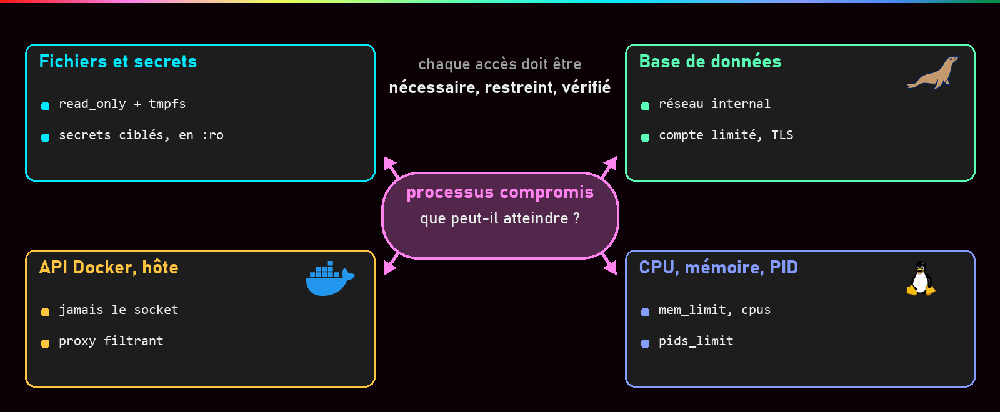{ .hero }

!!! abstract "Dans cette page"

    **Tu vas comprendre :**

    - où ranger un mot de passe pour qu'il ne traîne pas partout ;
    - comment empêcher un conteneur piraté de modifier ses fichiers, de parler à tout le monde ou de saturer la machine ;
    - pourquoi monter le socket Docker dans un conteneur revient à donner les clés de l'hôte.

    **Prérequis :** [Identités, privilèges et capabilities](Identites-et-privileges.md), [Docker Compose](Docker-Compose.md), [Réseaux Docker et publication de ports](Reseaux-et-ports.md). **Durée :** 45 min. **Niveau :** intermédiaire.

!!! quote "En clair"

    Ton conteneur est un **intérimaire** que tu accueilles. Tu lui donnes la clé de la seule pièce où il travaille, le code du coffre seulement s'il en a besoin, la liste des seuls collègues qu'il doit appeler, et un budget. S'il se fait manipuler par un escroc, les dégâts s'arrêtent à ce que tu lui as confié. Toute la page consiste à réduire ce qu'on lui confie.

    { .anim }

## L'essentiel en 30 secondes

<div class="grid cards" markdown>

-   :material-key-variant:{ .lg .middle } __Secrets__

    ---

    Un **fichier monté** dans le seul service qui en a besoin, pas une variable d'environnement.

-   :material-file-lock-outline:{ .lg .middle } __Fichiers__

    ---

    Système de fichiers en **lecture seule**, un `tmpfs` pour le temporaire, des volumes montés au plus juste.

-   :material-lan:{ .lg .middle } __Réseau__

    ---

    Isoler réduit **qui** parle à la base, pas **ce qu'on a le droit** de lui demander.

-   :material-gauge:{ .lg .middle } __Ressources__

    ---

    Mémoire, processeur, nombre de programmes plafonnés **après mesure** : l'incident reste dans le conteneur.

</div>

!!! warning "À retenir"

    **Monter le socket Docker dans un conteneur, même en lecture seule (`:ro`), c'est donner root sur l'hôte.** Un fichier `.env` n'est pas un coffre-fort, un port publié sans adresse est ouvert sur toutes les interfaces réseau, et un meilleur score d'audit peut cacher une configuration **moins** sûre.

## :material-key-variant: Secrets : ni dans l'image, ni dans l'environnement

!!! quote "En clair"

    Une variable d'environnement, c'est un **post-it collé sur l'écran** : quiconque passe devant le lit. Un secret monté, c'est une **enveloppe remise en main propre** à un seul destinataire, qui ne peut pas la réécrire.

    { .anim }

Un **secret** est une donnée sensible : mot de passe, clé d'API, certificat. Au **build**, un secret passe par `RUN --mount=type=secret` (voir [Sécurité des images](Securite-des-images.md)). À l'**exécution**, sa valeur est fournie au seul service concerné, sans être écrite dans l'image.

| Méthode | Où la valeur est visible | Verdict |
|---|---|---|
| `ENV` dans le Dockerfile | l'image, chaque registre, chaque conteneur | **à proscrire** |
| `environment:` dans Compose | `docker inspect`, `/proc/1/environ`, programmes enfants, journaux d'erreur | réglage oui, secret non |
| fichier `.env` | fichier en clair, facile à envoyer par erreur sur Git, présent dans les sauvegardes | **pas un coffre-fort** |
| `secrets:` Compose (`file:`) | `/run/secrets/<nom>`, en lecture seule, services choisis | bien meilleur, mais fichier en clair sur l'hôte |
| gestionnaire (Vault, cloud, Kubernetes chiffré, Swarm) | contrôle d'accès, chiffrement, renouvellement, journal | cible en production |

**Le scénario :** un attaquant trouve une faille qui lui permet de lire des fichiers dans ton conteneur web. Si le mot de passe de la base est dans l'environnement, il lit `/proc/1/environ` et l'obtient. Si le mot de passe **root** de la base n'a jamais été donné au conteneur web, il ne peut pas le voler.

```yaml
services:
  db:
    image: mariadb:11.4
    environment:
      MARIADB_PASSWORD_FILE: /run/secrets/db_app_password       # (1)!
      MARIADB_ROOT_PASSWORD_FILE: /run/secrets/db_root_password
    secrets: [db_app_password, db_root_password]                # (2)!
  web:
    secrets: [db_app_password]                                  # (3)!
secrets:                                                        # (4)!
  db_app_password: { file: ./secrets/db_app_password }
  db_root_password: { file: ./secrets/db_root_password }
```

1. La variable ne contient pas le mot de passe, seulement le **chemin** du fichier qui le contient. L'image MariaDB sait lire les variables qui finissent par `_FILE`.
2. `db` reçoit les deux secrets.
3. `web` ne reçoit que le mot de passe applicatif, pas celui de root.
4. La déclaration globale : d'où vient chaque secret, ici un fichier de l'hôte.

???+ example "En vrai : deux secrets, deux destinataires"

    **Ce qu'on fait :** on lance ce `compose.yaml` (avec un conteneur `web` minimal), puis on regarde ce que chaque service a reçu et ce que montre `docker inspect`.

    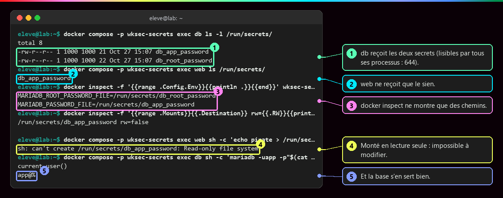

    **Ce qu'il faut regarder :**

    - ① : `db` reçoit les deux secrets. Droits `644` : tous les programmes du conteneur peuvent les lire.
    - ② : `web` ne reçoit que le sien.
    - ③ : `docker inspect` ne montre que des chemins, aucune valeur.
    - ④ : le secret est monté en lecture seule : impossible de le modifier.
    - ⑤ : et la base s'en sert bien pour authentifier `app`.

    On choisit qui reçoit quoi, et on change la valeur sans reconstruire l'image. Mais ce n'est ni chiffré, ni centralisé, ni renouvelé automatiquement : le dossier `secrets/` va dans `.gitignore`, avec des droits stricts sur l'hôte.

!!! tip "Un secret bien rangé peut encore fuir à l'usage"

    Un mot de passe passé en argument de commande est visible par `ps` (comme `-p"$(cat …)"` dans la capture, acceptable pour une démonstration seulement). Il peut aussi fuir par l'historique du shell, un message d'erreur ou un fichier produit. La sauvegarde de la base en est l'exemple type : voir [Stockage : couche du conteneur, volumes, bind mounts](Stockage-et-volumes.md).

## :material-folder-lock-outline: Fichiers, volumes et socket

!!! quote "En clair"

    `--read-only`, c'est **plastifier** le système de fichiers du conteneur : on lit tout, on n'écrit rien. On laisse juste un **tableau blanc** (le tmpfs) pour les notes du jour, effacé chaque soir à l'arrêt.

    { .anim }

`--read-only` rend tout le système de fichiers du conteneur non modifiable ; un `tmpfs` (un dossier en mémoire) garde les seuls dossiers où le programme doit écrire. On les découvre **en lisant les erreurs**, pas en devinant.

**Le scénario :** un attaquant qui a pris la main sur nginx voudrait modifier sa configuration pour rediriger tes visiteurs vers un faux site. Avec `--read-only`, il ne peut pas.

???+ example "En vrai : nginx en lecture seule"

    **Ce qu'on fait :** on lance nginx avec `--read-only` seul, puis avec un tmpfs sur ses deux dossiers d'écriture, et on essaie d'écrire ailleurs.

    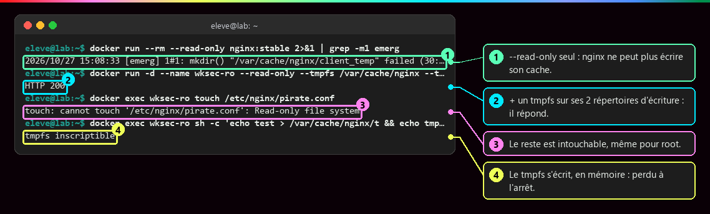

    **Ce qu'il faut regarder :**

    - ① : avec `--read-only` seul, nginx refuse de démarrer : il ne peut pas créer son dossier de cache.
    - ② : avec un tmpfs sur ses deux dossiers d'écriture, il répond (HTTP 200).
    - ③ : le reste est intouchable, même pour root.
    - ④ : le tmpfs, lui, s'écrit, en mémoire : son contenu est perdu à l'arrêt.

Un **volume est une porte vers des données** : on ne le monte que là où il sert, en lecture seule (`:ro`) quand c'est possible, avec des UID et des droits maîtrisés, et on teste la **restauration** de ses sauvegardes. Un conteneur non root qui peut écrire dans un volume sensible peut l'altérer. Et un bind mount en écriture de `/etc`, de `/root/.ssh` ou d'un dossier de scripts lancés automatiquement donne la main sur l'hôte.

Le **socket Docker** (`/var/run/docker.sock`) est la prise par laquelle on donne des ordres au démon Docker, qui tourne en root.

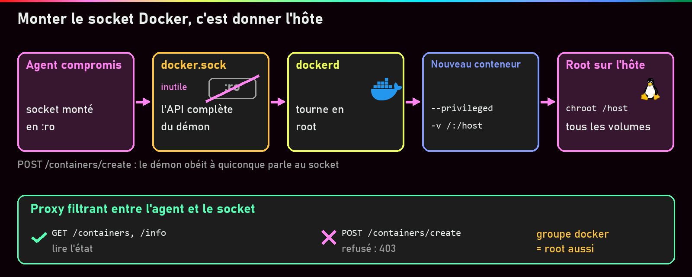

Quiconque parle à ce socket a l'**API complète** du démon : il peut lui demander de créer un conteneur privilégié qui monte le disque de l'hôte. Le `:ro` protège le fichier, pas les ordres qu'on envoie à travers. Et **être membre du groupe `docker`, c'est être root sans mot de passe**.

???+ example "En vrai : vérifier son propre moteur"

    **Ce qu'on fait :** on regarde qui a le droit d'utiliser le socket, si on fait partie de ce groupe, et si un conteneur le monte.

    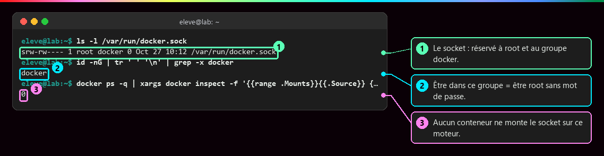

    **Ce qu'il faut regarder :**

    - ① : le socket est réservé à root et au groupe `docker` (`srw-rw----`).
    - ② : l'utilisateur courant est dans ce groupe : il est donc root sans mot de passe sur cette machine.
    - ③ : aucun conteneur ne monte le socket sur ce moteur. C'est ce qu'on veut.

## :material-lan: Réseau et ressources

!!! quote "En clair"

    Un réseau Docker dédié, c'est un **couloir privé** : seuls ceux qui y ont un bureau s'y croisent. Mais quiconque est dans le couloir peut frapper à la porte de la base. C'est la **serrure** de la base (mot de passe, droits du compte) qui décide ensuite.

    { .anim }

Un réseau dédié limite les échanges ordinaires, mais ne remplace ni l'authentification, ni les droits, ni le chiffrement. On ne publie que les services destinés à être joints, sur l'adresse la plus étroite (détails dans [Réseaux Docker et publication de ports](Reseaux-et-ports.md)).

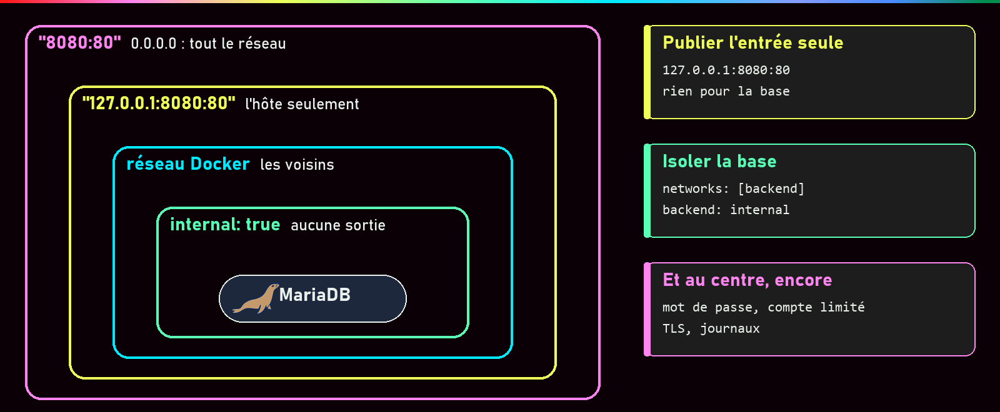

???+ example "En vrai : la base isolée, mais pas contre le web"

    **Ce qu'on fait :** on crée un réseau `back` en mode `--internal` (sans sortie vers Internet) pour la base `db` et l'application `app`, et un réseau `front` pour `app` et un autre conteneur. Puis on teste qui joint qui.

    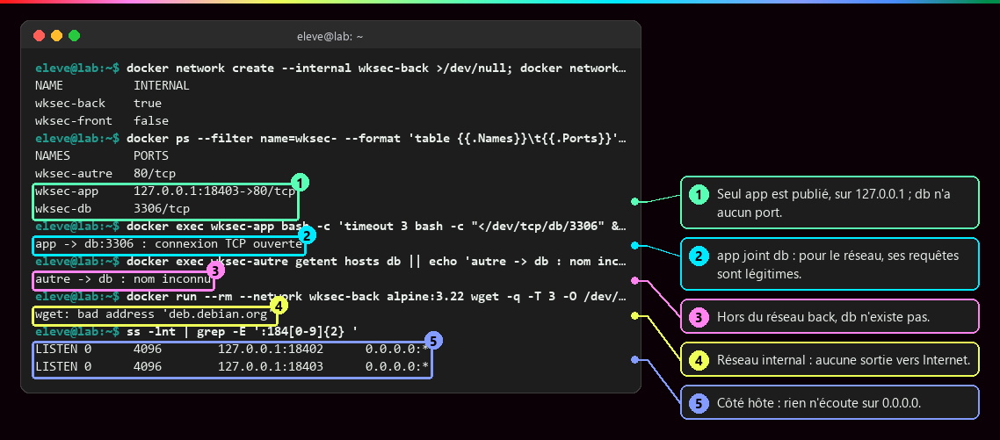

    **Ce qu'il faut regarder :**

    - ① : seul `app` est publié, et seulement sur `127.0.0.1` (la machine elle-même) ; `db` n'a aucun port publié.
    - ② : `app` joint `db` : pour le réseau, ses requêtes sont légitimes.
    - ③ : hors du réseau `back`, le nom `db` n'existe même pas.
    - ④ : le réseau `internal` n'a aucune sortie vers Internet.
    - ⑤ : côté hôte, rien n'écoute sur `0.0.0.0` (toutes les interfaces).

    **Le scénario :** un web piraté est exactement dans la position de `app`. Ce qui protège alors la base : le **mot de passe**, un **compte aux droits limités**, le **chiffrement** (TLS) si le trafic est sensible, et la **journalisation** des connexions et des échecs.

```sql
-- l'image MariaDB donne à MARIADB_USER tous les droits sur sa base : on les réduit
REVOKE ALL PRIVILEGES ON app.* FROM 'app'@'%';
GRANT SELECT, INSERT ON app.evenements TO 'app'@'%';
```

Avec `ports: "3306:3306"`, la base aurait en plus écouté sur `0.0.0.0`, donc été joignable depuis tout le réseau local et exposée aux essais de mots de passe en masse. Même derrière le pare-feu `ufw` : les règles de Docker passent avant les siennes.

!!! quote "En clair"

    Les limites de ressources sont le **disjoncteur** de chaque appartement : si un conteneur s'emballe, c'est chez lui que ça saute, pas dans tout l'immeuble.

    { .anim }

**Le scénario :** un attaquant (ou un simple bug) fait lancer des milliers de programmes à ton conteneur pour saturer la machine. Sans limite, tous les autres services tombent avec lui.

???+ example "En vrai : un service limité qui encaisse une saturation"

    **Ce qu'on fait :** on lance nginx avec 256 Mo de mémoire, un demi-processeur et 64 programmes au plus, puis on lui fait lancer 80 programmes d'un coup.

    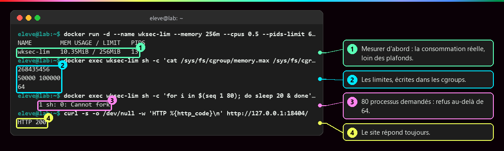

    **Ce qu'il faut regarder :**

    - ① : on mesure d'abord : la consommation réelle (10 Mo, 13 programmes) est loin des plafonds.
    - ② : les limites sont bien écrites dans les cgroups : 256 Mo en octets, 50 000 µs de processeur toutes les 100 000 (un demi-cœur), 64 programmes.
    - ③ : au-delà de 64, le système refuse de créer un programme (`Cannot fork`).
    - ④ : le site répond toujours.

    Une limite **trop basse crée sa propre panne** (base tuée au premier pic, délais qui expirent) : `docker stats` d'abord, une marge large ensuite. Écrites dans `compose.yaml` (`mem_limit`, `cpus`, `pids_limit`), les limites survivent aux recréations.

## :material-clipboard-check-outline: Auditer : conformité n'est pas résistance

!!! quote "En clair"

    Un audit de conformité, c'est le **contrôle technique** d'une voiture : il vérifie une liste de points. Il ne dit pas si tu conduis bien, ni si la voiture résistera à un choc précis.

    { .anim }

| Activité | Ce qu'elle cherche | Exemple d'outil |
|---|---|---|
| **Audit de conformité** | les écarts à une liste de règles de référence | Docker Bench for Security (CIS Docker Benchmark) |
| **Analyse de vulnérabilités** | les failles connues | Trivy, Docker Scout |
| **Test d'intrusion** | ce qu'un attaquant exploite réellement | humain, outillé |

Une **non-conformité** n'est pas forcément exploitable ; une **mesure compensatoire** la couvre autrement (un port publié sur `127.0.0.1` plutôt qu'un pare-feu dédié). Et `compose.yaml` n'est que l'intention : `docker inspect` montre ce qui a vraiment été créé.

???+ example "En vrai : trier les alertes d'un premier audit"

    **Ce qu'on fait :** on lance Docker Bench sur un moteur partagé, puis on classe quelques lignes `[WARN]` (avertissement) de son rapport.

    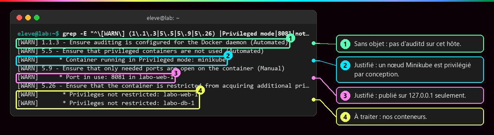

    **Ce qu'il faut regarder :**

    - ① : **sans objet** : l'audit du démon suppose l'outil `auditd`, absent de cet hôte.
    - ② : **justifiée** : un nœud Minikube est privilégié par conception.
    - ③ : **justifiée** : ce port n'est publié que sur `127.0.0.1`.
    - ④ : **à traiter** : nos propres conteneurs n'ont pas `no-new-privileges`.

    Le rapport compte 117 contrôles, 44 réussis et 109 lignes WARN, mais seulement **35 contrôles** en WARN : `grep -c` compte des lignes, et un contrôle produit une ligne par conteneur ou image concernés. On classe chaque alerte (sans objet, justifiée, à traiter, acceptée et documentée) et on traite **d'abord le plus risqué** : le service exposé, puis ce qui a un impact large, puis l'image, enfin les réglages globaux du démon.

???+ danger "En vrai : le paradoxe du score"

    **Ce qu'on fait :** on compare le rapport avant et après deux corrections sur nos conteneurs : limites de ressources, `no-new-privileges` et capabilities réduites au minimum.

    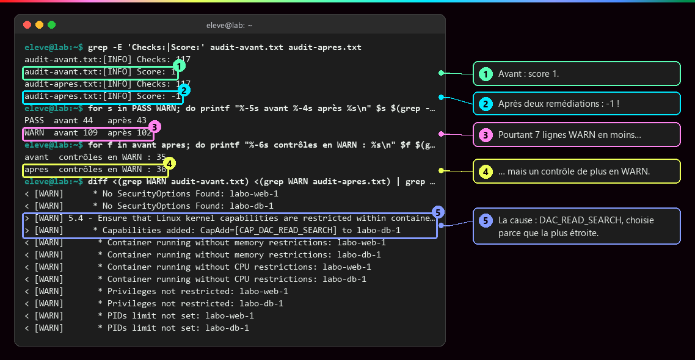

    **Ce qu'il faut regarder :**

    - ① : avant, le score vaut 1.
    - ② : après deux corrections, il tombe à -1 !
    - ③ : pourtant, il y a 7 lignes WARN de moins…
    - ④ : … mais un contrôle de plus en WARN.
    - ⑤ : la cause : la capability `DAC_READ_SEARCH`, ajoutée **parce qu'elle était la plus étroite**.

    Un contrôle reste en WARN tant qu'**un seul** conteneur du moteur le viole (les autres projets le gardaient rouge), et l'outil ne signale pas les capabilities du jeu par défaut. `DAC_OVERRIDE`, déjà dans ce jeu, aurait fait remonter le score, mais elle permet d'**écrire** partout : la configuration aurait été moins sûre avec un meilleur score. On garde la plus étroite et on documente l'alerte acceptée.

## :material-format-list-checks: Pour conclure la partie « Sécuriser »

| Ne pas confondre… | … avec | Page |
|---|---|---|
| Conteneur isolé | Machine virtuelle | [Isolation d'un conteneur](Isolation-des-conteneurs.md) |
| `USER` non root | Démon Docker rootless | [Identités et privilèges](Identites-et-privileges.md) |
| Tag, digest | Signature, absence de faille | [Sécurité des images](Securite-des-images.md) |
| `.env` | Gestion sécurisée des secrets | cette page |
| Healthcheck | Auto-réparation garantie | [Démarré n'est pas disponible](Demarre-n-est-pas-disponible.md) |
| Compose | Orchestrateur multi-machines | [Pourquoi orchestrer ?](Pourquoi-orchestrer.md) |

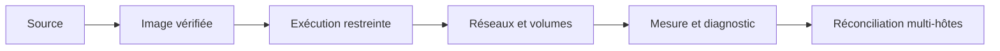

## :material-flask-outline: À toi de jouer

Six étapes, environ 10 minutes. Tu vas voir un mot de passe fuir, le ranger proprement, puis durcir et contrôler un serveur web.

**Étape 1 · Voir pourquoi une variable d'environnement n'est pas un coffre**

```bash
docker run -d --name fuite -e DB_PASSWORD=motdepasse123 alpine:3.22 sleep 600   # (1)!
docker inspect -f '{{.Config.Env}}' fuite                                       # (2)!
docker exec fuite env | grep PASSWORD                                           # (3)!
```

1. Lance un petit conteneur qui attend 10 minutes, avec un mot de passe dans une variable d'environnement (`-e`).
2. Ce que voit toute personne qui a accès à Docker.
3. Ce que voit tout programme dans le conteneur, donc un attaquant qui y entre.

Tu dois voir un identifiant (différent chez toi), puis le mot de passe en clair, deux fois :

```text
2823b89af910af05e3e73173045265f2ff5ed22b4703efc571a83e45ac015c18
[DB_PASSWORD=motdepasse123 PATH=/usr/local/sbin:/usr/local/bin:/usr/sbin:/usr/bin:/sbin:/bin]
DB_PASSWORD=motdepasse123
```

**Étape 2 · Ranger le mot de passe dans un secret Compose**

```bash
mkdir -p ~/lab-secrets/secrets && cd ~/lab-secrets                             # (1)!
echo "motdepasse123" > secrets/db_password && chmod 600 secrets/db_password    # (2)!
cat > compose.yaml <<'EOF'                                                      # (3)!
services:
  app:
    image: alpine:3.22
    command: sleep 600
    secrets: [db_password]
  autre:
    image: alpine:3.22
    command: sleep 600
secrets:
  db_password:
    file: ./secrets/db_password
EOF
docker compose up -d                                                            # (4)!
docker compose ps --format 'table {{.Service}}\t{{.Status}}'
```

1. Crée le dossier du projet et son sous-dossier `secrets`, puis entre dedans.
2. Écrit le mot de passe dans un fichier que seul toi peux lire (`chmod 600`).
3. Écrit tout le texte jusqu'à `EOF` dans `compose.yaml`. Deux services : `app` reçoit le secret, `autre` non. Tu peux aussi créer ce fichier avec ton éditeur.
4. Démarre les deux services en arrière-plan.

Tu dois voir les deux services démarrés :

```text
SERVICE   STATUS
app       Up 1 second
autre     Up 1 second
```

**Étape 3 · Vérifier qui reçoit quoi**

```bash
docker compose exec app cat /run/secrets/db_password                    # (1)!
docker compose exec autre ls /run/secrets                               # (2)!
docker compose exec app sh -c 'echo pirate > /run/secrets/db_password'  # (3)!
docker inspect -f '{{.Config.Env}}' lab-secrets-app-1                   # (4)!
```

1. `app` lit son secret.
2. `autre` n'a rien reçu.
3. On essaie de réécrire le secret depuis `app`.
4. L'environnement de `app` : Compose nomme le conteneur d'après le dossier, le service et un numéro.

Tu dois voir le mot de passe lu par `app`, aucun dossier dans `autre`, un refus d'écriture, et un environnement sans mot de passe :

```text
motdepasse123
ls: /run/secrets: No such file or directory
sh: can't create /run/secrets/db_password: Read-only file system
[PATH=/usr/local/sbin:/usr/local/bin:/usr/sbin:/usr/bin:/sbin:/bin]
```

**Étape 4 · Un serveur web en lecture seule, avec des limites**

```bash
docker run --rm --read-only nginx:stable 2>&1 | grep -m1 emerg                  # (1)!
docker run -d --name verif --read-only --tmpfs /var/cache/nginx --tmpfs /var/run \
  --memory 128m --pids-limit 64 --security-opt no-new-privileges \
  -p 127.0.0.1:8080:80 nginx:stable                                             # (2)!
curl -s -o /dev/null -w 'HTTP %{http_code}\n' http://127.0.0.1:8080/           # (3)!
docker exec verif touch /etc/nginx/pirate.conf                                  # (4)!
```

1. Essai avec `--read-only` seul ; `grep -m1 emerg` garde la première erreur grave de nginx.
2. `--read-only` plus deux `--tmpfs` pour les dossiers où nginx doit écrire ; 128 Mo de mémoire, 64 programmes au plus ; aucun gain de droits ; port publié sur `127.0.0.1` seulement. Les `\` continuent la commande sur la ligne suivante.
3. Demande la page d'accueil et n'affiche que le code de réponse.
4. Un attaquant tente de modifier la configuration.

Tu dois voir l'échec du premier essai (ta date sera différente), un identifiant, puis un site qui répond et une configuration intouchable :

```text
2026/10/27 15:44:35 [emerg] 1#1: mkdir() "/var/cache/nginx/client_temp" failed (30: Read-only file system)
71b387d664d8f76825268c4d8b6ae0d3409dafb0f314a58bbf184905b45d945e
HTTP 200
touch: cannot touch '/etc/nginx/pirate.conf': Read-only file system
```

**Étape 5 · Contrôler ce qui a vraiment été créé**

```bash
docker inspect -f 'ro={{.HostConfig.ReadonlyRootfs}} mem={{.HostConfig.Memory}} pids={{.HostConfig.PidsLimit}} opts={{.HostConfig.SecurityOpt}}' verif  # (1)!
docker ps --format '{{.Names}}\t{{.Ports}}'                                                         # (2)!
docker ps -q | xargs docker inspect -f '{{.Name}} {{range .Mounts}}{{.Source}} {{end}}' | grep -c docker.sock  # (3)!
```

1. Relit dans la configuration réelle du conteneur : lecture seule, mémoire (en octets), limite de programmes, options de sécurité.
2. Liste tous les conteneurs en marche et leurs ports publiés. Tout ce qui affiche `0.0.0.0` est ouvert sur toutes les interfaces.
3. Compte les conteneurs qui montent le socket Docker.

Tu dois voir tes réglages, tes quatre conteneurs (si ce sont les seuls en marche) avec un seul port, sur `127.0.0.1`, et aucun socket monté :

```text
ro=true mem=134217728 pids=64 opts=[no-new-privileges]
verif	127.0.0.1:8080->80/tcp
lab-secrets-autre-1	
lab-secrets-app-1	
fuite	
0
```

**Étape 6 · Faire le ménage**

```bash
docker rm -f fuite verif               # (1)!
docker compose down                    # (2)!
cd ~ && rm -rf ~/lab-secrets           # (3)!
```

1. Supprime les deux conteneurs lancés avec `docker run`.
2. Depuis le dossier `lab-secrets` : arrête et supprime les conteneurs et le réseau du projet Compose.
3. Supprime le dossier, mot de passe compris.

Tu dois voir :

```text
fuite
verif
 Container lab-secrets-autre-1 Stopping 
 Container lab-secrets-app-1 Stopping 
 Container lab-secrets-autre-1 Stopped 
 Container lab-secrets-autre-1 Removing 
 Container lab-secrets-autre-1 Removed 
 Container lab-secrets-app-1 Stopped 
 Container lab-secrets-app-1 Removing 
 Container lab-secrets-app-1 Removed 
 Network lab-secrets_default Removing 
 Network lab-secrets_default Removed 
```

??? tip "Ça ne marche pas ?"

    | Message | Cause | Solution |
    |---|---|---|
    | `no configuration file provided: not found` | tu n'es pas dans le dossier `lab-secrets` | `cd ~/lab-secrets` puis recommence |
    | `Bind for 127.0.0.1:8080 failed: port is already allocated` | le port 8080 est déjà pris | utilise `-p 127.0.0.1:8081:80` et adapte l'adresse du `curl` |
    | `curl: (7) Failed to connect` | nginx n'a pas démarré | `docker logs verif` : un `[emerg]` indique un dossier d'écriture manquant |
    | `Conflict. The container name "/fuite" is already in use` | un conteneur du même nom existe déjà | `docker rm -f fuite` puis recommence |
    | l'étape 5 affiche d'autres conteneurs | d'autres projets tournent sur ta machine | normal : regarde surtout lesquels publient sur `0.0.0.0` |

## :material-help-circle-outline: Vérifie que tu as compris

??? question "1. Un collègue propose de mettre le mot de passe de la base dans `environment:`, « c'est pareil qu'un secret ». Que lui réponds-tu ?"

    Non : la valeur apparaît dans `docker inspect`, dans `/proc/1/environ`, chez tous les programmes enfants et parfois dans les journaux d'erreur (étape 1). Un secret Compose n'est qu'un **chemin** dans la configuration, le fichier n'est donné qu'aux services choisis et ne peut pas être réécrit (étape 3).

??? question "2. Un outil de supervision demande `/var/run/docker.sock` monté en `:ro`. Pourquoi est-ce dangereux quand même ?"

    Le `:ro` empêche de modifier le **fichier**, pas d'envoyer des **ordres** au démon à travers lui. Si l'outil est piraté, l'attaquant demande au démon (qui tourne en root) de créer un conteneur privilégié qui monte le disque de l'hôte : il devient root sur la machine. On préfère un proxy filtrant ou des métriques dédiées.

??? question "3. Après une correction, le score Docker Bench baisse. Est-ce forcément une régression ?"

    **Non.** Un score compte des écarts à une liste, pas un niveau de risque. Dans l'exemple réel, la capability la plus étroite a fait baisser le score alors que l'alternative mieux notée (`DAC_OVERRIDE`) aurait permis d'écrire partout. On juge chaque alerte par le risque, et on documente celles qu'on accepte.

!!! success "Et ensuite ?"

    Tu sais donner à chaque conteneur juste ce qu'il lui faut, et le vérifier. Il reste une marche : faire tourner tout cela sur plusieurs machines et le relancer tout seul en cas de panne. Page suivante : [Pourquoi orchestrer ?](Pourquoi-orchestrer.md).

## :material-server: Pour aller plus loin

??? note "L'agent de supervision qui demande le socket : les options"

    | Solution | Données accessibles | Si l'agent est compromis |
    |---|---|---|
    | Socket monté directement | tout le moteur | **root sur l'hôte** |
    | Proxy filtrant (`docker-socket-proxy`, `GET /containers`, `/info` seulement) | état des conteneurs | fuite d'informations, pas de contrôle |
    | Collecteur sur l'hôte (compte de service) | fichiers cgroup, `/proc` | accès à l'hôte selon le compte |
    | Points de métriques dédiés (cAdvisor, exportateurs) | ce que l'exportateur publie | faible |

    ```yaml
    services:
      socket-proxy:
        image: tecnativa/docker-socket-proxy
        environment: { CONTAINERS: 1, INFO: 1, POST: 0 }
        volumes: ["/var/run/docker.sock:/var/run/docker.sock:ro"]
        networks: [monitoring]
      telegraf:
        image: telegraf:1.40.2        # telegraf.conf : endpoint = "tcp://socket-proxy:2375"
        networks: [monitoring]
    networks:
      monitoring: { internal: true }
    ```

    Le proxy garde le socket, mais **lui seul** l'a, il refuse toute écriture et n'est joignable que depuis le réseau interne de supervision.

??? note "Une configuration durcie doit rester exécutable"

    ```yaml
    services:
      web:
        image: exemple/web-nonroot:1.0
        user: "10001:10001"
        read_only: true
        tmpfs: ["/tmp"]
        cap_drop: ["ALL"]
        security_opt: ["no-new-privileges:true"]
    ```

    Un **exemple de politique**, pas une recette : l'image doit être prévue pour cet UID, ce port et ces emplacements d'écriture. On teste la fonctionnalité après durcissement (voir [Identités, privilèges et capabilities](Identites-et-privileges.md)).

??? note "Lancer l'audit, corriger, observer"

    ```bash
    git clone https://github.com/docker/docker-bench-security.git && cd docker-bench-security
    git rev-parse --short HEAD; sha256sum docker-bench-security.sh   # version et empreinte AVANT d'exécuter en root
    sudo sh docker-bench-security.sh | tee ~/audit-avant.txt
    ```

    Un script de sécurité exécuté en root peut tout faire : on vérifie le dépôt officiel, le commit et l'empreinte. Les sorties de cette page ont été produites ainsi sur un moteur partagé, puis relues.

    **Corriger dans l'ordre** : identifier le besoin qui motive le privilège, envisager une modification de l'image, retirer les droits inutiles, vérifier fichiers et réseau, tester et surveiller. Une correction se présente avec ses **risques résiduels** (ici : scripts d'entrée encore en root, racine inscriptible, pas de healthcheck, ni AppArmor ni namespace User).

    **Observer** : états et redémarrages, échecs d'authentification, processeur, mémoire et entrées-sorties, erreurs applicatives, modifications d'images et de configuration. Les journaux décrivent des événements, les métriques des tendances ; on n'y écrit **jamais** de secret, et la chaîne de supervision devient elle-même une cible si on lui donne trop de droits.

??? note "Les bonnes pratiques classiques, et leurs nuances"

    | Bonne pratique courante | Ce qu'il faut ajouter |
    |---|---|
    | Images minimales (`alpine`, `distroless`) | petit n'est pas forcément sûr : correctifs, compatibilité, visibilité des dépendances |
    | Pas de root dans le conteneur | vérifier **tous** les processus ; cela ne rend pas le démon non privilégié |
    | Configuration externalisée (variables, `.env`) | oui pour les réglages ; pour les secrets, fichiers montés ou gestionnaire dédié |
    | Volumes pour la persistance | un volume se protège comme ses données ; la persistance n'est pas une sauvegarde |
    | Images versionnées dans un registre | tags immuables, déploiement par digest, images signées avec leur SBOM |

??? abstract "Pour les créateurs : script de motion design « Socket monté, hôte perdu » (75 s)"

    Style : fond sombre ; l'hôte est une grande boîte grise, les conteneurs des boîtes colorées posées dedans ; le socket est une prise électrique dorée sur la paroi de l'hôte.

    | Séq. | Durée | À l'écran | Animation | Texte à l'écran |
    |---|---|---|---|---|
    | 1 | 0-8 s | Un hôte avec trois conteneurs ; dans un coin, `dockerd` porte une couronne « root » | La couronne scintille ; des fils relient `dockerd` à chaque conteneur | « Le démon Docker tourne en root et gère tous les conteneurs. » |
    | 2 | 8-17 s | Un administrateur branche un câble entre la prise dorée et un conteneur « supervision » ; il colle une étiquette « :ro » sur le câble | L'étiquette s'illumine en vert, rassurante | « Pour voir les conteneurs, on monte le socket. En lecture seule. » |
    | 3 | 17-26 s | Un curseur rouge entre dans le conteneur « supervision » par une faille de plugin | Le conteneur passe au rouge | « L'agent est compromis. L'attaquant n'est même pas root. » |
    | 4 | 26-36 s | Le curseur envoie une enveloppe « créer un conteneur privilégié, monter / » dans le câble | L'enveloppe passe sous l'étiquette « :ro », qui vire au gris et se décolle | « :ro protège le fichier. Pas l'API derrière lui. » |
    | 5 | 36-46 s | `dockerd` reçoit l'enveloppe, obéit et crée une nouvelle boîte ouverte vers le sol de l'hôte | Un trou s'ouvre sous la nouvelle boîte, tout le disque de l'hôte apparaît | « Le démon root exécute la demande. Le disque de l'hôte est monté. » |
    | 6 | 46-56 s | Le curseur descend dans le trou ; la couronne « root » passe sur sa tête | Les autres conteneurs, volumes et fichiers `secrets` se colorent en rouge un à un | « chroot /host : root sur la machine. Tous les volumes, tous les secrets. » |
    | 7 | 56-67 s | Retour en arrière (bande qui se rembobine) ; un boîtier « proxy » s'intercale sur le câble | La même enveloppe est arrêtée par le proxy, tampon « 403 » ; une petite enveloppe « GET /containers » passe | « Un proxy filtrant : lire l'état, oui. Créer, non. » |
    | 8 | 67-75 s | Écran de synthèse : la prise dorée avec un cadenas | Le texte s'écrit sur fond calme | « Monter le socket, c'est donner les clés de l'hôte. Le groupe docker aussi. » |

    Le moment clé est la séquence 4 : l'étiquette « :ro » doit d'abord paraître protectrice (séquence 2) pour que sa chute surprenne. Garder volumes et secrets visibles dès la séquence 1, discrets, pour que leur passage au rouge montre l'ampleur de la compromission. Par sécurité, cette démonstration n'a **pas** été exécutée : l'illustration `socket-root` la décrit.

??? info "Pour les créateurs : schémas"

    - **L'étude de menace** (illustration d'en-tête) : le processus compromis, quatre accès (fichiers et secrets, base, API Docker, ressources), la mesure de chacun.
    - **Les cercles d'exposition** : du plus large (`"8080:80"`, `0.0.0.0`) au plus étroit (`internal: true`) ; plus on est au centre, moins de monde joint le service, mais l'authentification reste nécessaire.
    - **Du socket monté à root sur l'hôte** : agent, `docker.sock`, `dockerd` root, conteneur privilégié avec `/` monté, `chroot /host` ; en dessous, le proxy filtrant qui répond 403.
