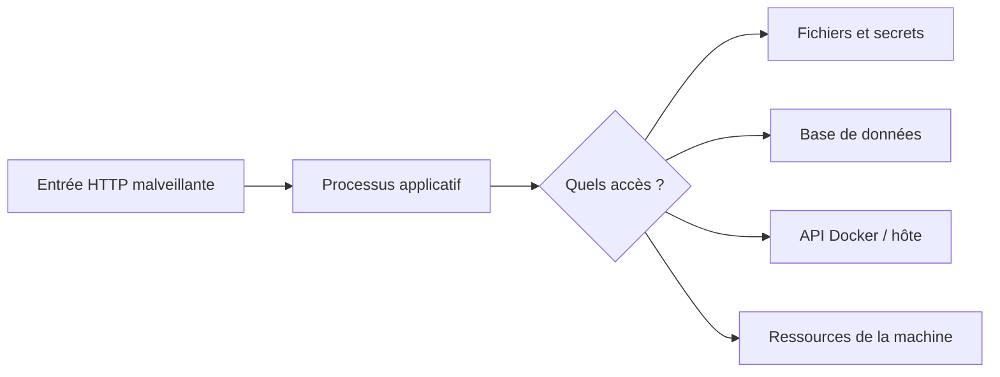
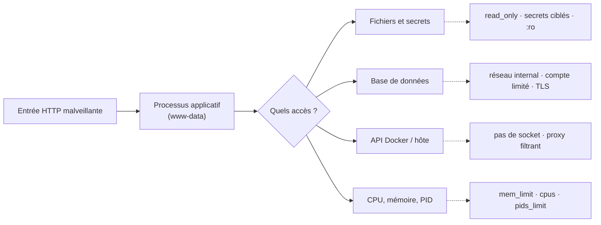
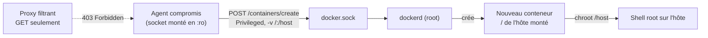
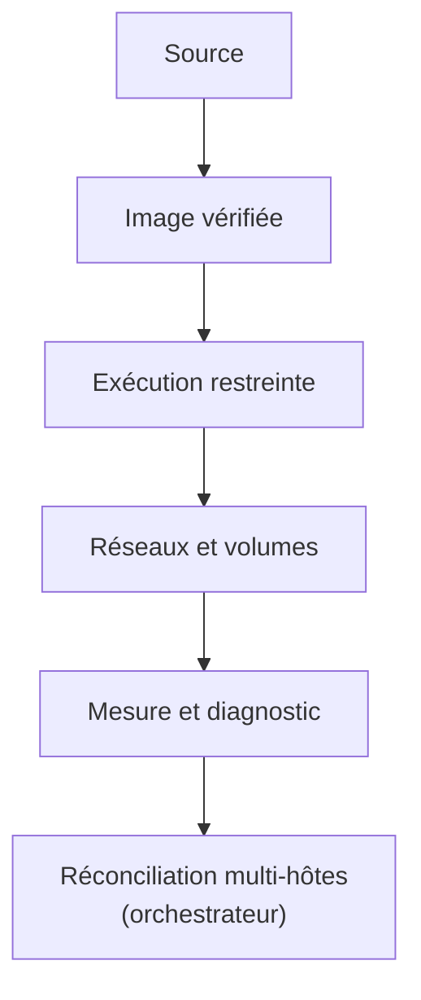

# Secrets, fichiers, réseau et ressources

> **En une phrase.** Une application compromise reste un processus qui peut lire ce qu'on lui monte, joindre ce qu'on lui connecte et consommer ce qu'on ne lui limite pas : chaque accès accordé doit être **nécessaire, restreint et vérifié**, puis l'ensemble contrôlé sans confondre un bon score d'audit avec une bonne sécurité.

---

## 1. Synthèse

### La question de départ : que permettrait une compromission ?



Pour chaque chemin, trois questions :
1. L'accès **existe-t-il réellement** ?
2. Quelles **permissions** l'autorisent ?
3. Quelle **mesure** réduit sa portée ou permet de le **détecter** ?

### Secrets : distinguer construction et exécution

| Moment | Exemples | Mécanisme adapté |
|---|---|---|
| **Pendant le build** | jeton d'accès à un registre privé ou à un dépôt | montage de secret BuildKit (`RUN --mount=type=secret`), voir [Sécurité des images](Securite-des-images.md) |
| **À l'exécution** | mot de passe SQL, certificat, clé d'API | fournir la valeur **au seul service concerné**, sans l'inscrire dans l'image |

### Où atterrit une valeur sensible ?

| Méthode | Où elle est visible | Verdict |
|---|---|---|
| `ENV` dans le Dockerfile | configuration de l'image, `docker image inspect`, chaque registre, chaque conteneur | **à proscrire** |
| Variable d'environnement à l'exécution (`environment:`) | `docker inspect`, `/proc/1/environ`, processus enfants, souvent les journaux d'erreur | acceptable pour un paramètre, pas pour un secret |
| Fichier `.env` | fichier local en clair, lu par Compose pour remplir le YAML ; facile à committer, copié dans les sauvegardes | **pas un coffre-fort** |
| Secret Compose (`secrets:` avec `file:`) | fichier monté en lecture seule dans `/run/secrets/<nom>`, uniquement dans les services qui le déclarent | bien meilleur, mais c'est un **fichier en clair de l'hôte** |
| Gestionnaire de secrets (Vault, coffre du fournisseur cloud, Secrets Kubernetes chiffrés, secrets Swarm) | contrôle d'accès, chiffrement, rotation, journal d'accès | cible en production |

Bon principe : distinguer **paramètres ordinaires** (nom d'hôte, port), **identifiants sensibles** et **secrets réellement gérés** par une solution appropriée.

### Fichiers : le système de fichiers et les volumes

- **`read_only: true`** rend le système de fichiers racine du conteneur non inscriptible ; un `tmpfs` (système de fichiers en mémoire) garde les répertoires d'écriture nécessaires. Condition : l'application doit le supporter. Les volumes gardent leurs propres règles.
- **Un volume est un chemin d'accès aux données** : il se protège comme les données qu'il contient.
  - ne le monter que dans les services qui en ont besoin ;
  - le monter en lecture seule (`:ro`, `read_only`) quand c'est possible ;
  - maîtriser UID, GID et permissions ;
  - sauvegarder et **tester les restaurations** ;
  - prévoir le chiffrement selon la sensibilité et le support.
- Un conteneur non privilégié mais autorisé à écrire dans un volume sensible **peut toujours l'altérer**.
- Un **bind mount en écriture** d'un répertoire sensible de l'hôte (`/etc`, `/root/.ssh`, un dossier de scripts lancés par cron) donne la main sur l'hôte.

### Le socket Docker : un point critique

`/var/run/docker.sock` donne accès à **l'API complète du démon**. Sur un moteur classique, où le démon tourne en root, quiconque contrôle cette API peut créer un conteneur privilégié qui monte `/` de l'hôte : c'est **l'équivalent de root sur la machine**.

- Le monter dans un conteneur de collecte ou d'administration **étend fortement sa confiance**.
- Un montage **`:ro` du socket ne change rien** : il protège le fichier, pas l'API qu'on atteint à travers lui.
- Pour la même raison, **être membre du groupe `docker`, c'est être root sans mot de passe**.

### Réseau : isoler n'est pas autoriser

Un réseau Docker dédié limite les communications ordinaires entre conteneurs. Il **ne remplace pas** :
- l'**authentification** applicative ;
- l'**autorisation** des opérations ;
- le **chiffrement** des flux sensibles ;
- les **politiques de filtrage** nécessaires ;
- les **protections de l'hôte**.

Rendre MariaDB invisible depuis Internet n'empêche pas une application compromise de lui envoyer des requêtes **autorisées**.

| Situation | Qui peut joindre le service | Exemple |
|---|---|---|
| Écoute dans le conteneur, sans publication | le conteneur et ses voisins du même réseau Docker, par leur nom | MariaDB sur 3306 |
| Publié sur `127.0.0.1` | seulement l'hôte du moteur | `ports: ["127.0.0.1:8080:80"]` |
| Publié sans adresse (`"8080:80"`) | **toute machine qui atteint l'hôte** (`0.0.0.0`), même avec un pare-feu comme ufw, que les règles de Docker court-circuitent | à éviter sans raison |
| Réseau `internal: true` | les conteneurs de ce réseau, sans aucune sortie vers l'extérieur | réseau `backend` de la base |

Principe : **ne publier que les services destinés à être joints**, et limiter la portée de chaque point d'entrée. Le détail des réseaux est dans [Réseaux Docker et publication de ports](Reseaux-et-ports.md).

### Ressources : la disponibilité est aussi de la sécurité

```yaml
services:
  api:
    image: exemple/api:1.0
    mem_limit: 512m
    cpus: 1.0
    pids_limit: 128
```

Les cgroups limitent les effets d'une **fuite mémoire**, d'une **consommation excessive de CPU** et de certaines saturations par **création de processus** (fork bomb). Ils transforment un incident d'hôte en incident de conteneur. Ils protègent la disponibilité **sans garantir une qualité de service constante** : il faut **mesurer, puis dimensionner** (mécanisme détaillé dans [Isolation d'un conteneur](Isolation-des-conteneurs.md)).

### Une configuration durcie doit rester exécutable

```yaml
services:
  web:
    image: exemple/web-nonroot:1.0
    user: "10001:10001"
    read_only: true
    tmpfs: ["/tmp"]
    cap_drop: ["ALL"]
    security_opt:
      - no-new-privileges:true
```

C'est un **exemple de politique**, pas une recette valable pour toutes les images : l'image doit être prévue pour cet UID, ce port et ces emplacements d'écriture. On **teste la fonctionnalité après durcissement** (voir [Identités, privilèges et capabilities](Identites-et-privileges.md)).

### Observer : détecter avant de subir

| À surveiller | Pourquoi |
|---|---|
| état et redémarrages des processus | un conteneur qui redémarre en boucle cache souvent une panne ou une attaque |
| échecs d'authentification ou d'accès | signe de force brute ou de compte compromis |
| consommation CPU, mémoire, entrées-sorties | saturation, minage, fuite |
| erreurs applicatives et des dépendances | panne d'un service tiers, injection |
| modifications d'images et de configuration | changement non prévu, dérive |

Les **journaux** décrivent des **événements** ; les **métriques** décrivent des **tendances**. Ce sont des preuves complémentaires. **Ne jamais journaliser** mots de passe, jetons ou données sensibles. Une chaîne de supervision a besoin de voir beaucoup : elle devient elle-même une surface d'attaque si on lui donne trop de droits (le socket Docker, typiquement).

### Vérifier : conformité n'est pas résistance

| Activité | Ce qu'elle cherche | Exemple d'outil |
|---|---|---|
| **Audit de conformité** | les écarts d'une configuration à un référentiel | Docker Bench for Security (contrôles du CIS Docker Benchmark) |
| **Analyse de vulnérabilités** | les failles connues des logiciels | Trivy, Docker Scout sur les images |
| **Test d'intrusion** | ce qu'un attaquant peut réellement exploiter, et l'impact | humain, outillé |

Un contrôle automatique peut signaler un conteneur privilégié, un montage sensible, une absence de limite mémoire, une image vulnérable, une configuration du démon exposée. Deux notions s'ajoutent au vocabulaire du risque (voir [Sécurité des images](Securite-des-images.md)) :
- **non-conformité** : écart à un référentiel, qui n'est pas forcément une vulnérabilité exploitable ;
- **mesure compensatoire** : protection alternative quand on ne corrige pas l'écart lui-même (un port lié à `127.0.0.1` plutôt qu'un pare-feu dédié).

Un rapport « vert » ne remplace **ni un modèle de menaces, ni des tests fonctionnels, ni un audit de l'application**. Et le fichier Compose n'est que **l'intention déclarée** : `docker inspect` montre ce qui a effectivement été créé.

### Remédier dans le bon ordre

Face à un conteneur excessivement privilégié :
1. **identifier le besoin** qui motive ce privilège ;
2. envisager une **modification de l'application ou de l'image** ;
3. **retirer les droits inutiles** ;
4. **vérifier l'accès** aux fichiers et au réseau ;
5. **tester** le service et **surveiller** son comportement.

Désactiver une protection pour « faire démarrer » est une **hypothèse de diagnostic**, pas une correction définitive.

### Pour conclure la partie « Sécuriser » : six distinctions à conserver

| Ne pas confondre… | … avec | Page |
|---|---|---|
| Conteneur isolé | Machine virtuelle | [Isolation d'un conteneur](Isolation-des-conteneurs.md) |
| `USER` non-root | Démon Docker rootless | [Identités et privilèges](Identites-et-privileges.md) |
| Tag / digest | Signature / absence de faille | [Sécurité des images](Securite-des-images.md) |
| `.env` | Gestion sécurisée des secrets | cette page |
| Healthcheck | Auto-réparation garantie | [Démarré n'est pas disponible](Demarre-n-est-pas-disponible.md) |
| Compose | Orchestrateur multi-hôtes | [Pourquoi orchestrer ?](Pourquoi-orchestrer.md) |

La sécurité d'une plateforme résulte d'un **ensemble de contrôles cohérents, vérifiés au regard des risques**.

### Les bonnes pratiques classiques, et leurs nuances

| Bonne pratique courante | Ce qu'il faut ajouter |
|---|---|
| Utiliser des images minimales (`alpine`, `distroless`) | petit n'est pas forcément sûr : correctifs, compatibilité et visibilité des dépendances comptent aussi |
| Éviter l'exécution en root dans le conteneur | vérifier **tous** les processus, et retenir que cela ne rend pas le démon non privilégié |
| Externaliser la configuration (variables d'environnement, fichier `.env`) | oui pour les paramètres ; pour les secrets, préférer des fichiers montés ou un gestionnaire dédié |
| Définir des volumes pour la persistance, ne pas écrire dans l'image | un volume se protège comme ses données, et la persistance n'est pas une sauvegarde |
| Versionner les images et les pousser dans un registre | tags immuables, déploiement par digest, images signées et accompagnées de leur SBOM |

> [!IMPORTANT]
> **Les pièges à retenir**
> 1. **`.env` n'est pas un coffre-fort**, et un secret Compose local n'est qu'un fichier en clair monté depuis l'hôte.
> 2. **Monter le socket Docker, même en `:ro`, revient à donner root sur l'hôte.**
> 3. **Un port publié sans adresse écoute sur toutes les interfaces**, et un réseau privé n'empêche pas les requêtes légitimes d'un service compromis.
> 4. **Une limite trop basse crée la panne** qu'elle devait éviter : mesurer d'abord.
> 5. **Un meilleur score d'audit peut cacher une configuration moins sûre.** Le but est de réduire le risque, pas le nombre de lignes rouges.

---

## 2. Cas d'usage classiques

### Cas 1 : passer un mot de passe à MariaDB sans variable d'environnement, et sans le faire fuir

**Besoin.** L'application et la base partagent un mot de passe ; seul le root de la base a besoin du second.

```yaml
services:
  db:
    image: mariadb:11.4
    environment:
      MARIADB_DATABASE: app
      MARIADB_USER: app
      MARIADB_PASSWORD_FILE: /run/secrets/db_app_password
      MARIADB_ROOT_PASSWORD_FILE: /run/secrets/db_root_password
    secrets: [db_app_password, db_root_password]
  web:
    image: exemple/web-php:1.0
    secrets: [db_app_password]          # web ne reçoit pas le mot de passe root

secrets:
  db_app_password:
    file: ./secrets/db_app_password
  db_root_password:
    file: ./secrets/db_root_password
```

```bash
docker compose exec db ls -l /run/secrets/              # les deux fichiers
docker compose exec web ls /run/secrets/                # un seul
docker inspect -f '{{json .Config.Env}}' "$(docker compose ps -q db)"   # seulement les CHEMINS
```

**Ce qu'on observe, sur un poste de test.** `docker inspect` ne montre que `MARIADB_PASSWORD_FILE=/run/secrets/db_app_password`, jamais la valeur. Une recherche des deux mots de passe dans tous les fichiers du projet hors `secrets/`, dans la configuration et l'historique de l'image, ne trouve rien. Mais dans le conteneur, le fichier était lisible (`644`) par **tous** les processus.
**À retenir.** Monter un **fichier** évite l'environnement (hérité, inspectable, souvent journalisé), permet de choisir qui reçoit quel secret, et de le changer sans reconstruire l'image. Ce n'est pourtant ni chiffré, ni centralisé, ni renouvelé automatiquement : `secrets/` va dans `.gitignore`, avec des permissions strictes sur l'hôte.

**Et à l'usage ?** Un secret bien stocké peut encore fuir quand on s'en sert : argument de commande visible dans `ps`, historique du shell, message d'erreur, fichier produit. La sauvegarde de la base, qui a besoin du mot de passe root, en est l'exemple type : la méthode (fichier d'options éphémère, vérification par `grep` que la sauvegarde ne contient pas le mot de passe) est détaillée dans [Stockage : couche du conteneur, volumes, bind mounts](Stockage-et-volumes.md).

### Cas 2 : passer un service en lecture seule

**Besoin.** Empêcher un intrus de déposer ou modifier des fichiers dans le conteneur.

```bash
docker run --rm --read-only nginx:1.27
# [emerg] mkdir() "/var/cache/nginx/client_temp" failed (30: Read-only file system)

docker run -d --name ro --read-only --tmpfs /var/cache/nginx --tmpfs /var/run \
  -p 127.0.0.1:8080:80 nginx:1.27
curl -s -o /dev/null -w '%{http_code}\n' http://127.0.0.1:8080/   # 200
docker exec ro touch /etc/test                                      # Read-only file system
docker rm -f ro
```

**Ce qu'on observe.** Le premier essai échoue : nginx écrit dans son cache au démarrage. En donnant un `tmpfs` aux deux seuls répertoires d'écriture, le service fonctionne et le reste devient intouchable, même pour root.
**À retenir.** On découvre les répertoires d'écriture **en lisant les erreurs**, pas en les devinant. Les données d'un `tmpfs` disparaissent à l'arrêt : il ne convient qu'au temporaire.

### Cas 3 : ce que le cloisonnement réseau ne protège pas

**Besoin.** La base est déjà sur un réseau `internal: true`, sans port publié, et seul le web la rejoint (montage détaillé dans [Réseaux Docker et publication de ports](Reseaux-et-ports.md)). Que reste-t-il si le web est compromis ?

```bash
ss -lnt | grep -E ':8080|:3306'         # côté hôte : seul 127.0.0.1:8080 écoute
```

**Ce qu'on observe, sur un poste de test.** Depuis un conteneur placé sur `frontend`, le nom `db` n'est même pas résolu, et la base n'a aucune route vers l'extérieur. Mais un conteneur quelconque branché sur `backend` a ouvert une connexion TCP vers `db:3306` sans difficulté. Le web compromis est exactement dans cette position : ses requêtes vers la base sont **légitimes** du point de vue du réseau.
**Ce qui protège réellement à ce stade.**
- **L'authentification** : sans le mot de passe, la connexion TCP ne mène à rien.
- **Un compte applicatif aux droits limités** : l'image MariaDB donne à `MARIADB_USER` tous les droits sur `MARIADB_DATABASE`. Un script d'initialisation peut les réduire au strict nécessaire :

```sql
REVOKE ALL PRIVILEGES ON app.* FROM 'app'@'%';
GRANT SELECT, INSERT ON app.evenements TO 'app'@'%';
```

- **Le chiffrement TLS** des échanges, selon la sensibilité, puisque le trafic interne circule en clair.
- **La journalisation des connexions et des échecs**, pour détecter un usage anormal.

**À retenir.** Avec `ports: "3306:3306"`, MariaDB aurait en plus été publiée sur `0.0.0.0`, donc exposée au réseau local et à la force brute, sans rien apporter au web. Le réseau réduit **qui** peut parler à la base ; il ne dit rien de **ce qu'on a le droit de lui demander**.

### Cas 4 : poser des limites de ressources dimensionnées sur la mesure

**Besoin.** Sur un hôte partagé avec d'autres projets, empêcher l'application d'affamer la machine.

```bash
docker stats --no-stream                 # mesurer avant de limiter
```

```yaml
services:
  db:
    mem_limit: 512m
    cpus: 1.0
    pids_limit: 128
  web:
    mem_limit: 256m
    cpus: 0.5
    pids_limit: 64
```

```bash
docker compose up -d
docker inspect -f '{{.HostConfig.Memory}} {{.HostConfig.NanoCpus}} {{.HostConfig.PidsLimit}}' "$(docker compose ps -q web)"
# 268435456 500000000 64
docker compose exec web cat /sys/fs/cgroup/memory.max /sys/fs/cgroup/cpu.max /sys/fs/cgroup/pids.max
# 268435456 / 50000 100000 / 64
docker compose exec web sh -c 'for i in $(seq 80); do sleep 300 & done; wait'   # Cannot fork
curl -s -o /dev/null -w '%{http_code}\n' http://127.0.0.1:8080/                 # 200
```

**Ce qu'on observe, sur un poste de test.** Mesure initiale : environ 82 Mio et 12 processus pour MariaDB, 14 Mio et 6 processus pour Apache ; les limites prennent une marge large. Pendant la saturation volontaire (80 processus lancés), le shell obtient `Cannot fork` et même un `docker exec` suivant échoue tant que la limite est atteinte, mais **le site répond toujours 200** et le reste de l'hôte n'a rien senti.
**À retenir.** Une limite trop basse crée sa propre panne : MariaDB tuée au premier pic, CPU bridé qui fait expirer les délais, Apache incapable de créer ses workers en pointe. Les limites écrites dans `compose.yaml` survivent aux recréations.

### Cas 5 : l'agent de supervision qui demande le socket Docker

**Besoin.** Collecter les métriques des conteneurs avec un agent (Telegraf, par exemple), dont la configuration standard lit l'API Docker.

```bash
# Ce que permet un socket monté, même en lecture seule : la preuve sans danger
docker run --rm -v /var/run/docker.sock:/var/run/docker.sock:ro docker:27-cli \
  docker run --rm -v /:/host alpine cat /host/etc/hostname
# affiche le nom de l'HÔTE : le conteneur enfant, créé par le démon root, voit tout le disque de l'hôte
```

**Ce qu'on observe.** Depuis un conteneur qui n'a que le socket en `:ro`, on fait créer par le démon un autre conteneur qui monte `/` de l'hôte. Remplacer `cat` par `chroot /host sh` donnerait un shell root sur la machine : lecture de tous les volumes et secrets, arrêt ou modification de tous les conteneurs.
**Les options, de la plus risquée à la plus sûre.**

| Solution | Données accessibles | Si l'agent est compromis | Limite |
|---|---|---|---|
| Socket monté directement | tout le moteur | **root sur l'hôte** | aucune pour l'attaquant |
| Proxy de socket filtrant (`docker-socket-proxy`, n'autorisant que `GET /containers`, `/info`) | état des conteneurs | fuite d'informations, pas de contrôle | un composant de plus à configurer |
| Collecteur sur l'hôte (compte de service) | fichiers cgroup, `/proc` | accès à l'hôte selon le compte | à installer hors conteneur |
| Points de métriques dédiés (cAdvisor, exportateurs) | ce que l'exportateur publie | faible | dépend de ce qui est exposé |

```yaml
services:
  socket-proxy:
    image: tecnativa/docker-socket-proxy
    environment: { CONTAINERS: 1, INFO: 1, POST: 0 }
    volumes: ["/var/run/docker.sock:/var/run/docker.sock:ro"]
    networks: [monitoring]
  telegraf:
    image: telegraf:1.40.2
    # dans telegraf.conf : endpoint = "tcp://socket-proxy:2375"
    networks: [monitoring]
networks:
  monitoring: { internal: true }
```

**À retenir.** Le proxy garde le socket, mais **lui seul** l'a, il refuse toute écriture, et il n'est joignable que depuis le réseau interne de supervision. L'agent compromis ne peut plus créer de conteneur.

### Cas 6 : auditer avec Docker Bench, puis interpréter

**Besoin.** Faire un premier état des lieux d'un moteur qui fonctionne mais que personne n'a vérifié.

```bash
git clone https://github.com/docker/docker-bench-security.git
cd docker-bench-security
git rev-parse --short HEAD               # noter la version exacte auditée
sha256sum docker-bench-security.sh       # et l'empreinte du script, avant de l'exécuter en root
sudo sh docker-bench-security.sh | tee ~/audit-avant.txt
grep -c '\[PASS\]' ~/audit-avant.txt; grep -c '\[WARN\]' ~/audit-avant.txt
```

**Ce qu'on observe, sur un poste de test.** 117 contrôles, **44 PASS et 109 lignes WARN**, score 1. Mais `grep -c` compte des **lignes** : un contrôle produit une ligne de détail par conteneur ou par image, et il n'y avait en réalité que **35 contrôles** en WARN.
**Interpréter chaque résultat.**
- **Des PASS sans objet** : les neuf contrôles Swarm étaient en PASS uniquement parce que Swarm n'était pas activé.
- **Des WARN sans objet** : alertes auditd et AppArmor sur un hôte qui n'en dispose pas (une VM WSL2), contrôles TLS alors que le démon n'écoute que sur son socket Unix, chemins propres à une autre distribution.
- **Des WARN justifiés par le contexte** : un port signalé « exposé » alors qu'il n'écoute que sur `127.0.0.1`, un nœud Minikube privilégié par nature.
- **Des WARN à traiter** : conteneurs en root avec les 14 capabilities et sans `no-new-privileges`, aucune limite de ressources sur un hôte partagé.

**Prioriser par le risque, pas par l'ordre du rapport.** Le rapport suit le référentiel (hôte, démon, fichiers, images, conteneurs). On traite d'abord ce qui est **exposé et facile à exploiter** (privilèges du service web), puis ce qui a un **impact large** (ressources sur un hôte partagé), puis l'image (utilisateur, healthcheck), et enfin les réglages globaux du démon, qui touchent **tous** les projets et demandent une étude d'impact (activer `userns-remap`, par exemple, rend invisibles les images et volumes existants).
**Le vrai risque de l'outil lui-même.** Un script de sécurité exécuté en root peut tout faire. D'où la vérification du dépôt officiel, du commit exact et de l'empreinte avant exécution.

### Cas 7 : le paradoxe du score

**Besoin.** Après deux remédiations (privilèges réduits, limites de ressources), refaire l'audit et comparer.

```bash
sudo sh docker-bench-security.sh | tee ~/audit-apres.txt
diff <(grep WARN ~/audit-avant.txt) <(grep WARN ~/audit-apres.txt)
```

**Ce qu'on observe.** Les lignes « No SecurityOptions », « Privileges not restricted », « without memory/CPU restrictions » et « PIDs limit not set » ont disparu pour les deux conteneurs traités : **7 lignes WARN de moins**. Pourtant **le score passe de 1 à -1**.
**Pourquoi.**
1. Un contrôle reste en WARN tant qu'**un seul** conteneur du moteur le viole : les autres projets du moteur le maintenaient en rouge.
2. Le contrôle sur les capabilities **passe de PASS à WARN** : l'outil accepte silencieusement les capabilities du jeu par défaut, mais signale toute autre capability ajoutée. Or `DAC_READ_SEARCH`, ajoutée à MariaDB, n'en fait pas partie (35 contrôles en WARN, puis 36).

**La leçon.** Remplacer `DAC_READ_SEARCH` par `DAC_OVERRIDE` (qui fait partie du jeu par défaut) aurait fait **remonter le score**, et la base aurait démarré pareil. Mais `DAC_OVERRIDE` permet aussi d'**écrire** dans n'importe quel fichier : la configuration aurait été **moins sûre avec un meilleur score**. On garde la capability la plus étroite et on **documente** l'alerte acceptée.
**Ce qui reste.** Une remédiation se présente avec ses risques résiduels : ici, entrypoints encore lancés en root, système de fichiers inscriptible, pas de healthcheck, pas d'AppArmor ni de namespace User.

---

## 3. Idées de schémas

### Schéma A : l'étude de menace annotée



### Schéma B : quatre cercles d'exposition

```
   ┌──────────────────────────────────────────────┐
   │  "8080:80"  →  0.0.0.0 : tout le réseau      │
   │  ┌────────────────────────────────────────┐  │
   │  │ "127.0.0.1:8080:80" → l'hôte seulement │  │
   │  │  ┌──────────────────────────────────┐  │  │
   │  │  │ réseau Docker : les voisins      │  │  │
   │  │  │  ┌────────────────────────────┐  │  │  │
   │  │  │  │ internal: true : pas de    │  │  │  │
   │  │  │  │ sortie, voisins seulement  │  │  │  │
   │  │  │  │        [ MariaDB ]         │  │  │  │
   │  │  │  └────────────────────────────┘  │  │  │
   │  │  └──────────────────────────────────┘  │  │
   │  └────────────────────────────────────────┘  │
   └──────────────────────────────────────────────┘
   Plus on est au centre, moins de monde peut joindre le service.
   Mais au centre, l'authentification reste nécessaire.
```

### Schéma C : du socket monté à root sur l'hôte



### Schéma D : de l'image au service exploité



Construction, distribution, exécution, sécurité et exploitation forment un même cycle de vie. La dernière marche est l'objet de [Pourquoi orchestrer ?](Pourquoi-orchestrer.md).

---

## 4. Script de motion design : « Socket monté, hôte perdu » (environ 75 s)

Style : fond sombre ; l'hôte est une grande boîte grise, les conteneurs des boîtes colorées posées dedans ; le socket est une prise électrique dorée sur la paroi de l'hôte.

| Séq. | Durée | À l'écran | Animation | Texte à l'écran |
|---|---|---|---|---|
| 1 | 0-8 s | Un hôte avec trois conteneurs ; dans un coin, `dockerd` porte une couronne « root » | La couronne scintille ; des fils relient `dockerd` à chaque conteneur | « Le démon Docker tourne en root et gère tous les conteneurs. » |
| 2 | 8-17 s | Un administrateur branche un câble entre la prise dorée et un conteneur « supervision » ; il colle une étiquette « :ro » sur le câble | L'étiquette s'illumine en vert, rassurante | « Pour voir les conteneurs, on monte le socket. En lecture seule. » |
| 3 | 17-26 s | Un curseur rouge entre dans le conteneur « supervision » par une faille de plugin | Le conteneur passe au rouge | « L'agent est compromis. L'attaquant n'est même pas root. » |
| 4 | 26-36 s | Le curseur envoie une enveloppe « créer un conteneur privilégié, monter / » dans le câble | L'enveloppe passe sous l'étiquette « :ro », qui vire au gris et se décolle | « :ro protège le fichier. Pas l'API derrière lui. » |
| 5 | 36-46 s | `dockerd` reçoit l'enveloppe, obéit et crée une nouvelle boîte ouverte vers le sol de l'hôte | Un trou s'ouvre sous la nouvelle boîte, tout le disque de l'hôte apparaît | « Le démon root exécute la demande. Le disque de l'hôte est monté. » |
| 6 | 46-56 s | Le curseur descend dans le trou ; la couronne « root » passe sur sa tête | Les autres conteneurs, volumes et fichiers `secrets` se colorent en rouge un à un | « chroot /host : root sur la machine. Tous les volumes, tous les secrets. » |
| 7 | 56-67 s | Retour en arrière (bande qui se rembobine) ; un boîtier « proxy » s'intercale sur le câble | La même enveloppe est arrêtée par le proxy, tampon « 403 » ; une petite enveloppe « GET /containers » passe | « Un proxy filtrant : lire l'état, oui. Créer, non. » |
| 8 | 67-75 s | Écran de synthèse : la prise dorée avec un cadenas | Le texte s'écrit sur fond calme | « Monter le socket, c'est donner les clés de l'hôte. Le groupe docker aussi. » |

**Conseil de réalisation.** Le moment clé est la séquence 4 : l'étiquette « :ro » doit d'abord paraître protectrice (séquence 2) pour que sa chute surprenne. Garder les volumes et fichiers de secrets visibles dès la séquence 1, discrets, pour que leur passage au rouge en séquence 6 montre l'ampleur de la compromission.

---

## 5. Vérifier soi-même

```bash
# 1. Un conteneur durci et la lecture de ce qui est réellement appliqué
docker run -d --name verif --read-only --tmpfs /var/cache/nginx --tmpfs /var/run \
  --memory 128m --cpus 0.5 --pids-limit 64 --security-opt no-new-privileges \
  -p 127.0.0.1:8080:80 nginx:1.27
docker inspect -f 'ro={{.HostConfig.ReadonlyRootfs}} mem={{.HostConfig.Memory}} pids={{.HostConfig.PidsLimit}} opts={{.HostConfig.SecurityOpt}}' verif
docker inspect -f '{{json .Mounts}}' verif               # montages : aucun socket, aucun chemin sensible
docker port verif                                         # 80/tcp -> 127.0.0.1:8080
docker info -f '{{.SecurityOptions}}'                     # options du moteur : seccomp, userns, rootless…

# 2. Quels conteneurs montent le socket Docker sur ce moteur ?
docker ps -q | xargs docker inspect -f '{{.Name}} {{range .Mounts}}{{.Source}} {{end}}' | grep docker.sock

# 3. Qui publie sur toutes les interfaces ?
docker ps --format '{{.Names}}\t{{.Ports}}' | grep '0.0.0.0'

docker rm -f verif
```

Pour l'audit complet, suivre les cas 6 et 7, puis classer chaque WARN dans l'une des quatre catégories (sans objet, justifié, à traiter, accepté et documenté).

## Voir aussi

- [Accueil du wiki](../README.md)
- Page précédente : [Identités, privilèges et capabilities](Identites-et-privileges.md)
- Page suivante : [Pourquoi orchestrer ?](Pourquoi-orchestrer.md)
- Pages liées : [Réseaux Docker et publication de ports](Reseaux-et-ports.md) · [Stockage : couche du conteneur, volumes, bind mounts](Stockage-et-volumes.md)
