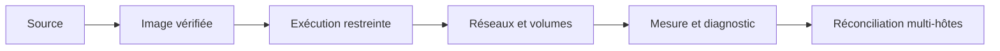

# Secrets, fichiers, réseau et ressources

<p class="lead">Une application compromise reste un processus qui peut lire ce qu'on lui monte, joindre ce qu'on lui connecte et consommer ce qu'on ne lui limite pas. Chaque accès accordé doit être <strong>nécessaire, restreint et vérifié</strong>, puis l'ensemble contrôlé sans confondre un bon score d'audit avec une bonne sécurité.</p>

{ .hero }

## L'essentiel en 30 secondes

<div class="grid cards" markdown>

-   :material-key-variant:{ .lg .middle } __Secrets__

    ---

    Un **fichier monté** dans le seul service qui en a besoin, pas une variable d'environnement.

-   :material-file-lock-outline:{ .lg .middle } __Fichiers__

    ---

    Racine en **lecture seule**, un `tmpfs` pour le temporaire, des volumes montés au plus juste.

-   :material-lan:{ .lg .middle } __Réseau__

    ---

    Isoler réduit **qui** parle à la base, pas **ce qu'on a le droit** de lui demander.

-   :material-gauge:{ .lg .middle } __Ressources__

    ---

    Mémoire, CPU, processus plafonnés **après mesure** : l'incident reste dans le conteneur.

</div>

!!! warning "À retenir"

    **Monter le socket Docker, même en `:ro`, c'est donner root sur l'hôte.** Un `.env` n'est pas un coffre-fort, un port publié sans adresse écoute sur toutes les interfaces, et un meilleur score d'audit peut cacher une configuration **moins** sûre.

## :material-key-variant: Secrets : ni dans l'image, ni dans l'environnement

Au **build**, un jeton passe par `RUN --mount=type=secret` (voir [Sécurité des images](Securite-des-images.md)). À l'**exécution**, la valeur est fournie au seul service concerné, sans être inscrite dans l'image.

| Méthode | Où la valeur est visible | Verdict |
|---|---|---|
| `ENV` dans le Dockerfile | l'image, chaque registre, chaque conteneur | **à proscrire** |
| `environment:` | `docker inspect`, `/proc/1/environ`, enfants, journaux d'erreur | paramètre oui, secret non |
| fichier `.env` | fichier en clair, facile à committer, dans les sauvegardes | **pas un coffre-fort** |
| `secrets:` Compose (`file:`) | `/run/secrets/<nom>`, en lecture seule, services choisis | bien meilleur, mais fichier en clair sur l'hôte |
| gestionnaire (Vault, cloud, Kubernetes chiffré, Swarm) | contrôle d'accès, chiffrement, rotation, journal | cible en production |

```yaml
services:
  db:
    image: mariadb:11.4
    environment:
      MARIADB_PASSWORD_FILE: /run/secrets/db_app_password
      MARIADB_ROOT_PASSWORD_FILE: /run/secrets/db_root_password
    secrets: [db_app_password, db_root_password]
  web:
    secrets: [db_app_password]          # web ne reçoit pas le mot de passe root
secrets:
  db_app_password: { file: ./secrets/db_app_password }
  db_root_password: { file: ./secrets/db_root_password }
```

???+ example "En vrai : deux secrets, deux destinataires"

    

    On choisit qui reçoit quoi, on change la valeur sans reconstruire. Mais ce n'est ni chiffré, ni centralisé, ni renouvelé : `secrets/` va dans `.gitignore`, avec des permissions strictes sur l'hôte, et dans le conteneur le fichier reste lisible par **tous** ses processus.

!!! tip "Un secret bien stocké peut encore fuir à l'usage"

    Argument de commande visible dans `ps` (comme `-p"$(cat …)"` ci-dessus, acceptable pour une démonstration seulement), historique du shell, message d'erreur, fichier produit. La sauvegarde de la base en est l'exemple type : voir [Stockage : couche du conteneur, volumes, bind mounts](Stockage-et-volumes.md).

## :material-folder-lock-outline: Fichiers, volumes et socket

`--read-only` rend la racine du conteneur non inscriptible ; un `tmpfs` garde les seuls répertoires d'écriture nécessaires. On les découvre **en lisant les erreurs**, pas en les devinant.

???+ example "En vrai : nginx en lecture seule"

    

Un **volume est un chemin d'accès aux données** : ne le monter que là où il sert, en `:ro` quand c'est possible, avec des UID et permissions maîtrisés, sauvegardé et **restauration testée**. Un conteneur non root qui peut écrire dans un volume sensible peut l'altérer, et un bind mount en écriture de `/etc`, `/root/.ssh` ou d'un dossier de scripts lancés par cron donne la main sur l'hôte.


Le socket donne l'**API complète du démon** : quiconque lui parle peut créer un conteneur privilégié qui monte `/` de l'hôte. Le `:ro` protège le fichier, pas l'API derrière lui ; et **être membre du groupe `docker`, c'est être root sans mot de passe**.

???+ example "En vrai : vérifier son propre moteur"

    

??? note "L'agent de supervision qui demande le socket : les options"

    | Solution | Données accessibles | Si l'agent est compromis |
    |---|---|---|
    | Socket monté directement | tout le moteur | **root sur l'hôte** |
    | Proxy filtrant (`docker-socket-proxy`, `GET /containers`, `/info` seulement) | état des conteneurs | fuite d'informations, pas de contrôle |
    | Collecteur sur l'hôte (compte de service) | fichiers cgroup, `/proc` | accès à l'hôte selon le compte |
    | Points de métriques dédiés (cAdvisor, exportateurs) | ce que l'exportateur publie | faible |

    ```yaml
    services:
      socket-proxy:
        image: tecnativa/docker-socket-proxy
        environment: { CONTAINERS: 1, INFO: 1, POST: 0 }
        volumes: ["/var/run/docker.sock:/var/run/docker.sock:ro"]
        networks: [monitoring]
      telegraf:
        image: telegraf:1.40.2        # telegraf.conf : endpoint = "tcp://socket-proxy:2375"
        networks: [monitoring]
    networks:
      monitoring: { internal: true }
    ```

    Le proxy garde le socket, mais **lui seul** l'a, il refuse toute écriture et n'est joignable que depuis le réseau interne de supervision.

??? note "Une configuration durcie doit rester exécutable"

    ```yaml
    services:
      web:
        image: exemple/web-nonroot:1.0
        user: "10001:10001"
        read_only: true
        tmpfs: ["/tmp"]
        cap_drop: ["ALL"]
        security_opt: ["no-new-privileges:true"]
    ```

    Un **exemple de politique**, pas une recette : l'image doit être prévue pour cet UID, ce port et ces emplacements d'écriture. On teste la fonctionnalité après durcissement (voir [Identités, privilèges et capabilities](Identites-et-privileges.md)).

## :material-lan: Réseau et ressources

Un réseau dédié limite les communications ordinaires, mais ne remplace ni l'authentification, ni l'autorisation, ni le chiffrement, ni le filtrage. On ne publie que les services destinés à être joints, sur l'adresse la plus étroite (détails dans [Réseaux Docker et publication de ports](Reseaux-et-ports.md)).


???+ example "En vrai : la base isolée, mais pas contre le web"

    

    Un web compromis est exactement dans la position de `app` : ses requêtes vers la base sont légitimes pour le réseau. Ce qui protège alors : le **mot de passe**, un **compte aux droits limités**, le **TLS** si le trafic est sensible, et la **journalisation** des connexions et des échecs.

```sql
-- l'image MariaDB donne à MARIADB_USER tous les droits sur sa base : on les réduit
REVOKE ALL PRIVILEGES ON app.* FROM 'app'@'%';
GRANT SELECT, INSERT ON app.evenements TO 'app'@'%';
```

Avec `ports: "3306:3306"`, la base aurait en plus écouté sur `0.0.0.0`, exposée au réseau local et à la force brute, même derrière ufw, que les règles de Docker court-circuitent.

???+ example "En vrai : un service limité qui encaisse une saturation"

    

    Les cgroups transforment un incident d'hôte en incident de conteneur. Une limite **trop basse crée sa propre panne** (base tuée au premier pic, délais qui expirent) : `docker stats` d'abord, une marge large ensuite, et les limites écrites dans `compose.yaml` (`mem_limit`, `cpus`, `pids_limit`) survivent aux recréations.

## :material-clipboard-check-outline: Auditer : conformité n'est pas résistance

| Activité | Ce qu'elle cherche | Exemple d'outil |
|---|---|---|
| **Audit de conformité** | les écarts à un référentiel | Docker Bench for Security (CIS Docker Benchmark) |
| **Analyse de vulnérabilités** | les failles connues | Trivy, Docker Scout |
| **Test d'intrusion** | ce qu'un attaquant exploite réellement | humain, outillé |

Une **non-conformité** n'est pas forcément exploitable ; une **mesure compensatoire** la couvre autrement (un port sur `127.0.0.1` plutôt qu'un pare-feu dédié). Et `compose.yaml` n'est que l'intention : `docker inspect` montre ce qui a été créé.

???+ example "En vrai : trier les WARN d'un premier audit"

    

    117 contrôles, 44 PASS et 109 lignes WARN, mais seulement **35 contrôles** en WARN : `grep -c` compte des lignes, une par conteneur ou image. On classe chaque alerte (sans objet, justifiée, à traiter, acceptée et documentée) et on priorise **par le risque** : le service exposé, puis l'impact large, puis l'image, enfin les réglages globaux du démon.

???+ danger "En vrai : le paradoxe du score"

    

    Un contrôle reste en WARN tant qu'**un seul** conteneur du moteur le viole (les autres projets le maintenaient rouge), et l'outil accepte silencieusement les capabilities du jeu par défaut. `DAC_OVERRIDE` aurait fait remonter le score, mais permet d'**écrire** partout : la configuration aurait été moins sûre avec un meilleur score. On garde la plus étroite et on documente l'alerte acceptée.

??? note "Lancer l'audit, remédier, observer"

    ```bash
    git clone https://github.com/docker/docker-bench-security.git && cd docker-bench-security
    git rev-parse --short HEAD; sha256sum docker-bench-security.sh   # version et empreinte AVANT d'exécuter en root
    sudo sh docker-bench-security.sh | tee ~/audit-avant.txt
    ```

    Un script de sécurité exécuté en root peut tout faire : on vérifie le dépôt officiel, le commit et l'empreinte. Ces sorties ont été produites ainsi sur un moteur partagé, puis relues pour cette page.

    **Remédier dans l'ordre** : identifier le besoin qui motive le privilège, envisager une modification de l'image, retirer les droits inutiles, vérifier fichiers et réseau, tester et surveiller. Une remédiation se présente avec ses **risques résiduels** (ici : scripts d'entrée encore en root, racine inscriptible, pas de healthcheck, ni AppArmor ni namespace User).

    **Observer** : états et redémarrages, échecs d'authentification, CPU, mémoire et entrées-sorties, erreurs applicatives, modifications d'images et de configuration. Les journaux décrivent des événements, les métriques des tendances ; on n'y écrit **jamais** de secret, et la chaîne de supervision devient elle-même une surface d'attaque si on lui donne trop de droits.

## :material-flask-outline: À toi de jouer

```bash
docker run -d --name verif --read-only --tmpfs /var/cache/nginx --tmpfs /var/run \
  --memory 128m --cpus 0.5 --pids-limit 64 --security-opt no-new-privileges \
  -p 127.0.0.1:8080:80 nginx:stable
docker inspect -f 'ro={{.HostConfig.ReadonlyRootfs}} mem={{.HostConfig.Memory}} pids={{.HostConfig.PidsLimit}} opts={{.HostConfig.SecurityOpt}}' verif
docker port verif                                           # 80/tcp -> 127.0.0.1:8080
docker ps -q | xargs docker inspect -f '{{.Name}} {{range .Mounts}}{{.Source}} {{end}}' | grep docker.sock
docker ps --format '{{.Names}}\t{{.Ports}}' | grep '0.0.0.0'   # qui publie sur toutes les interfaces ?
docker rm -f verif
```

## :material-format-list-checks: Pour conclure la partie « Sécuriser »

| Ne pas confondre… | … avec | Page |
|---|---|---|
| Conteneur isolé | Machine virtuelle | [Isolation d'un conteneur](Isolation-des-conteneurs.md) |
| `USER` non root | Démon Docker rootless | [Identités et privilèges](Identites-et-privileges.md) |
| Tag, digest | Signature, absence de faille | [Sécurité des images](Securite-des-images.md) |
| `.env` | Gestion sécurisée des secrets | cette page |
| Healthcheck | Auto-réparation garantie | [Démarré n'est pas disponible](Demarre-n-est-pas-disponible.md) |
| Compose | Orchestrateur multi-hôtes | [Pourquoi orchestrer ?](Pourquoi-orchestrer.md) |



La dernière marche, l'orchestrateur, est l'objet de [Pourquoi orchestrer ?](Pourquoi-orchestrer.md).

??? note "Les bonnes pratiques classiques, et leurs nuances"

    | Bonne pratique courante | Ce qu'il faut ajouter |
    |---|---|
    | Images minimales (`alpine`, `distroless`) | petit n'est pas forcément sûr : correctifs, compatibilité, visibilité des dépendances |
    | Pas de root dans le conteneur | vérifier **tous** les processus ; cela ne rend pas le démon non privilégié |
    | Configuration externalisée (variables, `.env`) | oui pour les paramètres ; pour les secrets, fichiers montés ou gestionnaire dédié |
    | Volumes pour la persistance | un volume se protège comme ses données ; la persistance n'est pas une sauvegarde |
    | Images versionnées dans un registre | tags immuables, déploiement par digest, images signées avec leur SBOM |

??? abstract "Pour les créateurs : script de motion design « Socket monté, hôte perdu » (75 s)"

    Style : fond sombre ; l'hôte est une grande boîte grise, les conteneurs des boîtes colorées posées dedans ; le socket est une prise électrique dorée sur la paroi de l'hôte.

    | Séq. | Durée | À l'écran | Animation | Texte à l'écran |
    |---|---|---|---|---|
    | 1 | 0-8 s | Un hôte avec trois conteneurs ; dans un coin, `dockerd` porte une couronne « root » | La couronne scintille ; des fils relient `dockerd` à chaque conteneur | « Le démon Docker tourne en root et gère tous les conteneurs. » |
    | 2 | 8-17 s | Un administrateur branche un câble entre la prise dorée et un conteneur « supervision » ; il colle une étiquette « :ro » sur le câble | L'étiquette s'illumine en vert, rassurante | « Pour voir les conteneurs, on monte le socket. En lecture seule. » |
    | 3 | 17-26 s | Un curseur rouge entre dans le conteneur « supervision » par une faille de plugin | Le conteneur passe au rouge | « L'agent est compromis. L'attaquant n'est même pas root. » |
    | 4 | 26-36 s | Le curseur envoie une enveloppe « créer un conteneur privilégié, monter / » dans le câble | L'enveloppe passe sous l'étiquette « :ro », qui vire au gris et se décolle | « :ro protège le fichier. Pas l'API derrière lui. » |
    | 5 | 36-46 s | `dockerd` reçoit l'enveloppe, obéit et crée une nouvelle boîte ouverte vers le sol de l'hôte | Un trou s'ouvre sous la nouvelle boîte, tout le disque de l'hôte apparaît | « Le démon root exécute la demande. Le disque de l'hôte est monté. » |
    | 6 | 46-56 s | Le curseur descend dans le trou ; la couronne « root » passe sur sa tête | Les autres conteneurs, volumes et fichiers `secrets` se colorent en rouge un à un | « chroot /host : root sur la machine. Tous les volumes, tous les secrets. » |
    | 7 | 56-67 s | Retour en arrière (bande qui se rembobine) ; un boîtier « proxy » s'intercale sur le câble | La même enveloppe est arrêtée par le proxy, tampon « 403 » ; une petite enveloppe « GET /containers » passe | « Un proxy filtrant : lire l'état, oui. Créer, non. » |
    | 8 | 67-75 s | Écran de synthèse : la prise dorée avec un cadenas | Le texte s'écrit sur fond calme | « Monter le socket, c'est donner les clés de l'hôte. Le groupe docker aussi. » |

    Le moment clé est la séquence 4 : l'étiquette « :ro » doit d'abord paraître protectrice (séquence 2) pour que sa chute surprenne. Garder volumes et secrets visibles dès la séquence 1, discrets, pour que leur passage au rouge montre l'ampleur de la compromission. Par sécurité, cette démonstration n'a **pas** été exécutée : l'illustration `socket-root` la décrit.

??? info "Pour les créateurs : schémas"

    - **L'étude de menace** (illustration d'en-tête) : le processus compromis, quatre accès (fichiers et secrets, base, API Docker, ressources), la mesure de chacun.
    - **Les cercles d'exposition** : du plus large (`"8080:80"`, `0.0.0.0`) au plus étroit (`internal: true`) ; plus on est au centre, moins de monde joint le service, mais l'authentification reste nécessaire.
    - **Du socket monté à root sur l'hôte** : agent, `docker.sock`, `dockerd` root, conteneur privilégié avec `/` monté, `chroot /host` ; en dessous, le proxy filtrant qui répond 403.
