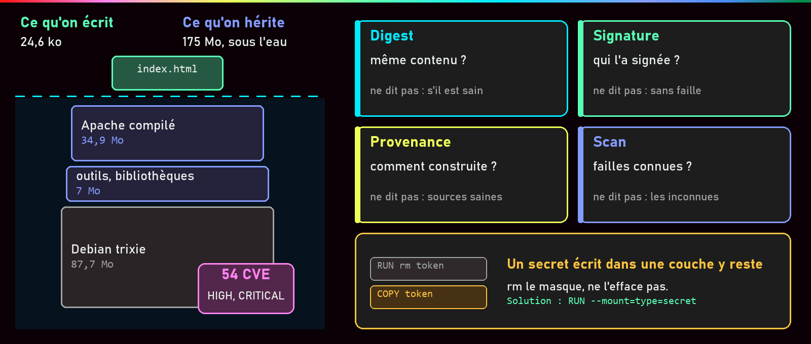
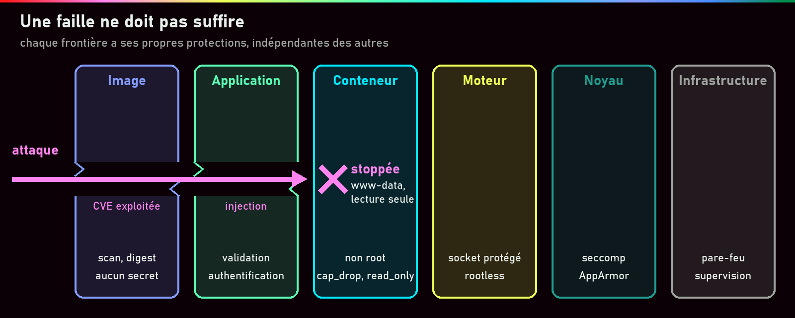
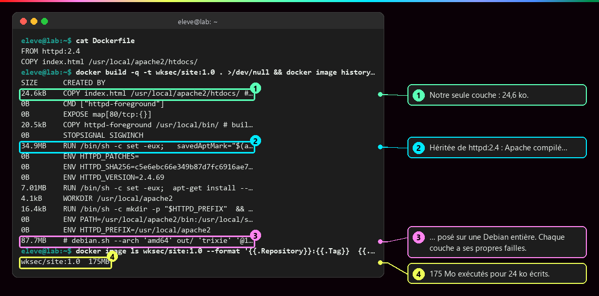
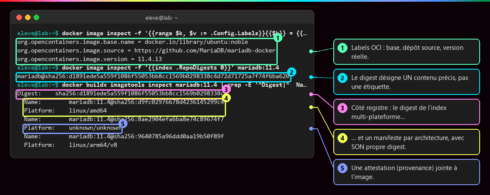
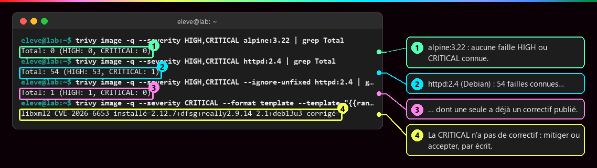
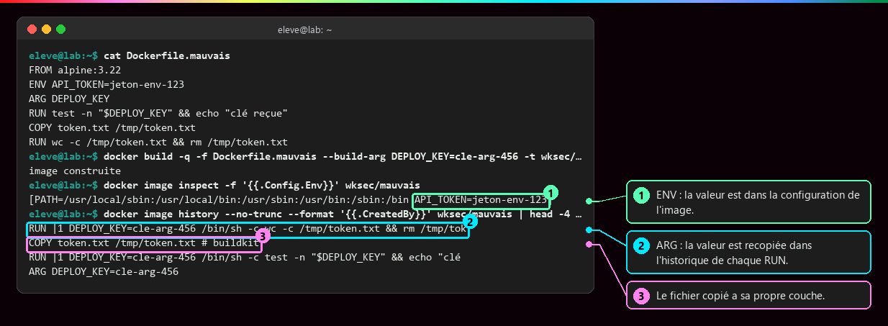
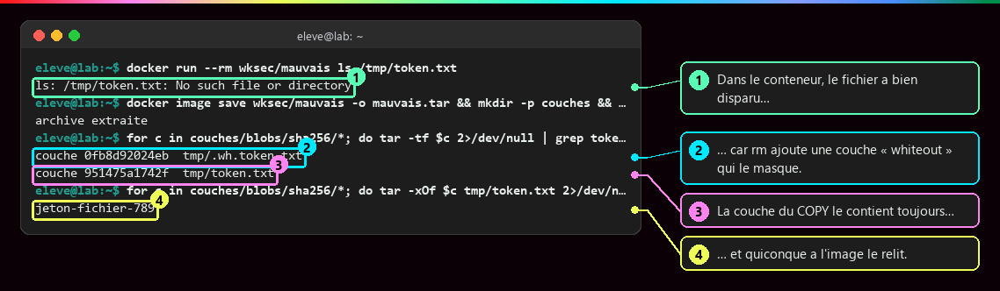
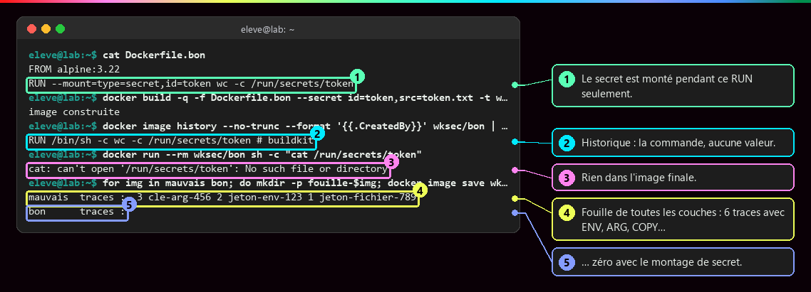
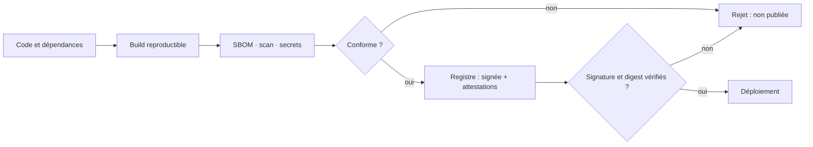

# Sécurité des images

<p class="lead">La sécurité d'un conteneur commence <strong>avant son exécution</strong> : une image transporte surtout du code qu'on n'a pas écrit. Il faut savoir d'où elle vient, ce qu'elle contient, comment la corriger, et ce qu'elle ne doit jamais contenir.</p>

{ .hero }

## L'essentiel en 30 secondes

<div class="grid cards" markdown>

-   :material-layers-triple-outline:{ .lg .middle } __Hériter__

    ---

    Pour une page HTML de 24 ko, on exécute **175 Mo** d'Apache et de Debian, avec leurs failles.

-   :material-fingerprint:{ .lg .middle } __Identifier__

    ---

    Un **tag** est une étiquette qui bouge ; un **digest** désigne un contenu précis.

-   :material-radar:{ .lg .middle } __Scanner__

    ---

    Un scan liste les failles **connues**. Zéro alerte ne veut pas dire image sûre.

-   :material-key-alert-outline:{ .lg .middle } __Aucun secret__

    ---

    Un secret écrit dans une couche **y reste**, même supprimé ensuite, et voyage avec chaque copie.

</div>

!!! warning "À retenir"

    **On ne patche pas un conteneur : on corrige l'image, on la reconstruit, on la teste, on la redéploie.** Et chaque contrôle (digest, signature, provenance, scan) répond à **une** question, jamais à « est-ce sûr ? ».

## :material-wall: Raisonner en frontières

Un conteneur **partage le noyau de l'hôte** (voir [Isolation d'un conteneur](Isolation-des-conteneurs.md)) : une faille du noyau touche plusieurs conteneurs, une mauvaise configuration élargit leurs accès, et une application compromise reste un processus à contrôler. On empile donc des protections **indépendantes**, une par niveau.



| Famille d'attaque | Exemples | Où se joue la protection |
|---|---|---|
| **Chaîne d'approvisionnement** | image ou dépendance vulnérable, provenance trompeuse | cette page |
| **Application** | injection SQL, exécution de code, authentification faible | le code et ses tests |
| **Configuration** | privilèges excessifs, ports exposés, secrets accessibles | [Identités et privilèges](Identites-et-privileges.md), [Secrets, fichiers, réseau](Secrets-fichiers-reseau-ressources.md) |
| **Infrastructure** | socket du démon, noyau, ressources partagées | idem, plus le durcissement de l'hôte |

Ces protections se complètent sans se remplacer : une configuration Docker restrictive ne corrige pas une injection SQL.

??? note "Le vocabulaire du risque et les actifs à protéger"

    | Notion | Définition | Exemple |
    |---|---|---|
    | **Menace** | ce qui pourrait exploiter une faiblesse | accès non autorisé aux données |
    | **Scénario** | le chemin concret de l'attaque | une commande exécutée à travers l'application web |
    | **Vulnérabilité** | faiblesse exploitable | une CVE de l'image, une injection dans le PHP |
    | **Impact** | ce que permettrait la réussite | lecture de secrets, rebond vers un autre service |
    | **Risque** | probabilité × gravité | un service exposé à Internet et lancé en root |
    | **Mesure** | ce qui réduit probabilité ou impact | non root, permissions, réseau restreint, supervision |

    Les actifs : les **données**, les **secrets** (usurpation, accès latéral), l'**hôte Docker** (tous les autres services), le **registre et les images** (code altéré distribué à tous), la **disponibilité**. La question utile n'est pas « mon conteneur est-il sécurisé ? » mais **« que permettrait cette compromission précise ? »**.

## :material-layers-search-outline: Ce qu'on hérite, et d'où ça vient

Avant d'adopter une image, on vérifie **qui la produit** (dépôt source, maintenance, mises à jour) et **ce qu'elle contient**. Le nombre de téléchargements ne prouve rien.

???+ example "En vrai : 24 ko écrits, 175 Mo exécutés"

    

    Notre `COPY` est la seule couche qu'on a écrite. Tout le reste vient de `httpd:2.4` et de sa base Debian : chaque paquet hérité a ses propres CVE et son propre rythme de correctifs. Une faille peut venir d'une **dépendance transitive** même si notre code est parfait.

???+ example "En vrai : labels OCI, digest de l'index et des manifestes"

    

    Les labels donnent la source et la version réelle (11.4.13 derrière le tag `11.4`). Le digest de l'**index** couvre toutes les plateformes ; chaque **manifeste** (amd64, arm64…) a le sien, et les entrées `unknown/unknown` sont des **attestations** de provenance.

???+ danger "Épingler un digest fige le contenu, pas sa qualité"

    ```yaml
    image: mariadb:11.4@sha256:d1891ede5a55...   # digest complet de l'index testé
    ```

    Le tag seul désignera une autre construction au prochain correctif ; le digest garantit la même image, **failles comprises**. On compare toujours des objets du même niveau (index avec index), et un outil comme Renovate ou Dependabot propose les nouveaux digests à valider après tests.

| Contrôle | Répond à | Ne dit pas |
|---|---|---|
| **Digest** | « même contenu ? » | si ce contenu est sain |
| **Signature** | « quelle identité l'a signé ? » | si le code est sans faille |
| **Provenance** (attestation) | « comment et à partir de quoi ? » | si les sources étaient saines |
| **Scan** | « quelles failles **connues** ? » | ce qui n'est pas encore connu |

## :material-radar: Scanner, interpréter, corriger

Un analyseur (Trivy, Docker Scout) confronte l'inventaire des paquets, le **SBOM**, aux bases de **CVE**. Le rapport n'est qu'un point de départ : on décide ligne par ligne.

???+ example "En vrai : 54 failles graves, une seule corrigeable"

    

    Trivy est lancé ici depuis son image officielle. `alpine:3.22` ne signale rien ; `httpd:2.4` en signale 54, mais **une seule** a déjà un correctif publié, et la CRITICAL n'en a pas : la reconstruction n'y changera rien aujourd'hui.

| Question, pour chaque ligne importante | Si oui | Si non |
|---|---|---|
| Le composant est-il présent et utilisé ? | continuer | faux positif probable, à documenter |
| Un correctif existe-t-il ? | mettre à jour la base, reconstruire | mitiger : désactiver la fonction, filtrer l'accès |
| La fonction vulnérable est-elle atteignable ? | priorité haute | priorité plus basse |
| Décision | **corriger**, **mitiger** ou **accepter**, en écrivant pourquoi | |

!!! tip "Corriger, c'est reconstruire"

    ```bash
    docker build --pull --no-cache -t registre.exemple.fr/app:1.2.1 .   # base à jour, RUN réexécutés
    trivy image registre.exemple.fr/app:1.2.1
    docker push registre.exemple.fr/app:1.2.1      # puis nouveau tag ou digest dans compose.yaml
    docker compose up -d                           # le conteneur est recréé
    ```

    Jamais de `docker exec web apt-get upgrade` : perdu à la recréation, impossible à tracer.

??? note "Alléger l'image, et produire SBOM et provenance au build"

    Une construction multi-étapes laisse le compilateur derrière elle (détails dans [Écrire un Dockerfile](Ecrire-un-Dockerfile.md)) :

    ```dockerfile
    FROM golang:1.23 AS build
    WORKDIR /src
    COPY . .
    RUN CGO_ENABLED=0 go build -o /app .

    FROM gcr.io/distroless/static-debian12:nonroot
    COPY --from=build /app /app
    ENTRYPOINT ["/app"]
    ```

    Plus de shell ni de gestionnaire de paquets : peu d'outils pour un intrus, peu de paquets à signaler. Mais **petit ne veut pas dire sûr** : il faut des correctifs rapides, une compatibilité vérifiée (Alpine utilise musl, pas glibc) et des dépendances encore visibles ; l'absence de shell complique aussi le diagnostic.

    `docker buildx build --sbom=true --provenance=mode=max ... --push .` attache à l'image la liste des paquets et la description du build. Effet constaté : reconstruire la même image depuis le cache change son identifiant local, car le digest de l'**index** inclut l'attestation régénérée. Même contenu exécutable, digest différent.

## :material-key-alert-outline: Aucun secret dans l'image

`ENV`, `ARG` et les fichiers copiés laissent des traces dans l'image ou ses métadonnées, et une image poussée ne se « dé-publie » pas.

???+ example "En vrai : ENV et ARG lisibles par tous"

    

???+ danger "En vrai : le fichier supprimé est toujours dans la couche"

    

    `rm` n'efface rien : il ajoute une couche qui **masque** le fichier (`.wh.token.txt`). La couche du `COPY` voyage intacte avec l'image, et `docker image save` suffit pour la relire.

???+ example "En vrai : le montage de secret BuildKit ne laisse aucune trace"

    

    `RUN --mount=type=secret` fournit le fichier **pendant ce RUN seulement**. La fouille de toutes les couches et métadonnées trouve 6 traces dans la mauvaise image, aucune dans la bonne. Le contexte et le `.dockerignore` sont traités dans [Contexte de build, cache et .dockerignore](Contexte-de-build-et-cache.md).

## :material-flask-outline: À toi de jouer

```bash
mkdir -p /tmp/lab-secret && cd /tmp/lab-secret && echo "valeur-secrete" > token.txt
printf 'FROM alpine:3.22\nCOPY token.txt /tmp/\nRUN rm /tmp/token.txt\n' > Dockerfile.mauvais
docker build -q -f Dockerfile.mauvais -t lab:mauvais .
docker image history --no-trunc lab:mauvais | head -3      # COPY puis RUN rm
docker image save lab:mauvais -o m.tar && mkdir c && tar -xf m.tar -C c
for l in c/blobs/sha256/*; do tar -tf $l 2>/dev/null | grep token; done   # token.txt ET .wh.token.txt

printf 'FROM alpine:3.22\nRUN --mount=type=secret,id=t wc -c /run/secrets/t\n' > Dockerfile.bon
docker build -q -f Dockerfile.bon --secret id=t,src=token.txt -t lab:bon .
docker run --rm lab:bon ls /run/secrets                      # absent de l'image
docker image rm lab:mauvais lab:bon
```

Pour aller plus loin : comparer `trivy image nginx:stable` et `trivy image nginx:stable-alpine`.

## :material-pipe: Une chaîne de livraison avec des portes



L'objectif est d'**empêcher** qu'un artefact non conforme atteigne l'exploitation, pas de le constater après déploiement.

??? abstract "Pour les créateurs : script de motion design « Le voyage d'une image » (70 s)"

    Style : fond sombre, une image représentée comme une pile de briques colorées, une porte de contrôle par étape. Vert pour ce qui passe, rouge pour ce qui est bloqué.

    | Séq. | Durée | À l'écran | Animation | Texte à l'écran |
    |---|---|---|---|---|
    | 1 | 0-8 s | Une petite brique « code » posée sur une haute pile de briques grises « dépendances » | La caméra descend le long de la pile, qui paraît sans fin | « Ce qu'on écrit est la partie visible. Le reste, on l'hérite. » |
    | 2 | 8-16 s | Deux images côte à côte : « officielle » et « copie au nom proche », chacune avec un compteur de téléchargements géant | Les compteurs tournent ; une loupe se pose sur l'étiquette du producteur et révèle « inconnu » pour la copie | « Populaire ne veut pas dire fiable. On vérifie qui la produit. » |
    | 3 | 16-25 s | Une étiquette `mariadb:11.4` attachée à une pile ; elle se décroche et va se coller sur une autre pile | Puis une empreinte `sha256` s'imprime directement dans la pile et ne bouge plus | « Un tag se déplace. Un digest désigne un contenu. » |
    | 4 | 25-35 s | Un scanner balaie la pile de briques | Trois briques s'allument en rouge avec un badge « CVE » ; l'une porte « correctif disponible », une autre « non atteignable » | « Scanner, puis interpréter : présent ? corrigé ? atteignable ? » |
    | 5 | 35-44 s | Un développeur tape `ENV API_TOKEN=…` ; une brique dorée « secret » s'insère dans la pile | Une main tente de retirer la brique dorée par-dessus (`rm`) : elle reste visible au travers, comme sous une vitre | « Un secret écrit dans une couche y reste. » |
    | 6 | 44-52 s | La même scène avec un tunnel `--mount=type=secret` | La brique dorée traverse le tunnel pendant le build puis disparaît ; la pile finale n'en garde aucune trace | « Le secret sert au build, il ne devient pas une couche. » |
    | 7 | 52-62 s | Une chaîne de portes : build, scan, signature, registre, déploiement | Une image non conforme est arrêtée à la porte « scan » (flash rouge) ; l'autre passe toutes les portes et reçoit un sceau « signée » | « Bloquer avant le déploiement, pas constater après. » |
    | 8 | 62-70 s | Un conteneur en marche avec une clé à molette « apt upgrade » barrée ; à côté, une flèche circulaire « reconstruire, tester, redéployer » | La flèche tourne, l'ancien conteneur s'efface, un nouveau apparaît | « On ne répare pas un conteneur. On remplace l'image. » |

    La séquence 5 porte l'idée la plus contre-intuitive : montrer que la suppression **ajoute** une couche par-dessus sans effacer celle du dessous (une vitre qui recouvre la brique dorée). La capture `sec_secret_couche` en est la preuve réelle (`.wh.token.txt`). Garder le même jeu de couleurs que les illustrations.

??? info "Pour les créateurs : schémas"

    - **L'iceberg** (illustration d'en-tête) : chiffres réels de `docker image history` sur une image `httpd:2.4` + `index.html` (24,6 ko au-dessus de l'eau ; 34,9 Mo, 7 Mo et 87,7 Mo dessous ; 54 CVE HIGH ou CRITICAL relevées par Trivy).
    - **Les remparts** (défense en profondeur) : une flèche rouge « attaque » franchit les deux premiers et s'arrête au troisième.
    - **Quatre questions autour d'une image** : digest, signature, provenance, scan, avec sous chaque bulle, en gris, ce qu'elle ne prouve pas.
